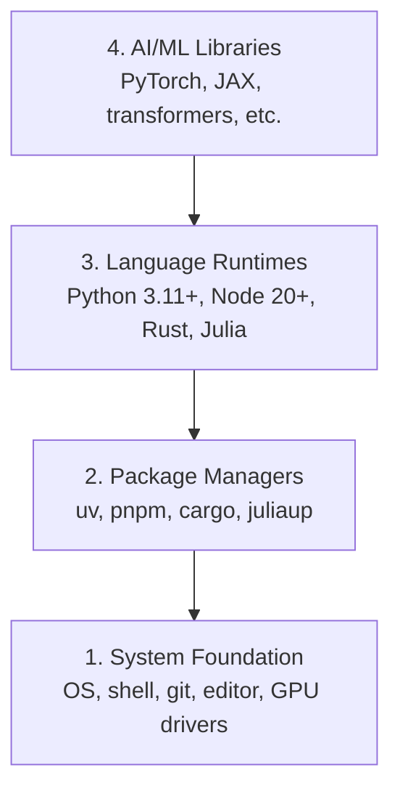

# Dev Environment

> 사용하는 도구가 사고방식을 결정합니다. 한 번에, 제대로 설정하십시오.

**유형:** Build (실습)
**사용 언어:** Python, Node.js, Rust
**선수 레슨:** 없음
**소요 시간:** ~45분

## Learning Objectives

- Python 3.11+, Node.js 20+, Rust 툴체인을 처음부터 설정합니다
- 재현 가능한 빌드를 위한 가상 환경 및 패키지 관리자를 구성합니다
- CUDA/MPS를 통한 GPU 접근을 확인하고 테스트 텐서 연산을 실행합니다
- 시스템, 패키지, 런타임, AI 라이브러리로 구성된 4계층 스택을 이해합니다

## The Problem

500개 이상의 레슨에 걸쳐 Python, TypeScript, Rust, Julia를 사용해 AI 엔지니어링을 배우게 됩니다. 환경이 올바르게 설정되어 있지 않으면, 모든 레슨이 학습 대신 도구와 씨름하는 과정이 되어 버립니다.

대부분의 사람들은 환경 설정을 건너뜁니다. 그러고는 import 오류, 버전 충돌, 누락된 CUDA 드라이버를 디버깅하느라 몇 시간을 허비합니다. 우리는 이 과정을 한 번에, 제대로 마칠 것입니다.

## The Concept

AI 엔지니어링 환경은 4개의 계층으로 이루어집니다:



아래에서 위로(bottom-up) 설치를 진행합니다. 각 계층은 그 아래 계층에 의존합니다.

```figure
s0-env-stack
```

## Build It

### Step 1: System Foundation

시스템을 확인하고 기본 도구를 설치합니다.

```bash
# macOS
xcode-select --install
brew install git curl wget

# Ubuntu/Debian
sudo apt update && sudo apt install -y build-essential git curl wget unzip

# Windows (use WSL2)
wsl --install -d Ubuntu-24.04
```

### Step 2: Python with uv

우리는 `uv`를 사용합니다. pip보다 10~100배 빠르며 가상 환경을 자동으로 처리합니다.

```bash
curl -LsSf https://astral.sh/uv/install.sh | sh

uv python install 3.12

uv venv
source .venv/bin/activate  # or .venv\Scripts\activate on Windows

uv pip install numpy matplotlib jupyter
```

확인:

```python
import sys
print(f"Python {sys.version}")

import numpy as np
print(f"NumPy {np.__version__}")
a = np.array([1, 2, 3])
print(f"Vector: {a}, dot product with itself: {np.dot(a, a)}")
```

### Step 3: Node.js with pnpm

TypeScript 레슨(에이전트, MCP 서버, 웹 앱)을 위한 설정입니다.

```bash
curl -fsSL https://fnm.vercel.app/install | bash
fnm install 22
fnm use 22

npm install -g pnpm

node -e "console.log('Node', process.version)"
```

fnm 설치 프로그램은 먼저 `unzip`를 확인하고, 없으면 `Not installing fnm due to missing dependencies.`를 출력하며 종료합니다. Linux에서는 zip 아카이브 압축을 풀고, macOS에서는 Homebrew를 통해 설치합니다. macOS에는 `unzip`가 기본 포함되어 있으며, Ubuntu, Debian, WSL2는 Step 1의 apt 명령에서 이를 설치합니다(해당 단계를 건너뛴 경우 `sudo apt install -y unzip`).

**macOS / Apple Silicon (M1/M2/M3/M4):** 설치 프로그램이 `Error: Cannot install under Rosetta 2 in ARM default prefix (/opt/homebrew)` 메시지와 함께 중단된다면 터미널이 Rosetta 2 환경에서 실행 중이고(`arch` 실행 시 `i386` 출력), Homebrew는 네이티브 arm64 빌드인 상태입니다. arm64를 강제하여 fnm을 설치하고 셸에 연결한 다음, 위 명령들을 `fnm install 22`부터 다시 실행하십시오:

```bash
arch -arm64 brew install fnm
echo 'eval "$(fnm env --use-on-cd)"' >> ~/.zshrc
source ~/.zshrc
```

### Step 4: Rust

성능이 중요한 레슨(추론(inference), 시스템)을 위한 설정입니다.

```bash
curl --proto '=https' --tlsv1.2 -sSf https://sh.rustup.rs | sh

rustc --version
cargo --version
```

### Step 5: Julia (Optional)

Julia의 강점이 발휘되는 수학 중심의 레슨을 위한 설정입니다.

```bash
curl -fsSL https://install.julialang.org | sh

julia -e 'println("Julia ", VERSION)'
```

### Step 6: GPU Setup (If You Have One)

**NVIDIA (Linux / Windows):**

```bash
nvidia-smi

# Install PyTorch with CUDA
uv pip install torch torchvision torchaudio --index-url https://download.pytorch.org/whl/cu124
```

**macOS / Apple Silicon (M1/M2/M3/M4):** Mac에는 CUDA가 없으며, 이는 정상적인 동작이지 오류가 아닙니다. `--index-url .../cuXXX`를 전달하지 **마십시오**(해당 wheel 파일은 Linux/Windows 전용이므로 설치에 실패합니다). Apple의 MPS (Metal) GPU 백엔드가 포함된 기본 빌드를 설치합니다:

```bash
uv pip install torch torchvision torchaudio
```

확인 (모든 플랫폼에서 작동):

```python
import torch
print(f"CUDA available: {torch.cuda.is_available()}")           # False on macOS — expected
print(f"MPS available:  {torch.backends.mps.is_available()}")   # True on Apple Silicon
if torch.cuda.is_available():
    print(f"GPU: {torch.cuda.get_device_name(0)}")
```

GPU가 없어도 괜찮습니다. 대부분의 레슨은 CPU에서 동작합니다. 학습(training) 비중이 높은 레슨의 경우 Google Colab이나 클라우드 GPU를 사용하십시오.

### Step 7: Verify the route you want to start

이 레슨의 모든 명령은 `README.md` 및 `phases/`가 위치한 디렉터리인 리포지토리 루트에서 실행하십시오. 사전 점검(preflight)은 선택한 학습 경로를 시작하는 데 필요한 항목만 검사합니다. 새로운 학습자가 수많은 경고 메시지 대신 하나의 명확한 결과를 볼 수 있도록 이후 단계의 도구는 기본적으로 건너뜁니다.

전체 초급자 과정을 시작하려면:

```bash
python3 phases/00-setup-and-tooling/01-dev-environment/code/verify.py --route beginner
```

또는 원하는 경로만 확인하려면:

```bash
python3 phases/00-setup-and-tooling/01-dev-environment/code/verify.py --route ml-foundations
python3 phases/00-setup-and-tooling/01-dev-environment/code/verify.py --route llm-engineering
python3 phases/00-setup-and-tooling/01-dev-environment/code/verify.py --route agents
python3 phases/00-setup-and-tooling/01-dev-environment/code/verify.py --route mcp
python3 phases/00-setup-and-tooling/01-dev-environment/code/verify.py --route agent-skills
python3 phases/00-setup-and-tooling/01-dev-environment/code/verify.py --route certification
```

이후 레슨에서 사용하는 선택적 도구 및 의존성까지 동일한 사전 점검에서 확인하려면 `--show-later`를 추가하십시오. 이후 단계 도구가 누락되어도 선택한 경로의 진행이 차단되지는 않습니다.

필수 점검 항목이 실패할 때마다 감지된 경로 또는 import 오류와 함께 정확한 해결 명령이 표시됩니다. Agent Skills 및 인증 경로의 경우, Python 스크립트가 AI 호스트의 스킬 감지 여부나 지정한 스킬 스코프의 쓰기 가능 여부를 직접 확인할 수 없으므로 수동 호스트 점검 내용도 함께 표시됩니다.

초급자 사전 점검을 통과하면 실행 가능한 첫 번째 레슨이 정확히 출력됩니다:

```text
Ready to start Beginner course.
Next: python3 phases/01-math-foundations/01-linear-algebra-intuition/code/vectors.py
```

## Use It

선택하여 점검한 경로를 시작할 환경이 준비되었습니다. 전체 스택을 모두 설치하느라 첫 레슨을 미루지 말고, 각 레슨에서 요구할 때 이후 도구를 설치하십시오. 전체 커리큘럼에서 사용하게 될 도구는 다음과 같습니다:

| Language | Used In | Package Manager |
|----------|---------|-----------------|
| Python | Phases 1-12 (ML, DL, NLP, Vision, Audio, LLMs) | uv |
| TypeScript | Phases 13-17 (Tools, Agents, Swarms, Infra) | pnpm |
| Rust | Phases 12, 15-17 (Performance-critical systems) | cargo |
| Julia | Phase 1 (Math foundations) | Pkg |

## Ship It

이 레슨에서는 누구나 실행하여 설정을 확인할 수 있는 검증 스크립트를 작성합니다.

AI 어시스턴트가 환경 문제를 진단하는 데 유용한 프롬프트는 `outputs/prompt-env-check.md`를 참조하십시오.

## Exercises

1. 검증 스크립트를 실행하고 실패한 항목을 수정합니다
2. 본 코스를 위한 Python 가상 환경을 만들고 PyTorch를 설치합니다
3. 4개 언어 모두로 "hello world"를 작성하고 각각 실행합니다

### Hints

**Exercise 1.** 리포지토리 루트에서 `python3 phases/00-setup-and-tooling/01-dev-environment/code/verify.py --route beginner`를 실행하고, 다음 줄을 보기 전에 먼저 실패한 첫 번째 줄부터 해결하십시오. 스크립트를 다시 실행했을 때 모든 필수 점검 항목을 통과하면 확인이 완료된 것입니다.

**Exercise 2.** 리포지토리 루트에서 `uv venv`로 가상 환경을 만들고 활성화한 뒤, Step 6에서 본인의 하드웨어에 맞는 명령으로 PyTorch를 설치하십시오. 가상 환경 내부에서 `python -c "import torch; print(torch.__version__)"`를 실행했을 때 버전 번호가 출력되면 정상적으로 설치된 것입니다.

**Exercise 3.** The Concept의 스택에 나온 4가지 런타임(Python, Node.js 기반 TypeScript, Rust, Julia)을 사용합니다. 언어별로 작은 파일을 하나씩 작성한 후 `python3`, `npx tsx`(Node.js는 `.ts` 파일을 직접 실행할 수 없음), `cargo run` 또는 `rustc`, 그리고 `julia`로 실행하십시오. 각 실행은 메시지를 출력하고 종료 코드 0으로 끝나야 합니다.
