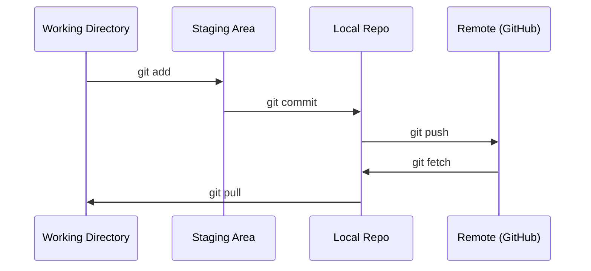

# Git 및 협업

> 버전 관리는 선택 사항이 아닙니다. 여기서 진행하는 모든 실험, 모든 모델, 모든 강의 실습은 전부 기록으로 추적됩니다.

**유형:** Learn (이론)
**사용 언어:** --
**선수 레슨:** Phase 0, Lesson 01
**소요 시간:** ~30분

## 학습 목표

- Git 사용자 정보를 설정하고 add, commit, push로 이어지는 일상적인 워크플로를 활용합니다.
- main 브랜치를 손상시키지 않고 독립적인 실험을 수행하기 위해 브랜치를 생성하고 병합(merge)합니다.
- 모델 체크포인트와 대용량 바이너리 파일을 제외하는 `.gitignore` 파일을 작성합니다.
- `git log` 명령어로 커밋 히스토리를 탐색하여 프로젝트의 변경 이력을 이해합니다.

## 문제 상황

20개의 Phase에 걸쳐 수백 개의 코드 파일을 작성하게 됩니다. 버전 관리가 없다면 작업 내용을 잃어버리거나 되돌릴 수 없는 문제를 만들게 되며, 다른 사람과 협업할 방법도 없습니다.

Git은 이를 위한 도구이며, GitHub는 코드가 저장되는 공간입니다. 이 강의에서는 이번 과정에 꼭 필요한 내용만 다룹니다.

## 핵심 개념



기억해야 할 세 가지:
1. 자주 저장하기 (`git commit`)
2. 원격 저장소에 푸시하기 (`git push`)
3. 실험용 브랜치 만들기 (`git checkout -b experiment`)

```figure
s0-commit-dag
```

## 직접 해보기

### 1단계: Git 설정하기

```bash
git config --global user.name "Your Name"
git config --global user.email "you@example.com"
```

### 2단계: 일상적인 워크플로

```bash
git status
git add file.py
git commit -m "Add perceptron implementation"
git push origin main
```

### 3단계: 실험을 위한 브랜치 생성

```bash
git checkout -b experiment/new-optimizer

# ... make changes, commit ...

git checkout main
git merge experiment/new-optimizer
```

### 4단계: 이 강의 저장소 작업하기

강의 저장소 자체에는 직접 푸시할 수 없습니다. 메인테이너(maintainer)에게만 쓰기 권한이 있기 때문입니다. 먼저 GitHub에서 Fork(우측 상단의 Fork 버튼)하여 `origin`이 본인의 복사본을 가리키도록 설정하세요:

```bash
git clone https://github.com/YOUR-USERNAME/ai-engineering-from-scratch.git
cd ai-engineering-from-scratch

git checkout -b my-progress
# work through lessons, commit your code
git push origin my-progress
```

## 활용하기

이 과정에서는 다음 명령어들만 알면 충분합니다:

| 명령어 | 사용 시점 |
|---------|------|
| `git clone` | 강의 저장소 가져오기 |
| `git add` + `git commit` | 작업 내용 저장하기 |
| `git push` | GitHub에 백업하기 |
| `git checkout -b` | main을 건드리지 않고 새로운 시도 해보기 |
| `git log --oneline` | 지금까지의 작업 내용 확인하기 |

이것으로 충분합니다. 이 과정에서는 rebase, cherry-pick, submodules 등은 필요하지 않습니다.

## 연습 문제

1. 이 저장소를 Fork하고, 자신의 fork를 clone한 뒤, `my-progress` 브랜치를 만들고, 파일을 하나 생성하여 commit하고 push해 보세요.
2. 모델 체크포인트 파일(`.pt`, `.pth`, `.safetensors`)을 제외하는 `.gitignore` 파일을 생성해 보세요.
3. `git log --oneline` 명령어로 이 저장소의 커밋 히스토리를 확인하고 강의들이 어떻게 추가되었는지 살펴보세요.

### 힌트

**연습 문제 1.** GitHub에서 Fork를 클릭한 다음 본인 fork의 URL을 `git clone`하세요. `git push -u origin my-progress` 후 GitHub에서 본인의 fork 저장소를 열고 브랜치 목록에 해당 파일이 포함된 `my-progress` 브랜치가 표시되는지 확인하세요.

**연습 문제 2.** 저장소 루트의 `.gitignore` 파일에 `*.pt`처럼 확장자당 하나의 패턴을 추가하세요. 각 확장자를 가진 빈 파일을 생성한 뒤 `git status`을 실행했을 때, 이 파일들이 추적되지 않는 파일(untracked files) 목록에 나타나지 않아야 합니다.

**연습 문제 3.** `git log --oneline`를 실행한 다음 `git log --oneline -- phases/00-setup-and-tooling`을 실행하여 이번 Phase를 수정한 커밋만 표시해 보세요. 하나의 커밋을 선택하고 `git show --stat <hash>`를 실행하여 어떤 강의 파일들이 추가되었는지 확인하세요.

## 핵심 용어

| 용어 | 흔히 하는 표현 | 실제 의미 |
|------|----------------|----------------------|
| Commit | "저장하기" | 특정 시점의 프로젝트 전체 스냅샷 |
| Branch | "복사본" | 작업을 진행함에 따라 앞으로 나아가는 커밋에 대한 포인터 |
| Merge | "코드 합치기" | 한 브랜치의 변경 사항을 가져와 다른 브랜치에 적용하는 작업 |
| Remote | "클라우드" | 다른 곳(GitHub, GitLab 등)에 호스팅된 저장소의 복사본 |
