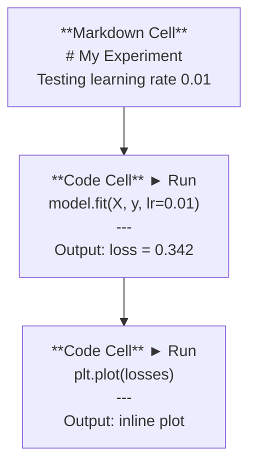
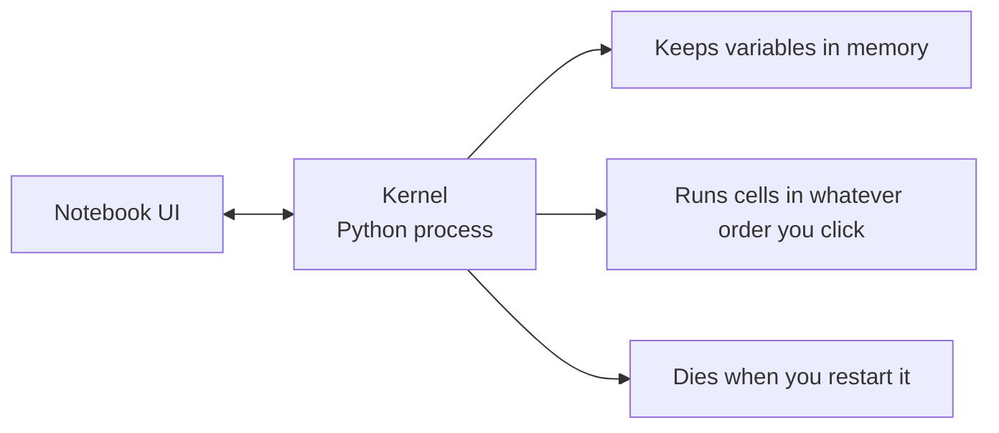

# Jupyter Notebooks

> 노트북은 AI 엔지니어링의 실험실 작업대입니다. 이곳에서 프로토타입을 만들고, 검증된 코드를 프로덕션으로 이전합니다.

**유형:** Build (실습)
**사용 언어:** Python
**선수 레슨:** Phase 0, Lesson 01
**소요 시간:** ~30분

## 학습 목표

- JupyterLab, Jupyter Notebook 또는 Jupyter 확장이 설치된 VS Code를 설치하고 실행합니다.
- 매직 커맨드(`%timeit`, `%%time`, `%matplotlib inline`)를 사용하여 벤치마크를 수행하고 인라인으로 시각화합니다.
- 노트북과 스크립트의 사용 시점을 구분하고 "노트북에서 탐색하고, 스크립트로 배포한다"는 워크플로를 적용합니다.
- 실행 순서 뒤섞임, 숨겨진 상태, 메모리 누수와 같은 흔한 노트북의 함정을 파악하고 방지합니다.

## 문제 인식

모든 AI 논문, 튜토리얼, Kaggle 경진대회에서는 Jupyter 노트북을 사용합니다. 노트북을 사용하면 코드를 조각 단위로 실행하고, 출력을 인라인으로 확인하며, 코드와 설명을 함께 작성하고, 빠르게 반복 작업을 수행할 수 있습니다. 노트북 없이 AI를 배우려는 것은 연습장 없이 수학 숙제를 하는 것과 같습니다.

하지만 노트북에는 명확한 함정이 존재합니다. 사람들은 노트북에 적합하지 않은 작업까지 포함해 모든 일에 노트북을 사용하곤 합니다. 언제 노트북을 쓰고 언제 스크립트를 써야 하는지 알아두면 나중에 겪을 디버깅의 악몽을 피할 수 있습니다.

## 핵심 개념

노트북은 셀의 목록으로 구성됩니다. 각 셀은 코드 또는 텍스트입니다.



커널은 백그라운드에서 실행되는 Python 프로세스입니다. 셀을 실행하면 커널로 코드가 전송되고, 커널이 이를 실행한 후 결과를 반환합니다. 모든 셀은 동일한 커널을 공유하므로 셀 간에 변수가 유지됩니다.



"원하는 순서대로 클릭하여 실행할 수 있다"는 점은 강력한 장점인 동시에 심각한 실수를 유발하는 원인이기도 합니다.

```figure
s0-cell-order
```

## 직접 만들어보기

### 1단계: 인터페이스 선택하기

세 가지 옵션이 있지만, 사용하는 포맷은 하나입니다:

| 인터페이스 | 설치 방법 | 추천 용도 |
|-----------|---------|----------|
| JupyterLab | `pip install jupyterlab` 실행 후 `jupyter lab` | 완전한 IDE 환경, 멀티 탭, 파일 탐색기, 터미널 |
| Jupyter Notebook | `pip install notebook` 실행 후 `jupyter notebook` | 단순하고 가벼움, 한 번에 하나의 노트북 작업 |
| VS Code | "Jupyter" 확장 설치 | 기존 에디터 환경 유지, Git 연동, 디버깅 |

세 환경 모두 동일한 `.ipynb` 파일을 읽고 씁니다. 원하는 인터페이스를 선택하면 됩니다. AI 작업에서는 JupyterLab이 가장 널리 사용됩니다.

```bash
pip install jupyterlab
jupyter lab
```

### 2단계: 핵심 단축키

두 가지 모드로 작업하게 됩니다. 명령 모드(왼쪽에 파란색 바 표시)로 전환하려면 `Escape`, 편집 모드(초록색 바 표시)로 전환하려면 `Enter`를 누릅니다.

**명령 모드 (가장 자주 사용):**

| 단축키 | 동작 |
|-----|--------|
| `Shift+Enter` | 셀 실행 후 다음 셀로 이동 |
| `A` | 위에 셀 삽입 |
| `B` | 아래에 셀 삽입 |
| `DD` | 셀 삭제 |
| `M` | 마크다운 셀로 변환 |
| `Y` | 코드 셀로 변환 |
| `Z` | 셀 작업 취소 |
| `Ctrl+Shift+H` | 전체 단축키 표시 |

**편집 모드:**

| 단축키 | 동작 |
|-----|--------|
| `Tab` | 자동 완성 |
| `Shift+Tab` | 함수 시그니처 표시 |
| `Ctrl+/` | 주석 토글 |

`Shift+Enter`는 하루에도 수천 번씩 사용하게 될 단축키입니다. 가장 먼저 익혀두세요.

### 3단계: 셀 유형

**코드 셀**은 Python 코드를 실행하고 출력을 표시합니다:

```python
import numpy as np
data = np.random.randn(1000)
data.mean(), data.std()
```

출력: `(0.0032, 0.9987)`

**마크다운 셀**은 서식이 지정된 텍스트를 렌더링합니다. 진행 중인 작업과 그 이유를 문서화할 때 사용합니다. 제목, 굵은 글씨, 기울임꼴, LaTeX 수식(`$E = mc^2$`), 표, 이미지를 지원합니다.

### 4단계: 매직 커맨드

매직 커맨드는 Python 코드가 아닙니다. `%`(라인 매직) 또는 `%%`(셀 매직)으로 시작하는 Jupyter 전용 명령어입니다.

**코드 실행 시간 측정:**

```python
%timeit np.random.randn(10000)
```

출력: `45.2 us +/- 1.3 us per loop`

```python
%%time
model.fit(X_train, y_train, epochs=10)
```

출력: `Wall time: 2.34 s`

`%timeit`는 코드를 여러 번 실행하여 평균을 냅니다. `%%time`는 코드를 한 번만 실행합니다. 마이크로벤치마크에는 `%timeit`를, 학습 실행에는 `%%time`를 사용합니다.

**인라인 플롯 활성화:**

```python
%matplotlib inline
```

이제 모든 `plt.plot()` 또는 `plt.show()` 플롯이 노트북 내에 직접 렌더링됩니다.

**노트북을 벗어나지 않고 패키지 설치하기:**

```python
!pip install scikit-learn
```

`!` 접두사를 사용하면 모든 셸 명령어를 실행할 수 있습니다.

**환경 변수 확인:**

```python
%env CUDA_VISIBLE_DEVICES
```

### 5단계: 풍부한 출력 인라인 표시

노트북은 셀의 마지막 표현식을 자동으로 표시합니다. 하지만 이를 직접 제어할 수도 있습니다:

```python
import pandas as pd

df = pd.DataFrame({
    "model": ["Linear", "Random Forest", "Neural Net"],
    "accuracy": [0.72, 0.89, 0.94],
    "training_time": [0.1, 2.3, 45.6]
})
df
```

이렇게 하면 단순 텍스트 덤프가 아닌 서식이 지정된 HTML 표가 렌더링됩니다. 플롯도 마찬가지입니다:

```python
import matplotlib.pyplot as plt

plt.figure(figsize=(8, 4))
plt.plot([1, 2, 3, 4], [1, 4, 2, 3])
plt.title("Inline Plot")
plt.show()
```

플롯이 셀 바로 아래에 나타납니다. 이것이 AI 작업에서 노트북이 널리 쓰이는 이유입니다. 데이터, 플롯, 코드를 한눈에 함께 볼 수 있습니다.

이미지를 표시할 때:

```python
from IPython.display import Image, display
display(Image(filename="architecture.png"))
```

### 6단계: Google Colab

Colab은 클라우드에서 실행되는 무료 Jupyter 노트북입니다. GPU, 사전 설치된 라이브러리, Google Drive 연동을 제공합니다. 별도의 설정이 필요하지 않습니다.

1. [colab.research.google.com](https://colab.research.google.com)으로 이동합니다.
2. 이 코스의 `.ipynb` 파일을 업로드합니다.
3. 런타임 > 런타임 유형 변경 > T4 GPU (무료)를 선택합니다.

Colab과 로컬 Jupyter의 차이점:
- 세션 간에 파일이 유지되지 않습니다 (Drive에 저장하거나 다운로드해야 함).
- numpy, pandas, matplotlib, torch, tensorflow, sklearn이 사전 설치되어 있습니다.
- 파일 업로드/다운로드에는 `from google.colab import files`를 사용합니다.
- 영구 저장을 위해 `from google.colab import drive; drive.mount('/content/drive')`를 사용합니다.
- 세션은 비활성 상태가 90분 지속되면 타임아웃됩니다 (무료 티어 기준).

## 활용하기

### 노트북 vs 스크립트: 상황별 선택 가이드

| 노트북을 사용하는 경우 | 스크립트를 사용하는 경우 |
|-------------------|-----------------|
| 데이터셋 탐색 | 학습 파이프라인 |
| 모델 프로토타이핑 | 재사용 가능한 유틸리티 |
| 결과 시각화 | `if __name__`를 사용하는 모든 작업 |
| 작업 내용 설명 및 문서화 | 예약 실행되는 코드 |
| 빠른 실험 | 프로덕션 코드 |
| 코스 실습 과제 | 패키지 및 라이브러리 |

기본 원칙: **노트북에서 탐색하고, 스크립트로 배포합니다**.

AI 분야의 일반적인 워크플로:
1. 노트북에서 데이터를 탐색합니다.
2. 노트북에서 모델의 프로토타입을 만듭니다.
3. 코드가 정상 작동하면 `.py` 파일로 이전합니다.
4. 추가 실험을 위해 해당 `.py` 파일들을 다시 노트북으로 임포트합니다.

### 흔한 함정들

**실행 순서 뒤섞임.** 셀 5를 실행한 후 셀 2, 이어서 셀 7을 실행하는 경우입니다. 내 컴퓨터에서는 잘 돌아가지만, 다른 사람이 위에서부터 아래로 순차 실행하면 오류가 발생합니다. 해결책: 공유하기 전에 Kernel > Restart & Run All을 실행합니다.

**숨겨진 상태.** 셀을 삭제했지만 그 셀이 생성한 변수가 메모리에 여전히 남아 있는 경우입니다. 겉보기에는 깔끔해 보이지만 삭제된 유령 셀에 의존하고 있는 상태입니다. 해결책: 커널을 주기적으로 재시작합니다.

**메모리 누수.** 4GB 데이터셋을 로드하고, 모델을 학습시킨 뒤, 다른 데이터셋을 로드하는 과정에서 기존 메모리가 전혀 해제되지 않는 현상입니다. 해결책: `del variable_name` 및 `gc.collect()`를 사용하거나 커널을 재시작합니다.

## 결과물

이 레슨을 통해 다음 결과물을 생성합니다:
- 노트북 문제 디버깅을 위한 `outputs/prompt-notebook-helper.md`

## 실습 과제

1. JupyterLab을 열고 새 노트북을 생성한 뒤, `%timeit`를 사용하여 100,000개의 난수 배열을 생성할 때의 리스트 컴프리헨션과 numpy 성능을 비교해 보세요.
2. 마크다운 셀과 코드 셀을 모두 포함하는 노트북을 만들어 CSV 파일을 로드하고, 데이터프레임을 표시하며, 차트를 그려보세요. 그런 다음 Kernel > Restart & Run All을 실행하여 위에서 아래로 오류 없이 실행되는지 검증해 보세요.
3. `code/notebook_tips.py`의 코드를 복사하여 Colab 노트북에 붙여넣고, 무료 GPU 환경에서 실행해 보세요.
### 힌트

**연습 1.** `jupyter lab`로 JupyterLab을 시작한 다음, 각 버전을 `%timeit`로 시작하는 개별 셀에 작성합니다. 두 실행 시간이 동일한 양의 작업을 측정하도록 두 셀 모두에서 동일하게 100,000 크기를 사용합니다.

**연습 2.** 데이터에는 `pd.read_csv`를 사용하고, 데이터프레임을 셀의 마지막 줄에 표시하며, `df.plot()` 또는 matplotlib으로 시각화합니다. Kernel > Restart & Run All을 실행한 후, 모든 셀의 실행 카운터에 숫자가 표시되어야 하며 오류가 발생하는 셀이 없어야 합니다.

**연습 3.** Colab에서 코드를 붙여넣기 전에 Runtime > Change runtime type > GPU를 선택합니다. `code/notebook_tips.py`의 각 함수가 해당 섹션을 출력하고 셀에서 `torch.cuda.is_available()`가 `True`를 반환하면 올바르게 실행된 것입니다.

## 핵심 용어

| 용어 | 흔히 쓰는 표현 | 실제 의미 |
|------|----------------|----------------------|
| Kernel | "내 코드를 실행하는 것" | 셀을 실행하고 변수를 메모리에 유지하는 별도의 Python 프로세스 |
| Cell | "코드 블록" | 노트북 내에서 독립적으로 실행 가능한 단위(코드 또는 마크다운) |
| Magic command | "Jupyter 트릭" | `%` 또는 `%%`가 접두사로 붙으며 노트북 환경을 제어하는 특수 명령어 |
| `.ipynb` | "노트북 파일" | 셀, 출력 및 메타데이터를 포함하는 JSON 파일. IPython Notebook의 약어 |

## 추가 자료

- [JupyterLab Docs](https://jupyterlab.readthedocs.io/): 전체 기능 안내
- [Google Colab FAQ](https://research.google.com/colaboratory/faq.html): Colab 전용 제한 사항 및 기능
- [28 Jupyter Notebook Tips](https://www.dataquest.io/blog/jupyter-notebook-tips-tricks-shortcuts/): 고급 사용자를 위한 단축키
