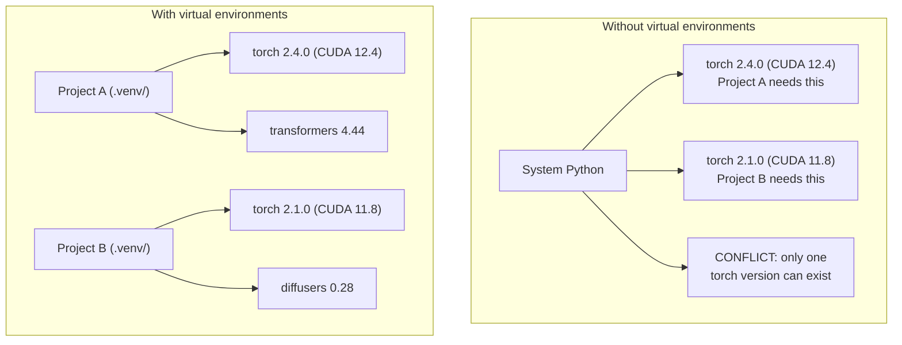

# Python Environments

> 의존성 지옥(dependency hell)은 실재합니다. 가상 환경이 그 해결책입니다.

**유형:** Build (실습)
**사용 언어:** Shell
**선수 레슨:** Phase 0, Lesson 01
**소요 시간:** ~30분

## Learning Objectives

- `uv`, `venv` 또는 `conda`를 사용하여 격리된 가상 환경을 생성합니다.
- 선택적 의존성 그룹이 포함된 `pyproject.toml`를 작성하고 재현성을 위한 록파일(lockfile)을 생성합니다.
- 전역 설치, pip/conda 혼용, CUDA 버전 불일치와 같은 흔한 실수를 진단하고 해결합니다.
- 의존성 충돌이 있는 프로젝트를 위해 단계(phase)별 환경 전략을 구현합니다.

## The Problem

미세 조정(fine-tuning) 프로젝트를 위해 PyTorch 2.4를 설치했다고 가정해 보겠습니다. 다음 주에 다른 프로젝트를 진행해야 하는데, 해당 프로젝트는 고정된 CUDA 빌드로 인해 PyTorch 2.1을 필요로 합니다. 전역 환경에서 버전을 업그레이드하면 첫 번째 프로젝트가 깨집니다. 다시 다운그레이드하면 두 번째 프로젝트가 깨집니다.

이것이 바로 의존성 지옥입니다. AI/ML 작업에서는 다음과 같은 이유로 이런 문제가 끊임없이 발생합니다.

- PyTorch, JAX, TensorFlow는 각각 자체적인 CUDA 바인딩을 제공합니다.
- 모델 라이브러리들은 특정 프레임워크 버전을 고정(pin)합니다.
- 전역 환경의 `pip install`는 이전에 설치되어 있던 패키지를 덮어씁니다.
- CUDA 11.8 빌드는 CUDA 12.x 드라이버와 호환되지 않습니다(그 반대도 마찬가지입니다).

해결책은 모든 프로젝트마다 자체 패키지를 갖춘 독립된 격리 환경을 제공하는 것입니다.

## The Concept



```figure
s0-env-isolation
```

## Build It

### Option 1: uv venv (Recommended)

`uv`는 가장 빠른 Python 패키지 관리자입니다(pip보다 10~100배 빠름). 하나의 도구로 가상 환경, Python 버전, 의존성 해결(dependency resolution)을 모두 처리합니다.

```bash
curl -LsSf https://astral.sh/uv/install.sh | sh

uv python install 3.12

cd your-project
uv venv
source .venv/bin/activate
```

패키지를 설치합니다:

```bash
uv pip install torch numpy
```

`pyproject.toml`를 사용하여 한 단계로 프로젝트를 생성합니다:

```bash
uv init my-ai-project
cd my-ai-project
uv add torch numpy matplotlib
```

### Option 2: venv (Built-in)

`uv`를 설치할 수 없는 경우, Python에 기본 내장된 `venv`를 사용할 수 있습니다:

```bash
python3 -m venv .venv
source .venv/bin/activate  # Linux/macOS
.venv\Scripts\activate     # Windows

pip install torch numpy
```

`uv`보다는 느리지만, Python이 설치된 모든 곳에서 작동합니다.

### Option 3: conda (When You Need It)

Conda는 CUDA 툴킷, cuDNN, C 라이브러리와 같은 비-Python 의존성을 관리합니다. 다음과 같은 경우에 사용합니다.

- 시스템 전체에 설치하지 않고 특정 CUDA 툴킷 버전이 필요한 경우
- 시스템 패키지를 설치할 수 없는 공유 클러스터 환경인 경우
- 라이브러리의 설치 지침에 "use conda"라고 명시되어 있는 경우

```bash
# Install miniconda (not the full Anaconda)
curl -LsSf https://repo.anaconda.com/miniconda/Miniconda3-latest-Linux-x86_64.sh -o miniconda.sh
bash miniconda.sh -b

conda create -n myproject python=3.12
conda activate myproject

conda install pytorch torchvision torchaudio pytorch-cuda=12.4 -c pytorch -c nvidia
```

한 가지 규칙이 있습니다. 특정 환경에 conda를 사용한다면, 해당 환경의 모든 패키지 설치에도 conda를 사용해야 합니다. Conda 환경에 `pip install`를 섞어 쓰면 디버깅하기 매우 까다로운 의존성 충돌이 발생합니다.

### For This Course: Per-Phase Strategy

전체 코스에 대해 단 하나의 환경만 생성할 수도 있지만, 그렇게 하지 마십시오. 단계마다 서로 다르며 (때로는 충돌하는) 의존성이 필요합니다.

전략:

```
ai-engineering-from-scratch/
├── .venv/                    <-- shared lightweight env for phases 0-3
├── phases/
│   ├── 04-neural-networks/
│   │   └── .venv/            <-- PyTorch env
│   ├── 05-cnns/
│   │   └── .venv/            <-- same PyTorch env (symlink or shared)
│   ├── 08-transformers/
│   │   └── .venv/            <-- might need different transformer versions
│   └── 11-llm-apis/
│       └── .venv/            <-- API SDKs, no torch needed
```

`code/env_setup.sh`의 스크립트는 이 코스를 위한 기본 환경을 생성합니다.

## pyproject.toml Basics

모든 Python 프로젝트에는 `pyproject.toml`이 있어야 합니다. 이는 `setup.py`, `setup.cfg`, `requirements.txt`을 하나의 파일로 대체합니다.

```toml
[project]
name = "ai-engineering-from-scratch"
version = "0.1.0"
requires-python = ">=3.11"
dependencies = [
    "numpy>=1.26",
    "matplotlib>=3.8",
    "jupyter>=1.0",
    "scikit-learn>=1.4",
]

[project.optional-dependencies]
torch = ["torch>=2.3", "torchvision>=0.18"]
llm = ["anthropic>=0.39", "openai>=1.50"]
```

그런 다음 설치를 진행합니다:

```bash
uv pip install -e ".[torch]"    # base + PyTorch
uv pip install -e ".[llm]"     # base + LLM SDKs
uv pip install -e ".[torch,llm]" # everything
```

## Lockfiles

록파일(lockfile)은 전이적 의존성(transitive dependencies)을 포함한 모든 의존성을 정확한 버전으로 고정합니다. 이를 통해 재현성이 보장되며, 록파일을 통해 설치하는 모든 사람은 완전히 동일한 패키지를 얻게 됩니다.

```bash
# uv generates uv.lock automatically when using uv add
uv add numpy

# pip-tools approach
uv pip compile pyproject.toml -o requirements.lock
uv pip install -r requirements.lock
```

록파일을 git에 커밋하십시오. 다른 사람이 저장소를 복제(clone)할 때 록파일로부터 설치하면 동일한 버전을 갖게 됩니다.

## Common Mistakes

### 1. Installing globally

```bash
pip install torch  # BAD: installs to system Python

source .venv/bin/activate
pip install torch  # GOOD: installs to virtual environment
```

패키지가 설치되는 위치를 확인하십시오:

```bash
which python       # should show .venv/bin/python, not /usr/bin/python
which pip           # should show .venv/bin/pip
```

### 2. Mixing pip and conda

```bash
conda create -n myenv python=3.12
conda activate myenv
conda install pytorch -c pytorch
pip install some-other-package   # BAD: can break conda's dependency tracking
conda install some-other-package # GOOD: let conda manage everything
```

Conda 환경 내부에서 pip을 반드시 사용해야 한다면(일부 패키지는 pip으로만 제공됨), 먼저 모든 conda 패키지를 설치한 다음 마지막에 pip 패키지를 설치하십시오.

### 3. Forgetting to activate

```bash
python train.py           # uses system Python, missing packages
source .venv/bin/activate
python train.py           # uses project Python, packages found
```

셸 프롬프트에 환경 이름이 표시되어야 합니다:

```
(.venv) $ python train.py
```

### 4. Committing .venv to git

```bash
echo ".venv/" >> .gitignore
```

가상 환경의 크기는 200MB에서 2GB에 달합니다. 이는 로컬 환경용이며 머신 간 이동이 불가능합니다. 가상 환경 디렉터리 대신 `pyproject.toml`와 록파일을 커밋하십시오.

### 5. CUDA version mismatch

```bash
nvidia-smi                # shows driver CUDA version (e.g., 12.4)
python -c "import torch; print(torch.version.cuda)"  # shows PyTorch CUDA version

# These must be compatible.
# PyTorch CUDA version must be <= driver CUDA version.
```

## Use It

설정 스크립트를 실행하여 코스 환경을 생성합니다:

```bash
bash phases/00-setup-and-tooling/06-python-environments/code/env_setup.sh
```

이렇게 하면 저장소 루트에 핵심 의존성이 설치 및 검증된 `.venv`가 생성됩니다.

## Exercises

1. `env_setup.sh`를 실행하고 모든 검사가 통과하는지 확인합니다.
2. 두 번째 가상 환경을 생성하고, 다른 버전의 numpy를 설치하여 두 환경이 서로 격리되어 있는지 확인합니다.
3. PyTorch와 Anthropic SDK가 모두 필요한 프로젝트를 위한 `pyproject.toml`을 작성합니다.
4. 의도적으로 (가상 환경을 활성화하지 않은 채) 패키지를 전역으로 설치해 보고, 어디에 설치되는지 확인한 다음 제거합니다.

### Hints

**Exercise 1.** 저장소 루트에서 `bash phases/00-setup-and-tooling/06-python-environments/code/env_setup.sh`를 실행합니다. 출력의 각 줄을 확인하고, 검사에 실패한 항목이 있으면 해당 항목을 수정한 뒤 모든 검사를 통과할 때까지 스크립트를 다시 실행합니다.

**Exercise 2.** `uv venv`를 사용하여 새 폴더에 두 번째 환경을 만들고 활성화한 뒤, `numpy==1.26.4`과 같이 버전을 고정하여 이전 버전의 numpy를 설치합니다. 각 환경에서 `python -c "import numpy; print(numpy.__version__)"`를 실행합니다. 두 버전이 서로 달라야 합니다.

**Exercise 3.** pyproject.toml Basics의 예제에서 시작하여 `dependencies` 아래에 `torch`와 `anthropic`를 나열합니다. 새 환경에서 `uv pip install -e .` 또는 `uv sync`를 실행합니다. 오류 없이 두 패키지를 모두 임포트할 수 있으면 파일이 올바르게 작성된 것입니다.

**Exercise 4.** 모든 환경을 비활성화하고 `pip install --user <small package>`를 실행한 다음, `pip show <package>`를 실행하여 `Location` 줄을 확인합니다. `pip uninstall <package>`로 패키지를 제거하고 `pip show`를 다시 실행하여 패키지가 완전히 삭제되었는지 확인합니다.

## Key Terms

| Term | What people say | What it actually means |
|------|----------------|----------------------|
| Virtual environment | "A venv" | 시스템 Python과 분리되어 자체 Python 인터프리터와 패키지를 포함하는 격리된 디렉터리 |
| Lockfile | "Pinned dependencies" | 모든 패키지와 정확한 버전을 나열하여 여러 머신에 걸쳐 동일한 설치를 보장하는 파일 |
| pyproject.toml | "The new setup.py" | setup.py/setup.cfg/requirements.txt를 대체하는 표준 Python 프로젝트 구성 파일 |
| Transitive dependency | "A dependency of a dependency" | 패키지 B가 C에 의존할 때, B에 의존하는 A를 설치하면 C는 A의 전이적 의존성이 됨 |
| CUDA mismatch | "My GPU isn't working" | PyTorch가 사용자의 GPU 드라이버가 지원하는 것과 다른 CUDA 버전용으로 컴파일됨 |
