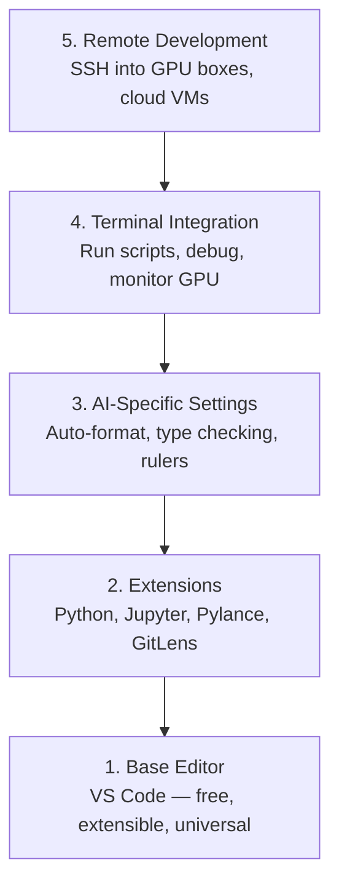

# 에디터 환경 설정

> 에디터는 여러분의 코파일럿(co-pilot)입니다. 한 번 제대로 설정해 두면 방해되지 않으면서 제 몫을 다하게 됩니다.

**유형:** Build (실습)
**사용 언어:** --
**선수 레슨:** Phase 0, Lesson 01
**소요 시간:** ~20분

## 학습 목표

- Python, Jupyter, 린팅, Remote SSH를 위한 필수 확장 프로그램을 포함하여 VS Code 설치하기
- AI 워크플로를 위한 저장 시 자동 포맷팅(format-on-save), 타입 검사, 노트북 출력 스크롤 설정하기
- 로컬 환경처럼 원격 GPU 머신에서 코드를 편집하고 디버깅할 수 있도록 Remote SSH 설정하기
- AI 작업을 위한 대안 에디터(Cursor, Windsurf, Neovim) 및 장단점 평가하기

## 문제 상황

에디터 안에서 Python을 작성하고, 노트북을 실행하고, 학습 루프를 디버깅하며, GPU 장비에 SSH로 접속하는 데 수천 시간을 보내게 됩니다. 에디터 설정이 잘못되어 있으면 매 세션마다 마찰이 발생합니다. 자동 완성 미지원, 타입 힌트 부재, 인라인 에러 미표시, 수동 포맷팅, 번거로운 터미널 워크플로 등이 발생합니다.

제대로 설정하는 데는 20분이 걸립니다. 이를 건너뛰면 매일 20분의 시간을 낭비하게 됩니다.

## 핵심 개념

AI 엔지니어링 에디터 설정에는 다섯 가지가 필요합니다:



```figure
s0-lsp-roundtrip
```

## 직접 구축하기

### 1단계: VS Code 설치

VS Code는 추천하는 에디터입니다. 무료이며, 모든 OS에서 실행되고, 최고 수준의 Jupyter 노트북 지원을 제공하며, 확장 프로그램 생태계가 AI 작업에 필요한 모든 것을 포괄합니다.

[code.visualstudio.com](https://code.visualstudio.com/)에서 다운로드하세요.

터미널에서 설치를 확인합니다:

```bash
code --version
```

macOS에서 `code` 명령어를 찾을 수 없다면, VS Code를 열고 `Cmd+Shift+P`를 누른 뒤 "Shell Command"를 입력하고 "'code' 명령을 PATH에 설치"를 선택하세요.

### 2단계: 필수 확장 프로그램 설치

VS Code의 통합 터미널(모든 플랫폼에서 `` Ctrl+` ``)을 열고 AI 작업에 중요한 확장 프로그램을 설치합니다:

```bash
code --install-extension ms-python.python
code --install-extension ms-python.vscode-pylance
code --install-extension ms-toolsai.jupyter
code --install-extension eamodio.gitlens
code --install-extension ms-vscode-remote.remote-ssh
code --install-extension ms-python.debugpy
code --install-extension ms-python.black-formatter
code --install-extension charliermarsh.ruff
```

각 확장 프로그램의 역할:

| 확장 프로그램 | 도입 이유 |
|-----------|-----|
| Python | 언어 지원, 가상환경 감지, 실행/디버그 |
| Pylance | 빠른 타입 검사, 자동 완성, import 해결 |
| Jupyter | VS Code 내부에서 노트북 실행, 변수 탐색기(variable explorer) |
| GitLens | 변경자 확인, 인라인 git blame |
| Remote SSH | 원격 GPU 장비의 폴더를 로컬처럼 열기 |
| Debugpy | Python 단계별(step-through) 디버깅 |
| Black Formatter | 저장 시 자동 포맷팅, 일관된 스타일 유지 |
| Ruff | 빠른 린팅, 흔한 실수 감지 |

본 레슨의 `code/vscode/extensions.json` 파일에 전체 추천 목록이 포함되어 있습니다. 프로젝트 폴더의 `.vscode/extensions.json` 위치로 복사하면, VS Code에서 해당 폴더를 열 때 설치 안내 메시지가 표시됩니다.

### 3단계: 환경 설정 구성

본 레슨의 `code/vscode/settings.json`에서 설정을 복사하거나, `Settings > Open Settings (JSON)`를 통해 수동으로 적용합니다.

AI 작업을 위한 핵심 설정:

```jsonc
{
    "python.analysis.typeCheckingMode": "basic",
    "editor.formatOnSave": true,
    "editor.rulers": [88, 120],
    "notebook.output.scrolling": true,
    "files.autoSave": "afterDelay"
}
```

이 설정들이 중요한 이유:

- **기본(basic) 수준의 타입 검사**: 실행하기 전에 잘못된 인수 타입을 잡아냅니다. 텐서 형태(tensor shape) 불일치나 잘못된 API 매개변수로 인한 디버깅 시간을 줄여줍니다.
- **저장 시 포맷팅**: 포맷팅에 대해 다시는 신경 쓸 필요가 없습니다. Black이 알아서 처리합니다.
- **88자와 120자 눈금자(rulers)**: Black은 88자에서 줄을 바꿉니다. 120자 표시는 독스트링(docstring)과 주석이 너무 길어지는 시점을 보여줍니다.
- **노트북 출력 스크롤**: 학습 루프는 수천 줄을 출력합니다. 스크롤이 없으면 출력 패널이 지나치게 길어집니다.
- **자동 저장**: 저장을 잊어버리는 경우가 생깁니다. 그러면 학습 스크립트가 이전 코드로 실행됩니다. 자동 저장은 이를 방지합니다.

### 4단계: 터미널 연동

VS Code의 통합 터미널은 학습 스크립트를 실행하고, GPU를 모니터링하며, 가상환경을 관리하는 공간입니다.

적절하게 설정해 둡니다:

```jsonc
{
    "terminal.integrated.defaultProfile.osx": "zsh",
    "terminal.integrated.defaultProfile.linux": "bash",
    "terminal.integrated.fontSize": 13,
    "terminal.integrated.scrollback": 10000
}
```

유용한 단축키:

| 작업 | macOS | Linux/Windows |
|--------|-------|---------------|
| 터미널 토글 | `` Ctrl+` `` | `` Ctrl+` `` |
| 새 터미널 | `` Ctrl+Shift+` `` | `` Ctrl+Shift+` `` |
| 터미널 분할 | `Cmd+\` | `Ctrl+Shift+5` |

분할 터미널은 매우 유용합니다. 하나는 스크립트 실행용으로, 다른 하나는 `nvidia-smi -l 1` 또는 `watch -n 1 nvidia-smi`를 통한 GPU 모니터링용으로 사용할 수 있습니다.

### 5단계: 원격 개발 (GPU 장비에 SSH 접속)

이는 AI 작업에서 가장 중요한 확장 프로그램입니다. 원격 머신(클라우드 VM, 연구실 서버, Lambda, Vast.ai)에서 학습을 실행하게 될 것입니다. Remote SSH를 사용하면 모든 것이 로컬에 있는 것처럼 원격 파일시스템을 열고, 파일을 편집하고, 터미널을 실행하고, 디버깅할 수 있습니다.

설정 방법:

1. Remote SSH 확장 프로그램을 설치합니다(2단계에서 완료).
2. `Ctrl+Shift+P`(또는 `Cmd+Shift+P`)를 누르고 "Remote-SSH: Connect to Host"를 입력합니다.
3. `user@your-gpu-box-ip`을 입력합니다.
4. VS Code가 원격 머신에 서버 컴포넌트를 자동으로 설치합니다.

비밀번호 없이 접속하려면 SSH 키를 설정합니다:

```bash
ssh-keygen -t ed25519 -C "your-email@example.com"
ssh-copy-id user@your-gpu-box-ip
```

편의를 위해 `~/.ssh/config`에 호스트를 추가합니다:

```
Host gpu-box
    HostName 203.0.113.50
    User ubuntu
    IdentityFile ~/.ssh/id_ed25519
    ForwardAgent yes
```

이제 `Remote-SSH: Connect to Host > gpu-box`만으로 즉시 연결됩니다.

## 대안 에디터

### Cursor

[cursor.com](https://cursor.com)는 AI 코드 생성 기능이 내장된 VS Code 포크(fork)입니다. 동일한 확장 프로그램 생태계와 설정 형식을 사용합니다. Cursor를 사용하더라도 이 레슨의 모든 내용이 그대로 적용됩니다. 동일한 `settings.json` 및 `extensions.json`를 가져와서 사용하세요.

### Windsurf

[windsurf.com](https://windsurf.com)는 또 다른 AI 우선(AI-first) VS Code 포크입니다. 마찬가지로 동일한 확장 프로그램, 동일한 설정 형식, 동일한 Remote SSH 지원을 제공합니다.

### Vim/Neovim

이미 Vim이나 Neovim을 사용하고 있고 생산성이 높다면 그대로 유지하세요. AI Python 작업을 위한 최소 설정은 다음과 같습니다:

- 타입 검사용 **pyright** 또는 **pylsp** (Mason 또는 수동 설치)
- 언어 서버 연동용 **nvim-lspconfig**
- 노트북 방식 실행을 위한 **jupyter-vim** 또는 **molten-nvim**
- 파일/심볼 검색용 **telescope.nvim**
- 포맷팅/린팅용 black 및 ruff와 함께 사용하는 **none-ls.nvim**

아직 Vim을 사용하지 않는다면 지금 시작하지 마세요. 에디터 학습 곡선이 AI 엔지니어링 학습과 충돌하게 됩니다. VS Code를 사용하세요.

## 실전 활용

이 설정을 마치면 일상적인 워크플로는 다음과 같습니다:

1. VS Code에서 프로젝트 폴더를 열거나(또는 Remote SSH를 통해 GPU 장비에 연결),
2. 에디터에서 자동 완성, 타입 힌트, 인라인 에러 표시를 활용해 Python 코드를 작성합니다.
3. Jupyter 확장 프로그램으로 Jupyter 노트북을 인라인으로 실행합니다.
4. 통합 터미널을 학습 스크립트 실행, `uv pip install`, GPU 모니터링에 활용합니다.
5. 커밋하기 전에 GitLens로 변경 사항을 검토합니다.

## 실습 과제

1. VS Code 및 2단계에 나열된 모든 확장 프로그램을 설치합니다.
2. 이 레슨의 `settings.json`을 VS Code 설정에 복사합니다.
3. Python 파일을 열고 Pylance가 타입 힌트를 표시하는지, Black이 저장 시 포맷팅을 수행하는지 확인합니다.
4. 원격 머신에 접근할 수 있다면 Remote SSH를 설정하고 원격 머신의 폴더를 열어봅니다.

### 힌트

**실습 1.** 2단계 표에 있는 확장 프로그램을 설치하거나 `code --install-extension <id>` 명령어로 `code/vscode/extensions.json`에 있는 각 ID를 설치하세요. `code --list-extensions`를 실행하여 파일의 ID와 일치하는지 확인합니다.

**실습 2.** Settings > Open Settings (JSON)을 열고 `code/vscode/settings.json`의 내용을 복사해 붙여넣습니다. 파일에 이미 설정이 있다면 키를 병합하고 올바른 JSON 형식을 유지하세요. VS Code는 깨진 파일에 빨간 밑줄을 표시합니다.

**실습 3.** 타입 어노테이션이 있는 함수를 작성한 다음 호출부에 마우스를 올려보세요. Pylance가 추론된 타입을 보여줍니다. 한 줄에 공백을 여러 개 추가하고 파일을 저장해 보세요. Black이 저장 시 해당 줄을 다시 포맷팅해야 합니다.

**실습 4.** 먼저 `~/.ssh/config`에 서버를 추가하고 터미널에서 `ssh <host>`가 작동하는지 확인합니다. 그런 다음 Remote SSH 명령을 사용해 연결하세요. VS Code가 원격 머신에서 실행되면 상태 표시줄에 호스트 이름이 표시됩니다.
## 핵심 용어

| 용어 | 흔히 부르는 표현 | 실제 의미 |
|------|----------------|----------------------|
| LSP | "자동 완성 엔진" | Language Server Protocol: 에디터가 언어별 서버로부터 타입 정보, 자동 완성, 진단(diagnostics) 정보를 가져오기 위한 표준 |
| Pylance | "Python 플러그인" | 타입 검사와 IntelliSense를 위해 Pyright를 사용하는 Microsoft의 Python 언어 서버 |
| Remote SSH | "서버에서 작업하기" | 원격 머신에서 경량 서버를 실행하고 로컬 에디터로 UI를 스트리밍하는 VS Code 확장 프로그램 |
| Format on save | "자동 Prettier" | 저장할 때마다 에디터가 포매터(Black, Ruff)를 실행하여 코드 스타일을 항상 일관되게 유지하는 기능 |
