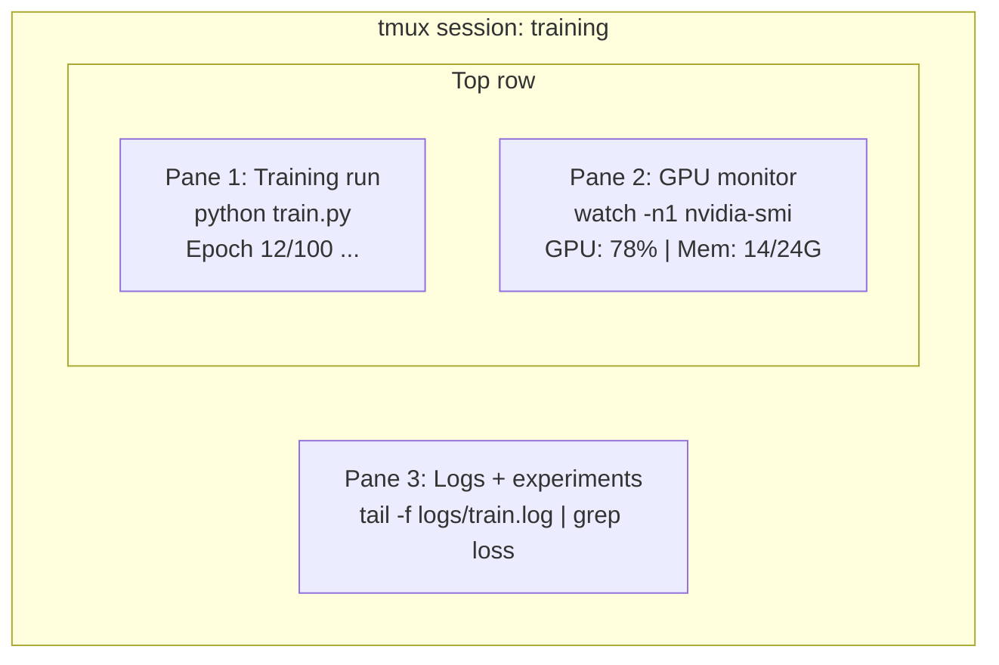

# Terminal & Shell

> 터미널은 AI 엔지니어가 머무는 곳입니다. 이곳에 익숙해지세요.

**유형:** Learn (이론)
**사용 언어:** --
**선수 레슨:** Phase 0, Lesson 01
**소요 시간:** ~35분

## 학습 목표

- 파이핑(piping), 리다이렉트(redirect), `grep`을 사용하여 명령줄에서 학습 로그를 필터링하고 처리합니다.
- 동시 학습과 GPU 모니터링을 위해 여러 창(pane)으로 구성된 영구 tmux 세션을 생성합니다.
- `htop`, `nvtop`, `nvidia-smi`을 사용하여 시스템 및 GPU 리소스를 모니터링합니다.
- SSH, `scp`, `rsync`을 사용하여 로컬 머신과 원격 머신 간에 파일을 전송합니다.

## 문제 상황

에디터보다 터미널에서 더 많은 시간을 보내게 될 것입니다. 학습 실행, GPU 모니터링, 실시간 로그 확인(log tailing), 원격 SSH 세션, 환경 관리 등 모든 AI 워크플로는 셸을 거칩니다. 여기서 작업 속도가 느리면 전체 작업이 느려집니다.

이번 강의에서는 AI 작업에 꼭 필요한 터미널 기술을 다룹니다. 유닉스의 역사는 다루지 않습니다. Bash 스크립팅을 깊게 파고들지도 않습니다. 꼭 필요한 내용만 배웁니다.

## 핵심 개념



세 가지 작업이 동시에 실행됩니다. 터미널은 단 하나입니다. 연결을 해제(detach)하고 퇴근한 뒤, SSH로 다시 접속하여 재연결(reattach)할 수 있습니다. 학습은 계속 실행됩니다.

```figure
s0-shell-pipeline
```

## 직접 구축하기

### 1단계: 사용 중인 셸 확인하기

현재 어떤 셸을 실행하고 있는지 확인합니다.

```bash
echo $SHELL
```

대부분의 시스템에서는 `bash` 또는 `zsh`을 사용합니다. 둘 중 어느 것을 써도 괜찮습니다. 이 코스의 명령어들은 두 셸 모두에서 동작합니다.

알아두어야 할 주요 사항:

```bash
# Move around
cd ~/projects/ai-engineering-from-scratch
pwd
ls -la

# History search (most useful shortcut you'll learn)
# Ctrl+R then type part of a previous command
# Press Ctrl+R again to cycle through matches

# Clear terminal
clear   # or Ctrl+L

# Cancel a running command
# Ctrl+C

# Suspend a running command (resume with fg)
# Ctrl+Z
```

### 2단계: 파이핑과 리다이렉트

파이핑은 명령어들을 서로 연결합니다. 로그를 처리하고 출력을 필터링하며 도구들을 연계할 때 파이핑을 사용합니다. 앞으로 끊임없이 사용하게 될 것입니다.

```bash
# Count how many times "loss" appears in a log
cat train.log | grep "loss" | wc -l

# Extract just the loss values from training output
grep "loss:" train.log | awk '{print $NF}' > losses.txt

# Watch a log file update in real time, filtering for errors
tail -f train.log | grep --line-buffered "ERROR"

# Sort experiments by final accuracy
grep "final_accuracy" results/*.log | sort -t= -k2 -n -r

# Redirect stdout and stderr to separate files
python train.py > output.log 2> errors.log

# Redirect both to the same file
python train.py > train_full.log 2>&1
```

알아두어야 할 세 가지 리다이렉트:

| 기호 | 설명 |
|--------|-------------|
| `>` | stdout을 파일에 기록 (덮어쓰기) |
| `>>` | stdout을 파일에 추가 |
| `2>` | stderr을 파일에 기록 |
| `2>&1` | stderr을 stdout과 같은 위치로 전송 |
| `\|` | 한 명령어의 stdout을 다음 명령어의 stdin으로 전달 |

### 3단계: 백그라운드 프로세스

학습을 실행하면 몇 시간씩 걸립니다. 그동안 내내 터미널을 열어두고 싶지는 않을 것입니다.

```bash
# Run in background (output still goes to terminal)
python train.py &

# Run in background, immune to hangup (closing terminal won't kill it)
nohup python train.py > train.log 2>&1 &

# Check what's running in background
jobs
ps aux | grep train.py

# Bring a background job to foreground
fg %1

# Kill a background process
kill %1
# or find its PID and kill that
kill $(pgrep -f "train.py")
```

`&`, `nohup`, 그리고 `screen`/`tmux`의 차이점:

| 방식 | 터미널 종료 시 유지 여부 | 재연결(reattach) 가능 여부 |
|--------|-------------------------|---------------|
| `command &` | 아니요 | 아니요 |
| `nohup command &` | 예 | 아니요 (로그 파일 확인 필요) |
| `screen` / `tmux` | 예 | 예 |

몇 분 이상 걸리는 작업에는 tmux를 사용합니다.

### 4단계: tmux

tmux를 사용하면 여러 창(pane)으로 구성된 영구 터미널 세션을 만들 수 있습니다. 학습 실행을 관리하는 데 가장 유용한 단 하나의 도구입니다.

```bash
# Install
# macOS
brew install tmux
# Ubuntu
sudo apt install tmux

# Start a named session
tmux new -s training

# Split horizontally
# Ctrl+B then "

# Split vertically
# Ctrl+B then %

# Navigate between panes
# Ctrl+B then arrow keys

# Detach (session keeps running)
# Ctrl+B then d

# Reattach
tmux attach -t training

# List sessions
tmux ls

# Kill a session
tmux kill-session -t training
```

일반적인 AI 워크플로 세션 구성:

```bash
tmux new -s train

# Pane 1: start training
python train.py --epochs 100 --lr 1e-4

# Ctrl+B, " to split, then run GPU monitor
watch -n1 nvidia-smi

# Ctrl+B, % to split vertically, tail the logs
tail -f logs/experiment.log

# Now detach with Ctrl+B, d
# SSH out, go get coffee, come back
# tmux attach -t train
```

### 5단계: htop 및 nvtop을 활용한 모니터링

```bash
# System processes (better than top)
htop

# GPU processes (if you have NVIDIA GPU)
# Install: sudo apt install nvtop (Ubuntu) or brew install nvtop (macOS)
nvtop

# Quick GPU check without nvtop
nvidia-smi

# Watch GPU usage update every second
watch -n1 nvidia-smi

# See which processes are using the GPU
nvidia-smi --query-compute-apps=pid,name,used_memory --format=csv
```

자주 사용하는 `htop` 단축키:
- `F6` 또는 `>`: 열 기준으로 정렬 (메모리 정렬을 통해 메모리 누수 확인)
- `F5`: 트리 뷰 토글 (자식 프로세스 확인)
- `F9`: 프로세스 종료
- `/`: 프로세스 이름 검색

### 6단계: 원격 GPU 머신을 위한 SSH

클라우드 GPU(Lambda, RunPod, Vast.ai)를 대여하면 SSH를 통해 접속합니다.

```bash
# Basic connection
ssh user@gpu-box-ip

# With a specific key
ssh -i ~/.ssh/my_gpu_key user@gpu-box-ip

# Copy files to remote
scp model.pt user@gpu-box-ip:~/models/

# Copy files from remote
scp user@gpu-box-ip:~/results/metrics.json ./

# Sync a whole directory (faster for many files)
rsync -avz ./data/ user@gpu-box-ip:~/data/

# Port forward (access remote Jupyter/TensorBoard locally)
ssh -L 8888:localhost:8888 user@gpu-box-ip
# Now open localhost:8888 in your browser

# SSH config for convenience
# Add to ~/.ssh/config:
# Host gpu
#     HostName 192.168.1.100
#     User ubuntu
#     IdentityFile ~/.ssh/gpu_key
#
# Then just:
# ssh gpu
```

### 7단계: AI 작업에 유용한 별칭(alias)

다음 설정을 `~/.bashrc` 또는 `~/.zshrc`에 추가합니다.

```bash
source phases/00-setup-and-tooling/10-terminal-and-shell/code/shell_aliases.sh
```

혹은 원하는 것만 복사하여 사용할 수도 있습니다. 핵심 별칭은 다음과 같습니다.

```bash
# GPU status at a glance
alias gpu='nvidia-smi --query-gpu=index,name,utilization.gpu,memory.used,memory.total,temperature.gpu --format=csv,noheader'

# Kill all Python training processes
alias killtraining='pkill -f "python.*train"'

# Quick virtual environment activate
alias ae='source .venv/bin/activate'

# Watch training loss
alias watchloss='tail -f logs/*.log | grep --line-buffered "loss"'
```

전체 목록은 `code/shell_aliases.sh`에서 확인할 수 있습니다.

### 8단계: 자주 쓰이는 AI 터미널 패턴

실무에서 자주 마주치는 패턴들입니다.

```bash
# Run training, log everything, notify when done
python train.py 2>&1 | tee train.log; echo "DONE" | mail -s "Training complete" you@email.com

# Compare two experiment logs side by side
diff <(grep "accuracy" exp1.log) <(grep "accuracy" exp2.log)

# Find the largest model files (clean up disk space)
find . -name "*.pt" -o -name "*.safetensors" | xargs du -h | sort -rh | head -20

# Download a model from Hugging Face
wget https://huggingface.co/model/resolve/main/model.safetensors

# Untar a dataset
tar xzf dataset.tar.gz -C ./data/

# Count lines in all Python files (see how big your project is)
find . -name "*.py" | xargs wc -l | tail -1

# Check disk space (training data fills disks fast)
df -h
du -sh ./data/*

# Environment variable check before training
env | grep -i cuda
env | grep -i torch
```

## 실전 활용

이 코스에서 각 도구가 활용되는 시점은 다음과 같습니다.

| 도구 | 사용 시점 |
|------|----------------|
| tmux | 모든 학습 실행 (Phase 3 이상) |
| `tail -f` + `grep` | 학습 로그 모니터링 |
| `nohup` / `&` | 간단한 백그라운드 작업 |
| `htop` / `nvtop` | 느린 학습 디버깅, OOM 오류 분석 |
| SSH + `rsync` | 클라우드 GPU 작업 |
| Piping + redirects | 실험 결과 처리 |
| Aliases | 반복적인 명령어 입력 시간 단축 |

## 연습 문제

1. tmux를 설치하고 세 개의 창(pane)으로 세션을 생성한 후, 한 창에서는 `htop`, 다른 창에서는 `watch -n1 date`, 세 번째 창에서는 Python 스크립트를 실행합니다. 세션에서 분리(detach)했다가 다시 연결(reattach)해 봅니다.
2. `code/shell_aliases.sh`의 별칭들을 셸 설정 파일에 추가하고 `source ~/.zshrc`(또는 `~/.bashrc`) 명령으로 다시 로드합니다.
3. `for i in $(seq 1 100); do echo "epoch $i loss: $(echo "scale=4; 1/$i" | bc)"; sleep 0.1; done > fake_train.log`로 가상의 학습 로그를 생성한 다음 `grep`, `tail`, `awk`를 사용하여 손실(loss) 값만 추출합니다.
4. 접근 권한이 있는 서버에 대한 SSH 설정(config) 항목을 구성합니다(또는 구문 연습을 위해 `localhost`를 사용합니다).

### 힌트

**연습 문제 1.** `tmux new -s practice`으로 시작한 다음, 접두사 키 `Ctrl+B`을 누른 후 `"` 및 `%`을 입력하여 창을 분할하고, `Ctrl+B`와 화살표 키를 사용하여 창 사이를 이동합니다. `Ctrl+B`를 누른 다음 `d`으로 분리(detach)하고, `tmux ls`을 실행한 뒤, `tmux attach -t practice`로 다시 연결(attach)합니다. 세 프로그램 모두 여전히 실행 중이어야 합니다.

**연습 문제 2.** `code/shell_aliases.sh`의 내용을 `~/.zshrc` 또는 `~/.bashrc` 파일 끝에 복사한 다음, 해당 파일에 대해 `source`를 실행합니다. 새로운 별칭 중 하나에 대해 `alias` 또는 `type <name>`를 실행하여 셸이 해당 별칭을 인식하는지 확인합니다.

**연습 문제 3.** 먼저 `tail -5 fake_train.log`를 실행하여 행의 형식을 확인합니다. 그런 다음 `grep loss`으로 필터링하고 `awk '{print $NF}'`을 사용하여 마지막 필드만 출력합니다. 출력 결과는 점차 작아지는 100개의 숫자여야 합니다.

**연습 문제 4.** 본문의 `Host gpu` 블록을 `~/.ssh/config`에 복사하고 `HostName` 및 `User`을 실제 서버 정보 또는 `localhost` 및 사용자 이름으로 변경합니다. `ssh -G gpu`을 실행하여 SSH가 사용할 설정을 출력합니다. 본인의 키를 허용하는 접속 가능한 SSH 서버가 있다면 `ssh gpu`를 실행하여 접속합니다.

## 주요 용어

| 용어 | 흔히 부르는 표현 | 실제 의미 |
|------|----------------|----------------------|
| Shell | "터미널" | 사용자의 명령어를 해석하는 프로그램 (bash, zsh, fish 등) |
| tmux | "터미널 멀티플렉서" | 하나의 창 안에서 여러 터미널 세션을 실행하고, 분리(detach) 및 재연결(reattach)할 수 있게 해주는 프로그램 |
| Pipe | "그 막대기 기호" | 한 명령어의 출력을 다른 명령어의 입력으로 전달하는 `\|` 연산자 |
| PID | "프로세스 ID" | 실행 중인 모든 프로세스에 할당되는 고유 번호로, 모니터링하거나 종료할 때 사용 |
| nohup | "No hangup" | 행업(hangup) 시그널을 무시하고 명령을 실행하여, 터미널을 닫아도 프로세스가 종료되지 않게 함 |
| SSH | "서버 접속" | Secure Shell의 약자로, 원격 머신에서 명령을 실행하기 위한 암호화된 프로토콜 |
