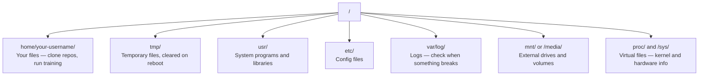

# Linux for AI

> 대부분의 AI는 Linux에서 실행됩니다. 막히지 않고 작업할 수 있을 정도의 지식은 필수적입니다.

**유형:** Learn (이론)
**사용 언어:** --
**선수 레슨:** Phase 0, Lesson 01
**소요 시간:** ~30분

## 학습 목표

- 명령줄에서 Linux 파일 시스템을 탐색하고 필수적인 파일 작업을 수행합니다.
- `chmod` 및 `chown`를 사용해 파일 권한을 관리하여 "Permission denied" 오류를 해결합니다.
- `apt`로 시스템 패키지를 설치하고 AI 작업을 위한 새로운 GPU 머신을 설정합니다.
- 원격 머신에서 작업할 때 개발자들이 흔히 겪는 macOS와 Linux 간의 차이점을 파악합니다.

## 문제 상황

개발은 macOS나 Windows에서 진행할 수 있습니다. 하지만 클라우드 GPU 머신에 SSH로 접속하거나, Lambda 인스턴스를 대여하거나, EC2 머신을 띄우는 순간 Ubuntu 환경을 마주하게 됩니다. 터미널이 유일한 인터페이스이며 Finder도, Explorer도, GUI도 존재하지 않습니다. 명령줄에서 파일 시스템을 탐색하고 패키지를 설치하며 프로세스를 관리할 수 없다면, "Linux에서 압축 푸는 법"을 구글링하는 동안 사용하지도 않는 GPU 요금만 계속 지불하게 됩니다.

이 문서는 일종의 생존 가이드입니다. AI 작업을 위해 원격 Linux 머신을 다루는 데 꼭 필요한 내용만을 다루며, 군더더기는 배제합니다.

## 파일 시스템 구조

Linux는 모든 것을 단일 루트 `/` 아래에 구성합니다. `C:\`나 `/Volumes` 같은 드라이브 개념은 없습니다. 실제로 다루게 될 디렉터리는 다음과 같습니다.



홈 디렉터리는 `~` 또는 `/home/your-username`입니다. 대부분의 작업은 이 안에서 이루어집니다.

## 필수 명령어

원격 GPU 머신에서 수행하는 작업의 95%를 아우르는 15가지 명령어입니다.

### 경로 이동

```bash
pwd                         # Where am I?
ls                          # What's here?
ls -la                      # What's here, including hidden files with details?
cd /path/to/dir             # Go there
cd ~                        # Go home
cd ..                       # Go up one level
```

### 파일 및 디렉터리

```bash
mkdir my-project            # Create a directory
mkdir -p a/b/c              # Create nested directories in one shot

cp file.txt backup.txt      # Copy a file
cp -r src/ src-backup/      # Copy a directory (recursive)

mv old.txt new.txt          # Rename a file
mv file.txt /tmp/           # Move a file

rm file.txt                 # Delete a file (no trash, it's gone)
rm -rf my-dir/              # Delete a directory and everything inside
```

`rm -rf`는 영구 삭제 명령어입니다. 실행 취소는 불가능합니다. Enter 키를 누르기 전에 경로를 반드시 다시 확인하십시오.

### 파일 읽기

```bash
cat file.txt                # Print entire file
head -20 file.txt           # First 20 lines
tail -20 file.txt           # Last 20 lines
tail -f log.txt             # Follow a log file in real time (Ctrl+C to stop)
less file.txt               # Scroll through a file (q to quit)
```

### 검색

```bash
grep "error" training.log           # Find lines containing "error"
grep -r "learning_rate" .           # Search all files in current directory
grep -i "cuda" config.yaml          # Case-insensitive search

find . -name "*.py"                 # Find all Python files under current dir
find . -name "*.ckpt" -size +1G     # Find checkpoint files larger than 1GB
```

## 권한

Linux의 모든 파일에는 소유자와 권한 비트가 있습니다. 스크립트가 실행되지 않거나 디렉터리에 파일을 쓸 수 없을 때 이 권한 문제가 발생합니다.

```bash
ls -l train.py
# -rwxr-xr-- 1 user group 2048 Mar 19 10:00 train.py
#  ^^^             owner permissions: read, write, execute
#     ^^^          group permissions: read, execute
#        ^^        everyone else: read only
```

일반적인 해결 방법:

```bash
chmod +x train.sh           # Make a script executable
chmod 755 deploy.sh         # Owner: full, others: read+execute
chmod 644 config.yaml       # Owner: read+write, others: read only

chown user:group file.txt   # Change who owns a file (needs sudo)
```

"Permission denied"라는 메시지가 나타나면 거의 대부분 권한 문제입니다. 대부분의 경우 `chmod +x` 또는 `sudo`를 통해 해결할 수 있습니다.

## 패키지 관리 (apt)

Ubuntu는 `apt`를 사용합니다. 시스템 수준의 소프트웨어는 이 도구를 통해 설치합니다.

```bash
sudo apt update             # Refresh the package list (always do this first)
sudo apt install -y htop    # Install a package (-y skips confirmation)
sudo apt install -y build-essential  # C compiler, make, etc. Needed by many Python packages
sudo apt install -y tmux    # Terminal multiplexer (keep sessions alive after disconnect)

apt list --installed        # What's installed?
sudo apt remove htop        # Uninstall
```

새로운 GPU 머신에 일반적으로 설치하는 패키지들:

```bash
sudo apt update && sudo apt install -y \
    build-essential \
    git \
    curl \
    wget \
    tmux \
    htop \
    unzip \
    python3-venv
```

## 사용자와 sudo

일반적으로 일반 사용자로 로그인하게 됩니다. 일부 작업에는 root(관리자) 권한이 필요합니다.

```bash
whoami                      # What user am I?
sudo command                # Run a single command as root
sudo su                     # Become root (exit to go back, use sparingly)
```

클라우드 GPU 인스턴스에서는 보통 유일한 사용자이며 이미 sudo 권한을 가지고 있습니다. 모든 작업을 root로 실행하지는 마십시오. sudo는 꼭 필요한 경우에만 사용하십시오.

## 프로세스와 systemd

학습이 멈췄거나 실행 중인 작업을 확인해야 할 때:

```bash
htop                        # Interactive process viewer (q to quit)
ps aux | grep python        # Find running Python processes
kill 12345                  # Gracefully stop process with PID 12345
kill -9 12345               # Force kill (use when graceful doesn't work)
nvidia-smi                  # GPU processes and memory usage
```

systemd는 서비스(백그라운드 데몬)를 관리합니다. 추론(inference) 서버를 실행할 때 사용하게 됩니다.

```bash
sudo systemctl start nginx          # Start a service
sudo systemctl stop nginx           # Stop it
sudo systemctl restart nginx        # Restart it
sudo systemctl status nginx         # Check if it's running
sudo systemctl enable nginx         # Start automatically on boot
```

## 디스크 공간

GPU 머신은 종종 디스크 공간이 제한적입니다. 모델과 데이터셋은 디스크를 빠르게 채웁니다.

```bash
df -h                       # Disk usage for all mounted drives
df -h /home                 # Disk usage for /home specifically

du -sh *                    # Size of each item in current directory
du -sh ~/.cache             # Size of your cache (pip, huggingface models land here)
du -sh /data/checkpoints/   # Check how big your checkpoints are

# Find the biggest space hogs
du -h --max-depth=1 / 2>/dev/null | sort -hr | head -20
```

일반적인 공간 확보 방법:

```bash
# Clear pip cache
pip cache purge

# Clear apt cache
sudo apt clean

# Remove old checkpoints you don't need
rm -rf checkpoints/epoch_01/ checkpoints/epoch_02/
```

## 네트워킹

명령줄에서 모델을 다운로드하고 파일을 전송하며 API를 호출하게 됩니다.

```bash
# Download files
wget https://example.com/model.bin                   # Download a file
curl -O https://example.com/data.tar.gz              # Same thing with curl
curl -s https://api.example.com/health | python3 -m json.tool  # Hit an API, pretty-print JSON

# Transfer files between machines
scp model.bin user@remote:/data/                     # Copy file to remote machine
scp user@remote:/data/results.csv .                  # Copy file from remote to local
scp -r user@remote:/data/checkpoints/ ./local-dir/   # Copy directory

# Sync directories (faster than scp for large transfers, resumes on failure)
rsync -avz --progress ./data/ user@remote:/data/
rsync -avz --progress user@remote:/results/ ./results/
```

대용량 파일의 경우 `scp` 대신 `rsync`를 사용하십시오. 변경된 바이트만 전송하며 연결이 끊겼을 때도 안정적으로 처리할 수 있습니다.

## tmux: 세션 유지하기

원격 머신에 SSH로 접속했을 때 노트북을 닫으면 실행 중이던 학습 작업이 강제 종료됩니다. tmux를 사용하면 이를 방지할 수 있습니다.

```bash
tmux new -s train           # Start a new session named "train"
# ... start your training, then:
# Ctrl+B, then D            # Detach (training keeps running)

tmux ls                     # List sessions
tmux attach -t train        # Reattach to session

# Inside tmux:
# Ctrl+B, then %            # Split pane vertically
# Ctrl+B, then "            # Split pane horizontally
# Ctrl+B, then arrow keys   # Switch between panes
```

장시간 실행되는 학습 작업은 항상 tmux 내부에서 실행하십시오. 예외는 없습니다.

## Windows 사용자를 위한 WSL2

Windows를 사용 중이라면 WSL2를 통해 듀얼 부팅 없이 실제 Linux 환경을 활용할 수 있습니다.

```bash
# In PowerShell (admin)
wsl --install -d Ubuntu-24.04

# After restart, open Ubuntu from Start menu
sudo apt update && sudo apt upgrade -y
```

WSL2는 실제 Linux 커널을 실행합니다. 이 레슨의 모든 내용은 WSL2 내부에서 그대로 동작합니다. WSL 내부에서 Windows 파일은 `/mnt/c/Users/YourName/` 경로로 접근할 수 있습니다.

Windows 쪽에 NVIDIA 드라이버가 설치되어 있다면 GPU 패스스루(passthrough)가 작동합니다. Linux 드라이버가 아닌 Windows용 NVIDIA 드라이버를 설치하면 WSL2 내부에서 CUDA를 사용할 수 있습니다.

## 주의 사항: macOS에서 Linux로 전환 시

macOS 환경에 익숙한 경우 혼란을 줄 수 있는 부분들입니다.

| macOS | Linux | 참고 사항 |
|-------|-------|-------|
| `brew install` | `sudo apt install` | 패키지 이름이 다를 수 있습니다. `brew install htop`와 `sudo apt install htop`는 동일하게 동작하지만 `brew install readline`와 `sudo apt install libreadline-dev`는 다릅니다. |
| `open file.txt` | `xdg-open file.txt` | 원격 머신에는 GUI가 없습니다. `cat`나 `less`를 사용하십시오. |
| `pbcopy` / `pbpaste` | 사용 불가 | SSH를 통한 클립보드 파이프 입출력은 지원되지 않습니다. |
| `~/.zshrc` | `~/.bashrc` | macOS는 zsh가 기본값입니다. 대부분의 Linux 서버는 bash를 사용합니다. |
| `/opt/homebrew/` | `/usr/bin/`, `/usr/local/bin/` | 바이너리가 위치하는 경로가 다릅니다. |
| `sed -i '' 's/a/b/' file` | `sed -i 's/a/b/' file` | macOS의 sed는 `-i` 뒤에 빈 문자열이 필요합니다. Linux는 필요하지 않습니다. |
| 대소문자 구분 없는 파일 시스템 | 대소문자 구분 파일 시스템 | Linux에서 `Model.py`와 `model.py`는 서로 다른 두 개의 파일입니다. |
| 줄 바꿈 `\n` | 줄 바꿈 `\n` | 동일합니다. 단, Windows는 `\r\n`를 사용하므로 bash 스크립트 실행이 실패할 수 있습니다. `dos2unix`로 해결할 수 있습니다. |

## 빠른 참조표

```
Navigation:     pwd, ls, cd, find
Files:          cp, mv, rm, mkdir, cat, head, tail, less
Search:         grep, find
Permissions:    chmod, chown, sudo
Packages:       apt update, apt install
Processes:      htop, ps, kill, nvidia-smi
Services:       systemctl start/stop/restart/status
Disk:           df -h, du -sh
Network:        curl, wget, scp, rsync
Sessions:       tmux new/attach/detach
```

```figure
s0-process-fork
```

## 실습 과제

1. 임의의 Linux 머신에 SSH로 접속(또는 WSL2 실행)하여 홈 디렉터리로 이동합니다. 프로젝트 폴더를 만들고, 그 안에 `touch`로 세 개의 빈 파일을 생성한 다음 `ls -la`로 목록을 확인합니다.
2. apt로 `htop`를 설치하고 실행하여 가장 많은 메모리를 사용하고 있는 프로세스를 확인합니다.
3. tmux 세션을 시작하고, 그 안에서 `sleep 300`를 실행한 후 세션을 분리(detach)하고, 세션 목록을 확인한 다음 다시 연결(reattach)합니다.
4. `df -h`를 사용해 사용 가능한 디스크 공간을 확인한 다음, `du -sh ~/.cache/*`를 사용해 캐시 디렉터리에서 공간을 차지하고 있는 항목을 찾습니다.
5. 로컬 머신에서 원격 머신으로 `scp`를 사용해 파일을 전송한 다음, `rsync`로 동일한 전송을 수행하고 두 방식의 차이를 비교해 봅니다.

### 힌트

**실습 1.** `cd ~`, `mkdir`를 사용해 새 폴더로 `cd`한 다음 세 개의 파일 이름을 지정하여 `touch`를 실행합니다. `ls -la` 출력에서 세 파일의 크기가 0이고 소유자가 본인의 사용자 이름으로 표시되는지 확인합니다.

**실습 2.** `sudo apt install -y htop`로 설치하고 실행한 뒤 `F6`를 누르거나 컬럼 이름을 클릭하여 `MEM%` 기준으로 정렬합니다. 목록 최상단에 위치한 프로세스가 메모리를 가장 많이 사용하는 프로세스입니다.

**실습 3.** 본문의 `tmux new -s train`를 사용해 `sleep 300`를 실행하고, `Ctrl+B`를 누른 다음 `d`를 눌러 분리합니다. `tmux ls`를 실행해 세션을 확인한 뒤 `tmux attach -t train`를 실행합니다. 이때 `sleep`가 여전히 실행 중이어야 합니다.

**실습 4.** `df -h`를 실행하고 홈 폴더가 위치한 파일 시스템의 `Avail` 컬럼을 확인합니다. 그런 다음 `du -sh ~/.cache/* | sort -h`를 실행하여 가장 큰 용량의 폴더가 마지막 줄에 출력되도록 합니다.

**실습 5.** `scp file.txt user@host:~/`로 파일을 복사한 다음 동일한 파일에 대해 `rsync -avP file.txt user@host:~/`를 실행합니다. `rsync` 명령을 한 번 더 실행해 보면, 원격 머신의 파일이 변경되지 않았기 때문에 거의 아무것도 전송하지 않는 것을 확인할 수 있습니다.
