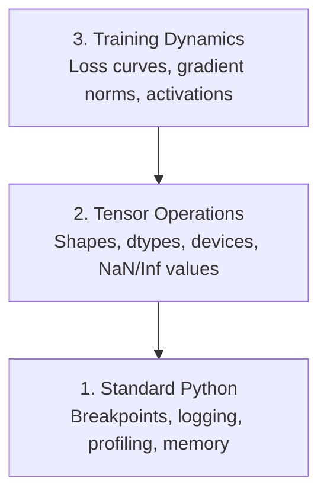

# 디버깅과 프로파일링

> 가장 최악의 AI 버그는 충돌을 일으키지 않습니다. 쓰레기 데이터로 조용히 학습하면서 아름다운 손실 곡선을 보고할 뿐입니다.

**유형:** Build (실습)
**Language:** Python
**선수 레슨:** Lesson 1 (Dev Environment), basic PyTorch familiarity
**소요 시간:** ~60분

## 학습 목표

- 조건부 `breakpoint()` 및 `debug_print`을 사용하여 학습 도중 텐서의 형태(shape), 데이터 타입(dtype), NaN 값을 점검합니다.
- `cProfile`, `line_profiler`, `tracemalloc`을 사용하여 학습 루프를 프로파일링하고 병목 지점을 찾습니다.
- 형태 불일치(shape mismatch), 손실의 NaN 발생, 데이터 누수(data leakage), 잘못된 디바이스에 할당된 텐서 등 흔히 발생하는 AI 버그를 감지합니다.
- TensorBoard를 설정하여 손실 곡선, 가중치 히스토그램, 그래디언트(gradient) 분포를 시각화합니다.

## 문제 정의

AI 코드는 일반적인 코드와 다르게 실패합니다. 웹 애플리케이션은 스택 트레이스(stack trace)를 남기며 충돌합니다. 하지만 잘못 구성된 학습 루프는 8시간 동안 실행되어 200달러 상당의 GPU 비용을 소모하고도 모든 입력에 대해 평균값만 예측하는 모델을 만들어 냅니다. 코드에서는 어떠한 에러도 발생하지 않았습니다. 버그의 원인은 텐서가 잘못된 디바이스에 있었거나, `.detach()` 호출을 누락했거나, 라벨이 피처에 누수되었기 때문이었습니다.

시간과 컴퓨팅 자원을 낭비하기 전에 이러한 무언의 실패를 잡아낼 수 있는 디버깅 도구가 필요합니다.

## 개념

AI 디버깅은 세 가지 수준에서 작동합니다.



대부분의 사람들은 레벨 3(TensorBoard 응시하기)으로 바로 건너뜁니다. 하지만 AI 버그의 80%는 레벨 1과 레벨 2에 존재합니다.

```figure
s0-flame-hot
```

## 직접 만들기

### 파트 1: 출력문 디버깅 (실제로 효과가 있습니다)

출력문(print) 디버깅은 종종 과소평가되지만 그래선 안 됩니다. 텐서 코드에서는 형태(shape), 데이터 타입(dtype), 값의 범위를 한 번에 확인해야 하므로 타깃을 지정한 print 문이 디버거를 한 단계씩 실행하는 것보다 훨씬 효과적입니다.

```python
def debug_print(name, tensor):
    print(f"{name}: shape={tensor.shape}, dtype={tensor.dtype}, "
          f"device={tensor.device}, "
          f"min={tensor.min().item():.4f}, max={tensor.max().item():.4f}, "
          f"mean={tensor.mean().item():.4f}, "
          f"has_nan={tensor.isnan().any().item()}")
```

의심스러운 연산이 끝날 때마다 이를 호출하십시오. 버그를 찾으면 print 문을 제거하면 됩니다. 아주 간단합니다.

### 파트 2: Python 디버거 (pdb와 breakpoint)

내장 디버거는 AI 작업에서 과소평가되어 있습니다. 학습 루프에 `breakpoint()`를 삽입하고 대화형으로 텐서를 점검해 보십시오.

```python
def training_step(model, batch, criterion, optimizer):
    inputs, labels = batch
    outputs = model(inputs)
    loss = criterion(outputs, labels)

    if loss.item() > 100 or torch.isnan(loss):
        breakpoint()

    loss.backward()
    optimizer.step()
```

디버거가 실행되었을 때 유용한 명령어는 다음과 같습니다.

- 형태 확인: `p outputs.shape`
- 손실 값 확인: `p loss.item()`
- NaN 개수 확인: `p torch.isnan(outputs).sum()`
- 그래디언트 확인: `p model.fc1.weight.grad`
- 계속 진행: `c`, 종료: `q`

이것이 바로 조건부 디버깅입니다. 문제가 있어 보일 때만 멈춥니다. 10,000스텝에 달하는 학습 실행에서는 이러한 방식이 매우 중요합니다.

### 파트 3: Python 로깅

디버깅이 단순한 빠른 점검 수준을 넘어설 때는 print 문을 로깅(logging)으로 교체하십시오.

```python
import logging

logging.basicConfig(
    level=logging.INFO,
    format="%(asctime)s [%(levelname)s] %(message)s",
    handlers=[
        logging.FileHandler("training.log"),
        logging.StreamHandler()
    ]
)
logger = logging.getLogger(__name__)

logger.info("Starting training: lr=%.4f, batch_size=%d", lr, batch_size)
logger.warning("Loss spike detected: %.4f at step %d", loss.item(), step)
logger.error("NaN loss at step %d, stopping", step)
```

로깅을 사용하면 타임스탬프, 심각도 수준, 파일 출력을 얻을 수 있습니다. 새벽 3시에 학습 실행이 실패했을 때 필요한 것은 화면 밖으로 스크롤되어 사라진 터미널 출력이 아니라 로그 파일입니다.

### 파트 4: 코드 구간 시간 측정

시간이 어디에 소요되는지 파악하는 것이 최적화의 첫걸음입니다.

```python
import time

class Timer:
    def __init__(self, name=""):
        self.name = name

    def __enter__(self):
        self.start = time.perf_counter()
        return self

    def __exit__(self, *args):
        elapsed = time.perf_counter() - self.start
        print(f"[{self.name}] {elapsed:.4f}s")

with Timer("data loading"):
    batch = next(dataloader_iter)

with Timer("forward pass"):
    outputs = model(batch)

with Timer("backward pass"):
    loss.backward()
```

흔히 발견되는 사실은 데이터 로딩이 전체 학습 시간의 60%를 차지한다는 점입니다. 이 문제의 해결책은 더 빠른 GPU가 아니라 DataLoader의 `num_workers > 0` 설정입니다.

### 파트 5: cProfile과 line_profiler

수동 타이머 이상의 정밀한 분석이 필요할 때:

```bash
python -m cProfile -s cumtime train.py
```

이렇게 하면 누적 시간순으로 정렬된 모든 함수 호출이 표시됩니다. 줄 단위(line-by-line) 프로파일링을 수행하려면 다음과 같이 합니다.

```bash
pip install line_profiler
```

```python
@profile
def train_step(model, data, target):
    output = model(data)
    loss = F.cross_entropy(output, target)
    loss.backward()
    return loss

# Run with: kernprof -l -v train.py
```

### 파트 6: 메모리 프로파일링

#### tracemalloc을 이용한 CPU 메모리 측정

```python
import tracemalloc

tracemalloc.start()

# your code here
model = build_model()
data = load_dataset()

snapshot = tracemalloc.take_snapshot()
top_stats = snapshot.statistics("lineno")
for stat in top_stats[:10]:
    print(stat)
```

#### memory_profiler를 이용한 CPU 메모리 측정

```bash
pip install memory_profiler
```

```python
from memory_profiler import profile

@profile
def load_data():
    raw = read_csv("data.csv")       # watch memory jump here
    processed = preprocess(raw)       # and here
    return processed
```

줄 단위 메모리 사용량을 확인하려면 `python -m memory_profiler your_script.py` 명령어로 실행하십시오.

#### PyTorch를 이용한 GPU 메모리 측정

```python
import torch

if torch.cuda.is_available():
    print(torch.cuda.memory_summary())

    print(f"Allocated: {torch.cuda.memory_allocated() / 1e9:.2f} GB")
    print(f"Cached: {torch.cuda.memory_reserved() / 1e9:.2f} GB")
```

OOM(Out of Memory, 메모리 부족)이 발생했을 때 조치 방법:

1. 배치 크기 줄이기 (언제나 가장 먼저 시도해야 할 방법)
2. `torch.cuda.empty_cache()`을 사용하여 캐시된 메모리 해제
3. 크기가 큰 중간 텐서에 대해 `del tensor` 실행 후 `torch.cuda.empty_cache()` 호출
4. 혼합 정밀도(`torch.cuda.amp`)를 사용하여 메모리 사용량을 절반으로 절감
5. 모델이 매우 깊은 경우 그래디언트 체크포인팅(gradient checkpointing) 활용

### 파트 7: 자주 발생하는 AI 버그와 해결 방법

#### 형태 불일치(Shape Mismatch)

가장 빈번하게 발생하는 버그입니다. 모델은 `[batch, channels, height, width]` 형태를 기대하지만 텐서의 형태가 `[batch, features]`인 경우입니다.

```python
def check_shapes(model, sample_input):
    print(f"Input: {sample_input.shape}")
    hooks = []

    def make_hook(name):
        def hook(module, inp, out):
            in_shape = inp[0].shape if isinstance(inp, tuple) else inp.shape
            out_shape = out.shape if hasattr(out, "shape") else type(out)
            print(f"  {name}: {in_shape} -> {out_shape}")
        return hook

    for name, module in model.named_modules():
        hooks.append(module.register_forward_hook(make_hook(name)))

    with torch.no_grad():
        model(sample_input)

    for h in hooks:
        h.remove()
```

샘플 배치로 이를 한 번 실행해 보십시오. 모델 내 모든 형태 변환 과정을 매핑해 줍니다.

#### 손실의 NaN 발생(NaN Loss)

NaN 손실은 무언가 폭발했음을 의미합니다. 주된 원인은 다음과 같습니다.

- 지나치게 높은 학습률(learning rate)
- 커스텀 손실 함수에서의 0 나누기(division by zero)
- 0 또는 음수에 대한 로그 계산
- RNN에서의 그래디언트 폭발(exploding gradients)

```python
def detect_nan(model, loss, step):
    if torch.isnan(loss):
        print(f"NaN loss at step {step}")
        for name, param in model.named_parameters():
            if param.grad is not None:
                if torch.isnan(param.grad).any():
                    print(f"  NaN gradient in {name}")
                if torch.isinf(param.grad).any():
                    print(f"  Inf gradient in {name}")
        return True
    return False
```

#### 데이터 누수(Data Leakage)

테스트 세트에서 모델이 99%의 정확도를 달성했습니다. 좋아 보이지만, 버그입니다.

```python
def check_data_leakage(train_set, test_set, id_column="id"):
    train_ids = set(train_set[id_column].tolist())
    test_ids = set(test_set[id_column].tolist())
    overlap = train_ids & test_ids
    if overlap:
        print(f"DATA LEAKAGE: {len(overlap)} samples in both train and test")
        return True
    return False
```

시간적 누수(temporal leakage)도 점검해야 합니다. 이는 과거를 예측하는 데 미래 데이터를 사용하는 경우를 말합니다. 데이터를 분할하기 전에 타임스탬프 기준으로 정렬하십시오.

#### 잘못된 디바이스(Wrong Device)

서로 다른 디바이스(CPU 대 GPU)에 있는 텐서는 런타임 에러를 유발합니다. 하지만 때로는 다른 모든 요소가 GPU에 있는 동안 특정 텐서만 조용히 CPU에 남아 있어 학습 속도가 현저히 느려지기만 할 때도 있습니다.

```python
def check_devices(model, *tensors):
    model_device = next(model.parameters()).device
    print(f"Model device: {model_device}")
    for i, t in enumerate(tensors):
        if t.device != model_device:
            print(f"  WARNING: tensor {i} on {t.device}, model on {model_device}")
```

### 파트 8: TensorBoard 기초

TensorBoard는 학습이 진행됨에 따라 내부에서 일어나는 일을 보여줍니다.

```bash
pip install tensorboard
```

```python
from torch.utils.tensorboard import SummaryWriter

writer = SummaryWriter("runs/experiment_1")

for step in range(num_steps):
    loss = train_step(model, batch)

    writer.add_scalar("loss/train", loss.item(), step)
    writer.add_scalar("lr", optimizer.param_groups[0]["lr"], step)

    if step % 100 == 0:
        for name, param in model.named_parameters():
            writer.add_histogram(f"weights/{name}", param, step)
            if param.grad is not None:
                writer.add_histogram(f"grads/{name}", param.grad, step)

writer.close()
```

다음 명령어로 실행합니다.

```bash
tensorboard --logdir=runs
```

주목해야 할 항목:

- **손실이 감소하지 않음**: 학습률이 너무 낮거나 모델 아키텍처에 문제가 있음
- **손실이 심하게 요동침**: 학습률이 너무 높음
- **손실이 NaN이 됨**: 수치적 불안정성 (위의 NaN 섹션 참조)
- **학습 손실은 감소하지만 검증 손실은 증가함**: 과적합(overfitting)
- **가중치 히스토그램이 0으로 수렴함**: 그래디언트 소실(vanishing gradients)
- **그래디언트 히스토그램이 폭발함**: 그래디언트 클리핑(gradient clipping) 필요

### 파트 9: VS Code 디버거

대화형 디버깅을 위해 VS Code에 `launch.json`을 구성합니다.

```json
{
    "version": "0.2.0",
    "configurations": [
        {
            "name": "Debug Training",
            "type": "debugpy",
            "request": "launch",
            "program": "${file}",
            "console": "integratedTerminal",
            "justMyCode": false
        }
    ]
}
```

줄 번호 옆 여백(gutter)을 클릭하여 중단점(breakpoint)을 설정합니다. Variables 창을 사용하여 텐서의 속성을 검사할 수 있습니다. 디버그 콘솔(Debug Console)을 이용하면 실행 도중 임의의 Python 표현식을 실행할 수 있습니다.

각 변환 단계를 직접 확인하고 싶은 데이터 전처리 파이프라인을 단계별로 실행할 때 유용합니다.

## 실전 적용

대부분의 AI 버그를 잡아내는 디버깅 워크플로는 다음과 같습니다.

1. **학습 전**: 샘플 배치로 `check_shapes`을 실행합니다. 입력 및 출력 차원이 예상과 일치하는지 확인합니다.
2. **초기 10스텝**: 손실, 출력값, 그래디언트에 대해 `debug_print`을 사용합니다. NaN이 발생하지 않고 값들이 합리적인 범위 내에 있는지 확인합니다.
3. **학습 도중**: 손실, 학습률, 그래디언트 노름(norm)을 기록합니다. 시각화를 위해 TensorBoard를 사용합니다.
4. **오류 발생 시**: 실패 지점에 `breakpoint()`를 삽입합니다. 대화형으로 텐서를 점검합니다.
5. **성능 점검**: 데이터 로딩, 순전파(forward pass), 역전파(backward pass)의 소요 시간을 측정합니다. OOM에 근접한 경우 메모리를 프로파일링합니다.

## 배포하기

디버깅 툴킷 스크립트를 실행하십시오.

```bash
python phases/00-setup-and-tooling/12-debugging-and-profiling/code/debug_tools.py
```

AI 특화 버그 진단에 도움이 되는 프롬프트는 `outputs/prompt-debug-ai-code.md`을 참조하십시오.

## 실습 과제

1. `debug_tools.py`을 실행하고 각 섹션의 출력을 읽어보십시오. 더미 모델을 수정하여 NaN을 유발해 보고(힌트: 순전파에서 0으로 나누기), 감지기가 이를 포착하는지 확인하십시오.
2. `cProfile`으로 학습 루프를 프로파일링하고 가장 느린 함수를 찾아보십시오.
3. `tracemalloc`을 사용하여 데이터 로딩 파이프라인에서 가장 많은 메모리를 할당하는 코드 라인을 찾으십시오.
4. 간단한 학습 실행에 TensorBoard를 설정하고 모델이 과적합되고 있는지 확인해 보십시오.
5. 학습 루프 내부에서 `breakpoint()`를 사용해 보십시오. 디버거 프롬프트에서 텐서 형태, 디바이스, 그래디언트 값을 검사하는 연습을 하십시오.
### 힌트

**연습 1.** `python3 phases/00-setup-and-tooling/12-debugging-and-profiling/code/debug_tools.py`를 실행하고 각 데모 함수의 출력을 확인합니다. 그런 다음 출력이 0으로 나누어지도록 `demo_nan_detection`의 모델을 변경하고 다시 실행합니다. `detect_nan`에 스텝 번호와 함께 NaN 경고가 출력되어야 합니다.

**연습 2.** `python -m cProfile -s cumtime your_script.py` 아래의 루프를 실행하거나, 이를 `cProfile.Profile()` 안에 래핑합니다. `cumtime` 열의 상위 행을 확인합니다. 작성한 코드 중에서 소요 시간이 가장 긴 함수가 가장 느린 함수입니다.

**연습 3.** `demo_memory_tracking`과 같이 데이터 로딩 코드 앞에서 `tracemalloc.start()`을 호출하고 그 뒤에서 `tracemalloc.take_snapshot()`를 호출합니다. `snapshot.statistics("lineno")[:5]`을 출력하면 첫 번째 줄에 가장 많은 메모리가 할당된 파일과 줄 번호가 표시됩니다.

**연습 4.** 각 에포크(epoch)마다 훈련 손실(training loss)과 검증 손실(validation loss)을 `SummaryWriter`에 기록한 다음, `tensorboard --logdir=runs`을 실행합니다. 훈련 손실은 계속 감소하는데 검증 손실은 증가한다면 모델이 과적합(overfitting)된 것입니다.

**연습 5.** 루프 내부의 `loss.backward()` 뒤에 `breakpoint()`를 넣고 스크립트를 실행합니다. `(Pdb)` 프롬프트에서 `x.shape`, `x.device`, `next(model.parameters()).grad`를 출력한 다음, `c`을 입력하여 다음 스텝으로 진행합니다.
