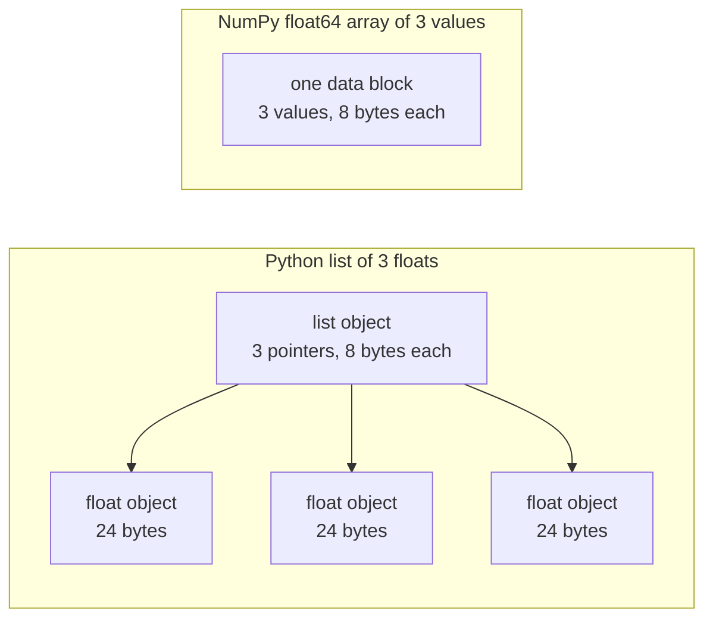

# AI 엔지니어링을 위한 Python

> 이 과정의 대부분의 코드는 소수의 동일한 Python 관용구 세트를 사용합니다. 수학과 모델 관련 강의에서 이를 활용하기 전에, 여기서 해당 관용구들을 미리 익혀둡니다.

**유형:** Build (실습)
**사용 언어:** Python
**선수 레슨:** Dev Environment, Python Environments
**소요 시간:** ~120분

## 학습 목표

- 언패킹과 f-string부터 데이터클래스 및 컴프리헨션에 이르기까지, 대부분의 강의 코드에서 사용하는 관용구를 읽고 작성합니다.
- 오류 없이 잘못된 결과를 초래하는 세 가지 Python 실수인 공유 리스트, 가변 기본 인자, 소진된 제너레이터를 찾아냅니다.
- 표준 라이브러리만을 사용하여 CSV 및 JSON 로더, 시드가 지정된 분할(seeded split), 미니배치 제너레이터를 구현합니다.
- 순수 Python으로 점곱(dot product), 평균, 표준편차를 작성하고, 실행 속도와 메모리 사용량을 측정합니다.
- 숫자에 대한 순수 Python 루프가 느린 이유와 NumPy 브로드캐스팅(broadcasting)이 루프를 컴파일된 코드로 어떻게 옮기는지 설명합니다.

## 문제

이 단계 이후의 강의에서는 수학과 모델 구현에 순수 Python을 사용합니다. 강의에 포함된 541개의 Python 파일 중 276개 파일이 `dataclasses`을 임포트합니다. 또한 187개 파일이 `random.seed`를 호출하거나 `random.Random` 제너레이터를 생성합니다. 이러한 관용구가 낯설다면, 정작 읽어야 할 수학적 내용 대신 문법을 파악하는 데 시간을 쓰게 됩니다.

Python에는 오류 메시지 없이 잘못된 결과를 내는 동작들도 있습니다. 두 개의 이름이 하나의 리스트를 참조할 수 있으므로, 한 이름을 통해 변경하면 다른 이름에도 반영됩니다. 기본 인자(default argument)는 함수 호출 간에 그 값을 유지합니다. 제너레이터는 한 번 순회하고 나면 비워지므로, 두 번째 학습 에포크(epoch)에서는 데이터를 전혀 받지 못해 손실(loss)이 변하지 않습니다.

마지막 문제는 속도입니다. 테스트용 노트북에서 100만 개의 부동소수점에 대한 순수 Python 루프는 약 30밀리초가 걸렸습니다. NumPy는 동일한 점곱을 1밀리초도 안 되어 계산했습니다. 명확한 루프와 배열 연산 중 적절한 선택을 내릴 수 있으려면 그 이유를 알아야 합니다.

## 핵심 개념

### 강의 코드에서 사용하는 요소

`ast` 모듈을 사용하여 `phases/*/*/code/`에 있는 541개의 Python 파일을 모두 파싱했습니다. 다음 표는 각 구문을 최소 한 번 이상 사용하는 파일 수를 집계한 것입니다. 집계 수치는 본 강의를 작성한 시점 기준이며, 강의가 추가됨에 따라 변경될 수 있습니다.

| 구문 | 파일 수 | 비율 |
|-----------|-------|-------|
| 함수 정의 | 541 | 100% |
| `if __name__ == "__main__":` | 529 | 98% |
| f-strings | 517 | 96% |
| 튜플 언패킹 | 448 | 83% |
| 클래스 | 379 | 70% |
| 리스트 컴프리헨션 | 375 | 69% |
| 함수의 타입 힌트 | 342 | 63% |
| 제너레이터 표현식 | 326 | 60% |
| 슬라이스 | 314 | 58% |
| `lambda` | 175 | 32% |
| `try` 및 `except` | 120 | 22% |
| `with` 문 | 96 | 18% |
| 딕셔너리 컴프리헨션 | 93 | 17% |
| `yield`를 사용한 제너레이터 함수 | 14 | 3% |

임포트 현황을 보면 어떤 표준 모듈이 중요한지 알 수 있습니다. 541개 파일 중 340개가 `from __future__ import annotations`로 시작하며, 276개가 `dataclasses`를 임포트합니다. `math`, `random`, `json` 모듈은 각각 187개, 175개, 126개 파일에 등장합니다. `collections` 모듈은 70개 파일에 나타나고, `itertools`는 4개 파일에만 나타납니다.

어떤 강의도 `map()`나 `filter()`를 호출하지 않습니다. 그 작업은 컴프리헨션으로 처리합니다. `key=` 함수와 함께 `sorted`, `min`, `max`, `.sort`를 호출하는 코드는 140개 이상의 파일에 등장합니다. 이번 강의에서는 이 목록의 상위에 있는 관용구들을 집중적으로 다룹니다.

### 이름은 객체를 참조합니다

Python에서 변수는 객체를 참조하는 이름입니다. 할당(assignment)은 이름을 객체에 바인딩합니다. 객체를 복사하지 않습니다. 두 이름이 하나의 리스트를 참조할 때, 어느 한 이름을 통해 변경하면 두 이름 모두에 반영됩니다. 숫자, 문자열, 튜플은 변경할 수 없으므로(immutable) 이러한 규칙이 문제를 일으키지 않습니다. 리스트, 딕셔너리, 세트는 변경할 수 있으므로(mutable), 독립적인 버전이 필요할 때는 복사본을 만들어야 합니다.

### 리스트는 포인터를 담고, 배열은 숫자를 담습니다

Python 리스트는 숫자를 직접 저장하지 않습니다. 포인터를 저장하며, 각 포인터는 온전한 Python 객체를 참조합니다. 64비트 CPython 빌드에서 각 포인터는 8바이트를 차지하고 각 `float` 객체는 24바이트를 차지합니다. 반면 NumPy `float64` 배열은 단일 메모리 블록에 순수 8바이트 값을 나란히 저장합니다.



리스트를 순회하는 루프는 각 원소마다 많은 작업을 수행합니다. 인터프리터는 한 번에 하나의 바이트코드 명령어씩 실행합니다. 각 원소마다 포인터를 따라가 피연산자의 타입을 확인합니다. 그런 다음 float 곱셈 코드를 호출하고 결과를 담을 Python float 객체를 생성합니다.

NumPy는 가공되지 않은 순수 값 위에서 컴파일된 코드 루프를 통해 동일한 연산을 수행합니다. 전체 배열에 대해 데이터 타입을 한 번만 확인하며, 원소마다 Python 객체를 생성하지 않습니다. 벡터화(vectorized)된 코드는 `(x - mean) / std`와 같이 전체 배열에 대한 단일 연산을 기술하며, 루프 실행은 라이브러리가 담당합니다. 본 강의의 벡터 함수들은 이 규칙을 따릅니다. 각 함수는 단일 배열 연산을 수행하므로, 나중에 단일 NumPy 호출로 대체할 수 있습니다.

### 리스트는 모든 항목을 담고, 제너레이터는 하나씩 담습니다

리스트 컴프리헨션은 다음 줄이 실행되기 전에 모든 항목을 생성합니다. 제너레이터는 호출자가 다음 항목을 요청할 때마다 하나씩 생성합니다. 리스트에 필요한 메모리는 항목 수에 비례하여 증가합니다. 제너레이터에 필요한 메모리는 항목 수와 상관없이 거의 일정하게 유지됩니다.

제너레이터는 한 번만 실행될 수 있습니다. 마지막 항목 이후에는 요청할 때마다 `StopIteration` 예외를 발생시키므로, 두 번째 `for` 루프에서는 아무런 항목도 얻지 못합니다. 학습 코드는 에포크당 데이터셋을 한 번씩 읽으므로, 매 에포크마다 새 제너레이터를 생성해야 합니다.

강의 코드에서 제너레이터 함수는 드물게 사용됩니다. 하지만 딥러닝 강의에서 사용하는 데이터 로더는 배치의 이터러블(iterable)이므로, 이 개념은 모든 학습 루프에 내재되어 있습니다. 아래 그림은 동일한 8개 행에 대한 두 가지 접근 방식을 보여줍니다.

```figure
s0-list-vs-generator
```

## 꼭 알아두어야 할 관용구

이 섹션의 각 코드 블록은 독립적으로 실행됩니다. 파일로 저장하고 `python3`로 실행해 보시기 바랍니다. 이 블록들은 개발 환경 강의에서 설치한 버전인 Python 3.11 이상이 필요합니다.

### 1. 값, 컬렉션, 언패킹

Python에는 네 가지 내장 컬렉션이 있습니다. 각각을 언제 사용해야 하는지 알아둡니다.

| 타입 | 예시 | 순서 유지 | 변경 가능 | 강의에서의 전형적인 용도 |
|------|---------|---------|------------|---------------------------|
| `list` | `[0.5, 1.2]` | 예 | 예 | 샘플, 손실, 가중치 |
| `tuple` | `(32, 784)` | 예 | 아니요 | 형상(shapes), 고정 레코드, 딕셔너리 키 |
| `dict` | `{"lr": 0.01}` | 삽입 순서 | 예 | 설정(configs), 어휘집(vocabularies), JSON 행 |
| `set` | `{"cat", "dog"}` | 아니요 | 예 | 고유 토큰, 중복 확인 |

다음 코드 블록은 할당이 리스트를 복사하지 않는다는 것을 보여줍니다.

```python
weights = [0.5, -1.2, 3.0]
alias = weights
alias[0] = 99.0
print(weights)

independent = list(weights)
independent[1] = 0.0
print(weights, independent)

grid = [[0] * 3] * 2
grid[0][0] = 1
print(grid)

grid = [[0] * 3 for _ in range(2)]
grid[0][0] = 1
print(grid)
```

```text
[99.0, -1.2, 3.0]
[99.0, -1.2, 3.0] [99.0, 0.0, 3.0]
[[1, 0, 0], [1, 0, 0]]
[[1, 0, 0], [0, 0, 0]]
```

`[[0] * 3] * 2` 표현식은 하나의 내부 리스트에 대한 두 개의 참조를 가진 외부 리스트를 만듭니다. 컴프리헨션은 각 행마다 새로운 내부 리스트를 만듭니다. 수학 단계에서는 리스트로부터 행렬을 구성하므로 컴프리헨션 형태를 사용합니다.

언패킹(unpacking)은 시퀀스의 항목들을 한 줄에서 여러 이름에 할당합니다. 별표가 붙은 이름(starred name)은 나머지 항목들을 모읍니다. f-string은 콜론 뒤에 선택적 포맷을 지정하여 표현식의 값을 문자열 안에 삽입합니다.

```python
shape = (32, 784)
batch_size, n_features = shape
first, *middle, last = [1, 2, 3, 4, 5]
x, y = 1.0, 3.0
x, y = y, x

config = {"lr": 0.01, "epochs": 5}
config["seed"] = 7
tokens = ["the", "cat", "sat", "on", "the", "mat"]
vocab = set(tokens)

print(batch_size, n_features, first, middle, last, x, y)
print(config.get("momentum", 0.9), "cat" in vocab, len(vocab))
print(f"lr={config['lr']:.0e} loss={0.123456:.3f} n={60_000:,} {batch_size=}")
```

```text
32 784 1 [2, 3, 4] 5 3.0 1.0
0.9 True 5
lr=1e-02 loss=0.123 n=60,000 batch_size=32
```

`dict.get`는 키가 없을 때 기본값을 반환합니다. 세트에 대한 `in` 검사는 세트 크기에 상관없이 거의 일정한 시간이 걸립니다. `{batch_size=}` 형태는 이름과 값을 함께 출력하므로 디버깅할 때 유용합니다.

슬라이스 `a[start:stop:step]`는 `start`를 포함하고 `stop`를 제외합니다. 음수 인덱스는 끝에서부터 셉니다. 리스트의 슬라이스는 새로운 리스트이므로, 큰 리스트를 슬라이스하면 리스트의 모든 포인터가 복사됩니다.

```python
tokens = ["<s>", "the", "cat", "sat", "on", "the", "mat", "</s>"]
print(tokens[1:-1])
print(tokens[:3], tokens[-3:])
print(tokens[::2])
print(tokens[::-1][:2])
windows = [tokens[i:i + 3] for i in range(len(tokens) - 2)]
print(len(windows), windows[0])
```

```text
['the', 'cat', 'sat', 'on', 'the', 'mat']
['<s>', 'the', 'cat'] ['the', 'mat', '</s>']
['<s>', 'cat', 'on', 'mat']
['</s>', 'mat']
6 ['<s>', 'the', 'cat']
```
### 2. Comprehensions

컴프리헨션(comprehension)은 하나의 표현식으로 이터러블(iterable)로부터 리스트, 딕셔너리, 세트를 생성합니다. 이는 기술하고자 하는 수학 표현과 유사하게 읽힙니다.

```python
scores = [0.91, 0.42, 0.77, 0.15, 0.66]
labels = [1 if s >= 0.5 else 0 for s in scores]
high = [s for s in scores if s > 0.6]
squares = {i: i * i for i in range(4)}
lengths = {len(word) for word in ["a", "bb", "cc", "ddd"]}
sum_sq = sum(s * s for s in scores)

matrix = [[1, 2, 3], [4, 5, 6]]
transposed = [list(column) for column in zip(*matrix)]
flat = [v for row in matrix for v in row]

print(labels, high, squares, lengths, round(sum_sq, 4))
print(transposed, flat)
```

```text
[1, 0, 1, 0, 1] [0.91, 0.77, 0.66] {0: 0, 1: 1, 2: 4, 3: 9} {1, 2, 3} 2.0555
[[1, 4], [2, 5], [3, 6]] [1, 2, 3, 4, 5, 6]
```

뒤에 붙는 `if`는 일부 항목만 남깁니다. `for` 앞의 표현식은 `a if condition else b`와 같은 조건부 표현식일 수 있습니다. 두 개의 `for` 절은 두 개의 중첩 루프와 동일한 순서로 실행됩니다.

소괄호는 제너레이터 표현식(generator expression)을 만듭니다. `sum(s * s for s in scores)`에서 `sum`는 한 번에 하나의 제곱값만 읽으므로 Python은 리스트를 생성하지 않습니다. `zip(*matrix)`에서는 별표(*)가 각 행을 개별 인자로 전달하며, `zip`는 각 위치의 항목들을 쌍으로 묶습니다.

### 3. Functions, arguments, and closures

기본값(default value)은 인자를 선택 사항으로 만듭니다. 키워드 인자(keyword argument)는 호출 시 매개변수의 이름을 지정합니다. 매개변수 목록에 단독으로 쓰인 `*`는 그 뒤의 매개변수들을 키워드 전용(keyword-only)으로 만듭니다.

```python
def clip(value, low=0.0, high=1.0):
    return max(low, min(high, value))


def train(data, *, lr=0.01, epochs=3):
    return f"{len(data)} samples, lr={lr}, epochs={epochs}"


def make_scaler(factor):
    def scale(values):
        return [v * factor for v in values]
    return scale


print(clip(1.7), clip(-3.0, low=-1.0), clip(0.4, high=0.3))
print(train([1, 2, 3], lr=0.1))
to_percent = make_scaler(100)
print(to_percent([0.25, 0.5]))
```

```text
1.0 -1.0 0.3
3 samples, lr=0.1, epochs=3
[25.0, 50.0]
```

키워드 전용 인자를 사용하면 `train(data, 0.1, 3)`와 같은 호출 시 `TypeError`가 발생합니다. 호출자는 반드시 `lr=0.1`와 같이 작성해야 하므로 두 숫자가 실수로 뒤바뀌는 일이 없습니다.

내부 함수 `scale`는 자신을 생성한 함수의 `factor`를 사용합니다. Python은 `scale`가 존재하는 한 `factor`를 유지합니다. 자신을 생성한 함수의 변수를 유지하는 함수를 클로저(closure)라고 합니다. Build It의 표준화 도구는 클로저를 사용하여 학습 통계량을 유지합니다.

`lambda`는 이름이 없는 단일 표현식 함수입니다. 본 과정의 코드에서는 주로 8부에서 다루는 `key=` 함수로 사용됩니다.

Python은 `def` 문을 실행할 때 기본값을 한 번만 평가합니다. 기본값을 사용하는 모든 호출은 동일한 객체를 공유하게 됩니다.

```python
def add_bad(item, bucket=[]):
    bucket.append(item)
    return bucket


def add_good(item, bucket=None):
    if bucket is None:
        bucket = []
    bucket.append(item)
    return bucket


add_bad("a")
print(add_bad("b"))
add_good("a")
print(add_good("b"))
```

```text
['a', 'b']
['b']
```

리스트, 딕셔너리, 세트의 기본값으로는 `None`를 사용하십시오. 새 객체는 함수 내부에서 생성합니다.

### 4. Classes and dataclasses

`@dataclass` 데코레이터는 타입 어노테이션이 지정된 필드를 기반으로 `__init__`, `__repr__`, `__eq__`를 작성합니다. `frozen=True`를 사용하면 객체 생성 후 변경할 수 없으므로 딕셔너리 키로 사용하거나 세트에 넣을 수 있습니다.

```python
from dataclasses import dataclass, field


@dataclass(frozen=True)
class Example:
    features: tuple[float, ...]
    label: int


@dataclass
class TrainConfig:
    lr: float = 0.01
    epochs: int = 5
    hidden: list[int] = field(default_factory=lambda: [64, 32])

    def describe(self):
        return f"lr={self.lr} epochs={self.epochs} hidden={self.hidden}"


ex = Example((1.5, 2.0), 1)
print(ex)
print(ex == Example((1.5, 2.0), 1), len({ex, Example((1.5, 2.0), 1)}))
print(TrainConfig(epochs=10).describe())
try:
    ex.label = 0
except AttributeError as err:
    print(type(err).__name__)
```

```text
Example(features=(1.5, 2.0), label=1)
True 1
lr=0.01 epochs=10 hidden=[64, 32]
FrozenInstanceError
```

`field(default_factory=...)`는 각 인스턴스에 새 리스트를 제공합니다. 이는 데이터클래스 내부에서 3부의 기본값 공유 문제를 해결합니다.

특수 메서드(special method)는 클래스를 Python 문법과 연결합니다. `len(ds)`는 `__len__`를 호출하고, `ds[2]`는 `__getitem__`를 호출합니다.

```python
class SquaresDataset:
    def __init__(self, n):
        self.n = n

    def __len__(self):
        return self.n

    def __getitem__(self, index):
        if not 0 <= index < self.n:
            raise IndexError(index)
        return index, index * index


ds = SquaresDataset(4)
print(len(ds), ds[2])
print(list(ds))
```

```text
4 (2, 4)
[(0, 0), (1, 1), (2, 4), (3, 9)]
```

`list(ds)` 내부의 `for` 루프는 `__iter__` 메서드 없이도 동작합니다. Python은 `IndexError`를 만날 때까지 0, 1, 2 등의 인자로 `__getitem__`를 호출합니다. PyTorch의 맵 스타일(map-style) 데이터셋도 동일한 두 메서드인 `__len__`와 `__getitem__`를 사용합니다.

### 5. Iterators and generators

이터러블은 `for` 루프가 허용하는 모든 객체를 의미합니다. `iter()`는 이터러블로부터 이터레이터를 가져오고, `next()`는 이터레이터에 다음 항목 하나를 요청합니다. 이터레이터에 더 이상 항목이 없으면 `StopIteration`를 발생시킵니다. `for` 루프는 사용자를 대신해 `next()`를 호출하고 `StopIteration`에서 멈춥니다.

```python
numbers = [10, 20, 30]
it = iter(numbers)
print(next(it), next(it), next(it))
try:
    next(it)
except StopIteration:
    print("no more items")


def countdown(n):
    while n > 0:
        yield n
        n -= 1


gen = countdown(3)
print(type(gen).__name__)
print(list(gen))
print(list(gen))
```

```text
10 20 30
no more items
generator
[3, 2, 1]
[]
```

본문에 `yield`가 포함된 함수는 제너레이터 함수입니다. 이를 호출하면 코드 본문은 실행되지 않고 제너레이터 객체만 반환됩니다. `next()`를 호출할 때마다 다음 `yield`까지 본문이 실행되고 거기서 일시 중지됩니다. 두 번째 `list(gen)`가 비어 있는 이유는 첫 번째 호출에서 제너레이터를 모두 소진했기 때문입니다.

제너레이터는 파일을 한 번에 한 줄씩 읽을 수 있습니다.

```python
import os
import tempfile


def read_rows(path):
    with open(path, encoding="utf-8") as fh:
        header = fh.readline().rstrip("\n").split(",")
        for line in fh:
            yield dict(zip(header, line.rstrip("\n").split(",")))


with tempfile.TemporaryDirectory() as tmp:
    path = os.path.join(tmp, "rows.csv")
    with open(path, "w", encoding="utf-8") as fh:
        fh.write("x,label\n")
        fh.writelines(f"{i * 0.5},{i % 2}\n" for i in range(5))
    rows = read_rows(path)
    print(next(rows))
    print(sum(1 for _ in rows))
```

```text
{'x': '0.0', 'label': '0'}
4
```

`read_rows`는 파일의 한 줄만 메모리에 유지합니다. 이것이 그림의 `read_rows`입니다. 예제를 짧게 유지하기 위해 쉼표로 분할합니다. 실제 CSV 파일은 따옴표로 묶인 필드 안에 쉼표가 포함될 수 있으므로, Build It에서는 `csv` 모듈을 사용합니다.

```python
import sys

as_list = [i * i for i in range(1_000_000)]
as_generator = (i * i for i in range(1_000_000))
print(sys.getsizeof(as_list), sys.getsizeof(as_generator))
print(sum(as_list) == sum(as_generator))
```

64비트 CPython에서 리스트는 약 8MB, 제너레이터는 약 200바이트를 보고합니다. `sys.getsizeof`는 리스트의 포인터만 계산하며 정수 객체는 더 많은 메모리를 사용합니다. Build It에서는 디버깅 및 프로파일링 강의에서 사용했던 `tracemalloc`로 실제 피크 메모리를 측정합니다.

### 6. Context managers and exceptions

`with` 문은 설정(setup) 코드를 실행한 후 본문을 실행하고, 마지막으로 정리(cleanup) 코드를 실행합니다. 정리 코드는 본문에서 예외가 발생하더라도 실행됩니다. `open()`가 반환하는 파일 객체는 파일을 닫아주는 컨텍스트 매니저입니다.

디버깅 및 프로파일링 강의에서는 `__enter__`와 `__exit__`를 갖춘 `Timer` 클래스를 작성했습니다. `contextlib.contextmanager` 데코레이터는 제너레이터로부터 동일한 종류의 객체를 만듭니다. `yield` 이전의 코드는 설정이며, `finally` 블록은 정리 작업입니다.

```python
import time
from contextlib import contextmanager


@contextmanager
def timer(label):
    start = time.perf_counter()
    try:
        yield
    finally:
        print(f"{label}: {(time.perf_counter() - start) * 1000:.1f} ms")


def parse_label(text):
    try:
        return int(text)
    except ValueError:
        raise ValueError(f"label must be an integer, got {text!r}") from None


with timer("sum of squares"):
    total = sum(i * i for i in range(200_000))

print(parse_label("3"))
try:
    parse_label("cat")
except ValueError as err:
    print("rejected:", err)
```

```text
sum of squares: 9.4 ms
3
rejected: label must be an integer, got 'cat'
```

실행 시간은 사용자의 머신마다 다릅니다. `except` 절에는 `ValueError`나 `KeyError`와 같이 예상되는 정확한 예외를 명시하십시오. 예외 유형이 없는 `except:` 절은 `KeyboardInterrupt`도 처리하므로, 이를 포함하는 루프는 Ctrl+C로 중단되지 않을 수 있습니다. 입력이 잘못되었을 때는 명확한 메시지와 함께 예외를 발생시키십시오. 메시지가 원래의 트레이스백(traceback)을 대체할 때는 `from None`를 추가하십시오.

### 7. Type hints, modules, and the main guard

타입 힌트(type hint)는 함수가 어떤 값을 받고 반환하는지 독자에게 알려줍니다. Python은 코드가 실행될 때 이를 검사하지 않습니다. mypy와 같은 타입 검사기가 코드 실행 전에 이를 읽습니다.

```python
from __future__ import annotations

from collections.abc import Iterable, Sequence


def mean(values: Sequence[float]) -> float:
    if not values:
        raise ValueError("mean() needs at least one value")
    return sum(values) / len(values)


def count_tokens(docs: Iterable[str]) -> int:
    return sum(len(doc.split()) for doc in docs)


def main() -> None:
    print(mean([1.0, 2.0, 4.0]))
    print(count_tokens(["the cat sat", "on the mat"]))
    print(mean.__annotations__)


if __name__ == "__main__":
    main()
```

```text
2.3333333333333335
6
{'values': 'Sequence[float]', 'return': 'float'}
```

`from __future__ import annotations`를 사용하면 마지막 줄에서 보듯이 Python이 각 힌트를 문자열로 저장합니다. `Sequence`는 리스트나 튜플처럼 `len()`와 인덱스를 지원하는 모든 객체를 의미합니다. `Iterable`는 `for` 루프가 허용하는 모든 객체를 의미합니다. 본 과정의 많은 파일이 `typing`에서 동일한 이름을 가져오며, 이 또한 잘 동작합니다.

모든 `.py` 파일은 모듈입니다. `python3 file.py`로 파일을 실행하면 Python은 파일의 `__name__`를 `"__main__"`로 설정합니다. 다른 파일이 이를 임포트할 때 `__name__`는 모듈 이름이 됩니다. 가드는 첫 번째 경우에만 `main()`를 호출합니다. 가드 덕분에 `code/tests/`의 테스트는 데모를 시작하지 않고도 `main.py`를 임포트할 수 있습니다.

### 8. Files, JSON, CSV, and sorting

`pathlib.Path`는 `/`로 경로를 결합하며 한 번의 호출로 파일 전체를 읽거나 쓸 수 있습니다. 기본 인코딩은 운영체제에 따라 다르므로 항상 `encoding="utf-8"`를 지정하십시오.

```python
import csv
import json
import tempfile
from pathlib import Path

rows = [
    {"text": "great movie", "label": 1, "score": 0.93},
    {"text": "boring plot", "label": 0, "score": 0.12},
    {"text": "fine acting", "label": 1, "score": 0.58},
]

with tempfile.TemporaryDirectory() as tmp:
    json_path = Path(tmp) / "reviews.json"
    json_path.write_text(json.dumps(rows, indent=2), encoding="utf-8")
    from_json = json.loads(json_path.read_text(encoding="utf-8"))

    csv_path = Path(tmp) / "reviews.csv"
    with csv_path.open("w", newline="", encoding="utf-8") as fh:
        writer = csv.DictWriter(fh, fieldnames=["text", "label", "score"])
        writer.writeheader()
        writer.writerows(rows)
    with csv_path.open(newline="", encoding="utf-8") as fh:
        from_csv = list(csv.DictReader(fh))

print(from_json == rows)
print(from_csv[0])

by_score = sorted(rows, key=lambda r: r["score"], reverse=True)
print([r["text"] for r in by_score])
print(max(rows, key=lambda r: r["score"])["text"])
print([r["text"] for r in sorted(rows, key=lambda r: (-r["label"], r["text"]))])
```

```text
True
{'text': 'great movie', 'label': '1', 'score': '0.93'}
['great movie', 'fine acting', 'boring plot']
great movie
['fine acting', 'great movie', 'boring plot']
```

JSON은 숫자를 숫자로 유지합니다. CSV는 모든 필드를 문자열로 반환하므로 각 필드를 직접 변환해야 합니다. `csv` 문서에서 안내하듯이 CSV 파일은 `newline=""`로 여십시오.

`key=` 함수는 Python이 각 항목을 비교할 때 사용할 값을 반환합니다. `sorted`, `min`, `max`는 모두 이 함수를 인자로 받을 수 있습니다. 튜플 키는 첫 번째 값으로 정렬하며, 동점일 때만 두 번째 값을 사용합니다. 마이너스 부호는 더 큰 레이블을 앞에 둡니다. Python의 정렬은 안정 정렬(stable sort)이므로 키가 같은 항목들은 원래의 순서를 유지합니다.

### 9. Counting, grouping, and iterator tools

이 두 모듈에는 일반 리스트와 딕셔너리에서는 제공하지 않는 자료구조와 이터레이터 도구가 포함되어 있습니다.

```python
from collections import Counter, defaultdict, deque
from itertools import chain, islice, product

labels = ["cat", "dog", "cat", "bird", "cat", "dog"]
counts = Counter(labels)
print(counts.most_common(2))

positions = defaultdict(list)
for i, label in enumerate(labels):
    positions[label].append(i)
print(dict(positions))

recent = deque(maxlen=3)
for loss in [2.0, 1.5, 1.2, 1.1, 0.9]:
    recent.append(loss)
print(list(recent), round(sum(recent) / len(recent), 3))

print(list(product([0.1, 0.01], [16, 32])))
print(list(chain([1, 2], [3], [4, 5])))
print(list(islice(range(100), 5, 10)))
```

```text
[('cat', 3), ('dog', 2)]
{'cat': [0, 2, 4], 'dog': [1, 5], 'bird': [3]}
[1.2, 1.1, 0.9] 1.067
[(0.1, 16), (0.1, 32), (0.01, 16), (0.01, 32)]
[1, 2, 3, 4, 5]
[5, 6, 7, 8, 9]
```

`Counter`는 레이블이나 토큰처럼 해시 가능한(hashable) 항목의 개수를 셉니다. `defaultdict(list)`는 새 키를 처음 사용할 때 빈 리스트를 생성하므로 그룹화 루프에서 키 존재 여부를 확인할 필요가 없습니다. `deque(maxlen=3)`는 네 번째 항목을 추가할 때 가장 오래된 항목을 제거하므로 최근 손실값(loss)에 대한 이동 윈도우(moving window)를 제공합니다. `enumerate`는 각 항목을 해당 인덱스와 함께 반환합니다.

`product`는 입력들의 모든 조합을 제공하며, 이는 하이퍼파라미터 그리드(hyperparameter grid)에 해당합니다. `chain`는 이터러블들을 처음부터 끝까지 이어 붙입니다. `islice`는 제너레이터를 포함한 모든 이터레이터의 슬라이스를 가져옵니다. Build It의 미니배치(mini-batch) 제너레이터는 `islice`를 사용합니다.
### 10. 숫자에 대한 루프가 느린 이유

`dis` 모듈은 인터프리터가 함수를 실행할 때 사용하는 바이트코드 명령어를 출력합니다.

```python
import dis


def dot(a, b):
    total = 0.0
    for x, y in zip(a, b):
        total += x * y
    return total


dis.dis(dot)
```

`FOR_ITER`부터 다시 해당 위치로 점프하는 부분까지의 명령어는 각 원소마다 한 번씩 실행됩니다. 즉, 곱셈과 덧셈 한 번마다 약 10개의 명령어가 실행되는 셈입니다. 정확한 명령어 이름은 Python 버전에 따라 달라집니다.

바이트코드로 실행되는 단계가 적을수록 루프는 빨라집니다. `sum`, `map`, `zip` 같은 내장 함수는 C로 작성되어 있습니다. '직접 만들기'에서는 순수 Python으로 이 효과를 측정하고, '적용하기'에서는 루프 전체를 NumPy로 옮겨 봅니다.

## 직접 만들기

이제 이후 강의에서 필요한 구성 요소들을 만듭니다. 완성된 전체 버전은 `code/main.py`이며, `code/tests/test_main.py`에서 이를 테스트합니다. 아래의 각 블록은 독립적으로 실행됩니다.

### 1단계: 레코드 타입과 데이터셋 로더

로더는 CSV 파일이나 JSON 파일을 단일 형태(부동소수점 피처 튜플과 정수 라벨)로 읽어옵니다.

```python
import csv
import json
import tempfile
from dataclasses import dataclass
from pathlib import Path


@dataclass(frozen=True)
class Record:
    features: tuple[float, ...]
    label: int


def row_to_record(row, names, label_field="label"):
    if label_field not in row:
        raise ValueError(f"row has no {label_field!r} field: {row}")
    if set(row) != {*names, label_field}:
        raise ValueError(f"row fields {list(row)} do not match {[*names, label_field]}")
    return Record(tuple(float(row[name]) for name in names), int(row[label_field]))


def load_records(path, label_field="label"):
    path = Path(path)
    if path.suffix == ".json":
        rows = json.loads(path.read_text(encoding="utf-8"))
    elif path.suffix == ".csv":
        with path.open(newline="", encoding="utf-8") as fh:
            rows = list(csv.DictReader(fh))
    else:
        raise ValueError(f"unsupported file type: {path.suffix!r}")
    if not rows:
        return []
    names = [key for key in rows[0] if key != label_field]
    return [row_to_record(row, names, label_field) for row in rows]


with tempfile.TemporaryDirectory() as tmp:
    csv_path = Path(tmp) / "data.csv"
    csv_path.write_text("x1,x2,label\n1.5,60,1\n1.8,82.5,0\n", encoding="utf-8")
    json_path = Path(tmp) / "data.json"
    json_path.write_text('[{"x1": 1.5, "x2": 60, "label": 1}]', encoding="utf-8")
    print(load_records(csv_path))
    print(load_records(json_path))
```

```text
[Record(features=(1.5, 60.0), label=1), Record(features=(1.8, 82.5), label=0)]
[Record(features=(1.5, 60.0), label=1)]
```

첫 번째 행이 피처의 이름과 순서를 결정합니다. `DictReader`와 `json.loads`는 키를 파일에 기록된 순서대로 유지하며, dict는 키가 추가된 순서를 유지합니다. JSON 표준은 객체 내 키의 순서를 정의하지 않으므로, `row_to_record`는 첫 번째 행의 순서에 따라 각 행을 이름별로 읽습니다. 라벨 누락, 피처 누락 또는 초과, 알 수 없는 파일 형식의 경우 메시지와 함께 `ValueError`를 발생시키므로, 잘못된 파일은 시작 시점에 실행이 중단됩니다. 또한 `main.py`에는 동일한 두 가지 포맷을 작성하는 `save_records`도 포함되어 있습니다.

### 2단계: 시드가 지정된 훈련 및 테스트 분할

```python
import random


def train_test_split(items, test_fraction=0.2, seed=0):
    if not 0.0 < test_fraction < 1.0:
        raise ValueError(f"test_fraction must be between 0 and 1, got {test_fraction}")
    if len(items) < 2:
        raise ValueError(f"need at least 2 items to split, got {len(items)}")
    order = list(range(len(items)))
    random.Random(seed).shuffle(order)
    n_test = min(max(1, round(len(items) * test_fraction)), len(items) - 1)
    test = [items[i] for i in order[:n_test]]
    train = [items[i] for i in order[n_test:]]
    return train, test


items = list(range(10))
print(train_test_split(items, seed=1))
print(train_test_split(items, seed=1) == train_test_split(items, seed=1))
print(train_test_split(items, seed=2)[1])
print(items)
```

```text
([9, 7, 5, 3, 0, 4, 1, 2], [6, 8])
True
[5, 9]
[0, 1, 2, 3, 4, 5, 6, 7, 8, 9]
```

`random.Random(seed)`는 독립된 전용 난수 생성기를 생성합니다. `random.seed(seed)`는 모든 모듈이 공유하는 단일 전역 생성기를 초기화하므로, 다른 라이브러리에서의 호출이 사용자의 난수 시퀀스를 바꿀 수 있습니다. 이 코스에서는 100개의 강의 파일이 `random.seed`를 호출하고, 96개의 파일이 `random.Random`를 생성합니다. 새로운 코드에서는 독립된 전용 생성기를 사용하십시오.

이 함수는 인덱스 리스트를 셔플하므로 원본 입력 리스트는 변경되지 않습니다. 동일한 시드는 항상 동일한 분할 결과를 생성합니다. 양쪽에 최소한 하나의 항목이 유지되어야 하므로 항목이 2개 미만인 리스트는 `ValueError`를 발생시킵니다. 표준화와 같이 데이터로부터 학습하는 단계 이전에는 항상 데이터를 먼저 분할하십시오. 디버깅 및 프로파일링 강의에서 확인했듯이, 훈련 데이터와 테스트 데이터가 겹치면 테스트 점수가 비정상적으로 높게 나타납니다.

### 3단계: 미니배치 제너레이터

```python
from itertools import islice


def batches(items, batch_size, drop_last=False):
    if batch_size < 1:
        raise ValueError(f"batch_size must be at least 1, got {batch_size}")
    return _batch_iter(iter(items), batch_size, drop_last)


def _batch_iter(iterator, batch_size, drop_last):
    while True:
        batch = list(islice(iterator, batch_size))
        if not batch or (drop_last and len(batch) < batch_size):
            return
        yield batch


print(list(batches(range(10), 4)))
print(list(batches(range(10), 4, drop_last=True)))
squares = (i * i for i in range(7))
print([len(b) for b in batches(squares, 3)])

for epoch in range(2):
    sizes = [len(b) for b in batches(range(10), 4)]
    print(f"epoch {epoch}: {sizes}")
```

```text
[[0, 1, 2, 3], [4, 5, 6, 7], [8, 9]]
[[0, 1, 2, 3], [4, 5, 6, 7]]
[3, 3, 1]
epoch 0: [4, 4, 2]
epoch 1: [4, 4, 2]
```

`islice`는 이터레이터에서 최대 `batch_size`개의 항목을 가져옵니다. `batches`는 `iter()`만 필요로 하므로 리스트, 파일 및 기타 제너레이터를 모두 받을 수 있습니다. 전체 길이가 배치 크기의 배수가 아닌 경우 마지막 배치는 더 작아집니다. 고정된 배치 형상이 필요한 모델을 위해 `drop_last=True`는 이러한 마지막 배치를 제거합니다.

제너레이터 함수는 첫 번째 `next()`가 호출될 때까지 코드를 전혀 실행하지 않으므로 작업이 두 개의 함수로 나뉘어 있습니다. 검사를 제너레이터 내부에 두면 `batches(data, 0)` 호출 시 오류 없이 반환되고, 나중에 훈련 루프 내부에서 오류가 발생하게 됩니다. 외부 함수는 일반 함수이므로 즉시 인자를 검사합니다. 제너레이터는 항목을 한 번만 생성하므로, 에포크 루프는 각 에포크마다 `batches()`를 다시 호출합니다.

### 4단계: 벡터 연산과 표준화기

```python
import math


def dot(a, b):
    return sum(x * y for x, y in zip(a, b, strict=True))


def mean(values):
    if not values:
        raise ValueError("mean() needs at least one value")
    return sum(values) / len(values)


def std(values):
    mu = mean(values)
    return math.sqrt(sum((v - mu) ** 2 for v in values) / len(values))


def make_standardizer(rows):
    columns = list(zip(*rows))
    means = [mean(c) for c in columns]
    scales = [s if s > 0 else 1.0 for s in (std(c) for c in columns)]

    def standardize(row):
        return [(v - m) / s for v, m, s in zip(row, means, scales, strict=True)]

    return standardize


print(dot([1.0, 2.0, 3.0], [4.0, 5.0, 6.0]))
values = [2.0, 4.0, 4.0, 4.0, 5.0, 5.0, 7.0, 9.0]
print(mean(values), std(values))

train_rows = [(1.0, 100.0), (2.0, 300.0), (3.0, 500.0)]
standardize = make_standardizer(train_rows)
print([[round(v, 3) for v in standardize(r)] for r in train_rows])
print([round(v, 3) for v in standardize((4.0, 700.0))])
```

```text
32.0
5.0 2.0
[[-1.225, -1.225], [0.0, 0.0], [1.225, 1.225]]
[2.449, 2.449]
```

`strict=True`를 설정하면 두 벡터의 길이가 다를 때 `zip`가 `ValueError`를 발생시킵니다. 이 설정이 없으면 `zip`는 더 짧은 입력의 끝에서 중단되고 오류 없이 잘못된 결과를 반환합니다. `strict` 인자는 Python 3.10 이상이 필요합니다.

`std`는 `n`로 나누므로 `statistics.pstdev`와 마찬가지로 모표준편차(population standard deviation)를 구합니다. 표본으로부터 더 큰 모집단의 산포도를 추정할 때는 `n - 1`로 나누십시오.

`make_standardizer`는 클로저입니다. 훈련 행에서 평균과 표준편차를 한 번 계산하고, `standardize`가 이를 보관합니다. 테스트 행에도 동일한 함수를 적용하므로 테스트 데이터가 통계치에 영향을 주지 않습니다. 상수 컬럼은 표준편차가 0이므로, 표준화기는 해당 컬럼에 대해 스케일 값으로 1을 사용합니다.

### 5단계: 전체 실행

`code/main.py`는 구성 요소들을 연결합니다. 두 개의 클러스터로부터 400개의 레코드를 생성하여 CSV와 JSON으로 저장한 다음, 두 파일을 다시 읽어옵니다. 그런 다음 레코드를 분할하고, 훈련 분할 데이터에 맞추어 표준화기를 적합(fit)한 뒤, 크기가 48인 배치로부터 클래스 중심(centroid)을 계산합니다.

최근접 중심 분류기(nearest-centroid classifier)는 각 클래스의 평균 피처 벡터를 저장합니다. 그리고 입력과 평균이 가장 가까운 클래스를 예측합니다. `fit_centroids`는 한 번에 한 배치씩 행을 누적하므로 훈련 세트 전체를 메모리에 올릴 필요가 없습니다. `predict`는 `min()`와 `key=` 함수를 사용하여 가장 가까운 중심을 찾습니다.

```bash
python3 phases/00-setup-and-tooling/13-python-for-ai-engineering/code/main.py
```

```text
Python for AI engineering: a standard-library toolkit
data     400 records, CSV and JSON load back unchanged: True
split    320 train, 80 test, records in both: 0
batches  size 48: [48, 48, 48, 48, 48, 48, 32]
scale    train feature means after standardizing: [0.0, 0.0]
model    nearest-centroid test accuracy: raw 0.86, standardized 0.89
speed    dot product of 200,000 floats, best of 5:
           index loop         6.60 ms
           zip generator      5.93 ms
           map + mul          2.89 ms
memory   peak bytes to sum 100,000 squares:
           list              4,000,616
           generator               472
```

두 피처는 스케일이 크게 다릅니다. 두 번째 피처의 산포도가 첫 번째 피처보다 10배 크기 때문에 원래 거리값을 지배하게 되어 원시(raw) 정확도가 더 낮아집니다. 실행 속도와 메모리 수치는 사용자의 환경에 따라 다를 수 있습니다.

### 6단계: 속도 및 메모리 측정

```python
import operator
import random
import time
import tracemalloc


def dot_index_loop(a, b):
    total = 0.0
    for i in range(len(a)):
        total += a[i] * b[i]
    return total


def dot_zip(a, b):
    return sum(x * y for x, y in zip(a, b, strict=True))


def dot_map(a, b):
    return sum(map(operator.mul, a, b))


def best_time(fn, *args, repeat=5):
    times = []
    for _ in range(repeat):
        start = time.perf_counter()
        fn(*args)
        times.append(time.perf_counter() - start)
    return min(times)


def peak_bytes(fn):
    tracemalloc.start()
    try:
        fn()
        return tracemalloc.get_traced_memory()[1]
    finally:
        tracemalloc.stop()


rng = random.Random(0)
a = [rng.random() for _ in range(1_000_000)]
b = [rng.random() for _ in range(1_000_000)]
for fn in (dot_index_loop, dot_zip, dot_map):
    print(f"{fn.__name__:15} {best_time(fn, a, b) * 1000:7.2f} ms")

print(peak_bytes(lambda: sum([i * i for i in range(100_000)])))
print(peak_bytes(lambda: sum(i * i for i in range(100_000))))
```

`best_time`는 여러 번의 실행 중 가장 빠른 결과를 보고합니다. 시스템의 다른 프로그램은 실행 시간을 늘리기만 할 뿐이므로, 최솟값이 실제 비용에 가장 가깝습니다. `timeit` 모듈의 문서에서도 동일한 방식을 권장합니다.

Python 3.11 환경의 테스트용 노트북에서는 인덱스 루프가 약 33 ms 걸렸습니다. zip 버전은 약 30 ms, `map` 버전은 약 14 ms 걸렸습니다. 세 버전 모두 동일한 산술 연산을 수행합니다. `map` 버전이 더 빠른 이유는 `map`와 `operator.mul`가 C로 작성되어 각 원소마다 실행되는 바이트코드 명령어가 더 적기 때문입니다. 메모리 수치에서도 차이가 드러납니다. 리스트는 약 4 MB, 제너레이터는 1 KB 미만을 사용합니다.

## 적용하기

### 표준 라이브러리 버전

표준 라이브러리에는 앞서 구현한 대부분의 구성 요소에 대해 이미 검증된 버전이 포함되어 있습니다.

| 직접 구현한 항목 | 표준 라이브러리 | 참고 |
|-----------|------------------|------|
| `mean`, `std` | `statistics.fmean`, `statistics.pstdev` | 테스트에서 이들과 비교 검증합니다 |
| `dot` | `math.sumprod` | Python 3.12 이상 |
| `batches` | `itertools.batched` | Python 3.12 이상, 튜플을 반환합니다 |
| `best_time` | `timeit.repeat` | 실행 중 가비지 컬렉션을 비활성화합니다 |
| `peak_bytes` | `tracemalloc` | 스냅샷 및 라인별 통계를 제공하는 동일 모듈입니다 |

```python
import statistics
import sys

values = [2.0, 4.0, 4.0, 4.0, 5.0, 5.0, 7.0, 9.0]
print(statistics.fmean(values), statistics.pstdev(values))

if sys.version_info >= (3, 12):
    import math
    from itertools import batched

    print(math.sumprod([1.0, 2.0, 3.0], [4.0, 5.0, 6.0]))
    print(list(batched(range(10), 4)))
```

```text
5.0 2.0
32.0
[(0, 1, 2, 3), (4, 5, 6, 7), (8, 9)]
```

이 코스는 Python 3.11을 지원하므로 `main.py`는 자체 구현된 `dot`와 `batches`를 사용합니다. Python 3.11에서는 이 블록이 첫 번째 줄만 출력합니다.

### 컴파일된 배열을 사용한 동일 연산

Python 환경 강의에서 생성한 가상 환경에 NumPy를 설치하십시오(예: `uv pip install numpy`). 강의 코드와 테스트 자체에는 NumPy가 필요하지 않습니다.

```python
import time

import numpy as np

n = 1_000_000
rng = np.random.default_rng(0)
a = rng.random(n)
b = rng.random(n)
a_list, b_list = a.tolist(), b.tolist()

start = time.perf_counter()
slow = sum(x * y for x, y in zip(a_list, b_list))
python_ms = (time.perf_counter() - start) * 1000

start = time.perf_counter()
fast = float(a @ b)
numpy_ms = (time.perf_counter() - start) * 1000

print(f"pure Python {python_ms:8.2f} ms")
print(f"NumPy       {numpy_ms:8.2f} ms")
print(f"difference  {abs(slow - fast):.1e}")
print(a.dtype, a.itemsize, a.nbytes)
```

테스트용 노트북에서 NumPy는 1 ms 미만이 걸렸고, 순수 Python 버전은 약 30 ms 걸렸습니다. 두 버전이 곱을 더하는 순서가 다르기 때문에 두 결과의 마지막 몇 자리는 차이가 납니다. 부동소수점 덧셈은 순서가 다르면 결과가 약간 달라집니다.

NumPy가 더 빠른 세 가지 이유는 다음과 같습니다.

- 배열은 각각 8바이트인 순수 `float64` 값을 메모리의 단일 블록에 저장합니다. float 리스트는 값마다 8바이트 포인터와 24바이트 float 객체가 필요합니다.
- 루프가 컴파일된 코드에서 실행됩니다. NumPy는 전체 배열에 대해 데이터 타입을 한 번만 확인하고 각 원소별로 Python 객체를 만들지 않습니다.
- 값들이 메모리에 나란히 배치되어 있어, NumPy가 한 번의 명령어로 여러 값을 처리하는 SIMD 명령어를 사용할 수 있습니다.

매우 작은 배열의 경우, 단일 NumPy 호출의 고정 비용이 짧은 Python 루프보다 클 수 있습니다. 연습문제 4에서 사용자의 머신에서 NumPy가 더 빨라지는 크기를 찾아봅니다.
### 브로드캐스팅(Broadcasting)

브로드캐스팅을 사용하면 코드에 반복문을 작성하지 않고도 NumPy가 서로 다른 형태(shape)의 배열을 결합할 수 있습니다. 이 블록은 4단계의 `make_standardizer`과 동일한 작업을 수행합니다.

```python
import numpy as np

X = np.array([[1.0, 100.0], [2.0, 300.0], [3.0, 500.0]])
mu = X.mean(axis=0)
sigma = X.std(axis=0)
Z = (X - mu) / sigma
print(X.shape, mu.shape, Z.shape)
print(Z.round(3))

norms = np.sqrt((X ** 2).sum(axis=1, keepdims=True))
print(norms.shape, (X / norms).shape)
```

```text
(3, 2) (2,) (3, 2)
[[-1.225 -1.225]
 [ 0.     0.   ]
 [ 1.225  1.225]]
(3, 1) (3, 2)
```

NumPy는 마지막 차원부터 첫 번째 차원 방향으로 역순으로 두 형태를 비교합니다. 두 차원이 같거나 둘 중 하나가 1인 경우 두 차원은 호환됩니다. 앞쪽에 누락된 차원은 1로 간주합니다. 크기가 1인 차원은 더 큰 차원에 맞춰 재사용되며, NumPy는 데이터를 복사하지 않습니다.

| `X`의 형태 | 다른 배열의 형태 | 결과 |
|--------------|--------------------------|--------|
| `(3, 2)` | `(2,)`, 열 평균 | `(3, 2)` |
| `(3, 2)` | `(3, 1)`, `keepdims=True`가 적용된 행 노름 | `(3, 2)` |
| `(3, 2)` | `(3,)`, `keepdims`가 없는 행 노름 | `ValueError` |

마지막 행은 흔히 발생하는 오류입니다. NumPy는 끝의 2와 3을 비교하는데, 둘 다 1이 아닙니다. 행 전체에 걸쳐 리덕션(축소) 연산을 수행한 후 그 결과를 원래 배열과 결합할 때는 `keepdims=True`를 유지하십시오.

## 완성품(Ship It)

이 레슨에서는 `outputs/prompt-python-review.md`을 제작합니다. 이는 AI 및 데이터 프로젝트의 Python 코드를 위한 리뷰 프롬프트입니다. 파일이나 diff를 입력하면, 이 레슨에서 다룬 관용구와 조용한 오류(silent error)들을 확인합니다.

- 공유 참조(shared reference) 및 가변 기본 인수(mutable default argument)
- 이미 소진된 제너레이터를 두 번째 에포크에서 다시 읽으려 하는 경우
- 시드(seed)가 없거나 전역 시드만 사용하는 난수
- 테스트 분할(test split)에서 유출된 통계치
- 대규모 숫자 배열에 사용된 순수 Python 반복문

각 발견 사항을 위치, 문제점, 수정 방안과 함께 보고합니다.

## 연습 문제

1. `main.py`의 `run_demo(seed=8)`를 실행해 보십시오. 출력이 바뀌는 줄과 그대로 유지되는 줄을 찾아보십시오. 분할 크기가 동일하게 유지되는 이유를 설명해 보십시오.
2. 순수 Python으로 `median(values)`을 작성해 보십시오. 홀수 길이 및 짝수 길이의 리스트에 대해 `statistics.median`과 비교하여 테스트하십시오.
3. CSV 파일에서 한 번에 하나의 `Record`을 yield하는 제너레이터인 `stream_records(path)`을 작성해 보십시오. 200,000개 행을 가진 파일을 만드십시오. `tracemalloc`을 사용하여 `stream_records`과 `load_records`의 최대 메모리 사용량을 비교해 보십시오.
4. 순수 Python과 NumPy로 각각 `matvec(matrix, vector)`을 작성해 보십시오. 크기 4, 64, 1024에 대해 `best_time`으로 둘 다 측정해 보십시오. 여러분의 환경에서 NumPy가 더 빨라지는 크기를 찾아보십시오.
5. '개념(The Concept)'에 나온 구문 스캔을 작성해 보십시오. `phases/*/*/code/*.py`의 각 파일에 대해 `ast.parse` 및 `ast.walk`을 사용하십시오. `ast.ListComp`, `ast.Yield`, `ast.With`을 포함하는 파일 수를 세고, 표의 수치와 비교해 보십시오.

### 힌트

**연습 문제 1.** `code/main.py`에서 `run_demo`를 임포트하고 `seed=7` 및 `seed=8`로 호출한 다음, `format_report`로 두 결과를 출력하십시오. 무작위 데이터에서 생성된 값은 변경되지만, 분할 크기는 `n` 및 `test_fraction`에만 의존하므로 그대로 유지됩니다.

**연습 문제 2.** 먼저 리스트의 복사본을 정렬한 후, 길이가 홀수인 경우 가운데 항목을 취하고 짝수인 경우 가운데 두 항목의 평균을 구하십시오. `[3, 1, 2]` 및 `[4, 1, 3, 2]`과 같은 리스트에서 `statistics.median`과 결과를 비교하십시오. 둘 다 같은 수치가 나와야 합니다.

**연습 문제 3.** `code/main.py`의 `load_records`을 읽고 파싱 단계는 유지하되, 리스트에 추가(append)하는 대신 각 `Record`을 `yield`하십시오. `make_dataset(200_000)`과 함께 `save_records`을 사용하여 파일을 생성한 다음, `peak_bytes(lambda: load_records(path))`와 `peak_bytes(lambda: sum(1 for _ in your_generator(path)))`을 비교하십시오. 호출 가능한 객체(callable) 내부에서 제너레이터를 소진시켜야 합니다. 그렇지 않으면 `peak_bytes`이 제너레이터 생성 비용만 측정하게 됩니다. 제너레이터의 최대 메모리가 훨씬 작게 보고되어야 합니다.

**연습 문제 4.** 순수 Python 버전의 모델로 `dot`을 사용하고 각 행마다 한 번씩 호출한 다음, NumPy에는 `np.array(matrix) @ np.array(vector)`을 사용하십시오. `best_time`으로 둘의 실행 시간을 측정하고 크기별로 표의 한 행씩 출력하십시오. 시간을 비교하기 전에 두 결과가 일치하는지 먼저 확인해야 합니다.

**연습 문제 5.** 각 파일을 `Path.read_text`로 읽고, `ast.parse`로 파싱한 후, `any(isinstance(node, ast.ListComp) for node in ast.walk(tree))`을 사용하여 단일 구문을 테스트하십시오. '개념'의 표는 파일 수를 세므로 각 파일은 한 번만 세어야 합니다.

## 핵심 용어

| 용어 | 일반적인 표현 | 실제 의미 |
|------|----------------|----------------------|
| 이터러블(Iterable) | "반복할 수 있는 것" | 리스트, 파일, 제너레이터처럼 `iter()`이 허용하는 객체 |
| 이터레이터(Iterator) | "커서" | 호출당 하나의 항목을 반환하고 끝에서 `StopIteration`를 발생시키는 `__next__` 메서드를 가진 객체 |
| 제너레이터(Generator) | "지연 평가 리스트" | `yield` 함수나 제너레이터 표현식으로 만든 이터레이터. 요청 시 각 항목을 생성하며 한 번만 실행됨. |
| 컴프리헨션(Comprehension) | "한 줄 반복문" | 선택적 필터와 함께 이터러블로부터 리스트, dict, set을 생성하는 표현식 |
| 클로저(Closure) | "함수 안의 함수" | 자신을 생성한 함수의 변수를 유지하는 함수 |
| 데이터클래스(Dataclass) | "구조체(struct)" | 주석이 달린 필드를 기반으로 Python이 `__init__`, `__repr__`, `__eq__` 메서드를 자동 작성해 주는 클래스 |
| 컨텍스트 관리자(Context manager) | "with 블록" | `with` 블록의 시작 시 설정 코드를, 예외가 발생하더라도 종료 시 정리 코드를 실행하는 객체 |
| 시드(Seed) | "난수" | 의사 난수 생성기의 시작 값. 동일한 시드는 동일한 시퀀스를 생성함. |
| 벡터화된 코드(Vectorized code) | "빠른 코드" | 전체 배열에 단일 연산을 적용하여 컴파일된 코드가 반복문을 실행하도록 하는 코드 |
| 브로드캐스팅(Broadcasting) | "자동 형태 맞춤" | 복사 없이 크기가 1인 차원을 재사용하여 서로 다른 형태의 배열을 결합하는 NumPy 규칙 |

## 더 읽을거리

- [The Python Tutorial: Data Structures](https://docs.python.org/3/tutorial/datastructures.html): 리스트, 튜플, 세트, 딕셔너리, 컴프리헨션.
- [The Python Tutorial: Classes](https://docs.python.org/3/tutorial/classes.html): 스코프, 클래스, 이터레이터, 제너레이터.
- [dataclasses](https://docs.python.org/3/library/dataclasses.html): `frozen` 및 `field`를 포함한 데코레이터의 모든 옵션.
- [collections](https://docs.python.org/3/library/collections.html): `Counter`, `defaultdict`, `deque` 및 기타 컨테이너 타입.
- [itertools](https://docs.python.org/3/library/itertools.html): `islice`, `chain`, `product`, `batched` 및 이들을 결합하는 레시피.
- [Sorting Techniques](https://docs.python.org/3/howto/sorting.html): 키 함수, 안정 정렬(stable sort), 다중 키 정렬.
- [timeit](https://docs.python.org/3/library/timeit.html): 작은 코드 조각을 측정하는 방법과 최솟값을 보고해야 하는 이유.
- [random](https://docs.python.org/3/library/random.html): 전역 생성기, `random.Random` 인스턴스, 재현성.
- [PEP 255: Simple Generators](https://peps.python.org/pep-0255/): `yield`를 추가한 제안서와 그 설계 배경.
- [NumPy: Broadcasting](https://numpy.org/doc/stable/user/basics.broadcasting.html): 다이어그램과 함께 제공되는 전체 형태 규칙.
- [Harris et al., Array programming with NumPy, Nature 585, 2020](https://doi.org/10.1038/s41586-020-2649-2): NumPy 배열의 설계와 빠른 속도의 원인.
