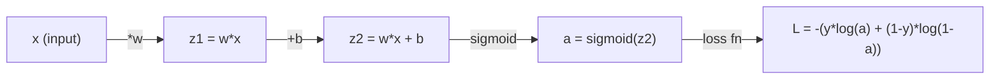
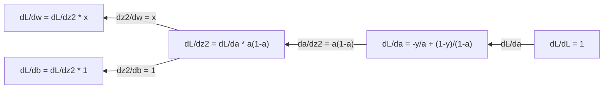
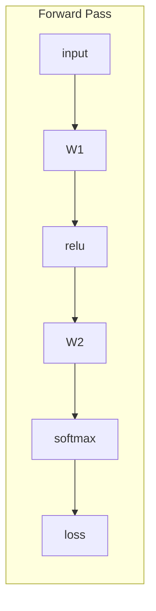
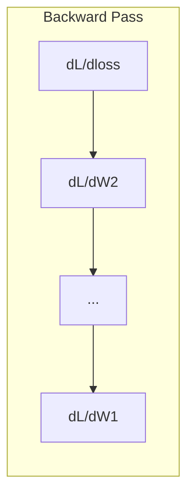

# 머신러닝을 위한 미적분학

> 미분은 어느 쪽이 내리막길인지 알려줍니다. 신경망이 학습하는 데 필요한 것은 그것뿐입니다.

**유형:** Learn (이론)
**Language:** Python
**선수 레슨:** Phase 1, Lessons 01-03
**소요 시간:** ~60분

## 학습 목표

- 일반적인 ML 함수($x^2$, sigmoid, cross-entropy)에 대한 수치 미분과 해석적 미분을 계산합니다.
- 손실 함수(loss function)를 최소화하기 위해 1차원 및 2차원에서 경사 하강법(gradient descent)을 밑바닥부터 구현합니다.
- 선형 회귀(linear regression) 모델의 그래디언트를 유도하고 가중치를 수동으로 업데이트하여 학습시킵니다.
- 헤시안 행렬(Hessian matrix), 테일러 급수(Taylor series) 근사, 그리고 이들이 최적화 기법들과 맺는 관계를 설명합니다.

## 문제

수백만 개의 가중치(weight)를 가진 신경망이 있습니다. 각 가중치는 조절 다이얼과 같습니다. 모델의 오차를 조금이라도 줄이려면 모든 다이얼을 어느 방향으로 돌려야 할지 알아내야 합니다. 미적분학이 바로 그 방향을 알려줍니다.

미적분학이 없다면 신경망 학습은 무작위로 값을 바꿔보며 운에 맡기는 것에 불과할 것입니다. 미분을 활용하면 각 가중치가 오차에 어떤 영향을 미치는지 정확히 알 수 있습니다. 매번 모든 다이얼을 올바른 방향으로 돌릴 수 있게 됩니다.

## 핵심 개념

### 미분이란 무엇인가?

미분은 변화율을 측정합니다. 함수 $y = f(x)$에 대해 도함수 $f'(x)$는 다음을 알려줍니다. $x$을 아주 미세하게 움직였을 때, $y$은 얼마나 변하는가?

기하학적으로 미분은 한 점에서의 접선(tangent line) 기울기입니다.

**$f(x) = x^2$:**

| $x$ | $f(x)$ | $f'(x)$ (기울기) |
|---|------|---------------|
| 0 | 0    | 0 (평평함, 맨 바닥) |
| 1 | 1    | 2 |
| 2 | 4    | 4 (이 점에서의 접선 기울기) |
| 3 | 9    | 6 |

$x=2$에서 기울기는 4입니다. $x$을 오른쪽으로 아주 조금 이동하면 $y$은 그 양의 약 4배만큼 증가합니다. $x=0$에서 기울기는 0입니다. 그릇 모양의 맨 바닥에 위치한 것입니다.

엄밀한 정의는 다음과 같습니다.

```math
f'(x) = \lim_{h \to 0} \frac{f(x + h) - f(x)}{h}
```

코드에서는 극한을 생략하고 매우 작은 $h$을 직접 사용합니다. 이것이 바로 수치 미분(numerical derivative)입니다.

### 편미분: 한 번에 한 변수씩

실제 함수는 입력이 여러 개입니다. 신경망의 손실은 수천, 수만 개의 가중치에 의해 결정됩니다. 편미분(partial derivative)은 한 변수를 제외한 모든 변수를 상수로 취급하고, 그 한 변수에 대해서만 미분을 수행합니다.

```math
\begin{aligned}
f(x, y) &= x^2 + 3xy + y^2 \\[4pt]
\frac{\partial f}{\partial x} &= 2x + 3y \quad \text{(treat } y \text{ as a constant)} \\
\frac{\partial f}{\partial y} &= 3x + 2y \quad \text{(treat } x \text{ as a constant)}
\end{aligned}
```

각 편미분은 다음 질문에 답합니다. 이 가중치 하나만 살짝 변경하면 손실은 어떻게 변하는가?

### 그래디언트: 모든 편미분의 벡터

그래디언트(gradient)는 모든 편미분을 하나의 벡터로 모은 것입니다. 함수 $f(x, y, z)$에 대해 그래디언트는 다음과 같습니다.

```math
\nabla f = \left[ \frac{\partial f}{\partial x}, \frac{\partial f}{\partial y}, \frac{\partial f}{\partial z} \right]
```

그래디언트는 가장 가파르게 증가하는 방향(steepest ascent)을 가리킵니다. 함수를 최소화하려면 그 반대 방향으로 이동해야 합니다.

**$f(x,y) = x^2 + y^2$의 등고선 플롯:**

이 함수는 동심원을 등고선으로 갖는 그릇 형태를 이룹니다. 최솟값은 (0, 0)에 있습니다.

| 점 | $\nabla f$ | $-\nabla f$ (하강 방향) |
|-------|--------|----------------------------|
| (1, 1) | [2, 2] (오르막길을 향함, 최솟값에서 멀어짐) | [-2, -2] (내리막길을 향함, 최솟값으로 향함) |
| (0, 0) | [0, 0] (평평함, 최솟값에 도달함) | [0, 0] |

이것이 바로 그림으로 나타낸 경사 하강법입니다. 그래디언트를 계산하고, 부호를 반대로 바꾼 뒤, 한 걸음 이동합니다.

### 최적화와의 연결점

신경망 학습은 최적화(optimization) 문제입니다. 모델이 얼마나 잘못되었는지를 측정하는 손실 함수 $L(w_1, w_2, \ldots, w_n)$가 주어지며, 이를 최소화하는 것이 목표입니다.

```
Gradient descent update rule:

  w_new = w_old - learning_rate * dL/dw

For every weight:
  1. Compute the partial derivative of loss with respect to that weight
  2. Subtract a small multiple of it from the weight
  3. Repeat
```

학습률(learning rate)은 보폭(step size)을 조절합니다. 너무 크면 최솟값을 지나치게 되고, 너무 작으면 학습 속도가 지나치게 느려집니다.

**손실 지형(Loss landscape, 1차원 단면):**

손실 함수 $L(w)$은 가중치 $w$의 변화에 따라 봉우리와 골짜기가 있는 곡선을 형성합니다.

| 특성 | 설명 |
|---------|-------------|
| 전역 최솟값(Global minimum) | 곡선 전체에서 가장 낮은 지점 -- 최적해 |
| 지역 최솟값(Local minimum) | 주변보다는 낮지만 전체에서 가장 낮지는 않은 골짜기 |
| 기울기(Slope) | 경사 하강법은 임의의 시작점에서부터 기울기를 따라 내리막길로 이동함 |

경사 하강법은 기울기를 따라 내리막으로 이동합니다. 지역 최솟값에 갇힐 수도 있지만, 고차원 공간(수백만 개의 가중치)에서는 이것이 실질적인 문제가 되는 경우가 드뭅니다.

### 수치 미분 vs 해석적 미분

도함수를 계산하는 데는 두 가지 방법이 있습니다.

해석적 미분(analytical derivative): 미적분 규칙을 직접 손으로 적용합니다. $f(x) = x^2$의 경우 도함수는 $f'(x) = 2x$입니다. 정확하고 빠릅니다.

수치 미분(numerical derivative): 정의를 이용해 근사합니다. 아주 작은 $h$에 대해 $f(x+h)$과 $f(x-h)$을 계산한 뒤, 그 차이를 이용합니다.

```
Numerical (central difference):

f'(x) ~= f(x + h) - f(x - h)
          -----------------------
                  2h

h = 0.0001 works well in practice
```

수치 미분은 더 느리지만 어떤 함수에도 적용할 수 있습니다. 해석적 미분은 빠르지만 공식을 직접 유도해야 합니다. 신경망 프레임워크는 제3의 방식인 자동 미분(automatic differentiation)을 사용하며, 이는 기계적인 방식으로 정확한 미분을 계산합니다. 이는 Phase 3에서 다루게 됩니다.

### 간단한 함수의 손계산 미분

다음은 ML에서 계속해서 마주치게 될 도함수들입니다.

```
Function        Derivative       Used in
--------        ----------       -------
f(x) = x^2     f'(x) = 2x      Loss functions (MSE)
f(x) = wx + b  f'(w) = x        Linear layer (gradient w.r.t. weight)
                f'(b) = 1        Linear layer (gradient w.r.t. bias)
                f'(x) = w        Linear layer (gradient w.r.t. input)
f(x) = e^x     f'(x) = e^x     Softmax, attention
f(x) = ln(x)   f'(x) = 1/x     Cross-entropy loss
f(x) = 1/(1+e^-x)  f'(x) = f(x)(1-f(x))   Sigmoid activation
```

$f(x) = x^2$의 경우:

```
f(x) = x^2    f'(x) = 2x

  x    f(x)   f'(x)   meaning
  -2    4      -4      slope tilts left (decreasing)
  -1    1      -2      slope tilts left (decreasing)
   0    0       0      flat (minimum!)
   1    1       2      slope tilts right (increasing)
   2    4       4      slope tilts right (increasing)
```

$x=3$, $b=1$인 $f(w) = wx + b$의 경우:

```
f(w) = 3w + 1    f'(w) = 3

The derivative with respect to w is just x.
If x is big, a small change in w causes a big change in output.
```

### 연쇄 법칙

함수가 합성되었을 때, 연쇄 법칙(chain rule)은 이를 미분하는 방법을 알려줍니다.

```
If y = f(g(x)), then dy/dx = f'(g(x)) * g'(x)

Example: y = (3x + 1)^2
  outer: f(u) = u^2       f'(u) = 2u
  inner: g(x) = 3x + 1    g'(x) = 3
  dy/dx = 2(3x + 1) * 3 = 6(3x + 1)
```

신경망은 일련의 함수 사슬입니다: 입력 -> 선형 변환 -> 활성화 함수 -> 선형 변환 -> 활성화 함수 -> 손실. 역전파(backpropagation)는 출력에서 입력 방향으로 연쇄 법칙을 반복 적용하는 과정입니다. 알고리즘의 원리는 이것이 전부입니다.

### 헤시안 행렬

그래디언트가 기울기를 나타낸다면, 헤시안(Hessian)은 곡률(curvature)을 나타냅니다.

헤시안은 2계 편미분(second-order partial derivatives)으로 이루어진 행렬입니다. 함수 $f(x_1, x_2, \ldots, x_n)$에 대해 헤시안의 성분 $(i, j)$은 다음과 같습니다.

```math
H_{ij} = \frac{\partial^2 f}{\partial x_i \, \partial x_j}
```

2변수 함수 $f(x, y)$의 경우:

```math
H = \begin{bmatrix} \dfrac{\partial^2 f}{\partial x^2} & \dfrac{\partial^2 f}{\partial x \, \partial y} \\[8pt] \dfrac{\partial^2 f}{\partial y \, \partial x} & \dfrac{\partial^2 f}{\partial y^2} \end{bmatrix}
```

**임계점(그래디언트 = 0인 지점)에서 헤시안이 알려주는 정보:**

| 헤시안 특성 | 의미 | 곡면 예시 |
|-----------------|---------|-----------------|
| 양의 정부호(Positive definite, 모든 고윳값 > 0) | 지역 최솟값 | 위를 향한 그릇 모양 |
| 음의 정부호(Negative definite, 모든 고윳값 < 0) | 지역 최댓값 | 아래를 향한 그릇 모양 |
| 부정부호(Indefinite, 양수/음수 고윳값 혼재) | 안장점(Saddle point) | 말안장 형태 |

**예시:** $f(x, y) = x^2 - y^2$ (안장 함수)

```
df/dx = 2x       df/dy = -2y
d^2f/dx^2 = 2    d^2f/dy^2 = -2    d^2f/dxdy = 0

H = | 2   0 |
    | 0  -2 |

Eigenvalues: 2 and -2 (one positive, one negative)
--> Saddle point at (0, 0)
```

$f(x, y) = x^2 + y^2$ (그릇 형태)과 비교해 보십시오.

```
H = | 2  0 |
    | 0  2 |

Eigenvalues: 2 and 2 (both positive)
--> Local minimum at (0, 0)
```

**ML에서 헤시안이 중요한 이유:**

뉴턴 방법(Newton's method)은 헤시안을 사용하여 경사 하강법보다 더 나은 최적화 스텝을 밟습니다. 단순히 기울기만 따르는 대신 곡률을 함께 고려합니다.

```math
\begin{aligned}
\text{Newton's update:} \quad & w_{\text{new}} = w_{\text{old}} - H^{-1} \cdot \text{gradient} \\
\text{Gradient descent:} \quad & w_{\text{new}} = w_{\text{old}} - \text{lr} \cdot \text{gradient}
\end{aligned}
```

뉴턴 방법은 헤시안이 그래디언트의 "스케일을 재조정"하기 때문에 더 빠르게 수렴합니다. 가파른 방향으로는 더 작은 스텝을, 완만한 방향으로는 더 큰 스텝을 이동합니다.

문제점: 파라미터가 $N$개인 신경망의 경우 헤시안은 $N \times N$ 크기가 됩니다. 파라미터가 100만 개인 모델이라면 1조 개의 원소를 가진 행렬이 필요합니다. 이것이 바로 우리가 근사법을 사용하는 이유입니다.

| 기법 | 활용 정보 | 계산 비용 | 수렴 속도 |
|--------|-------------|------|-------------|
| 경사 하강법 | 1차 도함수만 사용 | 스텝당 $O(N)$ | 느림 (선형 수렴) |
| 뉴턴 방법 | 전체 헤시안 | 스텝당 $O(N^3)$ | 빠름 (2차 수렴) |
| L-BFGS | 그래디언트 이력으로 근사한 헤시안 | 스텝당 $O(N)$ | 보통 (초선형 수렴) |
| Adam | 파라미터별 적응형 학습률 (대각 헤시안 근사) | 스텝당 $O(N)$ | 보통 |
| 자연 그래디언트(Natural gradient) | 피셔 정보 행렬(Fisher information matrix, 통계적 헤시안) | 스텝당 $O(N^2)$ | 빠름 |

실제 딥러닝에서는 Adam이 기본 옵티마이저로 사용됩니다. Adam은 파라미터별 그래디언트의 이동 평균과 분산을 추적하여 2차 정보를 저렴한 비용으로 근사합니다.
### 테일러 급수 근사 (Taylor Series Approximation)

모든 매끄러운 함수는 다항식으로 국소적으로 근사할 수 있습니다:

```math
f(x + h) = f(x) + f'(x)\,h + \frac{1}{2} f''(x)\,h^2 + \frac{1}{6} f'''(x)\,h^3 + \cdots
```

더 많은 항을 포함할수록 근사는 더 정확해지지만, 이는 점 $x$ 근처에서만 유효합니다.

**테일러 급수가 ML에서 중요한 이유:**

- **1차 테일러 = 경사 하강법(gradient descent).** $f(x + h) \approx f(x) + f'(x) h$를 사용할 때, 여러분은 선형 근사를 수행하는 것입니다. 경사 하강법은 이 선형 모델을 최소화하여 $h = -\text{lr} \cdot f'(x)$를 선택합니다.

- **2차 테일러 = 뉴턴 방법(Newton's method).** $f(x + h) \approx f(x) + f'(x) h + \frac{1}{2} f''(x) h^2$를 사용하면 2차 모델을 얻습니다. 이를 최소화하면 뉴턴 스텝인 $h = -f'(x)/f''(x)$가 도출됩니다.

- **손실 함수 설계.** MSE와 교차 엔트로피(cross-entropy)는 매끄럽기 때문에 테일러 전개가 잘 작동합니다. 이는 우연이 아닙니다. 매끄러운 손실 함수는 최적화를 예측 가능하게 만듭니다.

```
Approximation order    What it captures    Optimization method
-------------------    -----------------   -------------------
0th order (constant)   Just the value      Random search
1st order (linear)     Slope               Gradient descent
2nd order (quadratic)  Curvature           Newton's method
Higher orders          Finer structure     Rarely used in ML
```

핵심 통찰: 모든 경사 기반 최적화는 본질적으로 손실 함수를 국소적으로 근사하고 해당 근사의 최솟값으로 이동하는 것입니다.

### ML에서의 적분

도함수는 변화율을 알려줍니다. 적분은 누적, 즉 곡선 아래의 면적을 계산합니다.

ML에서는 적분을 손으로 직접 계산하는 경우가 드물지만, 그 개념은 어디에나 존재합니다:

**확률.** 확률 밀도 $p(x)$를 갖는 연속 확률 변수의 경우:

```math
P(a < X < b) = \int_a^b p(x) \, dx
```

$a$와 $b$ 사이의 확률 밀도 곡선 아래 면적은 해당 범위에 속할 확률입니다.

**기댓값.** 확률로 가중된 평균 결과:

```math
\mathbb{E}[f(X)] = \int f(x) \, p(x) \, dx
```

데이터 분포에 대한 기대 손실은 적분입니다. 훈련은 이것의 경험적 근사를 최소화합니다.

**KL 발산(KL divergence).** 두 분포가 얼마나 다른지 측정합니다:

```math
\mathrm{KL}(p \,\|\, q) = \int p(x) \log \frac{p(x)}{q(x)} \, dx
```

VAE, 지식 증류(knowledge distillation), 베이즈 추론(Bayesian inference)에서 사용됩니다.

**정규화 상수.** 베이즈 추론에서:

```math
p(w \mid \text{data}) = \frac{p(\text{data} \mid w) \, p(w)}{\int p(\text{data} \mid w) \, p(w) \, dw}
```

분모는 가능한 모든 파라미터 값에 대한 적분입니다. 이는 종종 다루기 힘들기(intractable) 때문에 MCMC나 변분 추론(variational inference) 같은 근사 기법을 사용합니다.

| 적분 개념 | ML에서 나타나는 곳 |
|-----------------|----------------------|
| 곡선 아래 면적 | 밀도 함수로부터 확률 계산 |
| 기댓값 | 손실 함수, 위험 최소화 |
| KL 발산 | VAE, 정책 최적화, 지식 증류 |
| 정규화 | 베이지안 사후 확률, softmax 분모 |
| 주변 우도 | 모델 비교, 증거 하한(ELBO) |

### 계산 그래프에서의 다변수 연쇄 법칙

연쇄 법칙(chain rule)은 일직선상의 스칼라 함수에만 적용되는 것이 아닙니다. 신경망에서는 변수들이 여러 갈래로 뻗어나가고 합쳐집니다. 단순한 순전파(forward pass)를 통해 도함수가 어떻게 흐르는지 살펴보겠습니다:



역전파(backward pass)는 오른쪽에서 왼쪽으로 그래디언트를 계산합니다:



각 화살표는 국소 도함수를 곱합니다. 임의의 파라미터에 대한 그래디언트는 손실에서 해당 파라미터까지의 경로에 있는 모든 국소 도함수의 곱입니다. 경로가 분기되고 합쳐질 때는 기여분을 합산합니다(다변수 연쇄 법칙).

역전파의 본질은 이것이 전부입니다. 바로 출력에서 입력 방향으로 계산 그래프를 통해 연쇄 법칙을 체계적으로 적용하는 것입니다.

### 야코비 행렬 (Jacobian matrix)

함수가 벡터를 벡터로 매핑할 때(신경망 레이어처럼), 그 도함수는 행렬이 됩니다. 야코비 행렬은 모든 입력에 대한 모든 출력의 편도함수를 포함합니다.

$f: \mathbb{R}^n \to \mathbb{R}^m$에 대해 야코비 행렬 $J$는 $m \times n$ 행렬입니다:

| | $x_1$ | $x_2$ | ... | $x_n$ |
|---|---|---|---|---|
| $f_1$ | $\partial f_1/\partial x_1$ | $\partial f_1/\partial x_2$ | ... | $\partial f_1/\partial x_n$ |
| $f_2$ | $\partial f_2/\partial x_1$ | $\partial f_2/\partial x_2$ | ... | $\partial f_2/\partial x_n$ |
| ... | ... | ... | ... | ... |
| $f_m$ | $\partial f_m/\partial x_1$ | $\partial f_m/\partial x_2$ | ... | $\partial f_m/\partial x_n$ |

신경망에서 야코비 행렬을 손으로 직접 계산할 일은 없습니다. PyTorch가 이를 처리합니다. 하지만 야코비 행렬의 존재를 알면 역전파에서의 형태(shape)를 이해하는 데 도움이 됩니다. 레이어가 $\mathbb{R}^n$를 $\mathbb{R}^m$로 매핑하면, 그 야코비 행렬은 $m \times n$입니다. 그래디언트는 이 행렬의 전치(transpose)를 통해 역방향으로 흐릅니다.

### 이것이 신경망에서 중요한 이유

신경망의 모든 가중치는 그래디언트를 얻습니다. 그래디언트는 손실을 줄이기 위해 해당 가중치를 어떻게 조정해야 하는지 알려줍니다.





각 가중치 업데이트:
- `W1 = W1 - lr * dL/dW1`
- `W2 = W2 - lr * dL/dW2`

순전파는 예측값과 손실을 계산합니다. 역전파는 모든 가중치에 대한 손실의 그래디언트를 계산합니다. 그런 다음 모든 가중치가 내리막 방향으로 작은 한 걸음을 내딛습니다. 이를 수백만 번 반복합니다. 이것이 바로 딥러닝입니다.

```figure
derivative-tangent
```

## 직접 만들어보기

### 1단계: 바닥부터 수치 미분 구현하기

```python
def numerical_derivative(f, x, h=1e-7):
    return (f(x + h) - f(x - h)) / (2 * h)

def f(x):
    return x ** 2

for x in [-2, -1, 0, 1, 2]:
    numerical = numerical_derivative(f, x)
    analytical = 2 * x
    print(f"x={x:2d}  f'(x) numerical={numerical:.6f}  analytical={analytical:.1f}")
```

수치 미분 결과는 해석적 미분 결과와 소수점 여러 자리까지 일치합니다.

### 2단계: 편도함수와 그래디언트

```python
def numerical_gradient(f, point, h=1e-7):
    gradient = []
    for i in range(len(point)):
        point_plus = list(point)
        point_minus = list(point)
        point_plus[i] += h
        point_minus[i] -= h
        partial = (f(point_plus) - f(point_minus)) / (2 * h)
        gradient.append(partial)
    return gradient

def f_multi(point):
    x, y = point
    return x**2 + 3*x*y + y**2

grad = numerical_gradient(f_multi, [1.0, 2.0])
print(f"Numerical gradient at (1,2): {[f'{g:.4f}' for g in grad]}")
print(f"Analytical gradient at (1,2): [2*1+3*2, 3*1+2*2] = [{2*1+3*2}, {3*1+2*2}]")
```

### 3단계: 경사 하강법으로 f(x) = x^2의 최솟값 찾기

```python
x = 5.0
lr = 0.1
for step in range(20):
    grad = 2 * x
    x = x - lr * grad
    print(f"step {step:2d}  x={x:8.4f}  f(x)={x**2:10.6f}")
```

$x=5$에서 시작하여, 각 스텝마다 최솟값인 $x=0$에 더 가까워집니다.

### 4단계: 2D 함수에서의 경사 하강법

```python
def f_2d(point):
    x, y = point
    return x**2 + y**2

point = [4.0, 3.0]
lr = 0.1
for step in range(30):
    grad = numerical_gradient(f_2d, point)
    point = [p - lr * g for p, g in zip(point, grad)]
    loss = f_2d(point)
    if step % 5 == 0 or step == 29:
        print(f"step {step:2d}  point=({point[0]:7.4f}, {point[1]:7.4f})  f={loss:.6f}")
```

### 5단계: 수치 미분과 해석적 미분 비교

```python
import math

test_functions = [
    ("x^2",      lambda x: x**2,          lambda x: 2*x),
    ("x^3",      lambda x: x**3,          lambda x: 3*x**2),
    ("sin(x)",   lambda x: math.sin(x),   lambda x: math.cos(x)),
    ("e^x",      lambda x: math.exp(x),   lambda x: math.exp(x)),
    ("1/x",      lambda x: 1/x,           lambda x: -1/x**2),
]

x = 2.0
print(f"{'Function':<12} {'Numerical':>12} {'Analytical':>12} {'Error':>12}")
print("-" * 50)
for name, f, df in test_functions:
    num = numerical_derivative(f, x)
    ana = df(x)
    err = abs(num - ana)
    print(f"{name:<12} {num:12.6f} {ana:12.6f} {err:12.2e}")
```

### 6단계: 헤세 행렬 수치 계산

```python
def hessian_2d(f, x, y, h=1e-5):
    fxx = (f(x + h, y) - 2 * f(x, y) + f(x - h, y)) / (h ** 2)
    fyy = (f(x, y + h) - 2 * f(x, y) + f(x, y - h)) / (h ** 2)
    fxy = (f(x + h, y + h) - f(x + h, y - h) - f(x - h, y + h) + f(x - h, y - h)) / (4 * h ** 2)
    return [[fxx, fxy], [fxy, fyy]]

def saddle(x, y):
    return x ** 2 - y ** 2

def bowl(x, y):
    return x ** 2 + y ** 2

H_saddle = hessian_2d(saddle, 0.0, 0.0)
H_bowl = hessian_2d(bowl, 0.0, 0.0)
print(f"Saddle Hessian: {H_saddle}")  # [[2, 0], [0, -2]] -- mixed signs
print(f"Bowl Hessian:   {H_bowl}")    # [[2, 0], [0, 2]]  -- both positive
```

안장점 함수의 헤세 행렬(Hessian)은 고윳값 2와 -2를 갖습니다(부호가 혼합되어 있어 안장점임을 확인). 그릇 모양 함수의 헤세 행렬은 고윳값 2와 2를 갖습니다(둘 다 양수이므로 최솟값임을 확인).

### 7단계: 테일러 근사 실제로 확인하기

```python
import math

def taylor_approx(f, f_prime, f_double_prime, x0, h, order=2):
    result = f(x0)
    if order >= 1:
        result += f_prime(x0) * h
    if order >= 2:
        result += 0.5 * f_double_prime(x0) * h ** 2
    return result

x0 = 0.0
for h in [0.1, 0.5, 1.0, 2.0]:
    true_val = math.sin(h)
    t1 = taylor_approx(math.sin, math.cos, lambda x: -math.sin(x), x0, h, order=1)
    t2 = taylor_approx(math.sin, math.cos, lambda x: -math.sin(x), x0, h, order=2)
    print(f"h={h:.1f}  sin(h)={true_val:.4f}  order1={t1:.4f}  order2={t2:.4f}")
```

$x_0=0$ 근처에서 $\sin(x) \approx x$입니다(1차 테일러). 이 근사는 작은 $h$에 대해서는 매우 훌륭하지만 큰 $h$에서는 깨집니다. 이것이 바로 경사 하강법이 작은 학습률에서 가장 잘 작동하는 이유입니다. 각 스텝은 선형 근사가 정확하다는 가정을 바탕으로 합니다.

### 8단계: 이것이 신경망에서 중요한 이유

```python
import random

random.seed(42)

w = random.gauss(0, 1)
b = random.gauss(0, 1)
lr = 0.01

xs = [1.0, 2.0, 3.0, 4.0, 5.0]
ys = [3.0, 5.0, 7.0, 9.0, 11.0]

for epoch in range(200):
    total_loss = 0
    dw = 0
    db = 0
    for x, y in zip(xs, ys):
        pred = w * x + b
        error = pred - y
        total_loss += error ** 2
        dw += 2 * error * x
        db += 2 * error
    dw /= len(xs)
    db /= len(xs)
    total_loss /= len(xs)
    w -= lr * dw
    b -= lr * db
    if epoch % 40 == 0 or epoch == 199:
        print(f"epoch {epoch:3d}  w={w:.4f}  b={b:.4f}  loss={total_loss:.6f}")

print(f"\nLearned: y = {w:.2f}x + {b:.2f}")
print(f"Actual:  y = 2x + 1")
```

모든 경사 기반 훈련 루프는 예측, 손실 계산, 그래디언트 계산, 가중치 업데이트라는 동일한 패턴을 따릅니다.

## 직접 사용해보기

NumPy를 사용하면 동일한 연산을 더 빠르고 간결하게 수행할 수 있습니다:

```python
import numpy as np

x = np.array([1, 2, 3, 4, 5], dtype=float)
y = np.array([3, 5, 7, 9, 11], dtype=float)

w, b = np.random.randn(), np.random.randn()
lr = 0.01

for epoch in range(200):
    pred = w * x + b
    error = pred - y
    loss = np.mean(error ** 2)
    dw = np.mean(2 * error * x)
    db = np.mean(2 * error)
    w -= lr * dw
    b -= lr * db

print(f"Learned: y = {w:.2f}x + {b:.2f}")
```

방금 여러분은 경사 하강법을 바닥부터 직접 구현했습니다. PyTorch가 그래디언트 계산을 자동화하지만, 업데이트 루프는 완전히 동일합니다.

## 연습 문제

1. `numerical_derivative`를 두 번 호출하여 `numerical_second_derivative(f, x)`를 구현하세요. $x=2$에서 $x^3$의 2계 도함수가 12임을 검증하세요.
2. 경사 하강법을 사용하여 $f(x, y) = (x - 3)^2 + (y + 1)^2$의 최솟값을 찾으세요. $(0, 0)$에서 시작합니다. 결과는 $(3, -1)$로 수렴해야 합니다.
3. 경사 하강법 루프에 모멘텀(momentum)을 추가하세요. 과거 그래디언트를 누적하는 속도 벡터를 유지합니다. $f(x) = x^4 - 3x^2$에서 모멘텀이 있을 때와 없을 때의 수렴 속도를 비교하세요.

### 힌트

**연습 문제 1.** `numerical_derivative(f, x)`를 반환하는 헬퍼 함수를 정의하고, 그 헬퍼를 `numerical_derivative`에 다시 전달하세요. 결과에 노이즈가 있다면 두 호출 모두에 `h=1e-4`와 같은 더 큰 스텝을 사용하세요. $x=2$에서의 값은 12에 가까워야 합니다.

**연습 문제 2.** 그래디언트 $(2(x - 3), 2(y + 1))$를 직접 작성하거나 `numerical_gradient`를 사용하고, $(0, 0)$에서 `gradient_descent_nd`를 호출하세요. 10스텝마다 점을 출력하세요. 이 점은 $(3, -1)$로 이동해야 하며 손실은 0에 가깝게 떨어져야 합니다.

**연습 문제 3.** 속도 `v`를 유지하고, 이를 `v = momentum * v - lr * grad`로 업데이트한 후 `v`를 `x`에 더하세요. 그래디언트가 0 근처에 도달하기 위해 각 방법이 필요로 하는 스텝 수를 세어보세요. 최솟값은 $x = \pm\sqrt{1.5} \approx \pm 1.225$에 있습니다.
## 핵심 용어 (Key Terms)

| 용어 | 흔히 하는 표현 | 실제 의미 |
|------|----------------|----------------------|
| 도함수(Derivative) | "기울기" | 한 지점에서 함수의 변화율입니다. 입력의 단위 변화당 출력이 얼마나 변하는지 알려줍니다. |
| 편도함수(Partial derivative) | "한 변수에 대한 미분" | 다른 모든 변수를 상수로 고정한 상태에서 특정 한 변수에 대해 구한 도함수입니다. |
| 그래디언트(Gradient) | "가장 가파른 상승 방향" | 모든 편도함수로 이루어진 벡터입니다. 함수를 가장 빠르게 증가시키는 방향을 가리킵니다. |
| 경사하강법(Gradient descent) | "내리막길 내려가기" | 손실을 줄이기 위해 매개변수에서 그래디언트(에 학습률을 곱한 값)를 뺍니다. 신경망 학습의 핵심입니다. |
| 학습률(Learning rate) | "보폭(Step size)" | 각 경사하강법 단계의 크기를 제어하는 스칼라입니다. 너무 크면 발산하고, 너무 작으면 느리게 수렴합니다. |
| 연쇄 법칙(Chain rule) | "도함수끼리 곱하기" | 합성함수를 미분하기 위한 규칙입니다: $\frac{df}{dx} = \frac{df}{dg} \cdot \frac{dg}{dx}$. 역전파(backpropagation)의 수학적 기반입니다. |
| 야코비안(Jacobian) | "도함수들의 행렬" | 함수가 벡터를 벡터로 매핑할 때, 입력에 대한 출력의 모든 편도함수로 구성된 행렬입니다. |
| 수치 미분(Numerical derivative) | "유한 차분" | 가까운 두 지점에서 함수를 평가하고 그 사이의 기울기를 계산하여 도함수를 근사하는 방법입니다. |
| 역전파(Backpropagation) | "후진 모드 자동 미분(reverse-mode autodiff)" | 연쇄 법칙을 사용하여 출력에서 입력 방향으로 층별 그래디언트를 계산하는 과정입니다. 신경망이 학습하는 방식입니다. |
| 헤시안(Hessian) | "이계도함수 행렬" | 모든 2차 편도함수로 구성된 행렬입니다. 함수의 곡률을 설명합니다. 임계점에서 헤시안이 양의 한정(positive definite)이면 극솟값(local minimum)을 의미합니다. |
| 테일러 급수(Taylor series) | "다항식 근사" | 도함수를 사용하여 특정 지점 근처에서 함수를 근사하는 방법입니다: $f(x+h) \approx f(x) + f'(x)h + \frac{1}{2}f''(x)h^2 + \cdots$ 경사하강법과 뉴턴 방법(Newton's method)이 작동하는 이유를 이해하는 기초가 됩니다. |
| 적분(Integral) | "곡선 아래의 면적" | 일정 구간에 걸친 양의 누적입니다. 머신러닝에서 적분은 확률, 기댓값, KL 발산(KL divergence) 등을 정의합니다. |

## 추가 참고 자료

- [3Blue1Brown: Essence of Calculus](https://www.3blue1brown.com/topics/calculus) - 도함수, 적분, 연쇄 법칙에 대한 시각적 직관
- [Stanford CS231n: Backpropagation](https://cs231n.github.io/optimization-2/) - 신경망 층을 통해 그래디언트가 흐르는 방식
