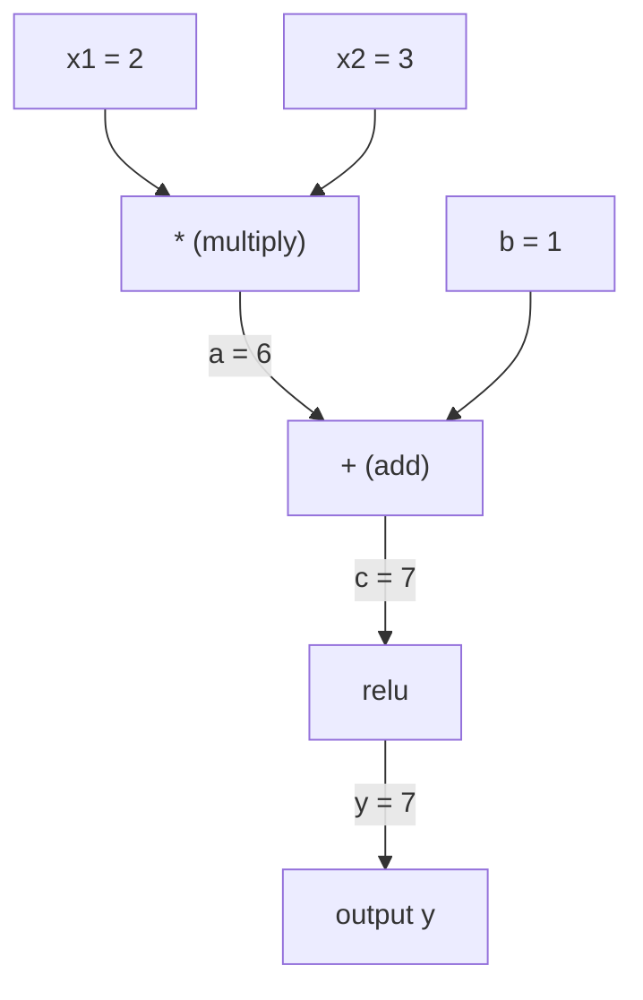
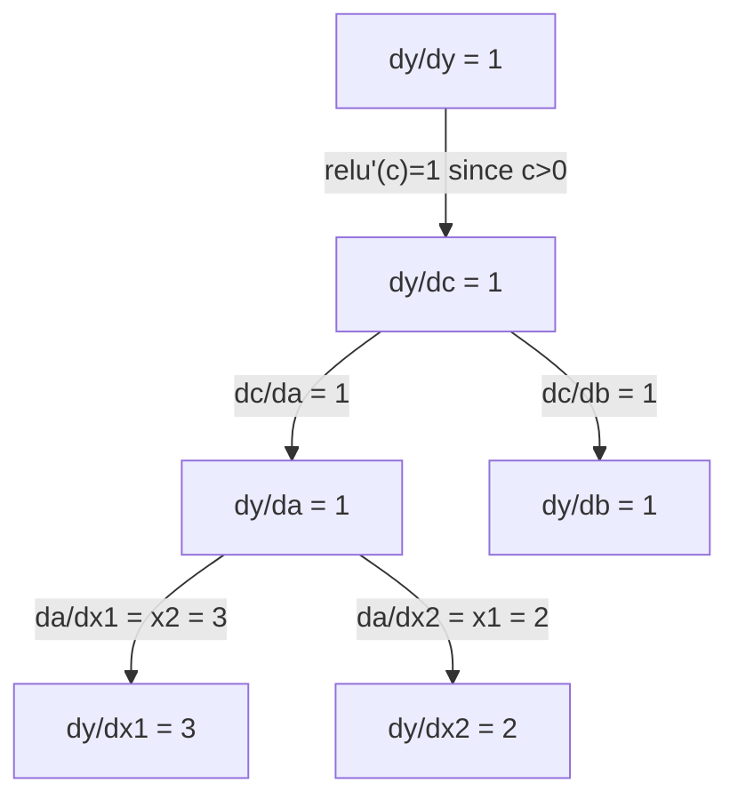

# 연쇄 법칙과 자동 미분

> 연쇄 법칙은 학습하는 모든 신경망의 이면에 자리한 핵심 엔진입니다.

**유형:** Build (실습)
**Language:** Python
**선수 레슨:** Phase 1, Lesson 04 (Derivatives & Gradients)
**소요 시간:** ~90분

## 학습 목표

- 연산을 기록하고 후진 모드 자동 미분(reverse-mode autodiff)을 통해 기울기(gradient)를 계산하는 최소한의 autograd 엔진(Value 클래스)을 구축합니다.
- 위상 정렬(topological sort)을 사용하여 계산 그래프(computation graph)를 통한 순전파(forward pass) 및 역전파(backward pass)를 구현합니다.
- 밑바닥부터 구현한 autograd 엔진만을 사용하여 XOR 문제에 대한 다층 퍼셉트론(MLP)을 구성하고 훈련합니다.
- 수치적 유한 차분(numerical finite differences)을 사용한 기울기 검증(gradient checking)으로 자동 미분의 정확성을 검증합니다.

## 문제 상황

단순한 함수의 도함수는 쉽게 계산할 수 있습니다. 하지만 신경망은 단순한 함수가 아닙니다. 그것은 수백 개의 함수가 합성된 형태입니다: 행렬 곱, 편향 더하기, 활성화 함수 적용, 다시 행렬 곱, softmax, 교차 엔트로피 손실(cross-entropy loss). 출력은 함수 속의 함수 속의 함수 형태가 됩니다.

네트워크를 훈련하려면 모든 단일 가중치에 대한 손실의 기울기를 구해야 합니다. 수백만 개의 파라미터에 대해 이를 손으로 직접 계산하는 것은 불가능합니다. 수치적으로(유한 차분으로) 계산하는 것은 너무 느립니다.

연쇄 법칙(chain rule)은 수학적 기초를 제공합니다. 자동 미분(automatic differentiation)은 알고리즘을 제공합니다. 둘이 결합하여 임의의 합성 함수에 대해 한 번의 순전파에 비례하는 시간 내에 정확한 기울기를 계산할 수 있게 해줍니다.

이것이 바로 PyTorch, TensorFlow, JAX가 작동하는 방식입니다. 여러분은 밑바닥부터 이의 축소 버전을 직접 구축해 볼 것입니다.

## 핵심 개념

### 연쇄 법칙

$y = f(g(x))$일 때, $x$에 대한 $y$의 도함수는 다음과 같습니다:

```math
\frac{dy}{dx} = \frac{dy}{dg} \cdot \frac{dg}{dx} = f'(g(x)) \cdot g'(x)
```

사슬을 따라 도함수들을 곱합니다. 각 연결 고리는 자신의 국소 도함수(local derivative)를 기여합니다.

예시: $y = \sin(x^2)$

```math
\begin{aligned}
g(x) &= x^2 \qquad & g'(x) &= 2x \\
f(g) &= \sin(g) \qquad & f'(g) &= \cos(g) \\[4pt]
\frac{dy}{dx} &= \cos(x^2) \cdot 2x
\end{aligned}
```

더 깊은 합성 함수의 경우 사슬이 확장됩니다:

```math
\begin{aligned}
y &= f(g(h(x))) \\[4pt]
\frac{dy}{dx} &= f'(g(h(x))) \cdot g'(h(x)) \cdot h'(x)
\end{aligned}
```

신경망의 모든 층은 이 사슬의 한 연결 고리입니다.

### 계산 그래프

계산 그래프는 연쇄 법칙을 시각화해 줍니다. 모든 연산은 노드가 됩니다. 데이터는 그래프를 따라 앞으로 흐릅니다. 기울기는 뒤로 흐릅니다.

**순전파 (값 계산):**



**역전파 (기울기 계산):**



역전파는 모든 노드에서 연쇄 법칙을 적용하여 출력에서 입력 방향으로 기울기를 전파합니다.

### 전진 모드 vs 후진 모드

그래프를 통해 연쇄 법칙을 적용하는 데는 두 가지 방식이 있습니다.

**전진 모드(Forward mode)**는 입력에서 시작하여 도함수를 앞으로 밀어냅니다. 이는 $dx/dx = 1$를 계산하고 각 연산을 통해 전파합니다. 입력이 적고 출력이 많을 때 적합합니다.

```
Forward mode: seed dx/dx = 1, propagate forward

  x = 2       (dx/dx = 1)
  a = x^2     (da/dx = 2x = 4)
  y = sin(a)  (dy/dx = cos(a) * da/dx = cos(4) * 4 = -2.615)
```

**후진 모드(Reverse mode)**는 출력에서 시작하여 기울기를 뒤로 끌어당깁니다. 이는 $dy/dy = 1$를 계산하고 각 연산을 역방향으로 거치며 전파합니다. 입력이 많고 출력이 적을 때 적합합니다.

```
Reverse mode: seed dy/dy = 1, propagate backward

  y = sin(a)  (dy/dy = 1)
  a = x^2     (dy/da = cos(a) = cos(4) = -0.654)
  x = 2       (dy/dx = dy/da * da/dx = -0.654 * 4 = -2.615)
```

신경망은 수백만 개의 입력(가중치)과 하나의 출력(손실)을 가집니다. 후진 모드는 단 한 번의 역전파로 모든 기울기를 계산합니다. 이것이 역전파(backpropagation)가 후진 모드를 사용하는 이유입니다.

| 모드 | 시드 | 방향 | 적합한 경우 |
|------|------|-----------|-----------|
| 전진 | $dx_i/dx_i = 1$ | 입력에서 출력으로 | 적은 입력, 많은 출력 |
| 후진 | $dy/dy = 1$ | 출력에서 입력으로 | 많은 입력, 적은 출력 (신경망) |

### 전진 모드를 위한 이원수

전진 모드는 이원수(dual numbers)를 사용하여 우아하게 구현할 수 있습니다. 이원수는 $\epsilon^2 = 0$을 만족하는 $a + b\epsilon$ 형태를 가집니다.

```
Dual number: (value, derivative)

(2, 1) means: value is 2, derivative w.r.t. x is 1

Arithmetic rules:
  (a, a') + (b, b') = (a+b, a'+b')
  (a, a') * (b, b') = (a*b, a'*b + a*b')
  sin(a, a')         = (sin(a), cos(a)*a')
```

입력 변수의 도함수를 1로 시드(seed) 설정합니다. 도함수는 모든 연산을 통해 자동으로 전파됩니다.

### Autograd 엔진 구축하기

autograd 엔진에는 세 가지가 필요합니다:

1. **값 래핑(Value wrapping).** 모든 숫자를 해당 값과 기울기를 저장하는 객체로 감쌉니다.
2. **그래프 기록(Graph recording).** 모든 연산은 입력과 국소 기울기 함수를 기록합니다.
3. **역전파(Backward pass).** 그래프를 위상 정렬한 다음, 역순으로 순회하며 각 노드에서 연쇄 법칙을 적용합니다.

이것이 바로 PyTorch의 `autograd`가 하는 일입니다. `torch.Tensor` 클래스는 값을 감싸고, `requires_grad=True`일 때 연산을 기록하며, `.backward()`을 호출할 때 기울기를 계산합니다.

### PyTorch Autograd의 내부 동작 원리

다음과 같은 PyTorch 코드를 작성할 때:

```python
x = torch.tensor(2.0, requires_grad=True)
y = x ** 2 + 3 * x + 1
y.backward()
print(x.grad)  # 7.0 = 2*x + 3 = 2*2 + 3
```

PyTorch는 내부적으로 다음 작업을 수행합니다:

1. `requires_grad=True`인 `x`에 대해 `Tensor` 노드를 생성합니다.
2. 모든 연산(`**`, `*`, `+`)은 새 노드를 생성하고 backward 함수를 기록합니다.
3. `y.backward()`는 기록된 그래프를 통해 후진 모드 자동 미분을 트리거합니다.
4. 각 노드의 `grad_fn`는 국소 기울기를 계산하여 부모 노드로 전달합니다.
5. 기울기는 (대체가 아닌) 덧셈을 통해 `.grad` 속성에 누적됩니다.

그래프는 동적(dynamic, define-by-run 방식)입니다. 매 순전파마다 새로운 그래프가 생성됩니다. 이것이 PyTorch가 모델 내부에서 제어 흐름(if/else, 반복문)을 지원할 수 있는 이유입니다.

```figure
chain-rule
```

## 직접 만들어보기

### 1단계: Value 클래스

```python
class Value:
    def __init__(self, data, children=(), op=''):
        self.data = data
        self.grad = 0.0
        self._backward = lambda: None
        self._prev = set(children)
        self._op = op

    def __repr__(self):
        return f"Value(data={self.data:.4f}, grad={self.grad:.4f})"
```

모든 `Value`는 자신의 수치 데이터, 기울기(초기값은 0), backward 함수, 그리고 자신을 생성한 자식 노드들에 대한 포인터를 저장합니다.

### 2단계: 기울기 추적 기능을 갖춘 산술 연산

```python
    def __add__(self, other):
        other = other if isinstance(other, Value) else Value(other)
        out = Value(self.data + other.data, (self, other), '+')
        def _backward():
            self.grad += out.grad
            other.grad += out.grad
        out._backward = _backward
        return out

    def __mul__(self, other):
        other = other if isinstance(other, Value) else Value(other)
        out = Value(self.data * other.data, (self, other), '*')
        def _backward():
            self.grad += other.data * out.grad
            other.grad += self.data * out.grad
        out._backward = _backward
        return out

    def relu(self):
        out = Value(max(0, self.data), (self,), 'relu')
        def _backward():
            self.grad += (1.0 if out.data > 0 else 0.0) * out.grad
        out._backward = _backward
        return out
```

각 연산은 국소 기울기를 계산하고 상류 기울기(`out.grad`)를 곱하는 방법을 알고 있는 클로저(closure)를 생성합니다. `+=`는 하나의 값이 여러 연산에서 사용되는 경우를 처리합니다.

### 3단계: 역전파

```python
    def backward(self):
        topo = []
        visited = set()
        def build_topo(v):
            if v not in visited:
                visited.add(v)
                for child in v._prev:
                    build_topo(child)
                topo.append(v)
        build_topo(self)

        self.grad = 1.0
        for v in reversed(topo):
            v._backward()
```

위상 정렬은 모든 노드의 기울기가 완전히 계산된 후에만 자식 노드로 전파되도록 보장합니다. 시드 기울기는 1.0($dy/dy = 1$)입니다.

### 4단계: 완전한 엔진을 위한 추가 연산들

기본 Value 클래스는 덧셈, 곱셈, relu를 처리합니다. 실제 autograd 엔진에는 더 많은 연산이 필요합니다. 다음은 신경망을 구축하는 데 필요한 연산들입니다:

```python
    def __neg__(self):
        return self * -1

    def __sub__(self, other):
        return self + (-other)

    def __radd__(self, other):
        return self + other

    def __rmul__(self, other):
        return self * other

    def __rsub__(self, other):
        return other + (-self)

    def __pow__(self, n):
        out = Value(self.data ** n, (self,), f'**{n}')
        def _backward():
            self.grad += n * (self.data ** (n - 1)) * out.grad
        out._backward = _backward
        return out

    def __truediv__(self, other):
        return self * (other ** -1) if isinstance(other, Value) else self * (Value(other) ** -1)

    def exp(self):
        import math
        e = math.exp(self.data)
        out = Value(e, (self,), 'exp')
        def _backward():
            self.grad += e * out.grad
        out._backward = _backward
        return out

    def log(self):
        import math
        out = Value(math.log(self.data), (self,), 'log')
        def _backward():
            self.grad += (1.0 / self.data) * out.grad
        out._backward = _backward
        return out

    def tanh(self):
        import math
        t = math.tanh(self.data)
        out = Value(t, (self,), 'tanh')
        def _backward():
            self.grad += (1 - t ** 2) * out.grad
        out._backward = _backward
        return out
```

**각 연산이 중요한 이유:**

| 연산 | 역전파 규칙 | 사용처 |
|-----------|--------------|---------|
| `__sub__` | add + neg 재사용 | 손실 계산 (pred - target) |
| `__pow__` | $n \cdot x^{n-1}$ | 다항식 활성화 함수, MSE ($\text{error}^2$) |
| `__truediv__` | mul + pow(-1) 재사용 | 정규화, 학습률 스케일링 |
| `exp` | $\exp(x) \cdot \text{upstream}$ | Softmax, 로그 우도(log-likelihood) |
| `log` | $(1/x) \cdot \text{upstream}$ | 교차 엔트로피 손실, 로그 확률 |
| `tanh` | $(1 - \tanh^2) \cdot \text{upstream}$ | 전통적인 활성화 함수 |

영리한 부분은 다음과 같습니다: `__sub__`와 `__truediv__`는 기존 연산들을 바탕으로 정의됩니다. 연쇄 법칙이 기본 add/mul/pow 연산을 통해 합성되므로 올바른 기울기를 거저 얻을 수 있습니다.

### 5단계: 밑바닥부터 미니 MLP 만들기

완성된 Value 클래스가 있다면 신경망을 구축할 수 있습니다. PyTorch도, NumPy도 필요 없습니다. 오직 Value와 연쇄 법칙만 있으면 됩니다.

```python
import random

class Neuron:
    def __init__(self, n_inputs):
        self.w = [Value(random.uniform(-1, 1)) for _ in range(n_inputs)]
        self.b = Value(0.0)

    def __call__(self, x):
        act = sum((wi * xi for wi, xi in zip(self.w, x)), self.b)
        return act.tanh()

    def parameters(self):
        return self.w + [self.b]

class Layer:
    def __init__(self, n_inputs, n_outputs):
        self.neurons = [Neuron(n_inputs) for _ in range(n_outputs)]

    def __call__(self, x):
        return [n(x) for n in self.neurons]

    def parameters(self):
        return [p for n in self.neurons for p in n.parameters()]

class MLP:
    def __init__(self, sizes):
        self.layers = [Layer(sizes[i], sizes[i+1]) for i in range(len(sizes)-1)]

    def __call__(self, x):
        for layer in self.layers:
            x = layer(x)
        return x[0] if len(x) == 1 else x

    def parameters(self):
        return [p for layer in self.layers for p in layer.parameters()]
```

`Neuron`은 `tanh(w1*x1 + w2*x2 + ... + b)`를 계산합니다. `Layer`는 뉴런들의 리스트입니다. `MLP`은 층들을 쌓아 올립니다. 모든 가중치는 `Value`이므로, `loss.backward()`를 호출하면 모든 파라미터로 기울기가 전파됩니다.

**XOR 문제 훈련:**

```python
random.seed(42)
model = MLP([2, 4, 1])  # 2 inputs, 4 hidden neurons, 1 output

xs = [[0, 0], [0, 1], [1, 0], [1, 1]]
ys = [-1, 1, 1, -1]  # XOR pattern (using -1/1 for tanh)

for step in range(100):
    preds = [model(x) for x in xs]
    loss = sum((p - y) ** 2 for p, y in zip(preds, ys))

    for p in model.parameters():
        p.grad = 0.0
    loss.backward()

    lr = 0.05
    for p in model.parameters():
        p.data -= lr * p.grad

    if step % 20 == 0:
        print(f"step {step:3d}  loss = {loss.data:.4f}")

print("\nPredictions after training:")
for x, y in zip(xs, ys):
    print(f"  input={x}  target={y:2d}  pred={model(x).data:6.3f}")
```

이것이 micrograd입니다. 순수 Python과 자동 미분으로 작성된 완전한 신경망 훈련 루프입니다. 상용 딥러닝 프레임워크도 모두 대규모 환경에서 동일한 작업을 수행합니다.
### Step 6: 그래디언트 검사

자동 미분(autodiff)이 올바른지 어떻게 알 수 있을까요? 수치 미분(numerical derivative)과 비교해 보면 됩니다. 이것이 바로 그래디언트 검사(gradient checking)입니다.

```python
def gradient_check(build_expr, x_val, h=1e-7):
    x = Value(x_val)
    y = build_expr(x)
    y.backward()
    autodiff_grad = x.grad

    y_plus = build_expr(Value(x_val + h)).data
    y_minus = build_expr(Value(x_val - h)).data
    numerical_grad = (y_plus - y_minus) / (2 * h)

    diff = abs(autodiff_grad - numerical_grad)
    return autodiff_grad, numerical_grad, diff
```

복잡한 식에서 테스트해 봅니다:

```python
def expr(x):
    return (x ** 3 + x * 2 + 1).tanh()

ad, num, diff = gradient_check(expr, 0.5)
print(f"Autodiff:  {ad:.8f}")
print(f"Numerical: {num:.8f}")
print(f"Difference: {diff:.2e}")
# Difference should be < 1e-5
```

새로운 연산을 구현할 때 그래디언트 검사는 필수적입니다. 역방향 전파(backward pass)에 버그가 있다면 수치 검사가 이를 잡아냅니다. 제대로 된 딥러닝 구현체라면 누구나 개발 과정에서 그래디언트 검사를 실행합니다.

**그래디언트 검사를 사용해야 하는 경우:**

| 상황 | 그래디언트 검사 수행 여부 |
|-----------|-------------------|
| autograd에 새 연산 추가 시 | 예, 항상 수행 |
| 수렴하지 않는 학습 루프 디버깅 시 | 예, 그래디언트부터 먼저 확인 |
| 프로덕션 환경 학습 시 | 아니요, 너무 느림 (파라미터당 순방향 전파 2회 발생) |
| autograd 코드에 대한 단위 테스트 시 | 예, 자동화하여 수행 |

### Step 7: 수기 계산과 대조 검증

```python
x1 = Value(2.0)
x2 = Value(3.0)
a = x1 * x2          # a = 6.0
b = a + Value(1.0)    # b = 7.0
y = b.relu()          # y = 7.0

y.backward()

print(f"y = {y.data}")          # 7.0
print(f"dy/dx1 = {x1.grad}")   # 3.0 (= x2)
print(f"dy/dx2 = {x2.grad}")   # 2.0 (= x1)
```

수기 검증: `y = relu(x1*x2 + 1)`. `x1*x2 + 1 = 7 > 0`이므로 relu는 항등 함수가 됩니다.
`dy/dx1 = x2 = 3`. `dy/dx2 = x1 = 2`. 엔진의 계산 결과와 일치합니다.

## 직접 사용해 보기

### PyTorch와 대조 검증

```python
import torch

x1 = torch.tensor(2.0, requires_grad=True)
x2 = torch.tensor(3.0, requires_grad=True)
a = x1 * x2
b = a + 1.0
y = torch.relu(b)
y.backward()

print(f"PyTorch dy/dx1 = {x1.grad.item()}")  # 3.0
print(f"PyTorch dy/dx2 = {x2.grad.item()}")  # 2.0
```

동일한 그래디언트가 나옵니다. 연쇄 법칙(chain rule)을 통한 역방향 모드 자동 미분이라는 수학적 원리가 동일하기 때문에, 여러분이 만든 엔진은 PyTorch와 동일한 결과를 계산합니다.

### 더 복잡한 식

```python
a = Value(2.0)
b = Value(-3.0)
c = Value(10.0)
f = (a * b + c).relu()  # relu(2*(-3) + 10) = relu(4) = 4

f.backward()
print(f"df/da = {a.grad}")  # -3.0 (= b)
print(f"df/db = {b.grad}")  #  2.0 (= a)
print(f"df/dc = {c.grad}")  #  1.0
```

## 배포하기

이번 레슨에서 만든 결과물은 다음과 같습니다:
- `outputs/skill-autodiff.md` -- autograd 시스템을 구축하고 디버깅하는 역량
- `code/autodiff.py` -- 확장 가능한 최소한의 autograd 엔진

여기서 작성한 Value 클래스는 3단계의 신경망 학습 루프를 위한 토대가 됩니다.

## 연습 문제

1. Value 클래스에 `__pow__`를 추가하여 `x ** n`를 계산할 수 있게 만드세요. $x=2$에서 $\frac{d}{dx}(x^3)$이 `12.0`과 같은지 검증하세요.

2. 활성화 함수로 `tanh`를 추가하세요. $\tanh'(0) = 1$ 및 $\tanh'(2) = 0.0707$(근사치)인지 검증하세요.

3. 단일 뉴런에 대한 계산 그래프를 구성하세요: `y = relu(w1*x1 + w2*x2 + b)`. 5개의 그래디언트를 모두 계산하고 PyTorch와 대조 검증하세요.

4. 이중수(dual number)를 사용하여 순방향 모드 자동 미분을 구현하세요. `Dual` 클래스를 작성하고 역방향 모드 엔진과 동일한 도함수가 나오는지 검증하세요.

### 힌트

**연습 문제 1.** `Value`에는 이미 `__pow__`가 정의되어 있습니다. 해당 클래스의 `_backward`을 확인하여 들어오는 그래디언트에 $n x^{n-1}$를 적용하는지 살펴보세요. `x = Value(2.0)`, `y = x ** 3`, `y.backward()`을 실행했을 때 `x.grad`은 12.0이어야 합니다.

**연습 문제 2.** `_backward` 안에서 $\tanh'(x) = 1 - \tanh(x)^2$를 사용하세요. 직접 구현한 유한 차분과 대조 검증하세요: $x = 0$ 및 $x = 2$에서 $\frac{\tanh(x + h) - \tanh(x - h)}{2h}$이 일치해야 합니다.

**연습 문제 3.** `Value` 객체들로 `w1*x1 + w2*x2 + b`을 구성하고, `relu`를 적용한 뒤, `backward`를 호출하세요. PyTorch와 비교하기 전에 직접 손으로 계산해 보세요. `relu`로 들어가는 입력이 양수이면 `w1`에 대한 그래디언트는 `x1`과 같고, 음수이면 5개의 그래디언트가 모두 0이 됩니다.

**연습 문제 4.** 각 `Dual`에 값과 도함수를 저장하고, 곱셈에는 곱의 미분법 $(a, a')(b, b') = (ab, a'b + ab')$을 사용하세요. 입력의 도함수 시드 값을 1로 설정한 다음, 동일한 함수에 대해 역방향 모드 엔진에서 구한 `x.grad`과 결과를 비교하세요.

## 핵심 용어

| 용어 | 흔히 하는 말 | 실제 의미 |
|------|----------------|----------------------|
| 연쇄 법칙(Chain rule) | "도함수들을 곱한다" | 합성함수의 도함수는 적절한 지점에서 계산된 각 함수의 국소 도함수(local derivative)의 곱과 같다는 원리 |
| 계산 그래프(Computational graph) | "네트워크 다이어그램" | 노드는 연산을 나타내고 에지는 값(순방향) 또는 그래디언트(역방향)를 전달하는 방향성 비순환 그래프(DAG) |
| 순방향 모드(Forward mode) | "도함수를 앞으로 밀어낸다" | 입력에서 출력 방향으로 도함수를 전파하는 자동 미분 방식. 입력 변수당 1회의 패스가 필요합니다. |
| 역방향 모드(Reverse mode) | "역전파(Backpropagation)" | 출력에서 입력 방향으로 그래디언트를 전파하는 자동 미분 방식. 출력 변수당 1회의 패스가 필요합니다. |
| autograd | "자동 그래디언트" | 값에 적용된 연산을 기록하고, 그래프를 구축하며, 연쇄 법칙을 통해 정확한 그래디언트를 계산하는 시스템 |
| 이중수(Dual numbers) | "값 더하기 도함수" | 산술 연산을 통해 도함수 정보를 전달하는 $a + b\epsilon$($\epsilon^2 = 0$) 형태의 수 |
| 위상 정렬(Topological sort) | "의존성 순서" | 모든 노드가 자신의 모든 의존 노드 뒤에 오도록 그래프 노드를 정렬하는 기법. 올바른 그래디언트 전파를 위해 필수적입니다. |
| 그래디언트 누적(Gradient accumulation) | "덮어쓰지 않고 더한다" | 한 값이 여러 연산에 입력으로 사용될 때, 해당 값의 그래디언트는 들어오는 모든 그래디언트 기여분의 합이 됩니다 |
| 동적 그래프(Dynamic graph) | "실행을 통한 정의(Define by run)" | 매 순방향 전파마다 다시 구축되는 계산 그래프로, 모델 내부에서 Python 제어 흐름을 사용할 수 있게 해줍니다(PyTorch 스타일) |
| 그래디언트 검사(Gradient checking) | "수치적 검증" | 자동 미분 그래디언트를 수치적 유한 차분 그래디언트와 비교하여 정확성을 검증하는 기법. 디버깅에 필수적입니다. |
| MLP | "다층 퍼셉트론(Multi-layer perceptron)" | 하나 이상의 뉴런 은닉층을 가진 신경망. 각 뉴런은 가중치 합과 편향을 계산한 다음 활성화 함수를 적용합니다. |
| 뉴런(Neuron) | "가중치 합 + 활성화 함수" | 기본 단위: $\text{output} = \text{activation}(w_1 x_1 + w_2 x_2 + \cdots + b)$. 가중치와 편향은 학습 가능한 파라미터입니다. |

## 더 읽을거리

- [3Blue1Brown: Backpropagation calculus](https://www.youtube.com/watch?v=tIeHLnjs5U8) -- 신경망에서 연쇄 법칙에 대한 시각적 설명
- [PyTorch Autograd mechanics](https://pytorch.org/docs/stable/notes/autograd.html) -- 실제 시스템의 동작 방식
- [Baydin et al., Automatic Differentiation in Machine Learning: a Survey](https://arxiv.org/abs/1502.05767) -- 종합적인 참고 자료
