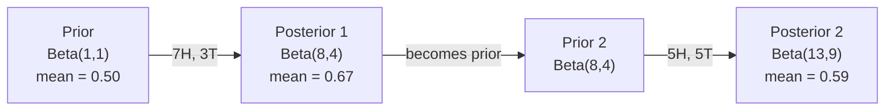

# 베이즈 정리 (Bayes' Theorem)

> 확률은 무엇을 기대하는가에 관한 것이고, 베이즈 정리는 무엇을 배우는가에 관한 것입니다.

**유형:** Build (실습)
**Language:** Python
**선수 레슨:** Phase 1, Lesson 06 (Probability Fundamentals)
**소요 시간:** ~75분

## 학습 목표

- 사전 확률(prior), 가능도/우도(likelihood), 증거(evidence)로부터 사후 확률(posterior probability)을 계산하기 위해 베이즈 정리를 적용합니다.
- 라플라스 스무딩(Laplace smoothing)과 로그 공간(log-space) 연산을 활용해 나이브 베이즈(Naive Bayes) 텍스트 분류기를 밑바닥부터 직접 구축합니다.
- MLE와 MAP 추정을 비교하고, MAP가 L2 정규화(regularization)와 어떻게 대응하는지 설명합니다.
- A/B 테스팅을 위해 베타-이항 켤레 사전 분포(Beta-Binomial conjugate prior)를 활용한 순차적 베이지안 업데이트를 구현합니다.

## 문제 상황

어떤 의학 검사의 정확도가 99%입니다. 검사 결과 양성이 나왔다면, 실제로 그 병에 걸렸을 확률은 얼마일까요?

대부분의 사람들은 99%라고 답합니다. 하지만 실제 답은 그 질병이 얼마나 희귀한지에 따라 달라집니다. 만약 만 명 중 1명(1/10,000) 꼴로 병에 걸린다면, 양성 판정을 받아도 실제로 병에 걸렸을 확률은 약 1%에 불과합니다. 나머지 99%의 양성 결과는 건강한 사람에게서 나온 거짓 경보(위양성)입니다.

이것은 억지 문제가 아닙니다. 바로 베이즈 정리(Bayes' theorem)의 원리입니다. 모든 스팸 필터, 모든 의학 진단, 불확실성을 정량화하는 모든 머신러닝 모델이 정확히 이 추론 방식을 사용합니다. 믿음(belief)에서 출발하여 증거를 확인한 뒤, 믿음을 업데이트합니다.

이 개념을 이해하지 못한 채 ML 시스템을 구축한다면 모델의 출력을 잘못 해석하고, 부적절한 임계값(threshold)을 설정하며, 지나치게 확신하는 잘못된 예측을 배포하게 됩니다.

## 핵심 개념

### 결합 확률에서 베이즈 정리까지

Lesson 06에서 조건부 확률이 다음과 같다는 것을 배웠습니다.

```math
P(A \mid B) = \frac{P(A \text{ and } B)}{P(B)}
```

그리고 대칭적으로 다음도 성립합니다.

```math
P(B \mid A) = \frac{P(A \text{ and } B)}{P(A)}
```

두 식은 동일한 분자 $P(A \text{ and } B)$를 공유합니다. 두 식을 같다고 놓고 정리하면 다음과 같습니다.

```math
\begin{aligned}
P(A \text{ and } B) &= P(A \mid B) \cdot P(B) = P(B \mid A) \cdot P(A) \\[4pt]
&\text{Therefore:} \\[4pt]
P(A \mid B) &= \frac{P(B \mid A) \cdot P(A)}{P(B)}
\end{aligned}
```

이것이 베이즈 정리입니다. 네 개의 항으로 이루어진 하나의 방정식입니다.

### 네 가지 구성 요소

| 요소 | 명칭 | 의미 |
|------|------|---------------|
| $P(A \mid B)$ | 사후 확률(Posterior) | 증거 $B$를 확인한 후 업데이트된 $A$에 대한 믿음 |
| $P(B \mid A)$ | 가능도/우도(Likelihood) | $A$가 참일 때 증거 $B$가 나타날 확률 |
| $P(A)$ | 사전 확률(Prior) | 증거를 확인하기 전 $A$에 대한 믿음 |
| $P(B)$ | 증거(Evidence) | 모든 가능한 경우에서 $B$가 관찰될 전체 확률 |

증거 항인 $P(B)$는 정규화 상수(normalizer) 역할을 합니다. 전체 확률의 법칙(law of total probability)을 사용해 다음과 같이 전개할 수 있습니다.

```math
P(B) = P(B \mid A) \cdot P(A) + P(B \mid \text{not } A) \cdot P(\text{not } A)
```

### 의학 검사 예시

어떤 질병이 10,000명 중 1명에게 발생합니다. 검사 정확도는 99%입니다(환자의 99%를 감지하고, 1%의 비율로 위양성을 냅니다).

```math
\begin{aligned}
P(\text{sick}) &= 0.0001 \quad \text{(prior: disease is rare)} \\
P(\text{positive} \mid \text{sick}) &= 0.99 \quad \text{(likelihood: test catches it)} \\
P(\text{positive} \mid \text{healthy}) &= 0.01 \quad \text{(false positive rate)} \\[6pt]
P(\text{positive}) &= P(\text{positive} \mid \text{sick}) \cdot P(\text{sick}) + P(\text{positive} \mid \text{healthy}) \cdot P(\text{healthy}) \\
&= 0.99 \cdot 0.0001 + 0.01 \cdot 0.9999 \\
&= 0.000099 + 0.009999 \\
&= 0.010098 \\[6pt]
P(\text{sick} \mid \text{positive}) &= P(\text{positive} \mid \text{sick}) \cdot P(\text{sick}) / P(\text{positive}) \\
&= 0.99 \cdot 0.0001 / 0.010098 \\
&= 0.0098 \\
&= 0.98\%
\end{aligned}
```

1% 미만입니다. 사전 확률이 지배적인 영향을 미치기 때문입니다. 질환이 매우 드물다면, 정확도가 높은 검사라 할지라도 대부분 위양성이 발생합니다. 의사들이 재검사나 확인 검사를 지시하는 이유가 바로 여기에 있습니다.

### 스팸 필터 예시

"lottery(복권)"라는 단어가 포함된 이메일을 받았습니다. 이 메일은 스팸일까요?

```math
\begin{aligned}
P(\text{spam}) &= 0.3 \quad \text{(30\% of email is spam)} \\
P(\text{"lottery"} \mid \text{spam}) &= 0.05 \quad \text{(5\% of spam emails contain "lottery")} \\
P(\text{"lottery"} \mid \text{not spam}) &= 0.001 \quad \text{(0.1\% of legitimate emails contain "lottery")} \\[6pt]
P(\text{"lottery"}) &= 0.05 \cdot 0.3 + 0.001 \cdot 0.7 \\
&= 0.015 + 0.0007 \\
&= 0.0157 \\[6pt]
P(\text{spam} \mid \text{"lottery"}) &= 0.05 \cdot 0.3 / 0.0157 \\
&= 0.955 \\
&= 95.5\%
\end{aligned}
```

단어 하나로 인해 확률이 30%에서 95.5%로 급증합니다. 실제 스팸 필터는 수백 개의 단어에 걸쳐 베이즈 정리를 동시에 적용합니다.

### 나이브 베이즈: 조건부 독립성 가정

나이브 베이즈는 클래스가 주어졌을 때 모든 특성(feature)이 조건부 독립이라는 가정을 도입하여 이를 여러 특성으로 확장합니다.

```math
P(\text{class} \mid \text{feature}_1, \text{feature}_2, \ldots, \text{feature}_n) = \frac{P(\text{class}) \cdot P(\text{feature}_1 \mid \text{class}) \cdot P(\text{feature}_2 \mid \text{class}) \cdots P(\text{feature}_n \mid \text{class})}{P(\text{feature}_1, \text{feature}_2, \ldots, \text{feature}_n)}
```

"나이브(naive, 순진한)"라는 이름이 붙은 이유는 바로 이 독립성 가정 때문입니다. 텍스트에서 단어의 출현은 독립적이지 않습니다("New"와 "York"는 강한 상관관계가 있습니다). 그러나 분류기는 보정된(calibrated) 확률을 완벽히 생성할 필요 없이 클래스 간 순위만 매기면 되기 때문에, 이 가정은 실전에서 놀라울 정도로 잘 작동합니다.

분모는 모든 클래스에 대해 동일하므로 분모 계산을 생략하고 분자만 비교할 수 있습니다.

```math
\text{score}(\text{class}) = P(\text{class}) \cdot \prod_i P(\text{feature}_i \mid \text{class})
```

가장 높은 점수를 얻은 클래스를 선택하면 됩니다.

### 최대 우도 추정 (MLE)

학습 데이터로부터 $P(\text{feature} \mid \text{class})$를 어떻게 얻을 수 있을까요? 바로 빈도를 세는 것입니다.

```math
P(\text{"free"} \mid \text{spam}) = \frac{\text{number of spam emails containing "free"}}{\text{total spam emails}}
```

이것이 최대 우도 추정(Maximum Likelihood Estimation, MLE)입니다. 관찰된 데이터가 나타날 가능성을 최대화하는 모수(parameter) 값을 선택합니다. 가능도 함수를 최대화하는 과정이며, 이산 빈도수 데이터의 경우 상대 빈도를 구하는 것으로 단순화됩니다.

문제점: 학습 도중 스팸 메일에 특정 단어가 한 번도 등장하지 않았다면, MLE는 해당 단어의 확률을 0으로 할당합니다. 단 하나의 보지 못한 단어로 인해 전체 곱이 0이 되어 버립니다. 이 문제는 라플라스 스무딩(Laplace smoothing)으로 해결합니다.

```math
P(\text{word} \mid \text{class}) = \frac{\text{count}(\text{word}, \text{class}) + 1}{\text{total\_words\_in\_class} + \text{vocabulary\_size}}
```

모든 빈도수에 1을 더해 줌으로써 어떤 확률도 0이 되지 않도록 보장합니다.

### 최대 사후 확률 추정 (MAP)

MLE는 묻습니다. 어떤 모수가 $P(\text{data} \mid \text{parameters})$를 최대화하는가?

MAP(Maximum A Posteriori)는 묻습니다. 어떤 모수가 $P(\text{parameters} \mid \text{data})$를 최대화하는가?

베이즈 정리에 따르면 다음과 같습니다.

```math
P(\text{parameters} \mid \text{data}) \propto P(\text{data} \mid \text{parameters}) \cdot P(\text{parameters})
```

MAP는 모수 자체에 대한 사전 확률을 추가합니다. 모수 값이 작아야 한다고 믿는다면, 큰 값에 페널티를 주는 사전 분포로 이를 인코딩합니다. 이는 머신러닝의 L2 정규화와 완전히 동일합니다. 릿지 회귀(ridge regression)의 "릿지" 페널티는 문자 그대로 가중치에 대한 가우시안 사전 분포(Gaussian prior)를 의미합니다.

| 추정 방식 | 최적화 대상 | ML 대응 개념 |
|------------|-----------|---------------|
| MLE | $P(\text{data} \mid \text{params})$ | 정규화되지 않은 학습 |
| MAP | $P(\text{data} \mid \text{params}) \cdot P(\text{params})$ | L2 / L1 정규화 |

### 베이지안 vs 빈도주의: 실질적인 차이점

빈도주의자(Frequentist)는 모수를 고정된 미지의 값으로 취급합니다. 그들은 질문합니다. "이 실험을 여러 번 반복한다면 어떤 결과가 나올 것인가?"

베이지안(Bayesian)은 모수를 확률 분포로 취급합니다. 그들은 질문합니다. "지금까지 관찰한 데이터를 바탕으로, 모수에 대해 무엇을 믿을 수 있는가?"

ML 시스템 구축 관점에서 실질적인 차이점은 다음과 같습니다.

| 측면 | 빈도주의 | 베이지안 |
|--------|-------------|----------|
| 출력 | 점 추정치(Point estimate) | 값들에 대한 확률 분포 |
| 불확실성 | 신뢰 구간(Confidence intervals, 절차에 대한 불확실성) | 신용 구간(Credible intervals, 모수에 대한 불확실성) |
| 소규모 데이터 | 과적합(overfitting) 위험 | 사전 분포가 정규화 역할을 수행 |
| 연산량 | 대체로 빠름 | 종종 샘플링(MCMC)이 필요함 |

대부분의 프로덕션 ML은 빈도주의적 접근 방식을 따릅니다(SGD, 점 추정). 베이지안 방법은 정밀하게 보정된 불확실성이 필요하거나(의학적 의사결정, 안전 필수 시스템) 데이터가 희소한 경우(퓨샷 학습(few-shot learning), 콜드 스타트)에 진가를 발휘합니다.

### 머신러닝에서 베이지안적 사고가 중요한 이유

이 둘의 연결점은 단순한 비유 그 이상입니다.

**사전 분포는 정규화입니다.** 가중치에 대한 가우시안 사전 분포는 L2 정규화입니다. 라플라스 사전 분포는 L1 정규화입니다. 정규화 항을 추가할 때마다, 여러분은 기대하는 모수 값에 대해 베이지안적 주장을 펼치는 것입니다.

**사후 분포는 불확실성입니다.** 단일 예측 확률값은 모델이 해당 추정치에 대해 얼마나 확신하는지 알려주지 않습니다. 베이지안 기법은 분포를 제공합니다. "내 생각에 $P(\text{spam})$는 0.8에서 0.95 사이입니다."

**베이즈 업데이트는 온라인 학습(online learning)입니다.** 오늘의 사후 분포는 내일의 사전 분포가 됩니다. 모델은 새로운 데이터를 볼 때 처음부터 다시 학습하는 대신 점진적으로 믿음을 업데이트합니다.

**모델 비교는 베이지안 방식입니다.** 베이지안 정보 기준(BIC), 한계 우도(marginal likelihood), 베이즈 팩터(Bayes factor)는 모두 과적합 없이 모델을 선택하기 위해 베이지안 추론을 활용합니다.

```figure
bayes-update
```

## 직접 구현하기

### 1단계: 베이즈 정리 함수

```python
def bayes(prior, likelihood, false_positive_rate):
    evidence = likelihood * prior + false_positive_rate * (1 - prior)
    posterior = likelihood * prior / evidence
    return posterior

result = bayes(prior=0.0001, likelihood=0.99, false_positive_rate=0.01)
print(f"P(sick|positive) = {result:.4f}")
```

### 2단계: 나이브 베이즈 분류기

```python
import math
from collections import defaultdict

class NaiveBayes:
    def __init__(self, smoothing=1.0):
        self.smoothing = smoothing
        self.class_counts = defaultdict(int)
        self.word_counts = defaultdict(lambda: defaultdict(int))
        self.class_word_totals = defaultdict(int)
        self.vocab = set()

    def train(self, documents, labels):
        for doc, label in zip(documents, labels):
            self.class_counts[label] += 1
            words = doc.lower().split()
            for word in words:
                self.word_counts[label][word] += 1
                self.class_word_totals[label] += 1
                self.vocab.add(word)

    def predict(self, document):
        words = document.lower().split()
        total_docs = sum(self.class_counts.values())
        vocab_size = len(self.vocab)
        best_class = None
        best_score = float("-inf")
        for cls in self.class_counts:
            score = math.log(self.class_counts[cls] / total_docs)
            for word in words:
                count = self.word_counts[cls].get(word, 0)
                total = self.class_word_totals[cls]
                score += math.log((count + self.smoothing) / (total + self.smoothing * vocab_size))
            if score > best_score:
                best_score = score
                best_class = cls
        return best_class
```

로그 확률은 언더플로우(underflow)를 방지합니다. 매우 작은 여러 확률을 곱하면 부동소수점 표현 한계를 벗어나는 극도로 작은 수가 됩니다. 로그 확률을 더하는 것은 수치적으로 안정적이며 수학적으로도 동일합니다.

### 3단계: 스팸 데이터로 학습

```python
train_docs = [
    "win free money now",
    "free lottery ticket winner",
    "claim your prize today free",
    "urgent offer free cash",
    "congratulations you won free",
    "meeting tomorrow at noon",
    "project update attached",
    "can we schedule a call",
    "quarterly report review",
    "lunch on thursday sounds good",
    "team standup notes attached",
    "please review the pull request",
]

train_labels = [
    "spam", "spam", "spam", "spam", "spam",
    "ham", "ham", "ham", "ham", "ham", "ham", "ham",
]

classifier = NaiveBayes()
classifier.train(train_docs, train_labels)

test_messages = [
    "free money waiting for you",
    "meeting rescheduled to friday",
    "you won a free prize",
    "please review the attached report",
]

for msg in test_messages:
    print(f"  '{msg}' -> {classifier.predict(msg)}")
```

### 4단계: 학습된 확률 살펴보기

```python
def show_top_words(classifier, cls, n=5):
    vocab_size = len(classifier.vocab)
    total = classifier.class_word_totals[cls]
    probs = {}
    for word in classifier.vocab:
        count = classifier.word_counts[cls].get(word, 0)
        probs[word] = (count + classifier.smoothing) / (total + classifier.smoothing * vocab_size)
    sorted_words = sorted(probs.items(), key=lambda x: x[1], reverse=True)
    for word, prob in sorted_words[:n]:
        print(f"    {word}: {prob:.4f}")

print("\nTop spam words:")
show_top_words(classifier, "spam")
print("\nTop ham words:")
show_top_words(classifier, "ham")
```

## 라이브러리 활용하기

Scikit-learn은 프로덕션 환경에서 바로 사용할 수 있는 나이브 베이즈 구현체를 제공합니다.

```python
from sklearn.feature_extraction.text import CountVectorizer
from sklearn.naive_bayes import MultinomialNB
from sklearn.metrics import classification_report

vectorizer = CountVectorizer()
X_train = vectorizer.fit_transform(train_docs)
clf = MultinomialNB()
clf.fit(X_train, train_labels)

X_test = vectorizer.transform(test_messages)
predictions = clf.predict(X_test)
for msg, pred in zip(test_messages, predictions):
    print(f"  '{msg}' -> {pred}")
```

알고리즘은 동일합니다. `CountVectorizer`가 토큰화 및 어휘집(vocabulary) 구축을 처리하며, `MultinomialNB`가 내부적으로 스무딩과 로그 확률 계산을 수행합니다. 직접 작성한 40줄짜리 코드도 동일한 작업을 수행합니다.
## Ship It

여기서 구축한 NaiveBayes 클래스는 토큰화(tokenization), 라플라스 스무딩(Laplace smoothing)을 적용한 확률 추정, 로그 공간(log-space) 예측에 이르는 전체 파이프라인을 보여줍니다. `code/bayes.py`의 코드는 Python 표준 라이브러리 외에 다른 의존성 없이 엔드투엔드로 실행됩니다.

### 켤레 사전분포

사전분포와 사후분포가 동일한 분포 계열에 속할 때, 그 사전분포를 "켤레(conjugate)"라고 합니다. 이는 베이즈 업데이트(Bayesian updating)를 대수적으로 깔끔하게 만들어 주며, 수치 적분(numerical integration) 없이 닫힌 형태(closed-form)의 사후분포를 얻을 수 있습니다.

| 가능도(Likelihood) | 켤레 사전분포 | 사후분포 | 예시 |
|-----------|----------------|-----------|---------|
| Bernoulli | $\text{Beta}(a, b)$ | $\text{Beta}(a + \text{successes}, b + \text{failures})$ | 동전 던지기 편향 추정 |
| Normal (분산이 알려진 경우) | $\text{Normal}(\mu_0, \sigma_0)$ | Normal(가중 평균, 더 작은 분산) | 센서 보정 |
| Poisson | $\text{Gamma}(a, b)$ | $\text{Gamma}(a + \text{sum of counts}, b + n)$ | 도착률 모델링 |
| Multinomial | $\text{Dirichlet}(\alpha)$ | $\text{Dirichlet}(\alpha + \text{counts})$ | 토픽 모델링, 언어 모델 |

이것이 중요한 이유: 켤레 사전분포가 없으면 사후분포를 근사하기 위해 몬테카를로 샘플링(Monte Carlo sampling)이나 변분 추론(variational inference)이 필요합니다. 켤레 사전분포가 있으면 숫자 두 개만 업데이트하면 됩니다.

베타 분포(Beta distribution)는 실무에서 가장 흔히 사용되는 켤레 사전분포입니다. $\text{Beta}(a, b)$는 확률 파라미터에 대한 믿음을 나타냅니다. 평균은 $a/(a+b)$입니다. $a+b$가 클수록 분포가 더 집중(확신)됩니다.

베타 사전분포의 특수한 경우:
- $\text{Beta}(1, 1)$ = 균등분포. 파라미터에 대해 아무런 의견이 없습니다.
- $\text{Beta}(10, 10)$ = 0.5에서 뾰족한 형태. 파라미터가 0.5에 가깝다고 강하게 믿습니다.
- $\text{Beta}(1, 10)$ = 0 쪽으로 치우친 형태. 파라미터가 작다고 믿습니다.

업데이트 규칙은 매우 단순합니다:

```math
\begin{aligned}
\text{Prior:} \quad & \text{Beta}(a, b) \\
\text{Data:} \quad & s \text{ successes}, f \text{ failures} \\
\text{Posterior:} \quad & \text{Beta}(a + s, b + f)
\end{aligned}
```

적분도 필요 없습니다. 샘플링도 필요 없습니다. 덧셈만 하면 됩니다.

### 순차적 베이즈 업데이트

베이즈 추론(Bayesian inference)은 본질적으로 순차적입니다. 오늘의 사후분포가 내일의 사전분포가 됩니다. 실제 시스템이 모든 과거 데이터를 다시 처리하지 않고 점진적으로 학습하는 방식이 바로 이것입니다.

구체적인 예: 동전이 공정한지 추정하기.

**1일 차: 아직 데이터가 없음.**
$\text{Beta}(1, 1)$로 시작합니다 -- 균등 사전분포입니다. 아무런 의견이 없습니다.
- 사전분포 평균: 0.5
- [0, 1] 전체에서 사전분포가 평평함

**2일 차: 앞면 7회, 뒷면 3회 관측.**
$\text{Posterior} = \text{Beta}(1 + 7, 1 + 3) = \text{Beta}(8, 4)$
- 사후분포 평균: $8/12 = 0.667$
- 증거는 동전이 앞면 쪽으로 편향되어 있음을 시사함

**3일 차: 앞면 5회, 뒷면 5회 추가 관측.**
어제의 사후분포를 오늘의 사전분포로 사용합니다.
$\text{Posterior} = \text{Beta}(8 + 5, 4 + 5) = \text{Beta}(13, 9)$
- 사후분포 평균: $13/22 = 0.591$
- 균형 잡힌 새로운 데이터가 추정치를 다시 0.5 쪽으로 당김



관측 순서는 상관없습니다. $\text{Beta}(1,1)$를 12회의 앞면과 8회의 뒷면으로 한 번에 업데이트해도 $\text{Beta}(13, 9)$가 나와 동일한 결과를 얻습니다. 순차적 업데이트와 배치(batch) 업데이트는 수학적으로 동등합니다. 하지만 순차적 업데이트를 사용하면 원시 데이터를 저장하지 않고도 각 단계에서 의사결정을 내릴 수 있습니다.

이것이 프로덕션 ML 시스템에서 온라인 학습(online learning)의 기초입니다. 밴딧(bandit)을 위한 톰슨 샘플링(Thompson sampling), 점진적 추천 시스템, 스트리밍 이상 탐지기가 모두 이 패턴을 사용합니다.

### A/B 테스팅과의 연관성

A/B 테스팅은 변장한 베이즈 추론입니다.

상황: 두 가지 버튼 색상을 테스트하고 있습니다. 변형 A(파란색)와 변형 B(초록색)입니다. 어느 쪽이 더 많은 클릭을 얻는지 알고 싶습니다.

베이지안 A/B 테스트:

1. **사전분포.** 두 변형 모두 $\text{Beta}(1, 1)$로 시작합니다. 사전 선호는 없습니다.
2. **데이터.** 변형 A: 노출 1,000회 중 클릭 50회. 변형 B: 노출 1,000회 중 클릭 65회.
3. **사후분포.**
   - A: $\text{Beta}(1 + 50, 1 + 950) = \text{Beta}(51, 951)$. 평균 = 0.051
   - B: $\text{Beta}(1 + 65, 1 + 935) = \text{Beta}(66, 936)$. 평균 = 0.066
4. **의사결정.** $P(B > A)$ -- B의 실제 전환율이 A보다 높을 확률을 계산합니다.

$P(B > A)$를 해석적으로 계산하는 것은 어렵습니다. 하지만 몬테카를로를 사용하면 매우 쉬워집니다:

```
1. Draw 100,000 samples from Beta(51, 951)  -> samples_A
2. Draw 100,000 samples from Beta(66, 936)  -> samples_B
3. P(B > A) = fraction of samples where B > A
```

만약 $P(B > A) > 0.95$라면 변형 B를 배포합니다. 0.05와 0.95 사이라면 데이터를 계속 수집합니다. $P(B > A) < 0.05$라면 변형 A를 배포합니다.

빈도주의(frequentist) A/B 테스팅 대비 장점:
- "B가 더 나을 확률이 97%이다"와 같이 직접적인 확률 진술을 얻을 수 있습니다
- p-값 혼란이 없습니다. "귀무가설 기각 실패"와 같은 모호한 표현이 없습니다.
- 위양성률(false positive rate)을 부풀리지 않고 언제든 결과를 확인할 수 있습니다("엿보기 문제(peeking problem)" 없음)
- 사전 지식을 통합할 수 있습니다 (예: 이전 테스트에 따르면 전환율이 대개 3~8% 수준임)

| 측면 | 빈도주의 A/B | 베이지안 A/B |
|--------|----------------|--------------|
| 출력 | p-값 | $P(B > A)$ |
| 해석 | "A=B일 때 이 데이터는 얼마나 놀라운가?" | "B가 A보다 나을 가능성은 얼마나 되는가?" |
| 조기 종료 | 위양성을 증가시킴 | 언제든 안전함 (사전분포가 잘 선택되고 모델이 올바르게 명시된 경우) |
| 사전 지식 | 사용되지 않음 | 베타 사전분포로 인코딩됨 |
| 결정 규칙 | $p < 0.05$ | $P(B > A) > \text{threshold}$ |

## 연습문제

1. **다중 검사.** 한 환자가 독립적인 두 번의 검사에서 모두 양성 반응을 보였습니다(두 검사 모두 정확도 99%, 질병 유병률 10,000명 중 1명). 두 검사 후의 $P(\text{sick})$는 얼마입니까? 첫 번째 검사의 사후분포를 두 번째 검사의 사전분포로 사용하세요.

2. **스무딩의 영향.** 스무딩 값을 0.01, 0.1, 1.0, 10.0으로 하여 스팸 분류기를 실행해 보세요. 상위 단어 확률은 어떻게 변합니까? 스무딩이 0이고 햄(ham)에만 등장하는 단어가 있을 때 어떤 일이 일어납니까?

3. **특성 추가.** NaiveBayes 클래스를 확장하여 단어 빈도와 함께 메시지 길이(짧음/길음)도 특성으로 사용하도록 만드세요. 학습 데이터로부터 $P(\text{short} \mid \text{spam})$ 및 $P(\text{short} \mid \text{ham})$를 추정하고 이를 예측 점수에 반영하세요.

4. **수기로 MAP 계산하기.** 관측 데이터(동전 던지기 10회 중 앞면 7회)가 주어졌을 때, $\text{Beta}(2,2)$ 사전분포를 사용하여 편향의 MAP 추정치를 계산하세요. 이를 MLE 추정치($7/10$)와 비교하세요.

### 힌트

**연습문제 1.** `bayes`을 한 번 호출하여 검사 1 후의 사후분포를 얻은 다음, 해당 사후분포를 사전분포로 하여 다시 호출하세요. `sequential_bayes(prior, likelihood, false_positive_rate, 2)`는 0.5에 가까운 동일한 값을 제공해야 합니다.

**연습문제 2.** 각 값에 대해 `NaiveBayes(smoothing=s)`를 하나씩 생성하고, 동일한 데이터로 학습시킨 뒤, 각각에 대해 `top_words`를 출력하세요. 스무딩이 0이면 스팸에 전혀 등장하지 않는 단어의 확률이 0이 되므로 해당 로그가 정의되지 않습니다.

**연습문제 3.** 짧은 스팸 메시지와 햄 메시지가 각각 몇 개인지 세고, 각 클래스의 총 메시지 수로 나눈 뒤, 그 비율의 로그를 `predict`의 점수에 더하세요. 각 클래스에 대한 두 확률의 합이 1이 되는지 확인하세요.

**연습문제 4.** $\text{Beta}(\alpha, \beta)$ 사전분포에서 MAP 추정치는 $\frac{h + \alpha - 1}{n + \alpha + \beta - 2}$입니다. $h = 7$, $n = 10$를 대입하세요. 결과는 MLE(0.7)와 사전분포의 최빈값(mode, 0.5) 사이에 있어야 합니다.
## 핵심 용어

| 용어 | 흔히 하는 말 | 실제 의미 |
|------|----------------|----------------------|
| 사전 확률(Prior) | "내 초기 추측" | 증거를 관찰하기 전의 $P(\text{hypothesis})$. 머신러닝에서는 정규화 항(regularization term)에 해당합니다. |
| 우도(Likelihood) | "데이터가 얼마나 잘 들어맞는가" | $P(\text{evidence} \mid \text{hypothesis})$. 특정 가설 하에서 관측된 데이터가 나타날 확률입니다. |
| 사후 확률(Posterior) | "업데이트된 내 믿음" | $P(\text{hypothesis} \mid \text{evidence})$. 사전 확률에 우도를 곱한 후 정규화한 값입니다. |
| 증거(Evidence) | "정규화 상수" | 모든 가설에 걸친 $P(\text{data})$. 사후 확률의 합이 1이 되도록 보장합니다. |
| 나이브 베이즈(Naive Bayes) | "그 단순한 텍스트 분류기" | 클래스가 주어졌을 때 특성들이 서로 독립이라고 가정하는 분류기입니다. 틀린 가정임에도 불구하고 잘 작동합니다. |
| 라플라스 스무딩(Laplace smoothing) | "1 더하기 스무딩" | 보지 못한 데이터로 인해 확률이 0이 되는 것을 방지하기 위해 모든 특성에 작은 빈도를 더하는 기법입니다. |
| MLE | "그냥 빈도를 사용해라" | $P(\text{data} \mid \text{parameters})$를 최대화하는 파라미터를 선택합니다. 사전 확률이 없습니다. 데이터가 적으면 과적합(overfit)될 수 있습니다. |
| MAP | "사전 확률이 추가된 MLE" | $P(\text{data} \mid \text{parameters}) \cdot P(\text{parameters})$를 최대화하는 파라미터를 선택합니다. 정규화된 MLE와 동등합니다. |
| 로그 확률(Log-probability) | "로그 공간에서 작업해라" | 작은 수를 여러 번 곱할 때 발생하는 부동소수점 언더플로(underflow)를 방지하기 위해 $P$ 대신 $\log(P)$를 사용하는 기법입니다. |
| 거짓 양성(False positive) | "오경보" | 검사 결과는 양성이지만 실제 상태는 음성인 경우입니다. 기저율의 오류(base rate fallacy)를 유발합니다. |

## 참고 자료

- [3Blue1Brown: Bayes' theorem](https://www.youtube.com/watch?v=HZGCoVF3YvM) - 의학 검사 예시를 통한 시각적 설명
- [Stanford CS229: Generative Learning Algorithms](https://cs229.stanford.edu/main_notes.pdf) - 나이브 베이즈 및 판별 모델과의 연관성
- [Think Bayes](https://greenteapress.com/wp/think-bayes/) - 무료 도서, Python 코드로 배우는 베이지안 통계
- [scikit-learn Naive Bayes](https://scikit-learn.org/stable/modules/naive_bayes.html) - 프로덕션 구현체 및 각 변형 기법의 사용 시기
