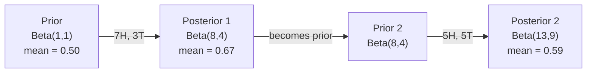

# 베이즈 정리

> 확률은 무엇을 기대하는가에 관한 것이며, 베이즈 정리는 무엇을 배우는가에 관한 것입니다.

**유형:** Build (실습)
**사용 언어:** Python, TypeScript
**선수 레슨:** Phase 1, Lesson 06 (Probability Fundamentals)
**소요 시간:** ~75분

## 학습 목표

- 베이즈 정리를 적용하여 사전 확률(prior), 우도(likelihood), 증거(evidence)로부터 사후 확률(posterior)을 계산합니다.
- 라플라스 스무딩(Laplace smoothing)과 로그 공간 연산을 적용하여 Naive Bayes 텍스트 분류기를 처음부터 직접 구현합니다.
- MLE와 MAP 추정을 비교하고 MAP가 L2 정규화(regularization)에 어떻게 대응되는지 설명합니다.
- A/B 테스트를 위한 베타-이항 켤레 사전 확률(Beta-Binomial conjugate priors)을 사용하여 순차적 베이지안 업데이트를 구현합니다.

## 문제

어떤 의학 검사의 정확도가 99%입니다. 여러분이 양성 판정을 받았습니다. 실제로 그 병에 걸렸을 확률은 얼마일까요?

대부분의 사람들은 99%라고 답합니다. 하지만 실제 답은 그 질병이 얼마나 희귀한지에 달려 있습니다. 만약 10,000명 중 1명만 걸리는 병이라면, 양성 결과가 나왔더라도 실제로 아플 확률은 약 1%에 불과합니다. 나머지 99%의 양성 결과는 건강한 사람에게서 나온 거짓 경보(false alarm)입니다.

이것은 말장난이 아닙니다. 바로 베이즈 정리(Bayes' theorem)입니다. 스팸 필터, 의학 진단, 불확실성을 정량화하는 머신러닝 모델 모두가 정확히 이 추론 방식을 사용합니다. 먼저 믿음(사전 확률)을 가지고 시작하고, 증거를 관찰한 뒤, 믿음을 업데이트합니다.

이 개념을 이해하지 못한 채 ML 시스템을 구축하면 모델 출력을 잘못 해석하고, 잘못된 임곗값(threshold)을 설정하며, 과도하게 확신에 찬 예측을 배포하게 됩니다.

## 개념

### 결합 확률에서 베이즈 정리로

Lesson 06에서 조건부 확률이 다음과 같다는 것을 배웠습니다:

```math
P(A \mid B) = \frac{P(A \text{ and } B)}{P(B)}
```

그리고 대칭적으로 다음과 같습니다:

```math
P(B \mid A) = \frac{P(A \text{ and } B)}{P(A)}
```

두 수식은 동일한 분자 $P(A \text{ and } B)$를 공유합니다. 두 식을 같게 놓고 정리하면 다음과 같습니다:

```math
\begin{aligned}
P(A \text{ and } B) &= P(A \mid B) \cdot P(B) = P(B \mid A) \cdot P(A) \\[4pt]
&\text{Therefore:} \\[4pt]
P(A \mid B) &= \frac{P(B \mid A) \cdot P(A)}{P(B)}
\end{aligned}
```

이것이 베이즈 정리입니다. 네 개의 항으로 이루어진 하나의 방정식입니다.

### 네 가지 구성 요소

| 부분 | 명칭 | 의미 |
|------|------|---------------|
| $P(A \mid B)$ | 사후 확률 (Posterior) | 증거 $B$을 본 후 업데이트된 $A$에 대한 믿음 |
| $P(B \mid A)$ | 우도 (Likelihood) | $A$가 참일 때 증거 $B$가 관찰될 확률 |
| $P(A)$ | 사전 확률 (Prior) | 어떤 증거도 보기 전의 $A$에 대한 믿음 |
| $P(B)$ | 증거 (Evidence) | 모든 가능성 아래에서 $B$가 나타날 전체 확률 |

증거 항 $P(B)$는 정규화 역할을 합니다. 전체 확률의 법칙(law of total probability)을 사용하여 이를 전개할 수 있습니다:

```math
P(B) = P(B \mid A) \cdot P(A) + P(B \mid \text{not } A) \cdot P(\text{not } A)
```

### 의학 검사 예시

어떤 질병이 10,000명 중 1명에게 발생합니다. 검사 정확도는 99%입니다(환자의 99%를 잡아내고, 건강한 사람의 1%에서 위양성이 발생함).

```math
\begin{aligned}
P(\text{sick}) &= 0.0001 \quad \text{(prior: disease is rare)} \\
P(\text{positive} \mid \text{sick}) &= 0.99 \quad \text{(likelihood: test catches it)} \\
P(\text{positive} \mid \text{healthy}) &= 0.01 \quad \text{(false positive rate)} \\[6pt]
P(\text{positive}) &= P(\text{positive} \mid \text{sick}) \cdot P(\text{sick}) + P(\text{positive} \mid \text{healthy}) \cdot P(\text{healthy}) \\
&= 0.99 \cdot 0.0001 + 0.01 \cdot 0.9999 \\
&= 0.000099 + 0.009999 \\
&= 0.010098 \\[6pt]
P(\text{sick} \mid \text{positive}) &= P(\text{positive} \mid \text{sick}) \cdot P(\text{sick}) / P(\text{positive}) \\
&= 0.99 \cdot 0.0001 / 0.010098 \\
&= 0.0098 \\
&= 0.98\%
\end{aligned}
```

1% 미만입니다. 사전 확률이 지배적인 영향을 미치기 때문입니다. 특정 조건이 매우 드물다면, 검사가 정확하더라도 양성 결과의 대부분은 위양성(false positive)입니다. 이것이 바로 의사들이 확진 검사를 추가로 지시하는 이유입니다.

### 스팸 필터 예시

"lottery"라는 단어가 포함된 이메일을 받았습니다. 이것은 스팸일까요?

```math
\begin{aligned}
P(\text{spam}) &= 0.3 \quad \text{(30\% of email is spam)} \\
P(\text{"lottery"} \mid \text{spam}) &= 0.05 \quad \text{(5\% of spam emails contain "lottery")} \\
P(\text{"lottery"} \mid \text{not spam}) &= 0.001 \quad \text{(0.1\% of legitimate emails contain "lottery")} \\[6pt]
P(\text{"lottery"}) &= 0.05 \cdot 0.3 + 0.001 \cdot 0.7 \\
&= 0.015 + 0.0007 \\
&= 0.0157 \\[6pt]
P(\text{spam} \mid \text{"lottery"}) &= 0.05 \cdot 0.3 / 0.0157 \\
&= 0.955 \\
&= 95.5\%
\end{aligned}
```

단어 하나가 확률을 30%에서 95.5%로 바꿉니다. 실제 스팸 필터는 수백 개의 단어에 걸쳐 베이즈 정리를 동시에 적용합니다.

### Naive Bayes: 독립성 가정

Naive Bayes는 클래스가 주어졌을 때 모든 특성(feature)이 조건부 독립이라고 가정함으로써 이를 다중 특성으로 확장합니다:

```math
P(\text{class} \mid \text{feature}_1, \text{feature}_2, \ldots, \text{feature}_n) = \frac{P(\text{class}) \cdot P(\text{feature}_1 \mid \text{class}) \cdot P(\text{feature}_2 \mid \text{class}) \cdots P(\text{feature}_n \mid \text{class})}{P(\text{feature}_1, \text{feature}_2, \ldots, \text{feature}_n)}
```

"Naive(순진한)"라는 이름은 바로 이 독립성 가정에서 비롯되었습니다. 텍스트에서 단어의 출현은 독립적이지 않습니다("New"와 "York"는 강한 상관관계를 가집니다). 하지만 분류기는 보정된 확률을 생성할 필요 없이 클래스 간의 순위만 매기면 되기 때문에, 이 가정은 실전에서 놀라울 정도로 잘 작동합니다.

분모는 모든 클래스에 대해 동일하므로 이를 생략하고 분자만 비교할 수 있습니다:

```math
\text{score}(\text{class}) = P(\text{class}) \cdot \prod_i P(\text{feature}_i \mid \text{class})
```

가장 높은 점수를 가진 클래스를 선택합니다.

### 최대 우도 추정(MLE)

학습 데이터로부터 $P(\text{feature} \mid \text{class})$를 어떻게 구할까요? 세어보면 됩니다.

```math
P(\text{"free"} \mid \text{spam}) = \frac{\text{number of spam emails containing "free"}}{\text{total spam emails}}
```

이것이 MLE(최대 우도 추정, Maximum Likelihood Estimation)입니다. 관찰된 데이터를 가장 잘 설명하는(가능성을 최대화하는) 파라미터 값을 선택하는 것입니다. 우도 함수를 최대화하는 것이며, 이산 카운트 데이터의 경우 이는 상대 빈도(relative frequency) 계산으로 귀결됩니다.

문제점: 학습 중에 어떤 단어가 스팸에 한 번도 등장하지 않았다면, MLE는 해당 단어의 확률을 0으로 부여합니다. 학습 데이터에 없던 단어 하나가 전체 곱을 0으로 만들어 버립니다. 이는 라플라스 스무딩(Laplace smoothing)으로 해결할 수 있습니다:

```math
P(\text{word} \mid \text{class}) = \frac{\text{count}(\text{word}, \text{class}) + 1}{\text{total\_words\_in\_class} + \text{vocabulary\_size}}
```

모든 카운트에 1을 더하면 어떤 확률도 0이 되지 않습니다.

어떤 학습 메시지에도 등장하지 않은 단어는 어휘 사전(vocabulary)에 포함되지 않습니다. `predict`는 어느 클래스에 대해서도 증거를 제공하지 않으므로 이러한 단어를 건너뜁니다.

### 최대 사후 확률 추정(MAP)

MLE는 질문합니다: 어떤 파라미터가 $P(\text{data} \mid \text{parameters})$를 최대화하는가?

MAP는 질문합니다: 어떤 파라미터가 $P(\text{parameters} \mid \text{data})$를 최대화하는가?

베이즈 정리에 따르면 다음과 같습니다:

```math
P(\text{parameters} \mid \text{data}) \propto P(\text{data} \mid \text{parameters}) \cdot P(\text{parameters})
```

MAP는 파라미터 자체에 대한 사전 확률을 추가합니다. 파라미터가 작은 값을 가져야 한다고 믿는다면, 큰 값에 불이익을 주는 사전 확률을 부여하여 이를 인코딩합니다. 이는 머신러닝의 L2 정규화와 완전히 동일합니다. 릿지 회귀(ridge regression)의 "릿지" 페널티는 문자 그대로 가중치에 대한 가우시안 사전 분포(Gaussian prior)입니다.

| 추정 방법 | 최적화 대상 | ML 대응 개념 |
|------------|-----------|---------------|
| MLE | $P(\text{data} \mid \text{params})$ | 정규화가 없는 학습 |
| MAP | $P(\text{data} \mid \text{params}) \cdot P(\text{params})$ | L2 / L1 정규화 |

### 베이지안 관점 vs 빈도주의 관점: 실질적인 차이

빈도주의자(frequentist)는 파라미터를 고정된 미지의 값으로 취급합니다. 그들은 "이 실험을 여러 번 반복한다면 무슨 일이 일어날까?"라고 묻습니다.

베이지안(Bayesian)은 파라미터를 분포로 취급합니다. 그들은 "내가 관찰한 것을 고려할 때, 파라미터에 대해 무엇을 믿어야 하는가?"라고 묻습니다.

ML 시스템 구축에 있어 실질적인 차이는 다음과 같습니다:

| 측면 | 빈도주의 | 베이지안 |
|--------|-------------|----------|
| 출력 | 점 추정치(Point estimate) | 값들에 대한 확률 분포 |
| 불확실성 | 신뢰 구간(Confidence interval, 절차에 대한 것) | 신용 구간(Credible interval, 파라미터에 대한 것) |
| 적은 데이터 | 과적합(overfitting)될 수 있음 | 사전 확률이 정규화 역할을 수행함 |
| 계산량 | 일반적으로 빠름 | 종종 샘플링(MCMC)이 필요함 |

대부분의 프로덕션 ML은 빈도주의 방식(SGD, 점 추정)을 따릅니다. 베이지안 기법은 보정된 불확실성이 필요하거나(의료 결정, 안전 필수 시스템), 데이터가 부족할 때(퓨샷 학습, 콜드 스타트) 빛을 발합니다.

### 왜 베이지안 사고방식이 ML에서 중요한가

둘의 연결고리는 단순한 비유 그 이상입니다:

**사전 확률은 정규화입니다.** 가중치에 대한 가우시안 사전 확률은 L2 정규화입니다. 라플라스 사전 확률은 L1 정규화입니다. 정규화 항을 추가할 때마다, 여러분은 어떤 파라미터 값을 기대하는지에 대한 베이지안 선언을 하고 있는 것입니다.

**사후 확률은 불확실성입니다.** 단일 예측 확률값은 모델이 해당 추정치를 얼마나 확신하는지에 대해 아무것도 알려주지 않습니다. 베이지안 기법은 "내 생각에 $P(\text{spam})$는 0.8에서 0.95 사이입니다"와 같은 분포를 제공합니다.

**베이즈 업데이트는 온라인 학습입니다.** 오늘의 사후 확률은 내일의 사전 확률이 됩니다. 모델은 새로운 데이터를 볼 때 처음부터 다시 학습하는 대신 점진적으로 자신의 믿음을 업데이트합니다.

**모델 비교는 베이지안입니다.** 베이지안 정보 기준(BIC), 한계 우도(marginal likelihood), 베이즈 팩터(Bayes factor)는 모두 과적합 없이 모델 간을 비교하고 선택하기 위해 베이지안 추론을 사용합니다.

```figure
bayes-update
```

## 직접 만들어보기

### 1단계: 베이즈 정리 함수

```python
def bayes(prior, likelihood, false_positive_rate):
    evidence = likelihood * prior + false_positive_rate * (1 - prior)
    posterior = likelihood * prior / evidence
    return posterior

result = bayes(prior=0.0001, likelihood=0.99, false_positive_rate=0.01)
print(f"P(sick|positive) = {result:.4f}")
```

### 2단계: Naive Bayes 분류기

```python
import math
from collections import defaultdict

class NaiveBayes:
    def __init__(self, smoothing=1.0):
        self.smoothing = smoothing
        self.class_counts = defaultdict(int)
        self.word_counts = defaultdict(lambda: defaultdict(int))
        self.class_word_totals = defaultdict(int)
        self.vocab = set()

    def train(self, documents, labels):
        for doc, label in zip(documents, labels):
            self.class_counts[label] += 1
            words = doc.lower().split()
            for word in words:
                self.word_counts[label][word] += 1
                self.class_word_totals[label] += 1
                self.vocab.add(word)

    def predict(self, document):
        words = [word for word in document.lower().split() if word in self.vocab]
        total_docs = sum(self.class_counts.values())
        vocab_size = len(self.vocab)
        best_class = None
        best_score = float("-inf")
        for cls in self.class_counts:
            score = math.log(self.class_counts[cls] / total_docs)
            for word in words:
                count = self.word_counts[cls].get(word, 0)
                total = self.class_word_totals[cls]
                score += math.log((count + self.smoothing) / (total + self.smoothing * vocab_size))
            if score > best_score:
                best_score = score
                best_class = cls
        return best_class
```

로그 확률(log probability)은 언더플로(underflow)를 방지합니다. 아주 작은 확률들을 곱하다 보면 부동소수점으로 표현하기에 너무 작은 숫자가 됩니다. 로그 확률을 더하는 것은 수치적으로 안정적이며 수학적으로도 동등합니다.

### 3단계: 스팸 데이터로 학습

```python
train_docs = [
    "win free money now",
    "free lottery ticket winner",
    "claim your prize today free",
    "urgent offer free cash",
    "congratulations you won free",
    "meeting tomorrow at noon",
    "project update attached",
    "can we schedule a call",
    "quarterly report review",
    "lunch on thursday sounds good",
    "team standup notes attached",
    "please review the pull request",
]

train_labels = [
    "spam", "spam", "spam", "spam", "spam",
    "ham", "ham", "ham", "ham", "ham", "ham", "ham",
]

classifier = NaiveBayes()
classifier.train(train_docs, train_labels)

test_messages = [
    "free money waiting for you",
    "meeting rescheduled to friday",
    "you won a free prize",
    "please review the attached report",
]

for msg in test_messages:
    print(f"  '{msg}' -> {classifier.predict(msg)}")
```

### 4단계: 학습된 확률 살펴보기

```python
def show_top_words(classifier, cls, n=5):
    vocab_size = len(classifier.vocab)
    total = classifier.class_word_totals[cls]
    probs = {}
    for word in classifier.vocab:
        count = classifier.word_counts[cls].get(word, 0)
        probs[word] = (count + classifier.smoothing) / (total + classifier.smoothing * vocab_size)
    sorted_words = sorted(probs.items(), key=lambda x: x[1], reverse=True)
    for word, prob in sorted_words[:n]:
        print(f"    {word}: {prob:.4f}")

print("\nTop spam words:")
show_top_words(classifier, "spam")
print("\nTop ham words:")
show_top_words(classifier, "ham")
```
## 활용하기

Scikit-learn은 프로덕션 환경에서 바로 사용할 수 있는 나이브 베이즈(naive Bayes) 구현체를 제공합니다:

```python
from sklearn.feature_extraction.text import CountVectorizer
from sklearn.naive_bayes import MultinomialNB
from sklearn.metrics import classification_report

vectorizer = CountVectorizer()
X_train = vectorizer.fit_transform(train_docs)
clf = MultinomialNB()
clf.fit(X_train, train_labels)

X_test = vectorizer.transform(test_messages)
predictions = clf.predict(X_test)
for msg, pred in zip(test_messages, predictions):
    print(f"  '{msg}' -> {pred}")
```

동일한 알고리즘입니다. CountVectorizer가 토큰화(tokenization) 및 단어 사전 구축을 처리합니다. MultinomialNB는 스무딩(smoothing)과 로그 확률 계산을 내부적으로 처리합니다. 밑바닥부터 직접 작성한 버전도 40줄로 동일한 작업을 수행합니다.

## 배포하기

여기서 구현한 NaiveBayes 클래스는 토큰화, 라플라스 스무딩(Laplace smoothing)을 사용한 확률 추정, 로그 공간(log-space)에서의 예측으로 이어지는 전체 파이프라인을 보여줍니다. `code/bayes.py`의 코드는 Python 표준 라이브러리 외에 다른 의존성 없이 엔드투엔드로 실행됩니다. `code/bayes.ts`의 TypeScript 포팅 버전은 Node 표준 라이브러리만 사용합니다.

### 켤레 사전 분포

사전 분포(prior)와 사후 분포(posterior)가 동일한 분포군에 속할 때, 그 사전 분포를 "켤레(conjugate)"라고 부릅니다. 이를 통해 베이지안 업데이트(Bayesian updating)를 대수적으로 깔끔하게 처리할 수 있으며, 수치 적분(numerical integration) 없이도 닫힌 형태(closed-form)의 사후 분포를 얻을 수 있습니다.

| 우도 | 켤레 사전 분포 | 사후 분포 | 예시 |
|-----------|----------------|-----------|---------|
| Bernoulli | $\text{Beta}(a, b)$ | $\text{Beta}(a + \text{successes}, b + \text{failures})$ | 동전 던지기 편향 추정 |
| Normal (known variance) | $\text{Normal}(\mu_0, \sigma_0)$ | Normal(weighted mean, smaller variance) | 센서 보정 |
| Poisson | $\text{Gamma}(a, b)$ | $\text{Gamma}(a + \text{sum of counts}, b + n)$ | 도달률(arrival rate) 모델링 |
| Multinomial | $\text{Dirichlet}(\alpha)$ | $\text{Dirichlet}(\alpha + \text{counts})$ | 토픽 모델링, 언어 모델 |

이것이 중요한 이유: 켤레 사전 분포가 없다면 몬테카를로 샘플링(Monte Carlo sampling)이나 변분 추론(variational inference)을 사용하여 사후 분포를 근사해야 합니다. 반면 켤레 사전 분포를 사용하면 두 개의 숫자만 업데이트하면 됩니다.

베타 분포(Beta distribution)는 실무에서 가장 흔히 사용되는 켤레 사전 분포입니다. $\text{Beta}(a, b)$은 확률 모수(parameter)에 대한 믿음을 나타냅니다. 평균은 $a/(a+b)$입니다. $a+b$가 클수록 분포가 더 집중(확신도가 높아짐)됩니다.

베타 사전 분포의 특수한 경우:
- $\text{Beta}(1, 1)$ = 균등 분포(uniform). 모수에 대해 아무런 사전 정보가 없습니다.
- $\text{Beta}(10, 10)$ = 0.5에서 뾰족한 형태. 모수가 0.5에 가까울 것이라고 강하게 확신합니다.
- $\text{Beta}(1, 10)$ = 0 쪽으로 치우친 형태. 모수가 작을 것이라고 믿습니다.

업데이트 규칙은 매우 간단합니다:

```math
\begin{aligned}
\text{Prior:} \quad & \text{Beta}(a, b) \\
\text{Data:} \quad & s \text{ successes}, f \text{ failures} \\
\text{Posterior:} \quad & \text{Beta}(a + s, b + f)
\end{aligned}
```

적분도 없고, 샘플링도 필요 없습니다. 덧셈만 하면 됩니다.

### 순차적 베이지안 업데이트

베이지안 추론은 본질적으로 순차적입니다. 오늘의 사후 분포가 내일의 사전 분포가 됩니다. 이를 통해 실제 시스템은 모든 과거 데이터를 다시 처리하지 않고도 점진적으로 학습할 수 있습니다.

구체적인 예시: 동전이 공정한지 추정하기.

**1일 차: 데이터 없음.**
균등 사전 분포인 $\text{Beta}(1, 1)$로 시작합니다. 아무런 사전 정보가 없습니다.
- 사전 평균: 0.5
- 사전 분포는 [0, 1] 구간에서 평평함

**2일 차: 앞면 7회, 뒷면 3회 관측.**
$\text{Posterior} = \text{Beta}(1 + 7, 1 + 3) = \text{Beta}(8, 4)$
- 사후 평균: $8/12 = 0.667$
- 증거에 따르면 동전이 앞면 쪽으로 편향되어 있음을 시사함

**3일 차: 앞면 5회, 뒷면 5회 추가 관측.**
어제의 사후 분포를 오늘의 사전 분포로 사용합니다.
$\text{Posterior} = \text{Beta}(8 + 5, 4 + 5) = \text{Beta}(13, 9)$
- 사후 평균: $13/22 = 0.591$
- 균형 잡힌 새로운 데이터 덕분에 추정치가 다시 0.5 쪽으로 당겨짐



관측 순서는 상관없습니다. $\text{Beta}(1,1)$에 12회의 앞면과 8회의 뒷면을 한꺼번에 업데이트해도 $\text{Beta}(13, 9)$라는 동일한 결과를 얻습니다. 순차적 업데이트와 배치(batch) 업데이트는 수학적으로 동등합니다. 하지만 순차적 업데이트를 사용하면 원시 데이터를 저장해 둘 필요 없이 매 단계마다 의사결정을 내릴 수 있습니다.

이것이 바로 프로덕션 ML 시스템에서 온라인 학습(online learning)의 기반입니다. 밴딧(bandit) 문제를 위한 톰슨 샘플링(Thompson sampling), 점진적 추천 시스템, 스트리밍 이상 탐지기 모두 이 패턴을 사용합니다.

### A/B 테스팅과의 연관성

A/B 테스팅은 본질적으로 베이지안 추론입니다.

상황 설정: 두 가지 버튼 색상을 테스트하고 있습니다. 변형 A(파란색)와 변형 B(초록색)입니다. 어느 버튼이 더 많은 클릭을 유도하는지 알고 싶습니다.

베이지안 A/B 테스트:

1. **사전 분포.** 두 변형 모두 $\text{Beta}(1, 1)$로 시작합니다. 사전 선호는 없습니다.
2. **데이터.** 변형 A: 1,000회 노출 중 50회 클릭. 변형 B: 1,000회 노출 중 65회 클릭.
3. **사후 분포.**
   - A: $\text{Beta}(1 + 50, 1 + 950) = \text{Beta}(51, 951)$. 평균 = 0.051
   - B: $\text{Beta}(1 + 65, 1 + 935) = \text{Beta}(66, 936)$. 평균 = 0.066
4. **의사결정.** B의 실제 전환율이 A보다 높을 확률인 $P(B > A)$를 계산합니다.

$P(B > A)$를 해석적(analytically)으로 계산하는 것은 어렵습니다. 하지만 몬테카를로를 사용하면 매우 간단해집니다:

```
1. Draw 100,000 samples from Beta(51, 951)  -> samples_A
2. Draw 100,000 samples from Beta(66, 936)  -> samples_B
3. P(B > A) = fraction of samples where B > A
```

$P(B > A) > 0.95$이면 변형 B를 배포합니다. 0.05와 0.95 사이라면 데이터를 계속 수집합니다. $P(B > A) < 0.05$이면 변형 A를 배포합니다.

빈도주의(frequentist) A/B 테스팅 대비 장점:
- 직접적인 확률 진술을 얻을 수 있습니다: "B가 더 나을 확률이 97%입니다"
- p-값(p-value)에 대한 혼란이 없습니다. "귀무가설을 기각하는 데 실패했다" 같은 모호한 표현도 없습니다.
- 위양성률(false positive rate)을 부풀리지 않고 언제든지 결과를 확인할 수 있습니다("엿보기 문제(peeking problem)" 없음).
- 사전 지식을 통합할 수 있습니다(예: 이전 테스트에 따르면 전환율은 보통 3~8% 수준임).

| 측면 | 빈도주의 A/B | 베이지안 A/B |
|--------|----------------|--------------|
| 출력 | p-value | $P(B > A)$ |
| 해석 | "A=B일 때 이 데이터는 얼마나 놀라운가?" | "B가 A보다 나을 가능성이 얼마나 되는가?" |
| 조기 중단 | 위양성 증가 | 어느 시점에서든 안전함(적절한 사전 분포와 올바르게 명시된 모델이 전제될 경우) |
| 사전 지식 | 사용되지 않음 | 베타 사전 분포로 인코딩됨 |
| 의사결정 규칙 | $p < 0.05$ | $P(B > A) > \text{threshold}$ |

## 연습 문제

1. **다중 검사.** 한 환자가 독립적인 두 번의 검사에서 모두 양성 반응을 보였습니다(두 검사 모두 정확도 99%, 질병 유병률은 10,000명 중 1명). 두 검사를 모두 마친 후 $P(\text{sick})$는 얼마입니까? 첫 번째 검사의 사후 확률을 두 번째 검사의 사전 확률로 사용하세요.

2. **스무딩의 영향.** 스무딩 값을 0.01, 0.1, 1.0, 10.0으로 설정하여 스팸 분류기를 실행해 보세요. 상위 단어 확률은 어떻게 변합니까? smoothing=0일 때 햄(ham)에만 등장하는 단어에는 어떤 일이 발생합니까?

3. **특성 추가.** 단어 수와 함께 메시지 길이(짧음/길음)도 특성(feature)으로 사용하도록 NaiveBayes 클래스를 확장하세요. 훈련 데이터로부터 $P(\text{short} \mid \text{spam})$ 및 $P(\text{short} \mid \text{ham})$을 추정하고 이를 예측 점수에 반영하세요.

4. **직접 계산하는 MAP.** 관측 데이터(동전 10회 던지기 중 앞면 7회)가 주어졌을 때, $\text{Beta}(2,2)$ 사전 분포를 사용하여 편향의 MAP 추정치를 계산하세요. 이를 MLE 추정치($7/10$)와 비교해 보세요.

### 힌트

**연습 문제 1.** `bayes`를 한 번 호출하여 1차 검사 후의 사후 확률을 구한 다음, 해당 사후 확률을 사전 확률로 넘겨 다시 호출하세요. `sequential_bayes(prior, likelihood, false_positive_rate, 2)` 역시 0.5에 가까운 동일한 값을 반환해야 합니다.

**연습 문제 2.** 각 값에 대해 `NaiveBayes(smoothing=s)`를 하나씩 생성하고, 동일한 데이터로 훈련한 뒤 각각에 대해 `top_words`를 출력하세요. 스무딩이 0이면 스팸에 전혀 등장하지 않는 단어의 확률이 0이 되므로 로그가 정의되지 않습니다.

**연습 문제 3.** 스팸 및 햄 메시지 중 짧은 메시지가 몇 개인지 세고, 각 클래스의 총 메시지 수로 나눈 뒤, 그 비율의 로그 값을 `predict`의 점수에 더하세요. 각 클래스에 대한 두 확률의 합이 1이 되는지 확인하세요.

**연습 문제 4.** $\text{Beta}(\alpha, \beta)$ 사전 분포에서 MAP 추정치는 $\frac{h + \alpha - 1}{n + \alpha + \beta - 2}$입니다. $h = 7$, $n = 10$를 대입하면, 그 결과는 MLE(0.7)와 사전 최빈값(mode, 0.5) 사이의 값이어야 합니다.
## 핵심 용어

| 용어 | 흔히 하는 말 | 실제 의미 |
|------|----------------|----------------------|
| 사전 확률(Prior) | "나의 초기 추측" | 증거를 관측하기 전의 $P(\text{hypothesis})$. 머신러닝에서는 규제(regularization) 항에 해당합니다. |
| 우도(Likelihood) | "데이터가 얼마나 잘 들어맞는가" | $P(\text{evidence} \mid \text{hypothesis})$. 특정 가설 하에서 관측된 데이터가 나타날 확률입니다. |
| 사후 확률(Posterior) | "업데이트된 나의 믿음" | $P(\text{hypothesis} \mid \text{evidence})$. 사전 확률에 우도를 곱한 후 정규화한 값입니다. |
| 증거(Evidence) | "정규화 상수" | 모든 가설에 걸친 $P(\text{data})$. 사후 확률의 합이 1이 되도록 보장합니다. |
| 나이브 베이즈(Naive Bayes) | "그 간단한 텍스트 분류기" | 클래스가 주어졌을 때 특성들이 서로 독립이라고 가정하는 분류기입니다. 잘못된 가정임에도 불구하고 잘 작동합니다. |
| 라플라스 스무딩(Laplace smoothing) | "1 더하기 스무딩" | 보지 못한 데이터로 인해 확률이 0이 되는 것을 방지하기 위해 모든 특성에 작은 빈도를 더하는 기법입니다. |
| MLE | "그냥 빈도를 사용하기" | $P(\text{data} \mid \text{parameters})$를 최대화하는 매개변수를 선택합니다. 사전 확률이 없습니다. 데이터가 적으면 과적합(overfitting)될 수 있습니다. |
| MAP | "사전 확률이 적용된 MLE" | $P(\text{data} \mid \text{parameters}) \cdot P(\text{parameters})$를 최대화하는 매개변수를 선택합니다. 규제화된 MLE와 동등합니다. |
| 로그 확률(Log-probability) | "로그 공간에서 계산하기" | 작은 수를 여러 번 곱할 때 발생하는 부동소수점 언더플로(underflow)를 방지하기 위해 $P$ 대신 $\log(P)$를 사용합니다. |
| 거짓 양성(False positive) | "오경보" | 검사 결과는 양성이지만 실제 상태는 음성인 경우입니다. 기저율 오류(base rate fallacy)를 유발합니다. |

## 더 읽을거리

- [3Blue1Brown: Bayes' theorem](https://www.youtube.com/watch?v=HZGCoVF3YvM) - 의학 검사 예시를 활용한 시각적 설명
- [Stanford CS229: Generative Learning Algorithms](https://cs229.stanford.edu/main_notes.pdf) - 나이브 베이즈 및 판별 모델(discriminative models)과의 연관성
- [Think Bayes](https://greenteapress.com/wp/think-bayes/) - Python 코드로 배우는 베이지안 통계 무료 도서
- [scikit-learn Naive Bayes](https://scikit-learn.org/stable/modules/naive_bayes.html) - 프로덕션 구현체 및 각 변형 모델의 사용 시점
