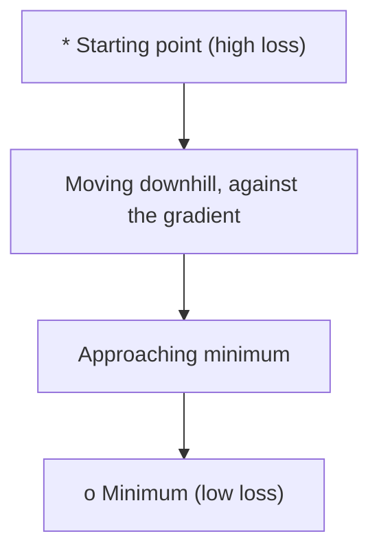
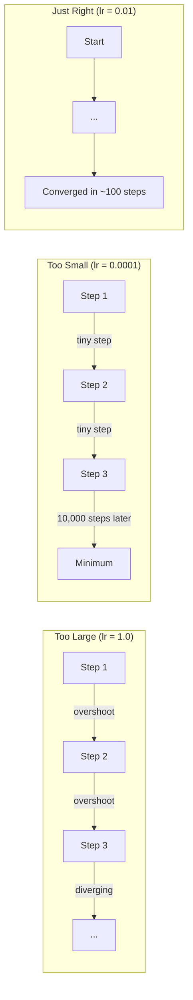
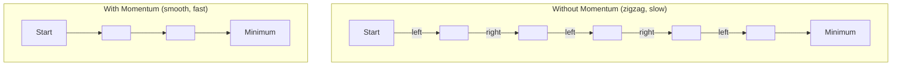
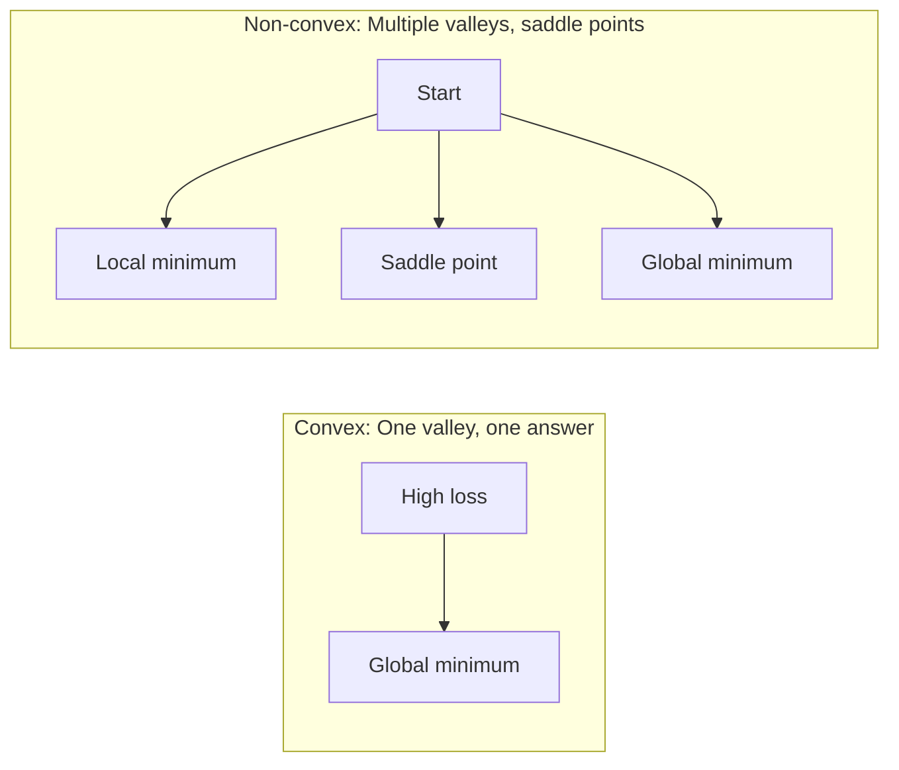
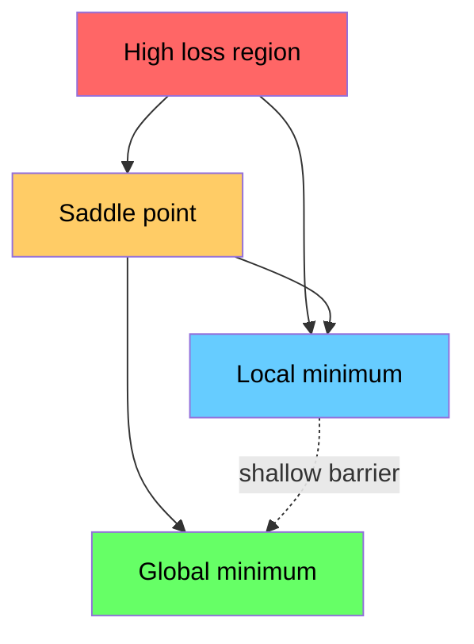

# Optimization

> 신경망을 훈련하는 것은 골짜기의 바닥을 찾는 것에 지나지 않습니다.

**유형:** Build (실습)
**Language:** Python
**선수 레슨:** Phase 1, Lessons 04-05 (Derivatives, Gradients)
**소요 시간:** ~75분

## Learning Objectives

- 바닐라 경사 하강법(vanilla gradient descent), 모멘텀을 적용한 SGD, Adam을 밑바닥부터 직접 구현합니다.
- 로젠브록 함수(Rosenbrock function)에서 옵티마이저의 수렴 속도를 비교하고, Adam이 가중치별 학습률을 적응적으로 조정하는 이유를 설명합니다.
- 볼록(convex) 손실 지형과 비볼록(non-convex) 손실 지형을 구분하고, 고차원에서 안장점(saddle point)이 미치는 영향을 설명합니다.
- 훈련 안정성을 높이기 위한 학습률 스케줄(스텝 감소, 코사인 어닐링, 웜업)을 구성합니다.

## The Problem

손실 함수(loss function)가 주어졌다고 가정해 봅시다. 이 함수는 모델이 얼마나 틀렸는지를 알려줍니다. 또한 그래디언트(gradient)도 있습니다. 그래디언트는 어느 방향으로 가면 손실이 더 커지는지를 알려줍니다. 이제 우리에게 필요한 것은 내리막길을 걸어 내려가는 전략입니다.

가장 단순한 접근법은 간단합니다. 그래디언트의 반대 방향으로 이동하는 것입니다. 이때 이동하는 보폭은 학습률(learning rate)이라는 수치로 조절합니다. 이 과정을 반복합니다. 이것이 바로 경사 하강법(gradient descent)이며, 실제로 잘 작동합니다. 하지만 "잘 작동한다"는 말에는 주의할 점이 있습니다. 학습률이 너무 크면 골짜기 벽 사이를 튕겨 다니며 바닥을 완전히 지나쳐 버립니다. 너무 작으면 수천 번의 불필요한 스텝을 거치며 정답을 향해 기어가게 됩니다. 안장점을 만나면 최솟값을 찾지 못했음에도 움직임을 멈추게 됩니다.

딥러닝의 모든 옵티마이저는 하나의 동일한 질문에 대한 해답입니다. "어떻게 하면 골짜기 바닥에 더 빠르고 안정적으로 도달할 수 있을까?"

## The Concept

### What optimization means

최적화(optimization)란 어떤 함수를 최소화(또는 최대화)하는 입력값을 찾는 과정입니다. 머신러닝에서 이 함수는 바로 손실(loss)입니다. 입력값은 모델의 가중치(weight)입니다. 즉, 훈련(training)이 곧 최적화입니다.

```
minimize L(w) where:
  L = loss function
  w = model weights (could be millions of parameters)
```

### Gradient descent (vanilla)

가장 단순한 옵티마이저입니다. 모든 가중치에 대해 손실의 그래디언트를 계산합니다. 각 가중치를 그래디언트의 반대 방향으로 이동시킵니다. 이때 보폭은 학습률로 조절합니다.

```math
w = w - \text{lr} \cdot \text{gradient}
```

이것이 알고리즘의 전부입니다. 단 한 줄입니다.



### Learning rate: the most important hyperparameter

학습률은 보폭을 제어합니다. 수렴과 관련된 모든 것을 결정하는 요소입니다.



올바른 학습률을 구하는 정해진 공식은 없습니다. 실험을 통해 찾아야 합니다. 일반적인 시작 지점은 Adam의 경우 0.001, 모멘텀을 적용한 SGD의 경우 0.01입니다.

### SGD vs batch vs mini-batch

바닐라 경사 하강법은 단 한 번의 스텝을 내딛기 전에 전체 데이터셋에 대해 그래디언트를 계산합니다. 이를 배치 경사 하강법(batch gradient descent)이라고 합니다. 안정적이지만 속도가 느립니다.

확률적 경사 하강법(Stochastic Gradient Descent, SGD)은 무작위로 선택한 단 하나의 샘플에 대해 그래디언트를 계산하고 즉시 스텝을 진행합니다. 노이즈가 심하지만 속도가 빠릅니다.

미니배치 경사 하강법(mini-batch gradient descent)은 두 방식의 절충안입니다. 작은 배치(32, 64, 128, 256개 샘플)에 대해 그래디언트를 계산한 다음 스텝을 진행합니다. 실제로 모두가 사용하는 방식이 바로 이것입니다.

| Variant | Batch size | Gradient quality | Speed per step | Noise |
|---------|-----------|-----------------|---------------|-------|
| Batch GD | 전체 데이터셋 | 정확함 | 느림 | 없음 |
| SGD | 1개 샘플 | 노이즈 매우 심함 | 빠름 | 높음 |
| Mini-batch | 32-256 | 우수한 추정치 | 균형 잡힘 | 보통 |

SGD와 미니배치에서 발생하는 노이즈는 버그가 아닙니다. 얕은 로컬 미니멈(local minima)과 안장점을 벗어나는 데 도움이 됩니다.

### Momentum: the ball rolling downhill

바닐라 경사 하강법은 오직 현재의 그래디언트만 고려합니다. 그래디언트가 지그재그로 진동하면(좁은 골짜기에서 흔히 발생) 진행 속도가 느려집니다. 모멘텀(momentum)은 과거의 그래디언트를 속도(velocity) 텀에 누적하여 이 문제를 해결합니다.

```math
\begin{aligned}
v &= \beta \cdot v + \text{gradient} \\
w &= w - \text{lr} \cdot v
\end{aligned}
```

골짜기를 굴러 내려가는 공을 떠올려 보세요. 공은 요철을 만날 때마다 멈췄다 다시 출발하지 않습니다. 일관된 방향으로 속도를 높이고 진동을 줄여 나갑니다.



`beta`(일반적으로 0.9)는 과거 이력을 얼마나 유지할지 제어합니다. 베타 값이 클수록 모멘텀이 강해져 경로가 부드러워지지만, 방향 전환에 대한 반응은 느려집니다.

### Adam: adaptive learning rates

가중치마다 필요한 학습률은 서로 다릅니다. 큰 그래디언트가 거의 발생하지 않는 가중치는 마침내 그래디언트가 생겼을 때 더 큰 보폭으로 이동해야 합니다. 지속적으로 거대한 그래디언트가 발생하는 가중치는 더 작은 보폭으로 이동해야 합니다.

Adam(Adaptive Moment Estimation)은 가중치별로 두 가지 값을 추적합니다.

1. 1차 모멘트($m$): 그래디언트의 이동 평균(모멘텀과 유사)
2. 2차 모멘트($v$): 제곱된 그래디언트의 이동 평균(그래디언트 크기)

```math
\begin{aligned}
m &= \beta_1 \cdot m + (1 - \beta_1) \cdot \text{gradient} \\
v &= \beta_2 \cdot v + (1 - \beta_2) \cdot \text{gradient}^2 \\[4pt]
\hat{m} &= m / (1 - \beta_1^t) \quad \text{bias correction} \\
\hat{v} &= v / (1 - \beta_2^t) \quad \text{bias correction} \\[4pt]
w &= w - \text{lr} \cdot \hat{m} / (\sqrt{\hat{v}} + \epsilon)
\end{aligned}
```

`sqrt(v_hat)`로 나누는 과정이 핵심적인 통찰입니다. 그래디언트가 큰 가중치는 큰 숫자로 나누어지므로 유효 보폭이 작아집니다. 그래디언트가 작은 가중치는 작은 숫자로 나누어지므로 유효 보폭이 커집니다. 각 가중치가 자신만의 적응형 학습률을 갖게 되는 것입니다.

기본 하이퍼파라미터는 `lr=0.001, beta1=0.9, beta2=0.999, epsilon=1e-8`입니다. 이 기본값들은 대부분의 문제에서 잘 작동합니다.

### Learning rate schedules

고정된 학습률은 일종의 타협점입니다. 훈련 초기에는 빠른 진행을 위해 큰 보폭을 원하지만, 훈련 후반에는 최솟값 부근에서 정밀하게 미세 조정하기 위해 작은 보폭을 원합니다.

자주 사용되는 스케줄은 다음과 같습니다.

| Schedule | Formula | Use case |
|----------|---------|----------|
| Step decay | 매 $N$ 에포크마다 $\text{lr} = \text{lr} \cdot \text{factor}$ | 단순함, 수동 제어 |
| Exponential decay | $\text{lr} = \text{lr}_0 \cdot \text{decay}^t$ | 완만한 감소 |
| Cosine annealing | $\text{lr} = \text{lr} _{\min} + 0.5 \cdot (\text{lr} _{\max} - \text{lr} _{\min}) \cdot (1 + \cos(\pi t / T))$ | 트랜스포머(Transformer), 현대적인 훈련 기법 |
| Warmup + decay | 선형 증가 후 점진적 감소 | 대규모 모델, 초기 불안정 방지 |

### Convex vs non-convex

볼록(convex) 함수에는 나쁜 로컬 미니멈이 없습니다. 모든 로컬 미니멈이 곧 글로벌 미니멈(global minimum)입니다. 최솟값이 존재하는 매끄러운 볼록 함수의 경우, 충분히 작은 학습률을 사용한 경사 하강법은 반드시 그 최솟값으로 수렴합니다. $f(x) = x^2$과 같은 2차 함수는 볼록 함수이며 최솟값이 유일합니다.

신경망의 손실 함수는 비볼록(non-convex) 함수입니다. 수많은 로컬 미니멈, 안장점, 평탄한 영역(flat regions)을 가지고 있습니다.



실제로 고차원 신경망에서 로컬 미니멈은 거의 문제가 되지 않습니다. 대부분의 로컬 미니멈은 손실 값이 글로벌 미니멈에 가깝기 때문입니다. 진짜 장애물은 안장점(어떤 방향으로는 평탄하고 다른 방향으로는 굽어 있는 지점)입니다. 모멘텀과 미니배치에서 발생하는 노이즈는 이러한 안장점을 벗어나는 데 도움을 줍니다.

### Loss landscape visualization

손실은 모든 가중치에 대한 함수입니다. 100만 개의 가중치를 가진 모델의 손실 지형(loss landscape)은 1,000,001차원 공간에 존재합니다. 이를 시각화하기 위해 가중치 공간에서 두 개의 무작위 방향을 선택하고 해당 방향을 따라 손실을 플롯하여 2차원 곡면으로 표현합니다.



가파른 미니멈(sharp minima)은 일반화 성능이 떨어집니다. 평탄한 미니멈(flat minima)은 일반화가 잘됩니다. 모멘텀을 적용한 SGD가 최종 테스트 정확도에서 Adam보다 종종 더 나은 성과를 내는 이유 중 하나가 바로 이것입니다. SGD의 노이즈가 가파른 미니멈에 갇히는 것을 방지해주기 때문입니다.

```figure
gradient-descent
```

## Build It

### Step 1: Define a test function

로젠브록 함수(Rosenbrock function)는 고전적인 최적화 벤치마크입니다. 이 함수의 최솟값은 (1, 1)에 위치하며, 찾기는 쉽지만 따라가기는 어려운 좁고 굽은 골짜기 안에 있습니다.

```math
f(x, y) = (1 - x)^2 + 100 \cdot (y - x^2)^2
```

```python
def rosenbrock(params):
    x, y = params
    return (1 - x) ** 2 + 100 * (y - x ** 2) ** 2

def rosenbrock_gradient(params):
    x, y = params
    df_dx = -2 * (1 - x) + 200 * (y - x ** 2) * (-2 * x)
    df_dy = 200 * (y - x ** 2)
    return [df_dx, df_dy]
```

### Step 2: Vanilla gradient descent

```python
class GradientDescent:
    def __init__(self, lr=0.001):
        self.lr = lr

    def step(self, params, grads):
        return [p - self.lr * g for p, g in zip(params, grads)]
```

### Step 3: SGD with momentum

```python
class SGDMomentum:
    def __init__(self, lr=0.001, momentum=0.9):
        self.lr = lr
        self.momentum = momentum
        self.velocity = None

    def step(self, params, grads):
        if self.velocity is None:
            self.velocity = [0.0] * len(params)
        self.velocity = [
            self.momentum * v + g
            for v, g in zip(self.velocity, grads)
        ]
        return [p - self.lr * v for p, v in zip(params, self.velocity)]
```

### Step 4: Adam

```python
class Adam:
    def __init__(self, lr=0.001, beta1=0.9, beta2=0.999, epsilon=1e-8):
        self.lr = lr
        self.beta1 = beta1
        self.beta2 = beta2
        self.epsilon = epsilon
        self.m = None
        self.v = None
        self.t = 0

    def step(self, params, grads):
        if self.m is None:
            self.m = [0.0] * len(params)
            self.v = [0.0] * len(params)

        self.t += 1

        self.m = [
            self.beta1 * m + (1 - self.beta1) * g
            for m, g in zip(self.m, grads)
        ]
        self.v = [
            self.beta2 * v + (1 - self.beta2) * g ** 2
            for v, g in zip(self.v, grads)
        ]

        m_hat = [m / (1 - self.beta1 ** self.t) for m in self.m]
        v_hat = [v / (1 - self.beta2 ** self.t) for v in self.v]

        return [
            p - self.lr * mh / (vh ** 0.5 + self.epsilon)
            for p, mh, vh in zip(params, m_hat, v_hat)
        ]
```

### Step 5: Run and compare

```python
def optimize(optimizer, func, grad_func, start, steps=5000):
    params = list(start)
    history = [params[:]]
    for _ in range(steps):
        grads = grad_func(params)
        params = optimizer.step(params, grads)
        history.append(params[:])
    return history

start = [-1.0, 1.0]

gd_history = optimize(GradientDescent(lr=0.0005), rosenbrock, rosenbrock_gradient, start)
sgd_history = optimize(SGDMomentum(lr=0.0001, momentum=0.9), rosenbrock, rosenbrock_gradient, start)
adam_history = optimize(Adam(lr=0.01), rosenbrock, rosenbrock_gradient, start)

for name, history in [("GD", gd_history), ("SGD+M", sgd_history), ("Adam", adam_history)]:
    final = history[-1]
    loss = rosenbrock(final)
    print(f"{name:6s} -> x={final[0]:.6f}, y={final[1]:.6f}, loss={loss:.8f}")
```

예상 출력: Adam이 가장 빠르게 수렴합니다. 모멘텀을 적용한 SGD는 더 부드러운 경로를 따릅니다. 바닐라 GD는 좁은 골짜기를 따라 느리게 전진합니다.
## 실전 활용

실무에서는 PyTorch나 JAX의 옵티마이저를 사용합니다. 이러한 라이브러리는 파라미터 그룹, 가중치 감쇠(weight decay), 그래디언트 클리핑(gradient clipping), GPU 가속 등을 직접 처리해 줍니다.

```python
import torch

model = torch.nn.Linear(784, 10)

sgd = torch.optim.SGD(model.parameters(), lr=0.01, momentum=0.9)
adam = torch.optim.Adam(model.parameters(), lr=0.001)
adamw = torch.optim.AdamW(model.parameters(), lr=0.001, weight_decay=0.01)

scheduler = torch.optim.lr_scheduler.CosineAnnealingLR(adam, T_max=100)
```

실무 지침:

- Adam(lr=0.001)으로 시작하세요. 튜닝 없이도 대부분의 문제에서 잘 작동합니다.
- 최종 정확도를 최대한 끌어올려야 하고 추가 튜닝을 진행할 여유가 있다면 모멘텀을 적용한 SGD(lr=0.01, momentum=0.9)로 전환하세요.
- 트랜스포머(Transformer) 모델에는 AdamW(가중치 감쇠가 분리된 Adam)를 사용하세요.
- 몇 에포크(epoch) 이상 진행되는 학습에는 항상 학습률 스케줄러(learning rate schedule)를 사용하세요.
- 학습이 불안정하면 학습률을 낮추고, 학습이 너무 느리면 학습률을 높이세요.

## 배포하기

이번 강의에서는 적절한 옵티마이저를 선택하기 위한 프롬프트를 작성합니다. `outputs/prompt-optimizer-guide.md`을 참고하세요.

여기서 구현한 옵티마이저 클래스들은 3단계에서 신경망을 바닥부터 직접 학습시킬 때 다시 사용됩니다.

## 연습 문제

1. **학습률 탐색(Learning rate sweep).** 로젠브록(Rosenbrock) 함수에 대해 기본 경사 하강법(vanilla gradient descent)을 학습률 [0.0001, 0.0005, 0.001, 0.005, 0.01]로 각각 실행해 보세요. 각 학습률에 대해 5,000단계 후의 최종 손실을 플롯하거나 출력하세요. 여전히 수렴하는 가장 큰 학습률을 찾아보세요.

2. **모멘텀 비교.** 로젠브록 함수에 대해 모멘텀 값 [0.0, 0.5, 0.9, 0.99]를 사용하여 SGD를 실행해 보세요. 매 단계마다 손실을 기록하세요. 어떤 모멘텀 값이 가장 빠르게 수렴하나요? 어떤 모멘텀 값에서 오버슈트(overshoot)가 발생하나요?

3. **안장점(Saddle point) 탈출.** 함수 $f(x, y) = x^2 - y^2$(원점에 안장점이 있음)을 정의하세요. (0.01, 0.01)에서 시작합니다. 기본 GD, 모멘텀이 적용된 SGD, Adam의 동작 방식을 비교해 보세요. 어느 옵티마이저가 안장점을 탈출하나요?

4. **학습률 감쇠 구현.** GradientDescent 클래스에 지수 감쇠 스케줄을 추가하세요: `lr = lr_0 * 0.999^step`. 로젠브록 함수에서 감쇠가 있을 때와 없을 때의 수렴 속도를 비교해 보세요.

### 힌트

**연습 문제 1.** 학습률들을 순회하면서 각각에 대해 `GradientDescent(lr=...)`를 생성하고, 이를 `rosenbrock` 및 `rosenbrock_gradient`와 함께 `optimize`에 전달하세요. 발산하는 실행은 손실이 증가하거나 `nan`이 됩니다. 최솟값은 손실이 0인 $(1, 1)$에 위치합니다.

**연습 문제 2.** 각 모멘텀 값마다 `SGDMomentum(momentum=m)`을 생성하고 각 단계 후의 손실을 기록하세요. 속도를 비교할 때는 `find_convergence_step`를 사용하고, 오버슈트를 찾으려면 손실이 오르내리는 구간을 확인하세요.

**연습 문제 3.** 그래디언트 $(2x, -2y)$를 작성하고 (0.01, 0.01)에서 세 옵티마이저를 실행하세요. 100단계마다 $y$를 출력하세요. 안장점을 탈출하는 옵티마이저는 $\lvert y \rvert$가 점점 커지는 옵티마이저입니다.

**연습 문제 4.** `lr_0`와 스텝 카운터를 `GradientDescent`에 저장하고, `step` 내부에서 `lr = lr_0 * 0.999 ** step`를 계산하세요. 0단계와 1,000단계에서 학습률을 출력해 보세요. 학습률이 `lr_0`에서 약 $0.37 \times \text{lr}_0$로 감소해야 합니다.

## 핵심 용어

| 용어 | 사람들이 흔히 하는 말 | 실제 의미 |
|------|----------------|----------------------|
| 경사 하강법(Gradient descent) | "내리막길 내려가기" | 학습률로 스케일링된 그래디언트를 빼서 가중치를 업데이트하는 가장 기본적인 옵티마이저. |
| 학습률(Learning rate) | "보폭(Step size)" | 가중치가 매 업데이트마다 이동하는 거리를 조절하는 스칼라 값. 너무 크면 발산하고, 너무 작으면 연산 자원이 낭비됨. |
| 모멘텀(Momentum) | "관성 유지하기" | 이전 그래디언트들을 속도 벡터에 누적하는 기법. 진동을 줄이고 일관된 방향으로의 이동 속도를 높임. |
| SGD | "무작위 샘플링" | 확률적 경사 하강법(Stochastic Gradient Descent). 전체 데이터셋 대신 무작위로 선택된 일부 서브셋에서 그래디언트를 계산함. 실무에서는 거의 항상 미니배치 SGD를 의미함. |
| 미니배치(Mini-batch) | "데이터 묶음" | 그래디언트를 추정하는 데 사용되는 학습 데이터의 작은 서브셋(32~256개 샘플). 속도와 그래디언트 정확도의 균형을 맞춤. |
| Adam | "기본 옵티마이저" | Adaptive Moment Estimation. 가중치별 그래디언트와 그래디언트 제곱의 이동 평균을 추적하여 각 가중치에 고유한 학습률을 부여함. |
| 편향 보정(Bias correction) | "초반 콜드 스타트 문제 해결" | Adam의 1차 및 2차 모멘트는 0으로 초기화됨. 편향 보정은 학습 초기 단계에서 이를 보상하기 위해 $(1 - \beta^t)$로 나누어 줌. |
| 학습률 스케줄(Learning rate schedule) | "시간에 따라 lr 변경하기" | 학습 중에 학습률을 조정하는 함수. 초기에는 큰 보폭으로, 후반에는 작은 보폭으로 이동함. |
| 볼록 함수(Convex function) | "골짜기가 하나뿐인 함수" | 모든 국소 최솟값(local minimum)이 곧 전역 최솟값(global minimum)인 함수. 경사 하강법으로 항상 최솟값을 찾을 수 있음. 신경망의 손실 함수는 볼록 함수가 아님. |
| 안장점(Saddle point) | "평평하지만 최솟값은 아님" | 그래디언트가 0이지만 어떤 방향으로는 최솟값이고 다른 방향으로는 최댓값인 지점. 고차원 공간에서 흔히 발생함. |
| 손실 지형(Loss landscape) | "지형도" | 가중치 공간 위에 손실 함수를 시각화한 것. 무작위 두 방향을 따라 단면을 잘라 시각화함. |
| 수렴(Convergence) | "목표 도달" | 추가적인 스텝을 진행해도 손실이 의미 있게 감소하지 않는 지점에 옵티마이저가 도달한 상태. |

## 더 읽을거리

- [Sebastian Ruder: An overview of gradient descent optimization algorithms](https://ruder.io/optimizing-gradient-descent/) - 주요 옵티마이저 전반을 포괄적으로 다룬 서베이
- [Why Momentum Really Works (Distill)](https://distill.pub/2017/momentum/) - 모멘텀의 역학을 보여주는 인터랙티브 시각화 자료
- [Adam: A Method for Stochastic Optimization (Kingma & Ba, 2014)](https://arxiv.org/abs/1412.6980) - 읽기 쉽고 간결한 원작 Adam 논문
- [Visualizing the Loss Landscape of Neural Nets (Li et al., 2018)](https://arxiv.org/abs/1712.09913) - 가파른 최솟값(sharp minima)과 평평한 최솟값(flat minima)을 비교해 보여준 논문
