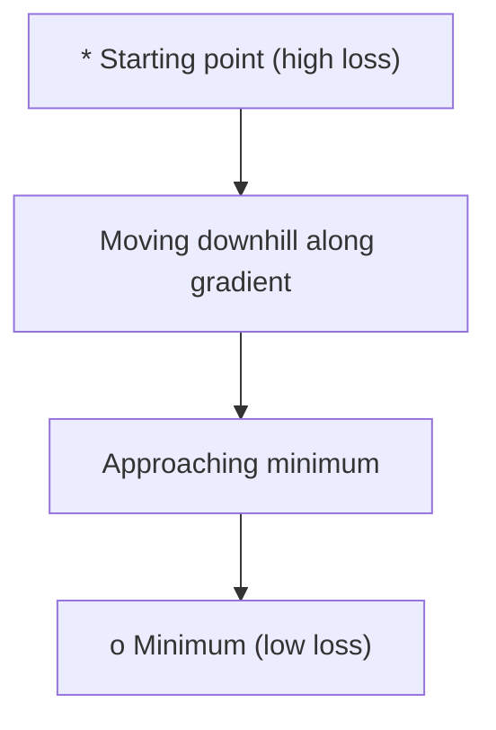
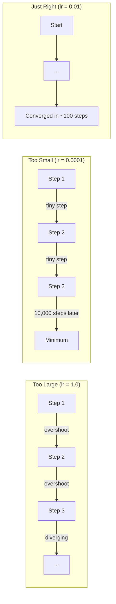
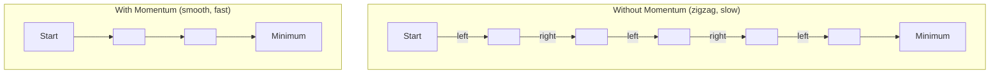
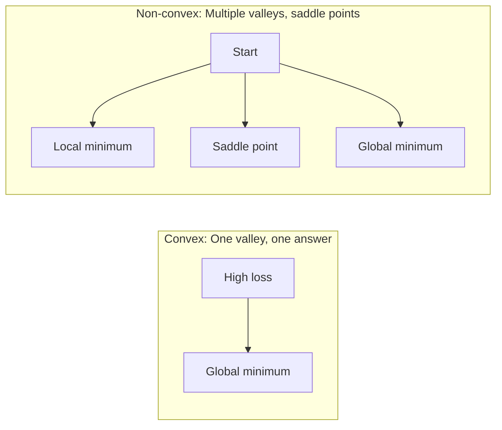
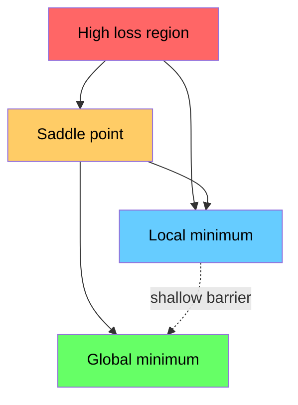

# 최적화(Optimization)

> 신경망을 훈련하는 것은 골짜기의 가장 낮은 바닥을 찾는 일에 불과합니다.

**유형:** Build (실습)
**Language:** Python
**선수 레슨:** Phase 1, Lessons 04-05 (Derivatives, Gradients)
**소요 시간:** ~75분

## 학습 목표

- 바닐라 경사 하강법(vanilla gradient descent), 모멘텀을 적용한 SGD(SGD with momentum), Adam을 밑바닥부터 직접 구현합니다.
- 로젠브록 함수(Rosenbrock function)에서 옵티마이저의 수렴 속도를 비교하고, Adam이 가중치별 적응형 학습률을 적용하는 이유를 설명합니다.
- 볼록(convex) 손실 지형과 비볼록(non-convex) 손실 지형을 구분하고, 고차원에서 안장점(saddle point)이 미치는 영향을 설명합니다.
- 훈련 안정성을 위해 학습률 스케줄(스텝 감쇄, 코사인 어닐링, 웜업)을 구성합니다.

## 문제 상황

손실 함수가 있습니다. 이 함수는 모델이 얼마나 잘못되었는지를 알려줍니다. 그래디언트(gradient)도 있습니다. 이는 어느 방향으로 가면 손실이 더 나빠지는지를 알려줍니다. 이제 내리막길을 내려가기 위한 전략이 필요합니다.

가장 단순한 접근법은 간단합니다. 그래디언트의 반대 방향으로 이동하는 것입니다. 이동 보폭은 학습률(learning rate)이라는 숫자로 조정합니다. 이 과정을 반복합니다. 이것이 바로 경사 하강법(gradient descent)이며, 실제로 잘 동작합니다. 하지만 "동작한다"라는 말에는 주의할 점이 있습니다. 학습률이 너무 크면 골짜기를 완전히 지나쳐 벽 사이를 튕겨 다니게 됩니다. 너무 작으면 불필요하게 수천 번의 단계를 거치며 정답을 향해 기어가듯 이동합니다. 안장점을 만나면 최솟값을 찾지 못했음에도 움직임을 멈추게 됩니다.

딥러닝의 모든 옵티마이저는 동일한 질문에 대한 답입니다. 어떻게 하면 더 빠르고 안정적으로 골짜기의 바닥에 도달할 수 있을까요?

## 핵심 개념

### 최적화란 무엇인가

최적화(optimization)란 어떤 함수를 최소화(또는 최대화)하는 입력값을 찾는 과정입니다. 머신러닝에서 이 함수는 손실 함수입니다. 입력값은 모델의 가중치입니다. 즉, 훈련(training)이 곧 최적화입니다.

```
minimize L(w) where:
  L = loss function
  w = model weights (could be millions of parameters)
```

### 바닐라 경사 하강법(Vanilla gradient descent)

가장 단순한 옵티마이저입니다. 모든 가중치에 대해 손실의 그래디언트를 계산합니다. 각 가중치를 해당 그래디언트의 반대 방향으로 이동시킵니다. 이동 보폭은 학습률로 조절합니다.

```math
w = w - \text{lr} \cdot \text{gradient}
```

이것이 알고리즘의 전부입니다. 단 한 줄입니다.



### 학습률: 가장 중요한 하이퍼파라미터

학습률은 보폭(step size)을 제어합니다. 수렴에 관한 모든 것을 결정합니다.



올바른 학습률을 구하는 정해진 공식은 없습니다. 실험을 통해 찾아야 합니다. 일반적인 시작 지점은 Adam의 경우 0.001, 모멘텀을 적용한 SGD의 경우 0.01입니다.

### SGD vs 배치 vs 미니배치

바닐라 경사 하강법은 한 걸음을 내딛기 전에 전체 데이터셋에 대해 그래디언트를 계산합니다. 이를 배치 경사 하강법(batch gradient descent)이라고 합니다. 안정적이지만 속도가 느립니다.

확률적 경사 하강법(SGD, Stochastic Gradient Descent)은 단 하나의 무작위 샘플에서 그래디언트를 계산하고 즉시 이동합니다. 노이즈가 심하지만 빠릅니다.

미니배치(mini-batch) 경사 하강법은 둘 사이의 절충안입니다. 작은 배치(32, 64, 128, 256개 샘플)에 대해 그래디언트를 계산한 다음 이동합니다. 실제로 모두가 사용하는 방식입니다.

| 변형 방식 | 배치 크기 | 그래디언트 품질 | 스텝당 속도 | 노이즈 |
|---------|-----------|-----------------|---------------|-------|
| 배치 GD | 전체 데이터셋 | 정확함 | 느림 | 없음 |
| SGD | 1개 샘플 | 노이즈 매우 심함 | 빠름 | 높음 |
| 미니배치 | 32-256 | 우수한 추정치 | 균형 잡힘 | 보통 |

SGD와 미니배치에서 발생하는 노이즈는 결함이 아닙니다. 이 노이즈는 얕은 국소 최솟값(local minima)과 안장점을 벗어나는 데 도움이 됩니다.

### 모멘텀: 내리막길을 굴러가는 공

바닐라 경사 하강법은 현재의 그래디언트만 고려합니다. 그래디언트가 지그재그로 진동하면(좁은 골짜기에서 흔히 발생) 진행 속도가 느려집니다. 모멘텀(momentum)은 과거의 그래디언트를 속도(velocity) 항에 누적하여 이 문제를 해결합니다.

```math
\begin{aligned}
v &= \beta \cdot v + \text{gradient} \\
w &= w - \text{lr} \cdot v
\end{aligned}
```

언덕 아래로 굴러가는 공에 비유할 수 있습니다. 공은 작은 턱을 만날 때마다 멈췄다 다시 출발하지 않습니다. 일관된 방향으로 속도를 붙이고 좌우 진동을 완화합니다.



`beta`(일반적으로 0.9)는 과거 이력을 얼마나 유지할지 제어합니다. 베타 값이 클수록 모멘텀이 커져 경로가 부드러워지지만, 방향 전환에 대한 반응은 느려집니다.

### Adam: 적응형 학습률

가중치마다 서로 다른 학습률이 필요합니다. 평소에 큰 그래디언트가 거의 발생하지 않던 가중치는 마침내 그래디언트가 발생했을 때 더 큰 보폭으로 이동해야 합니다. 반대로 항상 거대한 그래디언트가 발생하는 가중치는 더 작은 보폭으로 이동해야 합니다.

Adam(Adaptive Moment Estimation)은 가중치마다 두 가지 값을 추적합니다.

1. 1차 모멘트($m$): 그래디언트의 이동 평균(모멘텀과 유사)
2. 2차 모멘트($v$): 그래디언트 제곱의 이동 평균(그래디언트 크기)

```math
\begin{aligned}
m &= \beta_1 \cdot m + (1 - \beta_1) \cdot \text{gradient} \\
v &= \beta_2 \cdot v + (1 - \beta_2) \cdot \text{gradient}^2 \\[4pt]
\hat{m} &= m / (1 - \beta_1^t) \quad \text{bias correction} \\
\hat{v} &= v / (1 - \beta_2^t) \quad \text{bias correction} \\[4pt]
w &= w - \text{lr} \cdot \hat{m} / (\sqrt{\hat{v}} + \epsilon)
\end{aligned}
```

`sqrt(v_hat)`로 나누는 부분이 핵심적인 아이디어입니다. 그래디언트가 큰 가중치는 큰 숫자로 나누어지므로 유효 보폭이 작아집니다. 그래디언트가 작은 가중치는 작은 숫자로 나누어지므로 유효 보폭이 커집니다. 각 가중치가 고유한 적응형 학습률을 갖게 됩니다.

기본 하이퍼파라미터는 `lr=0.001, beta1=0.9, beta2=0.999, epsilon=1e-8`입니다. 이 기본값들은 대부분의 문제에서 잘 동작합니다.

### 학습률 스케줄

고정된 학습률은 타협안에 불과합니다. 훈련 초기에는 빠른 진행을 위해 큰 보폭이 필요합니다. 훈련 후반에는 최솟값 근처에서 미세 조정을 하기 위해 작은 보폭이 필요합니다.

자주 사용되는 스케줄은 다음과 같습니다.

| 스케줄 | 공식 | 사용 사례 |
|----------|---------|----------|
| 스텝 감쇄(Step decay) | 매 $N$ 에포크마다 $\text{lr} = \text{lr} \cdot \text{factor}$ | 단순함, 수동 제어 |
| 지수 감쇄(Exponential decay) | $\text{lr} = \text{lr}_0 \cdot \text{decay}^t$ | 부드러운 감소 |
| 코사인 어닐링(Cosine annealing) | $\text{lr} = \text{lr} _{\min} + 0.5 \cdot (\text{lr} _{\max} - \text{lr} _{\min}) \cdot (1 + \cos(\pi t / T))$ | Transformer, 현대적 훈련 기법 |
| 웜업 + 감쇄(Warmup + decay) | 선형 증가 후 감쇄 | 대규모 모델, 초기 불안정성 방지 |

### 볼록 vs 비볼록

볼록(convex) 함수는 단 하나의 최솟값을 가집니다. 경사 하강법은 항상 이 최솟값을 찾습니다. $f(x) = x^2$과 같은 2차 함수는 볼록 함수입니다.

신경망의 손실 함수는 비볼록(non-convex) 함수입니다. 수많은 국소 최솟값, 안장점, 평탄한 영역(flat regions)을 가지고 있습니다.



실제로는 고차원 신경망에서 국소 최솟값이 문제가 되는 경우는 드뭅니다. 대부분의 국소 최솟값은 전역 최솟값(global minimum)에 가까운 손실값을 갖기 때문입니다. 진짜 장애물은 안장점(일부 방향으로는 평탄하고 다른 방향으로는 굽어 있는 지점)입니다. 모멘텀과 미니배치에서 발생하는 노이즈는 이러한 안장점을 벗어나는 데 도움이 됩니다.

### 손실 지형 시각화

손실은 모든 가중치에 대한 함수입니다. 가중치가 100만 개인 모델의 경우 손실 지형(loss landscape)은 1,000,001차원 공간에 존재합니다. 이를 시각화하기 위해 가중치 공간에서 두 개의 무작위 방향을 선택하고 해당 방향을 따라 손실을 플롯하여 2D 곡면을 생성합니다.



가파른 최솟값(sharp minima)은 일반화 성능이 떨어집니다. 평탄한 최솟값(flat minima)은 일반화가 잘됩니다. 모멘텀을 적용한 SGD가 최종 테스트 정확도에서 종종 Adam을 능가하는 이유 중 하나가 바로 이것입니다. SGD의 노이즈가 가파른 최솟값에 안착하는 것을 방지해주기 때문입니다.

```figure
gradient-descent
```

## 직접 구현하기

### 1단계: 테스트 함수 정의

로젠브록 함수는 고전적인 최적화 벤치마크입니다. 최솟값은 (1, 1)에 위치하며, 찾기는 쉽지만 따라가기는 어려운 좁고 굽은 골짜기 내부에 있습니다.

```math
f(x, y) = (1 - x)^2 + 100 \cdot (y - x^2)^2
```

```python
def rosenbrock(params):
    x, y = params
    return (1 - x) ** 2 + 100 * (y - x ** 2) ** 2

def rosenbrock_gradient(params):
    x, y = params
    df_dx = -2 * (1 - x) + 200 * (y - x ** 2) * (-2 * x)
    df_dy = 200 * (y - x ** 2)
    return [df_dx, df_dy]
```

### 2단계: 바닐라 경사 하강법

```python
class GradientDescent:
    def __init__(self, lr=0.001):
        self.lr = lr

    def step(self, params, grads):
        return [p - self.lr * g for p, g in zip(params, grads)]
```

### 3단계: 모멘텀을 적용한 SGD

```python
class SGDMomentum:
    def __init__(self, lr=0.001, momentum=0.9):
        self.lr = lr
        self.momentum = momentum
        self.velocity = None

    def step(self, params, grads):
        if self.velocity is None:
            self.velocity = [0.0] * len(params)
        self.velocity = [
            self.momentum * v + g
            for v, g in zip(self.velocity, grads)
        ]
        return [p - self.lr * v for p, v in zip(params, self.velocity)]
```

### 4단계: Adam

```python
class Adam:
    def __init__(self, lr=0.001, beta1=0.9, beta2=0.999, epsilon=1e-8):
        self.lr = lr
        self.beta1 = beta1
        self.beta2 = beta2
        self.epsilon = epsilon
        self.m = None
        self.v = None
        self.t = 0

    def step(self, params, grads):
        if self.m is None:
            self.m = [0.0] * len(params)
            self.v = [0.0] * len(params)

        self.t += 1

        self.m = [
            self.beta1 * m + (1 - self.beta1) * g
            for m, g in zip(self.m, grads)
        ]
        self.v = [
            self.beta2 * v + (1 - self.beta2) * g ** 2
            for v, g in zip(self.v, grads)
        ]

        m_hat = [m / (1 - self.beta1 ** self.t) for m in self.m]
        v_hat = [v / (1 - self.beta2 ** self.t) for v in self.v]

        return [
            p - self.lr * mh / (vh ** 0.5 + self.epsilon)
            for p, mh, vh in zip(params, m_hat, v_hat)
        ]
```

### 5단계: 실행 및 비교

```python
def optimize(optimizer, func, grad_func, start, steps=5000):
    params = list(start)
    history = [params[:]]
    for _ in range(steps):
        grads = grad_func(params)
        params = optimizer.step(params, grads)
        history.append(params[:])
    return history

start = [-1.0, 1.0]

gd_history = optimize(GradientDescent(lr=0.0005), rosenbrock, rosenbrock_gradient, start)
sgd_history = optimize(SGDMomentum(lr=0.0001, momentum=0.9), rosenbrock, rosenbrock_gradient, start)
adam_history = optimize(Adam(lr=0.01), rosenbrock, rosenbrock_gradient, start)

for name, history in [("GD", gd_history), ("SGD+M", sgd_history), ("Adam", adam_history)]:
    final = history[-1]
    loss = rosenbrock(final)
    print(f"{name:6s} -> x={final[0]:.6f}, y={final[1]:.6f}, loss={loss:.8f}")
```

예상 출력: Adam이 가장 빠르게 수렴합니다. 모멘텀을 적용한 SGD는 더 부드러운 경로를 따릅니다. 바닐라 GD는 좁은 골짜기를 따라 느리게 진행합니다.
## Use It

실무에서는 PyTorch나 JAX의 옵티마이저를 사용합니다. 이들은 매개변수 그룹, 가중치 감쇠(weight decay), 그래디언트 클리핑(gradient clipping), GPU 가속을 처리해 줍니다.

```python
import torch

model = torch.nn.Linear(784, 10)

sgd = torch.optim.SGD(model.parameters(), lr=0.01, momentum=0.9)
adam = torch.optim.Adam(model.parameters(), lr=0.001)
adamw = torch.optim.AdamW(model.parameters(), lr=0.001, weight_decay=0.01)

scheduler = torch.optim.lr_scheduler.CosineAnnealingLR(adam, T_max=100)
```

경험 법칙:

- Adam(lr=0.001)으로 시작하세요. 튜닝 없이도 대부분의 문제에서 잘 작동합니다.
- 최종 정확도를 최대한 끌어올려야 하고 추가적인 튜닝 여유가 있다면 모멘텀을 적용한 SGD(lr=0.01, momentum=0.9)로 전환하세요.
- 트랜스포머(Transformer)에는 AdamW(분리된 가중치 감쇠가 적용된 Adam)를 사용하세요.
- 몇 에포크(epoch) 이상 진행되는 훈련 실행에는 항상 학습률 스케줄(learning rate schedule)을 사용하세요.
- 훈련이 불안정하면 학습률을 낮추세요. 훈련이 너무 느리면 학습률을 높이세요.

## Ship It

이 레슨에서는 적절한 옵티마이저를 선택하기 위한 프롬프트를 생성합니다. `outputs/prompt-optimizer-guide.md`을 참고하세요.

여기서 구현한 옵티마이저 클래스들은 3단계에서 신경망을 밑바닥부터 훈련할 때 다시 등장합니다.

## Exercises

1. **학습률 스윕.** 학습률 [0.0001, 0.0005, 0.001, 0.005, 0.01]을 사용하여 로젠브록 함수(Rosenbrock function)에서 기본 경사 하강법(vanilla gradient descent)을 실행하세요. 각 학습률에 대해 5,000단계 후의 최종 손실을 플롯하거나 출력하세요. 여전히 수렴하는 가장 큰 학습률을 찾으세요.

2. **모멘텀 비교.** 모멘텀 값 [0.0, 0.5, 0.9, 0.99]를 사용하여 로젠브록 함수에서 SGD를 실행하세요. 매 단계마다 손실을 추적하세요. 어떤 모멘텀 값이 가장 빠르게 수렴하나요? 어떤 값이 오버슈트(overshoot)하나요?

3. **안장점 탈출.** 함수 $f(x, y) = x^2 - y^2$를 정의하세요(원점에 안장점이 있음). (0.01, 0.01)에서 시작합니다. 기본 GD, 모멘텀이 적용된 SGD, Adam이 어떻게 동작하는지 비교하세요. 어느 옵티마이저가 안장점(saddle point)을 탈출하나요?

4. **학습률 감쇠 구현.** GradientDescent 클래스에 지수 감쇠 스케줄을 추가하세요: `lr = lr_0 * 0.999^step`. 로젠브록 함수에서 감쇠가 있을 때와 없을 때의 수렴 과정을 비교하세요.

### Hints

**연습문제 1.** 학습률들을 순회하면서 각각에 대해 `GradientDescent(lr=...)`를 생성하고, `rosenbrock` 및 `rosenbrock_gradient`와 함께 `optimize`에 전달하세요. 발산하는 실행은 손실이 증가하거나 `nan`이 됩니다. 최솟값은 $(1, 1)$에 위치하며 손실은 0입니다.

**연습문제 2.** 각 값에 대해 `SGDMomentum(momentum=m)`을 생성하고 각 단계 후의 손실을 기록하세요. 속도를 비교하려면 `find_convergence_step`을 사용하고, 오버슈트를 찾으려면 오르내리는 손실을 확인하세요.

**연습문제 3.** 그래디언트 $(2x, -2y)$를 작성하고 (0.01, 0.01)에서 세 옵티마이저를 실행하세요. 매 100단계마다 $y$를 출력하세요. 탈출하는 옵티마이저는 $\lvert y \rvert$가 크게 증가하는 옵티마이저입니다.

**연습문제 4.** `GradientDescent`에 `lr_0`과 스텝 카운터를 저장하고, `step` 내부에서 `lr = lr_0 * 0.999 ** step`을 계산하세요. 0단계와 1000단계에서 학습률을 출력하세요. 학습률은 `lr_0`에서 약 $0.37 \times \text{lr}_0$로 떨어져야 합니다.

## Key Terms

| 용어 | 사람들이 흔히 하는 말 | 실제 의미 |
|------|----------------|----------------------|
| 경사 하강법(Gradient descent) | "내리막길로 내려가기" | 학습률로 스케일링된 그래디언트를 빼서 가중치를 업데이트합니다. 가장 기본적인 옵티마이저입니다. |
| 학습률(Learning rate) | "보폭" | 각 업데이트가 가중치를 얼마나 이동시킬지 제어하는 스칼라입니다. 너무 크면 발산하고, 너무 작으면 연산 자원을 낭비합니다. |
| 모멘텀(Momentum) | "계속 굴러가기" | 과거의 그래디언트를 속도 벡터에 누적합니다. 진동을 완화하고 일관된 방향으로의 이동을 가속합니다. |
| SGD | "무작위 샘플링" | 확률적 경사 하강법(Stochastic gradient descent). 전체 데이터셋 대신 무작위 하위 집합에서 그래디언트를 계산합니다. 실무에서는 거의 항상 미니배치 SGD를 의미합니다. |
| 미니배치(Mini-batch) | "데이터 한 덩어리" | 그래디언트를 추정하는 데 사용되는 훈련 데이터의 작은 하위 집합(32~256개 샘플)입니다. 속도와 그래디언트 정확도의 균형을 맞춥니다. |
| Adam | "기본 옵티마이저" | Adaptive Moment Estimation. 그래디언트와 그래디언트 제곱의 가중치별 이동 평균을 추적하여 각 가중치에 고유한 학습률을 부여합니다. |
| 편향 수정(Bias correction) | "콜드 스타트 해결하기" | Adam의 1차 및 2차 모멘트는 0으로 초기화됩니다. 편향 수정은 초기 단계에서 이를 보상하기 위해 $(1 - \beta^t)$로 나눕니다. |
| 학습률 스케줄(Learning rate schedule) | "시간에 따라 lr 변경하기" | 훈련 중에 학습률을 조정하는 함수입니다. 초기에는 큰 보폭으로, 후기에는 작은 보폭으로 이동합니다. |
| 볼록 함수(Convex function) | "하나의 골짜기" | 모든 로컬 미니멈(local minimum)이 글로벌 미니멈(global minimum)인 함수입니다. 경사 하강법은 항상 이를 찾아냅니다. 신경망의 손실 함수는 볼록하지 않습니다. |
| 안장점(Saddle point) | "평평하지만 최솟값은 아님" | 그래디언트가 0이지만 어떤 방향으로는 최솟값이고 다른 방향으로는 최댓값인 지점입니다. 고차원에서 흔히 나타납니다. |
| 손실 지형(Loss landscape) | "지형도" | 가중치 공간 상에 플롯된 손실 함수입니다. 두 개의 무작위 방향으로 단면을 잘라 시각화합니다. |
| 수렴(Convergence) | "목표 지점 도달" | 추가 단계를 진행해도 손실이 유의미하게 감소하지 않는 지점에 옵티마이저가 도달한 상태입니다. |

## Further Reading

- [Sebastian Ruder: An overview of gradient descent optimization algorithms](https://ruder.io/optimizing-gradient-descent/) - 모든 주요 옵티마이저에 대한 포괄적인 서베이
- [Why Momentum Really Works (Distill)](https://distill.pub/2017/momentum/) - 모멘텀 역학의 인터랙티브 시각화
- [Adam: A Method for Stochastic Optimization (Kingma & Ba, 2014)](https://arxiv.org/abs/1412.6980) - Adam 원본 논문, 읽기 쉽고 간결함
- [Visualizing the Loss Landscape of Neural Nets (Li et al., 2018)](https://arxiv.org/abs/1712.09913) - 뾰족한 최솟값(sharp minima)과 평탄한 최솟값(flat minima)을 보여준 논문
