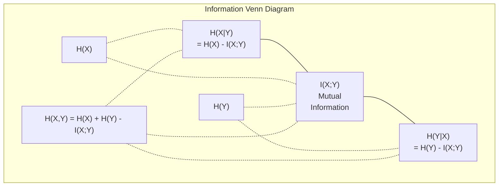

# 정보 이론

> 정보 이론은 놀라움(surprise)을 측정합니다. 손실 함수는 이 개념 위에 구축됩니다.

**유형:** Learn (이론)
**Language:** Python
**선수 레슨:** Phase 1, Lesson 06 (Probability)
**소요 시간:** ~60분

## 학습 목표

- 엔트로피(entropy), 교차 엔트로피(cross-entropy), KL 발산(KL divergence)을 밑바닥부터 계산하고 이들의 관계를 설명합니다.
- 교차 엔트로피 손실을 최소화하는 것이 로그 가능도(log-likelihood)를 최대화하는 것과 왜 동등한지 유도합니다.
- 특성(feature)과 타깃 간의 상호 정보량(mutual information)을 계산하여 특성 중요도의 순위를 매깁니다.
- 펄플렉서티(perplexity)를 언어 모델이 선택하는 유효 어휘 크기로 설명합니다.

## 문제

분류 모델을 학습시킬 때마다 `CrossEntropyLoss()`를 호출합니다. 언어 모델 논문마다 "펄플렉서티(perplexity)"가 등장합니다. VAE, 지식 증류(distillation), RLHF에 관한 글에서는 KL 발산(KL divergence)에 대해 읽게 됩니다. 이들은 서로 동떨어진 개념이 아닙니다. 모두 동일한 아이디어가 형태만 바꾼 것에 불과합니다.

정보 이론은 불확실성, 압축, 예측을 추론할 수 있는 언어를 제공합니다. 클로드 섀넌(Claude Shannon)은 1948년 통신 문제를 해결하기 위해 이를 창안했습니다. 알고 보면 신경망을 학습시키는 것도 통신 문제입니다. 모델은 학습된 가중치라는 노이즈가 있는 채널을 통해 올바른 레이블을 전송하려고 시도하는 것입니다.

이번 강의에서는 모든 공식을 밑바닥부터 직접 유도하여 공식이 어디서 유래했고 왜 작동하는지 살펴봅니다.

## 개념

### 정보량 (Surprise)

일어날 가능성이 낮은 사건이 발생하면 더 많은 정보를 전달합니다. 동전을 던져 앞면이 나오는 것? 놀랍지 않습니다. 복권에 당첨되는 것? 매우 놀라운 일입니다.

확률이 $p$인 사건의 정보량은 다음과 같습니다.

```math
I(x) = -\log(p(x))
```

밑이 2인 로그를 사용하면 비트(bit) 단위가 되고, 자연로그를 사용하면 나트(nat) 단위가 됩니다. 아이디어는 같고 단위만 다를 뿐입니다.

```
Event              Probability    Surprise (bits)
Fair coin heads    0.5            1.0
Rolling a 6        0.167          2.58
1-in-1000 event    0.001          9.97
Certain event      1.0            0.0
```

확실한 사건은 정보량이 0입니다. 이미 일어날 것임을 알고 있었기 때문입니다.

### 엔트로피 (평균 놀라움)

엔트로피는 어떤 분포에서 가능한 모든 결과에 걸친 기대 놀라움(expected surprise)입니다.

```math
H(P) = -\sum_{x} p(x) \log(p(x))
```

공정한 동전은 이진 변수에서 가질 수 있는 최대 엔트로피인 1비트를 갖습니다. 편향된 동전(앞면 99%)은 0.08비트라는 낮은 엔트로피를 갖습니다. 어떤 결과가 나올지 이미 알고 있으므로, 동전을 던질 때마다 얻는 정보는 거의 없습니다.

```math
\begin{aligned}
\text{Fair coin:} \quad & H = -(0.5 \log_2(0.5) + 0.5 \log_2(0.5)) = 1.0 \text{ bit} \\
\text{Biased coin:} \quad & H = -(0.99 \log_2(0.99) + 0.01 \log_2(0.01)) = 0.08 \text{ bits}
\end{aligned}
```

엔트로피는 분포에 내재된 줄일 수 없는 불확실성을 측정합니다. 이 값보다 더 압축할 수는 없습니다.

### 교차 엔트로피 (매일 사용하는 손실 함수)

교차 엔트로피는 실제로 분포 $P$에서 발생하는 사건을 인코딩하기 위해 분포 $Q$를 사용할 때의 평균 놀라움을 측정합니다.

```math
H(P, Q) = -\sum_{x} p(x) \log(q(x))
```

$P$는 실제 분포(레이블)입니다. $Q$는 모델의 예측입니다. $Q$가 $P$와 완벽히 일치하면 교차 엔트로피는 엔트로피와 같아집니다. 불일치가 발생하면 교차 엔트로피는 더 커집니다.

분류(classification)에서 $P$는 원-핫 벡터(one-hot vector)입니다(실제 클래스의 확률은 1, 나머지는 0). 이에 따라 교차 엔트로피는 다음과 같이 단순화됩니다.

```math
H(P, Q) = -\log(q(\text{true\_class}))
```

이것이 분류 문제에서 교차 엔트로피 손실 공식의 전부입니다. 정답 클래스에 대해 예측된 확률을 최대화하는 것입니다.

### KL 발산 (분포 간의 거리)

KL 발산은 $P$ 대신 $Q$를 사용함으로써 얻게 되는 추가적인 놀라움이 얼마나 되는지 측정합니다.

```math
\begin{aligned}
D_{KL}(P \,\|\, Q) &= \sum_{x} p(x) \log(p(x) / q(x)) \\
&= H(P, Q) - H(P)
\end{aligned}
```

교차 엔트로피는 엔트로피와 KL 발산의 합입니다. 학습 도중 실제 분포의 엔트로피는 상수이므로, 교차 엔트로피를 최소화하는 것은 KL 발산을 최소화하는 것과 같습니다. 즉, 모델의 분포를 실제 분포에 가깝게 밀어붙이는 것입니다.

KL 발산은 대칭적이지 않습니다: $D_{KL}(P \Vert Q) \ne D_{KL}(Q \Vert P)$. 따라서 엄밀한 의미의 거리 척도(distance metric)는 아닙니다.

### 상호 정보량

상호 정보량은 한 변수를 아는 것이 다른 변수에 대해 얼마나 많은 정보를 알려주는지 측정합니다.

```math
\begin{aligned}
I(X; Y) &= H(X) - H(X \mid Y) \\
&= H(X) + H(Y) - H(X, Y)
\end{aligned}
```

$X$와 $Y$가 독립이면 상호 정보량은 0입니다. 하나를 알아도 다른 하나에 대해 아무것도 알 수 없기 때문입니다. 두 변수가 완벽하게 상관되어 있다면 상호 정보량은 둘 중 어느 한 변수의 엔트로피와 같습니다.

특성 선택(feature selection)에서 특성과 타깃 간의 상호 정보량이 높다는 것은 해당 특성이 유용함을 의미합니다. 상호 정보량이 낮다면 노이즈에 불과함을 의미합니다.

### 조건부 엔트로피

$H(Y \mid X)$는 $X$를 관측한 후에도 $Y$에 대해 남아 있는 불확실성의 양을 측정합니다.

```math
H(Y \mid X) = H(X,Y) - H(X)
```

두 가지 극단적인 경우:
- $X$가 $Y$를 완전히 결정한다면, $H(Y \mid X) = 0$입니다. $X$를 알면 $Y$에 대한 모든 불확실성이 제거됩니다. 예: $X$ = 섭씨온도, $Y$ = 화씨온도.
- $X$가 $Y$에 대해 아무것도 알려주지 않는다면, $H(Y \mid X) = H(Y)$입니다. $X$를 알아도 불확실성은 전혀 줄어들지 않습니다. 예: $X$ = 동전 던지기 결과, $Y$ = 내일의 날씨.

조건부 엔트로피는 항상 음수가 아니며 결코 $H(Y)$를 초과하지 않습니다.

```math
0 \le H(Y \mid X) \le H(Y)
```

머신러닝에서 조건부 엔트로피는 의사결정나무(decision tree)에 등장합니다. 매 분기마다 알고리즘은 $H(Y \mid X)$를 최소화하는 특성 $X$를 선택합니다. 즉, 레이블 $Y$에 대한 불확실성을 가장 많이 제거해 주는 특성을 선택합니다.

### 결합 엔트로피

$H(X,Y)$는 $X$와 $Y$의 결합 분포에 대한 엔트로피입니다.

```math
H(X,Y) = -\sum_{x} \sum_{y} p(x,y) \log(p(x,y))
```

주요 성질:

```math
H(X,Y) \le H(X) + H(Y)
```

$X$와 $Y$가 독립일 때 등호가 성립합니다. 두 변수가 정보를 공유한다면, 결합 엔트로피는 각 엔트로피의 합보다 작아집니다. 여기서 "누락된" 엔트로피가 바로 상호 정보량입니다.



관계식:
- $H(X,Y) = H(X) + H(Y \mid X) = H(Y) + H(X \mid Y)$
- $I(X;Y) = H(X) - H(X \mid Y) = H(Y) - H(Y \mid X)$
- $H(X,Y) = H(X) + H(Y) - I(X;Y)$

### 상호 정보량 심층 분석

상호 정보량 $I(X;Y)$는 한 변수를 아는 것이 다른 변수에 대한 불확실성을 얼마나 줄여주는지를 정량화합니다.

```math
\begin{aligned}
I(X;Y) &= H(X) - H(X \mid Y) \\
&= H(Y) - H(Y \mid X) \\
&= H(X) + H(Y) - H(X,Y) \\
&= \sum_{x} \sum_{y} p(x,y) \log\left(\frac{p(x,y)}{p(x) \, p(y)}\right)
\end{aligned}
```

성질:
- 항상 $I(X;Y) \ge 0$입니다. 무언가를 관측함으로써 정보를 잃는 일은 결코 없습니다.
- $X$와 $Y$가 독립일 때에만 $I(X;Y) = 0$이 성립합니다.
- $I(X;Y) = I(Y;X)$입니다. KL 발산과 달리 대칭적입니다.
- $I(X;X) = H(X)$입니다. 어떤 변수는 자기 자신과 모든 정보를 공유합니다.

**특성 선택을 위한 상호 정보량.** ML에서는 타깃에 대한 정보를 많이 담고 있는 특성을 원합니다. 상호 정보량은 특성의 순위를 매길 수 있는 체계적인 기준을 제공합니다.

1. 각 특성 $X_i$에 대해, 타깃 변수가 $Y$일 때 $I(X_i; Y)$를 계산합니다.
2. MI 점수에 따라 특성의 순위를 매깁니다.
3. 상위 $k$개 특성을 유지합니다.

이는 선형, 비선형, 단조 여부와 관계없이 특성과 타깃 간의 모든 관계에 작동합니다. 상관관계는 선형 관계만 포착하지만, MI는 모든 관계를 포착합니다.

| 방법 | 탐지 대상 | 계산 비용 | 범주형 지원 여부 |
|--------|---------|-------------------|---------------------|
| 피어슨 상관계수(Pearson correlation) | 선형 관계 | $O(n)$ | 아니오 |
| 스피어만 상관계수(Spearman correlation) | 단조 관계 | $O(n \log n)$ | 아니오 |
| 상호 정보량(Mutual information) | 모든 통계적 의존성 | 구간화(binning) 시 $O(n \log n)$ | 예 |
### 레이블 스무딩과 크로스 엔트로피

표준 분류에서는 하드 타깃(hard target), 즉 [0, 0, 1, 0]을 사용합니다. 실제 클래스는 확률 1을 얻고, 나머지는 모두 0을 얻습니다. 레이블 스무딩(label smoothing)은 이를 소프트 타깃(soft target)으로 대체합니다.

```math
\text{soft\_target} = (1 - \epsilon) \cdot \text{hard\_target} + \epsilon / \text{num\_classes}
```

$\epsilon = 0.1$이고 클래스가 4개인 경우:
- 하드 타깃: [0, 0, 1, 0]
- 소프트 타깃: [0.025, 0.025, 0.925, 0.025]

정보 이론 관점에서 보면, 레이블 스무딩은 타깃 분포의 엔트로피를 증가시킵니다. 하드 원-핫 타깃은 엔트로피가 0이며, 불확실성이 전혀 없습니다. 반면 소프트 타깃은 양의 엔트로피를 갖습니다.

이것이 도움이 되는 이유:
- 모델이 로짓(logit)을 극단적인 값으로 몰아가는 것을 방지합니다(크로스 엔트로피 하에서 원-핫 타깃과 완벽하게 일치하려면 무한대의 로짓이 필요합니다).
- 정규화(regularization) 역할을 합니다: 모델이 100% 확신을 가질 수 없게 만듭니다.
- 캘리브레이션(calibration)을 개선합니다: 예측 확률이 실제 불확실성을 더 잘 반영하게 됩니다.
- 훈련과 추론(inference) 동작 간의 격차를 줄입니다.

레이블 스무딩이 적용된 크로스 엔트로피 손실은 다음과 같습니다.

```math
L = (1 - \epsilon) \cdot \text{CE}(\text{hard\_target}, \text{prediction}) + \epsilon \cdot H_{\text{uniform}}(\text{prediction})
```

두 번째 항은 균등 분포와 거리가 먼 예측에 페널티를 부여하며, 이는 확신도에 대한 직접적인 정규화로 작용합니다.

### 왜 크로스 엔트로피가 최고의 분류 손실 함수인가

세 가지 관점이 모두 동일한 결론에 도달합니다.

**정보 이론 관점.** 크로스 엔트로피는 실제 분포 대신 모델의 분포를 사용함으로써 낭비하게 되는 비트 수를 측정합니다. 이를 최소화하면 모델이 현실을 가장 효율적으로 인코딩하게 됩니다.

**최대우도(maximum likelihood) 관점.** 실제 클래스 $y_i$를 갖는 $N$개의 훈련 샘플에 대해:

```math
\begin{aligned}
\text{Likelihood} &= \prod_i q(y_i) \\
\text{Log-likelihood} &= \sum_i \log(q(y_i)) \\
\text{Negative log-likelihood} &= -\sum_i \log(q(y_i))
\end{aligned}
```

마지막 줄이 바로 크로스 엔트로피 손실입니다. 크로스 엔트로피 최소화는 곧 모델 하에서 훈련 데이터의 우도를 최대화하는 것입니다.

**기울기(gradient) 관점.** 로짓에 대한 크로스 엔트로피의 기울기는 단순히 (예측값 - 실제값)입니다. 깔끔하고 안정적이며 계산 속도가 빠릅니다. 이것이 바로 크로스 엔트로피가 softmax와 완벽하게 짝을 이루는 이유입니다.

### 비트(Bits) 대 내트(Nats)

유일한 차이점은 로그의 밑입니다.

```
log base 2   -> bits      (information theory tradition)
log base e   -> nats      (machine learning convention)
log base 10  -> hartleys  (rarely used)
```

1 nat = $1/\ln(2)$ bits = 1.4427 bits입니다. PyTorch와 TensorFlow는 기본적으로 자연로그(nats)를 사용합니다.

### 퍼플렉서티(Perplexity)

퍼플렉서티는 크로스 엔트로피의 지수(exponential)입니다. 이는 모델이 불확실해하는 동등한 가능성을 가진 선택지의 유효 개수를 알려줍니다.

```math
\begin{aligned}
\text{Perplexity} &= 2^{H(P,Q)} \quad \text{(if using bits)} \\
\text{Perplexity} &= e^{H(P,Q)} \quad \text{(if using nats)}
\end{aligned}
```

퍼플렉서티가 50인 언어 모델은 평균적으로 50개의 가능한 다음 토큰 중에서 균등하게 선택해야 하는 상황만큼 헷갈려한다는 뜻입니다. 낮을수록 좋습니다.

GPT-2는 일반적인 벤치마크에서 ~30의 퍼플렉서티를 달성했습니다. 최신 모델들은 데이터가 충분히 확보된 도메인에서 한 자릿수를 기록합니다.

```figure
entropy-kl
```

## 직접 구현해 보기

### 1단계: 정보량과 엔트로피

```python
import math

def information_content(p, base=2):
    if p <= 0 or p > 1:
        return float('inf') if p <= 0 else 0.0
    return -math.log(p) / math.log(base)

def entropy(probs, base=2):
    return sum(
        p * information_content(p, base)
        for p in probs if p > 0
    )

fair_coin = [0.5, 0.5]
biased_coin = [0.99, 0.01]
fair_die = [1/6] * 6

print(f"Fair coin entropy:   {entropy(fair_coin):.4f} bits")
print(f"Biased coin entropy: {entropy(biased_coin):.4f} bits")
print(f"Fair die entropy:    {entropy(fair_die):.4f} bits")
```

### 2단계: 크로스 엔트로피와 KL 발산

```python
def cross_entropy(p, q, base=2):
    total = 0.0
    for pi, qi in zip(p, q):
        if pi > 0:
            if qi <= 0:
                return float('inf')
            total += pi * (-math.log(qi) / math.log(base))
    return total

def kl_divergence(p, q, base=2):
    return cross_entropy(p, q, base) - entropy(p, base)

true_dist = [0.7, 0.2, 0.1]
good_model = [0.6, 0.25, 0.15]
bad_model = [0.1, 0.1, 0.8]

print(f"Entropy of true dist:     {entropy(true_dist):.4f} bits")
print(f"CE (good model):          {cross_entropy(true_dist, good_model):.4f} bits")
print(f"CE (bad model):           {cross_entropy(true_dist, bad_model):.4f} bits")
print(f"KL divergence (good):     {kl_divergence(true_dist, good_model):.4f} bits")
print(f"KL divergence (bad):      {kl_divergence(true_dist, bad_model):.4f} bits")
```

### 3단계: 분류 손실로서의 크로스 엔트로피

```python
def softmax(logits):
    max_logit = max(logits)
    exps = [math.exp(z - max_logit) for z in logits]
    total = sum(exps)
    return [e / total for e in exps]

def cross_entropy_loss(true_class, logits):
    probs = softmax(logits)
    return -math.log(probs[true_class])

logits = [2.0, 1.0, 0.1]
true_class = 0

probs = softmax(logits)
loss = cross_entropy_loss(true_class, logits)

print(f"Logits:      {logits}")
print(f"Softmax:     {[f'{p:.4f}' for p in probs]}")
print(f"True class:  {true_class}")
print(f"Loss:        {loss:.4f} nats")
print(f"Perplexity:  {math.exp(loss):.2f}")
```

### 4단계: 크로스 엔트로피와 음의 로그 우도의 동일성

```python
import random

random.seed(42)

n_samples = 1000
n_classes = 3
true_labels = [random.randint(0, n_classes - 1) for _ in range(n_samples)]
model_logits = [[random.gauss(0, 1) for _ in range(n_classes)] for _ in range(n_samples)]

ce_loss = sum(
    cross_entropy_loss(label, logits)
    for label, logits in zip(true_labels, model_logits)
) / n_samples

nll = -sum(
    math.log(softmax(logits)[label])
    for label, logits in zip(true_labels, model_logits)
) / n_samples

print(f"Cross-entropy loss:      {ce_loss:.6f}")
print(f"Negative log-likelihood: {nll:.6f}")
print(f"Difference:              {abs(ce_loss - nll):.2e}")
```

### 5단계: 상호정보량

```python
def mutual_information(joint_probs, base=2):
    rows = len(joint_probs)
    cols = len(joint_probs[0])

    margin_x = [sum(joint_probs[i][j] for j in range(cols)) for i in range(rows)]
    margin_y = [sum(joint_probs[i][j] for i in range(rows)) for j in range(cols)]

    mi = 0.0
    for i in range(rows):
        for j in range(cols):
            pxy = joint_probs[i][j]
            if pxy > 0:
                mi += pxy * math.log(pxy / (margin_x[i] * margin_y[j])) / math.log(base)
    return mi

independent = [[0.25, 0.25], [0.25, 0.25]]
dependent = [[0.45, 0.05], [0.05, 0.45]]

print(f"MI (independent): {mutual_information(independent):.4f} bits")
print(f"MI (dependent):   {mutual_information(dependent):.4f} bits")
```

## 활용해 보기

실무에서 사용하는 방식 그대로, NumPy를 활용하여 동일한 개념들을 다뤄 봅니다.

```python
import numpy as np

def np_entropy(p):
    p = np.asarray(p, dtype=float)
    mask = p > 0
    result = np.zeros_like(p)
    result[mask] = p[mask] * np.log(p[mask])
    return -result.sum()

def np_cross_entropy(p, q):
    p, q = np.asarray(p, dtype=float), np.asarray(q, dtype=float)
    mask = p > 0
    return -(p[mask] * np.log(q[mask])).sum()

def np_kl_divergence(p, q):
    return np_cross_entropy(p, q) - np_entropy(p)

true = np.array([0.7, 0.2, 0.1])
pred = np.array([0.6, 0.25, 0.15])
print(f"Entropy:    {np_entropy(true):.4f} nats")
print(f"Cross-ent:  {np_cross_entropy(true, pred):.4f} nats")
print(f"KL div:     {np_kl_divergence(true, pred):.4f} nats")
```

지금까지 `torch.nn.CrossEntropyLoss()`가 내부적으로 수행하는 작업을 밑바닥부터 직접 구현해 보았습니다. 이제 훈련 중에 손실이 감소하는 이유를 이해할 수 있습니다. 낭비되는 정보량(nats 단위)으로 측정했을 때 모델의 예측 분포가 실제 분포에 점점 더 가까워지기 때문입니다.

## 연습 문제

1. 알파벳이 균등 분포(26개 문자)를 따른다고 가정하고 영어 알파벳의 엔트로피를 계산하세요. 그런 다음 실제 문자 빈도를 사용하여 이를 추정해 보세요. 어느 쪽이 더 높으며 그 이유는 무엇인가요?

2. 모델이 실제 클래스가 1인 샘플에 대해 로짓 [5.0, 2.0, 0.5]를 출력합니다. 크로스 엔트로피 손실을 손으로 계산한 다음 `cross_entropy_loss` 함수로 검증하세요. 어떤 로짓이어야 손실이 0이 될까요?

3. KL 발산이 대칭적이지 않음을 보이세요. 두 분포 $P$와 $Q$를 선택하고 $D_{KL}(P \Vert Q)$와 $D_{KL}(Q \Vert P)$를 계산하세요. 두 값이 다른 이유를 설명하세요.

4. 일련의 토큰 예측에 대해 퍼플렉서티를 계산하는 함수를 작성하세요. (true_token_index, predicted_logits) 쌍의 리스트가 주어졌을 때, 시퀀스의 퍼플렉서티를 반환해야 합니다.

### 힌트

**연습 문제 1.** 26개의 동일한 확률로 `entropy`를 호출하세요. 결과는 $\log_2 26 \approx 4.70$ bits여야 합니다. 실제 문자 빈도는 균등하지 않으므로, 이를 사용한 엔트로피는 더 낮아야 합니다.

**연습 문제 2.** 로짓의 `softmax`를 계산한 다음, 인덱스 1에서의 확률의 $-\ln$를 계산하고 `cross_entropy_loss(1, logits)`와 비교하세요. 두 값 모두 3.06에 가까워야 합니다. 클래스 1의 로짓이 다른 두 로짓보다 훨씬 클 때만 손실이 0에 접근합니다.

**연습 문제 3.** 형태가 다른 두 개의 작은 분포(예: $P = [0.9, 0.1]$ 및 $Q = [0.5, 0.5]$)를 사용하고, 순서를 바꾸어 `kl_divergence`를 두 번 호출하세요. 각 방향마다 로그 비(log ratio)에 서로 다른 분포로 가중치를 부여하므로 두 값은 반드시 달라야 합니다.

**연습 문제 4.** 각 쌍에 대해 `cross_entropy_loss(true_token_index, predicted_logits)`를 계산하고 평균을 구한 뒤 `perplexity`에 전달하세요. $V$개 토큰에 대한 균등 로짓으로 확인해 보세요. 퍼플렉서티는 $V$이어야 합니다.

## 핵심 용어

| 용어 | 일상적인 표현 | 실제 의미 |
|------|----------------|----------------------|
| 정보량(Information content) | "놀라움(Surprise)" | 한 사건을 인코딩하는 데 필요한 비트(또는 내트) 수: $-\log(p)$ |
| 엔트로피(Entropy) | "무작위성" | 분포의 모든 결과에 걸친 평균 놀라움. 줄일 수 없는 불확실성을 측정함. |
| 크로스 엔트로피(Cross-entropy) | "손실 함수" | 실제 분포 $P$의 사건을 인코딩하기 위해 모델 분포 $Q$를 사용할 때의 평균 놀라움. |
| KL 발산(KL divergence) | "분포 간의 거리" | $P$ 대신 $Q$를 사용함으로써 낭비되는 추가 비트. 크로스 엔트로피에서 엔트로피를 뺀 값과 같음. 비대칭적임. |
| 상호정보량(Mutual information) | "X와 Y의 관련성 정도" | $Y$을 앎으로써 얻는 $X$에 대한 불확실성의 감소량. 0은 독립을 의미함. |
| Softmax | "로짓을 확률로 변환" | 지수화하고 정규화함. 임의의 실수 벡터를 유효한 확률 분포로 매핑함. |
| 퍼플렉서티(Perplexity) | "모델이 얼마나 헷갈려하는지" | 크로스 엔트로피의 지수. 각 단계에서 모델이 선택하고 있는 유효 어휘 크기. |
| 비트(Bits) | "섀넌의 단위" | 밑이 2인 로그로 측정한 정보량. 1비트는 공정한 동전 던지기 1회의 불확실성을 해소함. |
| 내트(Nats) | "ML의 단위" | 자연로그로 측정한 정보량. PyTorch와 TensorFlow에서 기본값으로 사용됨. |
| 음의 로그 우도(Negative log-likelihood) | "NLL 손실" | 원-핫 레이블에 대해 크로스 엔트로피 손실과 동일함. 이를 최소화하면 올바른 예측의 확률이 최대화됨. |

## 더 읽을거리

- [Shannon 1948: A Mathematical Theory of Communication](https://people.math.harvard.edu/~ctm/home/text/others/shannon/entropy/entropy.pdf) - 오늘날에도 여전히 읽어볼 가치가 있는 원문 논문
- [Visual Information Theory (Chris Olah)](https://colah.github.io/posts/2015-09-Visual-Information/) - 엔트로피와 KL 발산에 대한 최고의 시각적 설명
- [PyTorch CrossEntropyLoss docs](https://pytorch.org/docs/stable/generated/torch.nn.CrossEntropyLoss.html) - 방금 구현한 내용을 프레임워크에서 실제로 구현한 방식
