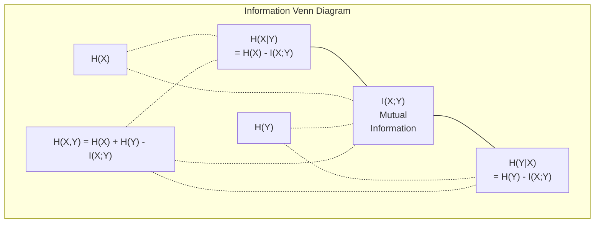

# 정보 이론

> 정보 이론은 놀라움(surprise)을 측정합니다. 손실 함수는 이 위에 구축됩니다.

**유형:** Learn (이론)
**사용 언어:** Python, TypeScript
**선수 레슨:** Phase 1, Lesson 06 (Probability)
**소요 시간:** ~60분

## 학습 목표

- 엔트로피(entropy), 교차 엔트로피(cross-entropy), KL 발산(KL divergence)을 밑바닥부터 계산하고 이들의 관계를 설명합니다.
- 교차 엔트로피 손실을 최소화하는 것이 로그 가능도(log-likelihood)를 최대화하는 것과 왜 동치인지 유도합니다.
- 특성(feature)과 타깃 간의 상호 정보량(mutual information)을 계산하여 특성 중요도의 순위를 매깁니다.
- 언어 모델이 선택할 수 있는 유효 어휘 크기로서의 펄플렉서티(perplexity)를 설명합니다.

## 문제 상황

학습시키는 모든 분류 모델에서 `CrossEntropyLoss()`을 호출합니다. 모든 언어 모델 논문에서 "펄플렉서티(perplexity)"를 봅니다. VAE, 증류(distillation), RLHF에서 KL 발산에 대해 읽게 됩니다. 이들은 서로 동떨어진 개념이 아닙니다. 모두 동일한 아이디어가 형태만 바꾼 것에 불과합니다.

정보 이론은 불확실성, 압축, 예측에 대해 추론할 수 있는 언어를 제공합니다. 클로드 섀넌(Claude Shannon)은 통신 문제를 해결하기 위해 1948년에 이를 창안했습니다. 알고 보면 신경망을 학습시키는 것도 통신 문제입니다. 모델은 학습된 가중치라는 노이즈가 있는 채널을 통해 올바른 레이블을 전송하려고 시도합니다.

이번 레슨에서는 모든 공식을 밑바닥부터 유도하여 그 기원과 작동 원리를 살펴봅니다.

## 핵심 개념

### 정보량 (놀라움)

일어날 확률이 낮은 일이 발생하면 더 많은 정보를 전달합니다. 동전 던지기에서 앞면이 나오는 것? 놀랍지 않습니다. 복권에 당첨되는 것? 매우 놀라운 일입니다.

확률이 $p$인 사건의 정보량은 다음과 같습니다.

```math
I(x) = -\log(p(x))
```

밑이 2인 로그를 사용하면 비트(bit) 단위가 됩니다. 자연로그를 사용하면 내트(nat) 단위가 됩니다. 개념은 동일하며 단위만 다릅니다.

```
Event              Probability    Surprise (bits)
Fair coin heads    0.5            1.0
Rolling a 6        0.167          2.58
1-in-1000 event    0.001          9.97
Certain event      1.0            0.0
```

확실한 사건은 0의 정보를 전달합니다. 이미 일어날 것을 알고 있었기 때문입니다.

### 엔트로피 (평균 놀라움)

엔트로피는 어떤 분포에서 가능한 모든 결과에 대한 평균(기댓값) 놀라움입니다.

```math
H(P) = -\sum_{x} p(x) \log(p(x))
```

공정한 동전은 이진 변수에서 최대 엔트로피인 1비트를 갖습니다. 편향된 동전(앞면 99%)은 0.08비트라는 낮은 엔트로피를 갖습니다. 어떤 결과가 나올지 이미 알고 있으므로, 각 동전 던지기는 거의 아무런 정보도 주지 않습니다.

```math
\begin{aligned}
\text{Fair coin:} \quad & H = -(0.5 \log_2(0.5) + 0.5 \log_2(0.5)) = 1.0 \text{ bit} \\
\text{Biased coin:} \quad & H = -(0.99 \log_2(0.99) + 0.01 \log_2(0.01)) = 0.08 \text{ bits}
\end{aligned}
```

엔트로피는 분포에 내재된 줄일 수 없는 불확실성을 측정합니다. 이 값보다 더 압축할 수는 없습니다.

### 교차 엔트로피 (매일 사용하는 손실 함수)

교차 엔트로피는 실제로는 분포 $P$에서 발생하는 사건을 분포 $Q$을 사용하여 인코딩할 때 발생하는 평균 놀라움을 측정합니다.

```math
H(P, Q) = -\sum_{x} p(x) \log(q(x))
```

$P$은 실제 분포(레이블)입니다. $Q$는 모델의 예측입니다. $Q$이 $P$과 완벽하게 일치하면 교차 엔트로피는 엔트로피와 같아집니다. 불일치가 생기면 값이 더 커집니다.

분류 작업에서 $P$는 원-핫 벡터(실제 클래스의 확률은 1, 나머지는 0)입니다. 이에 따라 교차 엔트로피는 다음과 같이 단순화됩니다.

```math
H(P, Q) = -\log(q(\text{true\_class}))
```

이것이 분류를 위한 교차 엔트로피 손실 공식의 전부입니다. 정답 클래스에 대해 예측된 확률을 최대화하는 것입니다.

### KL 발산 (분포 간의 거리)

KL 발산은 $P$ 대신 $Q$을 사용할 때 얼마나 많은 추가적인 놀라움을 얻게 되는지를 측정합니다.

```math
\begin{aligned}
D_{KL}(P \,\|\, Q) &= \sum_{x} p(x) \log(p(x) / q(x)) \\
&= H(P, Q) - H(P)
\end{aligned}
```

교차 엔트로피는 엔트로피에 KL 발산을 더한 값입니다. 학습 중에 실제 분포의 엔트로피는 상수이므로, 교차 엔트로피를 최소화하는 것은 KL 발산을 최소화하는 것과 같습니다. 즉, 모델의 분포를 실제 분포에 가깝게 밀어붙이는 것입니다.

KL 발산은 대칭적이지 않습니다: $D_{KL}(P \Vert Q) \ne D_{KL}(Q \Vert P)$. 따라서 진정한 의미의 거리 측도(metric)는 아닙니다.

### 상호 정보량

상호 정보량은 하나의 변수를 아는 것이 다른 변수에 대해 얼마나 많은 것을 알려주는지 측정합니다.

```math
\begin{aligned}
I(X; Y) &= H(X) - H(X \mid Y) \\
&= H(X) + H(Y) - H(X, Y)
\end{aligned}
```

$X$과 $Y$이 독립이면 상호 정보량은 0입니다. 하나를 알아도 다른 하나에 대해 아무것도 알 수 없기 때문입니다. 두 변수가 완벽하게 상관되어 있다면 상호 정보량은 둘 중 어느 한 변수의 엔트로피와 같습니다.

특성 선택(feature selection)에서 특성과 타깃 간의 상호 정보량이 높다는 것은 해당 특성이 유용함을 의미합니다. 상호 정보량이 낮다는 것은 그것이 노이즈임을 의미합니다.

### 조건부 엔트로피

$H(Y \mid X)$은 $X$을 관측한 후 $Y$에 대해 남아 있는 불확실성의 양을 측정합니다.

```math
H(Y \mid X) = H(X,Y) - H(X)
```

두 가지 극단적인 경우:
- $X$이 $Y$를 완전히 결정한다면, $H(Y \mid X) = 0$입니다. $X$를 알면 $Y$에 대한 모든 불확실성이 제거됩니다. 예: $X$ = 섭씨온도, $Y$ = 화씨온도.
- $X$이 $Y$에 대해 아무것도 알려주지 않는다면, $H(Y \mid X) = H(Y)$입니다. $X$을 알아도 불확실성이 전혀 줄어들지 않습니다. 예: $X$ = 동전 던지기, $Y$ = 내일의 날씨.

조건부 엔트로피는 항상 음수가 아니며 $H(Y)$를 넘지 않습니다:

```math
0 \le H(Y \mid X) \le H(Y)
```

머신러닝에서 조건부 엔트로피는 의사결정나무(decision tree)에 등장합니다. 알고리즘은 각 분기(split)마다 $H(Y \mid X)$을 최소화하는 특성 $X$, 즉 레이블 $Y$에 대한 불확실성을 가장 많이 제거하는 특성을 선택합니다.

### 결합 엔트로피

$H(X,Y)$은 $X$와 $Y$의 결합 분포에 대한 엔트로피입니다.

```math
H(X,Y) = -\sum_{x} \sum_{y} p(x,y) \log(p(x,y))
```

핵심 특성:

```math
H(X,Y) \le H(X) + H(Y)
```

$X$과 $Y$가 독립일 때 등호가 성립합니다. 두 변수가 정보를 공유한다면 결합 엔트로피는 개별 엔트로피의 합보다 작아집니다. 이 "누락된" 엔트로피가 바로 상호 정보량입니다.



이들의 관계는 다음과 같습니다.
- $H(X,Y) = H(X) + H(Y \mid X) = H(Y) + H(X \mid Y)$
- $I(X;Y) = H(X) - H(X \mid Y) = H(Y) - H(Y \mid X)$
- $H(X,Y) = H(X) + H(Y) - I(X;Y)$

### 상호 정보량 (자세히 알아보기)

상호 정보량 $I(X;Y)$은 하나의 변수를 아는 것이 다른 변수에 대한 불확실성을 얼마나 줄여주는지를 정량화합니다.

```math
\begin{aligned}
I(X;Y) &= H(X) - H(X \mid Y) \\
&= H(Y) - H(Y \mid X) \\
&= H(X) + H(Y) - H(X,Y) \\
&= \sum_{x} \sum_{y} p(x,y) \log\left(\frac{p(x,y)}{p(x) \, p(y)}\right)
\end{aligned}
```

특성:
- 항상 $I(X;Y) \ge 0$입니다. 어떤 것을 관측함으로써 정보를 잃지는 않습니다.
- $X$와 $Y$이 독립일 때만 $I(X;Y) = 0$입니다.
- $I(X;Y) = I(Y;X)$. KL 발산과 달리 대칭적입니다.
- $I(X;X) = H(X)$. 어떤 변수는 자기 자신과 모든 정보를 공유합니다.

**특성 선택을 위한 상호 정보량.** 머신러닝에서는 타깃에 대해 유익한 정보를 담고 있는 특성을 원합니다. 상호 정보량은 특성의 순위를 매기는 원칙적인 방법을 제공합니다.

1. 각 특성 $X_i$에 대해 $I(X_i; Y)$를 계산합니다(여기서 $Y$는 타깃 변수).
2. MI 점수를 기준으로 특성의 순위를 매깁니다.
3. 상위 $k$개 특성을 유지합니다.

이 방법은 특성과 타깃 간의 관계가 선형이든, 비선형이든, 단조롭든 아니든 모든 관계에 작동합니다. 피어슨 상관계수(Pearson correlation)는 선형 관계만 포착합니다. MI는 모든 의존성을 포착하지만, 유한한 데이터에서는 이를 추정하기 위해 충분한 표본과 합리적인 비닝(binning)이 필요합니다.

| 방법 | 감지 대상 | 계산 비용 | 범주형 처리 가능 여부 |
|--------|---------|-------------------|---------------------|
| 피어슨 상관계수 | 선형 관계 | $O(n)$ | 아니오 |
| 스피어만 상관계수 | 단조 관계 | $O(n \log n)$ | 아니오 |
| 상호 정보량 | 모든 통계적 의존성 | 비닝을 적용한 $O(n \log n)$ | 예 |
### Label Smoothing and Cross-Entropy

표준 분류에서는 하드 타깃(hard target), 즉 [0, 0, 1, 0]과 같은 형태를 사용합니다. 정답 클래스는 확률 1을 얻고, 나머지 클래스는 0을 얻습니다. 레이블 스무딩(label smoothing)은 이러한 타깃을 소프트 타깃(soft target)으로 대체합니다.

```math
\text{soft\_target} = (1 - \epsilon) \cdot \text{hard\_target} + \epsilon / \text{num\_classes}
```

$\epsilon = 0.1$이고 클래스가 4개인 경우:
- 하드 타깃: [0, 0, 1, 0]
- 소프트 타깃: [0.025, 0.025, 0.925, 0.025]

정보 이론의 관점에서 보면, 레이블 스무딩은 타깃 분포의 엔트로피를 증가시킵니다. 하드 원-핫 타깃은 엔트로피가 0이며, 불확실성이 전혀 없습니다. 반면 소프트 타깃은 양(+)의 엔트로피를 가집니다.

레이블 스무딩이 도움이 되는 이유:
- 모델이 로짓(logit)을 극단적인 값으로 몰아가는 것을 방지합니다(교차 엔트로피 하에서 원-핫 타깃과 완벽히 일치하려면 무한대의 로짓이 필요함).
- 정규화(regularization) 역할을 합니다: 모델이 100% 확신을 갖지 못하도록 합니다.
- 캘리브레이션(calibration)을 개선합니다: 예측 확률이 실제 불확실성을 더 잘 반영합니다.
- 학습 시와 추론(inference) 시의 동작 차이를 줄여 줍니다.

레이블 스무딩이 적용된 교차 엔트로피 손실은 다음과 같습니다.

```math
L = (1 - \epsilon) \cdot \text{CE}(\text{hard\_target}, \text{prediction}) + \epsilon \cdot H_{\text{uniform}}(\text{prediction})
```

두 번째 항은 균등 분포와 거리가 먼 예측에 페널티를 부여하여, 모델의 확신도에 직접적인 정규화를 가합니다.

### Why Cross-Entropy Is THE Classification Loss

세 가지 관점 모두 동일한 결론에 도달합니다.

**정보 이론 관점.** 교차 엔트로피는 실제 분포 대신 모델의 분포를 사용할 때 낭비되는 비트 수를 측정합니다. 이를 최소화하면 모델이 현실을 가장 효율적으로 인코딩하는 모델이 됩니다.

**최대우도(Maximum likelihood) 관점.** 실제 클래스가 $y_i$인 $N$개의 훈련 샘플에 대해:

```math
\begin{aligned}
\text{Likelihood} &= \prod_i q(y_i) \\
\text{Log-likelihood} &= \sum_i \log(q(y_i)) \\
\text{Negative log-likelihood} &= -\sum_i \log(q(y_i))
\end{aligned}
```

마지막 줄이 바로 교차 엔트로피 손실입니다. 교차 엔트로피를 최소화하는 것은 모델 하에서 훈련 데이터의 우도(likelihood)를 최대화하는 것과 같습니다.

**그래디언트(Gradient) 관점.** 로짓에 대한 교차 엔트로피의 그래디언트는 단순히 (예측값 - 실제값)입니다. 깔끔하고 안정적이며 계산 속도가 빠릅니다. 이것이 바로 softmax와 완벽하게 짝을 이루는 이유입니다.

### Bits vs Nats

유일한 차이점은 로그의 밑(base)입니다.

```
log base 2   -> bits      (information theory tradition)
log base e   -> nats      (machine learning convention)
log base 10  -> hartleys  (rarely used)
```

1 nat = $1/\ln(2)$ 비트 = 1.4427 비트입니다. PyTorch와 TensorFlow는 기본적으로 자연로그(nat)를 사용합니다.

### Perplexity

퍼플렉서티(perplexity)는 교차 엔트로피의 지수승입니다. 모델이 불확실성을 느끼고 있는 동일한 확률의 선택지가 유효하게 몇 개인지를 나타냅니다.

```math
\begin{aligned}
\text{Perplexity} &= 2^{H(P,Q)} \quad \text{(if using bits)} \\
\text{Perplexity} &= e^{H(P,Q)} \quad \text{(if using nats)}
\end{aligned}
```

퍼플렉서티가 50인 언어 모델은 다음 토큰을 고를 때 평균적으로 가능한 50개의 토큰 중에서 균등하게 하나를 골라야 할 때만큼 혼란스러워한다는 뜻입니다. 낮을수록 좋습니다.

GPT-2는 일반적인 벤치마크에서 퍼플렉서티 ~30을 달성했습니다. 최신 모델들은 데이터가 충분한 도메인에서 한 자릿수 퍼플렉서티를 기록합니다.

```figure
entropy-kl
```

## Build It

### Step 1: Information content and entropy

```python
import math

def information_content(p, base=2):
    if p <= 0 or p > 1:
        return float('inf') if p <= 0 else 0.0
    return -math.log(p) / math.log(base)

def entropy(probs, base=2):
    return sum(
        p * information_content(p, base)
        for p in probs if p > 0
    )

fair_coin = [0.5, 0.5]
biased_coin = [0.99, 0.01]
fair_die = [1/6] * 6

print(f"Fair coin entropy:   {entropy(fair_coin):.4f} bits")
print(f"Biased coin entropy: {entropy(biased_coin):.4f} bits")
print(f"Fair die entropy:    {entropy(fair_die):.4f} bits")
```

### Step 2: Cross-entropy and KL divergence

```python
def cross_entropy(p, q, base=2):
    total = 0.0
    for pi, qi in zip(p, q):
        if pi > 0:
            if qi <= 0:
                return float('inf')
            total += pi * (-math.log(qi) / math.log(base))
    return total

def kl_divergence(p, q, base=2):
    return cross_entropy(p, q, base) - entropy(p, base)

true_dist = [0.7, 0.2, 0.1]
good_model = [0.6, 0.25, 0.15]
bad_model = [0.1, 0.1, 0.8]

print(f"Entropy of true dist:     {entropy(true_dist):.4f} bits")
print(f"CE (good model):          {cross_entropy(true_dist, good_model):.4f} bits")
print(f"CE (bad model):           {cross_entropy(true_dist, bad_model):.4f} bits")
print(f"KL divergence (good):     {kl_divergence(true_dist, good_model):.4f} bits")
print(f"KL divergence (bad):      {kl_divergence(true_dist, bad_model):.4f} bits")
```

### Step 3: Cross-entropy as classification loss

```python
def softmax(logits):
    max_logit = max(logits)
    exps = [math.exp(z - max_logit) for z in logits]
    total = sum(exps)
    return [e / total for e in exps]

def cross_entropy_loss(true_class, logits):
    probs = softmax(logits)
    return -math.log(probs[true_class])

logits = [2.0, 1.0, 0.1]
true_class = 0

probs = softmax(logits)
loss = cross_entropy_loss(true_class, logits)

print(f"Logits:      {logits}")
print(f"Softmax:     {[f'{p:.4f}' for p in probs]}")
print(f"True class:  {true_class}")
print(f"Loss:        {loss:.4f} nats")
print(f"Perplexity:  {math.exp(loss):.2f}")
```

### Step 4: Cross-entropy equals negative log-likelihood

```python
import random

random.seed(42)

n_samples = 1000
n_classes = 3
true_labels = [random.randint(0, n_classes - 1) for _ in range(n_samples)]
model_logits = [[random.gauss(0, 1) for _ in range(n_classes)] for _ in range(n_samples)]

ce_loss = sum(
    cross_entropy_loss(label, logits)
    for label, logits in zip(true_labels, model_logits)
) / n_samples

nll = -sum(
    math.log(softmax(logits)[label])
    for label, logits in zip(true_labels, model_logits)
) / n_samples

print(f"Cross-entropy loss:      {ce_loss:.6f}")
print(f"Negative log-likelihood: {nll:.6f}")
print(f"Difference:              {abs(ce_loss - nll):.2e}")
```

### Step 5: Mutual information

```python
def mutual_information(joint_probs, base=2):
    rows = len(joint_probs)
    cols = len(joint_probs[0])

    margin_x = [sum(joint_probs[i][j] for j in range(cols)) for i in range(rows)]
    margin_y = [sum(joint_probs[i][j] for i in range(rows)) for j in range(cols)]

    mi = 0.0
    for i in range(rows):
        for j in range(cols):
            pxy = joint_probs[i][j]
            if pxy > 0:
                mi += pxy * math.log(pxy / (margin_x[i] * margin_y[j])) / math.log(base)
    return mi

independent = [[0.25, 0.25], [0.25, 0.25]]
dependent = [[0.45, 0.05], [0.05, 0.45]]

print(f"MI (independent): {mutual_information(independent):.4f} bits")
print(f"MI (dependent):   {mutual_information(dependent):.4f} bits")
```

## Use It

실제 현업에서 사용하는 방식대로, NumPy를 사용하여 동일한 개념들을 구현해 봅니다.

```python
import numpy as np

def np_entropy(p):
    p = np.asarray(p, dtype=float)
    mask = p > 0
    result = np.zeros_like(p)
    result[mask] = p[mask] * np.log(p[mask])
    return -result.sum()

def np_cross_entropy(p, q):
    p, q = np.asarray(p, dtype=float), np.asarray(q, dtype=float)
    mask = p > 0
    return -(p[mask] * np.log(q[mask])).sum()

def np_kl_divergence(p, q):
    return np_cross_entropy(p, q) - np_entropy(p)

true = np.array([0.7, 0.2, 0.1])
pred = np.array([0.6, 0.25, 0.15])
print(f"Entropy:    {np_entropy(true):.4f} nats")
print(f"Cross-ent:  {np_cross_entropy(true, pred):.4f} nats")
print(f"KL div:     {np_kl_divergence(true, pred):.4f} nats")
```

`torch.nn.CrossEntropyLoss()`가 내부적으로 수행하는 작업을 바닥부터 직접 구현해 보았습니다. 이제 학습 중에 왜 손실이 감소하는지 이해할 수 있습니다. 모델이 예측한 분포가 낭비되는 정보의 nat 단위로 측정했을 때 실제 분포에 점점 더 가까워지기 때문입니다.

## Exercises

1. 균등 분포를 가정하여 영어 알파벳(26자)의 엔트로피를 계산하세요. 그런 다음 실제 문자 빈도를 사용하여 엔트로피를 추정해 보세요. 어느 쪽이 더 높으며, 그 이유는 무엇인가요?

2. 모델이 실제 클래스가 1인 샘플에 대해 [5.0, 2.0, 0.5]라는 로짓을 출력했습니다. 교차 엔트로피 손실을 손으로 직접 계산한 뒤, 작성한 `cross_entropy_loss` 함수로 검증하세요. 어떤 로짓이어야 손실이 0이 될까요?

3. KL 발산(KL divergence)이 대칭적이지 않음을 보이세요. 두 분포 $P$과 $Q$를 선택하고 $D_{KL}(P \Vert Q)$와 $D_{KL}(Q \Vert P)$을 계산하세요. 두 값이 서로 다른 이유를 설명하세요.

4. 일련의 토큰 예측에 대해 퍼플렉서티를 계산하는 함수를 작성하세요. (true_token_index, predicted_logits) 쌍의 리스트가 주어졌을 때, 해당 시퀀스의 퍼플렉서티를 반환해야 합니다.

### Hints

**연습 문제 1.** 동일한 확률 26개로 `entropy`를 호출하세요. 결과는 $\log_2 26 \approx 4.70$ 비트여야 합니다. 실제 문자 빈도는 균등하지 않으므로 엔트로피가 더 낮아야 합니다.

**연습 문제 2.** 로짓의 `softmax`를 계산한 다음, 인덱스 1 위치의 확률에 $-\ln$을 취하고, `cross_entropy_loss(1, logits)`와 비교하세요. 두 값 모두 약 3.06이어야 합니다. 손실은 클래스 1의 로짓이 다른 두 로짓보다 훨씬 클 때에만 0에 수렴합니다.

**연습 문제 3.** 형태가 서로 다른 두 개의 작은 분포(예: $P = [0.9, 0.1]$ 및 $Q = [0.5, 0.5]$)를 사용하고, 순서를 바꾸어 가며 `kl_divergence`를 두 번 호출하세요. 각 방향마다 로그 비율에 가중치를 부여하는 분포가 서로 다르기 때문에 두 값은 달라야 합니다.

**연습 문제 4.** 각 쌍에 대해 `cross_entropy_loss(true_token_index, predicted_logits)`를 계산하고, 평균을 구한 뒤, 그 값을 `perplexity`에 전달하세요. $V$개 토큰에 대해 균등한 로짓으로 테스트해 보세요. 퍼플렉서티는 $V$이어야 합니다.

## Key Terms

| 용어 | 일상적인 표현 | 실제 의미 |
|------|----------------|----------------------|
| Information content (정보량) | "놀라움의 정도(Surprise)" | 어떤 사건을 인코딩하는 데 필요한 비트(또는 나트) 수: $-\log(p)$ |
| Entropy (엔트로피) | "무작위성" | 한 분포의 모든 결과에 대한 평균 놀라움 정도. 줄일 수 없는 불확실성을 측정합니다. |
| Cross-entropy (교차 엔트로피) | "손실 함수" | 실제 분포 $P$의 사건들을 모델 분포 $Q$를 사용해 인코딩할 때 발생하는 평균 놀라움 정도입니다. |
| KL divergence (KL 발산) | "분포 간의 거리" | $P$ 대신 $Q$를 사용함으로써 낭비되는 추가 비트 수입니다. 교차 엔트로피에서 엔트로피를 뺀 값과 같습니다. 대칭적이지 않습니다. |
| Mutual information (상호 정보량) | "X와 Y의 연관성" | $Y$를 앎으로써 줄어드는 $X$에 대한 불확실성입니다. 0이면 독립을 의미합니다. |
| Softmax | "로짓을 확률로 변환하기" | 지수화하고 정규화합니다. 임의의 실수 벡터를 유효한 확률 분포로 매핑합니다. |
| Perplexity (퍼플렉서티) | "모델이 얼마나 혼란스러워하는지" | 교차 엔트로피의 지수승입니다. 모델이 매 단계에서 선택하고 있는 실질적인 어휘 수입니다. |
| Bits (비트) | "새넌의 단위" | 밑이 2인 로그로 측정한 정보량입니다. 1비트는 공평한 동전 던지기 하나를 결정합니다. |
| Nats (나트) | "ML의 단위" | 자연로그로 측정한 정보량입니다. PyTorch와 TensorFlow에서 기본으로 사용합니다. |
| Negative log-likelihood (음의 로그 우도) | "NLL 손실" | 원-핫 레이블의 교차 엔트로피 손실과 동일합니다. 이를 최소화하면 정답 예측 확률이 최대화됩니다. |

## Further Reading

- [Shannon 1948: A Mathematical Theory of Communication](https://people.math.harvard.edu/~ctm/home/text/others/shannon/entropy/entropy.pdf) - 오늘날에도 여전히 읽어볼 가치가 있는 원본 논문
- [Visual Information Theory (Chris Olah)](https://colah.github.io/posts/2015-09-Visual-Information/) - 엔트로피와 KL 발산에 대한 최고의 시각적 설명
- [PyTorch CrossEntropyLoss docs](https://pytorch.org/docs/stable/generated/torch.nn.CrossEntropyLoss.html) - 방금 직접 구현한 내용을 프레임워크에서 구현하는 방법
