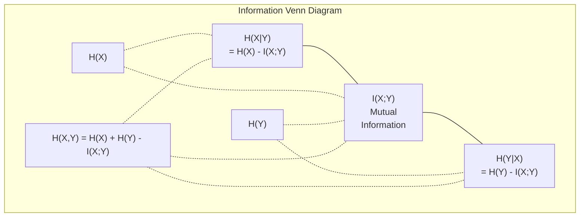

# 정보 이론

> 정보 이론은 놀라움(surprise)을 측정합니다. 손실 함수는 이 개념 위에 구축됩니다.

**유형:** Learn (이론)
**Language:** Python
**선수 레슨:** Phase 1, Lesson 06 (Probability)
**소요 시간:** ~60분

## 학습 목표

- 엔트로피(entropy), 교차 엔트로피(cross-entropy), KL 발산(KL divergence)을 밑바닥부터 계산하고 그 관계를 설명합니다
- 교차 엔트로피 손실 최소화가 로그 우도(log-likelihood) 최대화와 동등한 이유를 유도합니다
- 특성과 타깃 간의 상호 정보량(mutual information)을 계산하여 특성 중요도의 순위를 매깁니다
- 언어 모델이 선택하는 유효 어휘 크기라는 관점에서 펄플렉서티(perplexity)를 설명합니다

## 문제 정의

분류 모델을 학습시킬 때마다 `CrossEntropyLoss()`를 호출합니다. 언어 모델 논문마다 "펄플렉서티(perplexity)"라는 용어를 접합니다. VAE, 증류(distillation), RLHF에서는 KL 발산(KL divergence)에 대한 내용을 읽게 됩니다. 이들은 서로 동떨어진 개념이 아닙니다. 모두 동일한 아이디어가 다른 형태를 띠고 있는 것뿐입니다.

정보 이론은 불확실성, 압축, 예측에 대해 추론할 수 있는 언어를 제공합니다. Claude Shannon은 1948년 통신 문제를 해결하기 위해 이 이론을 창안했습니다. 알고 보면 신경망을 학습시키는 것도 통신 문제입니다. 모델은 학습된 가중치라는 노이즈가 있는 채널을 통해 올바른 레이블을 전송하려고 시도하는 것입니다.

이번 레슨에서는 모든 공식을 밑바닥부터 구축하여 각 공식이 어디서 유래했고 왜 작동하는지 살펴봅니다.

## 핵심 개념

### 정보량 (놀라움)

발생 확률이 낮은 일일수록 더 많은 정보를 담고 있습니다. 동전을 던져 앞면이 나오는 것? 놀랍지 않습니다. 복권에 당첨되는 것? 매우 놀라운 일입니다.

확률이 $p$인 사건의 정보량(information content)은 다음과 같습니다.

```math
I(x) = -\log(p(x))
```

밑이 2인 로그를 사용하면 비트(bit) 단위가 됩니다. 자연로그를 사용하면 내트(nat) 단위가 됩니다. 같은 개념이지만 단위가 다를 뿐입니다.

```
Event              Probability    Surprise (bits)
Fair coin heads    0.5            1.0
Rolling a 6        0.167          2.58
1-in-1000 event    0.001          9.97
Certain event      1.0            0.0
```

확실한 사건은 정보를 전혀 담고 있지 않습니다. 이미 일어날 것을 알고 있었기 때문입니다.

### 엔트로피 (평균 놀라움)

엔트로피(entropy)는 분포의 가능한 모든 결과에 대한 놀라움의 기댓값입니다.

```math
H(P) = -\sum_{x} p(x) \log(p(x))
```

공정한 동전은 이진 변수에서 가질 수 있는 최대 엔트로피인 1비트를 갖습니다. 편향된 동전(앞면 99%)은 0.08비트라는 낮은 엔트로피를 갖습니다. 어떤 결과가 나올지 이미 알고 있으므로, 동전을 던질 때마다 얻는 정보가 거의 없기 때문입니다.

```math
\begin{aligned}
\text{Fair coin:} \quad & H = -(0.5 \log_2(0.5) + 0.5 \log_2(0.5)) = 1.0 \text{ bit} \\
\text{Biased coin:} \quad & H = -(0.99 \log_2(0.99) + 0.01 \log_2(0.01)) = 0.08 \text{ bits}
\end{aligned}
```

엔트로피는 분포의 줄일 수 없는 불확실성을 측정합니다. 이 값 이하로는 압축할 수 없습니다.

### 교차 엔트로피 (매일 사용하는 손실 함수)

교차 엔트로피(cross-entropy)는 실제로는 분포 $P$에서 발생하는 사건을 분포 $Q$를 사용하여 인코딩할 때 발생하는 평균 놀라움을 측정합니다.

```math
H(P, Q) = -\sum_{x} p(x) \log(q(x))
```

$P$는 실제 분포(레이블)입니다. $Q$는 모델의 예측값입니다. $Q$가 $P$와 완벽하게 일치하면 교차 엔트로피는 엔트로피와 같아집니다. 불일치가 발생할 때마다 교차 엔트로피는 더 커집니다.

분류에서 $P$는 원-핫 벡터(정답 클래스의 확률은 1, 나머지는 0)입니다. 이에 따라 교차 엔트로피는 다음과 같이 단순화됩니다.

```math
H(P, Q) = -\log(q(\text{true\_class}))
```

이것이 분류를 위한 교차 엔트로피 손실 공식의 전부입니다. 정답 클래스의 예측 확률을 최대화하는 것입니다.

### KL 발산 (분포 간의 거리)

KL 발산(KL divergence)은 $P$ 대신 $Q$를 사용함으로써 얻게 되는 추가적인 놀라움의 양을 측정합니다.

```math
\begin{aligned}
D_{KL}(P \,\|\, Q) &= \sum_{x} p(x) \log(p(x) / q(x)) \\
&= H(P, Q) - H(P)
\end{aligned}
```

교차 엔트로피는 엔트로피에 KL 발산을 더한 값입니다. 학습 중에 실제 분포의 엔트로피는 상수이므로, 교차 엔트로피를 최소화하는 것은 KL 발산을 최소화하는 것과 같습니다. 즉, 모델의 분포를 실제 분포에 가깝게 밀어붙이는 것입니다.

KL 발산은 대칭적이지 않습니다: $D_{KL}(P \Vert Q) \ne D_{KL}(Q \Vert P)$. 따라서 엄밀한 의미의 거리 측도(distance metric)는 아닙니다.

### 상호 정보량

상호 정보량(mutual information)은 한 변수를 아는 것이 다른 변수에 대해 얼마나 많은 정보를 제공하는지를 측정합니다.

```math
\begin{aligned}
I(X; Y) &= H(X) - H(X \mid Y) \\
&= H(X) + H(Y) - H(X, Y)
\end{aligned}
```

$X$와 $Y$가 독립이라면 상호 정보량은 0입니다. 한 변수를 알아도 다른 변수에 대해 아무것도 알 수 없기 때문입니다. 두 변수가 완벽하게 상관되어 있다면, 상호 정보량은 두 변수 중 하나의 엔트로피와 같습니다.

특성 선택(feature selection)에서 특성과 타깃 간의 상호 정보량이 높다는 것은 해당 특성이 유용함을 의미합니다. 상호 정보량이 낮다는 것은 해당 특성이 노이즈에 불과함을 뜻합니다.

### 조건부 엔트로피

$H(Y \mid X)$는 $X$를 관측한 후 $Y$에 대해 남아 있는 불확실성의 양을 측정합니다.

```math
H(Y \mid X) = H(X,Y) - H(X)
```

두 가지 극단적인 경우를 살펴보겠습니다.
- $X$가 $Y$를 완전히 결정한다면, $H(Y \mid X) = 0$입니다. $X$를 알면 $Y$에 대한 모든 불확실성이 제거됩니다. 예시: $X$ = 섭씨온도, $Y$ = 화씨온도.
- $X$가 $Y$에 대해 아무런 정보를 주지 않는다면, $H(Y \mid X) = H(Y)$입니다. $X$를 알아도 불확실성이 전혀 줄어들지 않습니다. 예시: $X$ = 동전 던지기, $Y$ = 내일 날씨.

조건부 엔트로피는 항상 음수가 아니며, $H(Y)$를 초과하지 않습니다.

```math
0 \le H(Y \mid X) \le H(Y)
```

머신러닝에서 조건부 엔트로피는 의사결정나무(decision tree)에 등장합니다. 각 분기마다 알고리즘은 $H(Y \mid X)$를 최소화하는 특성 $X$를 선택합니다. 즉, 레이블 $Y$에 대한 불확실성을 가장 많이 제거하는 특성을 선택하는 것입니다.

### 결합 엔트로피

$H(X,Y)$는 $X$와 $Y$의 결합 분포에 대한 엔트로피입니다.

```math
H(X,Y) = -\sum_{x} \sum_{y} p(x,y) \log(p(x,y))
```

주요 성질:

```math
H(X,Y) \le H(X) + H(Y)
```

등호는 $X$와 $Y$가 독립일 때 성립합니다. 두 변수가 정보를 공유한다면, 결합 엔트로피는 개별 엔트로피의 합보다 작습니다. 이때 "누락된" 엔트로피가 바로 상호 정보량입니다.



관계식은 다음과 같습니다.
- $H(X,Y) = H(X) + H(Y \mid X) = H(Y) + H(X \mid Y)$
- $I(X;Y) = H(X) - H(X \mid Y) = H(Y) - H(Y \mid X)$
- $H(X,Y) = H(X) + H(Y) - I(X;Y)$

### 상호 정보량 (심층 분석)

상호 정보량 $I(X;Y)$는 한 변수를 아는 것이 다른 변수에 대한 불확실성을 얼마나 줄여주는지를 수량화합니다.

```math
\begin{aligned}
I(X;Y) &= H(X) - H(X \mid Y) \\
&= H(Y) - H(Y \mid X) \\
&= H(X) + H(Y) - H(X,Y) \\
&= \sum_{x} \sum_{y} p(x,y) \log\left(\frac{p(x,y)}{p(x) \, p(y)}\right)
\end{aligned}
```

성질:
- 항상 $I(X;Y) \ge 0$입니다. 무언가를 관측함으로써 정보를 잃는 일은 결코 없습니다.
- $X$와 $Y$가 독립일 때만 $I(X;Y) = 0$입니다.
- $I(X;Y) = I(Y;X)$. KL 발산과 달리 대칭적입니다.
- $I(X;X) = H(X)$. 어떤 변수는 자기 자신과 모든 정보를 공유합니다.

**특성 선택을 위한 상호 정보량.** 머신러닝에서는 타깃에 대해 유용한 정보를 제공하는 특성을 원합니다. 상호 정보량은 특성의 순위를 매기는 원칙적인 방법을 제공합니다.

1. 각 특성 $X_i$에 대해 $I(X_i; Y)$를 계산합니다(여기서 $Y$는 타깃 변수).
2. MI 점수를 기준으로 특성의 순위를 매깁니다.
3. 상위 $k$개 특성을 유지합니다.

이 방법은 특성과 타깃 사이의 관계가 선형이든, 비선형이든, 단조적이든, 그렇지 않든 모든 관계에 작동합니다. 피어슨 상관계수(Pearson correlation)는 선형 관계만 포착합니다. MI는 모든 의존성을 포착하지만, 유한한 데이터에서는 추정을 위해 충분한 샘플 수와 합리적인 구간화(binning)가 필요합니다.

| 방법 | 감지 대상 | 계산 비용 | 범주형 처리 가능 여부 |
|--------|---------|-------------------|---------------------|
| 피어슨 상관계수(Pearson correlation) | 선형 관계 | $O(n)$ | 아니오 |
| 스피어만 상관계수(Spearman correlation) | 단조 관계 | $O(n \log n)$ | 아니오 |
| 상호 정보량(Mutual information) | 모든 통계적 의존성 | 구간화 적용 시 $O(n \log n)$ | 예 |
### 레이블 스무딩과 교차 엔트로피

표준적인 분류에서는 하드 타깃(hard target) [0, 0, 1, 0]을 사용합니다. 실제 클래스는 확률 1을 얻고, 나머지 모든 클래스는 0을 얻습니다. 레이블 스무딩(label smoothing)은 이를 소프트 타깃(soft target)으로 대체합니다.

```math
\text{soft\_target} = (1 - \epsilon) \cdot \text{hard\_target} + \epsilon / \text{num\_classes}
```

$\epsilon = 0.1$이고 클래스가 4개인 경우:
- 하드 타깃:  [0, 0, 1, 0]
- 소프트 타깃:  [0.025, 0.025, 0.925, 0.025]

정보 이론(information theory) 관점에서 레이블 스무딩은 타깃 분포의 엔트로피(entropy)를 증가시킵니다. 하드 원-핫 타깃은 불확실성이 없으므로 엔트로피가 0입니다. 반면 소프트 타깃은 양의 엔트로피를 가집니다.

이것이 도움이 되는 이유:
- 모델이 로짓(logit)을 극단적인 값으로 몰아가는 것을 방지합니다(교차 엔트로피에서 원-핫 타깃과 완벽하게 일치하려면 무한대의 로짓이 필요합니다).
- 정규화(regularization) 역할을 합니다: 모델이 100% 확신하지 못하도록 만듭니다.
- 캘리브레이션(calibration)을 향상합니다: 예측 확률이 실제 불확실성을 더 잘 반영합니다.
- 학습과 추론(inference) 동작 간의 격차를 줄입니다.

레이블 스무딩을 적용한 교차 엔트로피 손실은 다음과 같습니다.

```math
L = (1 - \epsilon) \cdot \text{CE}(\text{hard\_target}, \text{prediction}) + \epsilon \cdot H_{\text{uniform}}(\text{prediction})
```

두 번째 항은 균등 분포에서 멀리 떨어진 예측에 페널티를 부여하며, 이는 확신도(confidence)에 대한 직접적인 정규화로 작용합니다.

### 왜 교차 엔트로피가 분류 손실의 표준인가

세 가지 관점에서 보아도 결론은 동일합니다.

**정보 이론 관점.** 교차 엔트로피는 실제 분포 대신 모델의 분포를 사용할 때 낭비되는 비트 수를 측정합니다. 이를 최소화하면 모델이 현실을 가장 효율적으로 인코딩하게 됩니다.

**최대 우도(Maximum likelihood) 관점.** 실제 클래스가 $y_i$인 $N$개의 훈련 샘플에 대해 다음과 같이 나타낼 수 있습니다.

```math
\begin{aligned}
\text{Likelihood} &= \prod_i q(y_i) \\
\text{Log-likelihood} &= \sum_i \log(q(y_i)) \\
\text{Negative log-likelihood} &= -\sum_i \log(q(y_i))
\end{aligned}
```

마지막 줄이 바로 교차 엔트로피 손실입니다. 교차 엔트로피를 최소화하는 것은 모델 하에서 훈련 데이터의 우도를 최대화하는 것과 같습니다.

**기울기(Gradient) 관점.** 로짓에 대한 교차 엔트로피의 기울기는 단순히 (예측값 - 실제값)입니다. 깔끔하고 안정적이며 계산 속도가 빠릅니다. 이것이 소프트맥스(softmax)와 완벽한 궁합을 이루는 이유입니다.

### 비트 대 내트(Bits vs Nats)

유일한 차이는 로그의 밑입니다.

```
log base 2   -> bits      (information theory tradition)
log base e   -> nats      (machine learning convention)
log base 10  -> hartleys  (rarely used)
```

1 내트 = $1/\ln(2)$ 비트 = 1.4427 비트입니다. PyTorch와 TensorFlow는 기본적으로 자연로그(내트)를 사용합니다.

### 퍼플렉시티(Perplexity)

퍼플렉시티는 교차 엔트로피의 지수값(exponential)입니다. 모델이 동일한 가능성을 두고 헷갈려하는 선택지의 유효 개수를 나타냅니다.

```math
\begin{aligned}
\text{Perplexity} &= 2^{H(P,Q)} \quad \text{(if using bits)} \\
\text{Perplexity} &= e^{H(P,Q)} \quad \text{(if using nats)}
\end{aligned}
```

퍼플렉시티가 50인 언어 모델은 평균적으로 50개의 가능한 다음 토큰 후보 중에서 균등하게 하나를 골라야 할 때만큼 혼란스러워한다는 의미입니다. 값이 낮을수록 좋습니다.

GPT-2는 일반적인 벤치마크에서 약 30의 퍼플렉시티를 달성했습니다. 최신 모델들은 데이터가 충분한 도메인에서 한 자릿수 퍼플렉시티를 기록합니다.

```figure
entropy-kl
```

## 직접 구현하기

### 단계 1: 정보량과 엔트로피

```python
import math

def information_content(p, base=2):
    if p <= 0 or p > 1:
        return float('inf') if p <= 0 else 0.0
    return -math.log(p) / math.log(base)

def entropy(probs, base=2):
    return sum(
        p * information_content(p, base)
        for p in probs if p > 0
    )

fair_coin = [0.5, 0.5]
biased_coin = [0.99, 0.01]
fair_die = [1/6] * 6

print(f"Fair coin entropy:   {entropy(fair_coin):.4f} bits")
print(f"Biased coin entropy: {entropy(biased_coin):.4f} bits")
print(f"Fair die entropy:    {entropy(fair_die):.4f} bits")
```

### 단계 2: 교차 엔트로피와 KL 발산

```python
def cross_entropy(p, q, base=2):
    total = 0.0
    for pi, qi in zip(p, q):
        if pi > 0:
            if qi <= 0:
                return float('inf')
            total += pi * (-math.log(qi) / math.log(base))
    return total

def kl_divergence(p, q, base=2):
    return cross_entropy(p, q, base) - entropy(p, base)

true_dist = [0.7, 0.2, 0.1]
good_model = [0.6, 0.25, 0.15]
bad_model = [0.1, 0.1, 0.8]

print(f"Entropy of true dist:     {entropy(true_dist):.4f} bits")
print(f"CE (good model):          {cross_entropy(true_dist, good_model):.4f} bits")
print(f"CE (bad model):           {cross_entropy(true_dist, bad_model):.4f} bits")
print(f"KL divergence (good):     {kl_divergence(true_dist, good_model):.4f} bits")
print(f"KL divergence (bad):      {kl_divergence(true_dist, bad_model):.4f} bits")
```

### 단계 3: 분류 손실로서의 교차 엔트로피

```python
def softmax(logits):
    max_logit = max(logits)
    exps = [math.exp(z - max_logit) for z in logits]
    total = sum(exps)
    return [e / total for e in exps]

def cross_entropy_loss(true_class, logits):
    probs = softmax(logits)
    return -math.log(probs[true_class])

logits = [2.0, 1.0, 0.1]
true_class = 0

probs = softmax(logits)
loss = cross_entropy_loss(true_class, logits)

print(f"Logits:      {logits}")
print(f"Softmax:     {[f'{p:.4f}' for p in probs]}")
print(f"True class:  {true_class}")
print(f"Loss:        {loss:.4f} nats")
print(f"Perplexity:  {math.exp(loss):.2f}")
```

### 단계 4: 교차 엔트로피와 음의 로그 우도의 동치성

```python
import random

random.seed(42)

n_samples = 1000
n_classes = 3
true_labels = [random.randint(0, n_classes - 1) for _ in range(n_samples)]
model_logits = [[random.gauss(0, 1) for _ in range(n_classes)] for _ in range(n_samples)]

ce_loss = sum(
    cross_entropy_loss(label, logits)
    for label, logits in zip(true_labels, model_logits)
) / n_samples

nll = -sum(
    math.log(softmax(logits)[label])
    for label, logits in zip(true_labels, model_logits)
) / n_samples

print(f"Cross-entropy loss:      {ce_loss:.6f}")
print(f"Negative log-likelihood: {nll:.6f}")
print(f"Difference:              {abs(ce_loss - nll):.2e}")
```

### 단계 5: 상호 정보량

```python
def mutual_information(joint_probs, base=2):
    rows = len(joint_probs)
    cols = len(joint_probs[0])

    margin_x = [sum(joint_probs[i][j] for j in range(cols)) for i in range(rows)]
    margin_y = [sum(joint_probs[i][j] for i in range(rows)) for j in range(cols)]

    mi = 0.0
    for i in range(rows):
        for j in range(cols):
            pxy = joint_probs[i][j]
            if pxy > 0:
                mi += pxy * math.log(pxy / (margin_x[i] * margin_y[j])) / math.log(base)
    return mi

independent = [[0.25, 0.25], [0.25, 0.25]]
dependent = [[0.45, 0.05], [0.05, 0.45]]

print(f"MI (independent): {mutual_information(independent):.4f} bits")
print(f"MI (dependent):   {mutual_information(dependent):.4f} bits")
```

## 직접 사용해보기

실무에서 활용하는 방식 그대로, NumPy를 사용하여 동일한 개념들을 다뤄봅니다.

```python
import numpy as np

def np_entropy(p):
    p = np.asarray(p, dtype=float)
    mask = p > 0
    result = np.zeros_like(p)
    result[mask] = p[mask] * np.log(p[mask])
    return -result.sum()

def np_cross_entropy(p, q):
    p, q = np.asarray(p, dtype=float), np.asarray(q, dtype=float)
    mask = p > 0
    return -(p[mask] * np.log(q[mask])).sum()

def np_kl_divergence(p, q):
    return np_cross_entropy(p, q) - np_entropy(p)

true = np.array([0.7, 0.2, 0.1])
pred = np.array([0.6, 0.25, 0.15])
print(f"Entropy:    {np_entropy(true):.4f} nats")
print(f"Cross-ent:  {np_cross_entropy(true, pred):.4f} nats")
print(f"KL div:     {np_kl_divergence(true, pred):.4f} nats")
```

여러분은 `torch.nn.CrossEntropyLoss()`가 내부적으로 수행하는 작업을 밑바닥부터 직접 구현했습니다. 이제 학습 중에 왜 손실이 감소하는지 알 수 있습니다. 모델의 예측 분포가 낭비되는 정보의 내트(nats) 단위로 측정했을 때 실제 분포에 점점 더 가까워지기 때문입니다.

## 연습 문제

1. 영어 알파벳(26자)이 균등 분포를 따른다고 가정하고 엔트로피를 계산하세요. 그런 다음 실제 문자 빈도를 사용하여 엔트로피를 추정하세요. 어느 쪽이 더 높으며, 그 이유는 무엇인가요?

2. 실제 클래스가 1인 샘플에 대해 모델이 로짓 [5.0, 2.0, 0.5]를 출력했습니다. 손으로 직접 교차 엔트로피 손실을 계산한 후, 작성한 `cross_entropy_loss` 함수로 검증하세요. 손실이 0이 되려면 로짓이 어떤 값이어야 할까요?

3. KL 발산(KL divergence)이 대칭적이지 않음을 보이세요. 두 분포 $P$와 $Q$를 선택하고 $D_{KL}(P \Vert Q)$와 $D_{KL}(Q \Vert P)$를 계산하세요. 두 값이 왜 다른지 설명하세요.

4. 토큰 예측 시퀀스에 대한 퍼플렉시티를 계산하는 함수를 작성하세요. (true_token_index, predicted_logits) 쌍의 리스트가 주어졌을 때, 해당 시퀀스의 퍼플렉시티를 반환해야 합니다.

### 힌트

**연습 문제 1.** 동일한 확률 26개로 `entropy`를 호출하세요. 결과는 $\log_2 26 \approx 4.70$ 비트여야 합니다. 실제 문자 빈도는 균등하지 않으므로 엔트로피가 더 낮아야 합니다.

**연습 문제 2.** 로짓의 `softmax`를 계산한 다음 인덱스 1의 확률에 대한 $-\ln$를 계산하고 `cross_entropy_loss(1, logits)`과 비교하세요. 두 값 모두 3.06에 가까워야 합니다. 손실은 클래스 1의 로짓이 다른 두 로짓보다 훨씬 클 때만 0에 수렴합니다.

**연습 문제 3.** 형태가 서로 다른 두 개의 작은 분포(예: $P = [0.9, 0.1]$ 및 $Q = [0.5, 0.5]$)를 사용하고, 순서를 바꾸어 `kl_divergence`를 두 번 호출하세요. 방향마다 로그 비율에 서로 다른 분포로 가중치를 부여하기 때문에 두 값은 달라야 합니다.

**연습 문제 4.** 각 쌍에 대해 `cross_entropy_loss(true_token_index, predicted_logits)`를 계산하고, 평균을 구한 뒤 이를 `perplexity`에 전달하세요. $V$개 토큰에 대한 균등 로짓으로 확인해 보세요. 퍼플렉시티는 $V$이어야 합니다.

## 핵심 용어

| 용어 | 흔히 쓰는 표현 | 실제 의미 |
|------|----------------|----------------------|
| 정보량(Information content) | "놀라움(Surprise)" | 사건을 인코딩하는 데 필요한 비트(또는 내트) 수: $-\log(p)$ |
| 엔트로피(Entropy) | "무작위성" | 한 분포의 모든 결과에 걸친 평균 놀라움. 줄일 수 없는 불확실성을 측정합니다. |
| 교차 엔트로피(Cross-entropy) | "손실 함수" | 실제 분포 $P$의 사건을 인코딩하기 위해 모델 분포 $Q$를 사용할 때의 평균 놀라움. |
| KL 발산(KL divergence) | "분포 간의 거리" | $P$ 대신 $Q$를 사용함으로써 낭비되는 추가 비트. 교차 엔트로피에서 엔트로피를 뺀 값과 같습니다. 비대칭적입니다. |
| 상호 정보량(Mutual information) | "X와 Y의 연관성 정도" | $Y$을 앎으로써 줄어드는 $X$에 대한 불확실성. 0이면 서로 독립임을 의미합니다. |
| 소프트맥스(Softmax) | "로짓을 확률로 변환" | 지수화 후 정규화. 임의의 실수 벡터를 유효한 확률 분포로 매핑합니다. |
| 퍼플렉시티(Perplexity) | "모델의 혼란도" | 교차 엔트로피의 지수값. 모델이 각 단계에서 선택하고 있는 유효 어휘 사전(vocabulary) 크기. |
| 비트(Bits) | "섀넌의 단위" | 밑이 2인 로그로 측정한 정보량. 1비트는 공정한 동전 던지기 하나를 결정합니다. |
| 내트(Nats) | "머신러닝의 단위" | 자연로그로 측정한 정보량. PyTorch와 TensorFlow에서 기본값으로 사용합니다. |
| 음의 로그 우도(Negative log-likelihood) | "NLL 손실" | 원-핫 레이블에 대해 교차 엔트로피 손실과 동일함. 이를 최소화하면 정답 예측의 확률이 최대화됩니다. |

## 더 읽어보기

- [Shannon 1948: A Mathematical Theory of Communication](https://people.math.harvard.edu/~ctm/home/text/others/shannon/entropy/entropy.pdf) - 오늘날에도 여전히 읽기 쉬운 원저 논문
- [Visual Information Theory (Chris Olah)](https://colah.github.io/posts/2015-09-Visual-Information/) - 엔트로피와 KL 발산에 관한 최고의 시각적 설명
- [PyTorch CrossEntropyLoss 문서](https://pytorch.org/docs/stable/generated/torch.nn.CrossEntropyLoss.html) - 방금 구현한 내용을 프레임워크가 실제로 어떻게 구현했는지 확인하기
