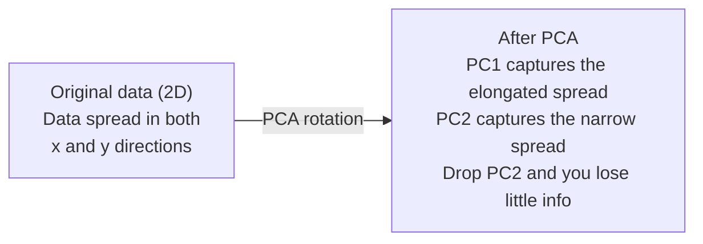

# 차원 축소

> 고차원 데이터에는 구조가 존재합니다. 올바른 각도에서 바라볼 때 그 구조를 발견할 수 있습니다.

**유형:** Build (실습)
**사용 언어:** Python, TypeScript
**선수 레슨:** Phase 1, Lessons 01 (Linear Algebra Intuition), 02 (Vectors, Matrices & Operations), 03 (Eigenvalues & Eigenvectors), 06 (Probability & Distributions)
**소요 시간:** ~90분

## 학습 목표

- PCA를 바닥부터 직접 구현: 데이터 중심화, 공분산 행렬 계산, 고유값 분해(eigendecomposition), 투영
- 설명된 분산 비율(explained variance ratio)과 엘보우 방법(elbow method)을 사용하여 주성분의 개수 결정
- MNIST 숫자를 2D로 시각화하기 위해 PCA, t-SNE, UMAP을 비교하고 각각의 트레이드오프 설명
- RBF 커널을 적용한 커널 PCA를 활용하여 표준 PCA로는 다룰 수 없는 비선형 데이터 구조 분리

## 문제 상황

샘플당 784개의 특성(feature)을 가진 데이터셋이 있다고 가정해 봅니다. 손글씨 숫자의 픽셀 값일 수도 있고, 유전자 발현 수준일 수도 있으며, 사용자 행동 신호일 수도 있습니다. 784차원은 시각화할 수 없습니다. 그래프로 그릴 수도 없으며, 머릿속으로 떠올리는 것조차 불가능합니다.

하지만 이 784개 특성의 대부분은 중복(redundant)입니다. 실제 정보는 훨씬 더 작은 표면 위에 존재합니다. 손글씨 "7"을 설명하는 데 784개의 독립된 숫자가 모두 필요하지는 않습니다. 획의 각도, 가로획의 길이, 기울어진 정도 같은 몇 가지만 있으면 충분합니다. 나머지는 노이즈에 불과합니다.

차원 축소(dimensionality reduction)는 바로 이 더 작은 표면을 찾아냅니다. 784차원 데이터를 가져와 중요한 구조를 유지하면서 2차원, 10차원, 또는 50차원으로 압축합니다.

## 핵심 개념

### 차원의 저주

고차원 공간은 직관적이지 않습니다. 차원이 증가함에 따라 세 가지 문제가 발생합니다.

**거리가 무의미해집니다.** 고차원에서는 임의의 두 점 사이의 거리가 거의 동일한 값으로 수렴합니다. 모든 점이 다른 모든 점과 대략 같은 거리에 있게 되면 최근접 이웃(nearest-neighbor) 탐색이 제대로 동작하지 않습니다.

```
Dimension    Avg distance ratio (max/min between random points)
2            ~5.0
10           ~1.8
100          ~1.2
1000         ~1.02
```

**부피가 모서리에 집중됩니다.** $d$차원의 단위 초입방체(hypercube)는 $2^d$개의 모서리를 가집니다. 100차원에서는 거의 모든 부피가 중심에서 멀리 떨어진 모서리에 존재합니다. 데이터 포인트들이 가장자리로 흩어지므로 모델은 내부 공간에서 데이터 기근을 겪게 됩니다.

**기하급수적으로 더 많은 데이터가 필요합니다.** 공간 내에서 동일한 샘플 밀도를 유지하려면, 2D에서 20D로 이동할 때 $10^{18}$배 더 많은 데이터가 필요합니다. 데이터는 결코 충분하지 않습니다. 차원을 축소하면 데이터 밀도를 다룰 수 있는 수준으로 되돌릴 수 있습니다.

### PCA: 중요한 방향 찾기

주성분 분석(PCA, Principal Component Analysis)은 데이터의 분산(variance)이 가장 큰 축들을 찾습니다. 첫 번째 축이 가장 큰 분산을 포착하고, 두 번째 축이 그다음으로 큰 분산을 포착하도록 좌표계를 회전합니다.

알고리즘:

```
1. Center the data        (subtract the mean from each feature)
2. Compute covariance     (how features move together)
3. Eigendecomposition     (find the principal directions)
4. Sort by eigenvalue     (biggest variance first)
5. Project               (keep top k eigenvectors, drop the rest)
```

왜 고유값 분해일까요? 공분산 행렬은 대칭 행렬이자 준양부호(positive semi-definite) 행렬입니다. 공분산 행렬의 고유벡터들은 특성 공간에서 직교하는 방향들입니다. 고유값은 각 방향이 얼마만큼의 분산을 포착하는지 알려줍니다. 가장 큰 고유값을 가진 고유벡터가 최대 분산의 방향을 가리킵니다.



- **PCA 적용 전:** 데이터 구름이 x축과 y축 모두에 걸쳐 대각선 방향으로 퍼져 있습니다.
- **PCA 적용 후:** PC1이 최대 분산 방향(길게 늘어난 방향)과 일치하고 PC2가 최소 분산 방향(좁게 퍼진 방향)과 일치하도록 좌표계가 회전됩니다.
- **차원 축소:** PC2를 버리고 데이터를 PC1에 투영하면 정보 손실을 최소화하면서 차원을 축소할 수 있습니다.

### 설명된 분산 비율

각 주성분은 전체 분산의 일부를 포착합니다. 설명된 분산 비율(explained variance ratio)은 그 크기가 얼마인지 나타냅니다.

```
Component    Eigenvalue    Explained ratio    Cumulative
PC1          4.73          0.473              0.473
PC2          2.51          0.251              0.724
PC3          1.12          0.112              0.836
PC4          0.89          0.089              0.925
...
```

누적 설명된 분산이 0.95에 도달하면, 해당 개수만큼의 주성분이 정보의 95%를 포착한다는 것을 알 수 있습니다. 그 이후의 성분들은 대부분 노이즈에 해당합니다.

### 주성분 개수 선택하기

세 가지 전략:

1. **임계값(Threshold):** 분산의 90~95%를 설명할 수 있을 만큼의 성분을 유지합니다.
2. **엘보우 방법(Elbow method):** 성분별 설명된 분산을 시각화하여 그래프가 급격히 꺾이는 지점을 찾습니다.
3. **다운스트림 성능(Downstream performance):** PCA를 전처리로 사용합니다. $k$을 변경해가며 모델의 정확도를 측정합니다. 가장 적합한 $k$은 정확도가 평탄해지는(plateau) 지점입니다.

### t-SNE: 이웃 관계 보존

t-분포 확률적 임베딩(t-SNE, t-Distributed Stochastic Neighbor Embedding)은 시각화를 위해 고안되었습니다. 어떤 점들이 서로 가까이 있는지를 보존하면서 고차원 데이터를 2D(또는 3D)로 매핑합니다.

직관적 원리: 원래 공간에서 점들 사이의 거리를 기반으로 점 쌍에 대한 확률 분포를 계산합니다. 가까운 점들에는 높은 확률을, 먼 점들에는 낮은 확률을 부여합니다. 그런 다음 2D 공간에서도 동일한 확률 분포가 유지되도록 배치를 찾습니다. 784차원에서 이웃이었던 점들은 2D에서도 이웃으로 유지됩니다.

t-SNE의 주요 특성:
- 비선형(Non-linear)입니다. PCA가 처리할 수 없는 복잡한 다양체(manifold)를 펼쳐낼 수 있습니다.
- 확률적(Stochastic)입니다. 실행할 때마다 결과 배치가 달라질 수 있습니다.
- Perplexity 파라미터가 고려할 이웃의 수를 제어합니다(일반적인 범위: 5~50).
- 결과물에서 군집(cluster) 간의 거리는 의미가 없습니다. 군집 자체의 형성만이 의미를 가집니다.
- 대규모 데이터셋에서는 느립니다. 기본적으로 $O(n^2)$의 시간 복잡도를 가집니다.

### UMAP: 더 빠르고 우수한 전역 구조 보존

Uniform Manifold Approximation and Projection (UMAP)은 t-SNE와 유사하게 동작하지만 두 가지 장점이 있습니다.
- 더 빠릅니다. 모든 쌍의 거리를 계산하는 대신 근사 최근접 이웃(approximate nearest-neighbor) 그래프를 사용합니다.
- 전역 구조(global structure) 보존이 더 뛰어납니다. 결과물에서 군집 간의 상대적 위치가 t-SNE보다 더 유의미한 경향이 있습니다.

UMAP은 고차원 공간에서 가중치 그래프("퍼지 위상 표현(fuzzy topological representation)")를 구축한 다음, 이 그래프를 가능한 잘 보존하는 저차원 배치를 찾습니다.

주요 파라미터:
- `n_neighbors`: 국소 구조를 정의하는 이웃의 수(perplexity와 유사). 값이 클수록 전역 구조를 더 많이 보존합니다.
- `min_dist`: 결과 공간에서 점들이 얼마나 조밀하게 모일지 제어합니다. 값이 작을수록 더 밀집된 군집을 형성합니다.

### 어떤 방법을 언제 사용할 것인가

| 방법 | 사용 사례 | 보존 대상 | 속도 |
|--------|----------|-----------|-------|
| PCA | 학습 전 전처리 | 전역 분산 | 빠름(정확한 계산), 수백만 개 샘플 처리 가능 |
| PCA | 빠른 탐색적 시각화 | 선형 구조 | 빠름 |
| t-SNE | 논문/출판용 고품질 2D 시각화 | 국소 이웃 관계 | 느림(샘플 1만 개 이하에 이상적) |
| UMAP | 대규모 데이터의 2D 시각화 | 국소 구조 + 일부 전역 구조 | 보통(수백만 개 처리 가능) |
| PCA | 모델을 위한 특성 축소 | 분산 순위 기반 특성 | 빠름 |
| t-SNE / UMAP | 군집 구조 파악 | 군집 분리 | 보통~느림 |

경험 법칙: 전처리와 데이터 압축에는 PCA를 사용합니다. 2차원으로 데이터의 구조를 시각화해야 할 때는 t-SNE나 UMAP을 사용합니다.
### 커널 PCA (Kernel PCA)

표준 PCA는 선형 부분 공간(linear subspace)을 찾습니다. 좌표계를 회전하고 일부 축을 버리는 방식입니다. 하지만 데이터가 비선형 다양체(nonlinear manifold) 위에 놓여 있다면 어떻게 될까요? 2차원 공간의 원은 어떤 직선으로도 분리할 수 없습니다. 표준 PCA는 도움이 되지 않습니다.

커널 PCA는 고차원 특성 공간의 좌표를 명시적으로 계산하지 않고, 커널 함수로 유도된 고차원 특성 공간에서 PCA를 적용합니다. 이것이 바로 SVM의 기반이 되는 아이디어와 동일한 커널 트릭(kernel trick)입니다.

알고리즘:
1. $K_{ij} = k(x_i, x_j)$인 커널 행렬 $K$ 계산
2. 특성 공간에서 커널 행렬의 중심화(centering) 수행
3. 중심화된 커널 행렬의 고유값 분해(eigendecomposition) 수행
4. 상위 고유벡터($1/\sqrt{\text{eigenvalue}}$로 스케일링됨)가 투영 결과가 됨

자주 사용되는 커널 함수:

| 커널 | 수식 | 적합한 용도 |
|--------|---------|----------|
| RBF (가우시안) | $\exp(-\gamma \lVert x - y \rVert^2)$ | 대부분의 비선형 데이터, 매끄러운 다양체 |
| 다항식 (Polynomial) | $(x \cdot y + c)^d$ | 다항 관계 |
| 시그모이드 (Sigmoid) | $\tanh(\alpha x \cdot y + c)$ | 신경망과 유사한 매핑 |

커널 PCA와 표준 PCA의 사용 기준:

| 기준 | 표준 PCA | 커널 PCA |
|-----------|-------------|------------|
| 데이터 구조 | 선형 부분 공간 | 비선형 다양체 |
| 속도 | $O(\min(n^2 d, d^2 n))$ | $O(n^2 d + n^3)$ |
| 해석 가능성 | 주성분이 특성들의 선형 결합임 | 주성분의 직접적인 특성 해석이 어려움 |
| 확장성 | 수백만 개의 샘플에도 동작 | 커널 행렬이 $n \times n$ 크기이므로 메모리 한계 존재 |
| 재구성 | 역변환이 바로 가능 | 원상(pre-image) 근사가 필요함 |

전형적인 예시: 2차원의 동심원입니다. 하나의 원 안에 다른 원이 들어 있는 두 개의 점 고리 형태입니다. 표준 PCA는 둘을 동일한 직선 위에 투영하므로 분류에는 쓸모가 없습니다. RBF 커널을 적용한 커널 PCA는 내부 원과 외부 원을 서로 다른 영역으로 매핑하여 선형 분리가 가능하게 만듭니다.

### 재구성 오차 (Reconstruction Error)

차원 축소가 얼마나 잘 되었을까요? 784차원을 50차원으로 압축했다면, 무엇을 잃어버렸을까요?

재구성 오차 측정 방법:
1. 데이터를 $k$차원으로 투영: $X_{\text{reduced}} = X W_k$
2. 재구성: $\hat{X} = X_{\text{reduced}} W_k^T$
3. MSE 계산: $\text{mean}((X - \hat{X})^2)$

PCA에서 재구성 오차는 설명된 분산(explained variance)과 명확한 관계를 가집니다:

```math
\begin{aligned}
\text{Reconstruction error} &= \text{sum of eigenvalues NOT included} \\
\text{Total variance} &= \text{sum of ALL eigenvalues} \\
\text{Fraction lost} &= \frac{\text{sum of dropped eigenvalues}}{\text{sum of all eigenvalues}}
\end{aligned}
```

각 주성분의 설명된 분산 비율(explained variance ratio)은 다음과 같습니다:

```math
\text{explained\_ratio}_k = \frac{\text{eigenvalue}_k}{\sum \text{all eigenvalues}}
```

누적 설명된 분산을 주성분 개수에 따라 시각화하면 "엘보(elbow)" 곡선이 나타납니다. 적절한 주성분 개수는 다음과 같은 지점입니다:
- 곡선이 평탄해지는 지점 (수익 체감)
- 누적 분산이 기준치(보통 0.90 또는 0.95)를 넘어서는 지점
- 다운스트림 태스크의 성능이 정체(plateau)되는 지점

재구성 오차는 $k$을 선택하는 용도 외에도 유용합니다. 이상치 탐지(anomaly detection)에 활용할 수 있는데, 재구성 오차가 큰 샘플은 학습된 부분 공간에 잘 맞지 않는 이상치(outlier)입니다. 이것이 프로덕션 시스템에서 PCA 기반 이상치 탐지가 작동하는 기본 원리입니다.

```figure
pca-axes
```

## 직접 만들어 보기

TypeScript 포팅 버전은 `code/dim_reduction.ts`에 있습니다. MNIST 데모는 scikit-learn이 필요하므로 Python에서만 실행됩니다.

```bash
python3 code/dim_reduction.py
npx tsx code/dim_reduction.ts
```

### 1단계: 밑바닥부터 구현하는 PCA

```python
import numpy as np

class PCA:
    def __init__(self, n_components):
        self.n_components = n_components
        self.components = None
        self.mean = None
        self.eigenvalues = None
        self.explained_variance_ratio_ = None

    def fit(self, X):
        self.mean = np.mean(X, axis=0)
        X_centered = X - self.mean

        cov_matrix = np.cov(X_centered, rowvar=False)

        eigenvalues, eigenvectors = np.linalg.eigh(cov_matrix)

        sorted_idx = np.argsort(eigenvalues)[::-1]
        eigenvalues = eigenvalues[sorted_idx]
        eigenvectors = eigenvectors[:, sorted_idx]

        self.components = eigenvectors[:, :self.n_components].T
        self.eigenvalues = eigenvalues[:self.n_components]
        total_var = np.sum(eigenvalues)
        self.explained_variance_ratio_ = self.eigenvalues / total_var

        return self

    def transform(self, X):
        X_centered = X - self.mean
        return X_centered @ self.components.T

    def fit_transform(self, X):
        self.fit(X)
        return self.transform(X)
```

### 2단계: 합성 데이터로 테스트하기

```python
np.random.seed(42)
n_samples = 500

t = np.random.uniform(0, 2 * np.pi, n_samples)
x1 = 3 * np.cos(t) + np.random.normal(0, 0.2, n_samples)
x2 = 3 * np.sin(t) + np.random.normal(0, 0.2, n_samples)
x3 = 0.5 * x1 + 0.3 * x2 + np.random.normal(0, 0.1, n_samples)

X_synthetic = np.column_stack([x1, x2, x3])

pca = PCA(n_components=2)
X_reduced = pca.fit_transform(X_synthetic)

print(f"Original shape: {X_synthetic.shape}")
print(f"Reduced shape:  {X_reduced.shape}")
print(f"Explained variance ratios: {pca.explained_variance_ratio_}")
print(f"Total variance captured: {sum(pca.explained_variance_ratio_):.4f}")
```

### 3단계: MNIST 숫자를 2차원으로 표현하기

```python
from sklearn.datasets import fetch_openml

mnist = fetch_openml("mnist_784", version=1, as_frame=False, parser="auto")
X_mnist = mnist.data[:5000].astype(float)
y_mnist = mnist.target[:5000].astype(int)

pca_mnist = PCA(n_components=50)
X_pca50 = pca_mnist.fit_transform(X_mnist)
print(f"50 components capture {sum(pca_mnist.explained_variance_ratio_):.2%} of variance")

pca_2d = PCA(n_components=2)
X_pca2d = pca_2d.fit_transform(X_mnist)
print(f"2 components capture {sum(pca_2d.explained_variance_ratio_):.2%} of variance")
```

### 4단계: sklearn과 비교하기

```python
from sklearn.decomposition import PCA as SklearnPCA
from sklearn.manifold import TSNE

sklearn_pca = SklearnPCA(n_components=2)
X_sklearn_pca = sklearn_pca.fit_transform(X_mnist)

print(f"\nOur PCA explained variance:     {pca_2d.explained_variance_ratio_}")
print(f"Sklearn PCA explained variance: {sklearn_pca.explained_variance_ratio_}")

diff = np.abs(np.abs(X_pca2d) - np.abs(X_sklearn_pca))
print(f"Max absolute difference: {diff.max():.10f}")

tsne = TSNE(n_components=2, perplexity=30, random_state=42)
X_tsne = tsne.fit_transform(X_mnist)
print(f"\nt-SNE output shape: {X_tsne.shape}")
```

### 5단계: UMAP과 비교하기

```python
try:
    from umap import UMAP

    reducer = UMAP(n_components=2, n_neighbors=15, min_dist=0.1, random_state=42)
    X_umap = reducer.fit_transform(X_mnist)
    print(f"UMAP output shape: {X_umap.shape}")
except ImportError:
    print("Install umap-learn: pip install umap-learn")
```

## 활용하기

분류기 이전의 전처리 단계로서의 PCA:

```python
from sklearn.decomposition import PCA as SklearnPCA
from sklearn.linear_model import LogisticRegression
from sklearn.model_selection import train_test_split
from sklearn.metrics import accuracy_score

X_train, X_test, y_train, y_test = train_test_split(
    X_mnist, y_mnist, test_size=0.2, random_state=42
)

results = {}
for k in [10, 30, 50, 100, 200]:
    pca_k = SklearnPCA(n_components=k)
    X_tr = pca_k.fit_transform(X_train)
    X_te = pca_k.transform(X_test)

    clf = LogisticRegression(max_iter=1000, random_state=42)
    clf.fit(X_tr, y_train)
    acc = accuracy_score(y_test, clf.predict(X_te))
    var_captured = sum(pca_k.explained_variance_ratio_)
    results[k] = (acc, var_captured)
    print(f"k={k:>3d}  accuracy={acc:.4f}  variance={var_captured:.4f}")
```

성능은 784차원에 도달하기 훨씬 전에 정체됩니다. 그 정체 구간이 바로 여러분의 운영점(operating point)입니다.

## 배포하기

이 레슨을 통해 다음을 완성합니다:
- `outputs/skill-dimensionality-reduction.md` - 주어진 작업에 적합한 차원 축소 기법을 선택하는 스킬

## 연습 문제

1. `inverse_transform`을 지원하도록 PCA 클래스를 수정하세요. MNIST 숫자를 10개, 50개, 200개의 주성분으로 재구성하세요. 각각에 대한 재구성 오차(원본과의 평균 제곱 오차)를 출력하세요.

2. 동일한 MNIST 서브셋에 perplexity 값을 5, 30, 100으로 설정하여 t-SNE를 실행하세요. 출력이 어떻게 달라지는지 설명하세요. perplexity가 클러스터의 밀집도에 영향을 미치는 이유는 무엇일까요?

3. 50개의 특성 중 5개만 유의미한 데이터셋을 만드세요 (`sklearn.datasets.make_classification`로 생성). PCA를 적용하고, 설명된 분산 곡선이 데이터가 실질적으로 5차원임을 올바르게 식별하는지 확인하세요.

### 힌트

**연습 문제 1.** `PCA` 클래스의 `inverse_transform`를 읽고 각 주성분 개수마다 모델을 하나씩 피팅하세요. 10개, 50개, 200개 주성분에 대해 `reconstruction_error`를 계산하세요. 주성분 개수가 늘어남에 따라 오차는 반드시 감소해야 합니다.

**연습 문제 2.** 동일한 서브셋에 대해 `perplexity`만 변경하고 동일한 `random_state`를 사용하여 `sklearn.manifold.TSNE`를 세 번 피팅하세요. 낮은 perplexity는 적은 수의 이웃을 고려하므로 작고 빽빽한 그룹이 나타나며, 높은 perplexity는 더 많은 이웃을 고려하므로 더 크고 매끄러운 그룹이 나타납니다.

**연습 문제 3.** `make_classification(n_features=50, n_informative=5, n_redundant=45)`을 호출하고 `PCA`을 피팅한 뒤 누적 설명된 분산을 출력하세요. 중복 특성(redundant features)은 유의미한 특성들의 선형 결합이므로 곡선이 5개 주성분에서 거의 1.0에 도달합니다. 그런 다음 `n_redundant=0`을 시도해 보세요. 나머지 45개 특성이 독립적인 노이즈가 되어 곡선이 평탄해지지 않습니다.

## 핵심 용어

| 용어 | 흔히 하는 말 | 실제 의미 |
|------|----------------|----------------------|
| 차원의 저주 (Curse of dimensionality) | "특성이 너무 많다" | 차원이 증가함에 따라 거리, 부피, 데이터 밀도가 모두 직관과 다르게 동작합니다. 모델이 이를 보완하려면 기하급수적으로 많은 데이터가 필요합니다. |
| PCA | "차원을 줄인다" | 축이 최대 분산 방향과 일치하도록 좌표계를 회전한 뒤, 분산이 낮은 축을 버리는 기법입니다. |
| 주성분 (Principal component) | "중요한 방향" | 공분산 행렬의 고유벡터입니다. 특성 공간에서 데이터의 변동이 가장 큰 방향을 의미합니다. |
| 설명된 분산 비율 (Explained variance ratio) | "이 주성분이 가진 정보량" | 하나의 주성분이 포착하는 전체 분산의 비율입니다. 상위 $k$개 비율을 합산하여 $k$개 주성분이 얼마나 보존하는지 확인할 수 있습니다. |
| 공분산 행렬 (Covariance matrix) | "특성들이 어떻게 상관되어 있는지" | $(i,j)$ 위치의 원소가 특성 $i$와 특성 $j$가 함께 어떻게 변하는지 측정하는 대칭 행렬입니다. 대각선 원소는 각 특성의 분산입니다. |
| t-SNE | "그 클러스터 플롯" | 쌍별 이웃 확률(pairwise neighborhood probabilities)을 보존하면서 고차원 데이터를 2차원으로 매핑하는 비선형 기법입니다. 시각화에는 좋지만 전처리에는 적합하지 않습니다. |
| UMAP | "더 빠른 t-SNE" | 위상수학적 데이터 분석(topological data analysis)에 기반한 비선형 기법입니다. 지역적 구조와 일부 전역적 구조를 모두 보존합니다. t-SNE보다 확장성이 뛰어납니다. |
| Perplexity | "t-SNE 조절 손잡이" | 각 점이 고려하는 유효 이웃 수를 제어합니다. 낮은 perplexity는 매우 국소적인 구조에 집중하고, 높은 perplexity는 더 넓은 패턴을 포착합니다. |
| 다양체 (Manifold) | "데이터가 놓여 있는 표면" | 고차원 공간에 포함(임베딩)된 저차원 표면입니다. 3차원 공간에서 구겨진 종이 한 장은 2차원 다양체입니다. |

## 더 읽을거리

- [A Tutorial on Principal Component Analysis](https://arxiv.org/abs/1404.1100) (Shlens) - 기초부터 시작하는 명쾌한 PCA 유도 과정
- [How to Use t-SNE Effectively](https://distill.pub/2016/misread-tsne/) (Wattenberg 외) - t-SNE의 함정과 파라미터 선택에 대한 대화형 가이드
- [UMAP documentation](https://umap-learn.readthedocs.io/) - UMAP 저자들의 이론적 배경과 실무 가이드
