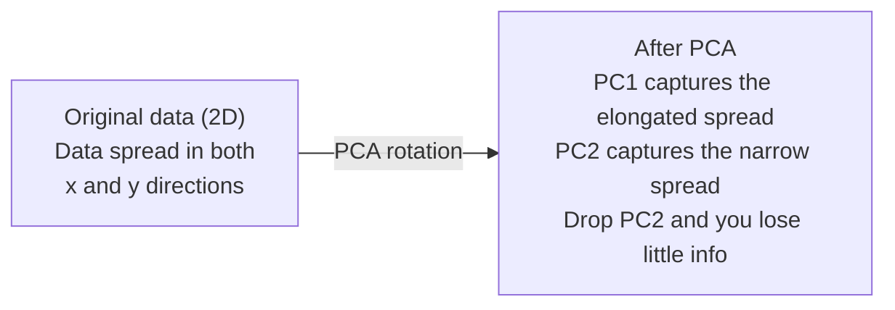

# 차원 축소

> 고차원 데이터에는 구조가 있습니다. 올바른 각도에서 바라보면 그 구조를 찾을 수 있습니다.

**유형:** Build (실습)
**Language:** Python
**선수 레슨:** Phase 1, Lessons 01 (Linear Algebra Intuition), 02 (Vectors, Matrices & Operations), 03 (Eigenvalues & Eigenvectors), 06 (Probability & Distributions)
**소요 시간:** ~90분

## 학습 목표

- 밑바닥부터 PCA 구현하기: 데이터 중심화, 공분산 행렬 계산, 고유값 분해, 투영 수행
- 설명된 분산 비율(explained variance ratio)과 엘보우 방법(elbow method)을 사용하여 주성분 개수 선택하기
- MNIST 숫자를 2D로 시각화하기 위해 PCA, t-SNE, UMAP을 비교하고 각각의 트레이드오프 설명하기
- 표준 PCA로는 다룰 수 없는 비선형 데이터 구조를 분리하기 위해 RBF 커널을 사용한 커널 PCA 적용하기

## 문제 상황

샘플당 784개의 특성(feature)을 가진 데이터셋이 있다고 가정해 보겠습니다. 손글씨 숫자의 픽셀 값일 수도 있고, 유전자 발현 수준일 수도 있으며, 사용자 행동 신호일 수도 있습니다. 784개의 차원은 시각화할 수 없습니다. 그래프로 그릴 수도 없습니다. 머릿속으로 떠올리는 것조차 불가능합니다.

하지만 이 784개 특성 대부분은 중복되어 있습니다. 실제 정보는 훨씬 더 작은 곡면 위에 존재합니다. 손글씨 숫자 "7"을 설명하는 데 784개의 독립적인 숫자가 모두 필요하지는 않습니다. 획의 각도, 가로획의 길이, 기울어진 정도와 같은 몇 가지만 있으면 됩니다. 나머지는 노이즈에 불과합니다.

차원 축소(dimensionality reduction)는 바로 그 더 작은 곡면을 찾아냅니다. 784차원의 데이터를 중요한 구조를 유지하면서 2차원, 10차원, 또는 50차원으로 압축합니다.

## 핵심 개념

### 차원의 저주

고차원 공간은 직관적이지 않습니다. 차원이 증가함에 따라 세 가지 문제가 발생합니다.

**거리가 무의미해집니다.** 고차원에서는 임의의 두 점 사이의 거리가 거의 동일한 값으로 수렴합니다. 모든 점이 다른 모든 점과 거의 같은 거리에 있게 되면 최근접 이웃(nearest-neighbor) 탐색이 제대로 동작하지 않습니다.

```
Dimension    Avg distance ratio (max/min between random points)
2            ~5.0
10           ~1.8
100          ~1.2
1000         ~1.02
```

**부피가 모서리에 집중됩니다.** $d$차원의 단위 초입방체(hypercube)는 $2^d$개의 모서리를 가집니다. 100차원에서는 거의 모든 부피가 중심에서 멀리 떨어진 모서리에 존재합니다. 데이터 포인트들이 가장자리로 흩어져 모델의 내부 영역에는 데이터가 극도로 부족해집니다.

**기하급수적으로 더 많은 데이터가 필요합니다.** 공간 내에서 동일한 샘플 밀도를 유지하려면, 2D에서 20D로 갈 때 $10^{18}$배 더 많은 데이터가 필요합니다. 데이터는 결코 충분할 수 없습니다. 차원을 축소하면 데이터 밀도를 다룰 수 있는 수준으로 되돌릴 수 있습니다.

### PCA: 중요한 방향 찾기

주성분 분석(PCA, Principal Component Analysis)은 데이터가 가장 많이 변하는 축을 찾아냅니다. 첫 번째 축이 가장 큰 분산을 포착하고, 두 번째 축이 그다음으로 큰 분산을 포착하는 방식으로 좌표계를 회전시킵니다.

알고리즘:

```
1. Center the data        (subtract the mean from each feature)
2. Compute covariance     (how features move together)
3. Eigendecomposition     (find the principal directions)
4. Sort by eigenvalue     (biggest variance first)
5. Project               (keep top k eigenvectors, drop the rest)
```

왜 고유값 분해를 사용할까요? 공분산 행렬은 대칭 행렬이자 준양의 부호 행렬(positive semi-definite)입니다. 이 행렬의 고유벡터들은 특성 공간에서 서로 직교하는 방향을 나타냅니다. 고유값은 각 방향이 얼마만큼의 분산을 포착하는지 알려줍니다. 가장 큰 고유값에 대응하는 고유벡터가 바로 최대 분산의 방향을 가리킵니다.



- **PCA 이전:** 데이터 군집이 x축과 y축에 걸쳐 대각선 방향으로 퍼져 있음
- **PCA 이후:** PC1이 최대 분산 방향(길게 늘어진 방향)에 맞춰지고, PC2가 최소 분산 방향(좁은 방향)에 맞춰지도록 좌표계가 회전됨
- **차원 축소:** PC2를 제거하고 데이터를 PC1에 투영하여 정보를 거의 잃지 않고 축소함

### 설명된 분산 비율

각 주성분은 전체 분산 중 일부를 포착합니다. 설명된 분산 비율(explained variance ratio)은 그 주성분이 얼마만큼의 정보를 포착하는지 나타냅니다.

```
Component    Eigenvalue    Explained ratio    Cumulative
PC1          4.73          0.473              0.473
PC2          2.51          0.251              0.724
PC3          1.12          0.112              0.836
PC4          0.89          0.089              0.925
...
```

누적 설명 분산이 0.95에 도달하면, 해당 개수의 주성분들이 정보의 95%를 포착하고 있음을 알 수 있습니다. 그 이후의 성분들은 대부분 노이즈에 불과합니다.

### 주성분 개수 선택하기

세 가지 전략:

1. **임계값(Threshold).** 분산의 90~95%를 설명할 수 있는 충분한 수의 성분을 유지합니다.
2. **엘보우 방법(Elbow method).** 성분별 설명된 분산을 그래프로 그리고, 급격히 꺾이는 지점을 찾습니다.
3. **다운스트림 성능(Downstream performance).** PCA를 전처리 단계로 사용합니다. $k$ 값을 변경하면서 모델의 정확도를 측정합니다. 정확도가 정체되는 지점이 최적의 $k$ 값입니다.

### t-SNE: 이웃 관계 보존

t-SNE(t-Distributed Stochastic Neighbor Embedding)는 시각화를 위해 설계되었습니다. 고차원 데이터를 어떤 점들이 서로 가까이 있는지를 보존하면서 2D(또는 3D)로 매핑합니다.

직관적 원리: 원래 공간에서 점들 사이의 거리를 기반으로 점 쌍에 대한 확률 분포를 계산합니다. 가까운 점들에는 높은 확률을 부여하고, 먼 점들에는 낮은 확률을 부여합니다. 그런 다음 2D 공간에서도 동일한 확률 분포가 유지되는 배치를 찾습니다. 784차원에서 이웃이었던 점들은 2D에서도 이웃으로 남게 됩니다.

t-SNE의 주요 특성:
- 비선형(Non-linear). PCA가 펼칠 수 없는 복잡한 매니폴드(manifold)를 펼칠 수 있습니다.
- 확률적(Stochastic). 실행할 때마다 다른 배치가 생성됩니다.
- perplexity 매개변수는 고려할 이웃의 수를 제어합니다(일반적인 범위: 5~50).
- 결과물에서 군집 간의 거리는 의미가 없습니다. 군집 자체의 형성만이 의미를 갖습니다.
- 대규모 데이터셋에서는 느립니다. 기본적으로 $O(n^2)$의 복잡도를 갖습니다.

### UMAP: 더 빠르고 더 뛰어난 전역 구조 보존

UMAP(Uniform Manifold Approximation and Projection)은 t-SNE와 유사하게 동작하지만 두 가지 장점이 있습니다.
- 더 빠릅니다. 모든 쌍 간의 거리를 계산하는 대신 근사 최근접 이웃(approximate nearest-neighbor) 그래프를 사용합니다.
- 더 나은 전역 구조를 보존합니다. 결과물에서 군집 간의 상대적 위치가 t-SNE보다 더 의미를 가집니다.

UMAP은 고차원 공간에서 가중치 그래프("퍼지 위상 표현(fuzzy topological representation)")를 구축한 다음, 이 그래프를 최대한 보존하는 저차원 배치를 찾습니다.

주요 매개변수:
- `n_neighbors`: 국소 구조를 정의하는 이웃의 수(perplexity와 유사). 값이 클수록 더 많은 전역 구조를 보존합니다.
- `min_dist`: 결과물에서 점들이 얼마나 조밀하게 뭉치는지를 결정. 값이 작을수록 더 밀집된 군집을 형성합니다.

### 상황별 기법 선택

| 기법 | 사용 사례 | 보존 대상 | 속도 |
|------|-----------|-----------|------|
| PCA | 학습 전 전처리 | 전역 분산 | 빠름(정확한 계산), 수백만 개 샘플 처리 가능 |
| PCA | 빠른 탐색적 시각화 | 선형 구조 | 빠름 |
| t-SNE | 출판용 고품질 2D 플롯 | 국소 이웃 관계 | 느림(샘플 1만 개 미만에 이상적) |
| UMAP | 대규모 2D 시각화 | 국소 구조 + 일부 전역 구조 | 보통(수백만 개 처리 가능) |
| PCA | 모델을 위한 특성 축소 | 분산 순위별 특성 | 빠름 |
| t-SNE / UMAP | 군집 구조 파악 | 군집 분리도 | 보통~느림 |

경험 법칙: 전처리 및 데이터 압축에는 PCA를 사용하세요. 2D에서 데이터 구조를 시각화해야 할 때는 t-SNE나 UMAP을 사용하세요.
### 커널 PCA(Kernel PCA)

표준 PCA는 선형 부분 공간(subspace)을 찾습니다. 좌표계를 회전하고 분산이 낮은 축을 버립니다. 하지만 데이터가 비선형 다양체(manifold) 위에 놓여 있다면 어떨까요? 2차원 공간의 원은 어떤 직선으로도 분리할 수 없습니다. 표준 PCA로는 해결할 수 없습니다.

커널 PCA는 커널 함수로 유도된 고차원 특성 공간(feature space)에서 해당 공간의 좌표를 명시적으로 계산하지 않고 PCA를 적용합니다. 이것이 바로 서포트 벡터 머신(SVM)의 기반이 되는 아이디어인 커널 트릭(kernel trick)입니다.

알고리즘:
1. $K_{ij} = k(x_i, x_j)$인 커널 행렬(kernel matrix) $K$을 계산합니다.
2. 특성 공간에서 커널 행렬을 중심화(center)합니다.
3. 중심화된 커널 행렬을 고유값 분해(eigendecomposition)합니다.
4. 상위 고유벡터($1/\sqrt{\text{eigenvalue}}$로 스케일링됨)가 투영(projection) 결과가 됩니다.

자주 사용되는 커널 함수:

| 커널 | 수식 | 적합한 용도 |
|--------|---------|----------|
| RBF (가우시안) | $\exp(-\gamma \lVert x - y \rVert^2)$ | 대부분의 비선형 데이터, 매끄러운 다양체 |
| 다항식(Polynomial) | $(x \cdot y + c)^d$ | 다항식 관계 |
| 시그모이드(Sigmoid) | $\tanh(\alpha x \cdot y + c)$ | 신경망과 유사한 매핑 |

커널 PCA와 표준 PCA 비교:

| 기준 | 표준 PCA | 커널 PCA |
|-----------|-------------|------------|
| 데이터 구조 | 선형 부분 공간 | 비선형 다양체 |
| 속도 | $O(\min(n^2 d, d^2 n))$ | $O(n^2 d + n^3)$ |
| 해석 가능성 | 주성분이 특성들의 선형 결합임 | 주성분에 대한 직접적인 특성 해석이 어려움 |
| 확장성 | 수백만 개의 샘플에도 동작 | 커널 행렬이 $n \times n$이므로 메모리 제약이 있음 |
| 재구성 | 직접적인 역변환 가능 | 프리이미지(pre-image) 근사가 필요함 |

대표적인 예로 2차원 동심원이 있습니다. 점으로 이루어진 두 고리가 하나는 안쪽에, 다른 하나는 바깥쪽에 위치하는 형태입니다. 표준 PCA는 둘을 동일한 직선상에 투영하므로 분류 작업에 전혀 도움이 되지 않습니다. 반면 RBF 커널을 적용한 커널 PCA는 내부 원과 외부 원을 서로 다른 영역에 매핑하여 선형 분리가 가능하도록 만듭니다.

### 재구성 오차(Reconstruction Error)

차원 축소가 얼마나 잘 되었을까요? 784차원을 50차원으로 압축했다면, 무엇을 잃었을까요?

재구성 오차를 다음과 같이 측정합니다:
1. 데이터를 $k$차원으로 투영합니다: $X_{\text{reduced}} = X W_k$
2. 데이터를 재구성합니다: $\hat{X} = X_{\text{reduced}} W_k^T$
3. 평균 제곱 오차(MSE)를 계산합니다: $\text{mean}((X - \hat{X})^2)$

PCA에서 재구성 오차는 설명된 분산(explained variance)과 명확한 관계를 가집니다:

```math
\begin{aligned}
\text{Reconstruction error} &= \text{sum of eigenvalues NOT included} \\
\text{Total variance} &= \text{sum of ALL eigenvalues} \\
\text{Fraction lost} &= \frac{\text{sum of dropped eigenvalues}}{\text{sum of all eigenvalues}}
\end{aligned}
```

각 주성분의 설명된 분산 비율(explained variance ratio)은 다음과 같습니다:

```math
\text{explained\_ratio}_k = \frac{\text{eigenvalue}_k}{\sum \text{all eigenvalues}}
```

주성분 개수에 따른 누적 설명 분산을 시각화하면 "엘보우(elbow)" 곡선이 나타납니다. 적절한 주성분 개수는 다음 조건에 해당하는 지점입니다:
- 곡선이 평평해지는 지점 (수익 체감 구간)
- 누적 분산이 설정한 임계값(보통 0.90 또는 0.95)을 넘는 지점
- 다운스트림 태스크의 성능이 정체되는 지점

재구성 오차는 단순히 $k$을 선택하는 용도 이상으로 유용합니다. 이상치 탐지(anomaly detection)에도 활용할 수 있습니다. 재구성 오차가 높은 샘플은 학습된 부분 공간에 들어맞지 않는 이상치입니다. 이것이 프로덕션 시스템에서 사용되는 PCA 기반 이상치 탐지의 기본 원리입니다.

```figure
pca-axes
```

## 직접 구현하기

### 1단계: 밑바닥부터 구현하는 PCA

```python
import numpy as np

class PCA:
    def __init__(self, n_components):
        self.n_components = n_components
        self.components = None
        self.mean = None
        self.eigenvalues = None
        self.explained_variance_ratio_ = None

    def fit(self, X):
        self.mean = np.mean(X, axis=0)
        X_centered = X - self.mean

        cov_matrix = np.cov(X_centered, rowvar=False)

        eigenvalues, eigenvectors = np.linalg.eigh(cov_matrix)

        sorted_idx = np.argsort(eigenvalues)[::-1]
        eigenvalues = eigenvalues[sorted_idx]
        eigenvectors = eigenvectors[:, sorted_idx]

        self.components = eigenvectors[:, :self.n_components].T
        self.eigenvalues = eigenvalues[:self.n_components]
        total_var = np.sum(eigenvalues)
        self.explained_variance_ratio_ = self.eigenvalues / total_var

        return self

    def transform(self, X):
        X_centered = X - self.mean
        return X_centered @ self.components.T

    def fit_transform(self, X):
        self.fit(X)
        return self.transform(X)
```

### 2단계: 합성 데이터로 테스트하기

```python
np.random.seed(42)
n_samples = 500

t = np.random.uniform(0, 2 * np.pi, n_samples)
x1 = 3 * np.cos(t) + np.random.normal(0, 0.2, n_samples)
x2 = 3 * np.sin(t) + np.random.normal(0, 0.2, n_samples)
x3 = 0.5 * x1 + 0.3 * x2 + np.random.normal(0, 0.1, n_samples)

X_synthetic = np.column_stack([x1, x2, x3])

pca = PCA(n_components=2)
X_reduced = pca.fit_transform(X_synthetic)

print(f"Original shape: {X_synthetic.shape}")
print(f"Reduced shape:  {X_reduced.shape}")
print(f"Explained variance ratios: {pca.explained_variance_ratio_}")
print(f"Total variance captured: {sum(pca.explained_variance_ratio_):.4f}")
```

### 3단계: 2차원으로 표현한 MNIST 숫자

```python
from sklearn.datasets import fetch_openml

mnist = fetch_openml("mnist_784", version=1, as_frame=False, parser="auto")
X_mnist = mnist.data[:5000].astype(float)
y_mnist = mnist.target[:5000].astype(int)

pca_mnist = PCA(n_components=50)
X_pca50 = pca_mnist.fit_transform(X_mnist)
print(f"50 components capture {sum(pca_mnist.explained_variance_ratio_):.2%} of variance")

pca_2d = PCA(n_components=2)
X_pca2d = pca_2d.fit_transform(X_mnist)
print(f"2 components capture {sum(pca_2d.explained_variance_ratio_):.2%} of variance")
```

### 4단계: sklearn과 비교하기

```python
from sklearn.decomposition import PCA as SklearnPCA
from sklearn.manifold import TSNE

sklearn_pca = SklearnPCA(n_components=2)
X_sklearn_pca = sklearn_pca.fit_transform(X_mnist)

print(f"\nOur PCA explained variance:     {pca_2d.explained_variance_ratio_}")
print(f"Sklearn PCA explained variance: {sklearn_pca.explained_variance_ratio_}")

diff = np.abs(np.abs(X_pca2d) - np.abs(X_sklearn_pca))
print(f"Max absolute difference: {diff.max():.10f}")

tsne = TSNE(n_components=2, perplexity=30, random_state=42)
X_tsne = tsne.fit_transform(X_mnist)
print(f"\nt-SNE output shape: {X_tsne.shape}")
```

### 5단계: UMAP과 비교하기

```python
try:
    from umap import UMAP

    reducer = UMAP(n_components=2, n_neighbors=15, min_dist=0.1, random_state=42)
    X_umap = reducer.fit_transform(X_mnist)
    print(f"UMAP output shape: {X_umap.shape}")
except ImportError:
    print("Install umap-learn: pip install umap-learn")
```

## 실전 활용

분류기 적용 전 전처리 단계로서의 PCA:

```python
from sklearn.decomposition import PCA as SklearnPCA
from sklearn.linear_model import LogisticRegression
from sklearn.model_selection import train_test_split
from sklearn.metrics import accuracy_score

X_train, X_test, y_train, y_test = train_test_split(
    X_mnist, y_mnist, test_size=0.2, random_state=42
)

results = {}
for k in [10, 30, 50, 100, 200]:
    pca_k = SklearnPCA(n_components=k)
    X_tr = pca_k.fit_transform(X_train)
    X_te = pca_k.transform(X_test)

    clf = LogisticRegression(max_iter=1000, random_state=42)
    clf.fit(X_tr, y_train)
    acc = accuracy_score(y_test, clf.predict(X_te))
    var_captured = sum(pca_k.explained_variance_ratio_)
    results[k] = (acc, var_captured)
    print(f"k={k:>3d}  accuracy={acc:.4f}  variance={var_captured:.4f}")
```

성능은 784차원에 도달하기 훨씬 전에 정체(plateau)에 도달합니다. 바로 그 정체 지점이 최적의 동작 지점(operating point)입니다.

## 결과물

이 레슨을 통해 다음 결과물을 얻을 수 있습니다:
- `outputs/skill-dimensionality-reduction.md` - 주어진 태스크에 적합한 차원 축소 기법을 선택하는 스킬

## 연습 문제

1. `inverse_transform`을 지원하도록 PCA 클래스를 수정합니다. 10개, 50개, 200개의 주성분으로부터 MNIST 숫자를 재구성해 보세요. 각각에 대한 재구성 오차(원본과의 평균 제곱 차이)를 출력합니다.

2. 동일한 MNIST 서브셋에 perplexity 값을 5, 30, 100으로 설정하여 t-SNE를 실행합니다. 결과가 어떻게 달라지는지 설명하세요. perplexity가 군집의 밀집도에 영향을 미치는 이유는 무엇일까요?

3. 50개의 특성 중 5개만 유의미한 데이터셋(`sklearn.datasets.make_classification`으로 생성)을 준비합니다. PCA를 적용하고, 설명된 분산 곡선이 데이터가 실질적으로 5차원임을 올바르게 식별하는지 확인하세요.

### 힌트

**연습 문제 1.** `PCA` 클래스의 `inverse_transform`을 확인하고 각 주성분 개수마다 모델을 하나씩 학습(fit)시킵니다. 10개, 50개, 200개의 주성분에 대해 `reconstruction_error`을 계산합니다. 주성분 수가 늘어남에 따라 오차는 반드시 감소해야 합니다.

**연습 문제 2.** 동일한 서브셋에 대해 `perplexity`만 변경하면서 `sklearn.manifold.TSNE`을 세 번 학습시키고, 동일한 `random_state`을 사용합니다. perplexity가 낮으면 적은 수의 이웃을 고려하므로 작고 빽빽한 그룹이 형성되고, perplexity가 높으면 더 많은 이웃을 고려하므로 더 크고 매끄러운 그룹이 형성될 것으로 예상할 수 있습니다.

**연습 문제 3.** `make_classification(n_features=50, n_informative=5, n_redundant=45)`를 호출하고, `PCA`를 학습시킨 뒤 누적 설명 분산을 출력합니다. 중복 특성(redundant features)은 유의미한 특성들의 선형 결합이므로 곡선이 5개 주성분 부근에서 거의 1.0에 도달합니다. 그런 다음 `n_redundant=0`으로 시도해 보세요. 나머지 45개 특성이 독립적인 노이즈가 되어 곡선이 평평해지지 않습니다.

## 핵심 용어

| 용어 | 흔히 하는 말 | 실제 의미 |
|------|----------------|----------------------|
| 차원의 저주(Curse of dimensionality) | "특성이 너무 많다" | 차원이 증가할수록 거리, 부피, 데이터 밀도가 모두 직관과 다르게 동작합니다. 모델이 이를 보완하려면 기하급수적으로 많은 데이터가 필요합니다. |
| PCA | "차원을 축소한다" | 축이 최대 분산 방향과 일치하도록 좌표계를 회전한 다음, 분산이 낮은 축을 제거합니다. |
| 주성분(Principal component) | "중요한 방향" | 공분산 행렬의 고유벡터입니다. 특성 공간에서 데이터의 분산이 가장 큰 방향을 의미합니다. |
| 설명된 분산 비율(Explained variance ratio) | "이 주성분이 가진 정보량" | 하나의 주성분이 설명하는 전체 분산의 비율입니다. 상위 $k$개의 비율을 합산하여 $k$개의 주성분이 보존하는 정보량을 파악할 수 있습니다. |
| 공분산 행렬(Covariance matrix) | "특성들이 어떻게 상관되어 있는가" | 원소 $(i,j)$가 특성 $i$과 특성 $j$이 함께 변화하는 정도를 측정하는 대칭 행렬입니다. 대각선 원소는 각 특성의 개별 분산입니다. |
| t-SNE | "그 군집 플롯" | 쌍별 이웃 확률을 보존하여 고차원 데이터를 2차원에 매핑하는 비선형 기법입니다. 시각화에는 적합하지만 전처리용으로는 적합하지 않습니다. |
| UMAP | "더 빠른 t-SNE" | 위상수학적 데이터 분석(TDA)에 기반한 비선형 기법입니다. 국소적(local) 구조와 일부 전역적(global) 구조를 모두 보존하며, t-SNE보다 확장성이 뛰어납니다. |
| Perplexity | "t-SNE 조절 다이얼" | 각 점이 고려하는 유효 이웃 수를 제어합니다. perplexity가 낮으면 매우 국소적인 구조에 집중하고, perplexity가 높으면 더 광범위한 패턴을 포착합니다. |
| 다양체(Manifold) | "데이터가 놓여 있는 곡면" | 더 높은 차원의 공간에 내포된(embedded) 저차원 곡면입니다. 3차원 공간에서 구겨진 종이 한 장은 2차원 다양체입니다. |

## 더 읽어보기

- [A Tutorial on Principal Component Analysis](https://arxiv.org/abs/1404.1100) (Shlens) - 기초부터 명확하게 설명하는 PCA 유도 과정
- [How to Use t-SNE Effectively](https://distill.pub/2016/misread-tsne/) (Wattenberg et al.) - t-SNE의 함정과 파라미터 선택에 대한 대화형 가이드
- [UMAP documentation](https://umap-learn.readthedocs.io/) - UMAP 저자들의 이론적 배경 및 실무 지침서
