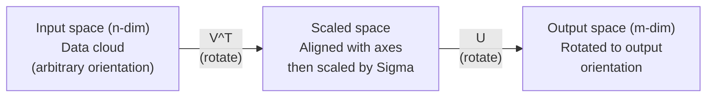
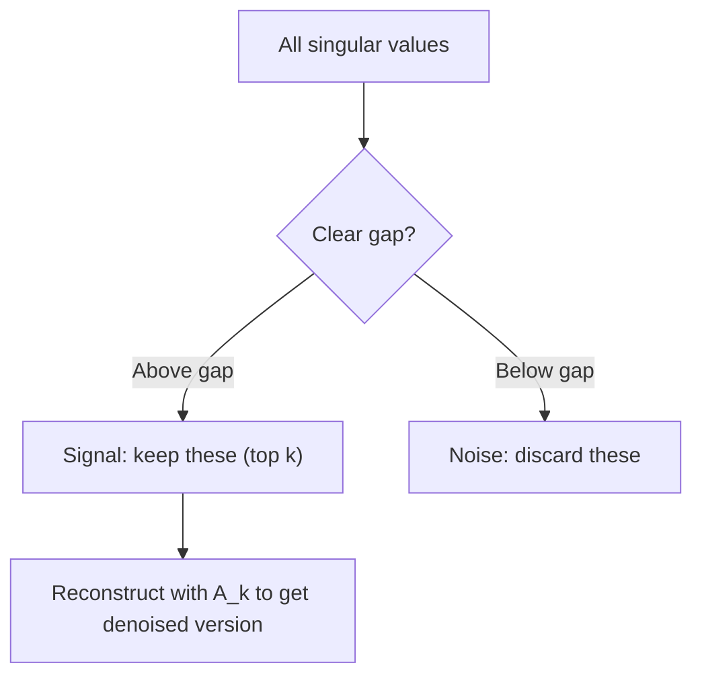

# 특잇값 분해(Singular Value Decomposition)

> SVD는 선형대수학의 만능 칼(Swiss Army knife)과 같습니다. 모든 행렬에 존재하며, 모든 데이터 과학자에게 반드시 필요합니다.

**유형:** Build (실습)
**사용 언어:** Python, Julia
**선수 레슨:** Phase 1, Lessons 01 (Linear Algebra Intuition), 02 (Vectors & Matrices Operations), 03 (Matrix Transformations)
**소요 시간:** ~120분

## 학습 목표

- 거듭제곱 반복법(power iteration)을 통해 SVD를 구현하고 $U$, $\Sigma$, $V^T$의 기하학적 의미를 설명합니다.
- 절단 SVD(truncated SVD)를 이미지 압축에 적용하고 압축률 대비 복원 오차(reconstruction error)를 측정합니다.
- 과결정 최소제곱(overdetermined least-squares) 시스템을 풀기 위해 SVD로 무어-펜로즈 유사역행렬(Moore-Penrose pseudoinverse)을 계산합니다.
- SVD를 PCA, 추천 시스템(잠재 요인, latent factors), 자연어 처리의 잠재 의미 분석(Latent Semantic Analysis, LSA)과 연결하여 이해합니다.

## 문제

1000x2000 크기의 행렬이 있다고 가정해 보겠습니다. 사용자-영화 평점 행렬일 수도 있고, 문서-단어 빈도 표일 수도 있으며, 이미지의 픽셀값일 수도 있습니다. 이 행렬을 압축하거나, 노이즈를 제거하거나, 숨겨진 구조를 찾아내거나, 최소제곱 시스템을 풀어야 합니다. 하지만 고윳값 분해(eigendecomposition)는 정사각행렬에만 적용할 수 있습니다. 그마저도 행렬이 선형 독립인 고유벡터의 완전한 집합을 가져야만 가능합니다.

반면 SVD는 어떤 행렬에든 적용할 수 있습니다. 어떤 형태든, 어떤 랭크(rank)든 조건 없이 작동합니다. SVD는 행렬을 세 개의 인수로 분해하여, 그 행렬이 공간에 미치는 작용의 기하학적 구조를 드러냅니다. 선형대수학 전체에서 가장 일반적이며 가장 유용한 행렬 분해(factorization)입니다.

## 핵심 개념

### SVD의 기하학적 의미

모든 행렬은 형태와 관계없이 회전(rotate), 스케일링(scale), 회전이라는 세 가지 연산을 순차적으로 수행합니다. SVD는 이러한 분해를 명시적으로 보여줍니다.

```math
\underset{\substack{m \times n \\ \text{(any)}}}{A} = \underset{\substack{m \times m \\ \text{(rotate)}}}{U} \cdot \underset{\substack{m \times n \\ \text{(scale)}}}{\Sigma} \cdot \underset{\substack{n \times n \\ \text{(rotate)}}}{V^T}
```

임의의 행렬 $A$가 주어지면, SVD는 이를 다음과 같이 분해합니다.
- $V^T$는 입력 공간($n$차원)의 벡터를 회전합니다.
- $\Sigma$는 각 축을 따라 크기를 조정합니다(늘이거나 줄임).
- $U$는 그 결과를 출력 공간($m$차원)으로 회전합니다.



이렇게 생각해 볼 수 있습니다. SVD에 행렬을 입력하면 다음과 같이 알려줍니다. "이 행렬은 구(sphere) 형태의 입력을 받아 먼저 $V^T$로 회전하고, $\Sigma$로 늘여 타원체(ellipsoid)를 만든 다음, 이 타원체를 $U$로 회전합니다." 특잇값은 이 타원체 축의 길이에 해당합니다.

### 전체 분해

형태가 $m \times n$인 행렬 $A$에 대해:

```math
\begin{aligned}
& A = U \cdot \Sigma \cdot V^T \\[6pt]
& \text{where:} \\
& \quad U \text{ is } m \times m, \text{ orthogonal } (U^T U = I) \\
& \quad \Sigma \text{ is } m \times n, \text{ diagonal (singular values on the diagonal)} \\
& \quad V \text{ is } n \times n, \text{ orthogonal } (V^T V = I) \\[6pt]
& \text{The singular values } \sigma_1 \ge \sigma_2 \ge \cdots \ge \sigma_r > 0 \\
& \text{where } r = \mathop{\mathrm{rank}}(A)
\end{aligned}
```

$U$의 열은 좌특이벡터(left singular vector)라고 부릅니다. $V$의 열은 우특이벡터(right singular vector)라고 부릅니다. $\Sigma$의 대각 성분은 특잇값(singular value)이라고 부릅니다. 특잇값은 항상 음수가 아니며, 관례적으로 내림차순으로 정렬됩니다.

### 좌특이벡터, 특잇값, 우특이벡터

SVD의 각 구성 요소는 고유한 기하학적 의미를 갖습니다.

**우특이벡터($V$의 열):** 입력 공간($\mathbb{R}^n$)의 정규직교 기저(orthonormal basis)를 이룹니다. 행렬이 출력 공간의 직교하는 방향으로 매핑하는 입력 공간 내의 방향들입니다. 정의역의 자연스러운 좌표계로 생각할 수 있습니다.

**특잇값($\Sigma$의 대각 성분):** 스케일링 계수입니다. i번째 특잇값은 행렬이 i번째 우특이벡터를 따라 벡터를 얼마나 늘이는지 나타냅니다. 특잇값이 0이면 행렬이 해당 방향을 완전히 압축(소멸)시킴을 의미합니다.

**좌특이벡터($U$의 열):** 출력 공간($\mathbb{R}^m$)의 정규직교 기저를 이룹니다. i번째 좌특이벡터는 i번째 우특이벡터가 (스케일링된 후) 도달하는 출력 공간 내의 방향입니다.

이들 사이의 관계는 다음과 같습니다.

```
A * v_i = sigma_i * u_i

The matrix A takes the i-th right singular vector v_i,
scales it by sigma_i, and maps it to the i-th left singular vector u_i.
```

이를 통해 어떤 행렬이든 좌표별로 어떤 작용을 하는지 한눈에 파악할 수 있습니다.

### 외적 형태

SVD는 랭크-1 행렬들의 합으로 표현할 수 있습니다.

```
A = sigma_1 * u_1 * v_1^T + sigma_2 * u_2 * v_2^T + ... + sigma_r * u_r * v_r^T

Each term sigma_i * u_i * v_i^T is a rank-1 matrix (an outer product).
The full matrix is the sum of r such matrices, where r is the rank.
```

이 형태는 저계수 근사(low-rank approximation)의 기초가 됩니다. 각 항은 하나의 구조 계층을 추가합니다. 첫 번째 항은 가장 중요한 단일 패턴을 포착합니다. 두 번째 항은 그다음으로 중요한 패턴을 포착하며, 이후 항들도 마찬가지입니다. 이 합을 특정 지점에서 절단(truncate)하면 주어진 랭크에서 가능한 최선의 근사를 얻을 수 있습니다.

```math
\begin{aligned}
\text{Rank-1 approx:} \quad & A_1 = \sigma_1 u_1 v_1^T \\
& \text{(captures the dominant pattern)} \\[6pt]
\text{Rank-2 approx:} \quad & A_2 = \sigma_1 u_1 v_1^T + \sigma_2 u_2 v_2^T \\
& \text{(captures the two most important patterns)} \\[6pt]
\text{Rank-}k\text{ approx:} \quad & A_k = \text{sum of top } k \text{ terms} \\
& \text{(optimal by the Eckart-Young theorem)}
\end{aligned}
```

### 고윳값 분해와의 관계

SVD와 고윳값 분해는 깊은 연관이 있습니다. $A$의 특잇값과 특이벡터는 $A^T A$ 및 $A A^T$의 고윳값과 고유벡터로부터 직접 도출됩니다.

```
A^T A = V * Sigma^T * U^T * U * Sigma * V^T
      = V * Sigma^T * Sigma * V^T
      = V * D * V^T

where D = Sigma^T * Sigma is a diagonal matrix with sigma_i^2 on the diagonal.

So:
- The right singular vectors (V) are eigenvectors of A^T A
- The singular values squared (sigma_i^2) are eigenvalues of A^T A

Similarly:
A A^T = U * Sigma * V^T * V * Sigma^T * U^T
      = U * Sigma * Sigma^T * U^T

So:
- The left singular vectors (U) are eigenvectors of A A^T
- The eigenvalues of A A^T are also sigma_i^2
```

이러한 연결 관계는 세 가지 사실을 시사합니다.
1. 특잇값은 항상 실수이며 음수가 아닙니다(양의 준정부호 행렬의 고윳값에 제곱근을 취한 값이기 때문입니다).
2. $A^T A$의 고윳값 분해를 통해 SVD를 계산할 수도 있지만, 이 방식은 조건수(condition number)를 제곱하여 수치적 정밀도를 떨어뜨립니다. SVD 전용 알고리즘은 이러한 문제를 방지합니다.
3. $A$가 대칭인 양의 준정부호 정사각행렬일 때, SVD와 고윳값 분해는 동일합니다.

### 절단 SVD: 저계수 근사

에카르트-영-미르스키(Eckart-Young-Mirsky) 정리에 따르면, 프로베니우스 놈(Frobenius norm)과 스펙트럼 놈(spectral norm) 모두에서 $A$에 대한 최적의 $\text{rank-}k$ 근사는 상위 $k$개의 특잇값과 그에 대응하는 벡터만 유지함으로써 얻을 수 있습니다.

```math
\begin{aligned}
& A_k = U_k \cdot \Sigma_k \cdot V_k^T \\[6pt]
& \text{where:} \\
& \quad U_k \text{ is } m \times k \quad \text{(first } k \text{ columns of } U\text{)} \\
& \quad \Sigma_k \text{ is } k \times k \quad \text{(top-left } k \times k \text{ block of } \Sigma\text{)} \\
& \quad V_k \text{ is } n \times k \quad \text{(first } k \text{ columns of } V\text{)} \\[6pt]
& \text{Approximation error} = \sigma_{k+1} \quad \text{(in spectral norm)} \\
& \text{Approximation error} = \sqrt{\sigma_{k+1}^2 + \cdots + \sigma_r^2} \quad \text{(in Frobenius norm)}
\end{aligned}
```

이는 단순히 '괜찮은' 근사가 아닙니다. 랭크 $k$로 만들 수 있는 수학적으로 증명된 최선의 근사입니다. 어떤 다른 $\text{rank-}k$ 행렬도 $A$에 이보다 더 가까울 수 없습니다.

| 구성 요소 | 상대적 크기 | 랭크-3 근사에 포함 여부 |
|-----------|-------------------|------------------------|
| $\sigma_1$ | 가장 큼 | 예 |
| $\sigma_2$ | 큼 | 예 |
| $\sigma_3$ | 중간-큼 | 예 |
| $\sigma_4$ | 중간 | 아니오 (오차) |
| $\sigma_5$ | 중간-작음 | 아니오 (오차) |
| $\sigma_6$ | 작음 | 아니오 (오차) |
| $\sigma_7$ | 매우 작음 | 아니오 (오차) |
| $\sigma_8$ | 극히 작음 | 아니오 (오차) |

상위 3개 유지: $A_3$는 가장 큰 3개의 특잇값을 포착합니다. 오차 = 나머지 값들($\sigma_4$부터 $\sigma_8$까지).

특잇값이 빠르게 감소하면 작은 $k$만으로도 행렬의 대부분을 포착할 수 있습니다. 특잇값이 느리게 감소한다면 해당 행렬에는 저계수 구조가 없음을 뜻합니다.

### SVD를 활용한 이미지 압축

그레이스케일 이미지는 픽셀 강도로 이루어진 행렬입니다. 800x600 크기의 이미지는 48만 개의 값을 가집니다. SVD를 사용하면 훨씬 적은 수의 값으로 이미지를 근사할 수 있습니다.

```
Original image: 800 x 600 = 480,000 values

SVD with rank k:
  U_k:      800 x k values
  Sigma_k:  k values
  V_k:      600 x k values
  Total:    k * (800 + 600 + 1) = k * 1401 values

  k=10:   14,010 values   (2.9% of original)
  k=50:   70,050 values  (14.6% of original)
  k=100: 140,100 values  (29.2% of original)

  The compression ratio improves as k gets smaller,
  but visual quality degrades.
```

핵심 통찰은 자연 이미지는 특잇값이 급격히 감소한다는 점입니다. 처음 몇 개의 특잇값이 대략적인 구조(형태, 그레이디언트)를 포착하고, 뒤쪽의 특잇값들은 세부 디테일과 노이즈를 포착합니다. 랭크 50에서 절단하면 저장 공간을 85% 적게 사용하면서도 원본과 거의 구분할 수 없는 이미지를 만들어내는 경우가 많습니다.
### 추천 시스템을 위한 SVD

넷플릭스 프라이즈(Netflix Prize)를 통해 이 방식이 유명해졌습니다. 대부분의 항목이 비어 있는 사용자-영화 평점 행렬이 있다고 가정해 보겠습니다.

```
             Movie1  Movie2  Movie3  Movie4  Movie5
  User1      [  5      ?       3       ?       1  ]
  User2      [  ?      4       ?       2       ?  ]
  User3      [  3      ?       5       ?       ?  ]
  User4      [  ?      ?       ?       4       3  ]

  ? = unknown rating
```

핵심 아이디어는 이 평점 행렬이 낮은 계수(low rank)를 가진다는 점입니다. 사용자들의 취향은 완전히 독립적이지 않습니다. 대부분의 선호도를 설명하는 소수의 잠재 요인(latent factor, 예: 액션 대 드라마, 고전 대 신작, 지적 취향 대 본능적 취향)이 존재합니다.

(결측치가 채워진) 평점 행렬에 SVD를 적용하면 다음과 같이 분해됩니다.
- $U$: 잠재 요인 공간에서의 사용자 프로필
- $\Sigma$: 각 잠재 요인의 중요도
- $V^T$: 잠재 요인 공간에서의 영화 프로필

어떤 영화에 대한 사용자의 예측 평점은 해당 사용자의 프로필과 영화 프로필의 내적(특이값으로 가중치 부여)입니다. 저계수 근사(low-rank approximation)를 통해 비어 있는 항목을 채웁니다.

실제로는 사이먼 펑크(Simon Funk)의 점진적 SVD나 ALS(교대 최소제곱법, alternating least squares)처럼 결측 데이터를 직접 다루는 변형 기법을 사용합니다. 하지만 핵심 아이디어는 동일합니다. 바로 SVD를 통한 잠재 요인 분해입니다.

### NLP에서의 SVD: 잠재 의미 분석

잠재 의미 분석(Latent Semantic Analysis, LSA)은 잠재 의미 색인(Latent Semantic Indexing, LSI)으로도 불리며, 단어-문서 행렬(term-document matrix)에 SVD를 적용합니다.

```
             Doc1   Doc2   Doc3   Doc4
  "cat"      [  3      0      1      0  ]
  "dog"      [  2      0      0      1  ]
  "fish"     [  0      4      1      0  ]
  "pet"      [  1      1      1      1  ]
  "ocean"    [  0      3      0      0  ]

After SVD with rank k=2:

  Each document becomes a point in 2D "concept space."
  Each term becomes a point in the same 2D space.
  Documents about similar topics cluster together.
  Terms with similar meanings cluster together.

  "cat" and "dog" end up near each other (land pets).
  "fish" and "ocean" end up near each other (water concepts).
  Doc1 and Doc3 cluster if they share similar topics.
```

LSA는 원시 텍스트에서 의미적 유사성을 포착하는 데 성공한 초기 방법 중 하나였습니다. 유의어는 유사한 문서에 나타나는 경향이 있으므로, SVD가 이들을 동일한 잠재 차원으로 묶어주기 때문에 효과적으로 동작합니다. 현대의 단어 임베딩(Word2Vec, GloVe)은 이러한 아이디어의 후손으로 볼 수 있습니다.

### 노이즈 감소를 위한 SVD

노이즈가 포함된 데이터에서는 신호가 상위 특이값에 집중되고 노이즈는 모든 특이값에 걸쳐 분산됩니다. 특이값을 절단(truncating)하면 노이즈 플로어를 제거할 수 있습니다.

**깨끗한 신호의 특이값:**

| 컴포넌트 | 크기 | 유형 |
|-----------|-----------|------|
| $\sigma_1$ | 매우 큼 | 신호 |
| $\sigma_2$ | 큼 | 신호 |
| $\sigma_3$ | 보통 | 신호 |
| $\sigma_4$ | 0에 가까움 | 무시 가능 |
| $\sigma_5$ | 0에 가까움 | 무시 가능 |

**노이즈가 포함된 신호의 특이값 (노이즈가 전반에 추가됨):**

| 컴포넌트 | 크기 | 유형 |
|-----------|-----------|------|
| $\sigma_1$ | 매우 큼 | 신호 |
| $\sigma_2$ | 큼 | 신호 |
| $\sigma_3$ | 보통 | 신호 |
| $\sigma_4$ | 작음 | 노이즈 |
| $\sigma_5$ | 작음 | 노이즈 |
| $\sigma_6$ | 작음 | 노이즈 |
| $\sigma_7$ | 작음 | 노이즈 |



이 기법은 신호 처리, 과학적 측정 및 데이터 정제에 사용됩니다. 가산 노이즈(additive noise)로 인해 훼손된 행렬이 있을 때마다 절단 SVD(truncated SVD)는 신호와 노이즈를 분리하는 원리적인 방법이 됩니다.

### SVD를 통한 의사역행렬

무어-펜로즈 의사역행렬(Moore-Penrose pseudoinverse) $A^+$은 정사각 행렬이 아니거나 특이 행렬인 경우까지 행렬의 역행렬 개념을 일반화합니다. SVD를 사용하면 이를 매우 간단하게 계산할 수 있습니다.

```
If A = U * Sigma * V^T, then:

A+ = V * Sigma+ * U^T

where Sigma+ is formed by:
  1. Transpose Sigma (swap rows and columns)
  2. Replace each non-zero diagonal entry sigma_i with 1/sigma_i
  3. Leave zeros as zeros

For A (m x n):      A+ is (n x m)
For Sigma (m x n):  Sigma+ is (n x m)
```

의사역행렬은 최소제곱 문제를 해결합니다. $Ax = b$에 정확한 해가 없다면(초과 결정 시스템, overdetermined system), $x = A^+ b$이 최소제곱 해($\lVert Ax - b \rVert$를 최소화함)가 됩니다.

```
Overdetermined system (more equations than unknowns):

  [1  1]         [3]
  [2  1] x   =   [5]       No exact solution exists.
  [3  1]         [6]

  x_ls = A+ b = V * Sigma+ * U^T * b

  This gives the x that minimizes the sum of squared residuals.
  Same result as the normal equations (A^T A)^(-1) A^T b,
  but numerically more stable.
```

### 수치적 안정성의 이점

$A^T A$의 고윳값 분해를 계산하면 특이값이 제곱됩니다($A^T A$의 고윳값은 $\sigma_i^2$입니다). 이는 조건수(condition number)를 제곱하여 수치적 오차를 증폭시킵니다.

```
Example:
  A has singular values [1000, 1, 0.001]
  Condition number of A: 1000 / 0.001 = 10^6

  A^T A has eigenvalues [10^6, 1, 10^{-6}]
  Condition number of A^T A: 10^6 / 10^{-6} = 10^{12}

  Computing SVD directly: works with condition number 10^6
  Computing via A^T A:     works with condition number 10^{12}
                           (6 extra digits of precision lost)
```

최신 SVD 알고리즘(Golub-Kahan 이중 대각화)은 $A^T A$를 직접 생성하지 않고 $A$에서 직접 연산합니다. 이것이 항상 `np.linalg.eig(A.T @ A)`보다 `np.linalg.svd(A)`를 선호해야 하는 이유입니다.

### PCA와의 관계

PCA는 중심화된(centered) 데이터에 대한 SVD 그 자체입니다. 이것은 단순한 비유가 아니라 문자 그대로 완전히 동일한 계산입니다.

```
Given data matrix X (n_samples x n_features), centered (mean subtracted):

Covariance matrix: C = (1/(n-1)) * X^T X

PCA finds eigenvectors of C. But:

  X = U * Sigma * V^T    (SVD of X)

  X^T X = V * Sigma^2 * V^T

  C = (1/(n-1)) * V * Sigma^2 * V^T

So the principal components are exactly the right singular vectors V.
The explained variance for each component is sigma_i^2 / (n-1).

In sklearn, PCA is implemented using SVD, not eigendecomposition.
It is faster and more numerically stable.
```

즉, 10강에서 배운 차원 축소에 관한 모든 내용은 내부적으로 SVD를 기반으로 합니다. PCA는 머신러닝에서 가장 흔하게 쓰이는 SVD의 응용 사례입니다.

```figure
svd-rank-reconstruction
```

## 직접 만들어보기

### 1단계: 거듭제곱 반복법을 이용한 밑바닥부터 SVD 구현

핵심 아이디어: 가장 큰 특이값과 해당 벡터를 찾기 위해 $A^T A$(또는 $A A^T$)에 거듭제곱 반복법(power iteration)을 사용합니다. 그런 다음 행렬을 디플레이션(deflate)하고 다음 특이값에 대해 이 과정을 반복합니다.

```python
import numpy as np

def power_iteration(M, num_iters=100):
    n = M.shape[1]
    v = np.random.randn(n)
    v = v / np.linalg.norm(v)

    for _ in range(num_iters):
        Mv = M @ v
        v = Mv / np.linalg.norm(Mv)

    eigenvalue = v @ M @ v
    return eigenvalue, v

def svd_from_scratch(A, k=None):
    m, n = A.shape
    if k is None:
        k = min(m, n)

    sigmas = []
    us = []
    vs = []

    A_residual = A.copy().astype(float)

    for _ in range(k):
        AtA = A_residual.T @ A_residual
        eigenvalue, v = power_iteration(AtA, num_iters=200)

        if eigenvalue < 1e-10:
            break

        sigma = np.sqrt(eigenvalue)
        u = A_residual @ v / sigma

        sigmas.append(sigma)
        us.append(u)
        vs.append(v)

        A_residual = A_residual - sigma * np.outer(u, v)

    U = np.column_stack(us) if us else np.empty((m, 0))
    S = np.array(sigmas)
    V = np.column_stack(vs) if vs else np.empty((n, 0))

    return U, S, V
```

### 2단계: 테스트 및 NumPy와의 비교

```python
np.random.seed(42)
A = np.random.randn(5, 4)

U_ours, S_ours, V_ours = svd_from_scratch(A)
U_np, S_np, Vt_np = np.linalg.svd(A, full_matrices=False)

print("Our singular values:", np.round(S_ours, 4))
print("NumPy singular values:", np.round(S_np, 4))

A_reconstructed = U_ours @ np.diag(S_ours) @ V_ours.T
print(f"Reconstruction error: {np.linalg.norm(A - A_reconstructed):.8f}")
```

### 3단계: 이미지 압축 데모

```python
def compress_image_svd(image_matrix, k):
    U, S, Vt = np.linalg.svd(image_matrix, full_matrices=False)
    compressed = U[:, :k] @ np.diag(S[:k]) @ Vt[:k, :]
    return compressed

image = np.random.seed(42)
rows, cols = 200, 300
image = np.random.randn(rows, cols)

for k in [1, 5, 10, 20, 50]:
    compressed = compress_image_svd(image, k)
    error = np.linalg.norm(image - compressed) / np.linalg.norm(image)
    original_size = rows * cols
    compressed_size = k * (rows + cols + 1)
    ratio = compressed_size / original_size
    print(f"k={k:>3d}  error={error:.4f}  storage={ratio:.1%}")
```

### 4단계: 노이즈 감소

```python
np.random.seed(42)
clean = np.outer(np.sin(np.linspace(0, 4*np.pi, 100)),
                 np.cos(np.linspace(0, 2*np.pi, 80)))
noise = 0.3 * np.random.randn(100, 80)
noisy = clean + noise

U, S, Vt = np.linalg.svd(noisy, full_matrices=False)
denoised = U[:, :5] @ np.diag(S[:5]) @ Vt[:5, :]

print(f"Noisy error:    {np.linalg.norm(noisy - clean):.4f}")
print(f"Denoised error: {np.linalg.norm(denoised - clean):.4f}")
print(f"Improvement:    {(1 - np.linalg.norm(denoised - clean) / np.linalg.norm(noisy - clean)):.1%}")
```

### 5단계: 의사역행렬

```python
A = np.array([[1, 1], [2, 1], [3, 1]], dtype=float)
b = np.array([3, 5, 6], dtype=float)

U, S, Vt = np.linalg.svd(A, full_matrices=False)
S_inv = np.diag(1.0 / S)
A_pinv = Vt.T @ S_inv @ U.T

x_svd = A_pinv @ b
x_lstsq = np.linalg.lstsq(A, b, rcond=None)[0]
x_pinv = np.linalg.pinv(A) @ b

print(f"SVD pseudoinverse solution:  {x_svd}")
print(f"np.linalg.lstsq solution:   {x_lstsq}")
print(f"np.linalg.pinv solution:    {x_pinv}")
```

## 사용해보기

전체 동작 데모는 `code/svd.py`에 있습니다. 이를 실행하여 이미지 압축, 추천 시스템, 잠재 의미 분석, 노이즈 감소에 적용된 SVD를 확인해 보십시오.

```bash
python svd.py
```

`code/svd.jl`의 Julia 버전은 Julia의 내장 함수 `svd()`와 `LinearAlgebra` 패키지를 사용하여 동일한 개념을 보여줍니다.

```bash
julia svd.jl
```

## 배포하기

이 레슨을 통해 다음을 얻을 수 있습니다.
- `outputs/skill-svd.md` - 실제 프로젝트에서 SVD를 언제 어떻게 적용해야 하는지 판단하는 역량

## 연습문제

1. 거듭제곱 반복법을 사용하지 않고 밑바닥부터 전체 SVD를 구현해 보십시오. 대신 $A^T A$의 고윳값 분해를 계산하여 $V$와 특이값을 구한 다음, $U = A V \Sigma^{-1}$를 계산하십시오. 거듭제곱 반복법 버전 및 NumPy와 수치적 정확도를 비교해 보십시오.

2. 실제 그레이스케일 이미지를 로드하십시오(또는 이미지를 그레이스케일로 변환하십시오). 계수(rank) 1, 5, 10, 25, 50, 100으로 이미지를 압축해 보십시오. 각 계수마다 압축률과 상대 오차를 계산하십시오. 이미지가 시각적으로 수용할 만한 수준이 되는 계수를 찾아보십시오.

3. 간단한 추천 시스템을 구축해 보십시오. 일부 항목만 알려진 10x8 크기의 사용자-영화 평점 행렬을 만듭니다. 결측치는 행 평균으로 채웁니다. SVD를 계산하고 계수 3 근사 행렬을 재구성하십시오. 재구성된 행렬을 사용하여 결측된 평점을 예측해 보십시오. 예측값이 합리적인지 확인하십시오.

4. 3개의 합성 토픽을 가진 100x50 크기의 문서-단어 행렬을 생성하십시오. 각 토픽에는 연관된 단어가 5개씩 있습니다. 여기에 노이즈를 추가하십시오. SVD를 적용하고 상위 3개의 특이값이 나머지보다 훨씬 큰지 확인하십시오. 문서를 3차원 잠재 공간에 투영하고 동일한 토픽의 문서들이 군집을 형성하는지 확인하십시오.

5. 깨끗한 저계수 행렬(계수 3, 크기 50x40)을 생성하고 다양한 수준($\sigma$ = 0.1, 0.5, 1.0, 2.0)의 가우시안 노이즈를 추가하십시오. 각 노이즈 수준에 대해 $k$을 1부터 40까지 변화시키며 원본 행렬과의 재구성 오차를 측정하여 최적의 절단 계수를 찾으십시오. 노이즈 수준에 따라 최적의 $k$이 어떻게 변화하는지 그래프로 그려보십시오.
### Hints

**Exercise 1.** $A^T A$를 계산하고, `np.linalg.eigh`로 고윳값(eigenvalue)과 고유벡터(eigenvector)를 구한 다음 내림차순으로 정렬합니다. 특잇값(singular value)은 고윳값의 제곱근입니다. $U \Sigma V^T$가 $A$를 재구성하는지 확인하고 `svd_from_scratch` 및 `np.linalg.svd`와 오차를 비교합니다.

**Exercise 2.** 각 랭크(rank)에 대해 `truncated_svd`를 호출하고, `reconstruct`로 이미지를 재구성하며, 크기 확인에는 `compression_ratio(m, n, k)`를 사용합니다. 랭크가 커질수록 상대 오차는 감소해야 하며, 뚜렷한 블록 현상이 보이지 않는 첫 번째 랭크가 정답입니다.

**Exercise 3.** 결측 셀을 표시하고 행 평균으로 채운 후, `truncated_svd` 및 `reconstruct`를 사용하여 랭크 3 근사(approximation)를 재구성합니다. 그런 다음 결과를 측정합니다. 평점 범위를 벗어난 예측값의 개수를 세고, 기존에 알고 있던 셀에서 발생한 가장 큰 변화량을 출력합니다. 랭크 3 근사는 두 속성 중 어느 것도 보장하지 않으므로, 유효한 평점이 필요하다면 예측값을 해당 범위로 클리핑(clip)해야 합니다.

**Exercise 4.** 각 주제(topic)별 문서에 대해 높은 빈도를 갖는 5개 단어 블록을 할당한 다음, 약간의 노이즈를 추가합니다. 특잇값을 출력해 보세요. 처음 3개 값이 4번째 값보다 훨씬 커야 합니다. 그런 다음 주제별로 3D 좌표에 색상을 지정하고 각 주제가 하나의 그룹을 형성하는지 확인합니다.

**Exercise 5.** 50x3 및 3x40 무작위 행렬의 곱으로 노이즈 없는 원본 행렬을 생성한 다음, 각 $\sigma$에 대해 노이즈를 추가합니다. 각 $k$에 대해 랭크 $k$ 재구성과 노이즈 없는 원본 행렬을 비교합니다. 노이즈가 적을 때는 최적의 $k$가 3 부근이고, 노이즈가 클 때는 더 작아질 것으로 예상할 수 있습니다.

## Key Terms

| Term | What people say | What it actually means |
|------|----------------|----------------------|
| SVD | "어떤 행렬이든 인수분해하기" | $A$를 $U \Sigma V^T$로 분해합니다. 여기서 $U$와 $V$는 직교(orthogonal) 행렬이고 $\Sigma$는 음이 아닌 원소를 갖는 대각(diagonal) 행렬입니다. 어떤 형태의 행렬에든 적용할 수 있습니다. |
| Singular value | "이 성분이 얼마나 중요한지" | $\Sigma$의 $i$번째 대각 원소입니다. 행렬이 i번째 주방향을 따라 얼마나 늘어나는지를 측정합니다. 항상 음이 아니며 내림차순으로 정렬됩니다. |
| Left singular vector | "출력 방향" | $U$의 열(column)입니다. $i$번째 우특이벡터가 ($\sigma_i$만큼 크기 조정된 후) 매핑되는 출력 공간의 방향입니다. |
| Right singular vector | "입력 방향" | $V$의 열입니다. 행렬에 의해 ($\sigma_i$만큼 크기 조정된) $i$번째 좌특이벡터로 매핑되는 입력 공간의 방향입니다. |
| Truncated SVD | "저랭크 근사" | 상위 $k$개의 특잇값과 해당 벡터만 유지합니다. 원본 행렬에 대해 수학적으로 증명 가능한 최선의 $\text{rank-}k$ 근사를 생성합니다(에카르트-영 정리). |
| Rank | "실제 차원 수" | 0이 아닌 특잇값의 개수입니다. 행렬이 실제로 사용하는 독립적인 방향의 수를 나타냅니다. |
| Pseudoinverse | "일반화 역행렬" | $V \Sigma^+ U^T$. 0이 아닌 특잇값은 역수로 취하고, 0은 그대로 둡니다. 정사각 행렬이 아니거나 특이(singular) 행렬인 경우의 최소제곱 문제를 해결합니다. |
| Condition number | "오차에 얼마나 민감한지" | $\sigma_{\max} / \sigma_{\min}$. 조건수가 크면 입력의 작은 변화가 출력에 큰 변화를 일으킴을 의미합니다. SVD를 통해 이를 직접 파악할 수 있습니다. |
| Latent factor | "잠재 변수" | SVD를 통해 발견되는 저랭크 공간의 차원입니다. 추천 시스템에서 잠재 요인은 장르 선호도에 해당할 수 있고, NLP에서는 주제에 해당할 수 있습니다. |
| Frobenius norm | "행렬의 전체 크기" | 모든 원소의 제곱합에 대한 제곱근입니다. 특잇값 제곱합의 제곱근과 같습니다. 근사 오차를 측정하는 데 사용됩니다. |
| Eckart-Young theorem | "SVD가 최선의 압축을 제공함" | 모든 목표 랭크 $k$에 대해, 절단된 SVD(truncated SVD)는 가능한 모든 $\text{rank-}k$ 행렬 중에서 근사 오차를 최소화합니다. |
| Power iteration | "가장 큰 고유벡터 찾기" | 무작위 벡터에 행렬을 반복적으로 곱하고 정규화합니다. 가장 큰 고윳값을 갖는 고유벡터로 수렴합니다. 여러 SVD 알고리즘의 기초가 되는 연산입니다. |

## Further Reading

- [Gilbert Strang: Linear Algebra and Its Applications, Chapter 7](https://math.mit.edu/~gs/linearalgebra/) - 응용을 포함한 SVD에 대한 심도 있는 설명
- [3Blue1Brown: But what is the SVD?](https://www.youtube.com/watch?v=vSczTbgc8Rc) - SVD에 대한 기하학적 직관
- [We Recommend a Singular Value Decomposition](https://www.ams.org/publicoutreach/feature-column/fcarc-svd) - 미국수학회(AMS)에서 제공하는 이해하기 쉬운 개요
- [Netflix Prize and Matrix Factorization](https://sifter.org/~simon/journal/20061211.html) - 추천을 위한 SVD에 관한 Simon Funk의 원작 블로그 포스트
- [Latent Semantic Analysis](https://en.wikipedia.org/wiki/Latent_semantic_analysis) - SVD의 초기 NLP 응용 사례
- [Numerical Linear Algebra by Trefethen and Bau](https://people.maths.ox.ac.uk/trefethen/text.html) - SVD 알고리즘과 그 수치적 특성을 이해하기 위한 표준적인 필독서
