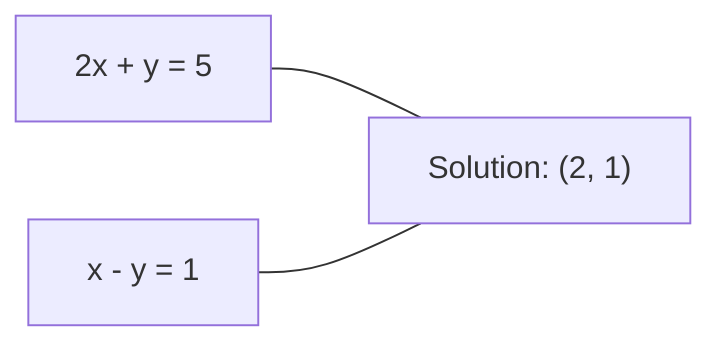
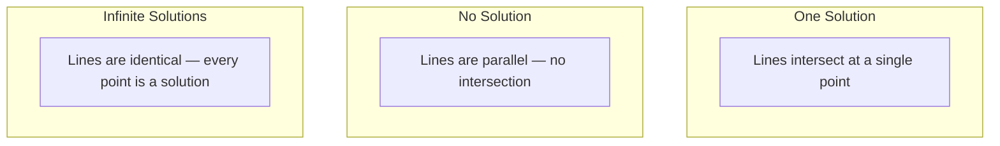

# 선형 시스템

> $Ax = b$를 푸는 것은 지금도 여러분의 신경망을 구동하고 있는, 수학에서 가장 오래된 문제입니다.

**유형:** Build (실습)
**Language:** Python
**선수 레슨:** Phase 1, Lessons 01 (Linear Algebra Intuition), 02 (Vectors & Matrices), 03 (Matrix Transformations)
**소요 시간:** ~120분

## 학습 목표

- 부분 피벗팅(partial pivoting)과 후진 대입법(back substitution)을 적용한 가우스 소거법(Gaussian elimination)으로 $Ax = b$ 풀기
- LU, QR, 숄레스키(Cholesky) 분해로 행렬을 인수분해하고 각각이 적절한 상황 설명하기
- 최소제곱법(least squares)에 대한 정규 방정식(normal equation)을 유도하고 이를 선형 회귀 및 릿지 회귀(ridge regression)와 연결하기
- 조건수(condition number)를 사용해 악조건 시스템(ill-conditioned system)을 진단하고, 이를 안정화하기 위해 규제(regularization) 적용하기

## 문제

선형 회귀를 훈련할 때마다 선형 시스템을 풀게 됩니다. 최소제곱 적합(least-squares fit)을 계산할 때마다 선형 시스템을 풀게 됩니다. 신경망 계층이 `y = Wx + b`를 계산할 때마다 선형 시스템의 한쪽 변을 평가하는 것입니다. 규제를 추가할 때도 시스템을 수정하게 됩니다. 가우시안 프로세스(Gaussian process)를 사용할 때는 행렬을 분해합니다. 마할라노비스 거리(Mahalanobis distance)를 구하기 위해 공분산 행렬의 역행렬을 계산할 때도 선형 시스템을 푸는 것입니다.

방정식 $Ax = b$는 어디에나 등장합니다. $A$는 이미 알고 있는 계수 행렬입니다. $b$는 이미 알고 있는 출력 벡터입니다. $x$는 구하고자 하는 미지수 벡터입니다. 선형 회귀에서 $A$는 데이터 행렬, $b$는 타깃 벡터, $x$는 가중치 벡터입니다. 모델 전체는 결국 다음 문제로 귀결됩니다: $Ax$가 $b$에 최대한 가까워지도록 하는 $x$를 찾는 것입니다.

이번 레슨에서는 이 방정식을 푸는 모든 주요 기법을 밑바닥부터 직접 구현합니다. 어떤 방법은 빠르고 어떤 방법은 안정적인지, 왜 어떤 방법은 정방(square) 시스템에만 작동하고 어떤 방법은 초과결정(overdetermined) 시스템도 다룰 수 있는지, 그리고 행렬의 조건수가 계산된 해의 유의미함을 어떻게 결정짓는지 이해하게 될 것입니다.

## 핵심 개념

### Ax = b의 기하학적 의미

선형 연립방정식은 기하학적으로 해석할 수 있습니다. 각 방정식은 하나의 초평면(hyperplane)을 정의합니다. 해는 모든 초평면이 교차하는 점(또는 점들의 집합)입니다.

```
2x + y = 5          Two lines in 2D.
x - y  = 1          They intersect at x=2, y=1.
```



세 가지 경우가 발생할 수 있습니다:



행렬 형태에서 "유일한 해"는 $A$가 가역(invertible)임을 의미합니다. "해 없음"은 시스템에 모순이 있음(inconsistent)을 뜻합니다. "무수히 많은 해"는 $A$에 영공간(null space)이 존재함을 의미합니다. 대부분의 ML 문제는 미지수(파라미터)보다 방정식(데이터 포인트)이 더 많기 때문에 "정확한 해가 없음" 범주에 속합니다. 바로 이 지점에서 최소제곱법이 등장합니다.

### 열 관점 vs 행 관점

$Ax = b$를 해석하는 방법에는 두 가지가 있습니다.

**행 관점(Row picture).** $A$의 각 행은 하나의 방정식을 정의합니다. 각 방정식은 초평면입니다. 해는 이 초평면들이 모두 교차하는 지점입니다.

**열 관점(Column picture).** $A$의 각 열은 하나의 벡터입니다. 문제는 다음으로 바뀝니다: $A$의 열들의 어떤 선형 결합(linear combination)이 $b$를 만들어내는가?

```
A = | 2  1 |    b = | 5 |
    | 1 -1 |        | 1 |

Row picture: solve 2x + y = 5 and x - y = 1 simultaneously.

Column picture: find x1, x2 such that:
  x1 * [2, 1] + x2 * [1, -1] = [5, 1]
  2 * [2, 1] + 1 * [1, -1] = [4+1, 2-1] = [5, 1]   check.
```

열 관점이 더 근본적입니다. 만약 $b$가 $A$의 열공간(column space) 안에 있다면 시스템은 해를 가집니다. 만약 $b$가 열공간에 없다면, 열공간 내에서 가장 가까운 점을 찾습니다. 그 가장 가까운 점이 바로 최소제곱해입니다.

### 가우스 소거법

가우스 소거법은 $Ax = b$를 후진 대입법으로 풀 수 있는 상삼각 시스템(upper triangular system) $Ux = c$으로 변환합니다. 가장 직접적인 방법입니다.

알고리즘:

```
1. For each column k (the pivot column):
   a. Find the largest entry in column k at or below row k (partial pivoting).
   b. Swap that row with row k.
   c. For each row i below k:
      - Compute multiplier m = A[i][k] / A[k][k]
      - Subtract m times row k from row i.
2. Back substitute: solve from the last equation upward.
```

예시:

```
Original:
| 2  1  1 | 8 |       R2 = R2 - (2)R1     | 2  1   1 |  8 |
| 4  3  3 |20 |  -->  R3 = R3 - (1)R1 --> | 0  1   1 |  4 |
| 2  3  1 |12 |                            | 0  2   0 |  4 |

                       R3 = R3 - (2)R2     | 2  1   1 |  8 |
                                       --> | 0  1   1 |  4 |
                                           | 0  0  -2 | -4 |

Back substitute:
  -2 * x3 = -4    -->  x3 = 2
  x2 + 2  = 4     -->  x2 = 2
  2*x1 + 2 + 2 = 8 --> x1 = 2
```

가우스 소거법에는 $O(n^3)$번의 연산이 소요됩니다. $1000 \times 1000$ 시스템의 경우 약 10억 번의 부동소수점 연산에 해당합니다. 빠르긴 하지만, 동일한 $A$에 대해 여러 시스템을 풀어야 한다면 더 나은 방법이 있습니다.

### 부분 피벗팅: 중요한 이유

피벗팅이 없으면 가우스 소거법은 실패하거나 엉터리 결과를 낼 수 있습니다. 피벗 원소가 0이면 0으로 나누게 됩니다. 피벗 원소가 매우 작으면 반올림 오차가 증폭됩니다.

```
Bad pivot:                       With partial pivoting:
| 0.001  1 | 1.001 |            Swap rows first:
| 1      1 | 2     |            | 1      1 | 2     |
                                 | 0.001  1 | 1.001 |
m = 1/0.001 = 1000              m = 0.001/1 = 0.001
R2 = R2 - 1000*R1               R2 = R2 - 0.001*R1
| 0.001  1     | 1.001   |      | 1      1     | 2     |
| 0     -999   | -999.0  |      | 0      0.999 | 0.999 |

x2 = 1.000 (correct)            x2 = 1.000 (correct)
x1 = (1.001 - 1)/0.001          x1 = (2 - 1)/1 = 1.000 (correct)
   = 0.001/0.001 = 1.000        Stable because the multiplier is small.
```

정밀도가 제한된 부동소수점 연산에서 피벗팅을 하지 않은 버전은 유효 숫자를 잃을 수 있습니다. 부분 피벗팅은 오차 증폭을 최소화하기 위해 사용 가능한 가장 큰 피벗을 항상 선택합니다.

### LU 분해

LU 분해는 $A$를 하삼각 행렬(lower triangular matrix) $L$와 상삼각 행렬(upper triangular matrix) $U$로 분해합니다: $A = LU$. $L$ 행렬은 가우스 소거법의 승수(multiplier)들을 저장합니다. $U$ 행렬은 소거의 결과입니다.

```
A = L @ U

| 2  1  1 |   | 1  0  0 |   | 2  1   1 |
| 4  3  3 | = | 2  1  0 | @ | 0  1   1 |
| 2  3  1 |   | 1  2  1 |   | 0  0  -2 |
```

단순히 소거하는 대신 왜 인수분해를 할까요? 일단 $L$와 $U$를 구하고 나면, 새로운 $b$에 대해 $Ax = b$를 푸는 데는 $O(n^2)$의 비용만 들기 때문입니다:

```math
\begin{aligned}
Ax &= b \\
LUx &= b \\
&\text{Let } y = Ux\text{:} \\
Ly &= b \quad \text{(forward substitution, } O(n^2)\text{)} \\
Ux &= y \quad \text{(back substitution, } O(n^2)\text{)}
\end{aligned}
```

$O(n^3)$의 비용은 분해 과정에서 한 번만 지불됩니다. 이후의 모든 풀이는 $O(n^2)$입니다. 동일한 $A$에 서로 다른 1,000개의 $b$ 벡터를 가진 시스템을 풀어야 한다면, LU는 전체 작업량을 약 1000/3배 절감해 줍니다.

부분 피벗팅을 적용하면 행 교환을 기록하는 치환 행렬(permutation matrix) $P$에 대해 $PA = LU$를 얻게 됩니다.

### QR 분해

QR 분해는 $A$를 직교 행렬(orthogonal matrix) $Q$와 상삼각 행렬 $R$로 분해합니다: $A = QR$.

직교 행렬은 $Q^T Q = I$라는 성질을 가집니다. 그 열들은 정규직교(orthonormal) 벡터입니다. $Q$를 곱해도 길이와 각도가 보존됩니다.

```
A = Q @ R

Q has orthonormal columns: Q^T Q = I
R is upper triangular

To solve Ax = b:
  QRx = b
  Rx = Q^T b    (just multiply by Q^T, no inversion needed)
  Back substitute to get x.
```

QR 분해는 최소제곱 문제를 풀 때 LU보다 수치적으로 더 안정적입니다. 그람-슈미트(Gram-Schmidt) 과정은 $Q$를 한 열씩 구축합니다:

```
Given columns a1, a2, ... of A:

q1 = a1 / ||a1||

q2 = a2 - (a2 . q1) * q1        (subtract projection onto q1)
q2 = q2 / ||q2||                (normalize)

q3 = a3 - (a3 . q1) * q1 - (a3 . q2) * q2
q3 = q3 / ||q3||

R[i][j] = qi . aj    for i <= j
```

각 단계는 이전의 모든 $q$ 벡터 방향의 성분을 제거하여, 새로운 직교 방향만 남깁니다.

### 숄레스키 분해

$A$가 대칭(symmetric, $A = A^T$)이고 양의 정부호(positive definite, 모든 고윳값이 양수)일 때, $L$가 하삼각 행렬인 $A = L L^T$로 분해할 수 있습니다. 이것이 숄레스키 분해입니다.

```
A = L @ L^T

| 4  2 |   | 2  0 |   | 2  1 |
| 2  5 | = | 1  2 | @ | 0  2 |

L[i][i] = sqrt(A[i][i] - sum(L[i][k]^2 for k < i))
L[i][j] = (A[i][j] - sum(L[i][k]*L[j][k] for k < j)) / L[j][j]    for i > j
```

숄레스키 분해는 LU보다 두 배 빠르고 메모리 공간도 절반만 필요합니다. 대칭 양의 정부호 행렬에만 적용할 수 있지만, 이러한 행렬은 끊임없이 등장합니다:

- 공분산 행렬은 대칭 준양의 정부호(symmetric positive semi-definite)입니다(규제를 적용하면 양의 정부호가 됩니다).
- 가우시안 프로세스의 커널 행렬은 대칭 양의 정부호입니다.
- 최솟값에서 볼록 함수의 헤시안(Hessian)은 대칭 양의 정부호입니다.
- $A^T A$는 항상 대칭 준양의 정부호입니다.

가우시안 프로세스에서는 커널 행렬 $K$를 숄레스키 분해한 후, $K \alpha = y$를 풀어 예측 평균을 얻습니다. 또한 숄레스키 인수는 주변 우도(marginal likelihood)를 계산하기 위한 로그 행렬식(log-determinant)도 제공합니다: $\log \det(K) = 2 \sum \log(\mathop{\mathrm{diag}}(L))$.

### 최소제곱법: Ax = b의 정확한 해가 존재하지 않을 때

$A$가 $m > n$인 $m \times n$ 행렬이라면(미지수보다 방정식이 더 많음), 이 시스템은 초과결정 시스템입니다. 정확한 해는 존재하지 않습니다. 대신 제곱 오차를 최소화합니다:

```
minimize ||Ax - b||^2

This is the sum of squared residuals:
  sum((A[i,:] @ x - b[i])^2 for i in range(m))
```

이 최소화 지점은 정규 방정식을 만족합니다:

```math
A^T A x = A^T b
```

유도 과정: $\lVert Ax - b \rVert^2 = (Ax - b)^T (Ax - b) = x^T A^T A x - 2 x^T A^T b + b^T b$를 전개합니다. $x$에 대한 그래디언트(gradient)를 구하고 이를 0으로 둡니다: $2 A^T A x - 2 A^T b = 0$.

```
Original system (overdetermined, 4 equations, 2 unknowns):
| 1  1 |         | 3 |
| 1  2 | x     = | 5 |       No exact x satisfies all 4 equations.
| 1  3 |         | 6 |
| 1  4 |         | 8 |

Normal equations:
A^T A = | 4  10 |    A^T b = | 22 |
        | 10 30 |            | 63 |

Solve: x = [1.5, 1.7]

This is linear regression. x[0] is the intercept, x[1] is the slope.
```
### 정규 방정식 = 선형 회귀

이 둘의 연관성은 정확히 일치합니다. 선형 회귀(linear regression)에서 데이터 행렬 $X$는 샘플당 하나의 행과 특성(feature)당 하나의 열을 가집니다. 타깃 벡터 $y$는 샘플당 하나의 원소를 가집니다. 가중치 벡터 $w$는 다음을 만족합니다:

```math
\begin{aligned}
X^T X w &= X^T y \\
w &= (X^T X)^{-1} X^T y
\end{aligned}
```

이것이 선형 회귀의 닫힌 형태 해(closed-form solution)입니다. `sklearn.linear_model.LinearRegression.fit()`를 호출할 때마다 이 식(또는 QR이나 SVD를 통한 동등한 식)을 계산합니다.

행렬에 정규화 항(regularization term) $\lambda I$를 추가하면 릿지 회귀(ridge regression)를 얻을 수 있습니다:

```math
\begin{aligned}
(X^T X + \lambda I) w &= X^T y \\
w &= (X^T X + \lambda I)^{-1} X^T y
\end{aligned}
```

정규화는 행렬의 조건수(condition number)를 개선하여(더 정확하게 역행렬을 계산하기 쉬워짐) 가중치를 0 쪽으로 축소시킴으로써 과적합(overfitting)을 방지합니다. 행렬 $X^T X + \lambda I$는 $\lambda > 0$일 때 항상 대칭 양의 정부호(symmetric positive definite)이므로, 숄레스키(Cholesky) 분해를 사용하여 풀 수 있습니다.

### 유사역행렬 (무어-펜로즈)

유사역행렬(pseudoinverse) $A^+$은 정사각 행렬이 아니거나 특이 행렬(singular matrix)인 경우로 행렬 역원 연산을 일반화합니다. 임의의 행렬 $A$에 대해:

```math
\begin{aligned}
x &= A^+ b \\[4pt]
\text{where } A^+ &= V \Sigma^+ U^T \quad \text{(computed via SVD)}
\end{aligned}
```

$\Sigma^+$는 0이 아닌 각 특잇값(singular value)의 역수를 취한 후 전치하여 구합니다. $A = U \Sigma V^T$이면 $A^+ = V \Sigma^+ U^T$입니다.

```
A = U Sigma V^T        (SVD)

Sigma = | 5  0 |       Sigma+ = | 1/5  0  0 |
        | 0  2 |                | 0  1/2  0 |
        | 0  0 |

A+ = V Sigma+ U^T
```

유사역행렬은 최소 놈 최소제곱해(minimum-norm least-squares solution)를 제공합니다. 시스템이 다음과 같은 경우:
- 유일해가 존재하는 경우: $A^+ b$가 그 해를 제공합니다.
- 해가 존재하지 않는 경우: $A^+ b$가 최소제곱해를 제공합니다.
- 무수히 많은 해가 존재하는 경우: $A^+ b$가 가장 작은 $\lVert x \rVert$를 갖는 해를 제공합니다.

NumPy의 `np.linalg.lstsq`와 `np.linalg.pinv`는 모두 내부적으로 SVD를 사용합니다.

### 조건수

조건수(condition number)는 입력의 작은 변화에 해가 얼마나 민감한지를 측정합니다. 행렬 $A$에 대해 조건수는 다음과 같습니다:

```math
\kappa(A) = \lVert A \rVert \cdot \lVert A^{-1} \rVert = \frac{\sigma_{\max}}{\sigma_{\min}}
```

여기서 $\sigma_{\max}$와 $\sigma_{\min}$는 각각 가장 큰 특잇값과 가장 작은 특잇값입니다.

```
Well-conditioned (kappa ~ 1):        Ill-conditioned (kappa ~ 10^15):
Small change in b -->                Small change in b -->
small change in x                    huge change in x

| 2  0 |   kappa = 2/1 = 2          | 1   1          |   kappa ~ 10^15
| 0  1 |   safe to solve            | 1   1+10^(-15) |   solution is garbage
```

경험 법칙:
- $\kappa < 100$: 안전하며, 해가 정확합니다.
- $\kappa \approx 10^k$: 부동소수점 연산에서 약 $k$자리의 정밀도 손실이 발생합니다.
- $\kappa \approx 10^{16}$ (float64 기준): 해가 무의미합니다. 행렬이 사실상 특이 행렬입니다.

ML에서는 특성들이 거의 공선형(collinear)일 때 조건 불량(ill-conditioning) 문제가 발생합니다. 정규화($\lambda I$ 추가)는 조건수를 $\sigma_{\max} / \sigma_{\min}$에서 $(\sigma_{\max} + \lambda) / (\sigma_{\min} + \lambda)$로 개선합니다.

### 반복법: 켤레기울기법

매우 큰 희소 시스템(수백만 개의 미지수)의 경우 LU나 숄레스키와 같은 직접법(direct method)은 비용이 너무 큽니다. 반복법(iterative method)은 여러 번의 반복을 거쳐 추정값을 개선함으로써 해를 근사합니다.

켤레기울기법(conjugate gradient, CG)은 $A$가 대칭 양의 정부호일 때 $Ax = b$를 풉니다. 정확한 연산(exact arithmetic) 환경에서는 최대 $n$번의 반복만으로 정확한 해를 찾지만, $A$의 고윳값(eigenvalue)들이 군집해 있으면 일반적으로 훨씬 빠르게 수렴합니다.

```
Algorithm sketch:
  x0 = initial guess (often zero)
  r0 = b - A x0           (residual)
  p0 = r0                 (search direction)

  For k = 0, 1, 2, ...:
    alpha = (rk . rk) / (pk . A pk)
    x_{k+1} = xk + alpha * pk
    r_{k+1} = rk - alpha * A pk
    beta = (r_{k+1} . r_{k+1}) / (rk . rk)
    p_{k+1} = r_{k+1} + beta * pk
    if ||r_{k+1}|| < tolerance: stop
```

CG는 다음 분야에서 사용됩니다:
- 대규모 최적화 (뉴턴-CG 기법)
- 편미분방정식(PDE) 이산화 문제 풀이
- 커널 행렬이 너무 커서 분해할 수 없는 커널 기법
- 다른 반복 솔버를 위한 전처리(preconditioning)

수렴 속도는 조건수에 따라 달라집니다. 조건이 더 좋은 시스템일수록 더 빠르게 수렴하며, 이는 정규화가 도움이 되는 또 다른 이유입니다.

### 전체 요약: 어떤 상황에 어떤 방법을 사용하는가

| 방법 | 요구 조건 | 계산 비용 | 활용 사례 |
|--------|-------------|------|----------|
| 가우스 소거법 | 정사각, 비특이 행렬 $A$ | $O(n^3)$ | 정사각 시스템의 일회성 풀이 |
| LU 분해 | 정사각, 비특이 행렬 $A$ | $O(n^3)$ 분해 + $O(n^2)$ 풀이 | 동일한 $A$에 대한 다중 풀이 |
| QR 분해 | 임의의 $A$ ($m \ge n$) | $O(mn^2)$ | 최소제곱, 수치적으로 안정적임 |
| 숄레스키 분해 | 대칭 양의 정부호 행렬 $A$ | $O(n^3/3)$ | 공분산 행렬, 가우시안 프로세스, 릿지 회귀 |
| 정규 방정식 | 초과결정계 ($m > n$) | $O(mn^2 + n^3)$ | 선형 회귀 (작은 $n$) |
| SVD / 유사역행렬 | 임의의 $A$ | $O(mn^2)$ | 랭크 결핍 시스템, 최소 놈 해 |
| 켤레기울기법 | 대칭 양의 정부호, 희소 행렬 $A$ | $O(n \cdot k \cdot \text{nnz})$ | 대규모 희소 시스템, $k$ = 반복 횟수 |

### ML과의 연결 고리

이 단원의 모든 방법은 실제 프로덕션 ML에서 사용됩니다:

**선형 회귀.** 닫힌 형태 해는 정규 방정식 $X^T X w = X^T y$를 풉니다. 이는 숄레스키 분해($n$가 작은 경우), QR 분해(수치적 안정성이 중요한 경우), 또는 SVD(행렬의 랭크가 결핍될 수 있는 경우)를 통해 수행됩니다.

**릿지 회귀.** $X^T X$에 $\lambda I$를 추가합니다. 정규화된 시스템 $(X^T X + \lambda I) w = X^T y$는 $\lambda > 0$일 때 $X^T X + \lambda I$가 대칭 양의 정부호이므로 항상 숄레스키 분해로 풀 수 있습니다.

**가우시안 프로세스.** 예측 평균을 구하려면 $K$가 커널 행렬인 $K \alpha = y$를 풀어야 합니다. $K$의 숄레스키 분해가 표준적인 접근법입니다. 로그 주변 가능도(log marginal likelihood)에는 $\log \det(K) = 2 \sum \log(\mathop{\mathrm{diag}}(L))$가 사용됩니다.

**신경망 가중치 초기화.** 직교 초기화(orthogonal initialization)는 열 벡터들이 정규직교(orthonormal)를 이루는 가중치 행렬을 만들기 위해 QR 분해를 사용합니다. 이는 심층 네트워크에서 신호 손실(signal collapse)을 방지합니다.

**전처리.** 대규모 최적화 도구는 켤레기울기 솔버의 전처리기(preconditioner)로 불완전 숄레스키(incomplete Cholesky)나 불완전 LU(incomplete LU)를 사용합니다.

**특성 공학(Feature engineering).** $X^T X$의 조건수는 특성들이 공선성을 갖는지 알려줍니다. $\kappa$가 크다면 특성을 제거하거나 정규화를 추가해야 합니다.

```figure
linear-system-conditioning
```

## 직접 구현하기

### 1단계: 부분 피벗팅을 적용한 가우스 소거법

```python
import numpy as np

def gaussian_elimination(A, b):
    n = len(b)
    Ab = np.hstack([A.astype(float), b.reshape(-1, 1).astype(float)])

    for k in range(n):
        max_row = k + np.argmax(np.abs(Ab[k:, k]))
        Ab[[k, max_row]] = Ab[[max_row, k]]

        if abs(Ab[k, k]) < 1e-12:
            raise ValueError(f"Matrix is singular or nearly singular at pivot {k}")

        for i in range(k + 1, n):
            m = Ab[i, k] / Ab[k, k]
            Ab[i, k:] -= m * Ab[k, k:]

    x = np.zeros(n)
    for i in range(n - 1, -1, -1):
        x[i] = (Ab[i, -1] - Ab[i, i+1:n] @ x[i+1:n]) / Ab[i, i]

    return x
```

### 2단계: LU 분해

```python
def lu_decompose(A):
    n = A.shape[0]
    L = np.eye(n)
    U = A.astype(float).copy()
    P = np.eye(n)

    for k in range(n):
        max_row = k + np.argmax(np.abs(U[k:, k]))
        if max_row != k:
            U[[k, max_row]] = U[[max_row, k]]
            P[[k, max_row]] = P[[max_row, k]]
            if k > 0:
                L[[k, max_row], :k] = L[[max_row, k], :k]

        for i in range(k + 1, n):
            L[i, k] = U[i, k] / U[k, k]
            U[i, k:] -= L[i, k] * U[k, k:]

    return P, L, U

def lu_solve(P, L, U, b):
    n = len(b)
    Pb = P @ b.astype(float)

    y = np.zeros(n)
    for i in range(n):
        y[i] = Pb[i] - L[i, :i] @ y[:i]

    x = np.zeros(n)
    for i in range(n - 1, -1, -1):
        x[i] = (y[i] - U[i, i+1:] @ x[i+1:]) / U[i, i]

    return x
```

### 3단계: 숄레스키 분해

```python
def cholesky(A):
    n = A.shape[0]
    L = np.zeros_like(A, dtype=float)

    for i in range(n):
        for j in range(i + 1):
            s = A[i, j] - L[i, :j] @ L[j, :j]
            if i == j:
                if s <= 0:
                    raise ValueError("Matrix is not positive definite")
                L[i, j] = np.sqrt(s)
            else:
                L[i, j] = s / L[j, j]

    return L
```

### 4단계: 정규 방정식을 통한 최소제곱법

```python
def least_squares_normal(A, b):
    AtA = A.T @ A
    Atb = A.T @ b
    return gaussian_elimination(AtA, Atb)

def ridge_regression(A, b, lam):
    n = A.shape[1]
    AtA = A.T @ A + lam * np.eye(n)
    Atb = A.T @ b
    L = cholesky(AtA)
    y = np.zeros(n)
    for i in range(n):
        y[i] = (Atb[i] - L[i, :i] @ y[:i]) / L[i, i]
    x = np.zeros(n)
    for i in range(n - 1, -1, -1):
        x[i] = (y[i] - L.T[i, i+1:] @ x[i+1:]) / L.T[i, i]
    return x
```

### 5단계: 조건수

```python
def condition_number(A):
    U, S, Vt = np.linalg.svd(A)
    return S[0] / S[-1]
```

## 직접 사용하기

실제 데이터를 바탕으로 선형 회귀와 릿지 회귀를 위해 지금까지의 요소들을 종합합니다:

```python
np.random.seed(42)
X_raw = np.random.randn(100, 3)
w_true = np.array([2.0, -1.0, 0.5])
y = X_raw @ w_true + np.random.randn(100) * 0.1

X = np.column_stack([np.ones(100), X_raw])

w_ols = least_squares_normal(X, y)
print(f"OLS weights (ours):    {w_ols}")

w_np = np.linalg.lstsq(X, y, rcond=None)[0]
print(f"OLS weights (numpy):   {w_np}")
print(f"Max difference: {np.max(np.abs(w_ols - w_np)):.2e}")

w_ridge = ridge_regression(X, y, lam=1.0)
print(f"Ridge weights (ours):  {w_ridge}")

from sklearn.linear_model import Ridge
ridge_sk = Ridge(alpha=1.0, fit_intercept=False)
ridge_sk.fit(X, y)
print(f"Ridge weights (sklearn): {ridge_sk.coef_}")
```

## 결과물

이 단원을 마치면 다음을 얻게 됩니다:
- 가우스 소거법, LU 분해, 숄레스키 분해, 최소제곱법, 릿지 회귀의 밑바닥부터 구현된 코드가 포함된 `code/linear_systems.py`
- 정규 방정식과 sklearn의 LinearRegression이 동일한 가중치를 산출한다는 것을 입증하는 작동 예제

## 연습 문제

1. 직접 구현한 가우스 소거법, LU 솔버, 그리고 `np.linalg.solve`를 사용하여 시스템 `[[1,2,3],[4,5,6],[7,8,10]] x = [6, 15, 27]`를 풀어보세요. 세 방법 모두 부동소수점 오차 범위 내에서 동일한 답을 산출하는지 확인하세요.

2. 50x5 무작위 행렬 X와 타깃 y = X @ w_true + noise를 생성하세요. 정규 방정식, QR 분해(`np.linalg.qr` 사용), SVD(`np.linalg.svd` 사용), `np.linalg.lstsq`를 사용하여 w를 구해보세요. 네 가지 해를 모두 비교하세요. $X^T X$의 조건수를 측정하고, 이 값이 어떤 방법을 신뢰할지에 어떻게 영향을 미치는지 설명하세요.

3. 두 열을 거의 동일하게 만들어 거의 특이 행렬에 가까운 행렬을 만드세요(예: 2열 = 1열 + 1e-10 * noise). 해당 행렬의 조건수를 계산하세요. 정규화를 적용하지 않은 경우와 적용한 경우($0.01 I$ 추가)에 대해 $Ax = b$를 풀어보세요. 해와 잔차(residual)를 비교하고, 정규화가 도움이 되는 이유를 설명하세요.

4. 100x100 무작위 대칭 양의 정부호 행렬에 대한 켤레기울기 알고리즘을 구현하세요. 1e-8의 허용 오차(tolerance)까지 수렴하는 데 몇 번의 반복이 필요한지 세어보세요. 이론적 최댓값인 $n$번의 반복 횟수와 비교해보세요.

5. 크기가 10, 50, 200, 500인 대칭 양의 정부호 행렬에서 직접 구현한 숄레스키 솔버, LU 솔버, 그리고 `np.linalg.solve`의 실행 시간을 측정하세요. 결과를 그래프로 시각화해 보세요. 숄레스키 분해가 LU 분해보다 대략 2배 빠른지 확인하세요.
### 힌트

**연습 1.** `gaussian_elimination(A, b)`을 호출한 다음, `lu_decompose(A)`에 이어 `lu_solve(P, L, U, b)`를 호출하고, 마지막으로 `np.linalg.solve(A, b)`을 호출합니다. 각 답을 `np.allclose(A @ x, b)`로 확인하고 세 가지 답을 `np.allclose`로 비교합니다.

**연습 2.** 정규 방정식에는 `least_squares_normal`을 사용하고, 다른 방법들에는 세 가지 NumPy 함수를 사용합니다. 네 가지 답 모두 `w_true`에 가까워야 합니다. `condition_number(X.T @ X)`과 `condition_number(X)`를 비교해 보세요. 첫 번째 값이 두 번째 값의 제곱이므로, 정규 방정식에서 가장 많은 정밀도 손실이 발생합니다.

**연습 3.** $10^{9}$을 초과하는 조건수(condition number)가 나타날 것으로 예상됩니다. `np.linalg.solve` 및 `ridge_regression(A, b, 0.01)`로 각각 해를 구한 다음, 각 경우에 대해 `np.linalg.norm(x)`와 잔차 노름(residual norm)을 비교합니다. 두 잔차 모두 작을 수 있지만, 정규화(regularization)를 적용하지 않은 해는 일반적으로 매우 큰 원소들을 갖습니다.

**연습 4.** 모든 고윳값(eigenvalue)이 양수가 되도록 `B @ B.T + n * np.eye(n)`을 사용하여 대칭 양의 정부호(symmetric positive definite) 행렬을 만듭니다. 복사한 `conjugate_gradient`의 루프에 카운터를 추가한 다음, 최종 잔차 노름이 1e-8 미만이고 카운트가 최대 100인지 확인합니다.

**연습 5.** 세 가지 솔버 모두에 동일한 `B @ B.T + n * np.eye(n)` 행렬을 사용하고, `time.perf_counter`로 각 풀이 시간을 측정하여 여러 번 실행한 결과 중 최적의 값을 취합니다. 숄레스키(Cholesky) 분해는 LU 분해 연산량의 약 절반만 필요하므로, 행렬 크기가 클수록 그 비율이 가장 명확하게 드러납니다.

## 핵심 용어

| 용어 | 흔히 하는 표현 | 실제 의미 |
|------|----------------|----------------------|
| 선형계 (Linear system) | "x에 대해 풀기" | 일차 연립방정식 $Ax = b$. $x$를 구한다는 것은 변환 $A$ 하에서 출력 $b$를 생성하는 입력을 찾는 것을 의미합니다. |
| 가우스 소거법 (Gaussian elimination) | "기본 행 연산" | 행 연산을 체계적으로 적용하여 대각선 아래의 원소를 0으로 만들어, 후진 대입법(back substitution)으로 풀 수 있는 상삼각계를 생성하는 방법입니다. $O(n^3)$. |
| 부분 피벗팅 (Partial pivoting) | "안정성을 위해 행 교환하기" | $k$ 열에서 소거하기 전에, 해당 열에서 절댓값이 가장 큰 원소를 가진 행을 피벗 위치로 교환합니다. 작은 수로 나누는 것을 방지합니다. |
| LU 분해 (LU decomposition) | "삼각행렬로 인수분해하기" | $A = LU$ 형태로 분해하는 것으로, 여기서 $L$는 하삼각행렬(승수 저장)이고 $U$는 상삼각행렬(소거된 행렬)입니다. 여러 번의 풀이에 걸쳐 $O(n^3)$ 비용을 상환(amortize)합니다. |
| QR 분해 (QR decomposition) | "직교 인수분해" | $A = QR$ 형태로 분해하는 것으로, 여기서 $Q$는 정규직교(orthonormal) 열을 가지며 $R$는 상삼각행렬입니다. 최소제곱법에서 LU 분해보다 더 안정적입니다. |
| 숄레스키 분해 (Cholesky decomposition) | "행렬의 제곱근" | 대칭 양의 정부호 행렬 $A$에 대해, $A = LL^T$ 형태로 분해합니다. LU 분해 비용의 절반입니다. 공분산 행렬, 커널 행렬, 릿지 회귀(ridge regression)에 사용됩니다. |
| 최소제곱법 (Least squares) | "정확한 해가 불가능할 때의 최적 적합" | 시스템이 초과 결정계(overdetermined, 미지수보다 방정식이 더 많음)일 때 잔차 제곱합 $\lVert Ax - b \rVert^2$을 최소화합니다. |
| 정규 방정식 (Normal equations) | "미적분학 지름길" | $A^T A x = A^T b$. $\lVert Ax - b \rVert^2$의 기울기(gradient)를 0으로 놓는 것입니다. 이것이 바로 선형 회귀의 닫힌 형태 해(closed-form solution)입니다. |
| 의사역행렬 (Pseudoinverse) | "비정방행렬을 위한 역행렬" | SVD를 통한 $A^+ = V \Sigma^+ U^T$. 정방행렬이든 직사각행렬이든, 특이(singular) 행렬이든 아니든 모든 행렬에 대해 최소 노름 최소제곱해를 제공합니다. |
| 조건수 (Condition number) | "이 답을 얼마나 신뢰할 수 있는가" | $\kappa = \sigma_{\max} / \sigma_{\min}$. 입력 섭동(perturbation)에 대한 민감도를 측정합니다. 약 $\log_{10}(\kappa)$자리의 정밀도 손실이 발생합니다. |
| 릿지 회귀 (Ridge regression) | "정규화된 최소제곱법" | $(X^T X + \lambda I) w = X^T y$를 풉니다. $\lambda I$을 더하면 조건성이 향상되고 가중치가 0을 향해 축소됩니다. 과적합(overfitting)을 방지합니다. |
| 켤레기울기법 (Conjugate gradient) | "큰 행렬을 위한 반복적 Ax=b" | 대칭 양의 정부호 시스템을 위한 반복법 솔버입니다. 최대 $n$ 단계 내에 수렴합니다. 인수분해 비용이 너무 큰 대규모 희소(sparse) 시스템에 실용적입니다. |
| 초과 결정계 (Overdetermined system) | "모수보다 데이터가 더 많음" | $m\text{-by-}n$ 시스템에서 $m > n$인 경우입니다. 정확한 해가 존재하지 않습니다. 최소제곱법으로 최적의 근사해를 찾습니다. 모든 회귀 문제가 이에 해당합니다. |
| 후진 대입법 (Back substitution) | "밑에서부터 위로 풀기" | 상삼각계가 주어졌을 때, 마지막 방정식을 먼저 푼 다음 거꾸로 대입해 나갑니다. $O(n^2)$. |
| 전진 대입법 (Forward substitution) | "위에서부터 밑으로 풀기" | 하삼각계가 주어졌을 때, 첫 번째 방정식을 먼저 푼 다음 앞으로 대입해 나갑니다. $O(n^2)$. LU 풀이의 L 단계에서 사용됩니다. |

## 더 읽을거리

- [MIT 18.06: Linear Algebra](https://ocw.mit.edu/courses/18-06-linear-algebra-spring-2010/) (Gilbert Strang) -- 선형계와 행렬 인수분해에 관한 가장 권위 있는 강의
- [Numerical Linear Algebra](https://people.maths.ox.ac.uk/trefethen/text.html) (Trefethen & Bau) -- 수치적 안정성, 조건성 및 알고리즘 실패 원인을 이해하기 위한 표준 참고서
- [Matrix Computations](https://www.press.jhu.edu/books/title/10678/matrix-computations) (Golub & Van Loan) -- 모든 행렬 알고리즘을 집대성한 백과사전식 참고서
- [3Blue1Brown: Inverse Matrices](https://www.3blue1brown.com/lessons/inverse-matrices) -- $Ax = b$을 푸는 것의 기하학적 의미에 대한 시각적 직관
