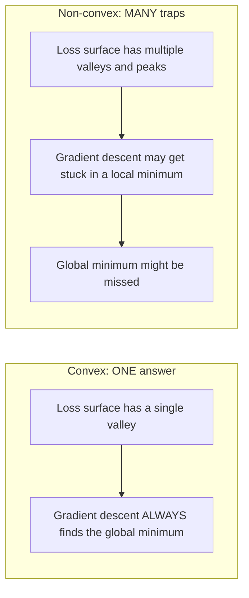
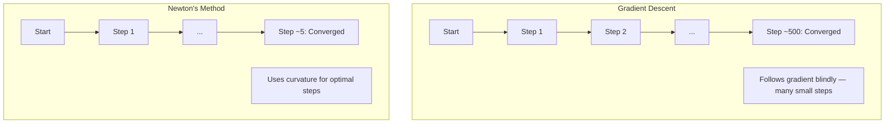
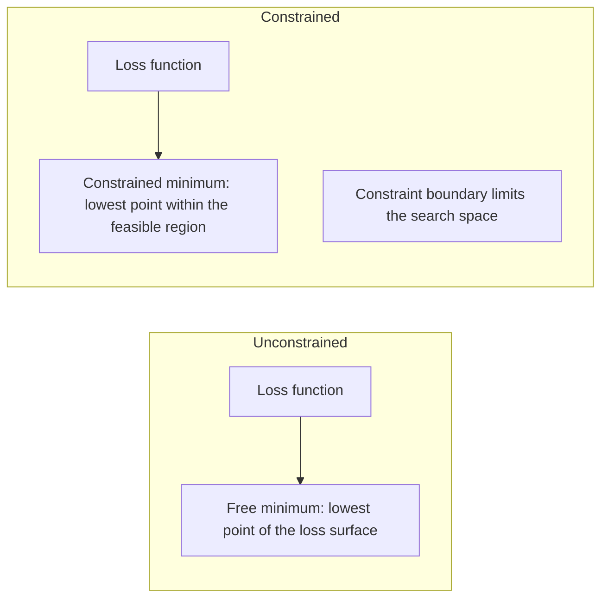
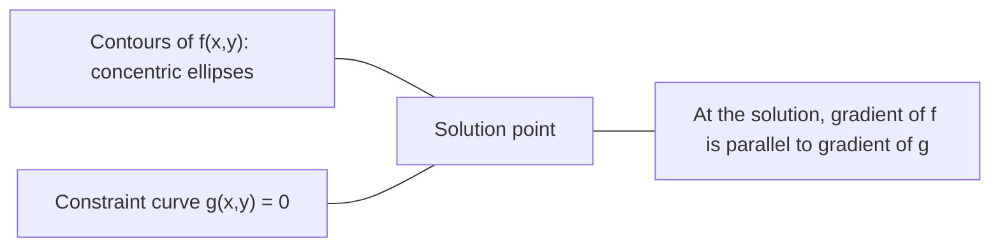

# 볼록 최적화 (Convex Optimization)

> 볼록 최적화 문제에는 골짜기가 하나뿐입니다. 신경망에는 수백만 개가 존재합니다. 그 차이를 아는 것이 중요합니다.

**유형:** Build (실습)
**Language:** Python
**선수 레슨:** Phase 1, Lessons 04 (Calculus for ML), 08 (Optimization)
**소요 시간:** ~90분

## 학습 목표

- 정의, 이계도함수, 헤세 행렬(Hessian matrix) 판정법을 사용하여 함수가 볼록한지 검정합니다.
- 뉴턴 방법(Newton's method)을 구현하고 경사 하강법(gradient descent)과의 이차 수렴(quadratic convergence) 속도를 비교합니다.
- 라그랑주 승수법(Lagrange multipliers)을 사용하여 제약 조건이 있는 최적화 문제를 풀고 KKT 조건을 해석합니다.
- 신경망 손실 지형(loss landscape)이 비볼록(non-convex)함에도 SGD가 여전히 우수한 해를 찾아내는 이유를 설명합니다.

## 문제 인식

레슨 08에서는 경사 하강법, 모멘텀(momentum), Adam을 다루었습니다. 이러한 옵티마이저는 어떤 곡면에서든 내리막 방향으로 이동합니다. 그러나 수학적인 보장은 없습니다. 비볼록 지형에서의 경사 하강법은 나쁜 국소 최솟값(local minimum)에 도달하거나, 안장점(saddle point)에 갇히거나, 영원히 진동할 수도 있습니다. 그럼에도 신경망이 비볼록 구조이고 다른 대안이 없기 때문에 경사 하강법을 사용해 왔습니다.

하지만 머신러닝의 수많은 문제는 볼록합니다. 선형 회귀(linear regression), 로지스틱 회귀(logistic regression), SVM, LASSO, 리지 회귀(ridge regression) 등이 그 예입니다. 이러한 문제에 대해서는 더 강력한 접근법, 즉 수학적 보장이 수반되는 최적화가 존재합니다. 볼록 문제에는 정확히 하나의 골짜기만 존재합니다. 내리막 방향으로 이동하는 알고리즘은 누구나 전역 최솟값(global minimum)에 도달합니다. 재시작도, 학습률 스케줄도, 기도도 필요하지 않습니다.

볼록성(convexity)을 이해하면 세 가지 이점이 있습니다. 첫째, 문제가 쉬운지(볼록한지) 어려운지(비볼록한지) 구별할 수 있습니다. 둘째, 볼록 문제에 대해 뉴턴 방법과 같은 더 빠른 도구를 활용할 수 있습니다. 셋째, 제약 조건으로서의 규제화(regularization), SVM의 쌍대성(duality), 그리고 볼록성이 제공하는 모든 훌륭한 성질을 깨뜨리는데도 딥러닝이 잘 작동하는 이유 등 ML 전반에 등장하는 핵심 개념들을 설명할 수 있습니다.

## 개념

### 볼록 집합 (Convex sets)

집합 $S$ 내의 임의의 두 점을 잇는 선분이 온전히 $S$ 안에 포함될 때, 집합 $S$를 볼록 집합이라고 합니다.

| 볼록 집합 | 비볼록 집합 |
|---|---|
| **직사각형**: 내부의 임의의 두 점을 연결하는 선분이 항상 내부에 머무름 | **별/초승달 모양**: 내부의 두 점을 연결하는 선분이 집합 외부를 지나갈 수 있음 |
| **삼각형**: 모든 내부 점에 대해 동일한 성질이 성립함 | **도넛/원환(annulus)**: 구멍으로 인해 일부 선분이 집합을 벗어남 |
| 임의의 두 점 사이의 선분이 집합 내에 머무름 | 특정 두 점 사이의 선분이 집합을 벗어남 |

수학적 정의: $S$에 속한 임의의 점 $x, y$과 임의의 $t \in [0, 1]$에 대해, 점 $tx + (1-t)y$ 역시 $S$에 속합니다.

볼록 집합의 예:
- 직선, 평면, 전체 공간 $\mathbb{R}^n$
- 공(원, 구, 초구)
- 반공간(halfspace): $\lbrace x : a^T x \le b \rbrace$
- 볼록 집합들의 임의의 개수 교집합

비볼록 집합의 예:
- 도넛(원환)
- 서로소인 두 원의 합집합
- "찌그러짐"이나 "구멍"이 있는 모든 집합

### 볼록 함수 (Convex functions)

함수 $f$의 정의역(domain)이 볼록 집합이고, 정의역 내의 임의의 두 점 $x, y$과 임의의 $t \in [0, 1]$에 대해 다음이 성립할 때 볼록 함수라고 합니다.

```math
f(tx + (1-t)y) \le t f(x) + (1-t) f(y)
```

기하학적 의미: 그래프 상의 임의의 두 점을 잇는 선분은 항상 그래프보다 위쪽에 있거나 그래프와 겹칩니다.

| 성질 | 볼록 함수 | 비볼록 함수 |
|---|---|---|
| **선분 판정법** | 그래프 상의 임의의 두 점을 잇는 선분이 곡선의 **위쪽 또는 곡선 상에** 위치함 | 그래프 상의 일부 점들을 잇는 선분이 곡선 **아래로** 내려감 |
| **형태** | 위로 굽은 단 하나의 그릇/골짜기 형태 | 곡률이 혼재된 여러 봉우리와 골짜기 형태 |
| **국소 최솟값** | 모든 국소 최솟값이 곧 전역 최솟값임 | 서로 다른 높이를 갖는 여러 국소 최솟값이 존재할 수 있음 |

대표적인 볼록 함수:
- $f(x) = x^2$ (포물선)
- $f(x) = \lvert x \rvert$ (절댓값)
- $f(x) = e^x$ (지수 함수)
- $f(x) = \max(0, x)$ (ReLU, 구분적 선형 함수이지만 볼록함)
- $x > 0$일 때 $f(x) = -\log(x)$ (음의 로그 함수)
- 임의의 선형 함수 $f(x) = a^T x + b$ (볼록 함수인 동시에 오목 함수)

### 볼록성 판정법

가장 쉬운 방법부터 가장 엄밀한 방법까지 세 가지 실용적인 판정법이 있습니다.

**판정법 1: 이계도함수 판정법 (1차원).** 모든 $x$에 대해 $f''(x) \ge 0$이면, $f$는 볼록 함수입니다.

- $f(x) = x^2$: $f''(x) = 2 \ge 0$. 볼록 함수.
- $f(x) = x^3$: $f''(x) = 6x$. $x < 0$에 대해 음수. 볼록 함수 아님.
- $f(x) = e^x$: $f''(x) = e^x > 0$. 볼록 함수.

**판정법 2: 헤세 행렬 판정법 (다변수).** 모든 $x$에 대해 헤세 행렬 $H(x)$이 양의 준정부호(positive semidefinite)이면, $f$는 볼록 함수입니다. 헤세 행렬은 2계 편도함수로 구성된 행렬입니다.

**판정법 3: 정의 기반 판정법.** 부등식 $f(tx + (1-t)y) \le t f(x) + (1-t) f(y)$을 직접 확인합니다. 도함수를 계산하기 어려운 함수에 유용합니다.

### 볼록성이 중요한 이유

볼록 최적화의 핵심 정리:

**볼록 함수에서는 모든 국소 최솟값이 곧 전역 최솟값입니다.**

이는 경사 하강법이 함정에 빠질 수 없음을 의미합니다. 내리막으로 이어지는 모든 경로는 동일한 해로 향합니다. 알고리즘은 최적해로 수렴함이 보장됩니다.



이에 따른 결과:
- 무작위 재시작(random restarts)이 필요 없음
- 정교한 학습률 스케줄이 필요 없음
- 수렴성 증명이 가능함 (수렴 속도는 함수의 성질에 따라 다름)
- 해가 유일함 (평평한 영역 제외)

### 머신러닝에서의 볼록 문제 vs 비볼록 문제

| 문제 | 볼록성 여부 | 이유 |
|---------|---------|-----|
| 선형 회귀 (MSE) | 예 | 손실이 가중치에 대해 이차 형태임 |
| 로지스틱 회귀 | 예 | 로그 손실(log-loss)이 가중치에 대해 볼록함 |
| SVM (힌지 손실) | 예 | 선형 함수들의 최댓값 형태임 |
| LASSO (L1 회귀) | 예 | 볼록 함수들의 합은 볼록함 |
| 리지 회귀 (L2) | 예 | 이차식 + 이차식 = 볼록함 |
| 신경망 (모든 손실) | 아니오 | 비선형 활성화 함수가 비볼록 지형을 형성함 |
| k-평균 군집화(k-means clustering) | 아니오 | 이산적인 할당 단계가 존재함 |
| 행렬 분해(Matrix factorization) | 아니오 | 미지수들의 곱 형태임 |

볼록 손실을 갖는 선형 모델은 볼록합니다. 비선형 활성화 함수를 가진 은닉층을 추가하는 순간 볼록성은 깨집니다.

### 헤세 행렬 (The Hessian matrix)

함수 $f: \mathbb{R}^n \to \mathbb{R}$의 헤세 행렬 $H$은 2계 편도함수로 이루어진 $n \times n$ 행렬입니다.

```math
H_{ij} = \frac{\partial^2 f}{\partial x_i \, \partial x_j}
```

$f(x, y) = x^2 + 3xy + y^2$의 경우:

```math
\begin{gathered}
\begin{aligned}
\frac{\partial f}{\partial x} &= 2x + 3y & \frac{\partial^2 f}{\partial x^2} &= 2 & \frac{\partial^2 f}{\partial x \, \partial y} &= 3 \\
\frac{\partial f}{\partial y} &= 3x + 2y & \frac{\partial^2 f}{\partial y \, \partial x} &= 3 & \frac{\partial^2 f}{\partial y^2} &= 2
\end{aligned} \\[8pt]
H = \begin{bmatrix} 2 & 3 \\ 3 & 2 \end{bmatrix}
\end{gathered}
```

헤세 행렬은 곡률에 대한 정보를 제공합니다.
- 고윳값(eigenvalue)이 모두 양수: 함수가 모든 방향으로 위를 향해 굽어 있음 (해당 지점에서 볼록함)
- 고윳값이 모두 음수: 모든 방향으로 아래를 향해 굽어 있음 (오목함, 국소 최댓값)
- 부호가 혼재됨: 안장점 (일부 방향으로는 위로 굽고, 다른 방향으로는 아래로 굽음)
- 고윳값이 0: 해당 방향으로 평평함 (퇴화(degenerate) 상태)

볼록성이 성립하려면 헤세 행렬이 특정 한 지점에서만이 아니라 모든 지점에서 양의 준정부호(모든 고윳값 $\ge 0$)를 만족해야 합니다.
### 뉴턴 방법(Newton's method)

경사 하강법(gradient descent)은 1차 정보(그래디언트)를 사용합니다. 뉴턴 방법은 2차 정보(헤시안, Hessian)를 사용합니다. 현재 지점에서 2차 근사를 적용하고, 해당 2차 함수의 최솟값으로 곧바로 이동합니다.

```math
\begin{aligned}
\text{Update rule:} \quad & x_{\text{new}} = x - H^{-1} \cdot \text{gradient} \\
\text{Compare to gradient descent:} \quad & x_{\text{new}} = x - \text{lr} \cdot \text{gradient}
\end{aligned}
```

뉴턴 방법은 스칼라 학습률(learning rate)을 헤시안의 역행렬로 대체합니다. 이를 통해 국소 곡률(local curvature)에 따라 보폭과 방향을 자동으로 조절합니다.



장점:
- 최솟값 근처에서 2차 수렴(quadratic convergence) (단계마다 오차가 제곱으로 감소)
- 조정할 학습률이 없음
- 척도 불변성(scale-invariant) (문제를 어떻게 매개변수화하든 관계없이 작동)

단점:
- 헤시안을 계산하는 데 $O(n^2)$의 메모리가 들고 역행렬 계산에 $O(n^3)$의 비용이 발생
- 가중치가 100만 개인 신경망의 경우, $10^{12}$개의 원소와 $10^{18}$번의 연산에 해당
- 딥러닝에는 실용적이지 않음

### 제약 조건이 있는 최적화(Constrained optimization)

제약 조건 없는 최적화: 모든 $x$에 대해 $f(x)$를 최소화합니다.
제약 조건이 있는 최적화: 제약 조건을 만족하면서 $f(x)$를 최소화합니다.

실제 문제는 제약 조건을 갖습니다. 비용을 최소화하고 싶지만 예산은 한정되어 있습니다. 오차를 최소화하고 싶지만 모델 복잡도에는 한계가 있습니다.



### 라그랑주 승수법(Lagrange multipliers)

라그랑주 승수법은 제약 조건이 있는 문제를 제약 조건이 없는 문제로 변환합니다.

문제: $g(x) = 0$ 제약 조건 하에서 $f(x)$ 최소화.

해결 방법: 새로운 변수(라그랑주 승수 $\lambda$)를 도입하고 제약 조건 없는 문제를 풉니다.

```math
L(x, \lambda) = f(x) + \lambda g(x)
```

해(solution)에서 $L$의 그래디언트는 0이 됩니다.

```math
\begin{aligned}
\frac{\partial L}{\partial x} &= \frac{\partial f}{\partial x} + \lambda \frac{\partial g}{\partial x} = 0 \\
\frac{\partial L}{\partial \lambda} &= g(x) = 0
\end{aligned}
```

기하학적 직관: 제약 조건이 적용된 최솟값에서 $f$의 그래디언트는 제약 조건 $g$의 그래디언트와 평행해야 합니다. 평행하지 않다면 제약 조건 곡면을 따라 이동하면서 $f$를 더 줄일 수 있기 때문입니다.



예제: $x + y = 1$ 제약 조건 하에서 $f(x,y) = x^2 + y^2$ 최소화.

```math
\begin{aligned}
L &= x^2 + y^2 + \lambda(x + y - 1) \\[4pt]
\frac{\partial L}{\partial x} &= 2x + \lambda = 0 \implies x = -\lambda/2 \\
\frac{\partial L}{\partial y} &= 2y + \lambda = 0 \implies y = -\lambda/2 \\
\frac{\partial L}{\partial \lambda} &= x + y - 1 = 0 \\[4pt]
&\text{From first two: } x = y \\
&\text{Substituting: } 2x = 1, \text{ so } x = y = 0.5, \ \lambda = -1
\end{aligned}
```

직선 $x + y = 1$ 위에서 원점과 가장 가까운 점은 $(0.5, 0.5)$입니다.

### KKT 조건(KKT conditions)

카루시-쿤-터커(Karush-Kuhn-Tucker, KKT) 조건은 라그랑주 승수법을 부등식 제약 조건으로 확장합니다.

문제: $i = 1, \ldots, m$에 대해 $g_i(x) \le 0$ 제약 조건 하에서 $f(x)$ 최소화.

KKT 조건(최적성의 필요조건):

```math
\begin{aligned}
&\text{1. Stationarity:} && \frac{\partial f}{\partial x} + \sum_i \lambda_i \frac{\partial g_i}{\partial x} = 0 \\
&\text{2. Primal feasibility:} && g_i(x) \le 0 \quad \text{for all } i \\
&\text{3. Dual feasibility:} && \lambda_i \ge 0 \quad \text{for all } i \\
&\text{4. Complementary slackness:} && \lambda_i \, g_i(x) = 0 \quad \text{for all } i
\end{aligned}
```

상보 슬랙성(Complementary slackness)이 핵심 통찰입니다. 제약 조건이 활성화(active)되어 있거나($g_i = 0$, 해가 경계면에 위치함), 승수가 0이어야 합니다(제약 조건이 영향을 미치지 않음). 해에 영향을 주지 않는 제약 조건은 $\lambda = 0$을 갖습니다.

KKT 조건은 SVM의 핵심입니다. 서포트 벡터는 제약 조건이 활성화된($\lambda > 0$) 데이터 포인트입니다. 그 밖의 모든 데이터 포인트는 $\lambda = 0$이며 결정 경계에 영향을 미치지 않습니다.

### 제약 조건 최적화로서의 규제

L1 및 L2 규제(regularization)는 임의로 고안된 기법이 아닙니다. 이들은 형태를 바꾼 제약 조건 최적화 문제입니다.

**L2 규제(Ridge):**

```math
\begin{aligned}
&\text{minimize } \text{Loss}(w) \text{ subject to } \lVert w \rVert^2 \le t \\[4pt]
&\text{Equivalent unconstrained form:} \\
&\text{minimize } \text{Loss}(w) + \lambda \lVert w \rVert^2
\end{aligned}
```

제약 조건 $\lVert w \rVert^2 \le t$는 볼(ball, 2차원에서는 원, 3차원에서는 구)을 정의합니다. 해는 손실 등고선(loss contour)이 이 볼과 처음 접하는 지점입니다.

**L1 규제(LASSO):**

```math
\begin{aligned}
&\text{minimize } \text{Loss}(w) \text{ subject to } \lVert w \rVert_1 \le t \\[4pt]
&\text{Equivalent unconstrained form:} \\
&\text{minimize } \text{Loss}(w) + \lambda \lVert w \rVert_1
\end{aligned}
```

제약 조건 $\lVert w \rVert_1 \le t$는 다이아몬드 형태(2차원에서는 회전된 정사각형)를 정의합니다.

| 특성 | L2 제약 조건 (원) | L1 제약 조건 (다이아몬드) |
|---|---|---|
| **제약 조건 형태** | 원 (고차원에서는 구) | 다이아몬드 (2차원에서는 회전된 정사각형) |
| **손실 등고선이 접하는 지점** | 매끄러운 경계 — 원 위의 임의의 점 | 꼭짓점 — 축과 정렬됨 |
| **해의 특성** | 가중치가 작지만 0은 아님 | 일부 가중치가 정확히 0이 됨 (희소성) |
| **결과** | 가중치 축소(shrinkage) | 특성 선택(feature selection) |

이는 L2가 가중치를 축소하기만 하는 반면, L1이 희소(sparse) 모델을 만들어내는(특성 선택) 이유를 설명해 줍니다. 다이아몬드 형태는 축과 정렬된 꼭짓점을 갖습니다. 손실 등고선은 꼭짓점에 접할 가능성이 더 높으며, 이에 따라 하나 이상의 가중치가 정확히 0이 됩니다.

### 쌍대성(Duality)

모든 제약 조건 최적화 문제(원문제, primal)에는 짝이 되는 문제(쌍대문제, dual)가 존재합니다. 볼록(convex) 문제의 경우 원문제와 쌍대문제는 동일한 최적값을 갖습니다. 이를 강한 쌍대성(strong duality)이라고 합니다.

라그랑주 쌍대 함수:

```math
\begin{aligned}
&\text{Primal:} && \text{minimize } f(x) \text{ subject to } g(x) \le 0 \\
&\text{Lagrangian:} && L(x, \lambda) = f(x) + \lambda g(x) \\
&\text{Dual function:} && d(\lambda) = \min_x L(x, \lambda) \\
&\text{Dual problem:} && \text{maximize } d(\lambda) \text{ subject to } \lambda \ge 0
\end{aligned}
```

쌍대성이 중요한 이유:
- 때로는 쌍대문제가 원문제보다 풀기 쉽습니다.
- SVM은 쌍대 형식으로 풀리며, 이때 문제가 데이터 포인트 간의 내적에 의존하게 되므로 커널 트릭(kernel trick)의 적용이 가능해집니다.
- 쌍대문제는 원문제 최적값의 하한(lower bound)을 제공하므로, 해의 품질을 확인하는 데 유용합니다.

특히 SVM의 경우:

```
Primal: find w, b that maximize the margin 2/||w|| subject to
        y_i(w^T x_i + b) >= 1 for all i

Dual:   maximize sum(alpha_i) - 0.5 * sum_ij(alpha_i * alpha_j * y_i * y_j * x_i^T x_j)
        subject to alpha_i >= 0 and sum(alpha_i * y_i) = 0

The dual only involves dot products x_i^T x_j.
Replace x_i^T x_j with K(x_i, x_j) to get the kernel trick.
```

### 비볼록성에도 불구하고 딥러닝이 잘 작동하는 이유

신경망의 손실 함수는 극도로 비볼록(non-convex)합니다. 고전적인 관점의 기준으로는 이러한 함수를 최적화하는 것이 실패해야 마땅합니다. 하지만 확률적 경사 하강법(SGD)은 안정적으로 좋은 해를 찾아냅니다. 몇 가지 요인이 이를 설명합니다.

**대부분의 국소 최솟값은 충분히 좋습니다.** 고차원 공간에서 무작위 임계점(critical point, 그래디언트가 0인 지점)은 국소 최솟값이 아니라 안장점(saddle point)일 확률이 압도적으로 높습니다. 드물게 존재하는 국소 최솟값들도 전역 최솟값(global minimum)에 가까운 손실값을 갖는 경향이 있습니다. 매개변수 공간이 수백만 차원에 달할 때 끔찍하게 나쁜 국소 최솟값에 갇힐 확률은 극히 낮습니다.

**진짜 장애물은 국소 최솟값이 아니라 안장점입니다.** $n$개의 매개변수를 가진 함수에서 안장점은 양의 곡률과 음의 곡률 방향이 섞여 있습니다. 고차원의 무작위 임계점에서 $n$개의 모든 고윳값이 양수(국소 최솟값)일 확률은 대략 $2^{-n}$에 불과합니다. 거의 모든 임계점은 안장점입니다. SGD의 노이즈는 이러한 안장점을 벗어나는 데 도움을 줍니다.

**과잉 매개변수화(overparameterization)는 손실 곡면을 완만하게 만듭니다.** 훈련 데이터 수보다 매개변수가 더 많은 신경망은 손실 곡면이 더 매끄럽고 서로 잘 연결되어 있습니다. 더 넓은(wider) 신경망일수록 나쁜 국소 최솟값이 적습니다. 이는 직관에 반하지만 경험적으로 일관되게 확인되는 사실입니다.

**손실 곡면 구조:**

| 특성 | 저차원 공간 | 고차원 공간 |
|---|---|---|
| **곡면(Landscape)** | 고립된 봉우리와 골짜기가 많음 | 매끄럽게 연결된 골짜기 |
| **최솟값** | 고립된 국소 최솟값이 많음 | 나쁜 국소 최솟값이 드묾, 대부분 준최적(near-optimal) |
| **탐색** | 전역 최솟값을 찾기 어려움 | 많은 경로가 좋은 해로 이어짐 |
| **임계점** | 국소 최솟값과 안장점이 혼재 | 국소 최솟값이 아닌 안장점이 압도적임 |

**확률적 노이즈는 암묵적 규제(implicit regularization) 역할을 합니다.** 미니배치 SGD가 유발하는 노이즈는 날카로운 최솟값(sharp minima)에 안착하는 것을 방지합니다. 날카로운 최솟값은 과적합(overfitting)되기 쉽고, 평탄한 최솟값(flat minima)은 일반화 성능이 좋습니다. 이 노이즈는 손실 곡면의 평탄한 영역 쪽으로 최적화 과정을 유도합니다.
### 실무에서의 2차 방법

순수 뉴턴 방법(Newton's method)은 대규모 모델에서 실용적이지 않습니다. 몇 가지 근사 기법을 통해 2차 정보를 실용적으로 활용할 수 있습니다.

**L-BFGS (Limited-memory BFGS):** 최근 $m$개의 기울기 차이를 사용하여 역 헤시안을 근사합니다. $O(n^2)$ 대신 $O(mn)$의 메모리가 필요합니다. 최대 약 10,000개의 파라미터를 갖는 문제에서 잘 작동합니다. 고전적인 머신러닝(로지스틱 회귀, CRF)에서 사용되지만 딥러닝에서는 사용되지 않습니다.

**자연 기울기(Natural gradient):** 표준 헤시안 대신 피셔 정보 행렬(로그 우도의 기댓값 헤시안)을 사용합니다. 이는 확률 분포의 기하학적 구조를 고려합니다. K-FAC (Kronecker-Factored Approximate Curvature)은 피셔 행렬을 크로네커 곱으로 근사하여 신경망에서 실용적으로 사용할 수 있게 합니다.

**헤시안 프리 최적화(Hessian-free optimization):** $H$을 직접 구성하지 않고 켤레 기울기법(conjugate gradient)을 사용하여 $Hx = g$를 풉니다. 헤시안-벡터 곱만 필요하며, 이는 자동 미분(automatic differentiation)을 통해 $O(n)$ 시간 내에 계산할 수 있습니다.

**대각 근사(Diagonal approximations):** Adam의 2차 모멘트는 헤시안 대각 성분에 대한 대각 근사입니다. AdaHessian은 허친슨 추정량(Hutchinson's estimator)을 통해 실제 헤시안 대각 원소를 사용하여 이를 확장합니다.

| 방법 | 메모리 | 스텝당 비용 | 사용 시점 |
|--------|--------|--------------|-------------|
| 경사 하강법 | $O(n)$ | $O(n)$ | 베이스라인, 대규모 모델 |
| 뉴턴 방법 | $O(n^2)$ | $O(n^3)$ | 소규모 볼록 문제 |
| L-BFGS | $O(mn)$ | $O(mn)$ | 중규모 볼록 문제 |
| Adam | $O(n)$ | $O(n)$ | 딥러닝 기본값 |
| K-FAC | $O(n)$ | $O(n)$ (레이어당) | 연구, 대규모 배치 학습 |

```figure
convex-vs-nonconvex
```

## 직접 구현해 보기

### 1단계: 볼록성 검사기

점을 샘플링하고 정의를 확인하여 볼록성을 경험적으로 검증하는 함수를 작성합니다.

```python
import random
import math

def check_convexity(f, dim, bounds=(-5, 5), samples=1000):
    violations = 0
    for _ in range(samples):
        x = [random.uniform(*bounds) for _ in range(dim)]
        y = [random.uniform(*bounds) for _ in range(dim)]
        t = random.uniform(0, 1)
        mid = [t * xi + (1 - t) * yi for xi, yi in zip(x, y)]
        lhs = f(mid)
        rhs = t * f(x) + (1 - t) * f(y)
        if lhs > rhs + 1e-10:
            violations += 1
    return violations == 0, violations
```

### 2단계: 2D 뉴턴 방법

명시적 헤시안을 사용하여 뉴턴 방법을 구현합니다. 경사 하강법과 수렴 속도를 비교합니다.

```python
def newtons_method(f, grad_f, hessian_f, x0, steps=50, tol=1e-12):
    x = list(x0)
    history = [x[:]]
    for _ in range(steps):
        g = grad_f(x)
        H = hessian_f(x)
        det = H[0][0] * H[1][1] - H[0][1] * H[1][0]
        if abs(det) < 1e-15:
            break
        H_inv = [
            [H[1][1] / det, -H[0][1] / det],
            [-H[1][0] / det, H[0][0] / det],
        ]
        dx = [
            H_inv[0][0] * g[0] + H_inv[0][1] * g[1],
            H_inv[1][0] * g[0] + H_inv[1][1] * g[1],
        ]
        x = [x[0] - dx[0], x[1] - dx[1]]
        history.append(x[:])
        if sum(gi ** 2 for gi in g) < tol:
            break
    return history
```

### 3단계: 라그랑주 승수법 솔버

라그랑지안(Lagrangian)에 대한 경사 하강법을 사용하여 제약 조건이 있는 최적화 문제를 풉니다.

```python
def lagrange_solve(f_grad, g_val, g_grad, x0, lr=0.01,
                   lr_lambda=0.01, steps=5000):
    x = list(x0)
    lam = 0.0
    history = []
    for _ in range(steps):
        fg = f_grad(x)
        gv = g_val(x)
        gg = g_grad(x)
        x = [
            xi - lr * (fgi + lam * ggi)
            for xi, fgi, ggi in zip(x, fg, gg)
        ]
        lam = lam + lr_lambda * gv
        history.append((x[:], lam, gv))
    return history
```

### 4단계: 1차 방법과 2차 방법 비교

동일한 이차 함수에 대해 경사 하강법과 뉴턴 방법을 실행합니다. 수렴할 때까지의 스텝 수를 계산합니다.

```python
def quadratic(x):
    return 5 * x[0] ** 2 + x[1] ** 2

def quadratic_grad(x):
    return [10 * x[0], 2 * x[1]]

def quadratic_hessian(x):
    return [[10, 0], [0, 2]]
```

뉴턴 방법은 1스텝 만에 수렴합니다(이차 함수에 대해 정확한 해를 구하기 때문입니다). 반면 경사 하강법은 헤시안의 고윳값(eigenvalue)이 5배 차이 나면서 길쭉한 골짜기가 형성되므로 수렴하는 데 수백 스텝이 걸립니다.

## 실전 활용

볼록성 분석은 머신러닝 모델과 솔버를 선택할 때 직접적으로 적용됩니다.

볼록 문제(로지스틱 회귀, SVM, LASSO)의 경우:
- 전용 솔버(liblinear, CVXPY, method='L-BFGS-B' 옵션의 scipy.optimize.minimize)를 사용합니다.
- 유일한 전역 해(global solution)를 기대할 수 있습니다.
- 2차 방법이 실용적이고 빠릅니다.

비볼록 문제(신경망)의 경우:
- 1차 방법(SGD, Adam)을 사용합니다.
- 해가 초기화 및 무작위성에 의존한다는 점을 수용해야 합니다.
- 과매개변수화(overparameterization), 노이즈, 학습률 스케줄을 암묵적 정규화(implicit regularization)로 활용합니다.
- 전역 최솟값을 찾는 데 시간을 낭비하지 마십시오. 적절한 국소 최솟값(local minimum)으로도 충분합니다.

```python
from scipy.optimize import minimize

result = minimize(
    fun=lambda w: sum((y - X @ w) ** 2) + 0.1 * sum(w ** 2),
    x0=np.zeros(d),
    method='L-BFGS-B',
    jac=lambda w: -2 * X.T @ (y - X @ w) + 0.2 * w,
)
```

SVM의 경우 쌍대 형태(dual formulation)를 통해 커널 트릭(kernel trick)을 사용할 수 있습니다.

```python
from sklearn.svm import SVC

svm = SVC(kernel='rbf', C=1.0)
svm.fit(X_train, y_train)
print(f"Support vectors: {svm.n_support_}")
```

## 연습 문제

1. **볼록성 갤러리.** 검사기를 사용하여 다음 함수의 볼록성을 테스트합니다: $f(x) = x^4$, $f(x) = \sin(x)$, $f(x,y) = x^2 + y^2$, $f(x,y) = xy$, $f(x) = \max(x, 0)$. 각 결과가 왜 타당한지 설명하십시오.

2. **뉴턴 방법 대 경사 하강법 경쟁.** 시작점 $(10, 10)$에서 $f(x,y) = 50x^2 + y^2$에 대해 두 방법을 모두 실행합니다. 손실(loss) < 1e-10에 도달하는 데 각각 몇 스텝이 필요한가요? 조건수(condition number, 헤시안의 가장 큰 고윳값과 가장 작은 고윳값의 비)가 증가하면 경사 하강법에는 어떤 현상이 발생하나요?

3. **라그랑주 승수법의 기하학.** $x + 2y = 4$ 제약 조건하에서 $f(x,y) = (x-3)^2 + (y-3)^2$를 최소화합니다. 해에서 $f$의 기울기가 $g$의 기울기와 평행한지 확인하여 해를 검증하십시오.

4. **정규화 제약 조건.** L1 제약 조건 최적화를 구현합니다: $\lvert x \rvert + \lvert y \rvert \le 1$ 제약 조건하에서 $(x-3)^2 + (y-2)^2$을 최소화합니다. 해의 좌표 중 하나가 0이 됨을 보이십시오(다이아몬드 제약 조건으로 인한 희소성(sparsity)).

5. **헤시안 고윳값 분석.** (1,1) 및 (-1,1)에서 로젠브록 함수(Rosenbrock function)의 헤시안을 계산합니다. 두 지점에서 고윳값을 계산하십시오. 최솟값에서의 곡률과 최솟값에서 멀리 떨어진 지점에서의 곡률에 대해 고윳값은 무엇을 알려주나요?

### 힌트

**연습 문제 1.** `check_convexity`을 실행하기 전에 각 결과를 예측해 보십시오. 1차원에서는 $f''(x)$의 부호를 살펴보고, 2차원에서는 헤시안의 고윳값을 살펴봅니다. $f(x,y) = xy$의 경우 헤시안의 고윳값이 1과 -1이므로 검사기는 볼록하지 않다고 보고해야 합니다.

**연습 문제 2.** $f$의 기울기 및 헤시안과 함께 `optimize_gd` 및 `newtons_method`를 호출합니다. 뉴턴 방법은 이차 함수를 1스텝 만에 풉니다. 경사 하강법의 경우 $50x^2$ 항으로 인해 학습률이 $2/100$보다 작아야 하므로, $y$ 방향으로 느리게 이동합니다. $100x^2$에 대해 반복하고 스텝 수를 다시 계산해 보십시오.

**연습 문제 3.** $g(x,y) = x + 2y - 4$와 함께 `lagrange_solve`을 사용합니다. 구한 해에서 $x + 2y = 4$인지, 그리고 $\nabla f = (2(x-3), 2(y-3))$이 $\nabla g = (1, 2)$의 배수인지 확인하십시오.

**연습 문제 4.** 제약 없는 최솟값인 (3, 2)는 다이아몬드 영역 바깥에 있으므로, 해는 경계면 위에 있습니다. 투영 경사 하강법(projected gradient descent)을 사용하십시오: 경사 스텝을 진행한 다음, 다시 $\lvert x \rvert + \lvert y \rvert \le 1$ 위로 투영합니다. 결과가 제약 조건을 등식으로 만족하는지 확인하고 `demo_regularization_geometry`과 비교해 보십시오.

**연습 문제 5.** 각 지점에서 `rosenbrock_hessian`을 호출하고 그 결과를 `hessian_eigenvalues_2d`에 전달합니다. (1, 1)에서는 두 고윳값이 모두 양수이고 비율이 매우 크므로, 골짜기가 한 방향으로는 좁고 다른 방향으로는 완만합니다. 이 비율을 (-1, 1)에서의 비율과 비교해 보십시오.
## 주요 용어 (Key Terms)

| 용어 | 의미 |
|------|---------------|
| 볼록 집합 (Convex set) | 집합 내의 임의의 두 점을 잇는 선분이 항상 집합 내부에 머무르는 집합 |
| 볼록 함수 (Convex function) | 그래프 상의 임의의 두 점을 잇는 선분이 항상 그래프보다 위에 있거나 같은 함수. 헤시안(Hessian)이 모든 곳에서 양의 준정부호(positive semidefinite)인 것과 동치 |
| 국소 최소점 (Local minimum) | 주변의 모든 점보다 낮은 지점. 볼록 함수에서는 모든 국소 최소점이 전역 최소점(global minimum)임 |
| 전역 최소점 (Global minimum) | 함수 전체 정의역에서 가장 낮은 지점 |
| 헤시안 행렬 (Hessian matrix) | 모든 2차 편미분값들로 구성된 행렬. 곡률(curvature) 정보를 인코딩함 |
| 양의 준정부호 (Positive semidefinite) | 모든 고윳값(eigenvalue)이 0 이상인 행렬. "2차 도함수 >= 0"의 다차원적 대응 개념 |
| 조건수 (Condition number) | 헤시안의 최대 고윳값과 최소 고윳값의 비. 조건수가 크면 길게 늘어진 계곡 형태가 되어 경사 하강법(gradient descent)의 수렴 속도가 느려짐 |
| 뉴턴 방법 (Newton's method) | 역헤시안(inverse Hessian)을 사용하여 스텝의 방향과 크기를 결정하는 2차 최적화 기법. 최솟값 근처에서 2차 수렴(quadratic convergence)을 보임 |
| 라그랑주 승수 (Lagrange multiplier) | 제약 조건이 있는 최적화 문제를 제약 조건이 없는 문제로 변환하기 위해 도입하는 변수 |
| KKT 조건 (KKT conditions) | 부등식 제약 조건이 있는 최적화 문제의 최적성에 대한 필요 조건. 라그랑주 승수를 일반화한 것 |
| 상보 여유성 (Complementary slackness) | 해(solution)에서 제약 조건이 활성화(active)되어 있거나, 해당 승수가 0이어야 한다는 조건. 둘 다 0이 아닐 수는 없음 |
| 쌍대성 (Duality) | 모든 제약 조건이 있는 문제는 그에 대응하는 쌍대 문제(dual problem)를 가짐. 볼록 문제에서는 두 문제가 동일한 최적값을 가짐 |
| 강 쌍대성 (Strong duality) | 원 문제(primal)와 쌍대 문제의 최적값이 같은 성질. 슬레이터 조건(Slater's condition)을 만족하는 볼록 문제에서 성립함 |
| L-BFGS | 전체 헤시안 대신 최근 $m$개의 그래디언트 차이를 저장하는 근사 2차 최적화 기법 |
| 안장점 (Saddle point) | 그래디언트가 0이지만 어떤 방향으로는 최솟값이고 다른 방향으로는 최댓값인 지점 |
| 과매개변수화 (Overparameterization) | 학습 예제 수보다 더 많은 매개변수를 사용하는 것. 손실 곡면(loss landscape)을 매끄럽게 만들어 나쁜 국소 최소점을 줄임 |

## 더 읽을거리

- [Boyd & Vandenberghe: Convex Optimization](https://web.stanford.edu/~boyd/cvxbook/) - 온라인에서 무료로 제공되는 표준 교재
- [Bottou, Curtis, Nocedal: Optimization Methods for Large-Scale Machine Learning (2018)](https://arxiv.org/abs/1606.04838) - 볼록 최적화 이론과 딥러닝 실무를 잇는 논문
- [Choromanska et al.: The Loss Surfaces of Multilayer Networks (2015)](https://arxiv.org/abs/1412.0233) - 다층 신경망의 비볼록(non-convex) 손실 곡면이 생각만큼 나쁘지 않은 이유를 다룬 논문
- [Nocedal & Wright: Numerical Optimization](https://link.springer.com/book/10.1007/978-0-387-40065-5) - 뉴턴 방법, L-BFGS, 제약 조건 최적화에 대한 포괄적인 참고서
