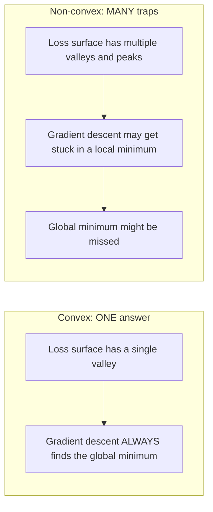
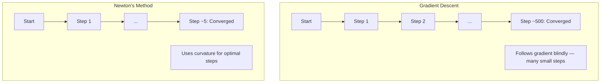
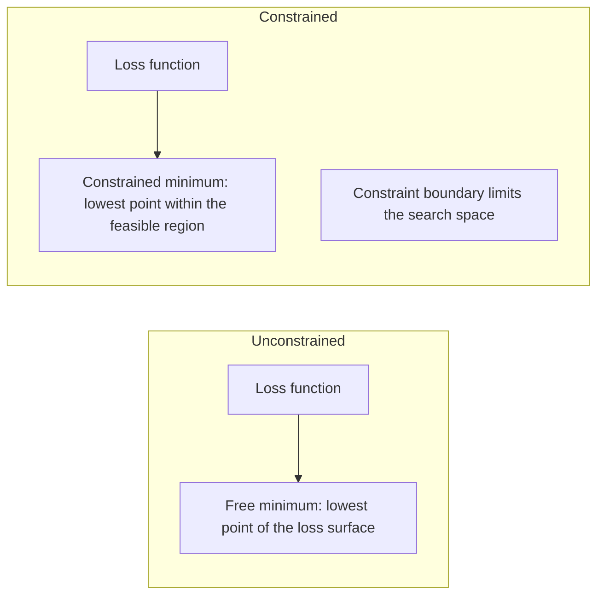
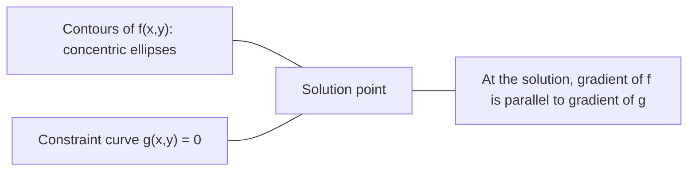

# 볼록 최적화 (Convex Optimization)

> 볼록 문제에는 하나의 계곡만 존재합니다. 신경망에는 수백만 개가 존재합니다. 그 차이를 아는 것이 중요합니다.

**유형:** Build (실습)
**Language:** Python
**선수 레슨:** Phase 1, Lessons 04 (Calculus for ML), 08 (Optimization)
**소요 시간:** ~90분

## 학습 목표

- 정의, 이계도함수, 헤시안(Hessian) 판정법을 사용하여 함수가 볼록(convex)한지 판별합니다.
- 뉴턴 방법(Newton's method)을 구현하고 경사 하강법과 비교하여 2차 수렴(quadratic convergence) 특성을 확인합니다.
- 라그랑주 승수법(Lagrange multipliers)을 사용하여 제약 조건이 있는 최적화 문제를 해결하고 KKT 조건을 해석합니다.
- 신경망의 손실 곡면(loss landscape)이 비볼록(non-convex)함에도 SGD가 여전히 우수한 해를 찾는 이유를 설명합니다.

## 문제 배경

레슨 08에서는 경사 하강법, 모멘텀, Adam을 다루었습니다. 이러한 옵티마이저들은 어떤 곡면에서든 내리막을 따라 이동합니다. 하지만 수학적 보장은 제공되지 않습니다. 비볼록 곡면에서의 경사 하강법은 나쁜 국소 최솟값(local minimum)에 도달하거나, 안장점(saddle point)에 갇히거나, 영원히 진동할 수도 있습니다. 신경망이 비볼록하며 다른 대안이 없기 때문에 그럼에도 이를 사용해 온 것입니다.

하지만 머신러닝의 수많은 문제는 볼록합니다. 선형 회귀, 로지스틱 회귀, SVM, LASSO, 리지(ridge) 회귀 등이 그렇습니다. 이러한 문제에는 수학적 보장이 있는 강력한 최적화 방법이 존재합니다. 볼록 문제에는 정확히 단 하나의 계곡만 있습니다. 내리막을 따라 걷는 모든 알고리즘은 전역 최솟값(global minimum)에 도달합니다. 무작위 재시작(restart)도 필요 없습니다. 복잡한 학습률 스케줄도 필요 없습니다. 기도할 필요도 없습니다.

볼록성을 이해하면 세 가지 이점이 있습니다. 첫째, 문제가 쉬운지(볼록한지) 어려운지(비볼록한지) 파악할 수 있습니다. 둘째, 볼록 문제에 대해 뉴턴 방법과 같은 훨씬 빠른 도구를 활용할 수 있습니다. 셋째, 제약 조건으로서의 정규화, SVM의 쌍대성(duality), 그리고 볼록성이 주는 모든 이상적인 특성을 위반함에도 딥러닝이 잘 작동하는 이유 등 ML 전반에 등장하는 핵심 개념들을 명확히 이해할 수 있습니다.

## 핵심 개념

### 볼록 집합 (Convex sets)

집합 S 내의 임의의 두 점에 대해, 두 점을 잇는 선분이 온전히 S 내에 포함될 때 집합 S를 볼록하다고 합니다.

| 볼록 집합 | 비볼록 집합 |
|---|---|
| **직사각형**: 내부의 임의의 두 점을 잇는 선분은 항상 내부에 머뭅니다 | **별/초승달 모양**: 내부의 두 점을 잇는 선분이 집합 외부를 통과할 수 있습니다 |
| **삼각형**: 모든 내부 점에 대해 동일한 성질이 성립합니다 | **도넛/원환(annulus)**: 중앙의 구멍으로 인해 일부 선분이 집합을 벗어납니다 |
| 임의의 두 점 사이의 선분이 집합 내에 머뭅니다 | 특정 점 쌍 사이의 선분이 집합 외부로 나갑니다 |

수학적 정의: 집합 S 내의 임의의 점 x, y와 [0, 1] 범위의 임의의 t에 대해, tx + (1-t)y 역시 S에 속합니다.

볼록 집합의 예:
- 직선, 평면, R^n 공간 전체
- 볼(ball, 원, 구, 초구)
- 반공간(halfspace): {x : a^T x <= b}
- 임의의 개수의 볼록 집합들의 교집합

비볼록 집합의 예:
- 도넛(원환)
- 서로 분리된 두 원의 합집합
- "찌그러진 부분"이나 "구멍"이 있는 모든 집합

### 볼록 함수 (Convex functions)

함수 f의 정의역이 볼록 집합이고, 정의역 내의 임의의 두 점 x, y와 [0, 1] 범위의 임의의 t에 대해 다음이 성립할 때 f를 볼록 함수라고 합니다.

```
f(tx + (1-t)y) <= t*f(x) + (1-t)*f(y)
```

기하학적 의미: 함수 그래프 위의 임의의 두 점을 잇는 선분은 항상 그래프보다 위쪽에 있거나 그래프와 겹칩니다.

| 특성 | 볼록 함수 | 비볼록 함수 |
|---|---|---|
| **선분 판정법** | 그래프 위 두 점 사이의 선분이 곡선 **위 또는 곡선상**에 위치함 | 그래프 위 일부 점 사이의 선분이 곡선 **아래**로 내려감 |
| **형태** | 위로 굽어 있는 단 하나의 그릇/계곡 형태 | 여러 개의 봉우리와 계곡이 혼재된 곡률을 가짐 |
| **국소 최솟값** | 모든 국소 최솟값이 곧 전역 최솟값임 | 서로 다른 높이에 여러 국소 최솟값이 존재할 수 있음 |

대표적인 볼록 함수:
- f(x) = x^2 (포물선)
- f(x) = |x| (절댓값)
- f(x) = e^x (지수 함수)
- f(x) = max(0, x) (ReLU, 구간별 선형 함수임에도 볼록함)
- f(x) = -log(x) (x > 0 구간의 음의 로그)
- 임의의 선형 함수 f(x) = a^T x + b (볼록 함수인 동시에 오목 함수)

### 볼록성 판정법

가장 쉬운 방법부터 가장 엄밀한 방법까지 3가지 실용적인 판정법이 있습니다.

**판정법 1: 이계도함수 판정법 (1차원).** 모든 x에 대해 f''(x) >= 0이면, f는 볼록합니다.

- f(x) = x^2: f''(x) = 2 >= 0. 볼록함.
- f(x) = x^3: f''(x) = 6x. x < 0일 때 음수. 볼록하지 않음.
- f(x) = e^x: f''(x) = e^x > 0. 볼록함.

**판정법 2: 헤시안 판정법 (다변수).** 모든 x에 대해 헤시안 행렬 H(x)가 양의 준정부호(positive semidefinite)이면, f는 볼록합니다. 헤시안은 2계 편도함수로 이루어진 행렬입니다.

**판정법 3: 정의에 의한 판정법.** f(tx + (1-t)y) <= t*f(x) + (1-t)*f(y) 부등식을 직접 검증합니다. 도함수를 계산하기 어려운 함수에 유용합니다.

### 볼록성이 중요한 이유

볼록 최적화의 핵심 정리:

**볼록 함수에서는 모든 국소 최솟값이 전역 최솟값입니다.**

이는 경사 하강법이 함정에 빠질 수 없음을 의미합니다. 내리막으로 이어지는 어떤 경로를 따라가도 동일한 해에 도달합니다. 알고리즘은 최적해로 수렴함이 보장됩니다.



그에 따른 결과:
- 무작위 재시작이 필요 없음
- 정교한 학습률 스케줄이 필요 없음
- 수렴성 증명이 가능함 (수렴 속도는 함수의 특성에 따라 결정됨)
- 평평한 영역을 제외하면 유일한 해를 가짐

### ML에서의 볼록 문제 vs 비볼록 문제

| 문제 | 볼록 여부 | 이유 |
|---------|---------|-----|
| 선형 회귀 (MSE) | 예 | 손실 함수가 가중치에 대해 2차식임 |
| 로지스틱 회귀 | 예 | 로그 손실(log-loss)이 가중치에 대해 볼록함 |
| SVM (힌지 손실) | 예 | 선형 함수들의 최댓값 형태임 |
| LASSO (L1 회귀) | 예 | 볼록 함수들의 합은 볼록함 |
| 리지 회귀 (L2) | 예 | 2차식 + 2차식 = 볼록함 |
| 신경망 (모든 손실) | 아니오 | 비선형 활성화 함수가 비볼록 곡면을 형성함 |
| k-평균 군집화 | 아니오 | 이산적인 할당 단계가 포함됨 |
| 행렬 분해 | 아니오 | 미지수들의 곱 형태임 |

볼록 손실을 갖는 선형 모델은 볼록합니다. 하지만 비선형 활성화 함수를 가진 은닉층을 추가하는 순간, 볼록성은 깨집니다.

### 헤시안 행렬 (The Hessian matrix)

함수 f: R^n -> R의 헤시안 H는 2계 편도함수로 구성된 n x n 행렬입니다.

```
H[i][j] = d^2 f / (dx_i dx_j)
```

f(x, y) = x^2 + 3xy + y^2의 경우:

```
df/dx = 2x + 3y       d^2f/dx^2 = 2      d^2f/dxdy = 3
df/dy = 3x + 2y       d^2f/dydx = 3      d^2f/dy^2 = 2

H = [ 2  3 ]
    [ 3  2 ]
```

헤시안은 곡률에 대한 정보를 제공합니다:
- 고윳값이 모두 양수: 함수가 모든 방향에서 위로 굽어 있음 (해당 지점에서 볼록)
- 고윳값이 모두 음수: 모든 방향에서 아래로 굽어 있음 (오목, 국소 최댓값)
- 부호가 혼재됨: 안장점 (일부 방향으로는 위로, 다른 방향으로는 아래로 굽어 있음)
- 고윳값이 0: 해당 방향으로 평평함 (퇴화된 상태)

볼록성이 성립하려면 헤시안이 특정 한 지점에서만이 아니라 모든 지점에서 양의 준정부호(모든 고윳값 >= 0)여야 합니다.
### 뉴턴 방법(Newton's method)

경사 하강법은 1계 도함수 정보(기울기)를 사용합니다. 뉴턴 방법은 2계 도함수 정보(헤시안, Hessian)를 사용합니다. 현재 지점에서 2차 근사(quadratic approximation)를 구성하고 해당 2차 함수의 최솟값으로 바로 이동합니다.

```
Update rule:
  x_new = x - H^(-1) * gradient

Compare to gradient descent:
  x_new = x - lr * gradient
```

뉴턴 방법은 스칼라 학습률을 역헤시안(inverse Hessian) 행렬로 대체합니다. 이를 통해 국소적 곡률(curvature)에 기반하여 스텝 크기와 방향을 자동으로 조정합니다.



장점:
- 최솟값 근처에서 2차 수렴(quadratic convergence) 달성(스텝마다 오차가 제곱으로 감소)
- 튜닝할 학습률이 없음
- 스케일 불변성(scale-invariant)(문제를 어떻게 매개변수화하든 관계없이 동작)

단점:
- 헤시안을 계산하는 데 O(n^2) 메모리가 필요하며 역행렬 계산에 O(n^3)이 소요됨
- 가중치가 100만 개인 신경망의 경우, 10^12개의 원소와 10^18회의 연산이 필요함
- 딥러닝에는 실용적이지 않음

### 제약 최적화(Constrained optimization)

비제약 최적화: 모든 x에 대해 f(x)를 최소화합니다.
제약 최적화: 제약 조건(constraints)을 만족하면서 f(x)를 최소화합니다.

현실의 문제에는 제약이 따릅니다. 비용을 최소화하고 싶지만 예산은 한정되어 있습니다. 오차를 최소화하고 싶지만 모델의 복잡도에는 한계가 있습니다.



### 라그랑주 승수법(Lagrange multipliers)

라그랑주 승수법은 제약이 있는 문제를 제약이 없는 문제로 변환합니다.

문제: g(x) = 0이라는 조건 하에 f(x)를 최소화합니다.

해결책: 새로운 변수(라그랑주 승수 lambda)를 도입하여 제약 없는 문제를 풉니다:

```
L(x, lambda) = f(x) + lambda * g(x)
```

해(solution)에서는 L의 기울기가 0이 됩니다:

```
dL/dx = df/dx + lambda * dg/dx = 0
dL/dlambda = g(x) = 0
```

기하학적 직관: 제약 조건이 있는 최솟값에서는 f의 기울기와 제약 조건 g의 기울기가 반드시 평행해야 합니다. 두 기울기가 평행하지 않다면, 제약 표면을 따라 이동하면서 f를 더 줄일 수 있기 때문입니다.



예시: x + y = 1이라는 조건 하에 f(x,y) = x^2 + y^2을 최소화합니다.

```
L = x^2 + y^2 + lambda(x + y - 1)

dL/dx = 2x + lambda = 0  =>  x = -lambda/2
dL/dy = 2y + lambda = 0  =>  y = -lambda/2
dL/dlambda = x + y - 1 = 0

From first two: x = y
Substituting: 2x = 1, so x = y = 0.5, lambda = -1
```

직선 x + y = 1 위에서 원점과 가장 가까운 점은 (0.5, 0.5)입니다.

### KKT 조건(KKT conditions)

카루시-쿤-터커(Karush-Kuhn-Tucker) 조건은 라그랑주 승수법을 부등식 제약 조건으로 확장합니다.

문제: i = 1, ..., m에 대해 g_i(x) <= 0이라는 조건 하에 f(x)를 최소화합니다.

KKT 조건(최적성의 필요조건):

```
1. Stationarity:    df/dx + sum(lambda_i * dg_i/dx) = 0
2. Primal feasibility:  g_i(x) <= 0  for all i
3. Dual feasibility:    lambda_i >= 0  for all i
4. Complementary slackness:  lambda_i * g_i(x) = 0  for all i
```

상보 여유성(complementary slackness)이 핵심적인 통찰입니다. 즉, 제약이 활성화되어 있거나(g_i = 0, 해가 경계면에 위치함) 승수가 0이어야(해당 제약 조건이 영향을 미치지 않음) 합니다. 해에 영향을 미치지 않는 제약 조건은 lambda = 0이 됩니다.

KKT 조건은 SVM의 핵심입니다. 서포트 벡터(support vector)는 제약 조건이 활성화된(lambda > 0) 데이터 포인트들입니다. 다른 모든 데이터 포인트는 lambda = 0이며 결정 경계에 영향을 미치지 않습니다.

### 제약 최적화로서의 규제(Regularization)

L1 규제와 L2 규제는 단순한 임의의 트릭이 아닙니다. 이들은 제약 최적화 문제의 다른 형태입니다.

**L2 규제 (Ridge):**

```
minimize  Loss(w)  subject to  ||w||^2 <= t

Equivalent unconstrained form:
minimize  Loss(w) + lambda * ||w||^2
```

제약 조건 ||w||^2 <= t는 공(2차원에서는 원, 3차원에서는 구)의 형태를 정의합니다. 해는 손실 등고선(loss contour)이 이 공과 처음 접하는 지점입니다.

**L1 규제 (LASSO):**

```
minimize  Loss(w)  subject to  ||w||_1 <= t

Equivalent unconstrained form:
minimize  Loss(w) + lambda * ||w||_1
```

제약 조건 ||w||_1 <= t는 다이아몬드(2차원에서는 회전된 정사각형) 형태를 정의합니다.

| 속성 | L2 제약 조건 (원) | L1 제약 조건 (다이아몬드) |
|---|---|---|
| **제약 조건 형태** | 원 (고차원에서는 구) | 다이아몬드 (2차원에서는 회전된 정사각형) |
| **손실 등고선이 접하는 위치** | 매끄러운 경계면 — 원 위의 임의의 지점 | 모서리 — 축과 정렬된 지점 |
| **해의 특성** | 가중치가 작아지지만 0은 아님 | 일부 가중치가 정확히 0이 됨 (희소성) |
| **결과** | 가중치 축소(weight shrinkage) | 특성 선택(feature selection) |

이는 L1이 왜 희소(sparse)한 모델을 만들고(특성 선택), L2는 가중치를 축소하기만 하는지를 설명해 줍니다. 다이아몬드는 모서리가 축과 정렬되어 있습니다. 손실 등고선은 모서리와 접할 가능성이 더 높으며, 이에 따라 하나 이상의 가중치가 정확히 0이 됩니다.

### 쌍대성(Duality)

모든 제약 최적화 문제(원시 문제, primal)에는 짝이 되는 동반 문제(쌍대 문제, dual)가 존재합니다. 볼록(convex) 문제의 경우 원시 문제와 쌍대 문제는 동일한 최적값을 갖습니다. 이를 강한 쌍대성(strong duality)이라고 합니다.

라그랑주 쌍대 함수:

```
Primal: minimize f(x) subject to g(x) <= 0
Lagrangian: L(x, lambda) = f(x) + lambda * g(x)
Dual function: d(lambda) = min_x L(x, lambda)
Dual problem: maximize d(lambda) subject to lambda >= 0
```

쌍대성이 중요한 이유:
- 쌍대 문제가 원시 문제보다 풀기 더 쉬운 경우가 있습니다.
- SVM은 데이터 포인트 간의 내적에 의존하는 쌍대 형태로 풀리기 때문에 커널 트릭(kernel trick)의 적용이 가능해집니다.
- 쌍대 문제는 원시 문제의 최적값에 대한 하한(lower bound)을 제공하므로, 해의 품질을 검증하는 데 유용합니다.

특히 SVM의 경우:

```
Primal: find w, b that maximize the margin 2/||w|| subject to
        y_i(w^T x_i + b) >= 1 for all i

Dual:   maximize sum(alpha_i) - 0.5 * sum_ij(alpha_i * alpha_j * y_i * y_j * x_i^T x_j)
        subject to alpha_i >= 0 and sum(alpha_i * y_i) = 0

The dual only involves dot products x_i^T x_j.
Replace x_i^T x_j with K(x_i, x_j) to get the kernel trick.
```

### 비볼록성에도 불구하고 딥러닝이 잘 작동하는 이유

신경망의 손실 함수는 극도로 비볼록(non-convex)합니다. 고전적인 기준에 비추어 보면, 신경망 최적화는 실패해야 마땅합니다. 그러나 확률적 경사 하강법(SGD)은 안정적으로 좋은 해를 찾아냅니다. 몇 가지 요인이 이를 설명합니다.

**대부분의 국소 최솟값(local minima)은 충분히 좋습니다.** 고차원 공간에서 무작위로 만나는 임계점(critical point, 기울기가 0인 지점)은 국소 최솟값이 아니라 압도적으로 안장점(saddle point)일 확률이 높습니다. 존재하는 소수의 국소 최솟값조차도 전역 최솟값(global minimum)에 가까운 손실값을 갖는 경향이 있습니다. 수백만 차원의 매개변수 공간에서 질이 매우 나쁜 국소 최솟값에 갇힐 확률은 극히 낮습니다.

**진짜 장애물은 국소 최솟값이 아니라 안장점입니다.** 매개변수가 n개인 함수에서 안장점은 양의 곡률 방향과 음의 곡률 방향이 섞여 있습니다. 고차원에서 임의의 임계점이 n개의 고윳값을 모두 양수로 가질 확률(국소 최솟값일 확률)은 대략 2^(-n)에 불과합니다. 거의 모든 임계점은 안장점입니다. SGD의 노이즈는 이러한 안장점을 벗어나는 데 도움이 됩니다.

**과다 매개변수화(overparameterization)는 지형을 매끄럽게 만듭니다.** 학습 예제보다 매개변수가 더 많은 신경망은 더 매끄럽고 서로 잘 연결된 손실 표면을 갖습니다. 더 넓은 신경망일수록 나쁜 국소 최솟값이 적습니다. 이는 직관에 반하지만 경험적으로 일관되게 확인되는 사실입니다.

**손실 지형(loss landscape) 구조:**

| 속성 | 저차원 공간 | 고차원 공간 |
|---|---|---|
| **지형** | 고립된 수많은 봉우리와 골짜기 | 매끄럽게 연결된 골짜기들 |
| **최솟값** | 고립된 다수의 국소 최솟값 | 나쁜 국소 최솟값이 거의 없음; 대부분 최적에 가까움 |
| **탐색 경로** | 전역 최솟값을 찾기 어려움 | 수많은 경로가 좋은 해로 이어짐 |
| **임계점** | 국소 최솟값과 안장점이 혼재 | 국소 최솟값이 아닌 안장점이 압도적으로 많음 |

**확률적 노이즈는 암묵적 규제(implicit regularization) 역할을 합니다.** 미니배치 SGD가 유입시키는 노이즈는 날카로운 최솟값(sharp minima)에 안착하는 것을 방지합니다. 날카로운 최솟값은 과적합을 유발하지만, 평탄한 최솟값(flat minima)은 일반화 성능이 좋습니다. 이 노이즈는 최적화 과정이 손실 지형의 평탄한 영역으로 향하도록 편향을 유도합니다.
### 실무에서의 2차 최적화 기법

순수 뉴턴 방법(Newton's method)은 대규모 모델에 실용적이지 않습니다. 여러 근사 기법을 통해 2차 정보를 실용적으로 활용할 수 있습니다.

**L-BFGS(Limited-memory BFGS):** 최근 m개의 기울기(gradient) 차이를 사용하여 역헤시안(inverse Hessian)을 근사합니다. O(n^2) 대신 O(mn)의 메모리가 필요합니다. 최대 약 10,000개의 파라미터를 가진 문제에 적합합니다. 고전적인 머신러닝(로지스틱 회귀, CRF)에서 사용되지만 딥러닝에는 사용되지 않습니다.

**자연 기울기(Natural gradient):** 표준 헤시안 대신 피셔 정보 행렬(Fisher information matrix, 로그 우도의 기댓값 헤시안)을 사용합니다. 이를 통해 확률 분포의 기하학적 구조를 반영합니다. K-FAC(Kronecker-Factored Approximate Curvature)은 피셔 행렬을 크로네커 곱(Kronecker product)으로 근사하여 신경망에서 실용적으로 사용할 수 있게 합니다.

**헤시안 프리 최적화(Hessian-free optimization):** H를 직접 구성하지 않고 켤레 기울기법(conjugate gradient)을 사용하여 Hx = g를 풉니다. 자동 미분(automatic differentiation)을 통해 O(n) 시간에 계산할 수 있는 헤시안-벡터 곱만 필요로 합니다.

**대각선 근사(Diagonal approximations):** Adam의 2차 모멘트는 헤시안 대각 성분의 대각 근사입니다. AdaHessian은 허친슨 추정량(Hutchinson's estimator)을 통해 실제 헤시안 대각 원소를 사용하여 이를 확장합니다.

| 기법 | 메모리 | 스텝당 비용 | 사용 시점 |
|--------|--------|--------------|-------------|
| 경사 하강법(Gradient descent) | O(n) | O(n) | 베이스라인, 대규모 모델 |
| 뉴턴 방법(Newton's method) | O(n^2) | O(n^3) | 소규모 볼록 문제 |
| L-BFGS | O(mn) | O(mn) | 중규모 볼록 문제 |
| Adam | O(n) | O(n) | 딥러닝 기본값 |
| K-FAC | O(n) | 레이어당 O(n) | 연구, 대규모 배치 훈련 |

```figure
convex-vs-nonconvex
```

## 직접 구현하기

### 1단계: 볼록성 검사기

점들을 샘플링하고 정의를 확인하여 경험적으로 볼록성을 검사하는 함수를 작성합니다.

```python
import random
import math

def check_convexity(f, dim, bounds=(-5, 5), samples=1000):
    violations = 0
    for _ in range(samples):
        x = [random.uniform(*bounds) for _ in range(dim)]
        y = [random.uniform(*bounds) for _ in range(dim)]
        t = random.uniform(0, 1)
        mid = [t * xi + (1 - t) * yi for xi, yi in zip(x, y)]
        lhs = f(mid)
        rhs = t * f(x) + (1 - t) * f(y)
        if lhs > rhs + 1e-10:
            violations += 1
    return violations == 0, violations
```

### 2단계: 2D 뉴턴 방법

명시적 헤시안을 사용하여 뉴턴 방법을 구현합니다. 경사 하강법과 수렴 속도를 비교합니다.

```python
def newtons_method(f, grad_f, hessian_f, x0, steps=50, tol=1e-12):
    x = list(x0)
    history = [x[:]]
    for _ in range(steps):
        g = grad_f(x)
        H = hessian_f(x)
        det = H[0][0] * H[1][1] - H[0][1] * H[1][0]
        if abs(det) < 1e-15:
            break
        H_inv = [
            [H[1][1] / det, -H[0][1] / det],
            [-H[1][0] / det, H[0][0] / det],
        ]
        dx = [
            H_inv[0][0] * g[0] + H_inv[0][1] * g[1],
            H_inv[1][0] * g[0] + H_inv[1][1] * g[1],
        ]
        x = [x[0] - dx[0], x[1] - dx[1]]
        history.append(x[:])
        if sum(gi ** 2 for gi in g) < tol:
            break
    return history
```

### 3단계: 라그랑주 승수법 솔버

라그랑지안에 경사 하강법을 적용하여 제약 조건이 있는 최적화 문제를 해결합니다.

```python
def lagrange_solve(f_grad, g_val, g_grad, x0, lr=0.01,
                   lr_lambda=0.01, steps=5000):
    x = list(x0)
    lam = 0.0
    history = []
    for _ in range(steps):
        fg = f_grad(x)
        gv = g_val(x)
        gg = g_grad(x)
        x = [
            xi - lr * (fgi + lam * ggi)
            for xi, fgi, ggi in zip(x, fg, gg)
        ]
        lam = lam + lr_lambda * gv
        history.append((x[:], lam, gv))
    return history
```

### 4단계: 1차 vs 2차 최적화 비교

동일한 2차 함수에서 경사 하강법과 뉴턴 방법을 실행합니다. 수렴에 필요한 스텝 수를 계산합니다.

```python
def quadratic(x):
    return 5 * x[0] ** 2 + x[1] ** 2

def quadratic_grad(x):
    return [10 * x[0], 2 * x[1]]

def quadratic_hessian(x):
    return [[10, 0], [0, 2]]
```

뉴턴 방법은 1스텝 만에 수렴합니다(2차 함수에 대해 정확한 해를 구함). 경사 하강법은 헤시안의 고윳값이 5배 차이가 나서 길쭉한 골짜기가 형성되므로 수백 스텝이 걸립니다.

## 실무 활용

볼록성 분석은 ML 모델과 솔버를 선택할 때 직접적으로 적용됩니다.

볼록 문제의 경우(로지스틱 회귀, SVM, LASSO):
- 전용 솔버를 사용합니다(liblinear, CVXPY, method='L-BFGS-B' 설정의 scipy.optimize.minimize).
- 유일한 전역 해를 기대할 수 있습니다.
- 2차 최적화 기법이 실용적이고 빠릅니다.

비볼록 문제의 경우(신경망):
- 1차 최적화 기법을 사용합니다(SGD, Adam).
- 해가 초기화 및 무작위성에 의존한다는 점을 받아들입니다.
- 과매개변수화(overparameterization), 노이즈, 학습률 스케줄을 암묵적 정규화로 사용합니다.
- 전역 최솟값을 찾는 데 시간을 낭비하지 마세요. 좋은 국소 최솟값으로도 충분합니다.

```python
from scipy.optimize import minimize

result = minimize(
    fun=lambda w: sum((y - X @ w) ** 2) + 0.1 * sum(w ** 2),
    x0=np.zeros(d),
    method='L-BFGS-B',
    jac=lambda w: -2 * X.T @ (y - X @ w) + 0.2 * w,
)
```

SVM의 경우 쌍대 형식(dual formulation)을 통해 커널 트릭을 사용할 수 있습니다.

```python
from sklearn.svm import SVC

svm = SVC(kernel='rbf', C=1.0)
svm.fit(X_train, y_train)
print(f"Support vectors: {svm.n_support_}")
```

## 연습 문제

1. **볼록성 갤러리.** 검사기를 사용하여 다음 함수들의 볼록성을 테스트하세요: f(x) = x^4, f(x) = sin(x), f(x,y) = x^2 + y^2, f(x,y) = x*y, f(x) = max(x, 0). 각 결과가 타당한 이유를 설명하세요.

2. **뉴턴 vs 경사 하강법 대결.** 시작점 (10, 10)에서 f(x,y) = 50*x^2 + y^2에 대해 두 방법을 실행하세요. 손실이 1e-10 미만에 도달하는 데 각각 몇 스텝이 필요한가요? 조건수(가장 큰 헤시안 고윳값과 가장 작은 헤시안 고윳값의 비)가 증가하면 경사 하강법에 어떤 현상이 발생하나요?

3. **라그랑주 승수법의 기하학.** x + 2y = 4 제약 조건 하에서 f(x,y) = (x-3)^2 + (y-3)^2를 최소화하세요. 최적해에서 f의 기울기와 g의 기울기가 평행한지 확인하여 해를 검증하세요.

4. **정규화 제약 조건.** L1 제약 최적화를 구현하세요: |x| + |y| <= 1 제약 조건 하에서 (x-3)^2 + (y-2)^2를 최소화합니다. 최적해의 좌표 중 하나가 0이 됨을 보이세요(다이아몬드 제약 조건으로 인한 희소성).

5. **헤시안 고윳값 분석.** (1,1)과 (-1,1)에서 로젠브록(Rosenbrock) 함수의 헤시안을 계산하세요. 두 지점 모두에서 고윳값을 계산하세요. 고윳값은 최솟점에서의 곡률과 최솟점에서 멀리 떨어진 곳에서의 곡률에 대해 무엇을 알려주나요?

## 핵심 용어

| 용어 | 의미 |
|------|---------------|
| 볼록 집합(Convex set) | 집합 내의 임의의 두 점을 잇는 선분이 집합 내부에 완전히 포함되는 집합 |
| 볼록 함수(Convex function) | 그래프 상의 임의의 두 점을 잇는 직선이 그래프 위 또는 그래프와 닿는 함수. 동등하게, 헤시안이 어디서나 준양의부호(positive semidefinite)인 함수 |
| 국소 최솟값(Local minimum) | 근처의 모든 점보다 낮은 점. 볼록 함수의 경우 모든 국소 최솟값이 전역 최솟값이 됨 |
| 전역 최솟값(Global minimum) | 정의역 전체에 걸쳐 함수가 취하는 가장 낮은 점 |
| 헤시안 행렬(Hessian matrix) | 모든 2계 편도함수로 구성된 행렬. 곡률 정보를 담고 있음 |
| 준양의부호(Positive semidefinite) | 모든 고윳값이 음수가 아닌 행렬. "2계 도함수 >= 0"의 다차원 확장 |
| 조건수(Condition number) | 헤시안의 가장 큰 고윳값과 가장 작은 고윳값의 비. 조건수가 높으면 길쭉한 골짜기가 형성되어 경사 하강법이 느려짐 |
| 뉴턴 방법(Newton's method) | 역헤시안을 사용하여 스텝 방향과 크기를 결정하는 2차 최적화 기법. 최솟값 근처에서 2차 수렴 |
| 라그랑주 승수(Lagrange multiplier) | 제약 조건이 있는 최적화 문제를 제약 조건이 없는 문제로 변환하기 위해 도입된 변수 |
| KKT 조건(KKT conditions) | 부등식 제약 조건이 있는 최적화 문제의 필요 최적성 조건. 라그랑주 승수법을 일반화함 |
| 상보 여유성(Complementary slackness) | 최적해에서 제약 조건이 활성화(active)되거나 승수가 0이어야 한다는 조건. 둘 다 동시에 0이 아닐 수는 없음 |
| 쌍대성(Duality) | 모든 제약 조건이 있는 문제는 짝이 되는 쌍대 문제를 가짐. 볼록 문제의 경우 두 문제 모두 동일한 최적값을 가짐 |
| 강 쌍대성(Strong duality) | 원시 문제와 쌍대 문제의 최적값이 같아지는 성질. 슬레이터 조건(Slater's condition)을 만족하는 볼록 문제에서 성립함 |
| L-BFGS | 전체 헤시안 대신 최근 m개의 기울기 차이를 저장하는 준(근사) 2차 최적화 기법 |
| 안장점(Saddle point) | 기울기가 0이지만 어떤 방향으로는 최솟값이고 다른 방향으로는 최댓값이 되는 점 |
| 과매개변수화(Overparameterization) | 훈련 예제 수보다 더 많은 파라미터를 사용하는 것. 손실 곡면(loss landscape)을 매끄럽게 만들고 불량한 국소 최솟값을 줄여줌 |

## 추천 자료

- [Boyd & Vandenberghe: Convex Optimization](https://web.stanford.edu/~boyd/cvxbook/) - 온라인에서 무료로 제공되는 표준 교재
- [Bottou, Curtis, Nocedal: Optimization Methods for Large-Scale Machine Learning (2018)](https://arxiv.org/abs/1606.04838) - 볼록 최적화 이론과 딥러닝 실무를 잇는 논문
- [Choromanska et al.: The Loss Surfaces of Multilayer Networks (2015)](https://arxiv.org/abs/1412.0233) - 비볼록 신경망 곡면이 생각만큼 나쁘지 않은 이유를 설명한 논문
- [Nocedal & Wright: Numerical Optimization](https://link.springer.com/book/10.1007/978-0-387-40065-5) - 뉴턴 방법, L-BFGS, 제약 조건 최적화에 대한 포괄적인 참고서
