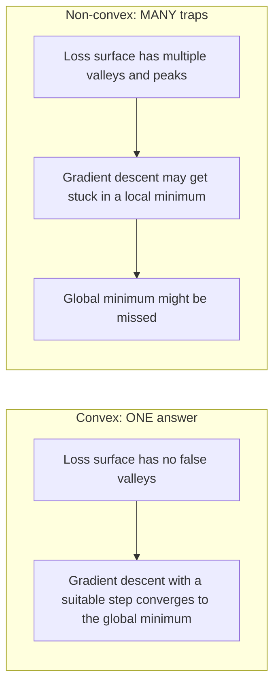
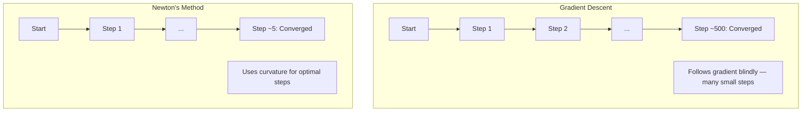
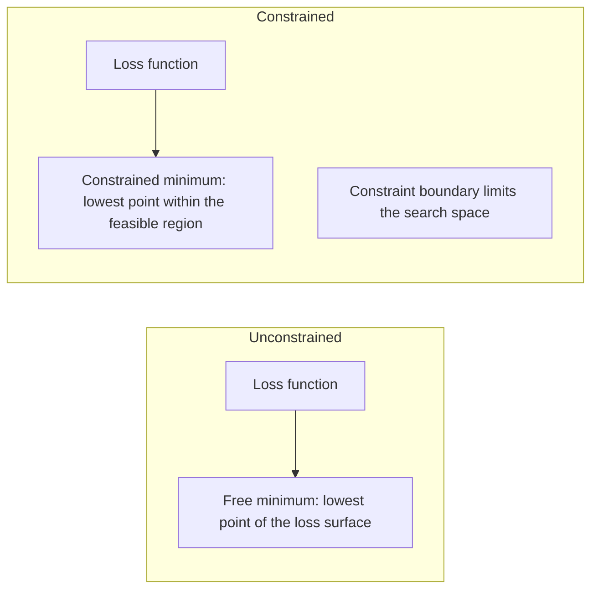
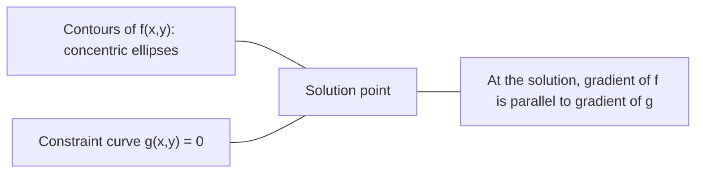

# 볼록 최적화

> 볼록 문제에는 골짜기가 하나뿐이지만, 신경망에는 수백만 개가 존재합니다. 그 차이를 이해하는 것이 중요합니다.

**유형:** Build (실습)
**Language:** Python
**선수 레슨:** Phase 1, Lessons 04 (Calculus for ML), 08 (Optimization)
**소요 시간:** ~90분

## 학습 목표

- 정의, 2계 도함수, 헤세 행렬(Hessian matrix) 판정법을 사용하여 함수가 볼록한지 판별합니다.
- 뉴턴 방법(Newton's method)을 구현하고 경사 하강법(gradient descent) 대비 2차 수렴(quadratic convergence) 특성을 비교합니다.
- 라그랑주 승수(Lagrange multiplier)를 사용하여 제약 조건이 있는 최적화 문제를 풀고 KKT 조건을 해석합니다.
- 신경망의 손실 지형(loss landscape)이 비볼록(non-convex)임에도 SGD가 여전히 우수한 해를 찾는 이유를 설명합니다.

## 문제

레슨 08에서는 경사 하강법, 모멘텀(momentum), Adam에 대해 배웠습니다. 이러한 옵티마이저는 어떤 곡면에서든 내리막을 향해 이동합니다. 하지만 수학적인 보장은 제공하지 않습니다. 비볼록(non-convex) 지형에서의 경사 하강법은 바람직하지 못한 로컬 미니멈(local minimum)에 도달하거나, 안장점(saddle point)에 갇히거나, 영원히 진동할 수도 있습니다. 그럼에도 신경망이 비볼록 함수이고 마땅한 대안이 없기 때문에 이 방법들을 사용해 왔습니다.

하지만 머신러닝의 수많은 문제는 볼록(convex) 문제입니다. 선형 회귀, 로지스틱 회귀, SVM, LASSO, 리지 회귀(ridge regression) 등이 대표적입니다. 이러한 문제에는 훨씬 강력한 도구인 수학적 보장이 뒷받침되는 최적화가 존재합니다. 볼록 문제에는 속임수 골짜기가 없습니다. 모든 로컬 미니멈이 곧 글로벌 미니멈(global minimum)이기 때문입니다. 최솟값을 갖는 매끄러운 볼록 함수에서는 적절한 보폭(step size)을 설정한 경사 하강법이 반드시 최솟값에 수렴합니다. 재시작(restart)도, 복잡한 학습률 스케줄도, 기도도 필요 없습니다.

볼록성을 이해하면 세 가지 이점이 있습니다. 첫째, 주어진 문제가 쉬운 문제(볼록)인지 어려운 문제(비볼록)인지 구분할 수 있습니다. 둘째, 볼록 문제에 적용할 수 있는 뉴턴 방법과 같은 더 빠른 도구를 제공합니다. 셋째, 제약 조건으로서의 정규화(regularization), SVM의 쌍대성(duality), 그리고 볼록성이 제공하는 이상적인 성질을 모두 위반함에도 딥러닝이 잘 작동하는 이유 등 머신러닝 전반에 등장하는 핵심 개념들을 설명해 줍니다.

## 개념

### 볼록 집합

집합 $S$ 내부의 임의의 두 점 $S$에 대해, 그 두 점을 잇는 선분 역시 온전히 $S$ 내에 속할 때 볼록 집합이라고 합니다.

| 볼록 집합 | 비볼록 집합 |
|---|---|
| **직사각형**: 내부의 임의의 두 점을 연결하는 선분이 항상 내부에 유지됨 | **별/초승달 모양**: 내부의 두 점을 잇는 선분이 집합 외부를 통과할 수 있음 |
| **삼각형**: 모든 내부 점에 대해 동일한 성질이 성립함 | **도넛/원환(annulus)**: 가운데 구멍으로 인해 일부 선분이 집합 외부로 벗어남 |
| 임의의 두 점을 잇는 선분이 항상 집합 내부에 머무름 | 특정 두 점을 잇는 선분이 집합 외부로 벗어남 |

수학적 정의: $S$의 임의의 점 $x, y$과 임의의 $t \in [0, 1]$에 대해, 점 $tx + (1-t)y$ 역시 $S$에 속해야 합니다.

볼록 집합의 예:
- 직선, 평면, $\mathbb{R}^n$ 전체 공간
- 공/볼(원, 구, 초구)
- 반공간(halfspace): $\lbrace x : a^T x \le b \rbrace$
- 임의 개수의 볼록 집합들의 교집합

비볼록 집합의 예:
- 도넛 모양(원환)
- 서로소인 두 원의 합집합
- "움푹 들어간 곳(dent)"이나 "구멍(hole)"이 있는 모든 집합

### 볼록 함수

함수 $f$의 정의역(domain)이 볼록 집합이고, 정의역 내의 임의의 두 점 $x, y$과 임의의 $t \in [0, 1]$에 대해 다음 조건을 만족하면 볼록 함수입니다:

```math
f(tx + (1-t)y) \le t f(x) + (1-t) f(y)
```

기하학적 의미: 그래프 위의 임의의 두 점을 잇는 선분이 그래프 자체보다 위에 있거나 같은 위치에 놓입니다.

| 속성 | 볼록 함수 | 비볼록 함수 |
|---|---|---|
| **선분 판정법** | 그래프 위의 임의의 두 점을 잇는 선분이 곡선 **위 또는 같은 위치**에 놓임 | 그래프 위의 특정 두 점을 잇는 선분이 곡선 **아래**로 내려감 |
| **형태** | 위쪽으로 굽어 있는 단일 그릇/골짜기 형태 | 여러 개의 봉우리와 골짜기가 혼재된 곡률 형태 |
| **로컬 미니멈** | 모든 로컬 미니멈이 곧 글로벌 미니멈임 | 서로 다른 높이에 여러 개의 로컬 미니멈이 존재할 수 있음 |

대표적인 볼록 함수:
- $f(x) = x^2$ (포물선)
- $f(x) = \lvert x \rvert$ (절댓값)
- $f(x) = e^x$ (지수 함수)
- $f(x) = \max(0, x)$ (ReLU, 조각별 선형 함수이지만 볼록)
- $x > 0$에서의 $f(x) = -\log(x)$ (음의 로그)
- 모든 선형 함수 $f(x) = a^T x + b$ (볼록 함수인 동시에 오목 함수)

### 볼록성 판정법

가장 쉬운 방법부터 가장 엄밀한 방법까지 3가지 실용적인 판정법이 있습니다.

**판정법 1: 2계 도함수 판정법 (1차원).** 모든 $x$에 대해 $f''(x) \ge 0$이면, $f$는 볼록 함수입니다.

- $f(x) = x^2$: $f''(x) = 2 \ge 0$. 볼록 함수.
- $f(x) = x^3$: $f''(x) = 6x$. $x < 0$에서 음수. 비볼록 함수.
- $f(x) = e^x$: $f''(x) = e^x > 0$. 볼록 함수.

**판정법 2: 헤세 행렬 판정법 (다변수).** 모든 $x$에 대해 헤세 행렬 $H(x)$이 양의 준정부호(positive semidefinite)이면 $f$는 볼록 함수입니다. 헤세 행렬은 2계 편도함수로 이루어진 행렬입니다.

**판정법 3: 정의 판정법.** 부등식 $f(tx + (1-t)y) \le t f(x) + (1-t) f(y)$을 직접 확인합니다. 도함수를 계산하기 어려운 함수에 유용합니다.

### 볼록성이 중요한 이유

볼록 최적화의 핵심 정리:

**볼록 함수에서는 모든 로컬 미니멈이 글로벌 미니멈입니다.**

즉, 경사 하강법이 바람직하지 못한 로컬 미니멈에 갇힐 수 없음을 의미합니다. 도달할 수 있는 모든 최솟값은 동일한 손실 값을 갖습니다. 최솟값을 갖는 매끄러운 볼록 함수에서는 적절한 보폭을 가진 경사 하강법이 최적값으로 수렴함이 보장됩니다.



이에 따른 결과:
- 무작위 재시작(random restart)이 필요 없음
- 정교한 학습률 스케줄이 필요 없음
- 수렴성 증명이 가능함 (수렴 속도는 함수의 성질에 따름)
- 해가 유일함 (평탄한 영역을 제외하면)

### 머신러닝에서의 볼록 문제 vs 비볼록 문제

| 문제 | 볼록 여부 | 이유 |
|---------|---------|-----|
| 선형 회귀 (MSE) | 예 | 가중치에 대해 손실이 2차식임 |
| 로지스틱 회귀 | 예 | 가중치에 대해 로그 손실이 볼록함 |
| SVM (힌지 손실) | 예 | 선형 함수들의 최댓값 형태임 |
| LASSO (L1 회귀) | 예 | 볼록 함수들의 합은 볼록 함수임 |
| 리지 회귀 (L2) | 예 | 2차식 + 2차식 = 볼록 함수 |
| 신경망 (모든 손실 함수) | 아니요 | 비선형 활성화 함수가 비볼록 지형을 형성함 |
| k-평균 군집화(k-means clustering) | 아니요 | 이산적인 할당 단계가 존재함 |
| 행렬 분해(Matrix factorization) | 아니요 | 미지수들의 곱 형태임 |

볼록 손실을 갖는 선형 모델은 볼록 최적화 문제입니다. 그러나 비선형 활성화 함수를 가진 은닉층(hidden layer)을 추가하는 순간 볼록성은 깨집니다.

### 헤세 행렬

함수 $f: \mathbb{R}^n \to \mathbb{R}$의 헤세 행렬 $H$는 2계 편도함수로 이루어진 $n \times n$ 행렬입니다.

```math
H_{ij} = \frac{\partial^2 f}{\partial x_i \, \partial x_j}
```

$f(x, y) = x^2 + 3xy + y^2$의 경우:

```math
\begin{gathered}
\begin{aligned}
\frac{\partial f}{\partial x} &= 2x + 3y & \frac{\partial^2 f}{\partial x^2} &= 2 & \frac{\partial^2 f}{\partial x \, \partial y} &= 3 \\
\frac{\partial f}{\partial y} &= 3x + 2y & \frac{\partial^2 f}{\partial y \, \partial x} &= 3 & \frac{\partial^2 f}{\partial y^2} &= 2
\end{aligned} \\[8pt]
H = \begin{bmatrix} 2 & 3 \\ 3 & 2 \end{bmatrix}
\end{gathered}
```

헤세 행렬은 곡률(curvature)에 대한 정보를 제공합니다:
- 고윳값(eigenvalue)이 모두 양수: 함수가 모든 방향으로 위쪽을 향해 굽어 있음 (해당 지점에서 볼록)
- 고윳값이 모두 음수: 모든 방향으로 아래쪽을 향해 굽어 있음 (오목, 로컬 맥시멈)
- 부호가 혼재됨: 안장점 (일부 방향으로는 위로 굽고, 다른 방향으로는 아래로 굽음)
- 고윳값이 0: 해당 방향으로 평탄함 (퇴화)

볼록 함수가 되려면 한 점뿐만 아니라 모든 지점에서 헤세 행렬이 양의 준정부호(모든 고윳값 $\ge 0$)여야 합니다.
### 뉴턴 방법 (Newton's method)

경사 하강법(gradient descent)은 1차 정보(gradient)를 사용합니다. 뉴턴 방법(Newton's method)은 2차 정보(Hessian)를 사용합니다. 현재 지점에서 2차 근사(quadratic approximation)를 수행하고 해당 2차 함수의 최솟값으로 바로 이동합니다.

```math
\begin{aligned}
\text{Update rule:} \quad & x_{\text{new}} = x - H^{-1} \cdot \text{gradient} \\
\text{Compare to gradient descent:} \quad & x_{\text{new}} = x - \text{lr} \cdot \text{gradient}
\end{aligned}
```

뉴턴 방법은 스칼라 학습률(learning rate)을 역 헤시안(inverse Hessian)으로 대체합니다. 이를 통해 국소 곡률(local curvature)에 따라 보폭(step size)과 방향이 자동으로 조정됩니다.



장점:
- 최솟값 근처에서 2차 수렴(quadratic convergence) 달성 (단계마다 오차가 제곱으로 감소)
- 튜닝할 학습률이 없음
- 스케일 불변성(scale-invariant) (문제를 어떻게 매개변수화하든 작동함)

단점:
- Hessian 계산에 $O(n^2)$의 메모리가 소요되고, 역행렬 계산에 $O(n^3)$의 비용이 듦
- 가중치가 100만 개인 신경망의 경우 $10^{12}$개의 성분과 $10^{18}$번의 연산이 필요함
- 딥러닝에는 실용적이지 않음

### 제약 최적화 (Constrained optimization)

비제약 최적화(unconstrained optimization): 모든 $x$에 대해 $f(x)$를 최소화합니다.
제약 최적화(constrained optimization): 제약 조건 하에서 $f(x)$를 최소화합니다.

실제 문제에는 제약 조건이 존재합니다. 비용을 최소화하고 싶지만 예산은 한정되어 있습니다. 오차를 최소화하고 싶지만 모델의 복잡도에는 한계가 있습니다.



### 라그랑주 승수법 (Lagrange multipliers)

라그랑주 승수법(Lagrange multipliers)은 제약이 있는 문제를 제약이 없는 문제로 변환합니다.

문제: $g(x) = 0$ 제약 조건 하에서 $f(x)$ 최소화.

해법: 새로운 변수(라그랑주 승수 $\lambda$)를 도입하고 제약 없는 문제를 풉니다.

```math
L(x, \lambda) = f(x) + \lambda g(x)
```

해(solution) 지점에서 $L$의 gradient는 0입니다.

```math
\begin{aligned}
\frac{\partial L}{\partial x} &= \frac{\partial f}{\partial x} + \lambda \frac{\partial g}{\partial x} = 0 \\
\frac{\partial L}{\partial \lambda} &= g(x) = 0
\end{aligned}
```

기하학적 직관: 제약 조건이 있는 최솟값에서, $f$의 gradient는 제약 조건 $g$의 gradient와 평행해야 합니다. 평행하지 않다면, 제약 표면을 따라 이동하면서 $f$를 더 줄일 수 있습니다.



예제: $x + y = 1$ 제약 조건 하에서 $f(x,y) = x^2 + y^2$ 최소화.

```math
\begin{aligned}
L &= x^2 + y^2 + \lambda(x + y - 1) \\[4pt]
\frac{\partial L}{\partial x} &= 2x + \lambda = 0 \implies x = -\lambda/2 \\
\frac{\partial L}{\partial y} &= 2y + \lambda = 0 \implies y = -\lambda/2 \\
\frac{\partial L}{\partial \lambda} &= x + y - 1 = 0 \\[4pt]
&\text{From first two: } x = y \\
&\text{Substituting: } 2x = 1, \text{ so } x = y = 0.5, \ \lambda = -1
\end{aligned}
```

직선 $x + y = 1$ 위에서 원점과 가장 가까운 점은 $(0.5, 0.5)$입니다.

### KKT 조건 (KKT conditions)

카루시-쿤-터커(Karush-Kuhn-Tucker, KKT) 조건은 라그랑주 승수법을 부등식 제약 조건으로 확장합니다.

문제: $i = 1, \ldots, m$에 대해 $g_i(x) \le 0$ 제약 조건 하에서 $f(x)$ 최소화.

KKT 조건 (최적성의 필요조건):

```math
\begin{aligned}
&\text{1. Stationarity:} && \frac{\partial f}{\partial x} + \sum_i \lambda_i \frac{\partial g_i}{\partial x} = 0 \\
&\text{2. Primal feasibility:} && g_i(x) \le 0 \quad \text{for all } i \\
&\text{3. Dual feasibility:} && \lambda_i \ge 0 \quad \text{for all } i \\
&\text{4. Complementary slackness:} && \lambda_i \, g_i(x) = 0 \quad \text{for all } i
\end{aligned}
```

상보성 여유 조건(complementary slackness)이 핵심적인 직관입니다. 즉, 제약 조건이 활성화(active)되어 있거나($g_i = 0$, 해가 경계면에 위치함), 승수가 0(제약 조건이 영향을 미치지 않음)이어야 합니다. 해에 영향을 주지 않는 제약 조건은 $\lambda = 0$을 갖습니다.

KKT 조건은 SVM의 핵심입니다. 서포트 벡터(support vector)는 제약 조건이 활성화된($\lambda > 0$) 데이터 포인트입니다. 다른 모든 데이터 포인트는 $\lambda = 0$이며 결정 경계에 영향을 미치지 않습니다.

### 제약 최적화로서의 규제 (Regularization as constrained optimization)

L1 및 L2 규제(regularization)는 임의로 만든 트릭이 아닙니다. 이들은 제약 최적화 문제가 다른 형태로 표현된 것입니다.

**L2 규제 (Ridge):**

```math
\begin{aligned}
&\text{minimize } \text{Loss}(w) \text{ subject to } \lVert w \rVert^2 \le t \\[4pt]
&\text{Equivalent unconstrained form:} \\
&\text{minimize } \text{Loss}(w) + \lambda \lVert w \rVert^2
\end{aligned}
```

제약 조건 $\lVert w \rVert^2 \le t$은 볼(2차원에서는 원, 3차원에서는 구)을 정의합니다. 해는 손실 등고선이 이 볼과 처음 접하는 지점입니다.

**L1 규제 (LASSO):**

```math
\begin{aligned}
&\text{minimize } \text{Loss}(w) \text{ subject to } \lVert w \rVert_1 \le t \\[4pt]
&\text{Equivalent unconstrained form:} \\
&\text{minimize } \text{Loss}(w) + \lambda \lVert w \rVert_1
\end{aligned}
```

제약 조건 $\lVert w \rVert_1 \le t$은 다이아몬드(2차원에서는 회전된 정사각형)를 정의합니다.

| 속성 | L2 제약 조건 (원) | L1 제약 조건 (다이아몬드) |
|---|---|---|
| **제약 조건 형태** | 원 (고차원에서는 구) | 다이아몬드 (2차원에서는 회전된 정사각형) |
| **손실 등고선 접점** | 매끄러운 경계 — 원 위의 임의의 지점 | 모서리 — 축과 정렬됨 |
| **해의 동작 방식** | 가중치가 작아지지만 0은 아님 | 일부 가중치가 정확히 0이 됨 (희소성) |
| **결과** | 가중치 감소(shrinkage) | 특성 선택(feature selection) |

이는 L1이 희소한 모델(특성 선택)을 생성하는 반면 L2는 가중치를 줄이기만 하는 이유를 설명해 줍니다. 다이아몬드는 축과 정렬된 모서리를 갖습니다. 손실 등고선은 모서리에 접할 가능성이 높으며, 이로 인해 하나 이상의 가중치가 정확히 0으로 설정됩니다.

### 쌍대성 (Duality)

모든 제약 최적화 문제(원시 문제, primal)는 이에 대응하는 문제(쌍대 문제, dual)를 갖습니다. 볼록 문제(convex problem)의 경우 원시 문제와 쌍대 문제는 동일한 최적값을 갖습니다. 이를 강 쌍대성(strong duality)이라고 합니다.

라그랑주 쌍대 함수(Lagrangian dual function):

```math
\begin{aligned}
&\text{Primal:} && \text{minimize } f(x) \text{ subject to } g(x) \le 0 \\
&\text{Lagrangian:} && L(x, \lambda) = f(x) + \lambda g(x) \\
&\text{Dual function:} && d(\lambda) = \min_x L(x, \lambda) \\
&\text{Dual problem:} && \text{maximize } d(\lambda) \text{ subject to } \lambda \ge 0
\end{aligned}
```

쌍대성이 중요한 이유:
- 쌍대 문제가 원시 문제보다 풀기 더 쉬운 경우가 있음
- SVM은 문제 형태가 데이터 포인트 간의 내적에 의존하는 쌍대 형식으로 풀리므로 커널 트릭(kernel trick)이 가능해짐
- 쌍대 문제는 원시 문제 최적값의 하한(lower bound)을 제공하므로 해의 품질을 확인하는 데 유용함

SVM의 경우 구체적으로 다음과 같습니다.

```
Primal: find w, b that maximize the margin 2/||w|| subject to
        y_i(w^T x_i + b) >= 1 for all i

Dual:   maximize sum(alpha_i) - 0.5 * sum_ij(alpha_i * alpha_j * y_i * y_j * x_i^T x_j)
        subject to alpha_i >= 0 and sum(alpha_i * y_i) = 0

The dual only involves dot products x_i^T x_j.
Replace x_i^T x_j with K(x_i, x_j) to get the kernel trick.
```

### 비볼록성에도 불구하고 딥러닝이 잘 작동하는 이유

신경망 손실 함수는 심각한 비볼록(non-convex) 형태입니다. 고전적인 척도에 따르면 이를 최적화하는 것은 실패해야 마땅합니다. 하지만 확률적 경사 하강법(stochastic gradient descent, SGD)은 안정적으로 좋은 해를 찾아냅니다. 몇 가지 요인이 이를 설명합니다.

**대부분의 국소 최솟값은 충분히 좋습니다.** 고차원 공간에서 무작위 임계점(gradient가 0인 지점)은 국소 최솟값(local minimum)이 아니라 압도적으로 안장점(saddle point)입니다. 존재하는 소수의 국소 최솟값조차도 전역 최솟값(global minimum)에 가까운 손실 값을 갖는 경향이 있습니다. 매개변수 공간이 수백만 차원에 달할 때 끔찍한 국소 최솟값에 갇힐 확률은 극히 낮습니다.

**국소 최솟값이 아니라 안장점이 실제 장애물입니다.** $n$개의 매개변수를 가진 함수에서 안장점은 양의 곡률 방향과 음의 곡률 방향이 섞여 있습니다. 고차원의 무작위 임계점에서 $n$개의 고윳값(eigenvalue)이 모두 양수(국소 최솟값)일 확률은 대략 $2^{-n}$입니다. 거의 모든 임계점은 안장점입니다. SGD의 노이즈는 이러한 안장점을 벗어나는 데 도움이 됩니다.

**과다매개변수화(Overparameterization)가 지형을 매끄럽게 만듭니다.** 학습 예제보다 매개변수가 더 많은 신경망은 더 매끄럽고 서로 잘 연결된 손실 곡면을 갖습니다. 신경망 폭이 넓을수록 나쁜 국소 최솟값이 적어집니다. 이는 직관에 반하지만 경험적으로 일관되게 확인되는 사실입니다.

**손실 지형(Loss landscape) 구조:**

| 속성 | 저차원 공간 | 고차원 공간 |
|---|---|---|
| **지형** | 고립된 봉우리와 골짜기가 많음 | 매끄럽게 연결된 골짜기 |
| **최솟값** | 고립된 국소 최솟값이 많음 | 나쁜 국소 최솟값이 거의 없음, 대부분 최적에 가까움 |
| **탐색** | 전역 최솟값을 찾기 어려움 | 좋은 해로 이어지는 경로가 많음 |
| **임계점** | 국소 최솟값과 안장점이 혼재 | 압도적으로 안장점이며 국소 최솟값은 드묾 |

**확률적 노이즈는 암묵적 규제로 작용합니다.** 미니배치 SGD는 날카로운 최솟값(sharp minima)에 안착하지 못하게 방해하는 노이즈를 추가합니다. 날카로운 최솟값은 과적합(overfitting)되기 쉽고, 평탄한 최솟값(flat minima)은 일반화(generalization) 성능이 뛰어납니다. 노이즈는 최적화 과정이 손실 지형의 평탄한 영역을 향하도록 유도합니다.
### 실전에서의 2차 방법

순수 뉴턴 방법(Newton's method)은 대규모 모델에 실용적이지 않습니다. 몇 가지 근사법을 통해 2차 정보를 활용할 수 있게 만듭니다.

**L-BFGS (Limited-memory BFGS):** 직전 $m$개의 그래디언트 차이를 사용하여 역 헤시안(inverse Hessian)을 근사합니다. $O(n^2)$ 대신 $O(mn)$의 메모리를 필요로 합니다. 최대 약 10,000개 매개변수를 갖는 문제에 잘 작동합니다. 고전 머신러닝(로지스틱 회귀, CRF)에서 사용되지만 딥러닝에서는 사용되지 않습니다.

**자연 그래디언트(Natural gradient):** 표준 헤시안 대신 피셔 정보 행렬(Fisher information matrix, 로그 우도의 기댓값 헤시안)을 사용합니다. 이는 확률 분포의 기하학적 구조를 반영합니다. K-FAC (Kronecker-Factored Approximate Curvature)은 피셔 행렬을 크로네커 곱으로 근사하여 신경망에서 실용적으로 사용할 수 있게 합니다.

**헤시안 프리 최적화(Hessian-free optimization):** $H$를 직접 형성하지 않고 켤레 기울기법(conjugate gradient)을 사용하여 $Hx = g$를 풉니다. 자동 미분을 통해 $O(n)$ 시간에 계산할 수 있는 헤시안-벡터 곱만 필요로 합니다.

**대각 근사(Diagonal approximations):** Adam의 2차 모멘트는 헤시안 대각 성분의 대각 근사입니다. AdaHessian은 Hutchinson 추정기를 통해 실제 헤시안 대각 성분을 사용하여 이를 확장합니다.

| 방법 | 메모리 | 스텝당 비용 | 사용 시점 |
|--------|--------|--------------|-------------|
| 경사 하강법(Gradient descent) | $O(n)$ | $O(n)$ | 베이스라인, 대규모 모델 |
| 뉴턴 방법 | $O(n^2)$ | $O(n^3)$ | 소규모 볼록 문제 |
| L-BFGS | $O(mn)$ | $O(mn)$ | 중규모 볼록 문제 |
| Adam | $O(n)$ | $O(n)$ | 딥러닝 기본값 |
| K-FAC | $O(n)$ | 레이어당 $O(n)$ | 연구, 대규모 배치 학습 |

```figure
convex-vs-nonconvex
```

## 직접 만들어 보기

### 1단계: 볼록성 검사기

점을 샘플링하고 정의를 확인하여 경험적으로 볼록성을 검사하는 함수를 작성합니다.

```python
import random
import math

def check_convexity(f, dim, bounds=(-5, 5), samples=1000):
    violations = 0
    for _ in range(samples):
        x = [random.uniform(*bounds) for _ in range(dim)]
        y = [random.uniform(*bounds) for _ in range(dim)]
        t = random.uniform(0, 1)
        mid = [t * xi + (1 - t) * yi for xi, yi in zip(x, y)]
        lhs = f(mid)
        rhs = t * f(x) + (1 - t) * f(y)
        if lhs > rhs + 1e-10:
            violations += 1
    return violations == 0, violations
```

### 2단계: 2D 뉴턴 방법

명시적 헤시안을 사용하여 뉴턴 방법을 구현합니다. 경사 하강법과 수렴 속도를 비교합니다.

```python
def newtons_method(f, grad_f, hessian_f, x0, steps=50, tol=1e-12):
    x = list(x0)
    history = [x[:]]
    for _ in range(steps):
        g = grad_f(x)
        H = hessian_f(x)
        det = H[0][0] * H[1][1] - H[0][1] * H[1][0]
        if abs(det) < 1e-15:
            break
        H_inv = [
            [H[1][1] / det, -H[0][1] / det],
            [-H[1][0] / det, H[0][0] / det],
        ]
        dx = [
            H_inv[0][0] * g[0] + H_inv[0][1] * g[1],
            H_inv[1][0] * g[0] + H_inv[1][1] * g[1],
        ]
        x = [x[0] - dx[0], x[1] - dx[1]]
        history.append(x[:])
        if sum(gi ** 2 for gi in g) < tol:
            break
    return history
```

### 3단계: 라그랑주 승수 솔버

라그랑지안에 경사 하강법을 적용하여 제약 조건이 있는 최적화 문제를 풉니다.

```python
def lagrange_solve(f_grad, g_val, g_grad, x0, lr=0.01,
                   lr_lambda=0.01, steps=5000):
    x = list(x0)
    lam = 0.0
    history = []
    for _ in range(steps):
        fg = f_grad(x)
        gv = g_val(x)
        gg = g_grad(x)
        x = [
            xi - lr * (fgi + lam * ggi)
            for xi, fgi, ggi in zip(x, fg, gg)
        ]
        lam = lam + lr_lambda * gv
        history.append((x[:], lam, gv))
    return history
```

### 4단계: 1차 방법 vs 2차 방법 비교

동일한 이차 함수에 대해 경사 하강법과 뉴턴 방법을 실행합니다. 수렴까지의 스텝 수를 측정합니다.

```python
def quadratic(x):
    return 5 * x[0] ** 2 + x[1] ** 2

def quadratic_grad(x):
    return [10 * x[0], 2 * x[1]]

def quadratic_hessian(x):
    return [[10, 0], [0, 2]]
```

뉴턴 방법은 1단계 만에 수렴합니다(이차 함수에 대해 정확함). 경사 하강법은 헤시안의 고윳값이 5배 차이가 나서 길쭉한 골짜기가 형성되기 때문에 수백 단계가 걸립니다.

## 적용해 보기

볼록성 분석은 ML 모델과 솔버를 선택할 때 직접 적용됩니다.

볼록 문제(로지스틱 회귀, SVM, LASSO):
- 전용 솔버를 사용합니다(liblinear, CVXPY, method='L-BFGS-B'를 지정한 scipy.optimize.minimize).
- 유일한 전역 해를 기대할 수 있습니다.
- 2차 방법이 실용적이고 빠릅니다.

비볼록 문제(신경망):
- 1차 방법을 사용합니다(SGD, Adam).
- 해가 초기화와 무작위성에 의존한다는 점을 받아들입니다.
- 과매개변수화, 노이즈, 학습률 스케줄을 암묵적 정규화로 활용합니다.
- 전역 최솟값을 찾는 데 시간을 낭비하지 마세요. 좋은 국소 최솟값으로도 충분합니다.

```python
from scipy.optimize import minimize

result = minimize(
    fun=lambda w: sum((y - X @ w) ** 2) + 0.1 * sum(w ** 2),
    x0=np.zeros(d),
    method='L-BFGS-B',
    jac=lambda w: -2 * X.T @ (y - X @ w) + 0.2 * w,
)
```

SVM의 경우 쌍대 정식화(dual formulation)를 통해 커널 트릭을 사용할 수 있습니다.

```python
from sklearn.svm import SVC

svm = SVC(kernel='rbf', C=1.0)
svm.fit(X_train, y_train)
print(f"Support vectors: {svm.n_support_}")
```

## 연습 문제

1. **볼록성 갤러리.** 검사기를 사용하여 다음 함수들의 볼록성을 테스트하세요: $f(x) = x^4$, $f(x) = \sin(x)$, $f(x,y) = x^2 + y^2$, $f(x,y) = xy$, $f(x) = \max(x, 0)$. 각 결과가 왜 타당한지 설명하세요.

2. **뉴턴 vs 경사 하강법 대결.** 시작점 $(10, 10)$에서 출발하여 $f(x,y) = 50x^2 + y^2$에 대해 두 방법을 모두 실행하세요. 손실이 1e-10 미만에 도달하려면 각각 몇 단계가 필요한가요? 조건수(가장 큰 헤시안 고윳값과 가장 작은 헤시안 고윳값의 비)가 증가하면 경사 하강법에는 어떤 일이 발생하나요?

3. **라그랑주 승수의 기하학.** $x + 2y = 4$ 제약 조건 하에서 $f(x,y) = (x-3)^2 + (y-3)^2$를 최소화하세요. 해에서 $f$의 그래디언트가 $g$의 그래디언트와 평행한지 확인하여 해를 검증하세요.

4. **정규화 제약 조건.** L1 제약 조건 최적화를 구현하세요: $\lvert x \rvert + \lvert y \rvert \le 1$ 제약 조건 하에서 $(x-3)^2 + (y-2)^2$를 최소화합니다. 해의 좌표 중 하나가 0이 됨을 보이세요(다이아몬드 제약 조건에 의한 희소성).

5. **헤시안 고윳값 분석.** (1,1)과 (-1,1)에서 로젠브록(Rosenbrock) 함수의 헤시안을 계산하세요. 두 점에서 고윳값을 계산하세요. 고윳값은 최솟점에서의 곡률과 최솟점에서 멀리 떨어진 곳에서의 곡률에 대해 무엇을 알려주나요?

### 힌트

**연습 문제 1.** `check_convexity`를 실행하기 전에 각 결과를 예측해 보세요. 1차원에서는 $f''(x)$의 부호를 살펴보고, 2차원에서는 헤시안의 고윳값을 살펴보세요. $f(x,y) = xy$의 경우 헤시안의 고윳값이 1과 -1이므로, 검사기는 볼록하지 않다고 보고해야 합니다.

**연습 문제 2.** $f$의 그래디언트와 헤시안을 전달하여 `optimize_gd` 및 `newtons_method`를 호출하세요. 뉴턴 방법은 이차 함수를 1스텝 만에 풉니다. 경사 하강법의 경우, $50x^2$ 항 때문에 학습률이 $2/100$보다 작아야 하므로 $y$ 방향으로 천천히 이동합니다. $100x^2$로 반복하고 스텝 수를 다시 세어 보세요.

**연습 문제 3.** $g(x,y) = x + 2y - 4$와 함께 `lagrange_solve`를 사용하세요. 정답 위치에서 $x + 2y = 4$인지, 그리고 $\nabla f = (2(x-3), 2(y-3))$가 $\nabla g = (1, 2)$의 배수인지 확인하세요.

**연습 문제 4.** 제약 조건이 없는 최솟값 (3, 2)는 다이아몬드 외부에 있으므로 정답은 경계에 있습니다. 투영 경사 하강법(projected gradient descent)을 사용하세요. 그래디언트 스텝을 취한 다음 $\lvert x \rvert + \lvert y \rvert \le 1$ 위로 다시 투영합니다. 결과가 제약 조건을 등식으로 만족하는지 확인하고 `demo_regularization_geometry`와 비교하세요.

**연습 문제 5.** 각 점에서 `rosenbrock_hessian`를 호출하고 그 결과를 `hessian_eigenvalues_2d`에 전달하세요. (1, 1)에서는 두 고윳값이 모두 양수이고 비율이 매우 크므로, 골짜기가 한 방향으로는 좁고 다른 방향으로는 평평합니다. 해당 비율을 (-1, 1)에서의 비율과 비교하세요.
## 주요 용어

| 용어 | 의미 |
|------|---------------|
| 볼록 집합(Convex set) | 집합 내의 임의의 두 점을 잇는 선분이 항상 집합 내부에 머무르는 집합입니다. |
| 볼록 함수(Convex function) | 그래프 상의 임의의 두 점을 잇는 선분이 그래프 위 또는 그 선상에 놓이는 함수입니다. 모든 지점에서 헤시안(Hessian) 행렬이 양의 준정부호(positive semidefinite)인 것과 동치입니다. |
| 국소 최솟값(Local minimum) | 인접한 모든 점보다 값이 낮은 지점입니다. 볼록 함수의 경우 모든 국소 최솟값이 곧 전역 최솟값이 됩니다. |
| 전역 최솟값(Global minimum) | 함수의 전체 정의역에서 가장 낮은 지점입니다. |
| 헤시안 행렬(Hessian matrix) | 모든 2차 편미분으로 구성된 행렬입니다. 곡률(curvature) 정보를 담고 있습니다. |
| 양의 준정부호(Positive semidefinite) | 모든 고윳값(eigenvalue)이 0 이상인 행렬입니다. "2차 도함수 >= 0"에 해당하는 다차원 개념입니다. |
| 조건수(Condition number) | 헤시안 행렬의 최댓값 고윳값과 최솟값 고윳값의 비입니다. 조건수가 크면 계곡 형태가 길쭉해져 경사 하강법(gradient descent)의 수렴 속도가 느려집니다. |
| 뉴턴 방법(Newton's method) | 헤시안의 역행렬을 사용하여 이동 방향과 보폭(step size)을 결정하는 2차 최적화 기법입니다. 최솟값 근처에서 2차 수렴(quadratic convergence)을 보입니다. |
| 라그랑주 승수(Lagrange multiplier) | 제약 조건이 있는 최적화 문제를 제약 조건이 없는 문제로 변환하기 위해 도입하는 변수입니다. |
| KKT 조건(KKT conditions) | 부등식 제약 조건이 있는 최적화 문제의 최적성을 위한 필요조건입니다. 라그랑주 승수를 일반화합니다. |
| 상보적 여유성(Complementary slackness) | 해(solution)에서 제약 조건이 활성화(active)되거나 해당 승수가 0이어야 한다는 조건입니다. 둘 다 0이 아닐 수는 없습니다. |
| 쌍대성(Duality) | 모든 제약 최적화 문제는 짝을 이루는 쌍대 문제(dual problem)를 가진다는 개념입니다. 볼록 문제에서는 두 문제가 동일한 최적값을 가집니다. |
| 강 쌍대성(Strong duality) | 원 문제(primal problem)와 쌍대 문제의 최적값이 서로 같음을 의미합니다. 슬레이터 조건(Slater's condition)을 만족하는 볼록 문제에서 성립합니다. |
| L-BFGS | 전체 헤시안을 저장하는 대신 최근 $m$개의 그래디언트 차이만 저장하는 근사적 2차 최적화 기법입니다. |
| 안장점(Saddle point) | 그래디언트가 0이지만 일부 방향으로는 최솟값이고 다른 방향으로는 최댓값이 되는 지점입니다. |
| 과다 매개변수화(Overparameterization) | 훈련 데이터 수보다 더 많은 매개변수를 사용하는 기법입니다. 손실 곡면(loss landscape)을 매끄럽게 만들어 좋지 않은 국소 최솟값을 줄여 줍니다. |

## 추가 참고 자료

- [Boyd & Vandenberghe: Convex Optimization](https://web.stanford.edu/~boyd/cvxbook/) - 온라인에서 무료로 이용할 수 있는 표준 교과서입니다.
- [Bottou, Curtis, Nocedal: Optimization Methods for Large-Scale Machine Learning (2018)](https://arxiv.org/abs/1606.04838) - 볼록 최적화 이론과 딥러닝 실무를 이어 주는 논문입니다.
- [Choromanska et al.: The Loss Surfaces of Multilayer Networks (2015)](https://arxiv.org/abs/1412.0233) - 비볼록 신경망의 손실 곡면이 겉보기만큼 까다롭지 않은 이유를 설명합니다.
- [Nocedal & Wright: Numerical Optimization](https://link.springer.com/book/10.1007/978-0-387-40065-5) - 뉴턴 방법, L-BFGS, 제약 최적화에 대한 포괄적인 참고서입니다.
