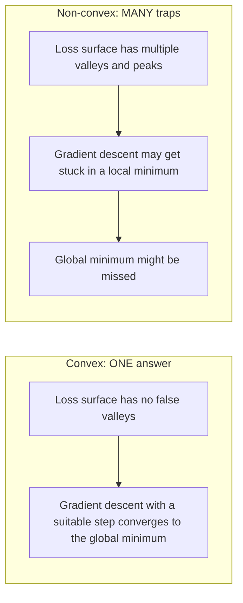
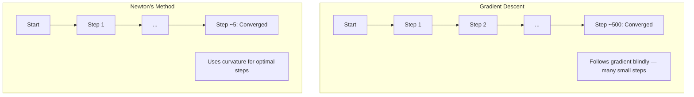
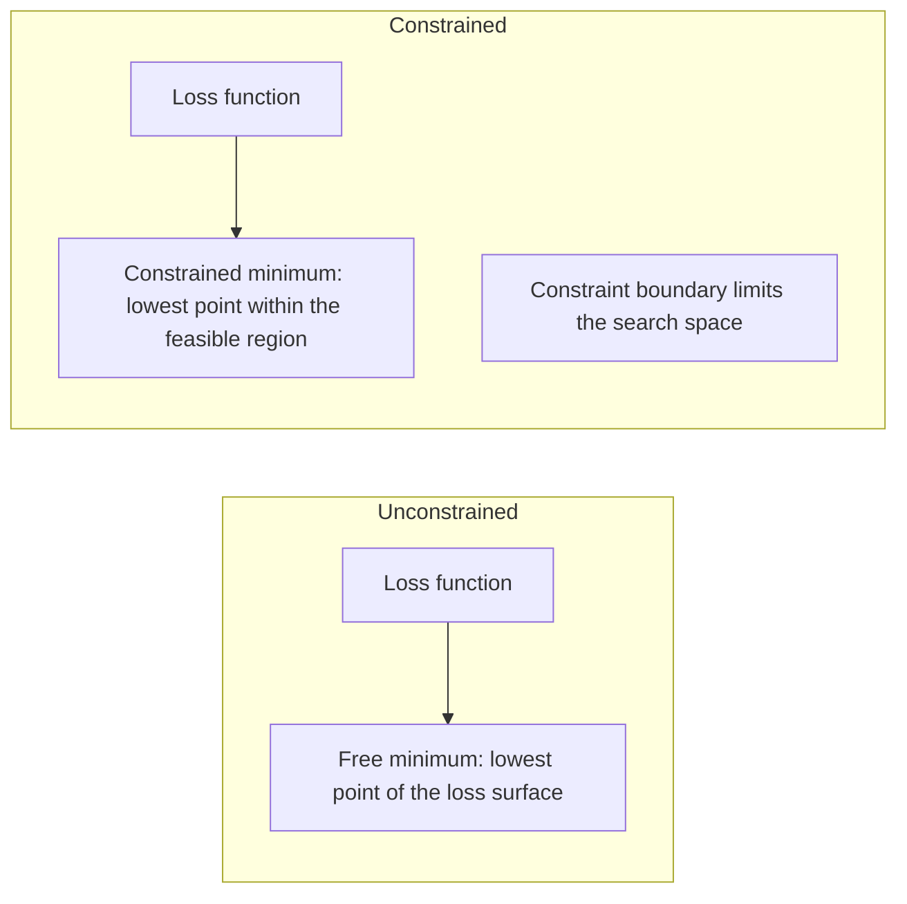
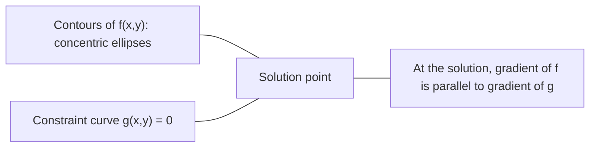

# 볼록 최적화

> 볼록 문제에는 골짜기가 하나뿐이지만, 신경망에는 수백만 개가 존재합니다. 그 차이를 아는 것이 중요합니다.

**유형:** Build (실습)
**사용 언어:** Python, TypeScript
**선수 레슨:** Phase 1, Lessons 04 (Calculus for ML), 08 (Optimization)
**소요 시간:** ~90분

## 학습 목표

- 정의, 2계 도함수 및 헤세 행렬(Hessian matrix) 기준을 사용하여 함수가 볼록(convex)한지 판별합니다.
- 뉴턴 방법(Newton's method)을 구현하고 경사 하강법(gradient descent)과의 2차 수렴(quadratic convergence) 속도를 비교합니다.
- 라그랑주 승수법(Lagrange multipliers)을 사용하여 제약 조건이 있는 최적화 문제를 풀고 KKT 조건을 해석합니다.
- 신경망의 손실 지형(loss landscape)이 비볼록(non-convex)임에도 SGD가 여전히 우수한 해를 찾아내는 이유를 설명합니다.

## 문제 정의

레슨 08에서는 경사 하강법, 모멘텀(momentum), Adam을 배웠습니다. 이러한 옵티마이저는 어떤 표면에서든 내리막을 따라 이동합니다. 하지만 수학적 보장은 전혀 제공되지 않습니다. 비볼록 지형에서의 경사 하강법은 바람직하지 않은 로컬 미니멈(local minimum, 국소 최솟값)에 도달하거나, 안장점(saddle point)에 갇히거나, 끝없이 진동할 수 있습니다. 그럼에도 신경망이 비볼록이며 대안이 없기 때문에 경사 하강법을 사용해 왔습니다.

하지만 머신러닝의 수많은 문제는 볼록합니다. 선형 회귀(linear regression), 로지스틱 회귀(logistic regression), SVM, LASSO, 리지 회귀(ridge regression) 등이 그렇습니다. 이러한 문제에는 수학적 보장이 수반되는 훨씬 강력한 최적화 방법이 존재합니다. 볼록 문제에는 가짜 골짜기가 없습니다. 즉, 모든 로컬 미니멈이 곧 글로벌 미니멈(global minimum, 전체 최솟값)입니다. 최솟값을 갖는 매끄러운 볼록 함수에 적절한 보폭(step size)으로 경사 하강법을 적용하면 반드시 그 최솟값으로 수렴합니다. 재시작도, 학습률 스케줄도, 기도도 필요하지 않습니다.

볼록성을 이해하면 세 가지 이점이 있습니다. 첫째, 풀고자 하는 문제가 쉬운 문제(볼록)인지 어려운 문제(비볼록)인지 알 수 있습니다. 둘째, 볼록 문제에 대해 뉴턴 방법과 같이 더 빠른 도구를 활용할 수 있습니다. 셋째, 제약 조건으로서의 정규화(regularization), SVM의 쌍대성(duality), 볼록성이 제공하는 모든 훌륭한 성질을 깨뜨리는데도 딥러닝이 잘 작동하는 이유 등 머신러닝 전반에 등장하는 핵심 개념들을 이해할 수 있게 됩니다.

## 개념

### 볼록 집합

집합 $S$ 내의 임의의 두 점을 잇는 선분이 온전히 $S$ 내에 포함될 때, 이 집합 $S$을 볼록 집합(convex set)이라고 합니다.

| 볼록 집합 | 비볼록 집합 |
|---|---|
| **직사각형**: 내부의 어떤 두 점을 선택하더라도 이를 잇는 선분이 내부에 온전히 유지됩니다 | **별/초승달 모양**: 내부의 두 점을 잇는 선분이 집합 외부를 지나갈 수 있습니다 |
| **삼각형**: 모든 내부 점에 대해 동일한 성질이 성립합니다 | **도넛/원환(annulus)**: 가운데 구멍이 있어 일부 선분이 집합을 벗어납니다 |
| 임의의 두 점을 잇는 선분이 항상 집합 내부에 머뭅니다 | 일부 두 점 쌍을 잇는 선분이 집합 외부로 벗어납니다 |

수학적 정의: $S$의 임의의 점 $x, y$과 임의의 $t \in [0, 1]$에 대해, 점 $tx + (1-t)y$ 역시 $S$에 속합니다.

볼록 집합의 예:
- 직선, 평면, 전체 공간 $\mathbb{R}^n$
- 공(원, 구, 초구)
- 반공간(halfspace): $\lbrace x : a^T x \le b \rbrace$
- 임의의 개수의 볼록 집합들의 교집합

비볼록 집합의 예:
- 도넛(원환)
- 서로소인 두 원의 합집합
- "움푹 파인 곳"이나 "구멍"이 있는 모든 집합

### 볼록 함수

함수 $f$의 정의역이 볼록 집합이고, 정의역 내의 임의의 두 점 $x, y$과 임의의 $t \in [0, 1]$에 대해 다음 부등식을 만족하면 볼록 함수(convex function)라고 합니다.

```math
f(tx + (1-t)y) \le t f(x) + (1-t) f(y)
```

기하학적 의미: 그래프 위의 임의의 두 점을 잇는 선분이 항상 그래프보다 위에 있거나 그래프와 닿아 있습니다.

| 특성 | 볼록 함수 | 비볼록 함수 |
|---|---|---|
| **선분 판정법** | 그래프 위의 임의의 두 점을 잇는 선분이 곡선 **위에 있거나 곡선과 닿음** | 그래프 위의 일부 점을 잇는 선분이 곡선 **아래**로 내려감 |
| **형태** | 위로 굽어 있는 단일 그릇/골짜기 형태 | 곡률이 뒤섞인 여러 봉우리와 골짜기 형태 |
| **로컬 미니멈** | 모든 로컬 미니멈이 곧 글로벌 미니멈 | 높이가 서로 다른 여러 로컬 미니멈이 존재할 수 있음 |

자주 쓰이는 볼록 함수:
- $f(x) = x^2$ (포물선)
- $f(x) = \lvert x \rvert$ (절댓값)
- $f(x) = e^x$ (지수 함수)
- $f(x) = \max(0, x)$ (ReLU, 구분적 선형이지만 볼록)
- $x > 0$에서 $f(x) = -\log(x)$ (음의 로그)
- 모든 선형 함수 $f(x) = a^T x + b$ (볼록이자 동시에 오목)

### 볼록성 판정법

가장 쉬운 방법부터 엄밀한 방법까지 세 가지 실용적인 판정법이 있습니다.

**판정법 1: 2계 도함수 판정법 (1차원).** 모든 $x$에 대해 $f''(x) \ge 0$이면 $f$는 볼록 함수입니다.

- $f(x) = x^2$: $f''(x) = 2 \ge 0$. 볼록합니다.
- $f(x) = x^3$: $f''(x) = 6x$. $x < 0$에서 음수입니다. 볼록하지 않습니다.
- $f(x) = e^x$: $f''(x) = e^x > 0$. 볼록합니다.

**판정법 2: 헤세 행렬 판정법 (다변수).** 모든 $x$에 대해 헤세 행렬(Hessian matrix) $H(x)$이 양의 준정부호(positive semidefinite)이면 $f$는 볼록 함수입니다. 헤세 행렬은 2계 편도함수들로 이루어진 행렬입니다.

**판정법 3: 정의에 따른 판정법.** 부등식 $f(tx + (1-t)y) \le t f(x) + (1-t) f(y)$을 직접 확인합니다. 도함수를 계산하기 어려운 함수에 유용합니다.

### 볼록성이 중요한 이유

볼록 최적화의 핵심 정리:

**볼록 함수에서는 모든 로컬 미니멈이 곧 글로벌 미니멈입니다.**

이는 경사 하강법이 나쁜 로컬 미니멈에 갇힐 수 없음을 의미합니다. 경사 하강법이 도달할 수 있는 모든 극솟점은 동일한 손실값을 갖습니다. 최솟값을 갖는 매끄러운 볼록 함수의 경우, 적절한 보폭을 사용한 경사 하강법은 반드시 최적값으로 수렴함이 보장됩니다.



이로 인한 결과:
- 무작위 재시작(random restart)이 필요 없음
- 복잡한 학습률 스케줄이 필요 없음
- 수렴성 증명이 가능함 (수렴 속도는 함수의 특성에 따라 결정됨)
- 평평한 영역을 제외하면 해가 유일함

### 머신러닝에서의 볼록 문제 vs 비볼록 문제

| 문제 | 볼록 여부 | 이유 |
|---------|---------|-----|
| 선형 회귀 (MSE) | 예 | 손실 함수가 가중치에 대해 2차식임 |
| 로지스틱 회귀 | 예 | 로그 손실(log-loss)이 가중치에 대해 볼록함 |
| SVM (힌지 손실) | 예 | 선형 함수들의 최댓값 형태임 |
| LASSO (L1 회귀) | 예 | 볼록 함수들의 합은 볼록함 |
| 리지 회귀 (L2) | 예 | 2차식 + 2차식 = 볼록 |
| 신경망 (어떤 손실 함수든) | 아니요 | 비선형 활성화 함수로 인해 비볼록 지형이 형성됨 |
| k-평균 군집화(k-means) | 아니요 | 이산적인 할당 단계가 존재함 |
| 행렬 분해(Matrix factorization) | 아니요 | 미지수들의 곱 형태임 |

손실 함수가 볼록한 선형 모델은 볼록 최적화 문제입니다. 그러나 비선형 활성화 함수를 갖는 은닉층을 추가하는 순간 볼록성은 깨집니다.

### 헤세 행렬

함수 $f: \mathbb{R}^n \to \mathbb{R}$의 헤세 행렬 $H$은 2계 편도함수로 구성된 $n \times n$ 행렬입니다.

```math
H_{ij} = \frac{\partial^2 f}{\partial x_i \, \partial x_j}
```

$f(x, y) = x^2 + 3xy + y^2$의 경우:

```math
\begin{gathered}
\begin{aligned}
\frac{\partial f}{\partial x} &= 2x + 3y & \frac{\partial^2 f}{\partial x^2} &= 2 & \frac{\partial^2 f}{\partial x \, \partial y} &= 3 \\
\frac{\partial f}{\partial y} &= 3x + 2y & \frac{\partial^2 f}{\partial y \, \partial x} &= 3 & \frac{\partial^2 f}{\partial y^2} &= 2
\end{aligned} \\[8pt]
H = \begin{bmatrix} 2 & 3 \\ 3 & 2 \end{bmatrix}
\end{gathered}
```

헤세 행렬은 곡률(curvature)에 대한 정보를 제공합니다.
- 모든 고윳값(eigenvalue)이 양수: 함수가 모든 방향에서 위로 굽어 있음 (해당 점에서 볼록)
- 모든 고윳값이 음수: 모든 방향에서 아래로 굽어 있음 (오목, 로컬 맥시멈)
- 부호가 혼합됨: 안장점 (일부 방향에서는 위로, 다른 방향에서는 아래로 굽어 있음)
- 고윳값이 0: 해당 방향으로 평평함 (퇴화)

함수가 볼록하기 위해서는 헤세 행렬이 특정 한 점만이 아니라 모든 지점에서 양의 준정부호(모든 고윳값 $\ge 0$)여야 합니다.
### 뉴턴 방법(Newton's method)

경사 하강법은 1차 정보(기울기, gradient)를 사용합니다. 뉴턴 방법은 2차 정보(헤시안, Hessian)를 사용합니다. 이는 현재 지점에서 2차 근사를 수행하고 해당 2차 함수의 최솟값으로 바로 이동합니다.

```math
\begin{aligned}
\text{Update rule:} \quad & x_{\text{new}} = x - H^{-1} \cdot \text{gradient} \\
\text{Compare to gradient descent:} \quad & x_{\text{new}} = x - \text{lr} \cdot \text{gradient}
\end{aligned}
```

뉴턴 방법은 스칼라 학습률(learning rate)을 헤시안의 역행렬로 대체합니다. 이를 통해 국소적 곡률(curvature)에 따라 보폭(step size)과 방향이 자동으로 조정됩니다.



장점:
- 최솟값 근처에서 2차 수렴(quadratic convergence)을 보임 (각 단계마다 오차가 제곱으로 감소)
- 튜닝할 학습률이 없음
- 스케일 불변성(scale-invariant)을 지님 (문제를 어떻게 매개변수화하든 상관없이 작동함)

단점:
- 헤시안을 계산하는 데 $O(n^2)$ 메모리가 들고, 역행렬 계산에 $O(n^3)$의 비용이 듦
- 가중치가 100만 개인 신경망의 경우, $10^{12}$개의 성분과 $10^{18}$번의 연산에 해당함
- 딥러닝에는 실용적이지 않음

### 제약 최적화(Constrained optimization)

비제약 최적화: 모든 $x$에 대해 $f(x)$를 최소화합니다.
제약 최적화: 제약 조건 하에서 $f(x)$를 최소화합니다.

실제 세계의 문제들에는 제약 조건이 있습니다. 비용을 최소화하고 싶지만 예산은 한정되어 있습니다. 오차를 최소화하고 싶지만 모델의 복잡도에는 한계가 있습니다.



### 라그랑주 승수법(Lagrange multipliers)

라그랑주 승수법은 제약 조건이 있는 문제를 비제약 문제로 변환합니다.

문제: $g(x) = 0$ 제약 조건 하에서 $f(x)$를 최소화.

해법: 새로운 변수(라그랑주 승수 $\lambda$)를 도입하고 비제약 문제를 풉니다.

```math
L(x, \lambda) = f(x) + \lambda g(x)
```

최적해에서는 $L$의 기울기가 0이 됩니다.

```math
\begin{aligned}
\frac{\partial L}{\partial x} &= \frac{\partial f}{\partial x} + \lambda \frac{\partial g}{\partial x} = 0 \\
\frac{\partial L}{\partial \lambda} &= g(x) = 0
\end{aligned}
```

기하학적 직관: 제약 조건이 있는 최솟값에서 $f$의 기울기는 제약 조건 $g$의 기울기와 반드시 평행해야 합니다. 두 기울기가 평행하지 않다면 제약 조건 표면을 따라 이동하면서 $f$를 더 줄일 수 있기 때문입니다.



예제: $x + y = 1$ 제약 조건 하에서 $f(x,y) = x^2 + y^2$를 최소화.

```math
\begin{aligned}
L &= x^2 + y^2 + \lambda(x + y - 1) \\[4pt]
\frac{\partial L}{\partial x} &= 2x + \lambda = 0 \implies x = -\lambda/2 \\
\frac{\partial L}{\partial y} &= 2y + \lambda = 0 \implies y = -\lambda/2 \\
\frac{\partial L}{\partial \lambda} &= x + y - 1 = 0 \\[4pt]
&\text{From first two: } x = y \\
&\text{Substituting: } 2x = 1, \text{ so } x = y = 0.5, \ \lambda = -1
\end{aligned}
```

직선 $x + y = 1$ 위의 점 중에서 원점과 가장 가까운 점은 $(0.5, 0.5)$입니다.

### KKT 조건(KKT conditions)

카루시-쿤-터커(KKT) 조건은 라그랑주 승수법을 부등식 제약 조건으로 확장한 것입니다.

문제: $i = 1, \ldots, m$에 대한 $g_i(x) \le 0$ 제약 조건 하에서 $f(x)$를 최소화.

KKT 조건 (최적성의 필요조건):

```math
\begin{aligned}
&\text{1. Stationarity:} && \frac{\partial f}{\partial x} + \sum_i \lambda_i \frac{\partial g_i}{\partial x} = 0 \\
&\text{2. Primal feasibility:} && g_i(x) \le 0 \quad \text{for all } i \\
&\text{3. Dual feasibility:} && \lambda_i \ge 0 \quad \text{for all } i \\
&\text{4. Complementary slackness:} && \lambda_i \, g_i(x) = 0 \quad \text{for all } i
\end{aligned}
```

상보성 조건(complementary slackness)이 핵심적인 직관을 제공합니다. 즉, 제약 조건이 활성화(active)되어 있거나($g_i = 0$, 해가 경계면에 위치함), 승수가 0(제약 조건이 영향을 미치지 않음)이어야 합니다. 최적해에 영향을 미치지 않는 제약 조건은 $\lambda = 0$을 가집니다.

KKT 조건은 SVM의 핵심입니다. 서포트 벡터(support vector)는 제약 조건이 활성화된($\lambda > 0$) 데이터 포인트들입니다. 그 외의 모든 데이터 포인트는 $\lambda = 0$이며 결정 경계(decision boundary)에 영향을 주지 않습니다.

### 제약 최적화 관점에서의 규제화(Regularization)

L1 규제화와 L2 규제화는 임의로 고안해 낸 기법이 아닙니다. 이들은 형태를 바꾼 제약 최적화 문제입니다.

**L2 규제화(Ridge):**

```math
\begin{aligned}
&\text{minimize } \text{Loss}(w) \text{ subject to } \lVert w \rVert^2 \le t \\[4pt]
&\text{Equivalent unconstrained form:} \\
&\text{minimize } \text{Loss}(w) + \lambda \lVert w \rVert^2
\end{aligned}
```

제약 조건 $\lVert w \rVert^2 \le t$는 공(2차원에서는 원, 3차원에서는 구) 형태의 영역을 정의합니다. 최적해는 손실 함수의 등고선이 이 원형 영역에 처음으로 접하는 지점입니다.

**L1 규제화(LASSO):**

```math
\begin{aligned}
&\text{minimize } \text{Loss}(w) \text{ subject to } \lVert w \rVert_1 \le t \\[4pt]
&\text{Equivalent unconstrained form:} \\
&\text{minimize } \text{Loss}(w) + \lambda \lVert w \rVert_1
\end{aligned}
```

제약 조건 $\lVert w \rVert_1 \le t$는 마름모(2차원에서는 회전된 정사각형) 형태의 영역을 정의합니다.

| 속성 | L2 제약 조건 (원) | L1 제약 조건 (마름모) |
|---|---|---|
| **제약 조건의 형태** | 원 (고차원에서는 구) | 마름모 (2차원에서는 회전된 정사각형) |
| **손실 등고선이 접하는 위치** | 매끄러운 경계면 — 원 위의 임의의 지점 | 꼭짓점 — 좌표축과 정렬된 지점 |
| **최적해의 특성** | 가중치가 작지만 0은 아님 | 일부 가중치가 정확히 0이 됨 (희소성) |
| **결과** | 가중치 축소(weight shrinkage) | 특성 선택(feature selection) |

이는 L1이 희소한 모델을 만들어내는(특성 선택) 반면, L2는 가중치를 축소하기만 하는 이유를 설명해 줍니다. 마름모는 좌표축과 정렬된 꼭짓점을 가지고 있습니다. 손실 등고선은 꼭짓점에 접할 확률이 더 높기 때문에 하나 이상의 가중치가 정확히 0이 됩니다.

### 쌍대성(Duality)

모든 제약 최적화 문제(원문제, primal)에는 짝을 이루는 문제(쌍대문제, dual)가 존재합니다. 볼록(convex) 문제의 경우 원문제와 쌍대문제의 최적값이 같습니다. 이를 강 쌍대성(strong duality)이라고 합니다.

라그랑주 쌍대 함수(Lagrangian dual function):

```math
\begin{aligned}
&\text{Primal:} && \text{minimize } f(x) \text{ subject to } g(x) \le 0 \\
&\text{Lagrangian:} && L(x, \lambda) = f(x) + \lambda g(x) \\
&\text{Dual function:} && d(\lambda) = \min_x L(x, \lambda) \\
&\text{Dual problem:} && \text{maximize } d(\lambda) \text{ subject to } \lambda \ge 0
\end{aligned}
```

쌍대성이 중요한 이유:
- 쌍대문제가 원문제보다 풀기 쉬운 경우가 있음
- SVM은 쌍대 형식으로 풀리며, 이때 문제는 데이터 포인트 간의 내적에 의존하게 됨 (커널 트릭 적용 가능)
- 쌍대문제는 원문제 최적값의 하한(lower bound)을 제공하므로 해의 품질을 확인하는 데 유용함

SVM의 경우 구체적으로 다음과 같습니다.

```
Primal: find w, b that maximize the margin 2/||w|| subject to
        y_i(w^T x_i + b) >= 1 for all i

Dual:   maximize sum(alpha_i) - 0.5 * sum_ij(alpha_i * alpha_j * y_i * y_j * x_i^T x_j)
        subject to alpha_i >= 0 and sum(alpha_i * y_i) = 0

The dual only involves dot products x_i^T x_j.
Replace x_i^T x_j with K(x_i, x_j) to get the kernel trick.
```

### 비볼록성(Non-convexity)에도 불구하고 딥러닝이 잘 작동하는 이유

신경망의 손실 함수는 극도로 비볼록(non-convex)합니다. 고전적인 모든 잣대로 보면 이를 최적화하는 것은 실패해야 마땅합니다. 하지만 확률적 경사 하강법(SGD)은 안정적으로 좋은 해를 찾아냅니다. 여러 요인이 이를 뒷받침합니다.

**대부분의 국소 최솟값(local minima)은 충분히 좋습니다.** 고차원 공간에서 무작위로 선택된 임계점(기울기가 0인 지점)은 국소 최솟값이 아니라 압도적으로 안장점(saddle point)일 확률이 높습니다. 존재하는 몇 안 되는 국소 최솟값들도 손실값이 전역 최솟값(global minimum)에 매우 근접하는 경향이 있습니다. 매개변수 공간이 수백만 차원에 달할 때 끔찍하게 나쁜 국소 최솟값에 갇힐 확률은 극히 낮습니다.

**진짜 장애물은 국소 최솟값이 아니라 안장점입니다.** 매개변수가 $n$개인 함수에서 안장점은 양의 곡률 방향과 음의 곡률 방향이 섞여 있습니다. 고차원 공간의 임의의 임계점에서 $n$개의 고윳값(eigenvalue)이 모두 양수(국소 최솟값)일 확률은 대략 $2^{-n}$에 불과합니다. 거의 모든 임계점은 안장점입니다. SGD의 노이즈는 이 안장점을 탈출하는 데 도움을 줍니다.

**과다매개변수화(Overparameterization)는 지형을 매끄럽게 만듭니다.** 학습 데이터 수보다 매개변수가 더 많은 신경망은 손실 표면이 더 매끄럽고 서로 잘 연결되어 있습니다. 더 넓은 신경망일수록 나쁜 국소 최솟값이 적습니다. 이는 직관에 반하지만 경험적으로 일관되게 확인되는 사실입니다.

**손실 지형(Loss landscape) 구조:**

| 속성 | 저차원 공간 | 고차원 공간 |
|---|---|---|
| **지형** | 고립된 봉우리와 골짜기가 많음 | 매끄럽게 연결된 골짜기 |
| **최솟값** | 고립된 국소 최솟값이 많음 | 나쁜 국소 최솟값이 적음, 대부분 최적에 가까움 |
| **탐색** | 전역 최솟값을 찾기 어려움 | 많은 경로가 좋은 해로 이어짐 |
| **임계점** | 국소 최솟값과 안장점이 혼재함 | 국소 최솟값이 아닌 안장점이 압도적으로 많음 |

**확률적 노이즈는 암묵적 규제화(implicit regularization) 역할을 합니다.** 미니배치 SGD가 유입시키는 노이즈는 날카로운 최솟값(sharp minima)에 안착하는 것을 방지합니다. 날카로운 최솟값은 과적합을 유발하지만, 평평한 최솟값(flat minima)은 일반화 성능을 높입니다. 노이즈는 손실 지형의 평평한 영역 쪽으로 최적화 방향을 유도합니다.
### 실전에서의 2차 최적화 기법

순수 뉴턴 방법(Newton's method)은 대규모 모델에 적용하기 어렵습니다. 여러 근사 기법을 통해 2차 정보를 실용적으로 활용할 수 있습니다.

**L-BFGS (Limited-memory BFGS):** 최근 $m$개의 그래디언트 차이를 사용하여 역 헤시안을 근사합니다. $O(n^2)$ 대신 $O(mn)$의 메모리만 필요합니다. 최대 약 10,000개의 파라미터를 가진 문제에 적합합니다. 고전 머신러닝(로지스틱 회귀, CRF)에서는 사용되지만 딥러닝에는 사용되지 않습니다.

**자연 그래디언트(Natural gradient):** 표준 헤시안 대신 피셔 정보 행렬(Fisher information matrix, 로그 우도의 기대 헤시안)을 사용합니다. 이는 확률 분포의 기하학적 구조를 반영합니다. K-FAC(Kronecker-Factored Approximate Curvature)은 피셔 행렬을 크로네커 곱으로 근사하여 신경망에 실용적으로 적용할 수 있도록 만듭니다.

**헤시안-프리 최적화(Hessian-free optimization):** $H$를 명시적으로 구하지 않고 켤레 기울기법(conjugate gradient)을 사용하여 $Hx = g$를 풉니다. 자동 미분을 통해 $O(n)$ 시간에 계산할 수 있는 헤시안-벡터 곱만 필요로 합니다.

**대각선 근사(Diagonal approximations):** Adam의 2차 모멘트는 헤시안 대각 성분의 대각선 근사입니다. AdaHessian은 허친슨 추정량(Hutchinson's estimator)을 통해 실제 헤시안 대각 원소를 사용하여 이를 확장합니다.

| 기법 | 메모리 | 스텝당 비용 | 사용 시점 |
|--------|--------|--------------|-------------|
| 그래디언트 디센트 | $O(n)$ | $O(n)$ | 베이스라인, 대규모 모델 |
| 뉴턴 방법 | $O(n^2)$ | $O(n^3)$ | 작은 볼록 문제 |
| L-BFGS | $O(mn)$ | $O(mn)$ | 중간 크기 볼록 문제 |
| Adam | $O(n)$ | $O(n)$ | 딥러닝 기본값 |
| K-FAC | $O(n)$ | 레이어당 $O(n)$ | 연구, 대규모 배치 학습 |

```figure
convex-vs-nonconvex
```

## 직접 구현하기

### 1단계: 볼록성 검사기

점을 샘플링하고 정의를 확인하여 볼록성을 경험적으로 테스트하는 함수를 구현합니다.

```python
import random
import math

def check_convexity(f, dim, bounds=(-5, 5), samples=1000):
    violations = 0
    for _ in range(samples):
        x = [random.uniform(*bounds) for _ in range(dim)]
        y = [random.uniform(*bounds) for _ in range(dim)]
        t = random.uniform(0, 1)
        mid = [t * xi + (1 - t) * yi for xi, yi in zip(x, y)]
        lhs = f(mid)
        rhs = t * f(x) + (1 - t) * f(y)
        if lhs > rhs + 1e-10:
            violations += 1
    return violations == 0, violations
```

### 2단계: 2차원을 위한 뉴턴 방법

명시적 헤시안을 사용하여 뉴턴 방법을 구현합니다. 수렴 속도를 그래디언트 디센트와 비교합니다.

```python
def newtons_method(f, grad_f, hessian_f, x0, steps=50, tol=1e-12):
    x = list(x0)
    history = [x[:]]
    for _ in range(steps):
        g = grad_f(x)
        H = hessian_f(x)
        det = H[0][0] * H[1][1] - H[0][1] * H[1][0]
        if abs(det) < 1e-15:
            break
        H_inv = [
            [H[1][1] / det, -H[0][1] / det],
            [-H[1][0] / det, H[0][0] / det],
        ]
        dx = [
            H_inv[0][0] * g[0] + H_inv[0][1] * g[1],
            H_inv[1][0] * g[0] + H_inv[1][1] * g[1],
        ]
        x = [x[0] - dx[0], x[1] - dx[1]]
        history.append(x[:])
        if sum(gi ** 2 for gi in g) < tol:
            break
    return history
```

### 3단계: 라그랑주 승수법 솔버

라그랑지안에 대한 그래디언트 디센트를 사용하여 제약 조건이 있는 최적화 문제를 풉니다.

```python
def lagrange_solve(f_grad, g_val, g_grad, x0, lr=0.01,
                   lr_lambda=0.01, steps=5000):
    x = list(x0)
    lam = 0.0
    history = []
    for _ in range(steps):
        fg = f_grad(x)
        gv = g_val(x)
        gg = g_grad(x)
        x = [
            xi - lr * (fgi + lam * ggi)
            for xi, fgi, ggi in zip(x, fg, gg)
        ]
        lam = lam + lr_lambda * gv
        history.append((x[:], lam, gv))
    return history
```

### 4단계: 1차 최적화와 2차 최적화 비교

동일한 2차 함수에 대해 그래디언트 디센트와 뉴턴 방법을 실행합니다. 수렴까지 걸리는 스텝 수를 측정합니다.

```python
def quadratic(x):
    return 5 * x[0] ** 2 + x[1] ** 2

def quadratic_grad(x):
    return [10 * x[0], 2 * x[1]]

def quadratic_hessian(x):
    return [[10, 0], [0, 2]]
```

뉴턴 방법은 1스텝 만에 수렴합니다(2차 함수에 대해 정확함). 반면 그래디언트 디센트는 헤시안의 고윳값이 5배 차이 나서 길쭉한 골짜기가 형성되므로 수백 스텝이 걸립니다.

## 활용하기

볼록성 분석은 ML 모델과 솔버를 선택할 때 직접 적용됩니다.

볼록 문제(로지스틱 회귀, SVM, LASSO)의 경우:
- 전용 솔버(liblinear, CVXPY, method='L-BFGS-B'를 사용한 scipy.optimize.minimize)를 사용합니다.
- 유일한 전역 최적해를 기대할 수 있습니다.
- 2차 최적화 기법이 실용적이며 빠릅니다.

비볼록 문제(신경망)의 경우:
- 1차 최적화 기법(SGD, Adam)을 사용합니다.
- 해가 초기화 및 무작위성에 의존한다는 점을 받아들입니다.
- 과매개변수화, 노이즈, 학습률 스케줄을 암시적 정규화로 활용합니다.
- 전역 최솟값을 찾는 데 시간을 낭비하지 마십시오. 적절한 국소 최솟값으로도 충분합니다.

```python
from scipy.optimize import minimize

result = minimize(
    fun=lambda w: sum((y - X @ w) ** 2) + 0.1 * sum(w ** 2),
    x0=np.zeros(d),
    method='L-BFGS-B',
    jac=lambda w: -2 * X.T @ (y - X @ w) + 0.2 * w,
)
```

SVM의 경우 쌍대 형태(dual formulation)를 통해 커널 트릭을 사용할 수 있습니다.

```python
from sklearn.svm import SVC

svm = SVC(kernel='rbf', C=1.0)
svm.fit(X_train, y_train)
print(f"Support vectors: {svm.n_support_}")
```

## 실습 과제

1. **볼록성 갤러리.** 검사기를 사용하여 다음 함수들의 볼록성을 테스트합니다: $f(x) = x^4$, $f(x) = \sin(x)$, $f(x,y) = x^2 + y^2$, $f(x,y) = xy$, $f(x) = \max(x, 0)$. 각 결과가 성립하는 이유를 설명합니다.

2. **뉴턴 방법 vs 그래디언트 디센트 경쟁.** 시작점 $(10, 10)$에서 $f(x,y) = 50x^2 + y^2$에 대해 두 방법을 모두 실행합니다. 손실 < 1e-10에 도달하는 데 각각 몇 스텝이 필요한가요? 조건수(가장 큰 헤시안 고윳값과 가장 작은 헤시안 고윳값의 비)가 증가하면 그래디언트 디센트에 어떤 일이 일어날까요?

3. **라그랑주 승수법의 기하학.** $x + 2y = 4$ 제약 조건 하에서 $f(x,y) = (x-3)^2 + (y-3)^2$를 최소화합니다. 최적해에서 $f$의 그래디언트가 $g$의 그래디언트와 평행한지 확인하여 해를 검증합니다.

4. **정규화 제약 조건.** L1 제약 최적화를 구현합니다: $\lvert x \rvert + \lvert y \rvert \le 1$ 제약 조건 하에서 $(x-3)^2 + (y-2)^2$를 최소화합니다. 최적해의 좌표 중 하나가 0임을 보여줍니다(마름모 제약 조건에 의한 희소성).

5. **헤시안 고윳값 분석.** (1,1)과 (-1,1)에서 로젠브록 함수(Rosenbrock function)의 헤시안을 계산합니다. 두 점에서 고윳값을 구합니다. 고윳값은 최솟점에서의 곡률과 최솟점에서 멀리 떨어진 곳에서의 곡률에 대해 무엇을 알려주나요?

### 힌트

**과제 1.** `check_convexity`를 실행하기 전에 각 결과를 예측해 봅니다. 1차원에서는 $f''(x)$의 부호를 살펴보고, 2차원에서는 헤시안의 고윳값을 살펴봅니다. $f(x,y) = xy$의 경우 헤시안의 고윳값이 1과 -1이므로 검사기가 볼록하지 않다고 보고해야 합니다.

**과제 2.** $f$의 그래디언트 및 헤시안과 함께 `optimize_gd` 및 `newtons_method`를 호출합니다. 뉴턴 방법은 2차 함수를 한 스텝 만에 풉니다. 그래디언트 디센트의 경우, $50x^2$ 항 때문에 학습률이 $2/100$보다 작아야 하므로 $y$ 방향으로 느리게 이동합니다. $100x^2$로 반복하고 스텝 수를 다시 측정합니다.

**과제 3.** $g(x,y) = x + 2y - 4$와 함께 `lagrange_solve`를 사용합니다. 구한 해에서 $x + 2y = 4$인지, 그리고 $\nabla f = (2(x-3), 2(y-3))$가 $\nabla g = (1, 2)$의 배수인지 확인합니다.

**과제 4.** 제약이 없는 최솟값 (3, 2)는 마름모 외부에 있으므로 해는 마름모의 경계에 있습니다. 투영 그래디언트 디센트(projected gradient descent)를 사용합니다. 그래디언트 스텝을 취한 다음 $\lvert x \rvert + \lvert y \rvert \le 1$ 위로 다시 투영합니다. 결과가 등호로 제약 조건을 만족하는지 확인하고 `demo_regularization_geometry`과 비교합니다.

**과제 5.** 각 점에서 `rosenbrock_hessian`를 호출하고 그 결과를 `hessian_eigenvalues_2d`에 전달합니다. (1, 1)에서는 두 고윳값이 모두 양수이고 그 비가 매우 크므로, 골짜기가 한쪽 방향으로는 좁고 다른 쪽 방향으로는 평평합니다. 이 비율을 (-1, 1)에서의 비율과 비교합니다.
## 핵심 용어

| 용어 | 의미 |
|------|---------------|
| 볼록 집합(Convex set) | 집합 내의 임의의 두 점을 잇는 선분이 해당 집합 내에 완전히 포함되는 집합 |
| 볼록 함수(Convex function) | 그래프 상의 임의의 두 점을 잇는 선분이 그래프보다 항상 위에 있거나 일치하는 함수. 동치 조건으로 헤시안(Hessian) 행렬이 모든 곳에서 양의 준정부호(positive semidefinite)입니다 |
| 지역 최솟값(Local minimum) | 주변의 모든 점보다 낮은 지점. 볼록 함수의 경우 모든 지역 최솟값이 곧 전역 최솟값입니다 |
| 전역 최솟값(Global minimum) | 함수의 전체 정의역에서 가장 낮은 지점 |
| 헤시안 행렬(Hessian matrix) | 모든 2차 편도함수로 구성된 행렬. 곡률(curvature) 정보를 인코딩합니다 |
| 양의 준정부호(Positive semidefinite) | 모든 고윳값(eigenvalue)이 0 이상인 행렬. 다차원에서 "2차 도함수 >= 0"에 해당하는 개념입니다 |
| 조건수(Condition number) | 헤시안의 최대 고윳값과 최소 고윳값 사이의 비율. 조건수가 크면 계곡 형태가 길쭉해져 경사 하강법(gradient descent)의 수렴 속도가 느려집니다 |
| 뉴턴법(Newton's method) | 헤시안의 역행렬을 사용하여 이동 방향과 보폭(step size)을 결정하는 2차 최적화 기법. 최솟값 근처에서 2차 수렴(quadratic convergence)을 보입니다 |
| 라그랑주 승수(Lagrange multiplier) | 제약 조건이 있는 최적화 문제를 무제약 문제로 변환하기 위해 도입하는 변수 |
| KKT 조건(KKT conditions) | 부등식 제약 조건이 있는 문제에서 최적성을 만족하기 위한 필요 조건. 라그랑주 승수를 일반화합니다 |
| 상보 여유성(Complementary slackness) | 최적해에서 제약 조건이 활성화(active)되거나 해당 승수가 0이어야 한다는 조건. 둘 다 0이 아닐 수는 없습니다 |
| 쌍대성(Duality) | 제약 조건이 있는 모든 문제에는 이에 상응하는 쌍대 문제(dual problem)가 존재한다는 개념. 볼록 문제의 경우 두 문제는 동일한 최적값을 가집니다 |
| 강한 쌍대성(Strong duality) | 원 문제(primal problem)와 쌍대 문제의 최적값이 동일한 성질. 슬레이터 조건(Slater's condition)을 만족하는 볼록 문제에서 성립합니다 |
| L-BFGS | 전체 헤시안을 저장하는 대신 최근 $m$개의 기울기 차이만을 저장하는 근사 2차 기법 |
| 안장점(Saddle point) | 기울기(gradient)가 0이지만 어떤 방향으로는 최솟값이고 다른 방향으로는 최댓값이 되는 지점 |
| 과잉 매개변수화(Overparameterization) | 훈련 예제 수보다 더 많은 매개변수를 사용하는 것. 손실 지형(loss landscape)을 완만하게 만들어 바람직하지 않은 지역 최솟값을 줄여 줍니다 |

## 더 읽을거리

- [Boyd & Vandenberghe: Convex Optimization](https://web.stanford.edu/~boyd/cvxbook/) - 온라인에서 무료로 이용할 수 있는 표준 교재
- [Bottou, Curtis, Nocedal: Optimization Methods for Large-Scale Machine Learning (2018)](https://arxiv.org/abs/1606.04838) - 볼록 최적화 이론과 딥러닝 실무를 잇는 논문
- [Choromanska et al.: The Loss Surfaces of Multilayer Networks (2015)](https://arxiv.org/abs/1412.0233) - 비볼록(non-convex) 신경망 손실 지형이 겉보기만큼 나쁘지 않은 이유를 다룬 논문
- [Nocedal & Wright: Numerical Optimization](https://link.springer.com/book/10.1007/978-0-387-40065-5) - 뉴턴법, L-BFGS, 제약 조건 최적화에 대한 종합적인 참고서
