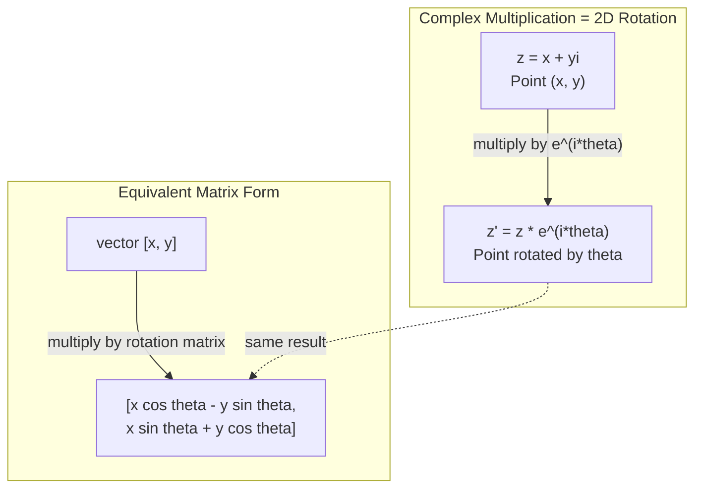
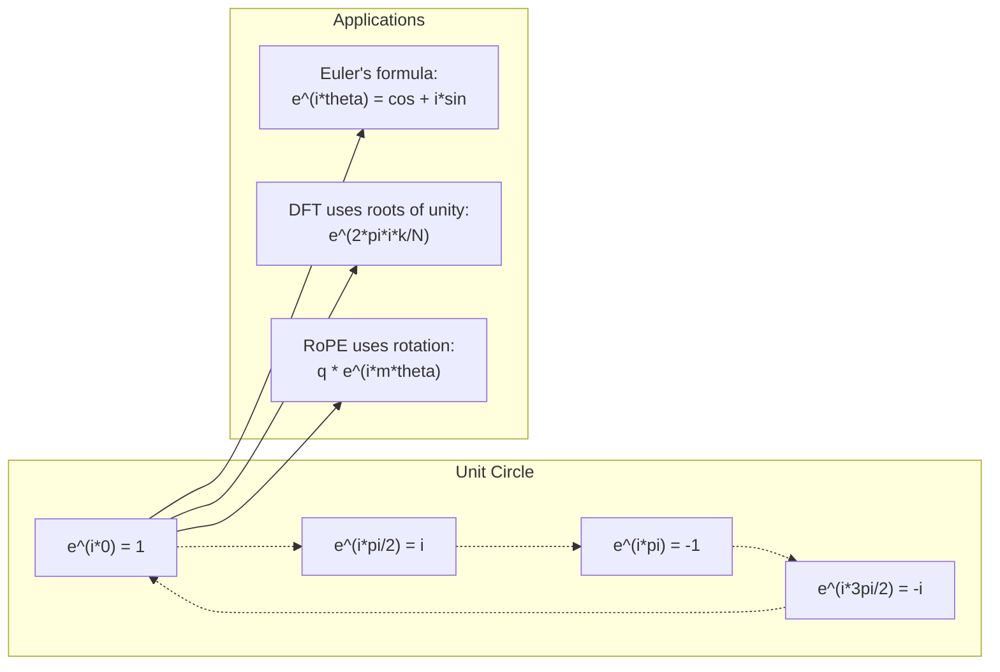

# AI를 위한 복소수

> -1의 제곱근은 결코 상상의 산물이 아닙니다. 이는 회전, 주파수, 그리고 신호 처리의 절반을 이해하는 핵심 열쇠입니다.

**유형:** Learn (이론)
**Language:** Python
**선수 레슨:** Phase 1, Lessons 01-04 (linear algebra, calculus)
**소요 시간:** ~60분

## 학습 목표

- 직교좌표계(rectangular form) 및 극좌표계(polar form) 모두에서 복소수 연산(덧셈, 곱셈, 나눗셈, 켤레복소수)을 수행합니다.
- 오일러 공식(Euler's formula)을 적용하여 복소 지수 함수와 삼각 함수 간 상호 변환을 수행합니다.
- 복소 단위원의 거듭제곱근(roots of unity)을 사용하여 이산 푸리에 변환(Discrete Fourier Transform)을 구현합니다.
- 복소수 회전이 트랜스포머(Transformer)의 RoPE 및 사인파 위치 인코딩(sinusoidal positional encodings)의 기초가 되는 방식을 설명합니다.

## 문제 상황

푸리에 변환에 관한 논문을 펼치면 곳곳에 `i`가 등장합니다. 트랜스포머의 위치 인코딩을 살펴보면 서로 다른 주파수의 `sin`와 `cos`, 즉 복소 지수 함수의 실수부와 허수부가 나타납니다. 양자 컴퓨팅에 관한 글을 읽다 보면 모든 것이 복소 벡터 공간으로 표현되어 있는 것을 보게 됩니다.

복소수는 매우 추상적으로 느껴질 수 있습니다. -1의 제곱근을 기반으로 구축된 수 체계는 수학적인 속임수처럼 느껴지기도 합니다. 하지만 이는 속임수가 아닙니다. 회전과 진동을 기술하는 가장 자연스러운 언어입니다. 무언가가 회전하거나, 진동하거나, 요동칠 때마다 복소수는 가장 적합한 도구가 됩니다.

복소수를 이해하지 못하면 이산 푸리에 변환(DFT)을 이해할 수 없습니다. FFT(고속 푸리에 변환)도 이해할 수 없습니다. 현대 언어 모델에서 RoPE(Rotary Position Embedding)가 어떻게 동작하는지도 이해할 수 없습니다. 최초의 Transformer 논문에서 사인파 위치 인코딩이 왜 그러한 주파수를 사용하는지도 이해할 수 없습니다.

본 강의에서는 복소수 연산을 기초부터 구축하고, 이를 기하학과 연결하며, 머신러닝에서 복소수가 정확히 어디에 나타나는지 보여줍니다.

## 핵심 개념

### 복소수란 무엇인가?

복소수는 실수부(real part)와 허수부(imaginary part)라는 두 부분으로 구성됩니다.

```
z = a + bi

where:
  a is the real part
  b is the imaginary part
  i is the imaginary unit, defined by i^2 = -1
```

이것이 전부입니다. 수직선을 평면으로 확장한 것입니다. 실수는 한 축 위에 위치하고, 허수는 다른 축 위에 위치합니다. 모든 복소수는 이 평면 위의 한 점입니다.

### 복소수 연산

**덧셈.** 실수부는 실수부끼리 더하고, 허수부는 허수부끼리 더합니다.

```math
\begin{aligned}
(a + bi) + (c + di) &= (a + c) + (b + d)i \\[4pt]
\text{Example: } (3 + 2i) + (1 + 4i) &= 4 + 6i
\end{aligned}
```

**곱셈.** 분배법칙을 사용하고 $i^2 = -1$임을 기억합니다.

```math
\begin{aligned}
(a + bi)(c + di) &= ac + adi + bci + bdi^2 \\
&= ac + adi + bci - bd \\
&= (ac - bd) + (ad + bc)i \\[8pt]
\text{Example: } (3 + 2i)(1 + 4i) &= 3 + 12i + 2i + 8i^2 \\
&= 3 + 14i - 8 \\
&= -5 + 14i
\end{aligned}
```

**켤레복소수(Conjugate).** 허수부의 부호를 바꿉니다.

```math
\text{conjugate of } (a + bi) = a - bi
```

복소수와 그 켤레복소수의 곱은 항상 실수입니다.

```math
(a + bi)(a - bi) = a^2 + b^2
```

**나눗셈.** 분자와 분모에 분모의 켤레복소수를 곱합니다.

```math
\frac{a + bi}{c + di} = \frac{(a + bi)(c - di)}{c^2 + d^2}
```

이렇게 하면 분모에서 허수부가 제거되어 깔끔한 복소수 형태를 얻을 수 있습니다.

### 복소평면

복소평면(complex plane)은 모든 복소수를 2차원 점에 매핑합니다. 가로축은 실수축(real axis)이고, 세로축은 허수축(imaginary axis)입니다.

```
z = 3 + 2i  corresponds to the point (3, 2)
z = -1 + 0i corresponds to the point (-1, 0) on the real axis
z = 0 + 4i  corresponds to the point (0, 4) on the imaginary axis
```

복소수는 원점으로부터의 벡터인 동시에 하나의 점입니다. 이러한 이중적 해석 덕분에 복소수는 기하학에서 매우 유용하게 쓰입니다.

### 극좌표 형식

평면 위의 모든 점은 원점으로부터의 거리와 양의 실수축으로부터의 각도로 표현할 수 있습니다.

```math
\begin{aligned}
z &= r (\cos\theta + i \sin\theta) \\[4pt]
\text{where: } r &= |z| = \sqrt{a^2 + b^2} \quad \text{(magnitude, or modulus)} \\
\theta &= \mathop{\mathrm{atan2}}(b, a) \quad \text{(phase, or argument)}
\end{aligned}
```

직교좌표 형식 $(a + bi)$은 덧셈에 적합합니다. 극좌표 형식 $(r, \theta)$은 곱셈에 적합합니다.

**극좌표 형식에서의 곱셈.** 크기는 곱하고, 각도는 더합니다.

```math
\begin{aligned}
z_1 &= r_1 e^{i\theta_1} \\
z_2 &= r_2 e^{i\theta_2} \\[4pt]
z_1 z_2 &= (r_1 r_2) \, e^{i(\theta_1 + \theta_2)}
\end{aligned}
```

이것이 바로 복소수가 회전을 표현하는 데 완벽한 이유입니다. 크기가 1인 복소수를 곱하는 것은 순수한 회전 연산에 해당합니다.

### 오일러 공식

복소 지수 함수와 삼각 함수를 잇는 가교:

```math
e^{i\theta} = \cos\theta + i \sin\theta
```

이 공식은 본 강의에서 가장 중요한 공식입니다. $\theta = \pi$일 때:

```math
\begin{aligned}
e^{i\pi} &= \cos\pi + i \sin\pi = -1 + 0i = -1 \\[4pt]
\text{Therefore: } e^{i\pi} + 1 &= 0
\end{aligned}
```

다섯 가지 기본 상수($e$, $i$, $\pi$, 1, 0)가 하나의 등식으로 연결됩니다.

### 오일러 공식이 ML에서 중요한 이유

오일러 공식은 $\theta$가 변함에 따라 $e^{i\theta}$가 단위원(unit circle)을 그린다는 것을 말해 줍니다. $\theta = 0$에서는 $(1, 0)$에 위치합니다. $\theta = \pi/2$에서는 $(0, 1)$에 위치합니다. $\theta = \pi$에서는 $(-1, 0)$에 위치합니다. $\theta = 3\pi/2$에서는 $(0, -1)$에 위치합니다. 완전한 한 바퀴 회전은 $\theta = 2\pi$입니다.

이는 곧 복소 지수 함수가 바로 '회전' 그 자체임을 의미합니다. 그리고 회전은 신호 처리와 머신러닝 전반에 걸쳐 어디에나 존재합니다.

### 2D 회전과의 연결

복소수 $(x + yi)$에 $e^{i\theta}$를 곱하면 원점을 중심으로 점 $(x, y)$를 각도 $\theta$만큼 회전시키게 됩니다.

```math
\begin{aligned}
&\text{Rotation via complex multiplication:} \\
&\quad (x + yi)(\cos\theta + i \sin\theta) = (x \cos\theta - y \sin\theta) + (x \sin\theta + y \cos\theta)i \\[8pt]
&\text{Rotation via matrix multiplication:} \\
&\quad \begin{bmatrix} \cos\theta & -\sin\theta \\ \sin\theta & \cos\theta \end{bmatrix} \begin{bmatrix} x \\ y \end{bmatrix} = \begin{bmatrix} x \cos\theta - y \sin\theta \\ x \sin\theta + y \cos\theta \end{bmatrix}
\end{aligned}
```

이 둘은 동일한 결과를 냅니다. 복소수 곱셈은 곧 2차원 회전입니다. 회전 행렬(rotation matrix)은 복소수 곱셈을 행렬 표기법으로 나타낸 것에 불과합니다.



### 페이저와 회전 신호

복소 지수 함수 $e^{i\omega t}$는 각주파수 $\omega$로 단위원 둘레를 회전하는 점입니다. $t$가 증가함에 따라 이 점은 원을 그립니다.

이 회전하는 점의 실수부는 $\cos(\omega t)$입니다. 허수부는 $\sin(\omega t)$입니다. 사인파 신호는 회전하는 복소수가 드리우는 그림자와 같습니다.

```math
\begin{aligned}
e^{i\omega t} &= \cos(\omega t) + i \sin(\omega t) \\[4pt]
\text{Real part: } & \cos(\omega t) \quad \text{-- a cosine wave} \\
\text{Imaginary part: } & \sin(\omega t) \quad \text{-- a sine wave}
\end{aligned}
```

이것이 바로 페이저(phasor) 표현입니다. 구불구불한 사인파를 추적하는 대신, 매끄럽게 회전하는 화살표를 추적하는 것입니다. 위상 변위(phase shift)는 각도의 오프셋이 됩니다. 진폭(amplitude)의 변화는 크기(magnitude)의 변화가 됩니다. 신호 간의 덧셈은 벡터 덧셈이 됩니다.

### 단위원의 거듭제곱근

$N$차 거듭제곱근(roots of unity)은 단위원 위에 등간격으로 배치된 $N$개의 점입니다.

```math
w_k = e^{2\pi i k/N} \quad \text{for } k = 0, 1, 2, \ldots, N-1
```

$N = 4$의 경우 거듭제곱근은 $1, i, -1, -i$입니다(네 방향의 방위점).
$N = 8$의 경우 네 방향의 방위점에 네 개의 대각선 방향 점이 추가됩니다.

단위원의 거듭제곱근은 이산 푸리에 변환(DFT)의 기초가 됩니다. DFT는 신호를 등간격으로 배치된 이들 $N$개 주파수 성분으로 분해합니다.

### DFT와의 연결

신호 $x[0], x[1], \ldots, x[N-1]$의 이산 푸리에 변환(DFT)은 다음과 같습니다.

```math
X[k] = \sum_{n=0}^{N-1} x[n] \, e^{-2\pi i k n/N}
```

각 $X[k]$은 신호가 주파수 $k$의 복소 사인파인 $k$번째 단위원 거듭제곱근과 얼마나 상관관계(correlation)를 갖는지 측정합니다. DFT는 신호를 $N$개의 회전하는 페이저로 분해하여 각 페이저의 진폭과 위상을 알려줍니다.

### i가 상상의 산물이 아닌 이유

'허수(imaginary)'라는 단어는 역사적 우연에 의해 붙여진 이름입니다. 데카르트(Descartes)가 이를 경멸적인 의미로 사용했습니다. 그러나 음수가 처음 등장했을 때 배척당했던 것과 마찬가지로, $i$ 역시 실제로 존재하지 않는 상상의 수인 것은 아닙니다. 음수가 "3에서 5를 빼면 무엇이 남는가?"라는 질문에 답하는 것처럼, 허수 단위는 "제곱해서 -1이 되는 수는 무엇인가?"라는 질문에 답합니다.

더 실용적으로 표현하자면, $i$는 90도 회전 연산자입니다. 실수에 $i$를 한 번 곱하면 허수축 방향으로 90도 회전합니다. 여기에 다시 $i$를 곱하면($i^2$), 90도 더 회전하여 음의 실수 방향을 가리키게 됩니다. 이것이 바로 $i^2 = -1$인 이유입니다. 결코 신비로운 현상이 아닙니다. 두 번의 1/4 회전(quarter-turn)이 모여 이루어진 반 바퀴 회전(half-turn)일 뿐입니다.

이것이 바로 복소수가 공학 전반에 걸쳐 널리 사용되는 이유입니다. 전자기파, 양자 상태, 신호 진동, 위치 인코딩 등 회전하는 모든 대상은 복소수를 통해 가장 자연스럽게 설명됩니다.
### 복소 지수 함수 vs 삼각함수

오일러 공식(Euler's formula)이 등장하기 전까지, 엔지니어들은 신호를 진폭 $A$, 주파수 $\omega$, 위상 $\phi$을 사용하여 $A \cos(\omega t + \phi)$와 같이 표현했습니다. 이 방식도 동작은 하지만 연산이 매우 번거롭습니다. 위상이 서로 다른 두 코사인 함수를 더하려면 삼각함수 항등식을 사용해야 합니다.

복소 지수 함수를 사용하면 동일한 신호가 $A e^{i(\omega t + \phi)}$가 됩니다. 두 신호를 더하는 것은 단순히 두 복소수를 더하는 것에 불과합니다. 곱셈(변조)은 크기를 곱하고 각도를 더하는 것만으로 이루어집니다. 위상 편이는 각도의 덧셈이 되고, 주파수 편이는 페이저(phasor)의 곱셈이 됩니다.

수학적 표현이 훨씬 간결해지기 때문에 신호 처리 분야 전체가 복소 지수 함수 표기법으로 전환되었습니다. "실제 신호"는 항상 복소수 표현의 실수부에 해당할 뿐입니다. 허수부는 모든 대수적 계산이 자연스럽게 맞아떨어지도록 돕는 기록 장치 역할을 합니다.

### 트랜스포머와의 연결점

**사인파 위치 인코딩(Sinusoidal positional encodings)** (원래의 Transformer 논문):

```math
\begin{aligned}
PE(pos, 2i) &= \sin\left(pos / 10000^{2i/d}\right) \\
PE(pos, 2i+1) &= \cos\left(pos / 10000^{2i/d}\right)
\end{aligned}
```

sin과 cos 쌍은 서로 다른 주파수를 갖는 복소 지수 함수의 실수부와 허수부입니다. 각 주파수는 위치를 인코딩하기 위한 서로 다른 "해상도"를 제공합니다. 저주파는 천천히 변하고(대략적인 위치), 고주파는 빠르게 변합니다(정밀한 위치). 이 둘이 결합하여 각 위치에 고유한 주파수 지문(frequency fingerprint)을 부여합니다.

**RoPE (Rotary Position Embedding)**는 이를 한 단계 더 발전시킵니다. 쿼리(query) 및 키(key) 벡터에 복소 회전 행렬을 명시적으로 곱합니다. 두 토큰 간의 상대적 위치가 회전 각도가 됩니다. 어텐션(attention)은 이 회전된 벡터들을 사용하여 계산되므로, 복소수 곱셈을 통해 모델이 상대적 위치에 민감하게 반응하도록 만듭니다.

| 연산 | 대수적 형태 | 기하학적 의미 |
|-----------|---------------|-------------------|
| 덧셈 | $(a+c) + (b+d)i$ | 평면에서의 벡터 덧셈 |
| 곱셈 | $(ac-bd) + (ad+bc)i$ | 회전 및 스케일링 |
| 켤레 | $a - bi$ | 실수축 대칭 |
| 크기 | $\sqrt{a^2 + b^2}$ | 원점으로부터의 거리 |
| 위상 | $\mathop{\mathrm{atan2}}(b, a)$ | 양의 실수축으로부터의 각도 |
| 나눗셈 | 켤레를 곱함 | 역회전 및 역스케일링 |
| 거듭제곱 | $r^n e^{in\theta}$ | $n$번 회전, $r^n$배 스케일링 |



```figure
roots-of-unity
```

## 직접 만들어 보기

### 1단계: Complex 클래스

사칙연산, 크기, 위상, 그리고 직교 좌표계와 극좌표계 형식 간의 변환을 지원하는 Complex(복소수) 클래스를 구현합니다.

```python
import math

class Complex:
    def __init__(self, real, imag=0.0):
        self.real = real
        self.imag = imag

    def __add__(self, other):
        return Complex(self.real + other.real, self.imag + other.imag)

    def __mul__(self, other):
        r = self.real * other.real - self.imag * other.imag
        i = self.real * other.imag + self.imag * other.real
        return Complex(r, i)

    def __truediv__(self, other):
        denom = other.real ** 2 + other.imag ** 2
        r = (self.real * other.real + self.imag * other.imag) / denom
        i = (self.imag * other.real - self.real * other.imag) / denom
        return Complex(r, i)

    def magnitude(self):
        return math.sqrt(self.real ** 2 + self.imag ** 2)

    def phase(self):
        return math.atan2(self.imag, self.real)

    def conjugate(self):
        return Complex(self.real, -self.imag)
```

### 2단계: 극좌표 변환 및 오일러 공식

```python
def to_polar(z):
    return z.magnitude(), z.phase()

def from_polar(r, theta):
    return Complex(r * math.cos(theta), r * math.sin(theta))

def euler(theta):
    return Complex(math.cos(theta), math.sin(theta))
```

검증: `euler(theta).magnitude()`의 값은 항상 1.0이어야 합니다. `euler(0)`는 (1, 0)을 반환해야 하고, `euler(pi)`는 (-1, 0)을 반환해야 합니다.

### 3단계: 회전

점 $(x, y)$을 각도 $\theta$만큼 회전하는 것은 한 번의 복소수 곱셈으로 이루어집니다.

```python
point = Complex(3, 4)
rotated = point * euler(math.pi / 4)
```

크기는 그대로 유지되며, 각도만 변합니다.

### 4단계: 복소수 연산을 활용한 DFT

```python
def dft(signal):
    N = len(signal)
    result = []
    for k in range(N):
        total = Complex(0, 0)
        for n in range(N):
            angle = -2 * math.pi * k * n / N
            total = total + Complex(signal[n], 0) * euler(angle)
        result.append(total)
    return result
```

이것이 $O(N^2)$ DFT(이산 푸리에 변환)입니다. 각 출력값 $X[k]$는 신호 샘플들에 단위근(roots of unity)을 곱한 합입니다.

### 5단계: 역 DFT

역 DFT(IDFT)는 스펙트럼으로부터 원래 신호를 복원합니다. 순방향 DFT와의 유일한 차이점은 지수의 부호를 바꾸고 $N$로 나누는 것뿐입니다.

```python
def idft(spectrum):
    N = len(spectrum)
    result = []
    for n in range(N):
        total = Complex(0, 0)
        for k in range(N):
            angle = 2 * math.pi * k * n / N
            total = total + spectrum[k] * euler(angle)
        result.append(Complex(total.real / N, total.imag / N))
    return result
```

이를 통해 완벽한 복원이 가능합니다. DFT를 적용한 후 IDFT를 적용하면 머신 정밀도 수준에서 원래 신호가 그대로 복원됩니다. 정보 손실은 전혀 발생하지 않습니다.

### 6단계: 단위근

```python
def roots_of_unity(N):
    return [euler(2 * math.pi * k / N) for k in range(N)]
```

다음 두 가지 특성을 검증합니다.
- 모든 단위근의 크기는 정확히 1입니다.
- 모든 $N$개의 단위근의 합은 0입니다(대칭성에 의해 상쇄됨).

이러한 특성 덕분에 DFT의 역변환이 가능해집니다. 단위근은 주파수 도메인에 대한 직교 기저(orthogonal basis)를 형성합니다.

## 사용해 보기

Python에는 복소수가 내장되어 지원됩니다. 리터럴 `j`는 허수 단위를 나타냅니다.

```python
z = 3 + 2j
w = 1 + 4j

print(z + w)
print(z * w)
print(abs(z))

import cmath
print(cmath.phase(z))
print(cmath.exp(1j * cmath.pi))
```

배열의 경우, NumPy가 복소수를 기본적으로 지원합니다.

```python
import numpy as np

z = np.array([1+2j, 3+4j, 5+6j])
print(np.abs(z))
print(np.angle(z))
print(np.conj(z))
print(np.real(z))
print(np.imag(z))

signal = np.sin(2 * np.pi * 5 * np.linspace(0, 1, 128))
spectrum = np.fft.fft(signal)
freqs = np.fft.fftfreq(128, d=1/128)
```

## 배포하기

`code/complex_numbers.py`를 실행하여 `outputs/skill-complex-arithmetic.md`를 생성합니다.

## 연습 문제

1. **손으로 직접 계산하는 복소수 연산.** $(2 + 3i)(4 - i)$를 계산하고 코드로 검증합니다. 그런 다음 $(5 + 2i) / (1 - 3i)$를 계산합니다. 두 결과를 복소평면에 그리고, 곱셈을 통해 첫 번째 숫자가 회전되고 스케일링되었는지 확인합니다.

2. **회전 시퀀스.** 점 $(1, 0)$에서 시작합니다. $e^{i\pi/6}$를 12번 곱합니다. 12번 곱한 후에 $(1, 0)$로 돌아오는지 확인합니다. 각 단계의 좌표를 출력하고 정십이각형을 그리는지 확인합니다.

3. **알려진 신호의 DFT.** 32개 지점에서 샘플링된 $\sin(2\pi \cdot 3t)$와 $0.5 \sin(2\pi \cdot 7t)$의 합으로 이루어진 신호를 생성합니다. DFT를 실행합니다. 크기 스펙트럼에서 주파수 3과 7에 피크가 나타나고, 7에서의 피크가 3에서의 피크 높이의 절반인지 확인합니다.

4. **단위근 시각화.** 8차 단위근(8th roots of unity)을 계산합니다. 이들의 합이 0인지 확인합니다. 임의의 단위근에 원시근(primitive root) $e^{2\pi i/8}$를 곱하면 다음 단위근이 되는지 확인합니다.

5. **회전 행렬과의 동등성.** 10개의 무작위 각도와 10개의 무작위 점에 대해 복소수 곱셈이 2x2 회전 행렬과의 행렬-벡터 곱셈과 동일한 결과를 내는지 검증합니다. 최대 수치 오차를 출력합니다.

### 힌트

**연습 문제 1.** $i^2 = -1$를 사용하여 전개한 다음, 분모와 분자에 켤레복소수 $1 + 3i$를 곱하여 나눗셈을 수행합니다. `Complex(2, 3) * Complex(4, -1)`로 곱셈 결과를 확인합니다. 이때 결과의 `magnitude()`는 두 크기의 곱과 같아야 하고, `phase()`는 두 위상의 합과 같아야 합니다.

**연습 문제 2.** `euler(math.pi / 6)`로 스텝을 만든 뒤 12번 곱합니다. 매 스텝마다 크기가 1로 유지되고 각도가 30도씩 커지는지 확인합니다. 최종 점은 (1, 0)과 약 1e-12 이내의 오차를 보여야 합니다.

**연습 문제 3.** $t = n/32$로 시간 지점을 만들고 `dft`를 호출합니다. 상위 절반은 거울상 대칭이므로 빈(bin) 0부터 15까지만 확인합니다. 진폭 $A$인 사인파의 빈 $k$에서의 크기는 $AN/2$이므로, 빈 3에서는 약 16, 빈 7에서는 약 8이 나와야 합니다.

**연습 문제 4.** `roots_of_unity(8)`를 호출하고 단위근들을 더합니다. 합의 크기가 0에 가까워야 합니다. 각 단위근을 이전 단위근으로 나누고 모든 결과가 `euler(2 * math.pi / 8)`와 같은지 확인합니다.

**연습 문제 5.** 회전 행렬은 [[cos t, -sin t], [sin t, cos t]]입니다. 각 각도와 점에 대해 `euler(t) * Complex(x, y)`와 행렬 곱을 계산한 다음, 가장 큰 절댓값 차이를 기록합니다. $10^{-15}$에 가까운 값이 나와야 합니다.
## 핵심 용어

| 용어 | 의미 |
|------|---------------|
| 복소수(Complex number) | $a$가 실수부, $b$가 허수부이고 $i^2 = -1$인 수 $a + bi$ |
| 허수단위(Imaginary unit) | $i^2 = -1$로 정의되는 수 $i$. 철학적 의미의 가상(imaginary)이 아니라 회전 연산자입니다 |
| 복소평면(Complex plane) | x축이 실수축이고 y축이 허수축인 2D 평면. 아르간 평면(Argand plane)이라고도 합니다 |
| 크기(Magnitude, modulus) | 원점으로부터의 거리: $\sqrt{a^2 + b^2}$. $\lvert z \rvert$로 표기합니다 |
| 위상(Phase, argument) | 양의 실수축으로부터의 각도: $\mathop{\mathrm{atan2}}(b, a)$. $\arg(z)$로 표기합니다 |
| 켤레복소수(Conjugate) | 실수축에 대한 대칭점: $a + bi$의 켤레는 $a - bi$입니다 |
| 극형식(Polar form) | $a + bi$ 대신 $r e^{i\theta}$로 $z$를 표현하는 방식. 곱셈이 쉬워집니다 |
| 오일러 공식(Euler's formula) | $e^{i\theta} = \cos\theta + i \sin\theta$. 지수함수와 삼각함수를 연결합니다 |
| 페이저(Phasor) | 정현파(sinusoidal) 신호를 나타내는 회전하는 복소수 $e^{i\omega t}$ |
| 1의 거듭제곱근(Roots of unity) | $k = 0$부터 $N-1$까지의 $N$개 복소수 $e^{2\pi i k/N}$. 단위원 위에 동일한 간격으로 놓인 $N$개의 점입니다 |
| DFT | 이산 푸리에 변환(Discrete Fourier Transform). 1의 거듭제곱근을 사용하여 신호를 복소 정현파 성분으로 분해합니다 |
| RoPE | 회전 위치 임베딩(Rotary Position Embedding). 복소수 곱셈을 사용하여 Transformer 어텐션에서 상대적 위치를 인코딩합니다 |

## 더 읽을거리

- [Visual Introduction to Euler's Formula](https://betterexplained.com/articles/intuitive-understanding-of-eulers-formula/) - 과도한 수식 없이 기하학적 직관을 길러줍니다
- [Su et al.: RoFormer (2021)](https://arxiv.org/abs/2104.09864) - 복소수 회전을 활용한 Rotary Position Embedding을 소개한 논문
- [Vaswani et al.: Attention Is All You Need (2017)](https://arxiv.org/abs/1706.03762) - 정현파 기반 위치 인코딩을 도입한 원조 Transformer 논문
- [3Blue1Brown: Euler's formula with introductory group theory](https://www.youtube.com/watch?v=mvmuCPvRoWQ) - 왜 $e^{i\pi} = -1$인지에 대한 시각적 설명
- [Needham: Visual Complex Analysis](https://global.oup.com/academic/product/visual-complex-analysis-9780198534464) - 기하학적 통찰이 가득한, 복소해석학 최고의 시각적 기본서
- [Strang: Introduction to Linear Algebra, Ch. 10](https://math.mit.edu/~gs/linearalgebra/) - 선형대수학 및 고윳값 관점에서의 복소수 다룸
