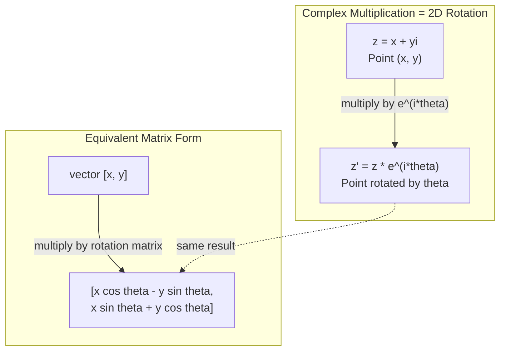
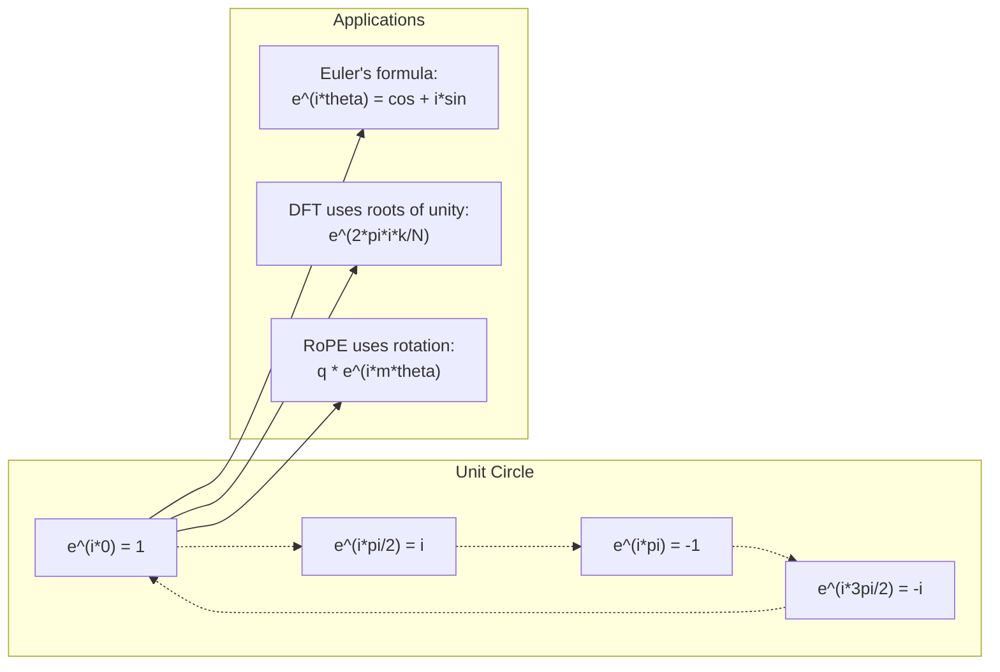

# AI를 위한 복소수

> -1의 제곱근은 상상의 산물이 아닙니다. 회전, 주파수, 그리고 신호 처리의 절반을 여는 열쇠입니다.

**유형:** Learn (이론)
**Language:** Python
**선수 레슨:** Phase 1, Lessons 01-04 (linear algebra, calculus)
**소요 시간:** ~60분

## 학습 목표

- 직교좌표 형식과 극좌표 형식 모두에서 복소수 연산(덧셈, 곱셈, 나눗셈, 켤레)을 수행합니다.
- 오일러 공식을 적용하여 복소 지수 함수와 삼각 함수 간 변환을 수행합니다.
- 복소 단위원의 거듭제곱근(roots of unity)을 사용하여 이산 푸리에 변환(Discrete Fourier Transform)을 구현합니다.
- 트랜스포머의 RoPE 및 사인파 위치 인코딩(sinusoidal positional encodings)의 기반에 복소수 회전이 어떻게 작용하는지 설명합니다.

## 문제 상황

푸리에 변환에 관한 논문을 펼치면 어디에나 `i`가 등장합니다. 트랜스포머 위치 인코딩을 살펴보면 서로 다른 주파수의 `sin`와 `cos`—즉 복소 지수의 실수부와 허수부—가 나타납니다. 양자 컴퓨팅에 대해 읽어보면 모든 것이 복소 벡터 공간으로 표현되어 있습니다.

복소수는 추상적으로 느껴집니다. -1의 제곱근 위에 구축된 수 체계는 수학적 속임수처럼 느껴지기도 합니다. 하지만 이는 속임수가 아닙니다. 회전과 진동을 표현하는 자연스러운 언어입니다. 무언가가 회전하거나, 진동하거나, 요동칠 때마다 복소수가 가장 적합한 도구가 됩니다.

복소수를 이해하지 못하면 이산 푸리에 변환을 이해할 수 없습니다. FFT를 이해할 수 없습니다. 최신 언어 모델에서 RoPE(Rotary Position Embedding)가 어떻게 작동하는지 이해할 수 없습니다. 최초의 Transformer 논문에서 사인파 위치 인코딩이 왜 그러한 주파수를 사용하는지 이해할 수 없습니다.

이번 레슨에서는 복소수 연산을 기초부터 구축하고, 기하학과 연결하며, 머신러닝에서 복소수가 정확히 어디에 나타나는지 보여줍니다.

## 개념

### 복소수란 무엇인가?

복소수는 실수부와 허수부의 두 부분으로 구성됩니다.

```
z = a + bi

where:
  a is the real part
  b is the imaginary part
  i is the imaginary unit, defined by i^2 = -1
```

그것이 전부입니다. 수직선을 평면으로 확장한 것입니다. 실수는 한 축에 놓이고, 허수는 다른 축에 놓입니다. 모든 복소수는 이 평면 위의 한 점입니다.

### 복소수 연산

**덧셈.** 실수부는 실수부끼리 더하고, 허수부는 허수부끼리 더합니다.

```
(a + bi) + (c + di) = (a + c) + (b + d)i

Example: (3 + 2i) + (1 + 4i) = 4 + 6i
```

**곱셈.** 분배법칙을 사용하고 i^2 = -1임을 기억합니다.

```
(a + bi)(c + di) = ac + adi + bci + bdi^2
                 = ac + adi + bci - bd
                 = (ac - bd) + (ad + bc)i

Example: (3 + 2i)(1 + 4i) = 3 + 12i + 2i + 8i^2
                            = 3 + 14i - 8
                            = -5 + 14i
```

**켤레복소수(Conjugate).** 허수부의 부호를 바꿉니다.

```
conjugate of (a + bi) = a - bi
```

복소수와 그 켤레복소수의 곱은 항상 실수입니다.

```
(a + bi)(a - bi) = a^2 + b^2
```

**나눗셈.** 분자와 분모에 분모의 켤레복소수를 곱합니다.

```
(a + bi) / (c + di) = (a + bi)(c - di) / (c^2 + d^2)
```

이렇게 하면 분모에서 허수부가 제거되어 깔끔한 복소수를 얻을 수 있습니다.

### 복소평면

복소평면은 모든 복소수를 2차원 점에 매핑합니다. 가로축은 실수축이고, 세로축은 허수축입니다.

```
z = 3 + 2i  corresponds to the point (3, 2)
z = -1 + 0i corresponds to the point (-1, 0) on the real axis
z = 0 + 4i  corresponds to the point (0, 4) on the imaginary axis
```

복소수는 원점으로부터의 점이자 동시에 벡터입니다. 이러한 이중적 해석 덕분에 복소수는 기하학에서 유용하게 쓰입니다.

### 극좌표 형식

평면 위의 모든 점은 원점으로부터의 거리와 양의 실수축으로부터의 각도로 표현할 수 있습니다.

```
z = r * (cos(theta) + i*sin(theta))

where:
  r = |z| = sqrt(a^2 + b^2)     (magnitude, or modulus)
  theta = atan2(b, a)             (phase, or argument)
```

직교좌표 형식(a + bi)은 덧셈에 유용합니다. 극좌표 형식(r, theta)은 곱셈에 유용합니다.

**극좌표 형식에서의 곱셈.** 크기는 곱하고, 각도는 더합니다.

```
z1 = r1 * e^(i*theta1)
z2 = r2 * e^(i*theta2)

z1 * z2 = (r1 * r2) * e^(i*(theta1 + theta2))
```

이것이 바로 복소수가 회전에 완벽한 이유입니다. 크기가 1인 복소수를 곱하는 것은 순수한 회전입니다.

### 오일러 공식

복소 지수와 삼각 함수를 잇는 다리입니다.

```
e^(i*theta) = cos(theta) + i*sin(theta)
```

이것은 이번 레슨에서 가장 중요한 공식입니다. theta = pi일 때 다음과 같습니다.

```
e^(i*pi) = cos(pi) + i*sin(pi) = -1 + 0i = -1

Therefore: e^(i*pi) + 1 = 0
```

다섯 개의 기초 상수(e, i, pi, 1, 0)가 하나의 방정식으로 연결됩니다.

### 오일러 공식이 ML에서 중요한 이유

오일러 공식에 따르면 theta가 변함에 따라 `e^(i*theta)`는 단위원(unit circle)을 그립니다. theta = 0에서는 (1, 0)에 위치합니다. theta = pi/2에서는 (0, 1)에 위치합니다. theta = pi에서는 (-1, 0)에 위치합니다. theta = 3*pi/2에서는 (0, -1)에 위치합니다. 한 바퀴 회전은 theta = 2*pi입니다.

즉, 복소 지수는 곧 회전입니다. 그리고 회전은 신호 처리와 ML 전반에 존재합니다.

### 2D 회전과의 연결

복소수 (x + yi)에 e^(i*theta)를 곱하면 점 (x, y)를 원점을 중심으로 각도 theta만큼 회전시킵니다.

```
Rotation via complex multiplication:
  (x + yi) * (cos(theta) + i*sin(theta))
  = (x*cos(theta) - y*sin(theta)) + (x*sin(theta) + y*cos(theta))i

Rotation via matrix multiplication:
  [cos(theta)  -sin(theta)] [x]   [x*cos(theta) - y*sin(theta)]
  [sin(theta)   cos(theta)] [y] = [x*sin(theta) + y*cos(theta)]
```

두 방식은 동일한 결과를 냅니다. 복소수 곱셈은 곧 2D 회전입니다. 회전 행렬은 복소수 곱셈을 행렬 표기법으로 나타낸 것일 뿐입니다.



### 페이저와 회전 신호

복소 지수 e^(i*omega*t)는 각주파수 omega로 단위원을 따라 회전하는 점입니다. t가 증가함에 따라 이 점은 원을 그립니다.

이 회전하는 점의 실수부는 cos(omega*t)입니다. 허수부는 sin(omega*t)입니다. 정현파(sinusoidal) 신호는 회전하는 복소수의 그림자입니다.

```
e^(i*omega*t) = cos(omega*t) + i*sin(omega*t)

Real part:      cos(omega*t)    -- a cosine wave
Imaginary part: sin(omega*t)    -- a sine wave
```

이것이 페이저(phasor) 표현입니다. 요동치는 사인파를 추적하는 대신, 매끄럽게 회전하는 화살표를 추적합니다. 위상 변위(phase shift)는 각도 오프셋이 됩니다. 진폭(amplitude) 변화는 크기 변화가 됩니다. 신호의 덧셈은 벡터 덧셈이 됩니다.

### 단위원의 거듭제곱근 (Roots of Unity)

단위원의 N차 거듭제곱근은 단위원 위에 등간격으로 배치된 N개의 점입니다.

```
w_k = e^(2*pi*i*k/N)    for k = 0, 1, 2, ..., N-1
```

N = 4일 때 거듭제곱근은 1, i, -1, -i(동서남북 4개 지점)입니다.
N = 8이면 4개 지점에 대각선 방향 4개 지점이 더해집니다.

단위원의 거듭제곱근은 이산 푸리에 변환의 기반입니다. DFT는 신호를 이들 N개의 등간격 주파수 성분으로 분해합니다.

### DFT와의 연결

신호 x[0], x[1], ..., x[N-1]의 이산 푸리에 변환(DFT)은 다음과 같습니다.

```
X[k] = sum_{n=0}^{N-1} x[n] * e^(-2*pi*i*k*n/N)
```

각 X[k]는 신호가 k번째 단위원의 거듭제곱근—즉 주파수 k의 복소 정현파—과 얼마나 상관관계를 가지는지를 측정합니다. DFT는 신호를 N개의 회전하는 페이저로 분해하고 각 페이저의 진폭과 위상을 알려줍니다.

### i가 상상의 산물이 아닌 이유

"허수(imaginary)"라는 단어는 역사적 우연에 불과합니다. 데카르트가 이 단어를 경멸적인 의미로 사용했습니다. 하지만 사람들이 처음에 음수를 거부했던 것 이상으로 i가 상상의 산물인 것은 아닙니다. 음수가 "3에서 5를 빼면 무엇이 되는가?"라는 질문에 답하듯이, 허수 단위는 "무엇을 제곱해야 -1이 되는가?"에 답합니다.

더 실용적으로 말하자면, i는 90도 회전 연산자입니다. 실수에 i를 한 번 곱하면 허수축 방향으로 90도 회전합니다. 여기에 i를 한 번 더 곱하면(i^2) 다시 90도 회전하여, 음의 실수 방향을 가리키게 됩니다. 이것이 i^2 = -1인 이유입니다. 신비로운 것이 아닙니다. 두 번의 1/4 회전으로 이루어진 반 바퀴 회전일 뿐입니다.

이것이 공학 전반에서 복소수가 널리 쓰이는 이유입니다. 전자기파, 양자 상태, 신호 진동, 위치 인코딩 등 회전하는 모든 것은 복소수로 자연스럽게 설명됩니다.
### 복소 지수 함수 vs 삼각 함수

오일러 공식(Euler's formula)이 등장하기 전, 엔지니어들은 신호를 진폭 A, 주파수 omega, 위상 phi를 사용하여 A*cos(omega*t + phi)로 표현했습니다. 이 방식도 동작은 하지만 연산이 매우 번거롭습니다. 위상이 서로 다른 두 코사인 함수를 더하려면 삼각함수 항등식을 사용해야 합니다.

복소 지수 함수(complex exponential)를 사용하면 동일한 신호가 A*e^(i*(omega*t + phi))로 표현됩니다. 두 신호를 더하는 것은 단순히 두 복소수를 더하는 것과 같습니다. 곱셈(변조)은 크기를 곱하고 각도를 더하기만 하면 됩니다. 위상 변위(phase shift)는 각도의 덧셈이 되며, 주파수 변위(frequency shift)는 페이저(phasor)와의 곱셈이 됩니다.

신호 처리(signal processing) 분야 전체가 복소 지수 표기법으로 전환한 이유는 수학적 처리가 훨씬 깔끔하기 때문입니다. "실제 신호(real signal)"는 항상 복소수 표현의 실수부(real part)에 불과합니다. 허수부(imaginary part)는 모든 대수적 연산이 자연스럽게 성립하도록 돕는 보조 역할을 하며 함께 다뤄집니다.

### 트랜스포머와의 연관성

**사인파 위치 인코딩(Sinusoidal positional encodings)** (오리지널 Transformer 논문):

```
PE(pos, 2i) = sin(pos / 10000^(2i/d))
PE(pos, 2i+1) = cos(pos / 10000^(2i/d))
```

sin과 cos 쌍은 서로 다른 주파수를 갖는 복소 지수 함수의 실수부와 허수부입니다. 각 주파수는 위치를 인코딩하기 위한 서로 다른 "해상도(resolution)"를 제공합니다. 저주파는 천천히 변하고(거친 위치 정보), 고주파는 빠르게 변합니다(세밀한 위치 정보). 이들이 결합하여 각 위치에 고유한 주파수 지문(frequency fingerprint)을 부여합니다.

**RoPE(Rotary Position Embedding)**는 여기서 한 걸음 더 나아갑니다. 쿼리(query) 및 키(key) 벡터에 복소 회전 행렬을 명시적으로 곱합니다. 두 토큰 사이의 상대적 위치는 회전 각도가 됩니다. 이렇게 회전된 벡터를 사용하여 어텐션(attention)을 계산하므로, 모델은 복소수 곱셈을 통해 상대적 위치에 민감하게 반응하게 됩니다.

| 연산 | 대수적 형태 | 기하학적 의미 |
|-----------|---------------|-------------------|
| 덧셈 | (a+c) + (b+d)i | 평면에서의 벡터 덧셈 |
| 곱셈 | (ac-bd) + (ad+bc)i | 회전 및 스케일링 |
| 켤레복소수 | a - bi | 실수축 대칭 이동 |
| 크기 | sqrt(a^2 + b^2) | 원점으로부터의 거리 |
| 위상 | atan2(b, a) | 양의 실수축과의 각도 |
| 나눗셈 | 켤레복소수 곱셈 | 역회전 및 재스케일링 |
| 거듭제곱 | r^n * e^(i*n*theta) | n번 회전, r^n배 스케일링 |



```figure
roots-of-unity
```

## 직접 구현해보기

### 1단계: Complex 클래스

사칙연산, 크기, 위상, 그리고 직교 좌표계와 극좌표계 간의 변환을 지원하는 복소수(Complex) 클래스를 구현합니다.

```python
import math

class Complex:
    def __init__(self, real, imag=0.0):
        self.real = real
        self.imag = imag

    def __add__(self, other):
        return Complex(self.real + other.real, self.imag + other.imag)

    def __mul__(self, other):
        r = self.real * other.real - self.imag * other.imag
        i = self.real * other.imag + self.imag * other.real
        return Complex(r, i)

    def __truediv__(self, other):
        denom = other.real ** 2 + other.imag ** 2
        r = (self.real * other.real + self.imag * other.imag) / denom
        i = (self.imag * other.real - self.real * other.imag) / denom
        return Complex(r, i)

    def magnitude(self):
        return math.sqrt(self.real ** 2 + self.imag ** 2)

    def phase(self):
        return math.atan2(self.imag, self.real)

    def conjugate(self):
        return Complex(self.real, -self.imag)
```

### 2단계: 극좌표 변환 및 오일러 공식

```python
def to_polar(z):
    return z.magnitude(), z.phase()

def from_polar(r, theta):
    return Complex(r * math.cos(theta), r * math.sin(theta))

def euler(theta):
    return Complex(math.cos(theta), math.sin(theta))
```

검증: `euler(theta).magnitude()`은 항상 1.0이어야 합니다. `euler(0)`는 (1, 0)이어야 하고, `euler(pi)`은 (-1, 0)이어야 합니다.

### 3단계: 회전

점 (x, y)를 각도 theta만큼 회전하는 것은 한 번의 복소수 곱셈으로 이루어집니다.

```python
point = Complex(3, 4)
rotated = point * euler(math.pi / 4)
```

크기는 그대로 유지되며, 각도만 변합니다.

### 4단계: 복소 연산을 이용한 DFT

```python
def dft(signal):
    N = len(signal)
    result = []
    for k in range(N):
        total = Complex(0, 0)
        for n in range(N):
            angle = -2 * math.pi * k * n / N
            total = total + Complex(signal[n], 0) * euler(angle)
        result.append(total)
    return result
```

이는 O(N^2)의 DFT(이산 푸리에 변환)입니다. 각 출력 X[k]는 신호 샘플들에 1의 거듭제곱근(roots of unity)을 곱하여 합산한 값입니다.

### 5단계: 역 DFT

역 DFT(IDFT)는 스펙트럼으로부터 원래 신호를 복원합니다. 순방향 DFT와의 차이점은 지수의 부호를 반전하고 N으로 나누는 것뿐입니다.

```python
def idft(spectrum):
    N = len(spectrum)
    result = []
    for n in range(N):
        total = Complex(0, 0)
        for k in range(N):
            angle = 2 * math.pi * k * n / N
            total = total + spectrum[k] * euler(angle)
        result.append(Complex(total.real / N, total.imag / N))
    return result
```

이를 통해 완벽한 복원이 가능합니다. DFT를 적용한 뒤 IDFT를 적용하면 기계 정밀도(machine precision) 범위 내에서 원래 신호로 되돌아옵니다. 어떤 정보도 손실되지 않습니다.

### 6단계: 1의 거듭제곱근

```python
def roots_of_unity(N):
    return [euler(2 * math.pi * k / N) for k in range(N)]
```

다음 두 가지 특성을 검증합니다.
- 모든 거듭제곱근의 크기는 정확히 1입니다.
- N개의 모든 거듭제곱근의 합은 0입니다(대칭성에 의해 상쇄됨).

이러한 특성 덕분에 DFT의 역변환이 가능해집니다. 1의 거듭제곱근은 주파수 영역(frequency domain)에 대한 직교 기저(orthogonal basis)를 형성합니다.

## 사용해보기

Python은 기본적으로 복소수를 지원합니다. 리터럴 `j`는 허수 단위를 나타냅니다.

```python
z = 3 + 2j
w = 1 + 4j

print(z + w)
print(z * w)
print(abs(z))

import cmath
print(cmath.phase(z))
print(cmath.exp(1j * cmath.pi))
```

배열의 경우, numpy는 복소수를 기본적으로 처리합니다.

```python
import numpy as np

z = np.array([1+2j, 3+4j, 5+6j])
print(np.abs(z))
print(np.angle(z))
print(np.conj(z))
print(np.real(z))
print(np.imag(z))

signal = np.sin(2 * np.pi * 5 * np.linspace(0, 1, 128))
spectrum = np.fft.fft(signal)
freqs = np.fft.fftfreq(128, d=1/128)
```

## 배포하기

`code/complex_numbers.py`를 실행하여 `outputs/skill-complex-arithmetic.md`을 생성합니다.

## 연습 문제

1. **손으로 복소 연산하기.** (2 + 3i) * (4 - i)를 계산하고 코드로 검증하세요. 그 다음 (5 + 2i) / (1 - 3i)를 계산하세요. 두 결과를 복소평면에 그리고, 곱셈이 첫 번째 숫자를 회전 및 스케일링했는지 확인하세요.

2. **회전 시퀀스.** 점 (1, 0)에서 시작합니다. e^(i*pi/6)을 12번 곱하세요. 12번 곱한 후에 다시 (1, 0)으로 돌아오는지 확인하세요. 각 단계에서의 좌표를 출력하고 정십이각형을 그리는지 확인하세요.

3. **알려진 신호의 DFT.** 32개 지점에서 샘플링된 sin(2*pi*3*t)와 0.5*sin(2*pi*7*t)의 합으로 구성된 신호를 만드세요. 작성한 DFT를 실행하세요. 크기 스펙트럼의 주파수 3과 7에서 피크가 나타나는지, 그리고 주파수 7의 피크 높이가 주파수 3의 피크 높이의 절반인지 확인하세요.

4. **1의 거듭제곱근 시각화.** 1의 8제곱근을 계산하세요. 이들의 합이 0인지 확인하세요. 임의의 거듭제곱근에 원시 거듭제곱근(primitive root) e^(2*pi*i/8)을 곱하면 다음 거듭제곱근이 되는지 확인하세요.

5. **회전 행렬과의 동등성.** 임의의 10개 각도와 10개 점에 대해, 복소수 곱셈이 2x2 회전 행렬을 사용한 행렬-벡터 곱셈과 동일한 결과를 내는지 검증하세요. 최대 수치 오차를 출력하세요.

## 핵심 용어

| 용어 | 의미 |
|------|---------------|
| 복소수(Complex number) | a는 실수부, b는 허수부이고 i^2 = -1인 수 a + bi |
| 허수 단위(Imaginary unit) | i^2 = -1로 정의되는 수 i. 철학적 의미의 가상이 아니며 회전 연산자 역할을 함 |
| 복소평면(Complex plane) | x축은 실수이고 y축은 허수인 2차원 평면. 아르간 평면(Argand plane)이라고도 함 |
| 크기(Magnitude, modulus) | 원점으로부터의 거리: sqrt(a^2 + b^2). \|z\|로 표기함 |
| 위상(Phase, argument) | 양의 실수축으로부터의 각도: atan2(b, a). arg(z)로 표기함 |
| 켤레복소수(Conjugate) | 실수축을 기준으로 한 대칭상: a + bi의 켤레복소수는 a - bi |
| 극형식(Polar form) | z를 a + bi 대신 r * e^(i*theta)로 표현하는 방식. 곱셈 연산이 간단해짐 |
| 오일러 공식(Euler's formula) | e^(i*theta) = cos(theta) + i*sin(theta). 지수 함수와 삼각 함수를 연결함 |
| 페이저(Phasor) | 정현파 신호를 나타내는 회전하는 복소수 e^(i*omega*t) |
| 1의 거듭제곱근(Roots of unity) | k = 0부터 N-1까지의 N개 복소수 e^(2*pi*i*k/N). 단위 원 위에 균등하게 분포된 N개의 점 |
| DFT | 이산 푸리에 변환(Discrete Fourier Transform). 1의 거듭제곱근을 사용하여 신호를 복소 정현파 성분으로 분해함 |
| RoPE | 회전 위치 임베딩(Rotary Position Embedding). 트랜스포머 어텐션에서 복소수 곱셈을 사용하여 상대적 위치를 인코딩함 |

## 더 읽을거리

- [Visual Introduction to Euler's Formula](https://betterexplained.com/articles/intuitive-understanding-of-eulers-formula/) - 복잡한 표기법 없이 기하학적 직관을 길러줌
- [Su et al.: RoFormer (2021)](https://arxiv.org/abs/2104.09864) - 복소 회전을 사용한 Rotary Position Embedding을 소개한 논문
- [Vaswani et al.: Attention Is All You Need (2017)](https://arxiv.org/abs/1706.03762) - 사인파 위치 인코딩을 제안한 오리지널 Transformer 논문
- [3Blue1Brown: Euler's formula with introductory group theory](https://www.youtube.com/watch?v=mvmuCPvRoWQ) - e^(i*pi) = -1인 이유에 대한 시각적 설명
- [Needham: Visual Complex Analysis](https://global.oup.com/academic/product/visual-complex-analysis-9780198534464) - 복소수를 시각적으로 가장 잘 다룬 책으로, 풍부한 기하학적 통찰 제공
- [Strang: Introduction to Linear Algebra, Ch. 10](https://math.mit.edu/~gs/linearalgebra/) - 선형대수학 및 고윳값 관점에서의 복소수 다루기
