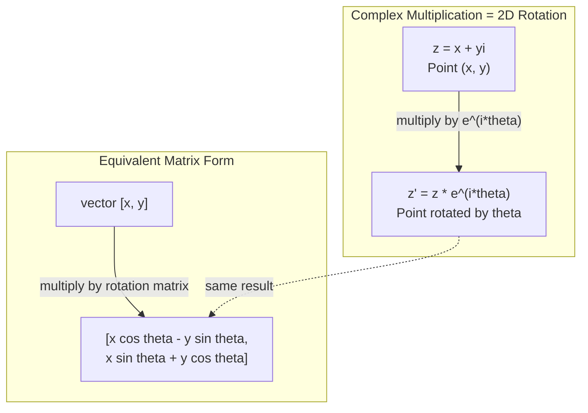
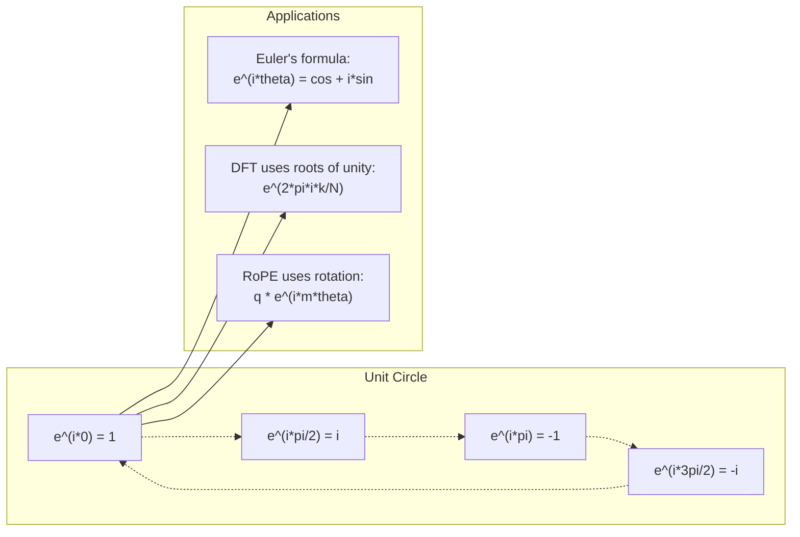

# AI를 위한 복소수

> -1의 제곱근은 상상의 산물이 아닙니다. 이는 회전, 주파수, 그리고 신호 처리의 절반을 이해하는 핵심 열쇠입니다.

**유형:** Learn (이론)
**사용 언어:** Python, TypeScript
**선수 레슨:** Phase 1, Lessons 01-04 (linear algebra, calculus)
**소요 시간:** ~60분

## 학습 목표

- 직교좌표 형식과 극좌표 형식 모두에서 복소수 연산(덧셈, 곱셈, 나눗셈, 켤레)을 수행할 수 있습니다.
- 오일러 공식을 적용하여 복소 지수와 삼각 함수 간의 변환을 수행할 수 있습니다.
- 복소 단위원의 거듭제곱근을 사용하여 이산 푸리에 변환(Discrete Fourier Transform)을 구현할 수 있습니다.
- 트랜스포머의 RoPE 및 사인파 위치 인코딩(sinusoidal positional encodings)의 기반에 복소수 회전이 어떻게 작용하는지 설명할 수 있습니다.

## 문제 상황

푸리에 변환에 관한 논문을 펼치면 온통 `i`로 가득 차 있습니다. 트랜스포머의 위치 인코딩을 살펴보면 복소 지수의 실수부와 허수부에 해당하는 서로 다른 주파수의 `sin` 및 `cos`을 보게 됩니다. 양자 컴퓨팅에 대해 읽어보면 모든 것이 복소 벡터 공간으로 표현되어 있습니다.

복소수는 추상적으로 느껴집니다. -1의 제곱근 위에 구축된 수 체계는 수학적 속임수처럼 느껴지기도 합니다. 하지만 이는 속임수가 아닙니다. 회전과 진동을 표현하는 가장 자연스러운 언어입니다. 무언가가 회전하거나 진동하거나 요동칠 때마다 복소수는 가장 적합한 도구가 됩니다.

복소수를 이해하지 못하면 이산 푸리에 변환을 이해할 수 없습니다. FFT(고속 푸리에 변환)를 이해할 수 없습니다. 현대 언어 모델에서 RoPE(Rotary Position Embedding)가 어떻게 작동하는지 이해할 수 없습니다. 오리지널 Transformer 논문의 사인파 위치 인코딩이 왜 특정 주파수들을 사용하는지 이해할 수 없습니다.

이번 레슨에서는 복소수 연산을 기초부터 구축하고, 이를 기하학과 연결하며, 머신러닝에서 복소수가 정확히 어디에 나타나는지 살펴봅니다.

## 핵심 개념

### 복소수란 무엇인가?

복소수는 두 부분, 즉 실수부와 허수부로 구성됩니다.

```
z = a + bi

where:
  a is the real part
  b is the imaginary part
  i is the imaginary unit, defined by i^2 = -1
```

이것이 전부입니다. 수직선을 평면으로 확장한 것입니다. 실수는 한 축에 놓이고, 허수는 다른 축에 놓입니다. 모든 복소수는 이 평면 위의 한 점입니다.

### 복소수 연산

**덧셈.** 실수부는 실수부끼리 더하고, 허수부는 허수부끼리 더합니다.

```math
\begin{aligned}
(a + bi) + (c + di) &= (a + c) + (b + d)i \\[4pt]
\text{Example: } (3 + 2i) + (1 + 4i) &= 4 + 6i
\end{aligned}
```

**곱셈.** 분배법칙을 사용하고 $i^2 = -1$임을 기억합니다.

```math
\begin{aligned}
(a + bi)(c + di) &= ac + adi + bci + bdi^2 \\
&= ac + adi + bci - bd \\
&= (ac - bd) + (ad + bc)i \\[8pt]
\text{Example: } (3 + 2i)(1 + 4i) &= 3 + 12i + 2i + 8i^2 \\
&= 3 + 14i - 8 \\
&= -5 + 14i
\end{aligned}
```

**켤레복소수(Conjugate).** 허수부의 부호를 바꿉니다.

```math
\text{conjugate of } (a + bi) = a - bi
```

복소수와 그 켤레복소수의 곱은 항상 실수입니다.

```math
(a + bi)(a - bi) = a^2 + b^2
```

**나눗셈.** 분자와 분모에 분모의 켤레복소수를 곱합니다.

```math
\frac{a + bi}{c + di} = \frac{(a + bi)(c - di)}{c^2 + d^2}
```

이렇게 하면 분모에서 허수부가 제거되어 깔끔한 복소수 형태를 얻을 수 있습니다.

### 복소평면

복소평면은 모든 복소수를 2차원 점으로 매핑합니다. 가로축은 실수축이고, 세로축은 허수축입니다.

```
z = 3 + 2i  corresponds to the point (3, 2)
z = -1 + 0i corresponds to the point (-1, 0) on the real axis
z = 0 + 4i  corresponds to the point (0, 4) on the imaginary axis
```

복소수는 점인 동시에 원점에서 출발하는 벡터이기도 합니다. 이러한 이중적 해석 덕분에 복소수는 기하학에서 매우 유용하게 쓰입니다.

### 극좌표 형식

평면 위의 모든 점은 원점으로부터의 거리와 양의 실수축으로부터의 각도로 표현할 수 있습니다.

```math
\begin{aligned}
z &= r (\cos\theta + i \sin\theta) \\[4pt]
\text{where: } r &= |z| = \sqrt{a^2 + b^2} \quad \text{(magnitude, or modulus)} \\
\theta &= \mathop{\mathrm{atan2}}(b, a) \quad \text{(phase, or argument)}
\end{aligned}
```

직교좌표 형식 $(a + bi)$은 덧셈에 유용합니다. 극좌표 형식 $(r, \theta)$은 곱셈에 유용합니다.

**극좌표 형식에서의 곱셈.** 크기는 곱하고, 각도는 더합니다.

```math
\begin{aligned}
z_1 &= r_1 e^{i\theta_1} \\
z_2 &= r_2 e^{i\theta_2} \\[4pt]
z_1 z_2 &= (r_1 r_2) \, e^{i(\theta_1 + \theta_2)}
\end{aligned}
```

이것이 복소수가 회전을 다루기에 완벽한 이유입니다. 크기가 1인 복소수를 곱하는 것은 순수한 회전을 의미합니다.

### 오일러 공식

복소 지수와 삼각 함수를 잇는 가교 역할을 합니다.

```math
e^{i\theta} = \cos\theta + i \sin\theta
```

이 공식은 이번 레슨에서 가장 중요한 공식입니다. $\theta = \pi$일 때:

```math
\begin{aligned}
e^{i\pi} &= \cos\pi + i \sin\pi = -1 + 0i = -1 \\[4pt]
\text{Therefore: } e^{i\pi} + 1 &= 0
\end{aligned}
```

다섯 가지 기본 상수($e$, $i$, $\pi$, 1, 0)가 하나의 등식으로 연결됩니다.

### 오일러 공식이 ML에서 중요한 이유

오일러 공식은 $\theta$가 변함에 따라 $e^{i\theta}$가 단위원(unit circle)을 그리며 나아간다는 것을 의미합니다. $\theta = 0$에서는 $(1, 0)$에 위치합니다. $\theta = \pi/2$에서는 $(0, 1)$에 위치합니다. $\theta = \pi$에서는 $(-1, 0)$에 위치합니다. $\theta = 3\pi/2$에서는 $(0, -1)$에 위치합니다. 한 바퀴의 완전한 회전은 $\theta = 2\pi$입니다.

이는 곧 복소 지수가 '회전' 그 자체임을 의미합니다. 그리고 회전은 신호 처리와 ML 전반에 걸쳐 어디에나 존재합니다.

### 2차원 회전과의 연결

복소수 $(x + yi)$에 $e^{i\theta}$을 곱하면 점 $(x, y)$을 원점을 중심으로 각도 $\theta$만큼 회전시킵니다.

```math
\begin{aligned}
&\text{Rotation via complex multiplication:} \\
&\quad (x + yi)(\cos\theta + i \sin\theta) = (x \cos\theta - y \sin\theta) + (x \sin\theta + y \cos\theta)i \\[8pt]
&\text{Rotation via matrix multiplication:} \\
&\quad \begin{bmatrix} \cos\theta & -\sin\theta \\ \sin\theta & \cos\theta \end{bmatrix} \begin{bmatrix} x \\ y \end{bmatrix} = \begin{bmatrix} x \cos\theta - y \sin\theta \\ x \sin\theta + y \cos\theta \end{bmatrix}
\end{aligned}
```

두 계산은 동일한 결과를 냅니다. 복소수 곱셈은 '2차원 회전'과 같습니다. 회전 행렬은 복소수 곱셈을 행렬 표기법으로 나타낸 것에 불과합니다.



### 페이저(Phasor)와 회전하는 신호

복소 지수 $e^{i\omega t}$는 각주파수 $\omega$로 단위원 둘레를 회전하는 점입니다. $t$가 증가함에 따라 이 점은 원을 그립니다.

이 회전하는 점의 실수부는 $\cos(\omega t)$입니다. 허수부는 $\sin(\omega t)$입니다. 사인파 신호는 회전하는 복소수의 그림자입니다.

```math
\begin{aligned}
e^{i\omega t} &= \cos(\omega t) + i \sin(\omega t) \\[4pt]
\text{Real part: } & \cos(\omega t) \quad \text{-- a cosine wave} \\
\text{Imaginary part: } & \sin(\omega t) \quad \text{-- a sine wave}
\end{aligned}
```

이것이 바로 페이저(phasor) 표현입니다. 물결치는 사인파를 추적하는 대신 부드럽게 회전하는 화살표를 추적합니다. 위상 변화는 각도의 오프셋이 됩니다. 진폭 변화는 크기 변화가 됩니다. 신호의 덧셈은 벡터의 덧셈이 됩니다.

### 단위원의 거듭제곱근(Roots of unity)

단위원의 $N$제곱근은 단위원 위에 등간격으로 배치된 $N$개의 점입니다.

```math
w_k = e^{2\pi i k/N} \quad \text{for } k = 0, 1, 2, \ldots, N-1
```

$N = 4$인 경우 거듭제곱근은 $1, i, -1, -i$(나침반의 네 방위점)입니다.
$N = 8$인 경우 네 방위점에 대각선 방향 네 개가 추가됩니다.

단위원의 거듭제곱근은 이산 푸리에 변환(DFT)의 기초가 됩니다. DFT는 신호를 이처럼 등간격으로 나뉜 $N$개의 주파수 성분으로 분해합니다.

### DFT와의 연결

신호 $x[0], x[1], \ldots, x[N-1]$의 이산 푸리에 변환은 다음과 같습니다.

```math
X[k] = \sum_{n=0}^{N-1} x[n] \, e^{-2\pi i k n/N}
```

각 $X[k]$은 신호가 $k$번째 단위원 거듭제곱근(주파수 $k$인 복소 사인파)과 얼마나 상관관계를 갖는지를 측정합니다. DFT는 신호를 $N$개의 회전하는 페이저로 분해하고 각 페이저의 진폭과 위상을 알려줍니다.

### i가 상상의 산물이 아닌 이유

"허수(imaginary)"라는 단어는 역사적 우연의 산물입니다. 데카르트가 이 개념을 무시하듯 사용했습니다. 하지만 사람들이 처음에 음수를 거부했던 시절과 비교하면 $i$ 역시 전혀 가상의 것이 아닙니다. 음수는 "3에서 5를 빼면 무엇이 되는가?"에 답합니다. 허수단위는 "무엇을 제곱해야 -1이 되는가?"에 답합니다.

더 유용하게 설명하자면, $i$는 90도 회전 연산자입니다. 실수에 $i$를 한 번 곱하면 허수축을 향해 90도 회전합니다. 여기에 $i$를 한 번 더 곱하면($i^2$), 다시 90도 회전하여 이제 음의 실수 방향을 가리키게 됩니다. 이것이 바로 $i^2 = -1$인 이유입니다. 결코 신비로운 현상이 아닙니다. 두 번의 90도 회전(quarter-turn)으로 만들어진 180도 반회전(half-turn)일 뿐입니다.

이것이 엔지니어링 전반에서 복소수가 어디에나 쓰이는 이유입니다. 전자기파, 양자 상태, 신호 진동, 위치 인코딩 등 회전하는 모든 것은 복소수를 통해 가장 자연스럽게 설명됩니다.
### 복소 지수 함수 vs 삼각 함수

오일러 공식 이전에는 엔지니어들이 신호를 진폭 $A$, 주파수 $\omega$, 위상 $\phi$을 갖는 $A \cos(\omega t + \phi)$ 형태로 표현했습니다. 이 방식도 동작은 하지만 연산이 매우 번거롭습니다. 위상이 서로 다른 두 코사인 함수를 더하려면 삼각함수 항등식을 사용해야 합니다.

복소 지수 함수를 사용하면 동일한 신호가 $A e^{i(\omega t + \phi)}$가 됩니다. 두 신호를 더하는 것은 단순히 두 복소수를 더하는 것에 불과합니다. 곱하기(변조)는 크기를 곱하고 각도를 더하는 것뿐입니다. 위상 변이는 각도 덧셈이 됩니다. 주파수 변이는 페이저(phasor)를 곱하는 것이 됩니다.

수식이 훨씬 깔끔해지기 때문에 신호 처리 분야 전체가 복소 지수 표기법으로 전환되었습니다. "실제 신호"는 항상 복소수 표현의 실수부일 뿐입니다. 허수부는 연산 보조용으로 함께 유지되며, 모든 대수 연산이 자연스럽게 맞아떨어지도록 해 줍니다.

### Transformer와의 연결점

**정현파 위치 인코딩(Sinusoidal positional encodings)** (오리지널 Transformer 논문):

```math
\begin{aligned}
PE(pos, 2i) &= \sin\left(pos / 10000^{2i/d}\right) \\
PE(pos, 2i+1) &= \cos\left(pos / 10000^{2i/d}\right)
\end{aligned}
```

sin과 cos 쌍은 서로 다른 주파수를 갖는 복소 지수 함수의 실수부와 허수부입니다. 각 주파수는 위치를 인코딩하기 위한 서로 다른 "해상도"를 제공합니다. 저주파는 천천히 변화하며(대략적인 위치), 고주파는 빠르게 변화합니다(세밀한 위치). 이 둘이 합쳐져 각 위치에 고유한 주파수 지문을 부여합니다.

**RoPE (Rotary Position Embedding)**는 여기서 한 걸음 더 나아갑니다. 쿼리(query) 및 키(key) 벡터에 복소 회전 행렬을 명시적으로 곱합니다. 두 토큰 간의 상대적 위치는 회전 각도가 됩니다. 어텐션(attention)은 이 회전된 벡터들을 사용하여 계산되므로, 모델이 복소수 곱셈을 통해 상대적 위치를 인식할 수 있게 됩니다.

| Operation | Algebraic Form | Geometric Meaning |
|-----------|---------------|-------------------|
| 덧셈 | $(a+c) + (b+d)i$ | 평면에서의 벡터 덧셈 |
| 곱셈 | $(ac-bd) + (ad+bc)i$ | 회전 및 크기 조정 |
| 켤레복소수 | $a - bi$ | 실수축 대칭 |
| 크기 | $\sqrt{a^2 + b^2}$ | 원점으로부터의 거리 |
| 위상 | $\mathop{\mathrm{atan2}}(b, a)$ | 양의 실수축으로부터의 각도 |
| 나눗셈 | 켤레복소수를 곱함 | 역회전 및 크기 재조정 |
| 거듭제곱 | $r^n e^{in\theta}$ | $n$번 회전, $r^n$배 크기 조정 |



```figure
roots-of-unity
```

## 직접 구현하기

### 1단계: Complex 클래스

사칙연산, 크기, 위상, 그리고 직교 좌표와 극좌표 형태 간의 변환을 지원하는 Complex 클래스를 구현합니다.

```python
import math

class Complex:
    def __init__(self, real, imag=0.0):
        self.real = real
        self.imag = imag

    def __add__(self, other):
        return Complex(self.real + other.real, self.imag + other.imag)

    def __mul__(self, other):
        r = self.real * other.real - self.imag * other.imag
        i = self.real * other.imag + self.imag * other.real
        return Complex(r, i)

    def __truediv__(self, other):
        denom = other.real ** 2 + other.imag ** 2
        r = (self.real * other.real + self.imag * other.imag) / denom
        i = (self.imag * other.real - self.real * other.imag) / denom
        return Complex(r, i)

    def magnitude(self):
        return math.sqrt(self.real ** 2 + self.imag ** 2)

    def phase(self):
        return math.atan2(self.imag, self.real)

    def conjugate(self):
        return Complex(self.real, -self.imag)
```

### 2단계: 극좌표 변환 및 오일러 공식

```python
def to_polar(z):
    return z.magnitude(), z.phase()

def from_polar(r, theta):
    return Complex(r * math.cos(theta), r * math.sin(theta))

def euler(theta):
    return Complex(math.cos(theta), math.sin(theta))
```

검증: `euler(theta).magnitude()`은 항상 1.0이어야 합니다. `euler(0)`은 (1, 0)을 반환해야 합니다. `euler(pi)`는 (-1, 0)을 반환해야 합니다.

### 3단계: 회전

점 $(x, y)$를 각도 $\theta$만큼 회전하는 것은 한 번의 복소수 곱셈으로 이루어집니다.

```python
point = Complex(3, 4)
rotated = point * euler(math.pi / 4)
```

크기는 그대로 유지되며, 각도만 변합니다.

### 4단계: 복소 연산 기반 DFT

```python
def dft(signal):
    N = len(signal)
    result = []
    for k in range(N):
        total = Complex(0, 0)
        for n in range(N):
            angle = -2 * math.pi * k * n / N
            total = total + Complex(signal[n], 0) * euler(angle)
        result.append(total)
    return result
```

이것이 $O(N^2)$ DFT입니다. 각 출력 $X[k]$는 신호 샘플들에 1의 거듭제곱근(roots of unity)을 곱한 값들의 합입니다.

### 5단계: 역 DFT

역 DFT(IDFT)는 스펙트럼으로부터 원래의 신호를 재구성합니다. 순방향 DFT와의 유일한 차이점은 지수의 부호를 바꾸고 $N$로 나누는 것입니다.

```python
def idft(spectrum):
    N = len(spectrum)
    result = []
    for n in range(N):
        total = Complex(0, 0)
        for k in range(N):
            angle = 2 * math.pi * k * n / N
            total = total + spectrum[k] * euler(angle)
        result.append(Complex(total.real / N, total.imag / N))
    return result
```

이를 통해 완벽한 재구성이 가능합니다. DFT를 적용한 후 IDFT를 적용하면 머신 정밀도 수준으로 원래 신호를 복원할 수 있습니다. 어떤 정보도 손실되지 않습니다.

### 6단계: 1의 거듭제곱근

```python
def roots_of_unity(N):
    return [euler(2 * math.pi * k / N) for k in range(N)]
```

두 가지 특성을 확인합니다.
- 모든 근의 크기는 정확히 1입니다.
- 모든 $N$개 근의 합은 0입니다 (대칭성에 의해 상쇄됩니다).

이러한 특성 덕분에 DFT의 역변환이 가능합니다. 1의 거듭제곱근은 주파수 영역에 대한 직교 기저를 형성합니다.

## 활용하기

Python은 복소수를 기본적으로 지원합니다. 리터럴 `j`는 허수 단위를 나타냅니다.

```python
z = 3 + 2j
w = 1 + 4j

print(z + w)
print(z * w)
print(abs(z))

import cmath
print(cmath.phase(z))
print(cmath.exp(1j * cmath.pi))
```

배열의 경우, numpy는 복소수를 기본적으로 처리합니다.

```python
import numpy as np

z = np.array([1+2j, 3+4j, 5+6j])
print(np.abs(z))
print(np.angle(z))
print(np.conj(z))
print(np.real(z))
print(np.imag(z))

signal = np.sin(2 * np.pi * 5 * np.linspace(0, 1, 128))
spectrum = np.fft.fft(signal)
freqs = np.fft.fftfreq(128, d=1/128)
```

## 배포하기

`code/complex_numbers.py` 또는 `npx tsx code/complex_numbers.ts`를 실행하여 `outputs/skill-complex-arithmetic.md`을 생성합니다.

## 연습 문제

1. **손으로 하는 복소 연산.** $(2 + 3i)(4 - i)$을 계산하고 코드로 검증합니다. 그런 다음 $(5 + 2i) / (1 - 3i)$를 계산합니다. 복소평면에 두 결과를 그리고 곱셈이 첫 번째 수를 회전하고 크기 조정한 것을 확인합니다.

2. **회전 시퀀스.** 점 $(1, 0)$에서 시작합니다. $e^{i\pi/6}$을 열두 번 곱합니다. 12번 곱한 후에 $(1, 0)$로 돌아오는지 확인합니다. 각 단계의 좌표를 출력하고 정십이각형을 그리는지 확인합니다.

3. **알려진 신호의 DFT.** 32개 지점에서 샘플링된 $\sin(2\pi \cdot 3t)$과 $0.5 \sin(2\pi \cdot 7t)$의 합인 신호를 생성합니다. 작성한 DFT를 실행합니다. 크기 스펙트럼에서 주파수 3과 7에 피크가 나타나고, 주파수 7의 피크 높이가 주파수 3 피크 높이의 절반인지 확인합니다.

4. **1의 거듭제곱근 시각화.** 1의 8제곱근을 계산합니다. 이들의 합이 0인지 확인합니다. 임의의 근에 원시근(primitive root) $e^{2\pi i/8}$를 곱하면 다음 근이 되는지 확인합니다.

5. **회전 행렬과의 동등성.** 10개의 무작위 각도와 10개의 무작위 점에 대해, 복소수 곱셈이 2x2 회전 행렬을 사용한 행렬-벡터 곱셈과 동일한 결과를 내는지 확인합니다. 최대 수치 오차를 출력합니다.

### 힌트

**연습 문제 1.** $i^2 = -1$을 사용하여 곱을 전개한 다음, 분모와 분자에 켤레복소수 $1 + 3i$을 곱하여 나눕니다. `Complex(2, 3) * Complex(4, -1)`로 곱을 확인합니다. 결과의 `magnitude()`은 두 크기의 곱과 같아야 하고, `phase()`는 두 위상의 합과 같아야 합니다.

**연습 문제 2.** `euler(math.pi / 6)`으로 회전 단계를 만들고 12번 곱합니다. 각 단계에서 크기가 1로 유지되고 각도가 30도씩 증가하는지 확인합니다. 마지막 점은 (1, 0)과 약 1e-12 이내의 오차여야 합니다.

**연습 문제 3.** $t = n/32$로 시간 지점들을 만들고 `dft`을 호출합니다. 상위 절반은 대칭이므로 빈(bin) 0부터 15까지만 살펴봅니다. 진폭 $A$인 사인파의 빈 $k$에서의 크기는 $AN/2$이므로, 빈 3에서는 약 16, 빈 7에서는 약 8이 나올 것으로 예상할 수 있습니다.

**연습 문제 4.** `roots_of_unity(8)`를 호출하고 근들을 모두 더합니다. 합의 크기는 0에 가까워야 합니다. 각 근을 이전 근으로 나누고 모든 결과가 `euler(2 * math.pi / 8)`과 일치하는지 확인합니다.

**연습 문제 5.** 회전 행렬은 [[cos t, -sin t], [sin t, cos t]]입니다. 각 각도와 점에 대해 `euler(t) * Complex(x, y)`와 행렬 곱을 계산한 다음, 가장 큰 절댓값 차이를 기록합니다. $10^{-15}$에 가까운 값이 나와야 합니다.
## 핵심 용어

| 용어 | 의미 |
|------|---------------|
| 복소수(Complex number) | $a$는 실수부, $b$는 허수부이고 $i^2 = -1$인 수 $a + bi$ |
| 허수 단위(Imaginary unit) | $i^2 = -1$로 정의되는 수 $i$. 철학적 의미의 상상의 수가 아니며, 회전 연산자입니다 |
| 복소평면(Complex plane) | x축은 실수축, y축은 허수축인 2차원 평면. 아르간 평면(Argand plane)이라고도 부릅니다 |
| 크기(절댓값/Modulus) | 원점으로부터의 거리: $\sqrt{a^2 + b^2}$. $\lvert z \rvert$로 표기합니다 |
| 위상(편각/Argument) | 양의 실수축으로부터의 각도: $\mathop{\mathrm{atan2}}(b, a)$. $\arg(z)$로 표기합니다 |
| 켤레복소수(Conjugate) | 실수축에 대한 대칭상: $a + bi$의 켤레복소수는 $a - bi$입니다 |
| 극형식(Polar form) | $z$를 $a + bi$ 대신 $r e^{i\theta}$로 표현하는 방식. 곱셈 연산이 쉬워집니다 |
| 오일러 공식(Euler's formula) | $e^{i\theta} = \cos\theta + i \sin\theta$. 지수 함수와 삼각 함수를 연결합니다 |
| 페이저(Phasor) | 정현파(sinusoidal) 신호를 나타내는 회전하는 복소수 $e^{i\omega t}$ |
| 1의 거듭제곱근(Roots of unity) | $k = 0$부터 $N-1$까지에 대한 $N$개의 복소수 $e^{2\pi i k/N}$. 단위 원 위의 등간격 점 $N$개입니다 |
| DFT | 이산 푸리에 변환(Discrete Fourier Transform). 1의 거듭제곱근을 사용하여 신호를 복소 정현파 성분으로 분해합니다 |
| RoPE | 회전 위치 임베딩(Rotary Position Embedding). 복소수 곱셈을 사용하여 Transformer 어텐션(attention)에서 상대적 위치를 인코딩합니다 |

## 더 읽을거리

- [Visual Introduction to Euler's Formula](https://betterexplained.com/articles/intuitive-understanding-of-eulers-formula/) - 복잡한 표기법 없이 기하학적 직관을 길러줍니다
- [Su et al.: RoFormer (2021)](https://arxiv.org/abs/2104.09864) - 복소수 회전을 사용한 Rotary Position Embedding을 소개한 논문
- [Vaswani et al.: Attention Is All You Need (2017)](https://arxiv.org/abs/1706.03762) - 정현파 위치 인코딩을 다룬 오리지널 Transformer 논문
- [3Blue1Brown: Euler's formula with introductory group theory](https://www.youtube.com/watch?v=mvmuCPvRoWQ) - 왜 $e^{i\pi} = -1$인지에 대한 시각적 설명
- [Needham: Visual Complex Analysis](https://global.oup.com/academic/product/visual-complex-analysis-9780198534464) - 기하학적 통찰로 가득 찬 복소수 분야 최고의 시각적 기본서
- [Strang: Introduction to Linear Algebra, Ch. 10](https://math.mit.edu/~gs/linearalgebra/) - 선형대수학 및 고윳값(eigenvalue) 관점에서의 복소수
