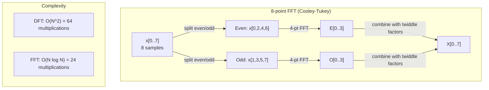
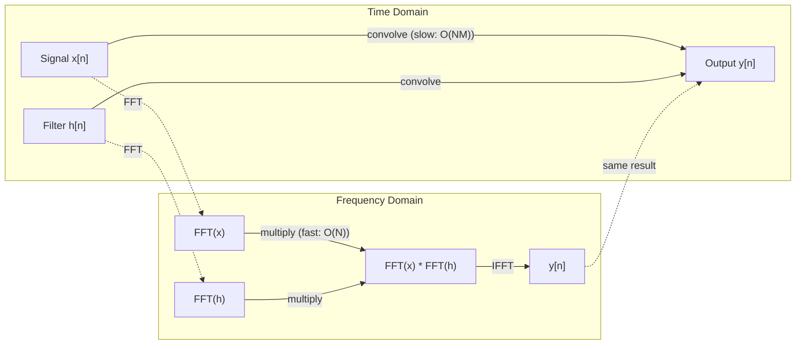

# 푸리에 변환(The Fourier Transform)

> 모든 신호는 사인파의 합입니다. 푸리에 변환은 그 사인파들이 무엇인지 알려줍니다.

**유형:** Build (실습)
**Language:** Python
**선수 레슨:** Phase 1, Lessons 01-04, 19 (complex numbers)
**소요 시간:** ~90분

## 학습 목표

- DFT를 밑바닥부터 구현하고 $O(N \log N)$ Cooley-Tukey FFT와 대조하여 검증합니다.
- 주파수 계수를 해석합니다: 신호에서 진폭, 위상, 파워 스펙트럼을 추출합니다.
- 합성곱 정리(convolution theorem)를 적용하여 FFT 곱셈을 통한 합성곱을 수행합니다.
- 푸리에 주파수 분해를 트랜스포머의 위치 인코딩(positional encoding) 및 CNN 합성곱 층과 연결합니다.

## 문제

오디오 녹음은 시간에 따른 압력 측정값의 시퀀스입니다. 주가는 며칠에 걸친 값의 시퀀스입니다. 이미지는 공간에 걸친 픽셀 강도의 그리드입니다. 이 모든 것은 시간 도메인(또는 공간 도메인)의 데이터입니다. 어떤 인덱스에 따라 값이 변하는 것을 보게 됩니다.

하지만 많은 패턴은 시간 도메인에서 보이지 않습니다. 이 오디오 신호는 순음(pure tone)일까요, 아니면 화음일까요? 이 주가에는 주간 주기가 있을까요? 이 이미지에는 반복되는 텍스처가 있을까요? 이러한 질문들은 주파수 구성에 관한 것이며, 시간 도메인은 이를 숨깁니다.

푸리에 변환은 데이터를 시간 도메인에서 주파수 도메인으로 변환합니다. 신호를 입력받아 서로 다른 주파수의 사인파들로 분해합니다. 각 사인파는 진폭(얼마나 강한지)과 위상(어디서 시작하는지)을 가집니다. 푸리에 변환은 이 둘 모두를 알려줍니다.

이것이 머신러닝에서 중요한 이유는 주파수 도메인의 사고방식이 곳곳에 등장하기 때문입니다. 합성곱 신경망(CNN)은 합성곱을 수행하는데, 이는 주파수 도메인에서의 곱셈입니다. 트랜스포머의 위치 인코딩은 위치를 표현하기 위해 주파수 분해를 사용합니다. 오디오 모델(음성 인식, 음악 생성)은 소리의 주파수 표현인 스펙트로그램(spectrogram)을 기반으로 동작합니다. 시계열 모델은 주기적 패턴을 찾습니다. 푸리에 변환을 이해하면 이 모든 것을 다룰 수 있는 어휘를 갖추게 됩니다.

## 개념

### DFT의 정의

$N$개의 샘플 $x[0], x[1], \ldots, x[N-1]$이 주어졌을 때, 이산 푸리에 변환(Discrete Fourier Transform, DFT)은 $N$개의 주파수 계수 $X[0], X[1], \ldots, X[N-1]$를 생성합니다:

```math
X[k] = \sum_{n=0}^{N-1} x[n] \, e^{-2\pi i k n/N} \qquad \text{for } k = 0, 1, \ldots, N-1
```

각 $X[k]$는 복소수입니다. 그 크기(magnitude) $\lvert X[k] \rvert$는 주파수 $k$의 진폭에 비례합니다. 정규화가 없다면, 빈(bin) $k$에 정확히 떨어지는 진폭 $A$의 실수 사인파는 $\lvert X[k] \rvert = AN/2$을 산출하므로, 진폭을 구하려면 $N/2$로 나눕니다. 그 위상(phase) $\angle X[k]$은 해당 주파수의 위상 오프셋을 알려줍니다.

핵심적인 통찰: $e^{-2\pi i k n/N}$는 주파수 $k$로 회전하는 페이저(phasor)입니다. DFT는 신호와 균등하게 간격을 둔 $N$개의 주파수 각각 사이의 상관관계를 계산합니다. 신호에 주파수 $k$의 에너지가 포함되어 있다면 상관관계가 큽니다. 그렇지 않다면 0에 가깝습니다.

### 각 계수의 의미

**$X[0]$: DC 성분.** 이는 모든 샘플의 합이며, 평균에 비례합니다. 신호의 상수(주파수 0) 오프셋을 나타냅니다.

```math
X[0] = \sum_{n=0}^{N-1} x[n] \, e^0 = \text{sum of all samples}
```

**$1 \le k \le N/2$ 범위의 $X[k]$: 양의 주파수.** $X[k]$는 $N$개 샘플당 $k$ 사이클의 주파수를 나타냅니다. $k$가 클수록 더 높은 주파수(더 빠른 진동)를 의미합니다.

**$X[N/2]$: 나이퀴스트 주파수(Nyquist frequency).** $N$개 샘플로 표현할 수 있는 가장 높은 주파수입니다. 이보다 높으면 앨리어싱(aliasing, 고주파수가 저주파수로 잘못 나타나는 현상)이 발생합니다.

**$N/2 < k < N$ 범위의 $X[k]$: 음의 주파수.** 실수 신호의 경우, $X[N-k] = \overline{X[k]}$입니다. 음의 주파수는 양의 주파수의 거울상입니다. 유용한 정보가 처음 $N/2 + 1$개의 계수에만 들어 있는 이유가 바로 이 때문입니다.

### 역 DFT(Inverse DFT)

역 DFT는 주파수 계수로부터 원래 신호를 재구성합니다:

```math
x[n] = \frac{1}{N} \sum_{k=0}^{N-1} X[k] \, e^{2\pi i k n/N} \qquad \text{for } n = 0, 1, \ldots, N-1
```

순방향 DFT와의 유일한 차이점은 지수의 부호가 양수(음수가 아님)라는 점과, $1/N$ 정규화 인수가 있다는 점입니다.

역 DFT는 완벽한 재구성을 제공합니다. 정보가 전혀 손실되지 않습니다. 어떠한 오차도 없이 시간 도메인에서 주파수 도메인으로, 그리고 다시 원래대로 돌아올 수 있습니다. DFT는 기저 변환(change of basis)으로, 동일한 정보를 다른 좌표계에서 다시 표현하는 것입니다.

### FFT: 빠르게 만들기

위에서 정의한 DFT는 $O(N^2)$입니다. $N$개의 각 출력 계수에 대해 $N$개의 입력 샘플에 걸쳐 합산합니다. $N$ = 100만인 경우, 이는 $10^{12}$번의 연산에 해당합니다.

고속 푸리에 변환(Fast Fourier Transform, FFT)은 동일한 결과를 $O(N \log N)$에 계산합니다. $N$ = 100만인 경우, 1조 번 대신 약 2,000만 번의 연산으로 줄어듭니다. 이것이 주파수 분석을 실용적으로 만드는 핵심입니다.

가장 널리 쓰이는 FFT인 Cooley-Tukey 알고리즘은 분할 정복(divide and conquer) 방식으로 작동합니다:

1. 신호를 짝수 인덱스 샘플과 홀수 인덱스 샘플로 나눕니다.
2. 각 절반의 DFT를 재귀적으로 계산합니다.
3. "회전 인자(twiddle factors)" $e^{-2\pi i k/N}$를 사용하여 절반 크기의 두 DFT를 결합합니다.

```math
\begin{aligned}
X[k] &= E[k] + e^{-2\pi i k/N} \, O[k] && \text{for } k = 0, \ldots, N/2 - 1 \\
X[k + N/2] &= E[k] - e^{-2\pi i k/N} \, O[k] && \text{for } k = 0, \ldots, N/2 - 1 \\[6pt]
\text{where } E &= \text{DFT of even-indexed samples} \\
O &= \text{DFT of odd-indexed samples}
\end{aligned}
```

이 대칭성 덕분에 각 재귀 단계는 $O(N)$의 작업을 수행하며, 단계 수는 총 $\log_2(N)$개입니다. 총합: $O(N \log N)$.



여기서 구현하는 기수-2(radix-2) FFT는 신호 길이가 2의 거듭제곱일 때 가장 빠릅니다. 하위 문제가 홀수 길이를 가질 때마다 일반 `dft`로 폴백하므로, 속도를 위해 신호 뒤에 0을 채워(zero-padding) 다음 2의 거듭제곱 크기로 맞추는 경우가 많습니다. `numpy.fft`와 같은 라이브러리 FFT는 혼합 기수(mixed-radix) 알고리즘으로 임의의 길이를 처리하지만, 작은 소인수를 가진 길이에서 가장 빠릅니다.

### 스펙트럼 분석

**파워 스펙트럼(power spectrum)**은 $\lvert X[k] \rvert^2$, 즉 각 주파수 계수의 크기 제곱입니다. 각 주파수에 에너지가 얼마나 존재하는지를 보여줍니다.

**위상 스펙트럼(phase spectrum)**은 $\angle X[k]$, 즉 각 주파수의 위상 오프셋입니다. 대부분의 분석 작업에서는 파워 스펙트럼에만 관심을 두고 위상은 무시합니다.

```math
\begin{aligned}
\text{Power at frequency } k: \quad P[k] &= |X[k]|^2 = \mathop{\mathrm{Re}}(X[k])^2 + \mathop{\mathrm{Im}}(X[k])^2 \\
\text{Phase at frequency } k: \quad \phi[k] &= \mathop{\mathrm{atan2}}(\mathop{\mathrm{Im}}(X[k]), \mathop{\mathrm{Re}}(X[k]))
\end{aligned}
```

### 주파수 분해능

DFT의 주파수 분해능은 샘플 수 $N$과 샘플링 레이트(sampling rate) $f_s$에 따라 달라집니다.

```math
\begin{aligned}
\text{Frequency of bin } k: \quad & f_k = k \cdot f_s / N \\
\text{Frequency resolution:} \quad & \Delta f = f_s / N \\
\text{Maximum frequency:} \quad & f_{\max} = f_s / 2 \quad \text{(Nyquist)}
\end{aligned}
```

가까이 붙어 있는 두 주파수를 구분하려면 더 많은 샘플이 필요합니다. 높은 주파수를 포착하려면 더 높은 샘플링 레이트가 필요합니다.

### 합성곱 정리(Convolution theorem)

이는 신호 처리에서 가장 중요한 결과 중 하나이며 CNN과 직접적으로 관련되어 있습니다.

**시간 도메인에서의 합성곱은 주파수 도메인에서의 점별(pointwise) 곱셈과 같습니다.**

```math
\begin{aligned}
& x * h = \text{IFFT}(\text{FFT}(x) \cdot \text{FFT}(h)) \\[4pt]
& \text{where } * \text{ is convolution and } \cdot \text{ is element-wise multiplication}
\end{aligned}
```

이것이 중요한 이유:

- 길이가 각각 $N$과 $M$인 두 신호의 직접 합성곱에는 $O(NM)$번의 연산이 소요됩니다.
- FFT 기반 합성곱은 $O(N \log N)$만큼의 연산이 소요됩니다: 둘 다 변환하고, 곱한 다음, 역변환합니다.
- 커널이 클수록 FFT 합성곱이 압도적으로 빠릅니다.
- 수용 영역(receptive field)이 큰 합성곱 층에서 일어나는 일이 바로 이것입니다.

참고: DFT는 순환 합성곱(circular convolution, 신호가 끝에서 되감김)을 계산합니다. 선형 합성곱(되감김 없음)을 수행하려면 계산 전에 두 신호 모두에 제로 패딩을 적용하여 길이를 $N + M - 1$로 만들어야 합니다.


### 윈도잉(Windowing)

DFT는 신호가 주기적이라고 가정합니다. 즉, $N$개의 샘플을 무한히 반복되는 신호의 한 주기로 취급합니다. 신호의 시작 값과 끝 값이 일치하지 않으면 경계에서 불연속성이 발생하며, 이는 가짜 고주파 성분으로 나타납니다. 이를 스펙트럼 누출(spectral leakage)이라고 부릅니다.

윈도잉은 DFT를 계산하기 전에 신호의 양 끝을 점진적으로 0으로 수렴시켜 누출을 줄입니다.

일반적으로 사용되는 윈도우:

| 윈도우 | 형태 | 주엽(Main lobe) 너비 | 부엽(Side lobe) 레벨 | 사용 사례 |
|--------|-------|----------------|-----------------|----------|
| 직각(Rectangular) | 평평함 (윈도우 없음) | 가장 좁음 | 가장 높음 (-13 dB) | 신호가 N개 샘플 내에서 정확히 주기적일 때 |
| 한(Hann) | 융기 코사인(Raised cosine) | 중간 | 낮음 (-31 dB) | 범용 스펙트럼 분석 |
| 해밍(Hamming) | 변형 코사인 | 중간 | 더 낮음 (-42 dB) | 오디오 처리, 음성 분석 |
| 블랙맨(Blackman) | 삼중 코사인 | 넓음 | 매우 낮음 (-58 dB) | 부엽 억제가 매우 중요할 때 |

```math
\begin{aligned}
\text{Hann window:} \quad & w[n] = 0.5 \left(1 - \cos\frac{2\pi n}{N-1}\right) \\
\text{Hamming window:} \quad & w[n] = 0.54 - 0.46 \cos\frac{2\pi n}{N-1}
\end{aligned}
```

DFT를 적용하기 전에 윈도우를 신호와 원소별로 곱하여 적용합니다: `X = DFT(x * w)`.

### DFT 특성

| 특성 | 시간 도메인 | 주파수 도메인 |
|----------|-------------|-----------------|
| 선형성(Linearity) | $ax + by$ | $aX + bY$ |
| 시간 이동(Time shift) | $x[n - k]$ | $X[f] e^{-2\pi i f k/N}$ |
| 주파수 이동(Frequency shift) | $x[n] e^{2\pi i f_0 n/N}$ | $X[f - f_0]$ |
| 합성곱(Convolution) | $x * h$ | $X \cdot H$ (점별 곱) |
| 곱셈(Multiplication) | $x \cdot h$ (점별 곱) | $X * H$ (순환 합성곱, $1/N$로 스케일링) |
| 파세발 정리(Parseval's theorem) | $\sum \lvert x[n] \rvert^2$ | $\frac{1}{N} \sum \lvert X[k] \rvert^2$ |
| 켤레 대칭(Conjugate symmetry, 실수 입력) | $x[n]$ 실수 | $X[k] = \overline{X[N-k]}$ |

파세발 정리는 두 도메인에서 총 에너지가 동일함을 의미합니다. 에너지는 변환을 거쳐도 보존됩니다.

### 위치 인코딩과의 연결점

오리지널 Transformer는 정현파 위치 인코딩(sinusoidal positional encoding)을 사용합니다:

```math
\begin{aligned}
PE(pos, 2i) &= \sin\left(pos / 10000^{2i/d_{\text{model}}}\right) \\
PE(pos, 2i+1) &= \cos\left(pos / 10000^{2i/d_{\text{model}}}\right)
\end{aligned}
```

각 차원 쌍 $(2i, 2i+1)$는 서로 다른 주파수로 진동합니다. 주파수는 높은 주파수(차원 0, 1)에서 낮은 주파수(마지막 차원들)까지 기하급수적 간격으로 배치됩니다. 이를 통해 푸리에 계수가 신호를 고유하게 식별하는 방식과 유사하게, 각 위치는 모든 주파수 대역에 걸쳐 고유한 패턴을 갖게 됩니다.

이를 통해 얻어지는 주요 특성:

- **유일성:** 어떠한 두 위치도 동일한 인코딩을 갖지 않습니다.
- **제한된 값 범위:** sin과 cos은 항상 $[-1, 1]$ 범위에 있습니다.
- **상대적 위치:** 위치 $p+k$의 인코딩은 위치 $p$의 인코딩에 대한 선형 함수로 표현될 수 있습니다. 모델은 상대적 위치에 주의를 기울이는 법(attend)을 학습할 수 있습니다.

### CNN과의 연결점

합성곱 계층(convolution layer)은 학습된 필터(커널)를 신호나 이미지 전체에 슬라이딩하면서 입력에 적용합니다. 수학적으로 이것은 합성곱 연산입니다.

합성곱 정리에 의해, 이는 다음과 동등합니다:
1. 입력을 FFT
2. 커널을 FFT
3. 주파수 도메인에서 곱셈
4. 결과를 IFFT

표준 CNN 구현체는 직접 합성곱(작은 3x3 커널에서 더 빠름)을 사용합니다. 그러나 커널이 크거나 전역 합성곱(global convolution)인 경우에는 FFT 기반 접근법이 훨씬 빠릅니다. 일부 아키텍처(FNet 등)는 어텐션(attention)을 FFT로 완전히 대체하여 $O(N^2)$ 대신 $O(N \log N)$ 복잡도로 경쟁력 있는 정확도를 달성합니다.

### 스펙트로그램과 단시간 푸리에 변환

단일 FFT는 전체 신호의 주파수 성분을 제공하지만, 해당 주파수가 언제 발생하는지는 전혀 알려주지 않습니다. 처프(chirp, 시간에 따라 주파수가 증가하는 신호)와 화음(chord, 모든 주파수가 동시에 존재하는 신호)은 동일한 크기 스펙트럼을 가질 수 있습니다.

단시간 푸리에 변환(STFT, Short-Time Fourier Transform)은 신호의 겹치는 윈도우에서 FFT를 계산하여 이 문제를 해결합니다. 그 결과물은 스펙트로그램(spectrogram)으로, 한 축은 시간이고 다른 축은 주파수인 2차원 표현입니다. 각 지점의 강도는 특정 시점, 특정 주파수에서의 에너지를 나타냅니다.

```
STFT procedure:
1. Choose a window size (e.g., 1024 samples)
2. Choose a hop size (e.g., 256 samples -- 75% overlap)
3. For each window position:
   a. Extract the windowed segment
   b. Apply a Hann/Hamming window
   c. Compute FFT
   d. Store the magnitude spectrum as one column of the spectrogram
```

스펙트로그램은 오디오 ML 모델의 표준 입력 표현입니다. 음성 인식 모델(Whisper, DeepSpeech)은 멜 스펙트로그램(mel-spectrogram)을 기반으로 작동하는데, 이는 사람의 음고(pitch) 지각과 더 잘 일치하도록 주파수를 멜 스케일로 매핑한 스펙트로그램입니다.

### 앨리어싱(Aliasing)

신호에 $f_s/2$(나이퀴스트 주파수, Nyquist frequency)를 초과하는 주파수가 포함되어 있다면, $f_s$ 속도로 샘플링할 때 앨리어싱된 복사본이 생성됩니다. 100 Hz로 샘플링된 90 Hz 신호는 10 Hz 신호와 완전히 동일하게 보입니다. 샘플만으로는 이 둘을 구별할 방법이 없습니다.

```
Example:
  True signal: 90 Hz sine wave
  Sampling rate: 100 Hz
  Apparent frequency: 100 - 90 = 10 Hz

  The samples from the 90 Hz signal at 100 Hz sampling rate
  are identical to the samples from a 10 Hz signal.
  No amount of math can recover the original 90 Hz.
```

이것이 아날로그-디지털 변환기에 샘플링 전 나이퀴스트 주파수를 넘는 성분을 제거하는 안티 앨리어싱 필터(anti-aliasing filter)가 포함되어 있는 이유입니다. ML에서는 적절한 저역 통과 필터링(low-pass filtering) 없이 피처 맵을 다운샘플링할 때 앨리어싱이 나타나며, 일부 아키텍처는 안티 앨리어싱 풀링 계층을 통해 이 문제를 해결합니다.

### 제로 패딩은 해상도를 높이지 못함

흔한 오해 중 하나는 FFT 전에 신호에 제로 패딩(zero-padding)을 적용하면 주파수 해상도가 향상된다는 것입니다. 그렇지 않습니다. 제로 패딩은 기존 주파수 빈(bin) 사이를 보간하여 스펙트럼을 더 매끄럽게 보이게 할 뿐입니다. 원래 샘플에 존재하지 않았던 주파수 세부 정보를 드러낼 수는 없습니다.

진정한 주파수 해상도는 관측 시간 $T = N / f_s$에만 의존합니다. $\Delta f$만큼 떨어진 두 주파수를 분해하려면 최소 $T = 1 / \Delta f$초의 데이터가 필요합니다. 아무리 제로 패딩을 많이 적용해도 이 근본적인 한계를 바꿀 수는 없습니다.

```figure
fourier-synthesis
```

## 직접 구현하기

### 1단계: 바닥부터 구현하는 DFT

$O(N^2)$ DFT는 정의에서 곧바로 도출됩니다.

```python
import math

class Complex:
    ...

def dft(x):
    N = len(x)
    result = []
    for k in range(N):
        total = Complex(0, 0)
        for n in range(N):
            angle = -2 * math.pi * k * n / N
            w = Complex(math.cos(angle), math.sin(angle))
            xn = x[n] if isinstance(x[n], Complex) else Complex(x[n])
            total = total + xn * w
        result.append(total)
    return result
```

### 2단계: 역 DFT(Inverse DFT)

동일한 구조에서 지수가 양수이고, $N$로 나눕니다.

```python
def idft(X):
    N = len(X)
    result = []
    for n in range(N):
        total = Complex(0, 0)
        for k in range(N):
            angle = 2 * math.pi * k * n / N
            w = Complex(math.cos(angle), math.sin(angle))
            total = total + X[k] * w
        result.append(Complex(total.real / N, total.imag / N))
    return result
```

### 3단계: FFT (쿨리-튜키 알고리즘)

재귀적 FFT는 길이가 2의 거듭제곱이어야 합니다. 짝수와 홀수로 분할하고, 재귀 호출한 뒤, 트위들 팩터(twiddle factor)와 결합합니다.

```python
def fft(x):
    N = len(x)
    if N <= 1:
        return [x[0] if isinstance(x[0], Complex) else Complex(x[0])]
    if N % 2 != 0:
        return dft(x)

    even = fft([x[i] for i in range(0, N, 2)])
    odd = fft([x[i] for i in range(1, N, 2)])

    result = [Complex(0)] * N
    for k in range(N // 2):
        angle = -2 * math.pi * k / N
        twiddle = Complex(math.cos(angle), math.sin(angle))
        t = twiddle * odd[k]
        result[k] = even[k] + t
        result[k + N // 2] = even[k] - t
    return result
```

### 4단계: 스펙트럼 분석 헬퍼

```python
def power_spectrum(X):
    return [xk.real ** 2 + xk.imag ** 2 for xk in X]

def convolve_fft(x, h):
    N = len(x) + len(h) - 1
    padded_N = 1
    while padded_N < N:
        padded_N *= 2

    x_padded = x + [0.0] * (padded_N - len(x))
    h_padded = h + [0.0] * (padded_N - len(h))

    X = fft(x_padded)
    H = fft(h_padded)

    Y = [xk * hk for xk, hk in zip(X, H)]

    y = idft(Y)
    return [y[n].real for n in range(N)]
```

## 사용하기

실제 작업에서는 고도로 최적화된 C 라이브러리를 기반으로 하는 numpy의 FFT를 사용하세요.

```python
import numpy as np

signal = np.sin(2 * np.pi * 5 * np.arange(256) / 256)
spectrum = np.fft.fft(signal)
freqs = np.fft.fftfreq(256, d=1/256)

power = np.abs(spectrum) ** 2

positive_freqs = freqs[:len(freqs)//2]
positive_power = power[:len(power)//2]
```

윈도잉 및 고급 스펙트럼 분석의 경우:

```python
from scipy.signal import windows, stft

window = windows.hann(256)
windowed = signal * window
spectrum = np.fft.fft(windowed)
```

합성곱의 경우:

```python
from scipy.signal import fftconvolve

result = fftconvolve(signal, kernel, mode='full')
```

스펙트로그램의 경우:

```python
from scipy.signal import stft

frequencies, times, Zxx = stft(signal, fs=sample_rate, nperseg=256)
spectrogram = np.abs(Zxx) ** 2
```

스펙트로그램 행렬의 형상은 (n_frequencies, n_time_frames)입니다. 각 열은 특정 시간 윈도우에서의 파워 스펙트럼입니다. 이것이 오디오 ML 모델이 입력으로 사용하는 데이터입니다.

## 배포하기

`code/fourier.py`를 실행하여 `outputs/prompt-spectral-analyzer.md`을 생성합니다.
## 연습 문제

1. **단일 주파수 순음(pure tone) 식별.** 1~50 Hz 사이의 알 수 없는 주파수를 가진 단일 사인파로 구성되고, 128 Hz로 1초 동안 샘플링된 신호를 생성합니다. 직접 구현한 DFT를 사용하여 주파수를 식별합니다. 정답과 일치하는지 확인합니다. 이제 표준편차가 0.5인 가우시안 노이즈(Gaussian noise)를 추가하고 반복합니다. 노이즈가 스펙트럼에 어떤 영향을 미치나요?

2. **FFT 대 DFT 검증.** 길이가 64인 무작위 신호를 생성합니다. DFT($O(N^2){}$)와 FFT를 모두 계산합니다. 모든 계수가 1e-10 오차 범위 내에서 일치하는지 확인합니다. 길이가 256, 512, 1024, 2048인 신호에 대해 두 함수의 실행 시간을 측정합니다. FFT 실행 시간 대비 DFT 실행 시간의 비율을 그래프로 그립니다.

3. **합성곱 정리를 예제로 증명하기.** 신호 x = [1, 2, 3, 4, 0, 0, 0, 0]과 필터 h = [1, 1, 1, 0, 0, 0, 0, 0]을 생성합니다. 중첩 루프(nested loop)를 사용하여 두 신호의 원형 합성곱(circular convolution)을 직접 계산합니다. 그런 다음 FFT(변환, 곱셈, 역변환)를 통해 이를 계산합니다. 결과가 일치하는지 확인합니다. 이제 적절한 제로 패딩(zero-padding)을 적용하여 선형 합성곱(linear convolution)을 수행합니다.

4. **윈도잉(windowing) 효과.** 10 Hz와 12 Hz(매우 인접한 주파수)의 두 사인파의 합으로 구성된 신호를 생성합니다. 128 Hz로 1초 동안 샘플링합니다. 윈도우를 적용하지 않은 경우, 한(Hann) 윈도우, 해밍(Hamming) 윈도우를 각각 적용하여 파워 스펙트럼(power spectrum)을 계산합니다. 어떤 윈도우를 사용할 때 두 피크를 가장 쉽게 구분할 수 있나요? 그 이유는 무엇인가요?

5. **위치 인코딩(positional encoding) 분석.** d_model = 128 및 max_pos = 512에 대해 사인파 위치 인코딩을 생성합니다. 각 위치 쌍 $(p_1, p_2)$에 대해 해당 인코딩의 내적(dot product)을 계산합니다. 내적이 절대적 위치가 아니라 오직 $\lvert p_1 - p_2 \rvert$에만 의존함을 보입니다. 거리가 증가함에 따라 내적은 어떻게 변화하나요?

### 힌트

**연습 문제 1.** 1초 동안 128개의 샘플이 있을 때 bin $k$은 $k$ Hz이므로, 정수 주파수의 경우 bin 1부터 63까지 중 가장 큰 값의 인덱스가 해당 주파수가 됩니다. 정수 단위의 헤르츠(Hz) 값을 선택하세요. 두 bin 사이에 걸치는 주파수는 인접한 bin으로 퍼지며, 피크는 가장 가까운 bin만 나타냅니다. `generate_signal` 및 `magnitude_spectrum`을 사용하세요. 노이즈를 추가한 후, 다른 bin들의 값이 증가하는 동안에도 피크가 여전히 동일한 bin에 위치하는지 확인하세요.

**연습 문제 2.** `fft`는 신호를 반으로 나누므로 2의 거듭제곱 길이를 사용하세요. 모든 계수에 대해 `max(abs(a - b))`인지 확인하세요. 실행 시간의 비율은 대략 $N / \log_2 N$에 비례하여 증가해야 합니다.

**연습 문제 3.** 원형 합성곱의 경우 $n$ = 0, 1, 2에 대해 $y[n] = \sum_k h[k] x[(n-k) \bmod 8]$를 손으로 직접 계산하고, `convolve_direct` 및 `convolve_fft`의 처음 세 값과 비교해 보세요. 선형 합성곱의 길이는 4 + 3 - 1 = 6이므로, 길이 8이 이미 충분한지 먼저 확인하세요.

**연습 문제 4.** `hann_window`, `hamming_window`, `apply_window`, `power_spectrum`을 사용하고, 9~13 Hz 사이에서 분리된 피크의 개수를 세어 보세요. 10 Hz와 12 Hz는 모두 1초 동안 완전한 주기를 완료하므로 윈도우를 적용하지 않았을 때 가장 좋아 보일 수 있습니다. 윈도우가 감소시키는 누설(leakage) 현상을 확인하기 위해 10.5 Hz와 12.5 Hz로 다시 시도해 보세요.

**연습 문제 5.** `positional_encoding(pos, 128)`을 사용하여 각 인코딩을 계산합니다. 위치 (0, 10)의 내적과 (100, 110)의 내적을 비교하세요. 두 값은 약 1e-10 오차 범위 내에서 일치해야 합니다. 그런 다음 고정된 하나의 $p_1$에 대해 $\lvert p_1 - p_2 \rvert$에 따른 내적을 그래프로 그려 보세요.

## 핵심 용어

| 용어 | 의미 |
|------|---------------|
| DFT (이산 푸리에 변환) | $N$개의 시간 도메인 샘플을 $N$개의 주파수 도메인 계수로 변환합니다. 각 계수는 해당 주파수의 복소 사인파와의 상관관계입니다 |
| FFT (고속 푸리에 변환) | DFT를 계산하는 $O(N \log N)$ 알고리즘입니다. 쿨리-튜키(Cooley-Tukey) 알고리즘은 짝수/홀수 인덱스를 재귀적으로 분할합니다 |
| 역 DFT (Inverse DFT) | 주파수 계수로부터 시간 도메인 신호를 재구성합니다. 지수의 부호가 반대이고 $1/N$ 스케일링이 적용된다는 점을 제외하면 DFT와 동일한 공식입니다 |
| 주파수 빈 (Frequency bin) | DFT 출력의 각 인덱스 $k$는 $k f_s/N$ Hz 주파수를 나타냅니다. "bin"은 이산적인 주파수 구간을 의미합니다 |
| DC 성분 (DC component) | 0 주파수 계수인 $X[0]$입니다. 신호의 평균에 비례합니다 |
| 나이퀴스트 주파수 (Nyquist frequency) | 샘플링 속도 $f_s$에서 표현할 수 있는 최대 주파수인 $f_s/2$입니다. 이보다 높은 주파수는 앨리어싱을 일으킵니다 |
| 파워 스펙트럼 (Power spectrum) | 각 주파수 계수의 크기 제곱인 $\lvert X[k] \rvert^2$입니다. 주파수 전반에 걸친 에너지 분포를 보여줍니다 |
| 위상 스펙트럼 (Phase spectrum) | 각 주파수 성분의 위상 오프셋인 $\angle X[k]$입니다. 분석 시 종종 무시됩니다 |
| 스펙트럼 누설 (Spectral leakage) | 비주기적 신호를 주기적인 것으로 처리하여 발생하는 가짜(spurious) 주파수 성분입니다. 윈도잉을 통해 줄일 수 있습니다 |
| 윈도우 함수 (Window function) | 스펙트럼 누설을 줄이기 위해 DFT 적용 전에 곱해주는 테이퍼링(tapering) 함수(Hann, Hamming, Blackman 등)입니다 |
| 회전 인자 (Twiddle factor) | FFT의 버터플라이 연산에서 부분 DFT를 결합하는 데 사용되는 복소 지수 $e^{-2\pi i k/N}$입니다 |
| 합성곱 정리 (Convolution theorem) | 시간 도메인에서의 합성곱은 주파수 도메인에서의 점별(pointwise) 곱셈과 같습니다. 신호 처리 및 CNN의 기본 원리입니다 |
| 원형 합성곱 (Circular convolution) | 신호가 순환(wrap around)하는 합성곱입니다. DFT가 기본적으로 계산하는 방식입니다 |
| 선형 합성곱 (Linear convolution) | 순환이 없는 표준 합성곱입니다. DFT 전에 제로 패딩을 적용하여 계산할 수 있습니다 |
| 파세발 정리 (Parseval's theorem) | 푸리에 변환을 거쳐도 총 에너지가 보존된다는 정리입니다. $\sum \lvert x[n] \rvert^2 = \frac{1}{N} \sum \lvert X[k] \rvert^2$ |
| 앨리어싱 (Aliasing) | 샘플링 속도가 불충분하여 나이퀴스트 주파수 이상의 주파수가 더 낮은 주파수로 왜곡되어 나타나는 현상입니다 |

## 더 읽을거리

- [Cooley & Tukey: An Algorithm for the Machine Calculation of Complex Fourier Series (1965)](https://www.ams.org/journals/mcom/1965-19-090/S0025-5718-1965-0178586-1/) - 컴퓨팅의 판도를 바꾼 최초의 FFT 논문
- [3Blue1Brown: But what is the Fourier Transform?](https://www.youtube.com/watch?v=spUNpyF58BY) - 푸리에 변환에 대한 최고의 시각적 입문 자료
- [Lee-Thorp et al.: FNet: Mixing Tokens with Fourier Transforms (2021)](https://arxiv.org/abs/2105.03824) - Transformer에서 셀프 어텐션(self-attention)을 FFT로 대체한 연구
- [Smith: The Scientist and Engineer's Guide to Digital Signal Processing](http://www.dspguide.com/) - FFT, 윈도잉, 스펙트럼 분석을 심도 있게 다루는 무료 온라인 교재
- [Vaswani et al.: Attention Is All You Need (2017)](https://arxiv.org/abs/1706.03762) - 푸리에 주파수 분해에서 유도된 사인파 위치 인코딩
- [Radford et al.: Whisper (2022)](https://arxiv.org/abs/2212.04356) - 멜 스펙트로그램(mel-spectrogram)을 입력 표현으로 사용하는 음성 인식
