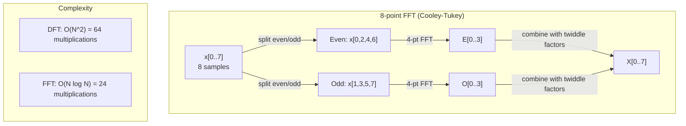
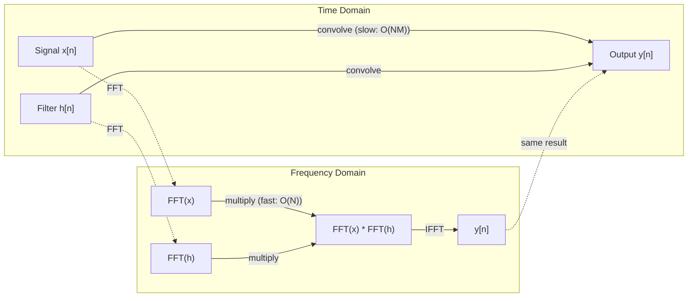

# 푸리에 변환(The Fourier Transform)

> 모든 신호는 사인파의 합입니다. 푸리에 변환은 어떤 사인파들로 이루어져 있는지 알려줍니다.

**유형:** Build (실습)
**Language:** Python
**선수 레슨:** Phase 1, Lessons 01-04, 19 (complex numbers)
**소요 시간:** ~90분

## 학습 목표

- DFT를 밑바닥부터 직접 구현하고 O(N log N) 쿨리-튜키(Cooley-Tukey) FFT와 비교 검증합니다.
- 주파수 계수를 해석하여 신호로부터 진폭, 위상, 파워 스펙트럼(power spectrum)을 추출합니다.
- 합성곱 정리(convolution theorem)를 적용하여 FFT 곱셈을 통해 합성곱을 수행합니다.
- 푸리에 주파수 분해를 트랜스포머(Transformer)의 위치 인코딩(positional encoding) 및 CNN 합성곱 층과 연결합니다.

## 문제

오디오 녹음은 시간에 따른 압력 측정값의 시퀀스입니다. 주가는 날짜에 따른 가치의 시퀀스입니다. 이미지는 공간에 따른 픽셀 강도의 그리드입니다. 이 모든 것은 시간 도메인(또는 공간 도메인)의 데이터입니다. 어떤 인덱스에 따라 값이 변하는 것을 관찰하게 됩니다.

하지만 많은 패턴이 시간 도메인에서는 보이지 않습니다. 이 오디오 신호는 순음(pure tone)일까요, 아니면 화음일까요? 이 주가에는 주간 주기가 존재할까요? 이 이미지에는 반복되는 텍스처가 있을까요? 이러한 질문들은 주파수 구성 요소에 관한 것이며, 시간 도메인은 이를 숨깁니다.

푸리에 변환은 데이터를 시간 도메인에서 주파수 도메인으로 변환합니다. 신호를 입력받아 서로 다른 주파수를 갖는 사인파들로 분해합니다. 각 사인파는 진폭(신호의 세기)과 위상(시작 위치)을 갖습니다. 푸리에 변환은 이 둘 모두를 알려줍니다.

주파수 도메인적 사고는 어디에나 등장하므로 ML에서 매우 중요합니다. 합성곱 신경망(CNN)은 합성곱을 수행하는데, 이는 주파수 도메인에서의 곱셈에 해당합니다. 트랜스포머 위치 인코딩은 위치를 표현하기 위해 주파수 분해를 사용합니다. 오디오 모델(음성 인식, 음악 생성)은 소리의 주파수 표현인 스펙트로그램(spectrogram)을 기반으로 동작합니다. 시계열 모델은 주기적 패턴을 탐색합니다. 푸리에 변환을 이해하면 이 모든 것을 다룰 수 있는 어휘를 갖추게 됩니다.

## 개념

### DFT의 정의

N개의 샘플 x[0], x[1], ..., x[N-1]이 주어졌을 때, 이산 푸리에 변환(Discrete Fourier Transform, DFT)은 N개의 주파수 계수 X[0], X[1], ..., X[N-1]을 생성합니다.

```
X[k] = sum_{n=0}^{N-1} x[n] * e^(-2*pi*i*k*n/N)

for k = 0, 1, ..., N-1
```

각 X[k]는 복소수입니다. 그 크기(magnitude) |X[k]|는 주파수 k의 진폭을 나타냅니다. 그 위상각 angle(X[k])는 해당 주파수의 위상 오프셋을 나타냅니다.

핵심 직관: `e^(-2*pi*i*k*n/N)`는 주파수 k로 회전하는 페이저(phasor)입니다. DFT는 신호와 균등한 간격을 갖는 N개의 주파수 각각 사이의 상관관계를 계산합니다. 신호가 주파수 k의 에너지를 포함하고 있다면 상관관계가 크게 나타납니다. 그렇지 않다면 거의 0에 가깝습니다.

### 각 계수의 의미

**X[0]: 직류(DC) 성분.** 이는 모든 샘플의 합이며, 평균에 비례합니다. 신호의 상수(주파수 0) 오프셋을 나타냅니다.

```
X[0] = sum_{n=0}^{N-1} x[n] * e^0 = sum of all samples
```

**1 <= k <= N/2인 X[k]: 양의 주파수.** X[k]는 N개 샘플당 k 사이클의 주파수를 나타냅니다. k가 클수록 더 높은 주파수(더 빠른 진동)를 의미합니다.

**X[N/2]: 나이퀴스트(Nyquist) 주파수.** N개의 샘플로 표현할 수 있는 가장 높은 주파수입니다. 이보다 높으면 앨리어싱(aliasing), 즉 높은 주파수가 낮은 주파수로 잘못 나타나는 현상이 발생합니다.

**N/2 < k < N인 X[k]: 음의 주파수.** 실수 값을 갖는 신호의 경우 X[N-k] = conj(X[k])가 성립합니다. 음의 주파수는 양의 주파수의 거울상입니다. 유용한 정보가 처음 N/2 + 1개의 계수에 들어 있는 이유가 바로 여기에 있습니다.

### 역 DFT(Inverse DFT)

역 DFT는 주파수 계수로부터 원래 신호를 재구성합니다.

```
x[n] = (1/N) * sum_{k=0}^{N-1} X[k] * e^(2*pi*i*k*n/N)

for n = 0, 1, ..., N-1
```

순방향 DFT와의 유일한 차이점은 지수의 부호가 음수가 아닌 양수라는 점과, 1/N 정규화 계수가 존재한다는 점입니다.

역 DFT는 완벽한 재구성(perfect reconstruction)을 제공합니다. 정보가 전혀 손실되지 않습니다. 어떠한 오차도 없이 시간 도메인에서 주파수 도메인으로, 그리고 다시 원래대로 되돌아갈 수 있습니다. DFT는 기저 변환(change of basis)으로, 동일한 정보를 다른 좌표계에서 다시 표현하는 것입니다.

### FFT: 속도 개선하기

위에서 정의한 DFT는 O(N^2)입니다. N개의 출력 계수 각각에 대해 N개의 입력 샘플을 합산하기 때문입니다. N = 100만인 경우, 연산 횟수는 10^12에 달합니다.

고속 푸리에 변환(Fast Fourier Transform, FFT)은 동일한 결과를 O(N log N)으로 계산합니다. N = 100만인 경우, 1조 번 대신 약 2천만 번의 연산만 필요합니다. 이를 통해 주파수 분석이 실용성을 갖추게 됩니다.

쿨리-튜키 알고리즘(가장 널리 사용되는 FFT)은 분할 정복(divide and conquer) 방식으로 동작합니다.

1. 신호를 짝수 인덱스 샘플과 홀수 인덱스 샘플로 분할합니다.
2. 재귀적으로 각 절반의 DFT를 계산합니다.
3. "회전 인자(twiddle factor)" e^(-2*pi*i*k/N)를 사용하여 절반 크기의 두 DFT를 결합합니다.

```
X[k] = E[k] + e^(-2*pi*i*k/N) * O[k]          for k = 0, ..., N/2 - 1
X[k + N/2] = E[k] - e^(-2*pi*i*k/N) * O[k]    for k = 0, ..., N/2 - 1

where E = DFT of even-indexed samples
      O = DFT of odd-indexed samples
```

이러한 대칭성 덕분에 각 재귀 단계는 O(N)의 작업을 수행하며, 단계의 수는 log2(N)개입니다. 총 복잡도는 O(N log N)이 됩니다.



FFT는 신호의 길이가 2의 거듭제곱이어야 합니다. 실제 구현에서는 신호를 다음 2의 거듭제곱 크기에 맞추어 제로 패딩(zero-padding)합니다.

### 스펙트럼 분석

**파워 스펙트럼(power spectrum)**은 |X[k]|^2, 즉 각 주파수 계수의 크기 제곱입니다. 이는 각 주파수에 얼마만큼의 에너지가 존재하는지를 보여줍니다.

**위상 스펙트럼(phase spectrum)**은 angle(X[k])로, 각 주파수의 위상 오프셋입니다. 대부분의 분석 작업에서는 파워 스펙트럼에 집중하고 위상은 무시합니다.

```
Power at frequency k:  P[k] = |X[k]|^2 = X[k].real^2 + X[k].imag^2
Phase at frequency k:  phi[k] = atan2(X[k].imag, X[k].real)
```

### 주파수 분해능

DFT의 주파수 분해능(frequency resolution)은 샘플 수 N과 샘플링 레이트 fs에 따라 결정됩니다.

```
Frequency of bin k:      f_k = k * fs / N
Frequency resolution:    delta_f = fs / N
Maximum frequency:       f_max = fs / 2  (Nyquist)
```

서로 가까이 붙어 있는 두 주파수를 구분하려면 더 많은 샘플이 필요합니다. 높은 주파수를 포착하려면 더 높은 샘플링 레이트가 필요합니다.

### 합성곱 정리

이는 신호 처리에서 가장 중요한 결과 중 하나이며 CNN과도 직접적으로 연관됩니다.

**시간 도메인에서의 합성곱은 주파수 도메인에서의 원소별(pointwise) 곱셈과 같습니다.**

```
x * h = IFFT(FFT(x) . FFT(h))

where * is convolution and . is element-wise multiplication
```

이것이 중요한 이유:

- 길이가 각각 N과 M인 두 신호의 직접 합성곱은 O(N*M)의 연산이 소요됩니다.
- FFT 기반 합성곱은 O(N log N)이 소요됩니다. 둘 다 변환하고, 곱한 뒤, 역변환합니다.
- 커널 크기가 클 때 FFT 합성곱은 극적으로 빠릅니다.
- 이는 수용 영역(receptive field)이 큰 합성곱 층에서 정확히 일어나는 일입니다.

참고: DFT는 순환 합성곱(circular convolution, 신호가 끝에서 다시 순환함)을 계산합니다. 선형 합성곱(wraparound 없음)을 수행하려면 계산 전에 두 신호 모두 길이 N + M - 1로 제로 패딩해야 합니다.


### 윈도잉(Windowing)

DFT는 신호가 주기적이라고 가정합니다. 즉, N개의 샘플을 무한히 반복되는 신호의 한 주기로 취급합니다. 신호의 시작 값과 끝 값이 일치하지 않으면 경계에서 불연속성이 발생하며, 이는 가짜 고주파 성분으로 나타납니다. 이를 스펙트럼 누설(spectral leakage)이라고 합니다.

윈도잉은 DFT를 계산하기 전에 양 끝의 신호 값을 0으로 점진적으로 감소시켜 누설을 줄입니다.

일반적인 윈도우:

| Window | Shape | Main lobe width | Side lobe level | Use case |
|--------|-------|----------------|-----------------|----------|
| Rectangular | 평평함 (윈도우 없음) | 가장 좁음 | 가장 높음 (-13 dB) | 신호가 N개 샘플 내에서 정확히 주기적일 때 |
| Hann | Raised cosine | 중간 | 낮음 (-31 dB) | 범용 스펙트럼 분석 |
| Hamming | 수정된 코사인 | 중간 | 더 낮음 (-42 dB) | 오디오 처리, 음성 분석 |
| Blackman | 삼중 코사인 | 넓음 | 매우 낮음 (-58 dB) | 사이드 로브 억제가 매우 중요할 때 |

```
Hann window:    w[n] = 0.5 * (1 - cos(2*pi*n / (N-1)))
Hamming window: w[n] = 0.54 - 0.46 * cos(2*pi*n / (N-1))
```

DFT를 적용하기 전에 윈도우를 신호와 원소별로 곱하여 적용합니다: `X = DFT(x * w)`.

### DFT 성질

| Property | Time Domain | Frequency Domain |
|----------|-------------|-----------------|
| Linearity | a*x + b*y | a*X + b*Y |
| Time shift | x[n - k] | X[f] * e^(-2*pi*i*f*k/N) |
| Frequency shift | x[n] * e^(2*pi*i*f0*n/N) | X[f - f0] |
| Convolution | x * h | X * H (pointwise) |
| Multiplication | x * h (pointwise) | X * H (circular convolution, scaled by 1/N) |
| Parseval's theorem | sum \|x[n]\|^2 | (1/N) * sum \|X[k]\|^2 |
| Conjugate symmetry (real input) | x[n] real | X[k] = conj(X[N-k]) |

파르스발 정리(Parseval's theorem)는 두 도메인에서 총 에너지가 동일함을 나타냅니다. 에너지는 변환 전후로 보존됩니다.

### 위치 인코딩(Positional Encoding)과의 연결점

오리지널 Transformer는 사인 함수 기반 위치 인코딩(sinusoidal positional encodings)을 사용합니다:

```
PE(pos, 2i)   = sin(pos / 10000^(2i/d_model))
PE(pos, 2i+1) = cos(pos / 10000^(2i/d_model))
```

각 차원 쌍 (2i, 2i+1)은 서로 다른 주파수로 진동합니다. 주파수는 높은 주파수(차원 0, 1)에서 낮은 주파수(마지막 차원들)까지 기하급수적 간격으로 배치됩니다. 이를 통해 푸리에 계수가 신호를 고유하게 식별하듯이, 각 위치는 모든 주파수 대역에 걸쳐 고유한 패턴을 갖게 됩니다.

이 방식이 제공하는 핵심 성질은 다음과 같습니다:

- **유일성(Uniqueness):** 동일한 인코딩을 갖는 위치는 없습니다.
- **유계 값(Bounded values):** sin과 cos은 항상 [-1, 1] 범위 내에 있습니다.
- **상대적 위치(Relative position):** 위치 p+k의 인코딩은 위치 p 인코딩의 선형 함수로 표현될 수 있습니다. 모델은 상대적 위치에 주의를 기울이는 법(attend)을 학습할 수 있습니다.

### CNN과의 연결점

합성곱 계층은 신호나 이미지 위로 학습된 필터(커널)를 슬라이딩하면서 입력에 적용합니다. 수학적으로 이것이 바로 합성곱(convolution) 연산입니다.

합성곱 정리에 의해, 이 연산은 다음과 동일합니다:
1. 입력에 FFT 수행
2. 커널에 FFT 수행
3. 주파수 도메인에서 곱셈
4. 결과에 IFFT 수행

표준 CNN 구현은 직접 합성곱을 사용합니다(작은 3x3 커널의 경우 더 빠름). 그러나 큰 커널이나 전역 합성곱(global convolution)의 경우 FFT 기반 접근 방식이 훨씬 빠릅니다. 일부 아키텍처(FNet 등)는 어텐션(attention)을 FFT로 완전히 대체하여, O(N^2) 대신 O(N log N)의 복잡도로 경쟁력 있는 정확도를 달성합니다.

### 스펙트로그램과 단시간 푸리에 변환(STFT)

단일 FFT는 전체 신호의 주파수 성분을 제공하지만, 해당 주파수가 언제 발생하는지는 전혀 알려주지 않습니다. 처프(chirp, 시간에 따라 주파수가 증가하는 신호)와 화음(모든 주파수가 동시에 존재하는 신호)은 동일한 크기 스펙트럼(magnitude spectrum)을 가질 수 있습니다.

단시간 푸리에 변환(Short-Time Fourier Transform, STFT)은 신호의 겹치는 윈도우 구간마다 FFT를 계산하여 이 문제를 해결합니다. 그 결과물이 스펙트로그램(spectrogram)으로, 한 축은 시간, 다른 축은 주파수인 2차원 표현입니다. 각 지점의 강도는 특정 시점, 특정 주파수에서의 에너지를 보여줍니다.

```
STFT procedure:
1. Choose a window size (e.g., 1024 samples)
2. Choose a hop size (e.g., 256 samples -- 75% overlap)
3. For each window position:
   a. Extract the windowed segment
   b. Apply a Hann/Hamming window
   c. Compute FFT
   d. Store the magnitude spectrum as one column of the spectrogram
```

스펙트로그램은 오디오 ML 모델의 표준 입력 표현입니다. 음성 인식 모델(Whisper, DeepSpeech)은 인간의 음고 지각에 더 잘 부합하도록 주파수를 멜 스케일(mel scale)에 매핑한 스펙트로그램인 멜 스펙트로그램(mel-spectrogram)을 기반으로 동작합니다.

### 앨리어싱(Aliasing)

신호에 fs/2(나이퀴스트 주파수, Nyquist frequency)를 초과하는 주파수가 포함되어 있다면, fs의 속도로 샘플링할 때 앨리어싱 복제본이 생성됩니다. 100 Hz로 샘플링된 90 Hz 신호는 10 Hz 신호와 완전히 동일하게 보입니다. 샘플만으로는 둘을 구별할 방법이 없습니다.

```
Example:
  True signal: 90 Hz sine wave
  Sampling rate: 100 Hz
  Apparent frequency: 100 - 90 = 10 Hz

  The samples from the 90 Hz signal at 100 Hz sampling rate
  are identical to the samples from a 10 Hz signal.
  No amount of math can recover the original 90 Hz.
```

이 때문에 아날로그-디지털 변환기(ADC)에는 샘플링 전에 나이퀴스트 주파수 이상의 주파수를 제거하는 안티앨리어싱 필터(anti-aliasing filter)가 포함되어 있습니다. ML에서는 적절한 저주파 통과 필터링 없이 피처 맵을 다운샘플링할 때 앨리어싱이 나타나며, 일부 아키텍처는 안티앨리어싱 풀링 계층으로 이를 해결합니다.

### 제로 패딩은 해상도를 높이지 않습니다

흔한 오해 중 하나는 FFT 전에 신호에 제로 패딩(zero-padding)을 적용하면 주파수 해상도가 향상된다는 것입니다. 그렇지 않습니다. 제로 패딩은 기존 주파수 빈(bin) 사이를 보간하여 스펙트럼이 더 매끄럽게 보이도록 만들 뿐입니다. 원래 샘플에 없었던 주파수 세부 정보를 드러낼 수는 없습니다.

진정한 주파수 해상도는 관측 시간 T = N / fs에 의해서만 결정됩니다. delta_f만큼 떨어진 두 주파수를 분해하려면 최소 T = 1 / delta_f 초 분량의 데이터가 필요합니다. 아무리 제로 패딩을 적용해도 이 근본적인 한계는 바뀌지 않습니다.

```figure
fourier-synthesis
```

## 직접 구현하기

### 1단계: 바닥부터 구현하는 DFT

O(N^2) DFT는 정의로부터 직접 유도됩니다.

```python
import math

class Complex:
    ...

def dft(x):
    N = len(x)
    result = []
    for k in range(N):
        total = Complex(0, 0)
        for n in range(N):
            angle = -2 * math.pi * k * n / N
            w = Complex(math.cos(angle), math.sin(angle))
            xn = x[n] if isinstance(x[n], Complex) else Complex(x[n])
            total = total + xn * w
        result.append(total)
    return result
```

### 2단계: 역 DFT(Inverse DFT)

동일한 구조에서 지수를 양수로 바꾸고, N으로 나눕니다.

```python
def idft(X):
    N = len(X)
    result = []
    for n in range(N):
        total = Complex(0, 0)
        for k in range(N):
            angle = 2 * math.pi * k * n / N
            w = Complex(math.cos(angle), math.sin(angle))
            total = total + X[k] * w
        result.append(Complex(total.real / N, total.imag / N))
    return result
```

### 3단계: FFT (쿨리-튜키, Cooley-Tukey)

재귀적 FFT는 2의 거듭제곱 길이를 요구합니다. 짝수와 홀수로 분할하고, 재귀를 수행한 후, 트위들 팩터(twiddle factor)를 사용하여 결합합니다.

```python
def fft(x):
    N = len(x)
    if N <= 1:
        return [x[0] if isinstance(x[0], Complex) else Complex(x[0])]
    if N % 2 != 0:
        return dft(x)

    even = fft([x[i] for i in range(0, N, 2)])
    odd = fft([x[i] for i in range(1, N, 2)])

    result = [Complex(0)] * N
    for k in range(N // 2):
        angle = -2 * math.pi * k / N
        twiddle = Complex(math.cos(angle), math.sin(angle))
        t = twiddle * odd[k]
        result[k] = even[k] + t
        result[k + N // 2] = even[k] - t
    return result
```

### 4단계: 스펙트럼 분석 헬퍼

```python
def power_spectrum(X):
    return [xk.real ** 2 + xk.imag ** 2 for xk in X]

def convolve_fft(x, h):
    N = len(x) + len(h) - 1
    padded_N = 1
    while padded_N < N:
        padded_N *= 2

    x_padded = x + [0.0] * (padded_N - len(x))
    h_padded = h + [0.0] * (padded_N - len(h))

    X = fft(x_padded)
    H = fft(h_padded)

    Y = [xk * hk for xk, hk in zip(X, H)]

    y = idft(Y)
    return [y[n].real for n in range(N)]
```

## 사용하기

실제 작업에서는 고도로 최적화된 C 라이브러리를 기반으로 하는 numpy의 FFT를 사용하십시오.

```python
import numpy as np

signal = np.sin(2 * np.pi * 5 * np.arange(256) / 256)
spectrum = np.fft.fft(signal)
freqs = np.fft.fftfreq(256, d=1/256)

power = np.abs(spectrum) ** 2

positive_freqs = freqs[:len(freqs)//2]
positive_power = power[:len(power)//2]
```

윈도잉 및 고급 스펙트럼 분석의 경우:

```python
from scipy.signal import windows, stft

window = windows.hann(256)
windowed = signal * window
spectrum = np.fft.fft(windowed)
```

합성곱의 경우:

```python
from scipy.signal import fftconvolve

result = fftconvolve(signal, kernel, mode='full')
```

스펙트로그램의 경우:

```python
from scipy.signal import stft

frequencies, times, Zxx = stft(signal, fs=sample_rate, nperseg=256)
spectrogram = np.abs(Zxx) ** 2
```

스펙트로그램 행렬의 형태는 (n_frequencies, n_time_frames)입니다. 각 열은 특정 시간 윈도우에서의 파워 스펙트럼(power spectrum)입니다. 오디오 ML 모델은 이것을 입력으로 받아 사용합니다.

## 배포하기

`code/fourier.py`를 실행하여 `outputs/prompt-spectral-analyzer.md`를 생성하십시오.
## 연습 문제

1. **순음 식별(Pure tone identification).** 1~50 Hz 사이의 알 수 없는 주파수를 가진 단일 사인파 신호를 생성하고, 128 Hz로 1초 동안 샘플링합니다. 직접 구현한 DFT를 사용하여 주파수를 식별하세요. 결과가 정답과 일치하는지 확인합니다. 이제 표준편차가 0.5인 가우시안 노이즈(Gaussian noise)를 추가하고 반복하세요. 노이즈가 스펙트럼에 어떤 영향을 미치나요?

2. **FFT와 DFT 검증.** 길이가 64인 무작위 신호를 생성합니다. DFT(O(N^2))와 FFT를 모두 계산합니다. 모든 계수가 1e-10 이내로 일치하는지 확인하세요. 길이가 256, 512, 1024, 2048인 신호에서 두 함수의 실행 시간을 측정합니다. FFT 실행 시간 대비 DFT 실행 시간의 비율을 그래프로 나타내세요.

3. **합성곱 정리 예제 증명.** 신호 x = [1, 2, 3, 4, 0, 0, 0, 0]와 필터 h = [1, 1, 1, 0, 0, 0, 0, 0]를 생성합니다. 두 신호의 순환 합성곱(circular convolution)을 직접(중첩 루프로) 계산하세요. 그런 다음 FFT를 통해 계산합니다(변환, 곱셈, 역변환). 두 결과가 일치하는지 확인하세요. 이제 적절히 제로 패딩(zero-padding)을 적용하여 선형 합성곱(linear convolution)을 수행하세요.

4. **윈도잉(Windowing) 효과.** 10 Hz와 12 Hz(매우 가까운 주파수)의 두 사인파를 더한 신호를 생성합니다. 128 Hz로 1초 동안 샘플링하세요. 윈도우 없음, 한(Hann) 윈도우, 해밍(Hamming) 윈도우를 각각 적용하여 파워 스펙트럼을 계산합니다. 두 피크를 구별하기에 가장 적합한 윈도우는 무엇인가요? 그 이유는 무엇인가요?

5. **위치 인코딩(Positional encoding) 분석.** d_model = 128, max_pos = 512에 대한 사인파 위치 인코딩을 생성합니다. 각 위치 쌍 (p1, p2)에 대해 인코딩의 내적(dot product)을 계산하세요. 내적이 절대적 위치가 아닌 |p1 - p2|에만 의존함을 보이세요. 거리가 멀어질수록 내적은 어떻게 변하나요?

## 핵심 용어

| 용어 | 의미 |
|------|------|
| DFT (이산 푸리에 변환, Discrete Fourier Transform) | N개의 시간 도메인 샘플을 N개의 주파수 도메인 계수로 변환합니다. 각 계수는 해당 주파수의 복소 사인파와의 상관관계입니다 |
| FFT (고속 푸리에 변환, Fast Fourier Transform) | DFT를 계산하는 O(N log N) 알고리즘입니다. Cooley-Tukey 알고리즘은 짝수/홀수 인덱스를 재귀적으로 분할합니다 |
| 역 DFT (Inverse DFT) | 주파수 계수로부터 시간 도메인 신호를 재구성합니다. 지수의 부호가 반대이고 1/N 스케일링이 적용된다는 점을 제외하면 DFT와 공식이 동일합니다 |
| 주파수 빈 (Frequency bin) | DFT 출력의 각 인덱스 k는 k*fs/N Hz 주파수를 나타냅니다. "빈(bin)"은 이산 주파수 구간을 의미합니다 |
| 직류 성분 (DC component) | 0 주파수 계수인 X[0]입니다. 신호의 평균값에 비례합니다 |
| 나이퀴스트 주파수 (Nyquist frequency) | 샘플링 레이트 fs에서 표현할 수 있는 최대 주파수인 fs/2입니다. 이보다 높은 주파수에서는 앨리어싱(aliasing)이 발생합니다 |
| 파워 스펙트럼 (Power spectrum) | 각 주파수 계수의 크기 제곱인 \|X[k]\|^2입니다. 주파수별 에너지 분포를 나타냅니다 |
| 위상 스펙트럼 (Phase spectrum) | 각 주파수 성분의 위상 오프셋인 angle(X[k])입니다. 분석 시 종종 무시됩니다 |
| 스펙트럼 누설 (Spectral leakage) | 비주기적 신호를 주기적 신호로 취급함으로써 발생하는 왜곡된 주파수 성분입니다. 윈도잉으로 완화할 수 있습니다 |
| 윈도우 함수 (Window function) | 스펙트럼 누설을 줄이기 위해 DFT 전에 적용하는 테이퍼링(tapering) 함수(Hann, Hamming, Blackman 등)입니다 |
| 트위들 팩터 (Twiddle factor) | FFT의 버터플라이(butterfly) 연산에서 하위 DFT들을 결합하는 데 사용되는 복소 지수 e^(-2*pi*i*k/N)입니다 |
| 합성곱 정리 (Convolution theorem) | 시간 도메인의 합성곱은 주파수 도메인의 원소별 곱셈과 같습니다. 신호 처리 및 CNN의 기본 원리입니다 |
| 순환 합성곱 (Circular convolution) | 신호가 끝에서 다시 처음으로 순환되는 합성곱입니다. DFT가 본질적으로 계산하는 방식입니다 |
| 선형 합성곱 (Linear convolution) | 순환되지 않는 표준 합성곱입니다. DFT 전에 제로 패딩을 적용하여 계산할 수 있습니다 |
| 파세발 정리 (Parseval's theorem) | 푸리에 변환 전후로 총 에너지가 보존된다는 정리입니다. sum \|x[n]\|^2 = (1/N) sum \|X[k]\|^2 |
| 앨리어싱 (Aliasing) | 불충분한 샘플링 레이트로 인해 나이퀴스트 주파수보다 높은 주파수가 더 낮은 주파수로 나타나는 현상입니다 |

## 더 읽을거리

- [Cooley & Tukey: An Algorithm for the Machine Calculation of Complex Fourier Series (1965)](https://www.ams.org/journals/mcom/1965-19-090/S0025-5718-1965-0178586-1/) - 컴퓨팅의 역사를 바꾼 최초의 FFT 논문
- [3Blue1Brown: But what is the Fourier Transform?](https://www.youtube.com/watch?v=spUNpyF58BY) - 푸리에 변환에 대한 최고의 시각적 입문 자료
- [Lee-Thorp et al.: FNet: Mixing Tokens with Fourier Transforms (2021)](https://arxiv.org/abs/2105.03824) - Transformer에서 셀프 어텐션을 FFT로 대체한 연구
- [Smith: The Scientist and Engineer's Guide to Digital Signal Processing](http://www.dspguide.com/) - FFT, 윈도잉, 스펙트럼 분석을 깊이 있게 다루는 무료 온라인 교재
- [Vaswani et al.: Attention Is All You Need (2017)](https://arxiv.org/abs/1706.03762) - 푸리에 주파수 분해에서 유도된 사인파 위치 인코딩
- [Radford et al.: Whisper (2022)](https://arxiv.org/abs/2212.04356) - 멜 스펙트로그램(mel-spectrogram)을 입력 표현으로 사용하는 음성 인식 모델
