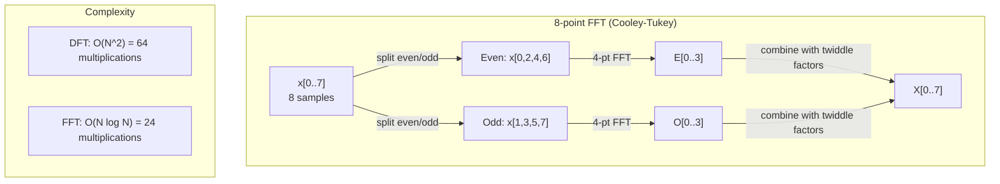
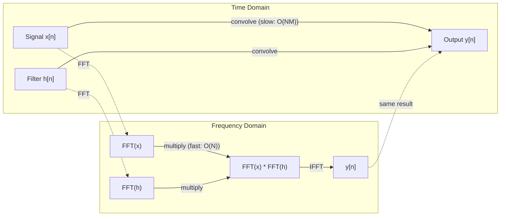

# 푸리에 변환 (The Fourier Transform)

> 모든 신호는 사인파의 합입니다. 푸리에 변환은 그 사인파들이 무엇인지 알려줍니다.

**유형:** Build (실습)
**Language:** Python
**선수 레슨:** Phase 1, Lessons 01-04, 19 (complex numbers)
**소요 시간:** ~90분

## 학습 목표

- DFT를 밑바닥부터 직접 구현하고, $O(N \log N)$ 쿨리-터키(Cooley-Tukey) FFT와 비교하여 검증합니다.
- 주파수 계수를 해석합니다: 신호로부터 진폭, 위상, 파워 스펙트럼(power spectrum)을 추출합니다.
- 합성곱 정리(convolution theorem)를 적용하여 FFT 곱셈을 통한 합성곱(convolution)을 수행합니다.
- 푸리에 주파수 분해를 Transformer 위치 인코딩(positional encoding) 및 CNN 합성곱 계층과 연결합니다.

## 문제 상황

오디오 녹음은 시간에 따른 압력 측정값의 시퀀스입니다. 주가는 날짜에 따른 값의 시퀀스입니다. 이미지는 공간에 따른 픽셀 강도의 그리드입니다. 이 모든 것들은 시간 영역(time domain, 또는 공간 영역)의 데이터입니다. 특정 인덱스에 따라 변화하는 값들을 보게 됩니다.

하지만 많은 패턴이 시간 영역에서는 보이지 않습니다. 이 오디오 신호가 단일 톤일까요, 아니면 화음일까요? 이 주가에는 주간 주기가 있을까요? 이 이미지에는 반복되는 텍스처가 있을까요? 이러한 질문들은 주파수 구성에 관한 것이며, 시간 영역에서는 이것이 숨겨져 있습니다.

푸리에 변환(Fourier transform)은 데이터를 시간 영역에서 주파수 영역(frequency domain)으로 변환합니다. 신호를 입력받아 서로 다른 주파수를 갖는 사인파들로 분해합니다. 각 사인파는 진폭(얼마나 강한지)과 위상(어디서 시작하는지)을 가집니다. 푸리에 변환은 이 둘 모두를 알려줍니다.

주파수 영역적 사고는 모든 곳에 등장하기 때문에 이는 ML에서 중요합니다. 합성곱 신경망(CNN)은 합성곱을 수행하는데, 이는 주파수 영역에서의 곱셈에 해당합니다. Transformer 위치 인코딩은 위치를 표현하기 위해 주파수 분해를 사용합니다. 오디오 모델(음성 인식, 음악 생성)은 소리의 주파수 표현인 스펙트로그램(spectrogram)을 기반으로 동작합니다. 시계열 모델은 주기적 패턴을 탐색합니다. 푸리에 변환을 이해하면 이 모든 것을 다룰 수 있는 어휘를 얻게 됩니다.

## 핵심 개념

### DFT 정의

$N$개의 샘플 $x[0], x[1], \ldots, x[N-1]$이 주어졌을 때, 이산 푸리에 변환(Discrete Fourier Transform, DFT)은 $N$개의 주파수 계수 $X[0], X[1], \ldots, X[N-1]$를 생성합니다:

```math
X[k] = \sum_{n=0}^{N-1} x[n] \, e^{-2\pi i k n/N} \qquad \text{for } k = 0, 1, \ldots, N-1
```

각 $X[k]$는 복소수입니다. 그 크기(magnitude) $\lvert X[k] \rvert$는 주파수 $k$의 진폭을 나타냅니다. 그 위상(phase) $\angle X[k]$는 해당 주파수의 위상 오프셋을 나타냅니다.

핵심 직관: $e^{-2\pi i k n/N}$는 주파수 $k$로 회전하는 페이저(phasor)입니다. DFT는 신호와 등간격으로 나뉜 $N$개의 각 주파수 사이의 상관관계(correlation)를 계산합니다. 신호가 주파수 $k$의 에너지를 포함하고 있다면 상관관계가 큽니다. 그렇지 않다면 0에 가깝습니다.

### 각 계수의 의미

**$X[0]$: DC 성분.** 모든 샘플의 합이며, 평균에 비례합니다. 신호의 상수(0 주파수) 오프셋을 나타냅니다.

```math
X[0] = \sum_{n=0}^{N-1} x[n] \, e^0 = \text{sum of all samples}
```

**$1 \le k \le N/2$ 범위의 $X[k]$: 양의 주파수.** $X[k]$는 $N$개 샘플당 $k$ 사이클의 주파수를 나타냅니다. $k$가 높을수록 주파수가 높음(더 빠른 진동)을 의미합니다.

**$X[N/2]$: 나이퀴스트 주파수(Nyquist frequency).** $N$개의 샘플로 표현할 수 있는 가장 높은 주파수입니다. 이보다 높으면 높은 주파수가 낮은 주파수로 가장하는 에일리어싱(aliasing)이 발생합니다.

**$N/2 < k < N$ 범위의 $X[k]$: 음의 주파수.** 실수 값을 갖는 신호의 경우, $X[N-k] = \overline{X[k]}$입니다. 음의 주파수는 양의 주파수의 거울상입니다. 이것이 바로 유용한 정보가 처음 $N/2 + 1$개의 계수에 존재하는 이유입니다.

### 역이산 푸리에 변환(IDFT)

역이산 푸리에 변환(Inverse DFT)은 주파수 계수로부터 원래 신호를 재구성합니다:

```math
x[n] = \frac{1}{N} \sum_{k=0}^{N-1} X[k] \, e^{2\pi i k n/N} \qquad \text{for } n = 0, 1, \ldots, N-1
```

정방향 DFT와의 유일한 차이점은 지수의 부호가 (음수가 아닌) 양수이며, $1/N$ 정규화 인수가 존재한다는 점입니다.

역 DFT는 완벽한 재구성을 제공합니다. 정보가 전혀 손실되지 않습니다. 어떤 오차도 없이 시간 영역에서 주파수 영역으로, 다시 역방향으로 이동할 수 있습니다. DFT는 기저 변환(change of basis)입니다. 동일한 정보를 다른 좌표계로 다시 표현하는 것입니다.

### FFT: 빠른 연산

위에서 정의한 DFT는 $O(N^2)$입니다: $N$개의 각 출력 계수마다 $N$개의 입력 샘플에 대해 합을 구해야 합니다. $N$ = 100만인 경우, 이는 $10^{12}$회의 연산에 해당합니다.

고속 푸리에 변환(Fast Fourier Transform, FFT)은 동일한 결과를 $O(N \log N)$에 계산합니다. $N$ = 100만인 경우, 1조 번 대신 약 2천만 번의 연산만 수행하면 됩니다. 이것이 바로 주파수 분석을 실용적으로 만드는 핵심입니다.

가장 흔히 사용되는 FFT인 쿨리-터키(Cooley-Tukey) 알고리즘은 분할 정복(divide and conquer) 방식으로 동작합니다:

1. 신호를 짝수 인덱스 샘플과 홀수 인덱스 샘플로 분할합니다.
2. 각 절반의 DFT를 재귀적으로 계산합니다.
3. "회전 인자(twiddle factors)" $e^{-2\pi i k/N}$를 사용하여 크기가 절반인 두 DFT를 결합합니다.

```math
\begin{aligned}
X[k] &= E[k] + e^{-2\pi i k/N} \, O[k] && \text{for } k = 0, \ldots, N/2 - 1 \\
X[k + N/2] &= E[k] - e^{-2\pi i k/N} \, O[k] && \text{for } k = 0, \ldots, N/2 - 1 \\[6pt]
\text{where } E &= \text{DFT of even-indexed samples} \\
O &= \text{DFT of odd-indexed samples}
\end{aligned}
```

대칭성으로 인해 재귀의 각 단계는 $O(N)$만큼의 작업을 수행하며, 총 $\log_2(N)$개의 단계가 존재합니다. 전체: $O(N \log N)$.



FFT는 신호의 길이가 2의 거듭제곱이어야 합니다. 실제로는 신호를 다음으로 큰 2의 거듭제곱 크기로 제로 패딩(zero-padding)합니다.

### 스펙트럼 분석

**파워 스펙트럼(power spectrum)**은 $\lvert X[k] \rvert^2$로, 각 주파수 계수의 크기 제곱입니다. 각 주파수에 에너지가 얼마나 존재하는지를 보여줍니다.

**위상 스펙트럼(phase spectrum)**은 $\angle X[k]$로, 각 주파수의 위상 오프셋입니다. 대부분의 분석 작업에서는 파워 스펙트럼에 집중하고 위상은 무시합니다.

```math
\begin{aligned}
\text{Power at frequency } k: \quad P[k] &= |X[k]|^2 = \mathop{\mathrm{Re}}(X[k])^2 + \mathop{\mathrm{Im}}(X[k])^2 \\
\text{Phase at frequency } k: \quad \phi[k] &= \mathop{\mathrm{atan2}}(\mathop{\mathrm{Im}}(X[k]), \mathop{\mathrm{Re}}(X[k]))
\end{aligned}
```

### 주파수 분해능

DFT의 주파수 분해능(frequency resolution)은 샘플 수 $N$과 샘플링 레이트(sampling rate) $f_s$에 따라 달라집니다.

```math
\begin{aligned}
\text{Frequency of bin } k: \quad & f_k = k \cdot f_s / N \\
\text{Frequency resolution:} \quad & \Delta f = f_s / N \\
\text{Maximum frequency:} \quad & f_{\max} = f_s / 2 \quad \text{(Nyquist)}
\end{aligned}
```

서로 가까이 붙어 있는 두 주파수를 분리해 내려면 더 많은 샘플이 필요합니다. 높은 주파수를 포착하려면 더 높은 샘플링 레이트가 필요합니다.

### 합성곱 정리

이 정리는 신호 처리에서 가장 중요한 결과 중 하나이며, CNN과 직접적인 관련이 있습니다.

**시간 영역에서의 합성곱은 주파수 영역에서의 원소별 곱셈(pointwise multiplication)과 같습니다.**

```math
\begin{aligned}
& x * h = \text{IFFT}(\text{FFT}(x) \cdot \text{FFT}(h)) \\[4pt]
& \text{where } * \text{ is convolution and } \cdot \text{ is element-wise multiplication}
\end{aligned}
```

이것이 중요한 이유:

- 길이가 각각 $N$과 $M$인 두 신호의 직접 합성곱은 $O(NM)$ 연산이 소요됩니다.
- FFT 기반 합성곱은 $O(N \log N)$ 연산이 소요됩니다: 둘 다 변환하고, 곱한 뒤, 다시 역변환합니다.
- 큰 커널의 경우, FFT 합성곱이 압도적으로 빠릅니다.
- 이는 수용 영역(receptive field)이 큰 합성곱 계층에서 일어나는 일과 정확히 일치합니다.

참고: DFT는 순환 합성곱(circular convolution, 신호가 끝에서 되돌아옴)을 계산합니다. 선형 합성곱(linear convolution, 되돌아오지 않음)을 구하려면, 계산 전에 두 신호 모두 길이 $N + M - 1$으로 제로 패딩해야 합니다.


### 윈도잉(Windowing)

DFT는 신호가 주기적이라고 가정합니다. 즉, $N$개의 샘플을 무한히 반복되는 신호의 한 주기로 취급합니다. 신호의 시작값과 끝값이 같지 않으면 경계에서 불연속이 발생하며, 이는 가짜 고주파 성분으로 나타납니다. 이를 스펙트럼 누설(spectral leakage)이라고 부릅니다.

윈도잉은 DFT를 계산하기 전에 신호의 양 끝을 0으로 점진적으로 줄여(tapering) 누설을 감소시킵니다.

일반적인 윈도우:

| 윈도우 | 형태 | 주엽(main lobe) 폭 | 부엽(side lobe) 레벨 | 사용 사례 |
|--------|-------|----------------|-----------------|----------|
| 직사각형(Rectangular) | 평평함 (윈도우 없음) | 가장 좁음 | 가장 높음 (-13 dB) | 신호가 N개 샘플에 정확히 주기적일 때 |
| 한(Hann) | 융기 코사인(raised cosine) | 중간 | 낮음 (-31 dB) | 범용 스펙트럼 분석 |
| 해밍(Hamming) | 변형 코사인(modified cosine) | 중간 | 더 낮음 (-42 dB) | 오디오 처리, 음성 분석 |
| 블랙맨(Blackman) | 삼중 코사인(triple cosine) | 넓음 | 매우 낮음 (-58 dB) | 부엽 억제가 매우 중요할 때 |

```math
\begin{aligned}
\text{Hann window:} \quad & w[n] = 0.5 \left(1 - \cos\frac{2\pi n}{N-1}\right) \\
\text{Hamming window:} \quad & w[n] = 0.54 - 0.46 \cos\frac{2\pi n}{N-1}
\end{aligned}
```

DFT를 적용하기 전에 윈도우를 신호와 원소별로 곱하여 적용합니다: `X = DFT(x * w)`.

### DFT 성질

| 성질 | 시간 영역 | 주파수 영역 |
|----------|-------------|-----------------|
| 선형성 | $ax + by$ | $aX + bY$ |
| 시간 이동 | $x[n - k]$ | $X[f] e^{-2\pi i f k/N}$ |
| 주파수 이동 | $x[n] e^{2\pi i f_0 n/N}$ | $X[f - f_0]$ |
| 합성곱(Convolution) | $x * h$ | $X \cdot H$ (원소별 곱) |
| 곱셈 | $x \cdot h$ (원소별 곱) | $X * H$ ($1/N$배 스케일링된 원형 합성곱) |
| 파르스발 정리(Parseval's theorem) | $\sum \lvert x[n] \rvert^2$ | $\frac{1}{N} \sum \lvert X[k] \rvert^2$ |
| 켤레 대칭 (실수 입력) | $x[n]$ 실수 | $X[k] = \overline{X[N-k]}$ |

파르스발 정리는 두 영역에서 총 에너지가 동일함을 의미합니다. 에너지는 변환 전반에 걸쳐 보존됩니다.

### 위치 인코딩과의 연결점

오리지널 Transformer는 사인 곡선 기반의 위치 인코딩(sinusoidal positional encoding)을 사용합니다:

```math
\begin{aligned}
PE(pos, 2i) &= \sin\left(pos / 10000^{2i/d_{\text{model}}}\right) \\
PE(pos, 2i+1) &= \cos\left(pos / 10000^{2i/d_{\text{model}}}\right)
\end{aligned}
```

각 차원 쌍 $(2i, 2i+1)$는 서로 다른 주파수로 진동합니다. 주파수는 높은 쪽(차원 0, 1)부터 낮은 쪽(마지막 차원)까지 기하급수적 간격으로 배치됩니다. 이를 통해 각 위치는 모든 주파수 대역에 걸쳐 고유한 패턴을 갖게 되며, 이는 푸리에 계수가 신호를 고유하게 식별하는 방식과 유사합니다.

이를 통해 얻을 수 있는 주요 성질은 다음과 같습니다.

- **유일성(Uniqueness):** 동일한 인코딩을 갖는 두 위치는 존재하지 않습니다.
- **유계 값(Bounded values):** sin과 cos 값은 항상 $[-1, 1]$ 범위 내에 있습니다.
- **상대적 위치(Relative position):** 위치 $p+k$의 인코딩은 위치 $p$의 인코딩에 대한 선형 함수로 표현할 수 있습니다. 모델은 상대적 위치에 어텐션을 기울이는 법을 학습할 수 있습니다.

### CNN과의 연결점

합성곱 계층(convolution layer)은 학습된 필터(커널)를 신호나 이미지 전체에 걸쳐 슬라이딩하면서 입력에 적용합니다. 수학적으로 이는 합성곱 연산입니다.

합성곱 정리에 의해, 이는 다음과 동등합니다:
1. 입력에 FFT 수행
2. 커널에 FFT 수행
3. 주파수 영역에서 곱셈
4. 결과에 IFFT 수행

표준 CNN 구현은 직접 합성곱(direct convolution)을 사용합니다(작은 3x3 커널에서 더 빠름). 하지만 대형 커널이나 전역 합성곱의 경우 FFT 기반 접근 방식이 훨씬 빠릅니다. 일부 아키텍처(FNet 등)는 어텐션을 완전히 FFT로 대체하여 $O(N^2)$ 대신 $O(N \log N)$ 복잡도로 경쟁력 있는 정확도를 달성합니다.

### 스펙트로그램과 단시간 푸리에 변환

단일 FFT는 전체 신호의 주파수 성분을 제공하지만, 해당 주파수가 언제 발생하는지는 알려주지 않습니다. 처프(chirp, 시간에 따라 주파수가 증가하는 신호)와 화음(chord, 모든 주파수가 동시에 존재하는 신호)은 동일한 크기 스펙트럼(magnitude spectrum)을 가질 수 있습니다.

단시간 푸리에 변환(Short-Time Fourier Transform, STFT)은 신호의 겹치는 윈도우들에 대해 FFT를 계산함으로써 이를 해결합니다. 그 결과는 스펙트로그램(spectrogram)입니다. 이는 한 축에 시간, 다른 축에 주파수를 두는 2D 표현입니다. 각 지점의 강도는 해당 시점, 해당 주파수에서의 에너지를 나타냅니다.

```
STFT procedure:
1. Choose a window size (e.g., 1024 samples)
2. Choose a hop size (e.g., 256 samples -- 75% overlap)
3. For each window position:
   a. Extract the windowed segment
   b. Apply a Hann/Hamming window
   c. Compute FFT
   d. Store the magnitude spectrum as one column of the spectrogram
```

스펙트로그램은 오디오 ML 모델의 표준 입력 표현입니다. 음성 인식 모델(Whisper, DeepSpeech)은 멜 스케일(mel scale)로 매핑된 스펙트로그램인 멜 스펙트로그램(mel-spectrogram)을 입력으로 처리하며, 이는 인간의 음고 지각과 더 잘 부합합니다.

### 앨리어싱(Aliasing)

신호에 $f_s/2$(나이퀴스트 주파수, Nyquist frequency)보다 높은 주파수가 포함되어 있다면, 샘플링 레이트 $f_s$으로 샘플링할 때 앨리어싱된 복제 신호가 생성됩니다. 100 Hz로 샘플링된 90 Hz 신호는 10 Hz 신호와 완전히 동일하게 보입니다. 샘플만으로는 이 둘을 구별할 방법이 없습니다.

```
Example:
  True signal: 90 Hz sine wave
  Sampling rate: 100 Hz
  Apparent frequency: 100 - 90 = 10 Hz

  The samples from the 90 Hz signal at 100 Hz sampling rate
  are identical to the samples from a 10 Hz signal.
  No amount of math can recover the original 90 Hz.
```

이 때문에 아날로그-디지털 변환기(ADC)에는 샘플링 전에 나이퀴스트 주파수 이상의 주파수를 제거하는 안티앨리어싱 필터가 포함됩니다. ML에서 앨리어싱은 적절한 저역통과 필터링(low-pass filtering) 없이 피처 맵을 다운샘플링할 때 발생하며, 일부 아키텍처는 안티앨리어싱 풀링 계층으로 이를 해결합니다.

### 제로 패딩은 해상도를 높이지 않습니다

흔한 오해 중 하나는 FFT를 적용하기 전에 신호에 제로 패딩(zero-padding)을 적용하면 주파수 해상도가 향상된다는 생각입니다. 그렇지 않습니다. 제로 패딩은 기존 주파수 빈(bin) 사이를 보간하여 스펙트럼을 더 매끄럽게 보이도록 할 뿐입니다. 원본 샘플에 없던 주파수 세부 정보를 드러낼 수는 없습니다.

진정한 주파수 해상도는 오직 관찰 시간 $T = N / f_s$에만 의존합니다. $\Delta f$만큼 떨어진 두 주파수를 구분하려면 최소 $T = 1 / \Delta f$초의 데이터가 필요합니다. 아무리 제로 패딩을 적용해도 이 근본적인 한계를 바꿀 수는 없습니다.

```figure
fourier-synthesis
```

## 직접 구현하기

### 1단계: 밑바닥부터 구현하는 DFT

$O(N^2)$ DFT는 정의로부터 직접 도출됩니다.

```python
import math

class Complex:
    ...

def dft(x):
    N = len(x)
    result = []
    for k in range(N):
        total = Complex(0, 0)
        for n in range(N):
            angle = -2 * math.pi * k * n / N
            w = Complex(math.cos(angle), math.sin(angle))
            xn = x[n] if isinstance(x[n], Complex) else Complex(x[n])
            total = total + xn * w
        result.append(total)
    return result
```

### 2단계: 역 DFT

구조는 동일하며, 지수는 양수이고, $N$로 나눕니다.

```python
def idft(X):
    N = len(X)
    result = []
    for n in range(N):
        total = Complex(0, 0)
        for k in range(N):
            angle = 2 * math.pi * k * n / N
            w = Complex(math.cos(angle), math.sin(angle))
            total = total + X[k] * w
        result.append(Complex(total.real / N, total.imag / N))
    return result
```

### 3단계: FFT (Cooley-Tukey)

재귀적 FFT는 길이가 2의 거듭제곱이어야 합니다. 짝수와 홀수로 분할하고, 재귀를 수행한 뒤, 회전 인자(twiddle factor)를 사용해 결합합니다.

```python
def fft(x):
    N = len(x)
    if N <= 1:
        return [x[0] if isinstance(x[0], Complex) else Complex(x[0])]
    if N % 2 != 0:
        return dft(x)

    even = fft([x[i] for i in range(0, N, 2)])
    odd = fft([x[i] for i in range(1, N, 2)])

    result = [Complex(0)] * N
    for k in range(N // 2):
        angle = -2 * math.pi * k / N
        twiddle = Complex(math.cos(angle), math.sin(angle))
        t = twiddle * odd[k]
        result[k] = even[k] + t
        result[k + N // 2] = even[k] - t
    return result
```

### 4단계: 스펙트럼 분석 도우미 함수

```python
def power_spectrum(X):
    return [xk.real ** 2 + xk.imag ** 2 for xk in X]

def convolve_fft(x, h):
    N = len(x) + len(h) - 1
    padded_N = 1
    while padded_N < N:
        padded_N *= 2

    x_padded = x + [0.0] * (padded_N - len(x))
    h_padded = h + [0.0] * (padded_N - len(h))

    X = fft(x_padded)
    H = fft(h_padded)

    Y = [xk * hk for xk, hk in zip(X, H)]

    y = idft(Y)
    return [y[n].real for n in range(N)]
```

## 사용하기

실제 작업에서는 고도로 최적화된 C 라이브러리를 기반으로 하는 numpy의 FFT를 사용합니다.

```python
import numpy as np

signal = np.sin(2 * np.pi * 5 * np.arange(256) / 256)
spectrum = np.fft.fft(signal)
freqs = np.fft.fftfreq(256, d=1/256)

power = np.abs(spectrum) ** 2

positive_freqs = freqs[:len(freqs)//2]
positive_power = power[:len(power)//2]
```

윈도잉 및 더 고급 스펙트럼 분석의 경우:

```python
from scipy.signal import windows, stft

window = windows.hann(256)
windowed = signal * window
spectrum = np.fft.fft(windowed)
```

합성곱의 경우:

```python
from scipy.signal import fftconvolve

result = fftconvolve(signal, kernel, mode='full')
```

스펙트로그램의 경우:

```python
from scipy.signal import stft

frequencies, times, Zxx = stft(signal, fs=sample_rate, nperseg=256)
spectrogram = np.abs(Zxx) ** 2
```

스펙트로그램 행렬의 형상은 (n_frequencies, n_time_frames)입니다. 각 열은 하나의 시간 윈도우에서의 파워 스펙트럼입니다. 이것이 오디오 ML 모델이 입력으로 사용하는 데이터입니다.

## 배포하기

`code/fourier.py`을 실행하여 `outputs/prompt-spectral-analyzer.md`를 생성합니다.
## 연습 문제

1. **단일 주파수 음(Pure tone) 식별.** 1~50 Hz 사이의 알 수 없는 주파수를 가진 단일 사인파 신호를 128 Hz로 1초 동안 샘플링하여 생성합니다. 직접 구현한 DFT를 사용하여 주파수를 식별합니다. 정답과 일치하는지 확인합니다. 이제 표준편차가 0.5인 가우시안 노이즈를 추가하고 반복합니다. 노이즈가 스펙트럼에 어떤 영향을 미치나요?

2. **FFT와 DFT 검증.** 길이가 64인 무작위 신호를 생성합니다. DFT($O(N^2){}$)와 FFT를 모두 계산합니다. 모든 계수가 1e-10 이내로 일치하는지 확인합니다. 길이가 256, 512, 1024, 2048인 신호에서 두 함수의 실행 시간을 측정합니다. FFT 시간 대비 DFT 시간의 비율을 그래프로 그립니다.

3. **예제를 통한 합성곱 정리(Convolution theorem) 증명.** 신호 x = [1, 2, 3, 4, 0, 0, 0, 0]과 필터 h = [1, 1, 1, 0, 0, 0, 0, 0]을 생성합니다. 이 둘의 원형 합성곱(circular convolution)을 직접(중첩 루프로) 계산합니다. 그런 다음 FFT를 통해 계산합니다(변환, 곱셈, 역변환). 결과가 일치하는지 확인합니다. 이제 적절한 제로 패딩을 적용하여 선형 합성곱(linear convolution)을 수행합니다.

4. **윈도잉(Windowing) 효과.** 10 Hz와 12 Hz(매우 인접함)의 두 사인파의 합으로 신호를 생성합니다. 128 Hz로 1초 동안 샘플링합니다. 윈도우 미적용, 한(Hann) 윈도우, 해밍(Hamming) 윈도우를 각각 적용하여 파워 스펙트럼을 계산합니다. 어떤 윈도우를 사용할 때 두 피크를 가장 쉽게 구분할 수 있나요? 그 이유는 무엇인가요?

5. **위치 인코딩(Positional encoding) 분석.** d_model = 128 및 max_pos = 512에 대한 사인파 위치 인코딩을 생성합니다. 각 위치 쌍 $(p_1, p_2)$에 대해 인코딩의 내적(dot product)을 계산합니다. 내적이 절대 위치가 아니라 오직 $\lvert p_1 - p_2 \rvert$에만 의존함을 보입니다. 거리가 증가함에 따라 내적은 어떻게 변화하나요?

### 힌트

**연습 문제 1.** 1초 동안 128개의 샘플이 있으므로, 빈(bin) $k$는 $k$ Hz에 해당하며, 따라서 정수 주파수의 경우 빈 1부터 63까지 중 가장 큰 값의 인덱스가 주파수가 됩니다. 정수 헤르츠 값을 선택합니다. 두 빈 사이의 주파수는 인접한 빈으로 퍼져나가며, 피크는 가장 가까운 빈만을 나타냅니다. `generate_signal`와 `magnitude_spectrum`을 사용합니다. 노이즈를 추가한 후, 다른 빈의 값이 상승하더라도 피크가 여전히 동일한 빈에 위치하는지 확인합니다.

**연습 문제 2.** `fft`는 신호를 반으로 나누므로 2의 거듭제곱 길이를 사용합니다. 모든 계수에 대해 `max(abs(a - b))`를 확인합니다. 시간 비율은 대략 $N / \log_2 N$에 비례하여 증가해야 합니다.

**연습 문제 3.** 원형 합성곱의 경우, $n$ = 0, 1, 2에 대해 $y[n] = \sum_k h[k] x[(n-k) \bmod 8]$를 손으로 직접 계산하고 `convolve_direct`와 `convolve_fft`의 처음 세 값을 비교합니다. 선형 합성곱의 길이는 4 + 3 - 1 = 6이므로, 먼저 길이 8이 이미 충분한지 확인합니다.

**연습 문제 4.** `hann_window`, `hamming_window`, `apply_window`, `power_spectrum`를 사용하고 9 Hz와 13 Hz 사이의 구분된 피크 수를 셉니다. 10 Hz와 12 Hz는 모두 1초 동안 완전한 주기를 완료하므로, 윈도우를 적용하지 않았을 때 가장 좋아 보일 수 있습니다. 10.5 Hz와 12.5 Hz로 반복하여 윈도우가 줄여주는 누설(leakage) 현상을 확인합니다.

**연습 문제 5.** `positional_encoding(pos, 128)`를 사용하여 각 인코딩을 계산합니다. 위치 (0, 10)에 대한 내적과 (100, 110)에 대한 내적을 비교합니다. 두 값은 약 1e-10 이내로 일치해야 합니다. 그런 다음 하나의 고정된 $p_1$에 대해 $\lvert p_1 - p_2 \rvert$에 따른 내적을 그래프로 그립니다.

## 주요 용어

| 용어 | 의미 |
|------|------|
| 이산 푸리에 변환(DFT, Discrete Fourier Transform) | $N$개의 시간 도메인 샘플을 $N$개의 주파수 도메인 계수로 변환합니다. 각 계수는 해당 주파수의 복소 정현파와의 상관관계입니다 |
| 고속 푸리에 변환(FFT, Fast Fourier Transform) | DFT를 계산하는 $O(N \log N)$ 알고리즘입니다. 쿨리-튜키(Cooley-Tukey) 알고리즘은 짝수/홀수 인덱스를 재귀적으로 분할합니다 |
| 역 이산 푸리에 변환(Inverse DFT) | 주파수 계수로부터 시간 도메인 신호를 재구성합니다. 지수의 부호가 반대이고 $1/N$ 스케일링이 적용된다는 점을 제외하면 DFT와 동일한 공식입니다 |
| 주파수 빈(Frequency bin) | DFT 출력의 각 인덱스 $k$는 주파수 $k f_s/N$ Hz를 나타냅니다. "빈"은 이산적인 주파수 구간을 의미합니다 |
| 직류 성분(DC component) | 0 주파수 계수인 $X[0]$입니다. 신호의 평균에 비례합니다 |
| 나이퀴스트 주파수(Nyquist frequency) | 샘플링 레이트 $f_s$에서 표현 가능한 최대 주파수인 $f_s/2$입니다. 이 주파수를 초과하는 주파수는 앨리어싱됩니다 |
| 파워 스펙트럼(Power spectrum) | 각 주파수 계수의 크기 제곱인 $\lvert X[k] \rvert^2$입니다. 주파수 전반의 에너지 분포를 보여줍니다 |
| 위상 스펙트럼(Phase spectrum) | 각 주파수 성분의 위상 오프셋인 $\angle X[k]$입니다. 분석에서는 종종 무시됩니다 |
| 스펙트럼 누설(Spectral leakage) | 비주기적 신호를 주기적인 것으로 취급하여 발생하는 인위적인 주파수 성분입니다. 윈도잉으로 줄일 수 있습니다 |
| 윈도우 함수(Window function) | 스펙트럼 누설을 줄이기 위해 DFT 전에 적용하는 테이퍼링(tapering) 함수(Hann, Hamming, Blackman)입니다 |
| 트위들 팩터(Twiddle factor) | FFT 버터플라이 연산에서 하위 DFT를 결합하는 데 사용되는 복소 지수 $e^{-2\pi i k/N}$입니다 |
| 합성곱 정리(Convolution theorem) | 시간 도메인에서의 합성곱은 주파수 도메인에서의 점별(pointwise) 곱셈과 동일합니다. 신호 처리 및 CNN의 기본 원리입니다 |
| 원형 합성곱(Circular convolution) | 신호가 순환(wrap around)되는 합성곱입니다. DFT가 자연스럽게 계산하는 방식입니다 |
| 선형 합성곱(Linear convolution) | 순환 없는 표준 합성곱입니다. DFT 적용 전에 제로 패딩을 수행하여 얻을 수 있습니다 |
| 파세발 정리(Parseval's theorem) | 푸리에 변환을 거쳐도 총 에너지는 보존됩니다. $\sum \lvert x[n] \rvert^2 = \frac{1}{N} \sum \lvert X[k] \rvert^2$ |
| 앨리어싱(Aliasing) | 불충분한 샘플링 레이트로 인해 나이퀴스트 주파수 이상의 주파수가 더 낮은 주파수로 나타나는 현상입니다 |

## 더 읽을거리

- [Cooley & Tukey: An Algorithm for the Machine Calculation of Complex Fourier Series (1965)](https://www.ams.org/journals/mcom/1965-19-090/S0025-5718-1965-0178586-1/) - 컴퓨팅의 판도를 바꾼 최초의 FFT 논문
- [3Blue1Brown: But what is the Fourier Transform?](https://www.youtube.com/watch?v=spUNpyF58BY) - 푸리에 변환에 대한 최고의 시각적 입문 자료
- [Lee-Thorp et al.: FNet: Mixing Tokens with Fourier Transforms (2021)](https://arxiv.org/abs/2105.03824) - Transformer에서 셀프 어텐션을 FFT로 대체한 연구
- [Smith: The Scientist and Engineer's Guide to Digital Signal Processing](http://www.dspguide.com/) - FFT, 윈도잉, 스펙트럼 분석을 심도 있게 다루는 무료 온라인 교재
- [Vaswani et al.: Attention Is All You Need (2017)](https://arxiv.org/abs/1706.03762) - 푸리에 주파수 분해에서 파생된 사인파 위치 인코딩
- [Radford et al.: Whisper (2022)](https://arxiv.org/abs/2212.04356) - 멜 스펙트로그램을 입력 표현으로 사용하는 음성 인식 모델
