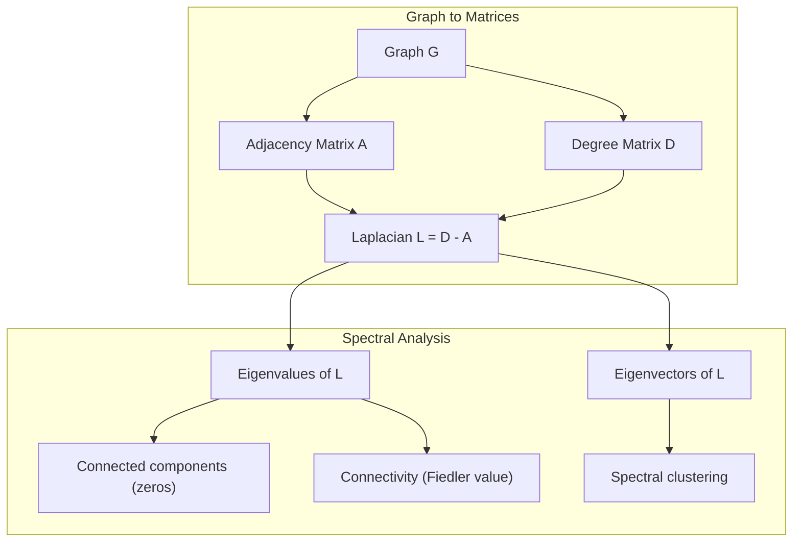
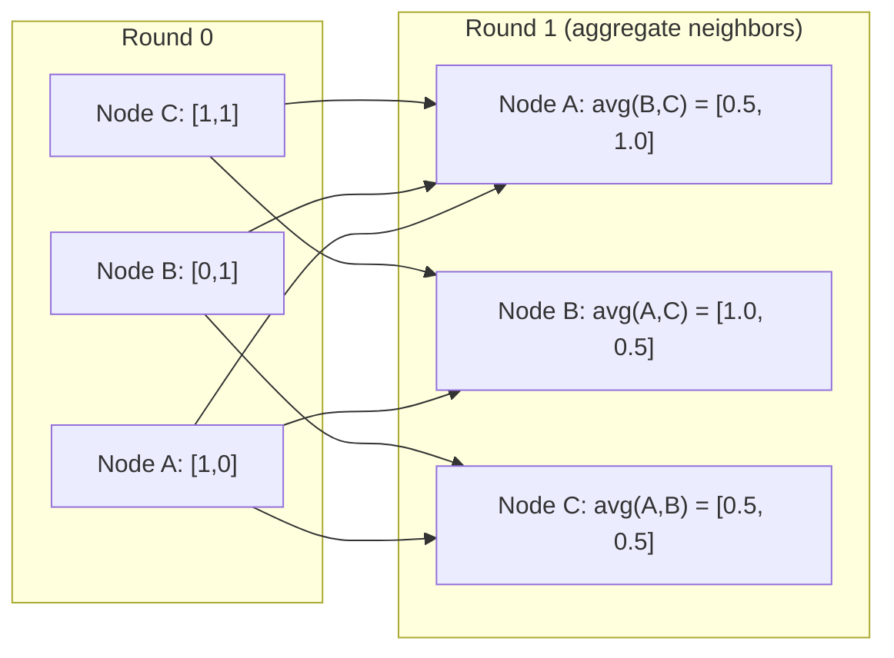

# 머신러닝을 위한 그래프 이론

> 그래프는 관계를 표현하는 자료구조입니다. 데이터에 연결 관계가 존재한다면 그래프 이론이 반드시 필요합니다.

**유형:** Build (실습)
**Language:** Python
**선수 레슨:** Phase 1, Lessons 01-03 (linear algebra, matrices)
**소요 시간:** ~90분

## 학습 목표

- 인접 행렬(adjacency matrix) 및 인접 리스트(adjacency list) 표현을 갖춘 그래프 클래스를 구현하고, BFS 및 DFS 순회를 구현합니다.
- 그래프 라플라시안(Laplacian)을 계산하고, 그 고윳값(eigenvalue)을 사용하여 연결 요소(connected component)를 탐지하고 노드를 클러스터링합니다.
- 정규화된 인접 행렬 곱셈을 통해 GNN 스타일의 메시지 패싱(message passing) 1단계를 구현합니다.
- 피들러 벡터(Fiedler vector)를 활용하여 그래프를 분할하는 스펙트럴 클러스터링(spectral clustering)을 적용합니다.

## 문제 상황

소셜 네트워크, 분자, 지식 베이스, 인용 네트워크, 도로망은 모두 그래프입니다. 전통적인 머신러닝은 데이터를 평면적인 테이블로 다룹니다. 각 행은 독립적이며, 각 특성은 열이 됩니다. 하지만 연결 구조 자체가 중요한 정보일 때는 테이블 방식이 한계를 드러냅니다.

소셜 네트워크를 생각해 봅시다. 사용자가 어떤 상품을 구매할지 예측하고자 합니다. 해당 사용자의 구매 이력도 중요하지만, 그 친구들의 구매 이력이 더 중요할 수 있습니다. 연결 관계 자체가 신호(signal)를 담고 있기 때문입니다.

분자의 경우도 마찬가지입니다. 단백질과의 결합 여부를 예측하고자 할 때, 원자 자체도 중요하지만 원자들이 서로 어떻게 결합되어 있는지가 결정적인 역할을 합니다. 구조 그 자체가 곧 데이터입니다.

그래프 신경망(Graph Neural Networks, GNN)은 딥러닝에서 가장 빠르게 성장하고 있는 분야입니다. 신약 개발, 소셜 추천, 이상 거래 탐지(fraud detection), 지식 그래프 추론 등에 활용됩니다. 모든 GNN은 동일한 기초, 즉 기초 그래프 이론 위에 구축됩니다.

필요한 요소는 다음 네 가지입니다.
1. 그래프를 행렬로 표현하는 방법 (행렬 곱셈을 수행하기 위함)
2. 그래프 구조를 탐색하는 순회 알고리즘
3. 라플라시안 — 스펙트럴 그래프 이론에서 가장 중요한 단일 행렬
4. 메시지 패싱 — GNN을 동작하게 만드는 핵심 연산

## 개념

### 그래프: 노드와 에지

그래프 $G = (V, E)$는 정점(node) 집합 $V$과 에지(edge) 집합 $E$로 구성됩니다. 각 에지는 두 노드를 연결합니다.

**유향 vs 무향.** 무향 그래프(undirected graph)에서 에지 $(u, v)$는 $u$가 $v$에 연결되고 동시에 $v$도 $u$에 연결됨을 의미합니다. 유향 그래프(directed graph, digraph)에서 에지 $(u, v)$는 $u$가 $v$를 가리킴을 의미하며, 그 역이 반드시 성립하지는 않습니다.

**가중치 vs 비가중치.** 비가중치 그래프(unweighted graph)에서는 에지가 존재하거나 존재하지 않거나 둘 중 하나입니다. 가중치 그래프(weighted graph)에서는 각 에지가 거리, 비용, 강도 등의 수치적 가중치를 가집니다.

| 그래프 유형 | 예시 |
|-----------|---------|
| 무향, 비가중치 | 페이스북 친구 네트워크 |
| 유향, 비가중치 | 트위터 팔로우 네트워크 |
| 무향, 가중치 | 도로망 (거리) |
| 유향, 가중치 | 웹페이지 링크 (PageRank 점수) |

### 인접 행렬

인접 행렬(adjacency matrix) $A$은 핵심적인 표현 방식입니다. $n$개의 노드를 가진 그래프의 경우 다음과 같습니다.

```math
A[i][j] = \begin{cases} 1 & \text{if there is an edge from node } i \text{ to node } j \\ 0 & \text{otherwise} \end{cases}
```

무향 그래프의 경우, $A$는 대칭 행렬입니다: $A[i][j] = A[j][i]$. 가중치 그래프의 경우, $A[i][j]$ = 에지 $(i, j)$의 가중치입니다.

**예시 -- 삼각형 그래프:**

```
Nodes: 0, 1, 2
Edges: (0,1), (1,2), (0,2)

A = [[0, 1, 1],
     [1, 0, 1],
     [1, 1, 0]]
```

인접 행렬은 모든 GNN의 입력이 됩니다. $A$에 대한 행렬 연산은 그래프에 대한 연산에 대응합니다.

### 차수

노드의 차수(degree)는 해당 노드에 연결된 에지의 수입니다. 유향 그래프의 경우 진입 차수(in-degree, 들어오는 에지)와 진출 차수(out-degree, 나가는 에지)로 나뉩니다.

차수 행렬(degree matrix) $D$은 대각 행렬입니다.

```math
\begin{aligned}
D[i][i] &= \text{degree of node } i \\
D[i][j] &= 0 \quad \text{for } i \ne j
\end{aligned}
```

앞서 살펴본 삼각형 예시의 경우, 모든 노드가 다른 두 노드와 연결되어 있으므로 $D = \mathop{\mathrm{diag}}(2, 2, 2)$가 됩니다.

차수는 노드의 중요도를 알려줍니다. 차수가 높다는 것은 허브(hub) 노드임을 의미합니다. 네트워크의 차수 분포는 그 구조적 특성을 보여줍니다. 소셜 네트워크는 멱함수 법칙(power law)을 따릅니다(소수의 허브, 다수의 리프 노드). 무작위 그래프는 포아송 분포를 따르는 차수를 가집니다.

### BFS와 DFS

두 가지 기본적인 그래프 순회 알고리즘입니다. 둘 다 반드시 알아두어야 합니다.

**너비 우선 탐색(BFS):** 모든 이웃을 먼저 탐색한 후, 이웃의 이웃을 탐색합니다. 큐(queue, FIFO)를 사용합니다.

```
BFS from node 0:
  Visit 0
  Queue: [1, 2]        (neighbors of 0)
  Visit 1
  Queue: [2, 3]        (add neighbors of 1)
  Visit 2
  Queue: [3]           (neighbors of 2 already visited)
  Visit 3
  Queue: []            (done)
```

BFS는 비가중치 그래프에서 최단 경로를 찾습니다. 시작 노드에서 임의의 노드까지의 거리는 해당 노드가 처음 발견되는 BFS 레벨과 같습니다. 이러한 이유로 소셜 네트워크에서 홉 수(hop-count) 기반 거리를 계산할 때 BFS가 사용됩니다.

**깊이 우선 탐색(DFS):** 역추적(backtracking)하기 전에 가능한 한 깊이 탐색합니다. 스택(stack, LIFO) 또는 재귀를 사용합니다.

```
DFS from node 0:
  Visit 0
  Stack: [1, 2]        (neighbors of 0)
  Visit 2               (pop from stack)
  Stack: [1, 3]         (add neighbors of 2)
  Visit 3               (pop from stack)
  Stack: [1]
  Visit 1               (pop from stack)
  Stack: []             (done)
```

DFS는 다음과 같은 작업에 유용합니다.
- 연결 요소 찾기 (방문하지 않은 노드에서 DFS 실행)
- 사이클 탐지 (DFS 트리의 역방향 에지 확인)
- 위상 정렬 (topological sort, DFS 완료 순서의 역순)

| 알고리즘 | 자료구조 | 탐색 대상 | 활용 사례 |
|-----------|---------------|-------|----------|
| BFS | 큐 | 최단 경로 | 소셜 네트워크 거리, 지식 그래프 순회 |
| DFS | 스택 | 요소, 사이클 | 연결성, 위상 정렬 |

### 그래프 라플라시안

$L = D - A$. 스펙트럴 그래프 이론에서 가장 중요한 행렬입니다.

삼각형 그래프의 경우:

```math
D = \begin{bmatrix} 2 & 0 & 0 \\ 0 & 2 & 0 \\ 0 & 0 & 2 \end{bmatrix} \qquad A = \begin{bmatrix} 0 & 1 & 1 \\ 1 & 0 & 1 \\ 1 & 1 & 0 \end{bmatrix} \qquad L = \begin{bmatrix} 2 & -1 & -1 \\ -1 & 2 & -1 \\ -1 & -1 & 2 \end{bmatrix}
```

라플라시안은 주목할 만한 성질들을 가지고 있습니다.

1. **$L$는 양의 준정부호(positive semi-definite) 행렬입니다.** 모든 고윳값이 $\ge 0$입니다.

2. **0인 고윳값의 개수는 연결 요소의 개수와 같습니다.** 연결 그래프는 정확히 하나의 0인 고윳값을 가집니다. 분리된 3개의 연결 요소를 가진 그래프는 세 개의 0인 고윳값을 가집니다.

3. **0이 아닌 가장 작은 고윳값(피들러 값, Fiedler value)은 연결성을 측정합니다.** 피들러 값이 크면 그래프가 잘 연결되어 있음을 뜻합니다. 피들러 값이 작으면 그래프에 병목(bottleneck)과 같은 취약 지점이 있음을 뜻합니다.

4. **피들러 값에 대응하는 고유벡터(피들러 벡터, Fiedler vector)는 최적의 분할 방식을 보여줍니다.** 양수 값을 가진 노드는 한 그룹으로, 음수 값을 가진 노드는 다른 그룹으로 나뉩니다. 이것이 바로 스펙트럴 클러스터링입니다.



### 스펙트럴 성질

인접 행렬과 라플라시안의 고윳값은 순회를 거치지 않고도 그래프의 구조적 성질을 드러냅니다.

**스펙트럴 클러스터링**의 동작 원리는 다음과 같습니다.
1. 라플라시안 $L$을 계산합니다.
2. $L$의 가장 작은 고유벡터 $k$개를 구합니다(연결 그래프에서 모두 1로 채워진 첫 번째 고유벡터는 건너뜁니다).
3. 해당 고유벡터들을 각 노드의 새로운 좌표로 사용합니다.
4. 이 좌표들을 대상으로 $k$-means를 실행합니다.

이 방식이 효과적인 이유는 무엇일까요? $L$의 고유벡터는 그래프상에서 가장 "매끄러운(smooth)" 함수를 인코딩하기 때문입니다. 잘 연결된 노드들은 서로 비슷한 고유벡터 값을 얻게 됩니다. 병목으로 분리된 노드들은 서로 다른 값을 얻습니다. 즉, 고유벡터가 군집(cluster)을 자연스럽게 분리해 냅니다.

**랜덤 워크와의 연관성.** 정규화된 라플라시안은 그래프상의 랜덤 워크(random walk)와 관련이 있습니다. 랜덤 워크의 정상 분포(stationary distribution)는 노드 차수에 비례합니다. 믹싱 시간(mixing time, 보행이 얼마나 빠르게 수렴하는지)은 스펙트럴 갭(spectral gap)에 따라 결정됩니다.

### 메시지 패싱

그래프 신경망의 핵심 연산입니다. 각 노드는 이웃으로부터 메시지를 수집(aggregate)하고, 이를 집계하여 자신의 상태를 업데이트(update)합니다.

```math
h_v^{(k+1)} = \text{UPDATE}\left(h_v^{(k)}, \text{AGGREGATE}\left(\{h_u^{(k)} : u \in \text{neighbors}(v)\}\right)\right)
```

가장 단순한 형태의 경우, AGGREGATE는 평균(mean)이고, UPDATE는 선형 변환 + 활성화 함수(activation)입니다.

```math
h_v^{(k+1)} = \sigma\left(W \cdot \text{mean}\left(\{h_u^{(k)} : u \in \text{neighbors}(v)\}\right)\right)
```

이는 본질적으로 행렬 곱셈입니다. $H$가 모든 노드 특성의 행렬이고 $A$가 인접 행렬이라면 다음과 같이 표현됩니다.

```math
H^{(k+1)} = \sigma\left(A_{\text{norm}} H^{(k)} W\right)
```

여기서 $A_{\text{norm}}$는 정규화된 인접 행렬입니다(각 행의 합은 1).

메시지 패싱을 1회 수행하면 각 노드는 직계 이웃을 "볼" 수 있습니다. 2회 수행하면 이웃의 이웃까지 볼 수 있습니다. $K$회 수행하면 각 노드는 자신의 $K$-홉 이웃으로부터 정보를 얻게 됩니다.


### Concepts and ML Applications

| Concept | ML Application |
|---------|---------------|
| Adjacency matrix | GNN input representation |
| Graph Laplacian | Spectral clustering, community detection |
| BFS/DFS | Knowledge graph traversal, path finding |
| Degree distribution | Node importance, feature engineering |
| Message passing | GNN layers (GCN, GAT, GraphSAGE) |
| Eigenvalues of L | Community detection, graph partitioning |
| Spectral clustering | Unsupervised node grouping |
| PageRank | Node importance, web search |

```figure
graph-degree-distribution
```

## Build It

### Step 1: Graph class from scratch

```python
class Graph:
    def __init__(self, n_nodes, directed=False):
        self.n = n_nodes
        self.directed = directed
        self.adj = {i: {} for i in range(n_nodes)}

    def add_edge(self, u, v, weight=1.0):
        self.adj[u][v] = weight
        if not self.directed:
            self.adj[v][u] = weight

    def neighbors(self, node):
        return list(self.adj[node].keys())

    def degree(self, node):
        return len(self.adj[node])

    def weighted_degree(self, node):
        return sum(self.adj[node].values())

    def adjacency_matrix(self):
        import numpy as np
        A = np.zeros((self.n, self.n))
        for u in range(self.n):
            for v, w in self.adj[u].items():
                A[u][v] = w
        return A

    def degree_matrix(self):
        import numpy as np
        D = np.zeros((self.n, self.n))
        for i in range(self.n):
            D[i][i] = self.weighted_degree(i)
        return D

    def laplacian(self):
        return self.degree_matrix() - self.adjacency_matrix()
```

인접 리스트(adjacency list, `self.adj`)는 이웃 노드들을 효율적으로 저장합니다. 모든 스펙트럴 연산(spectral operation)에 numpy가 필요하므로 인접 행렬 변환에는 numpy를 사용합니다.

### Step 2: BFS and DFS

```python
from collections import deque

def bfs(graph, start):
    visited = set()
    order = []
    distances = {}
    queue = deque([(start, 0)])
    visited.add(start)
    while queue:
        node, dist = queue.popleft()
        order.append(node)
        distances[node] = dist
        for neighbor in graph.neighbors(node):
            if neighbor not in visited:
                visited.add(neighbor)
                queue.append((neighbor, dist + 1))
    return order, distances


def dfs(graph, start):
    visited = set()
    order = []
    stack = [start]
    while stack:
        node = stack.pop()
        if node in visited:
            continue
        visited.add(node)
        order.append(node)
        for neighbor in reversed(graph.neighbors(node)):
            if neighbor not in visited:
                stack.append(neighbor)
    return order
```

BFS는 $O(1)$ popleft 연산을 위해 deque(양방향 큐)를 사용합니다. DFS는 리스트를 스택으로 사용합니다. 두 알고리즘 모두 모든 노드를 정확히 한 번씩 방문하므로 시간 복잡도는 $O(V + E)$입니다.

### Step 3: Connected components and Laplacian eigenvalues

```python
def connected_components(graph):
    visited = set()
    components = []
    for node in range(graph.n):
        if node not in visited:
            order, _ = bfs(graph, node)
            visited.update(order)
            components.append(order)
    return components


def laplacian_eigenvalues(graph):
    import numpy as np
    L = graph.laplacian()
    eigenvalues = np.linalg.eigvalsh(L)
    return eigenvalues
```

`eigvalsh`는 대칭 행렬을 위한 함수이며, 무방향 그래프의 라플라시안(Laplacian)은 항상 대칭입니다. 이 함수는 고윳값(eigenvalue)을 오름차순으로 반환합니다. 0의 개수를 세어 연결 요소(connected component)의 수를 구할 수 있습니다.

### Step 4: Spectral clustering

```python
def spectral_clustering(graph, k=2):
    import numpy as np
    L = graph.laplacian()
    eigenvalues, eigenvectors = np.linalg.eigh(L)
    features = eigenvectors[:, 1:k+1]

    labels = np.zeros(graph.n, dtype=int)
    for i in range(graph.n):
        if features[i, 0] >= 0:
            labels[i] = 0
        else:
            labels[i] = 1
    return labels
```

$k=2$인 경우, 피들러 벡터(Fiedler vector)의 부호에 따라 그래프가 두 개의 클러스터로 분할됩니다. $k>2$인 경우에는 (모든 원소가 1인 자명한 고유벡터를 제외하고) 처음 $k$개의 고유벡터에 대해 $k$-means를 실행합니다.

### Step 5: Message passing

```python
def message_passing(graph, features, weight_matrix):
    import numpy as np
    A = graph.adjacency_matrix()
    row_sums = A.sum(axis=1, keepdims=True)
    row_sums[row_sums == 0] = 1
    A_norm = A / row_sums
    aggregated = A_norm @ features
    output = aggregated @ weight_matrix
    return output
```

이것이 GNN 메시지 전달(message passing)의 1 라운드입니다. 각 노드의 새로운 특성(feature)은 이웃 노드들의 특성을 가중 평균한 후 가중치 행렬로 변환한 값입니다. 여러 라운드를 쌓으면 정보를 더 멀리 전파할 수 있습니다.

## Use It

networkx와 numpy를 사용하면 동일한 연산을 한 줄로 처리할 수 있습니다:

```python
import networkx as nx
import numpy as np

G = nx.karate_club_graph()

A = nx.adjacency_matrix(G).toarray()
L = nx.laplacian_matrix(G).toarray()

eigenvalues = np.linalg.eigvalsh(L.astype(float))
print(f"Smallest eigenvalues: {eigenvalues[:5]}")
print(f"Connected components: {nx.number_connected_components(G)}")

communities = nx.community.greedy_modularity_communities(G)
print(f"Communities found: {len(communities)}")

pr = nx.pagerank(G)
top_nodes = sorted(pr.items(), key=lambda x: x[1], reverse=True)[:5]
print(f"Top 5 PageRank nodes: {top_nodes}")
```

networkx는 최적화된 C 백엔드를 통해 어떤 규모의 그래프도 다룰 수 있습니다. 프로덕션 환경에서는 이를 활용하세요. 밑바닥부터 직접 구현한 코드는 그 내부 동작 방식을 이해하는 데 사용하세요.

### numpy spectral analysis

```python
import numpy as np

A = np.array([
    [0, 1, 1, 0, 0],
    [1, 0, 1, 0, 0],
    [1, 1, 0, 1, 0],
    [0, 0, 1, 0, 1],
    [0, 0, 0, 1, 0]
])

D = np.diag(A.sum(axis=1))
L = D - A

eigenvalues, eigenvectors = np.linalg.eigh(L)
print(f"Eigenvalues: {np.round(eigenvalues, 4)}")
print(f"Fiedler value: {eigenvalues[1]:.4f}")
print(f"Fiedler vector: {np.round(eigenvectors[:, 1], 4)}")

fiedler = eigenvectors[:, 1]
group_a = np.where(fiedler >= 0)[0]
group_b = np.where(fiedler < 0)[0]
print(f"Cluster A: {group_a}")
print(f"Cluster B: {group_b}")
```

피들러 벡터가 핵심적인 역할을 수행합니다. 양수 항목은 한 클러스터에, 음수 항목은 다른 클러스터에 속합니다. 반복적인 최적화가 필요 없이 한 번의 고윳값 분해(eigendecomposition)만으로 충분합니다.

## Ship It

이 레슨에서 제작하는 산출물:
- `outputs/skill-graph-analysis.md` -- 그래프 구조 데이터를 분석하기 위한 기술 레퍼런스

## Connections

| Concept | Where it shows up |
|---------|------------------|
| Adjacency matrix | GCN, GAT, GraphSAGE input |
| Laplacian | Spectral clustering, ChebNet filters |
| BFS | Knowledge graph traversal, shortest path queries |
| Message passing | Every GNN layer, neural message passing |
| Spectral gap | Graph connectivity, mixing time of random walks |
| Degree distribution | Power-law networks, node feature engineering |
| Connected components | Preprocessing, handling disconnected graphs |
| PageRank | Node importance ranking, attention initialization |

GNN은 특별히 언급할 가치가 있습니다. GCN(Kipf & Welling, 2017)의 그래프 합성곱(graph convolution) 연산은 자기 루프(self-loop)가 추가된 인접 행렬 $\hat{A} = A + I$을 사용합니다:

```math
H^{(l+1)} = \sigma\left(\hat{D}^{-1/2} \hat{A} \hat{D}^{-1/2} H^{(l)} W^{(l)}\right)
```

여기서 $\hat{A} = A + I$ (인접 행렬에 자기 루프를 더한 것)이며, $\hat{D}$는 $\hat{A}$의 차수 행렬(degree matrix)입니다. 자기 루프는 각 노드가 집계(aggregation) 중에 자신의 특성을 포함하도록 보장합니다. 이는 대칭 정규화(symmetric normalization)가 적용된 메시지 전달과 정확히 같습니다. $\hat{D}^{-1/2} \hat{A} \hat{D}^{-1/2}$는 정규화된 인접 행렬입니다. 이러한 정규화가 $L_{\text{sym}} = I - D^{-1/2} A D^{-1/2}$와 관련되어 있기 때문에 라플라시안이 등장합니다. 라플라시안을 이해하는 것은 곧 GCN이 왜 작동하는지 이해하는 것입니다.

## Exercises

1. **PageRank를 밑바닥부터 구현하세요.** 균등한 점수로 시작합니다. 각 단계에서 v를 가리키는 모든 u에 대해 다음을 계산합니다: score(v) = (1-d)/n + d * sum(score(u)/out_degree(u)). d=0.85를 사용하세요. 수렴할 때까지(변화량 < 1e-6) 실행합니다. 작은 웹 그래프에서 테스트해 보세요.

2. **스펙트럴 클러스터링을 사용하여 커뮤니티를 찾으세요.** 명확히 분리된 두 개의 클러스터(예: 단일 에지로 연결된 두 개의 완전 그래프(clique))를 가진 그래프를 만듭니다. 스펙트럴 클러스터링을 실행하고 올바른 분할을 찾는지 확인하세요. 클러스터 간 교차 에지를 추가하면 어떤 일이 일어날까요?

3. **가중치 그래프에서 최단 경로를 구하는 다익스트라 알고리즘(Dijkstra's algorithm)을 구현하세요.** 동일한 그래프에서 균등한 가중치를 주었을 때의 BFS 결과와 비교해 보세요.

4. **2계층 메시지 전달 네트워크를 구축하세요.** 서로 다른 가중치 행렬을 사용하여 메시지 전달을 두 번 적용합니다. 2 라운드 후에 각 노드가 2-hop 이웃으로부터 정보를 얻었음을 보여주세요.

5. **실제 데이터셋의 그래프를 분석하세요.** Karate Club 그래프(노드 34개, 에지 78개)를 사용합니다. 차수 분포(degree distribution), 라플라시안 고윳값, 스펙트럴 클러스터링을 계산하세요. 스펙트럴 클러스터링 결과를 알려진 정답(ground truth) 분할과 비교해 보세요.

### Hints

**연습문제 1.** 문제에 주어진 공식을 사용하세요. 나가는 에지가 없는 노드는 자신의 점수를 모든 노드와 균등하게 나누어야 하며, 그렇지 않으면 총합이 1 미만으로 떨어집니다. 각 단계 후 점수의 합이 1이 되는지 확인하고 `pagerank(graph)`의 결과와 비교해 보세요.

**연습문제 2.** `add_edge`로 두 개의 완전 그래프를 만들고 단일 에지로 연결한 다음 `spectral_clustering(graph, k=2)`를 호출하세요. 각 완전 그래프가 하나의 레이블을 받는지 확인합니다. 교차 에지를 추가하면서 두 그룹이 결합됨에 따라 커지는 `laplacian()`의 두 번째로 작은 고윳값을 출력해 보세요.

**연습문제 3.** `heapq`로 우선순위 큐(priority queue)를 유지하고 항상 알려진 거리가 가장 작은 노드를 확장합니다. 모든 가중치를 1로 설정하고, 각 다익스트라 거리가 `bfs(graph, start)`로부터 해당 노드까지의 BFS 계층과 같은지 확인하세요.

**연습문제 4.** 각 열이 하나의 노드를 나타내도록 단위 행렬(identity matrix)을 `features`로 사용하고, `message_passing`를 두 번 적용합니다. 그러면 노드 $v$의 행에서 0이 아닌 항목들이 어떤 노드가 $v$에 도달했는지를 보여줍니다. 그 집합을 너비 우선 탐색(BFS)으로 구한 거리 2 이내의 노드들과 비교해 보세요.

**연습문제 5.** `networkx.karate_club_graph()`는 노드 속성 `club`에 에지 리스트와 정답(ground truth)을 제공합니다. 에지를 `Graph`에 복사하고 노드 34개와 에지 78개가 있는지 확인하세요. `spectral_clustering`의 레이블을 `club` 값과 비교하되, 두 레이블의 이름이 서로 뒤바뀔 수 있음을 감안하세요.

## Key Terms

| Term | What people say | What it actually means |
|------|----------------|----------------------|
| Graph | "노드와 에지" | 쌍별 관계를 인코딩하는 수학적 구조 $G=(V,E)$ |
| Adjacency matrix | "연결 테이블" | 노드 $i$와 $j$가 연결되어 있으면 $A[i][j] = 1$인 $n \times n$ 행렬 |
| Degree | "노드의 연결 정도" | 하나의 노드에 맞닿아 있는 에지의 수 |
| Laplacian | "D 빼기 A" | 고윳값이 그래프 구조를 드러내 주는 행렬인 $L = D - A$ |
| Fiedler value | "대수적 연결도" | 그래프의 연결 상태가 얼마나 좋은지 측정하는 $L$의 가장 작은 0이 아닌 고윳값 |
| BFS | "레벨별 탐색" | 더 깊이 들어가기 전에 모든 이웃을 먼저 방문하며, 최단 경로를 찾는 순회 방식 |
| DFS | "깊이 우선 탐색" | 백트래킹하기 전에 하나의 경로를 끝까지 따라가는 순회 방식 |
| Message passing | "노드끼리 이웃과 대화하기" | 각 노드가 이웃으로부터 정보를 집계하는 과정으로, GNN의 핵심 원리 |
| Spectral clustering | "고유벡터를 이용한 클러스터링" | 라플라시안의 고유벡터를 사용하여 그래프를 분할하는 기법 |
| Connected component | "분리된 독립 조각" | 모든 노드가 다른 모든 노드에 도달할 수 있는 극대 부분 그래프(maximal subgraph) |
## 더 읽을거리

- **Kipf & Welling (2017)** -- "Semi-Supervised Classification with Graph Convolutional Networks." 현대 GNN의 출발점이 된 논문입니다. 스펙트럼 그래프 합성곱(spectral graph convolution)이 메시지 패싱(message passing)으로 단순화될 수 있음을 보여줍니다.
- **Spielman (2012)** -- "Spectral Graph Theory" 강의 노트. 라플라시안(Laplacian), 스펙트럼 갭(spectral gap), 그래프 분할(graph partitioning)을 다루는 결정판과 같은 입문 자료입니다.
- **Hamilton (2020)** -- "Graph Representation Learning." 기초부터 응용까지 GNN을 포괄적으로 다루는 도서입니다.
- **Bronstein et al. (2021)** -- "Geometric Deep Learning: Grids, Groups, Graphs, Geodesics, and Gauges." 통합 프레임워크를 제시하는 논문입니다.
- **Veličković et al. (2018)** -- "Graph Attention Networks." 어텐션(attention) 메커니즘을 접목하여 메시지 패싱을 확장합니다.
