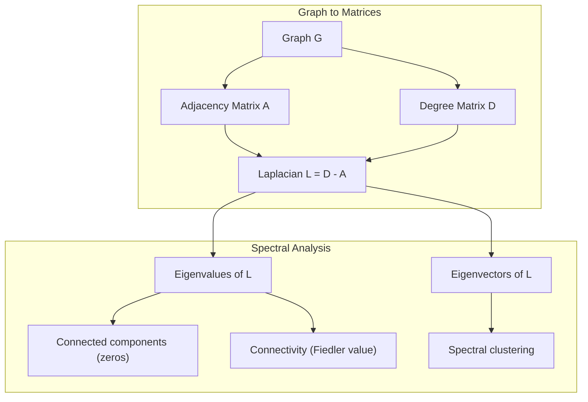
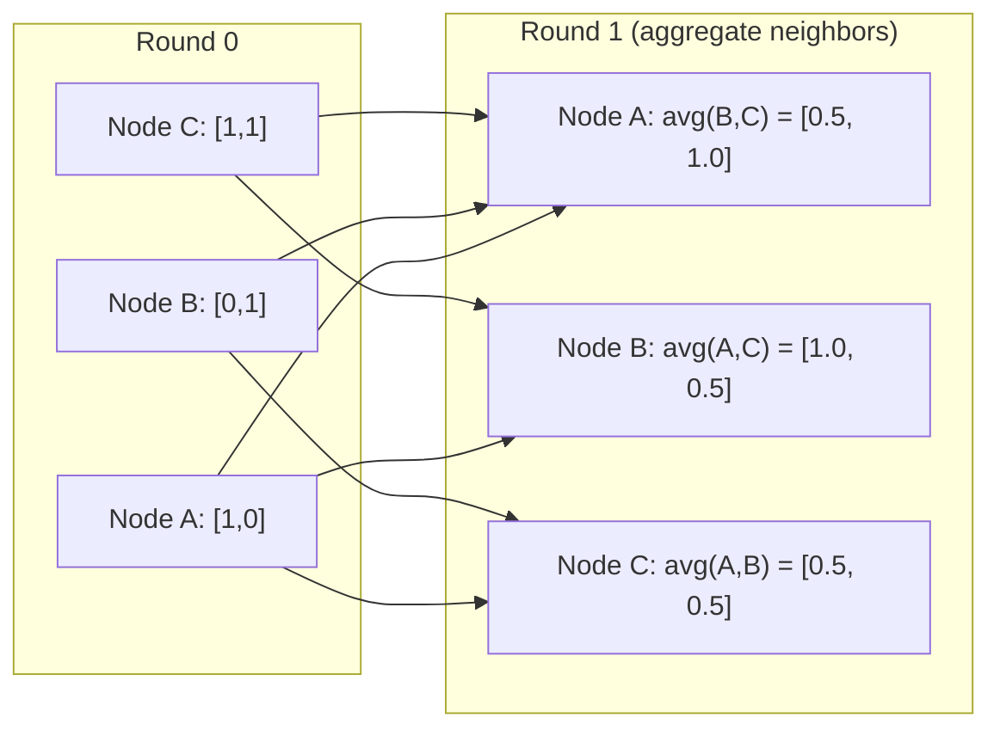

# 머신러닝을 위한 그래프 이론

> 그래프는 관계를 표현하는 자료구조입니다. 데이터에 연결 관계가 존재한다면 그래프 이론이 필요합니다.

**유형:** Build (실습)
**사용 언어:** Python, TypeScript
**선수 레슨:** Phase 1, Lessons 01-03 (linear algebra, matrices)
**소요 시간:** ~90분

## 학습 목표

- 인접 행렬/리스트 표현을 갖춘 그래프 클래스를 구현하고, BFS 및 DFS 순회를 작성합니다
- 그래프 라플라시안(Graph Laplacian)을 계산하고, 그 고윳값을 활용해 연결 성분(connected component)을 감지하고 노드를 클러스터링합니다
- 정규화된 인접 행렬 곱셈을 통해 GNN 스타일의 메시지 전달(message passing) 1단계를 구현합니다
- 피들러 벡터(Fiedler vector)를 사용하는 스펙트럴 클러스터링(spectral clustering)을 적용해 그래프를 분할합니다

## 문제 정의

소셜 네트워크, 분자, 지식 베이스, 인용 네트워크, 도로망은 모두 그래프입니다. 전통적인 머신러닝은 데이터를 평면적인 테이블로 다룹니다. 각 행은 독립적이며, 각 특성(feature)은 하나의 열을 차지합니다. 그러나 연결 구조 자체가 중요한 역할을 할 때, 테이블 형태의 표현은 한계에 부딪힙니다.

소셜 네트워크를 생각해 보십시오. 사용자가 어떤 제품을 구매할지 예측하고자 합니다. 해당 사용자의 구매 이력도 중요하지만, 그 친구들의 구매 이력은 훨씬 더 강력한 단서가 됩니다. 연결 관계 속에 유의미한 신호가 담겨 있기 때문입니다.

분자의 경우도 마찬가지입니다. 단백질에 결합할 수 있는 분자인지 예측하려 할 때, 개별 원자의 종류도 중요하지만 원자들이 서로 어떻게 결합되어 있는지가 결정적인 정보입니다. 즉, 구조 자체가 곧 데이터입니다.

그래프 신경망(Graph Neural Networks, GNN)은 딥러닝에서 가장 빠르게 성장하고 있는 분야 중 하나입니다. 신약 개발, 소셜 추천, 사기 탐지(fraud detection), 지식 그래프 추론 등 다양한 영역의 핵심 기반으로 쓰이고 있습니다. 모든 GNN은 동일한 기초, 즉 기초 그래프 이론 위에 구축됩니다.

필요한 핵심 요소는 다음 네 가지입니다:
1. 그래프를 행렬로 표현하는 방법 (행렬 곱셈을 수행하기 위함)
2. 그래프 구조를 탐색하기 위한 순회 알고리즘
3. 스펙트럴 그래프 이론(spectral graph theory)에서 가장 중요한 행렬인 라플라시안
4. GNN의 핵심 동작 원리인 메시지 전달

## 개념 설명

### 그래프: 노드와 에지

그래프 $G = (V, E)$는 정점(vertex, 노드) 집합 $V$와 에지(edge, 간선) 집합 $E$로 구성됩니다. 각 에지는 두 노드를 연결합니다.

**방향 그래프 vs 무방향 그래프.** 무방향 그래프(undirected graph)에서 에지 $(u, v)$는 $u$가 $v$에 연결되어 있고 '동시에' $v$도 $u$에 연결되어 있음을 의미합니다. 방향 그래프(directed graph, digraph)에서 에지 $(u, v)$는 $u$가 $v$를 가리킨다는 뜻이며, 그 역이 반드시 성립하지는 않습니다.

**가중 그래프 vs 비가중 그래프.** 비가중 그래프(unweighted graph)에서는 에지가 존재하거나 존재하지 않거나 둘 중 하나입니다. 가중 그래프(weighted graph)에서는 각 에지가 거리, 비용, 강도 등을 나타내는 수치적 가중치를 가집니다.

| 그래프 유형 | 예시 |
|-----------|---------|
| 무방향, 비가중 | Facebook 친구 네트워크 |
| 방향, 비가중 | Twitter 팔로우 네트워크 |
| 무방향, 가중 | 도로망 (거리) |
| 방향, 가중 | 웹페이지 링크 (PageRank 점수) |

### 인접 행렬

인접 행렬(adjacency matrix) $A$은 그래프의 핵심 표현 방식입니다. 노드가 $n$개인 그래프의 경우:

```math
A[i][j] = \begin{cases} 1 & \text{if there is an edge from node } i \text{ to node } j \\ 0 & \text{otherwise} \end{cases}
```

무방향 그래프의 경우, $A$는 대칭 행렬(symmetric matrix)입니다: $A[i][j] = A[j][i]$. 가중 그래프의 경우, $A[i][j]$ = 에지 $(i, j)$의 가중치입니다.

**예시 -- 삼각형 그래프:**

```
Nodes: 0, 1, 2
Edges: (0,1), (1,2), (0,2)

A = [[0, 1, 1],
     [1, 0, 1],
     [1, 1, 0]]
```

인접 행렬은 모든 GNN의 입력이 됩니다. $A$에 대한 행렬 연산은 그래프에 대한 연산에 대응합니다.

### 차수

노드의 차수(degree)는 해당 노드에 연결된 에지의 수입니다. 방향 그래프에서는 진입 차수(in-degree, 들어오는 에지)와 진출 차수(out-degree, 나가는 에지)로 나뉩니다.

차수 행렬(degree matrix) $D$은 대각 행렬(diagonal matrix)입니다:

```math
\begin{aligned}
D[i][i] &= \text{degree of node } i \\
D[i][j] &= 0 \quad \text{for } i \ne j
\end{aligned}
```

삼각형 그래프 예시의 경우, 모든 노드가 다른 두 노드에 연결되어 있으므로 $D = \mathop{\mathrm{diag}}(2, 2, 2)$가 됩니다.

차수는 노드의 중요도를 나타냅니다. 차수가 높은 노드는 허브(hub) 노드입니다. 네트워크의 차수 분포는 그 구조적 특성을 드러냅니다. 소셜 네트워크는 멱법칙(power law)을 따릅니다(소수의 허브와 다수의 말단 노드). 반면 랜덤 그래프는 포아송 분포(Poisson distribution)를 따르는 차수를 갖습니다.

### BFS와 DFS

두 가지 기초적인 그래프 순회 알고리즘입니다. 둘 다 필수적으로 이해해야 합니다.

**너비 우선 탐색(Breadth-First Search, BFS):** 모든 이웃 노드를 먼저 탐색한 뒤, 이웃의 이웃으로 나아갑니다. 큐(queue, FIFO)를 사용합니다.

```
BFS from node 0:
  Visit 0
  Queue: [1, 2]        (neighbors of 0)
  Visit 1
  Queue: [2, 3]        (add neighbors of 1)
  Visit 2
  Queue: [3]           (neighbors of 2 already visited)
  Visit 3
  Queue: []            (done)
```

BFS는 비가중 그래프에서 최단 경로를 찾습니다. 시작 노드에서 임의의 노드까지의 거리는 해당 노드가 처음 발견되는 BFS 레벨과 같습니다. 이러한 이유로 소셜 네트워크에서 홉(hop) 수 기반 거리를 계산할 때 BFS가 사용됩니다.

**깊이 우선 탐색(Depth-First Search, DFS):** 역추적(backtracking)하기 전에 가능한 한 깊이 탐색합니다. 스택(stack, LIFO)이나 재귀를 사용합니다.

```
DFS from node 0:
  Visit 0
  Stack: [1, 2]        (neighbors of 0)
  Visit 2               (pop from stack)
  Stack: [1, 3]         (add neighbors of 2)
  Visit 3               (pop from stack)
  Stack: [1]
  Visit 1               (pop from stack)
  Stack: []             (done)
```

DFS는 다음과 같은 작업에 유용합니다:
- 연결 성분 찾기 (미방문 노드에서 DFS 실행)
- 사이클 감지 (DFS 트리의 역방향 에지 탐색)
- 위상 정렬(topological sorting) (DFS 완료 순서의 역순)

| 알고리즘 | 자료구조 | 찾는 대상 | 활용 사례 |
|-----------|---------------|-------|----------|
| BFS | 큐 | 최단 경로 | 소셜 네트워크 거리, 지식 그래프 순회 |
| DFS | 스택 | 성분, 사이클 | 연결성 검사, 위상 정렬 |

### 그래프 라플라시안

$L = D - A$. 스펙트럴 그래프 이론에서 가장 중요한 행렬입니다.

삼각형 그래프의 경우:

```math
D = \begin{bmatrix} 2 & 0 & 0 \\ 0 & 2 & 0 \\ 0 & 0 & 2 \end{bmatrix} \qquad A = \begin{bmatrix} 0 & 1 & 1 \\ 1 & 0 & 1 \\ 1 & 1 & 0 \end{bmatrix} \qquad L = \begin{bmatrix} 2 & -1 & -1 \\ -1 & 2 & -1 \\ -1 & -1 & 2 \end{bmatrix}
```

라플라시안은 다음과 같은 주목할 만한 성질을 지닙니다:

1. **$L$는 준양부호 행렬(positive semi-definite)입니다.** 모든 고윳값은 $\ge 0$입니다.

2. **0인 고윳값의 개수는 연결 성분의 개수와 같습니다.** 연결 그래프는 정확히 하나의 0 고윳값을 가집니다. 3개의 분리된 연결 성분으로 이루어진 그래프는 3개의 0 고윳값을 가집니다.

3. **0이 아닌 가장 작은 고윳값(피들러 값, Fiedler value)은 연결 강도를 측정합니다.** 피들러 값이 크면 그래프가 긴밀하게 연결되어 있음을 의미합니다. 피들러 값이 작으면 그래프에 취약 지점, 즉 병목(bottleneck)이 존재함을 의미합니다.

4. **피들러 값에 대응하는 고유벡터(피들러 벡터)는 최적의 분할 방식을 제시합니다.** 양수 값을 갖는 노드는 한 그룹으로, 음수 값을 갖는 노드는 다른 그룹으로 나뉩니다. 이것이 스펙트럴 클러스터링의 기본 원리입니다.



### 스펙트럴 특성

인접 행렬과 라플라시안의 고윳값은 순회 과정을 거치지 않고도 구조적 특성을 드러내 줍니다.

**스펙트럴 클러스터링**의 동작 과정은 다음과 같습니다:
1. 라플라시안 $L$를 계산합니다
2. $L$의 가장 작은 고유벡터 $k$개를 구합니다 (연결 그래프에서 모든 원소가 1인 첫 번째 고유벡터는 제외)
3. 해당 고유벡터들을 각 노드의 새로운 좌표로 사용합니다
4. 이 좌표들에 대해 $k$-means 알고리즘을 실행합니다

이 방식이 효과적인 이유는 무엇일까요? $L$의 고유벡터는 그래프상에서 가장 "부드러운(smooth)" 함수를 인코딩합니다. 긴밀하게 연결된 노드들은 비슷한 고유벡터 값을 얻고, 병목으로 분리된 노드들은 서로 다른 값을 얻습니다. 즉, 고유벡터가 클러스터를 자연스럽게 분리해 냅니다.

**랜덤 워크(random walk)와의 연관성.** 정규화된 라플라시안은 그래프상의 랜덤 워크와 밀접하게 연관되어 있습니다. 랜덤 워크의 정적 분포(stationary distribution)는 노드 차수에 비례합니다. 혼합 시간(mixing time, 랜덤 워크가 수렴하는 속도)은 스펙트럴 갭(spectral gap)에 의해 결정됩니다.

### 메시지 전달

그래프 신경망의 핵심 연산입니다. 각 노드는 이웃들로부터 메시지를 수집하여 집계(aggregate)한 뒤, 자신의 상태를 업데이트(update)합니다.

```math
h_v^{(k+1)} = \text{UPDATE}\left(h_v^{(k)}, \text{AGGREGATE}\left(\{h_u^{(k)} : u \in \text{neighbors}(v)\}\right)\right)
```

가장 단순한 형태에서, AGGREGATE는 평균(mean)이고, UPDATE는 선형 변환과 활성화 함수입니다:

```math
h_v^{(k+1)} = \sigma\left(W \cdot \text{mean}\left(\{h_u^{(k)} : u \in \text{neighbors}(v)\}\right)\right)
```

이는 본질적으로 행렬 곱셈입니다. $H$가 모든 노드 특성의 행렬이고 $A$가 인접 행렬이라면:

```math
H^{(k+1)} = \sigma\left(A_{\text{norm}} H^{(k)} W\right)
```

여기서 $A_{\text{norm}}$는 정규화된 인접 행렬(각 행의 합이 1)입니다.

메시지 전달을 1회 수행하면 각 노드는 직속 이웃의 정보를 "볼" 수 있습니다. 2회 수행하면 이웃의 이웃까지 볼 수 있습니다. $K$회 수행하면 각 노드는 $K$-홉 이웃의 정보를 확보하게 됩니다.


### 개념 및 ML 활용

| 개념 | ML 활용 |
|------|---------|
| 인접 행렬(Adjacency matrix) | GNN 입력 표현 |
| 그래프 라플라시안(Graph Laplacian) | 스펙트럴 군집화, 커뮤니티 탐지 |
| BFS/DFS | 지식 그래프 순회, 경로 탐색 |
| 차수 분포(Degree distribution) | 노드 중요도, 피처 엔지니어링 |
| 메시지 패싱(Message passing) | GNN 레이어(GCN, GAT, GraphSAGE) |
| L의 고유값 | 커뮤니티 탐지, 그래프 분할 |
| 스펙트럴 군집화(Spectral clustering) | 비지도 노드 그룹화 |
| PageRank | 노드 중요도, 웹 검색 |

```figure
graph-degree-distribution
```

## 직접 구현하기

### 1단계: 밑바닥부터 Graph 클래스 만들기

```python
class Graph:
    def __init__(self, n_nodes, directed=False):
        self.n = n_nodes
        self.directed = directed
        self.adj = {i: {} for i in range(n_nodes)}

    def add_edge(self, u, v, weight=1.0):
        self.adj[u][v] = weight
        if not self.directed:
            self.adj[v][u] = weight

    def neighbors(self, node):
        return list(self.adj[node].keys())

    def degree(self, node):
        return len(self.adj[node])

    def weighted_degree(self, node):
        return sum(self.adj[node].values())

    def adjacency_matrix(self):
        import numpy as np
        A = np.zeros((self.n, self.n))
        for u in range(self.n):
            for v, w in self.adj[u].items():
                A[u][v] = w
        return A

    def degree_matrix(self):
        import numpy as np
        D = np.zeros((self.n, self.n))
        for i in range(self.n):
            D[i][i] = self.weighted_degree(i)
        return D

    def laplacian(self):
        return self.degree_matrix() - self.adjacency_matrix()
```

인접 리스트(`self.adj`)는 이웃 노드를 효율적으로 저장합니다. 모든 스펙트럴 연산에 numpy가 필요하므로 인접 행렬 변환에는 numpy를 사용합니다.

### 2단계: BFS 및 DFS

```python
from collections import deque

def bfs(graph, start):
    visited = set()
    order = []
    distances = {}
    queue = deque([(start, 0)])
    visited.add(start)
    while queue:
        node, dist = queue.popleft()
        order.append(node)
        distances[node] = dist
        for neighbor in graph.neighbors(node):
            if neighbor not in visited:
                visited.add(neighbor)
                queue.append((neighbor, dist + 1))
    return order, distances


def dfs(graph, start):
    visited = set()
    order = []
    stack = [start]
    while stack:
        node = stack.pop()
        if node in visited:
            continue
        visited.add(node)
        order.append(node)
        for neighbor in reversed(graph.neighbors(node)):
            if neighbor not in visited:
                stack.append(neighbor)
    return order
```

BFS는 $O(1)$ popleft를 위해 deque(양방향 큐)를 사용합니다. DFS는 리스트를 스택으로 사용합니다. 둘 다 모든 노드를 정확히 한 번씩 방문하므로 $O(V + E)$ 시간이 소요됩니다.

### 3단계: 연결 요소 및 라플라시안 고유값

```python
def connected_components(graph):
    visited = set()
    components = []
    for node in range(graph.n):
        if node not in visited:
            order, _ = bfs(graph, node)
            visited.update(order)
            components.append(order)
    return components


def laplacian_eigenvalues(graph):
    import numpy as np
    L = graph.laplacian()
    eigenvalues = np.linalg.eigvalsh(L)
    return eigenvalues
```

`eigvalsh`은 대칭 행렬을 위한 함수로, 무방향 그래프에서 라플라시안은 항상 대칭 행렬입니다. 이 함수는 고유값을 오름차순으로 반환합니다. 연결 요소(connected component)의 개수를 구하려면 0의 개수를 셉니다.

### 4단계: 스펙트럴 군집화

```python
def spectral_clustering(graph, k=2):
    import numpy as np
    L = graph.laplacian()
    eigenvalues, eigenvectors = np.linalg.eigh(L)
    features = eigenvectors[:, 1:k+1]

    labels = np.zeros(graph.n, dtype=int)
    for i in range(graph.n):
        if features[i, 0] >= 0:
            labels[i] = 0
        else:
            labels[i] = 1
    return labels
```

$k=2$의 경우, 피들러 벡터(Fiedler vector)의 부호에 따라 그래프를 두 개의 클러스터로 분할합니다. $k>2$의 경우, 첫 $k$개의 고유벡터(모든 성분이 1인 자명한 고유벡터 제외)에 대해 $k$-means를 실행합니다.

### 5단계: 메시지 패싱

```python
def message_passing(graph, features, weight_matrix):
    import numpy as np
    A = graph.adjacency_matrix()
    row_sums = A.sum(axis=1, keepdims=True)
    row_sums[row_sums == 0] = 1
    A_norm = A / row_sums
    aggregated = A_norm @ features
    output = aggregated @ weight_matrix
    return output
```

이것이 GNN 메시지 패싱의 1회 라운드입니다. 각 노드의 새로운 피처는 가중치 행렬로 변환된 이웃 피처들의 가중 평균입니다. 여러 라운드를 쌓으면 정보를 더 먼 노드까지 전파할 수 있습니다.

## 라이브러리 활용하기

networkx와 numpy를 사용하면 동일한 연산을 한 줄로 처리할 수 있습니다.

```python
import networkx as nx
import numpy as np

G = nx.karate_club_graph()

A = nx.adjacency_matrix(G).toarray()
L = nx.laplacian_matrix(G).toarray()

eigenvalues = np.linalg.eigvalsh(L.astype(float))
print(f"Smallest eigenvalues: {eigenvalues[:5]}")
print(f"Connected components: {nx.number_connected_components(G)}")

communities = nx.community.greedy_modularity_communities(G)
print(f"Communities found: {len(communities)}")

pr = nx.pagerank(G)
top_nodes = sorted(pr.items(), key=lambda x: x[1], reverse=True)[:5]
print(f"Top 5 PageRank nodes: {top_nodes}")
```

networkx는 최적화된 C 백엔드를 통해 어떤 크기의 그래프든 처리합니다. 프로덕션에서는 이를 사용하십시오. 밑바닥부터 구현한 코드는 내부 동작 원리를 이해하는 데 활용하십시오.

### numpy 스펙트럴 분석

```python
import numpy as np

A = np.array([
    [0, 1, 1, 0, 0],
    [1, 0, 1, 0, 0],
    [1, 1, 0, 1, 0],
    [0, 0, 1, 0, 1],
    [0, 0, 0, 1, 0]
])

D = np.diag(A.sum(axis=1))
L = D - A

eigenvalues, eigenvectors = np.linalg.eigh(L)
print(f"Eigenvalues: {np.round(eigenvalues, 4)}")
print(f"Fiedler value: {eigenvalues[1]:.4f}")
print(f"Fiedler vector: {np.round(eigenvectors[:, 1], 4)}")

fiedler = eigenvectors[:, 1]
group_a = np.where(fiedler >= 0)[0]
group_b = np.where(fiedler < 0)[0]
print(f"Cluster A: {group_a}")
print(f"Cluster B: {group_b}")
```

피들러 벡터가 핵심적인 역할을 수행합니다. 양수 값은 한 클러스터에, 음수 값은 다른 클러스터에 속하게 됩니다. 반복적인 최적화 과정 없이, 고유값 분해(eigendecomposition) 한 번으로 해결됩니다.

## 결과물

이 레슨을 통해 다음 결과물을 얻을 수 있습니다.
- `outputs/skill-graph-analysis.md` -- 그래프 구조 데이터를 분석하기 위한 기술 레퍼런스

## 관련 지식

| 개념 | 적용 분야 |
|------|-----------|
| 인접 행렬 | GCN, GAT, GraphSAGE 입력 |
| 라플라시안 | 스펙트럴 군집화, ChebNet 필터 |
| BFS | 지식 그래프 순회, 최단 경로 쿼리 |
| 메시지 패싱 | 모든 GNN 레이어, 뉴럴 메시지 패싱 |
| 스펙트럴 갭(Spectral gap) | 그래프 연결성, 랜덤 워크의 혼합 시간(mixing time) |
| 차수 분포 | 멱법칙(power-law) 네트워크, 노드 피처 엔지니어링 |
| 연결 요소 | 전처리, 비연결 그래프 처리 |
| PageRank | 노드 중요도 랭킹, 어텐션 초기화 |

GNN은 특별히 살펴볼 가치가 있습니다. GCN(Kipf & Welling, 2017)의 그래프 합성곱(graph convolution) 연산은 자기 루프(self-loop)가 추가된 인접 행렬 $\hat{A} = A + I$를 사용합니다.

```math
H^{(l+1)} = \sigma\left(\hat{D}^{-1/2} \hat{A} \hat{D}^{-1/2} H^{(l)} W^{(l)}\right)
```

여기서 $\hat{A} = A + I$(인접 행렬에 자기 루프를 더한 것)이며, $\hat{D}$는 $\hat{A}$의 차수 행렬입니다. 자기 루프는 각 노드가 집계 과정에서 자신의 피처를 포함하도록 보장합니다. 이는 정확히 대칭 정규화(symmetric normalization)를 적용한 메시지 패싱입니다. $\hat{D}^{-1/2} \hat{A} \hat{D}^{-1/2}$는 정규화된 인접 행렬입니다. 라플라시안이 등장하는 이유는 이 정규화가 $L_{\text{sym}} = I - D^{-1/2} A D^{-1/2}$와 관련이 있기 때문입니다. 라플라시안을 이해하면 GCN이 작동하는 이유를 이해할 수 있습니다.

## 연습 문제

1. **PageRank를 밑바닥부터 구현하십시오.** 균등한 점수로 시작합니다. 각 단계에서 점수는 모든 v를 가리키는 u에 대해 score(v) = (1-d)/n + d * sum(score(u)/out_degree(u))가 됩니다. d=0.85를 사용하십시오. 수렴할 때까지(변화량 < 1e-6) 실행합니다. 작은 웹 그래프에서 테스트하십시오.

2. **스펙트럴 군집화를 사용하여 커뮤니티를 찾으십시오.** 명확히 분리된 두 클러스터(예: 단일 엣지로 연결된 두 개의 완전 그래프(clique))가 있는 그래프를 만듭니다. 스펙트럴 군집화를 실행하고 올바른 분할을 찾는지 확인하십시오. 클러스터 간 교차 엣지를 추가하면 어떤 결과가 발생합니까?

3. **가중치 그래프에서 최단 경로를 구하는 다익스트라(Dijkstra) 알고리즘을 구현하십시오.** 균등 가중치를 적용한 동일 그래프에서 BFS 결과와 비교하십시오.

4. **2계층 메시지 패싱 네트워크를 구축하십시오.** 서로 다른 가중치 행렬을 사용하여 메시지 패싱을 두 번 적용합니다. 2라운드 후에 각 노드가 2-홉(hop) 이웃의 정보를 갖게 됨을 보이십시오.

5. **실제 그래프를 분석하십시오.** 가라테 클럽(Karate Club) 그래프(34개 노드, 78개 엣지)를 사용합니다. 차수 분포, 라플라시안 고유값, 스펙트럴 군집화를 계산하십시오. 스펙트럴 군집화 결과를 알려진 실제 분할(ground truth split)과 비교하십시오.

### 힌트

**연습 문제 1.** 연습 문제의 공식을 사용하십시오. 나가는 엣지가 없는 노드는 자신의 점수를 모든 노드와 균등하게 나누어야 하며, 그렇지 않으면 총합이 1 미만으로 떨어집니다. 각 단계 후 점수의 합이 1이 되는지 확인하고 `pagerank(graph)`의 결과와 비교하십시오.

**연습 문제 2.** `add_edge`로 두 개의 완전 그래프(clique)를 만들고, 하나의 엣지로 연결한 다음 `spectral_clustering(graph, k=2)`를 호출하십시오. 각 완전 그래프가 하나의 레이블을 받는지 확인합니다. 교차 엣지를 추가하면서 두 그룹이 결합됨에 따라 증가하는 `laplacian()`의 두 번째로 작은 고유값을 출력해 보십시오.

**연습 문제 3.** `heapq`로 우선순위 큐를 유지하고 항상 알려진 거리가 가장 작은 노드를 확장하십시오. 모든 가중치를 1로 설정하고, 각 다익스트라 거리가 `bfs(graph, start)`에서 구한 해당 노드의 BFS 계층과 일치하는지 확인하십시오.

**연습 문제 4.** 각 열이 한 노드를 나타내도록 단위 행렬을 `features`로 사용하고, `message_passing`를 두 번 적용하십시오. 그러면 노드 $v$의 행에서 0이 아닌 성분이 노드 $v$에 도달한 노드들을 나타냅니다. 이 집합을 너비 우선 탐색을 통해 구한 거리 2 이내의 노드들과 비교하십시오.

**연습 문제 5.** `networkx.karate_club_graph()`는 엣지 리스트와 노드 속성 `club`의 정답을 제공합니다. 엣지들을 `Graph`에 복사하고 노드 34개와 엣지 78개가 있는지 확인하십시오. `spectral_clustering`의 레이블을 `club` 값과 비교하되, 두 레이블의 이름이 서로 바뀌어 있을 수 있음을 감안하십시오.

## 핵심 용어

| 용어 | 일상적인 표현 | 실제 의미 |
|------|---------------|-----------|
| 그래프(Graph) | "노드와 엣지" | 쌍별 관계를 인코딩하는 수학적 구조 $G=(V,E)$ |
| 인접 행렬(Adjacency matrix) | "연결 테이블" | 노드 $i$와 $j$가 연결되어 있으면 $A[i][j] = 1$인 $n \times n$ 행렬 |
| 차수(Degree) | "노드가 얼마나 연결되어 있는가" | 노드에 연결된 엣지의 수 |
| 라플라시안(Laplacian) | "D 빼기 A" | 고유값이 그래프 구조를 드러내는 행렬 $L = D - A$ |
| 피들러 값(Fiedler value) | "대수적 연결도" | 그래프의 연결 상태를 측정하는 $L$의 가장 작은 0이 아닌 고유값 |
| BFS | "레벨별 탐색" | 더 깊이 들어가기 전에 모든 이웃을 먼저 방문하여 최단 경로를 찾는 순회 방식 |
| DFS | "깊이 우선 탐색" | 역추적하기 전에 하나의 경로를 끝까지 따라가는 순회 방식 |
| 메시지 패싱(Message passing) | "노드끼리 이웃과 대화하기" | 각 노드가 이웃으로부터 정보를 집계하는 GNN의 핵심 연산 |
| 스펙트럴 군집화(Spectral clustering) | "고유벡터를 이용한 군집화" | 라플라시안의 고유벡터를 사용하여 그래프를 분할하는 기법 |
| 연결 요소(Connected component) | "독립된 조각" | 모든 노드가 서로에게 도달할 수 있는 극대 부분 그래프(maximal subgraph) |
## 추가 참고 자료

- **Kipf & Welling (2017)** -- "Semi-Supervised Classification with Graph Convolutional Networks." 현대적 GNN의 시작을 알린 논문입니다. 스펙트럼 그래프 합성곱(spectral graph convolution)이 메시지 패싱(message passing)으로 단순화됨을 보여줍니다.
- **Spielman (2012)** -- "Spectral Graph Theory" 강의 노트. 라플라시안(Laplacian), 스펙트럼 갭(spectral gap), 그래프 분할(graph partitioning)에 관한 대표적인 입문 자료입니다.
- **Hamilton (2020)** -- "Graph Representation Learning." GNN의 기초부터 응용까지 다루는 도서입니다.
- **Bronstein et al. (2021)** -- "Geometric Deep Learning: Grids, Groups, Graphs, Geodesics, and Gauges." 통합 프레임워크를 제시하는 논문입니다.
- **Veličković et al. (2018)** -- "Graph Attention Networks." 어텐션(attention) 메커니즘을 통해 메시지 패싱을 확장합니다.
