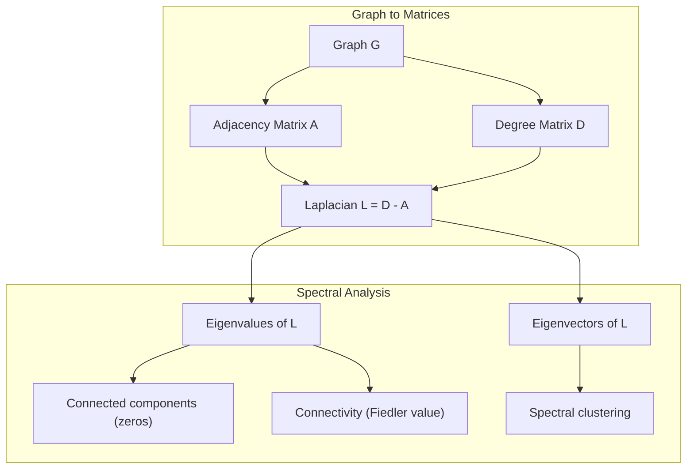
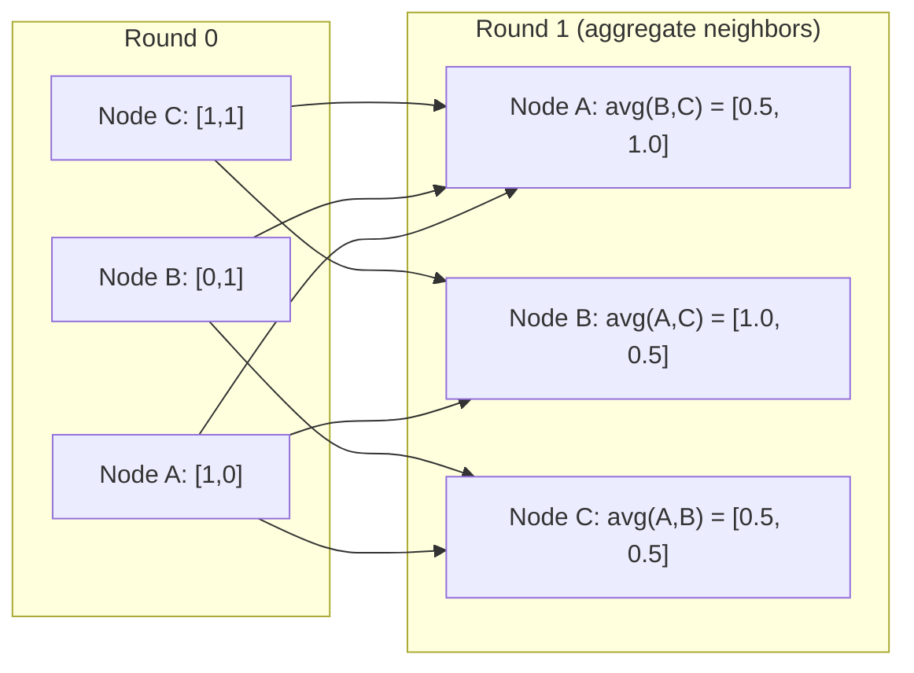

# 머신러닝을 위한 그래프 이론

> 그래프는 관계를 표현하는 자료구조입니다. 데이터에 연결 관계가 존재한다면 그래프 이론이 반드시 필요합니다.

**유형:** Build (실습)
**Language:** Python
**선수 레슨:** Phase 1, Lessons 01-03 (linear algebra, matrices)
**소요 시간:** ~90분

## 학습 목표

- 인접 행렬 및 인접 리스트 표현을 갖춘 그래프 클래스를 구축하고, BFS 및 DFS 순회를 구현합니다.
- 그래프 라플라시안(graph Laplacian)을 계산하고, 그 고유값을 활용하여 연결 요소(connected component)를 감지하며 노드를 클러스터링합니다.
- 정규화된 인접 행렬 곱셈 형태로 GNN 스타일의 메시지 패싱(message passing) 1단계를 구현합니다.
- 피들러 벡터(Fiedler vector)를 활용한 스펙트럴 클러스터링(spectral clustering)을 적용해 그래프를 분할합니다.

## 문제 상황

소셜 네트워크, 분자, 지식 베이스, 인용 네트워크, 도로망 등은 모두 그래프입니다. 전통적인 머신러닝은 데이터를 평면적인 테이블로 다룹니다. 각 행은 독립적이며, 각 특성은 하나의 열이 됩니다. 그러나 연결 구조 자체가 중요한 정보일 때는 테이블 형태의 데이터 표현이 한계를 드러냅니다.

소셜 네트워크를 생각해 보십시오. 사용자가 어떤 제품을 구매할지 예측하려고 합니다. 해당 사용자의 구매 이력도 중요하지만, 그 친구들의 구매 이력이 더 중요할 때가 많습니다. 연결 관계 자체가 신호(signal)를 담고 있기 때문입니다.

분자의 경우도 마찬가지입니다. 특정 분자가 단백질에 결합하는지 예측하고자 할 때, 원자 자체도 중요하지만 원자들이 서로 어떻게 결합되어 있는지가 결정적인 역할을 합니다. 구조 자체가 곧 데이터인 것입니다.

그래프 신경망(Graph Neural Networks, GNN)은 딥러닝에서 가장 빠르게 성장하고 있는 분야입니다. 신약 개발, 소셜 추천, 이상 거래 탐지(fraud detection), 지식 그래프 추론 등에 널리 활용되고 있습니다. 모든 GNN은 동일한 기초, 즉 기본적인 그래프 이론 위에 세워집니다.

이를 위해서는 네 가지가 필요합니다.
1. 그래프를 행렬로 표현하는 방법 (행렬 곱셈을 수행하기 위함)
2. 그래프 구조를 탐색하기 위한 순회 알고리즘
3. 스펙트럴 그래프 이론에서 가장 중요한 단일 행렬인 라플라시안
4. GNN을 동작하게 만드는 핵심 연산인 메시지 패싱

## 개념

### 그래프: 노드와 엣지

그래프 $G = (V, E)$는 정점(노드) $V$과 간선(엣지) $E$로 구성됩니다. 각 엣지는 두 노드를 연결합니다.

**방향 그래프 vs 무방향 그래프.** 무방향 그래프(undirected graph)에서 엣지 $(u, v)$는 $u$가 $v$에 연결되고 '동시에' $v$도 $u$에 연결됨을 의미합니다. 방향 그래프(directed graph 또는 digraph)에서 엣지 $(u, v)$는 $u$가 $v$를 가리킨다는 뜻이며, 그 역이 반드시 성립하지는 않습니다.

**가중치 그래프 vs 비가중치 그래프.** 비가중치 그래프(unweighted graph)에서는 엣지가 존재하거나 존재하지 않거나 둘 중 하나입니다. 가중치 그래프(weighted graph)에서는 각 엣지가 거리, 비용, 강도 등의 수치적 가중치를 가집니다.

| 그래프 유형 | 예시 |
|-----------|---------|
| 무방향, 비가중치 | 페이스북 친구 네트워크 |
| 방향, 비가중치 | 트위터 팔로우 네트워크 |
| 무방향, 가중치 | 도로망 (거리) |
| 방향, 가중치 | 웹 페이지 링크 (PageRank 점수) |

### 인접 행렬

인접 행렬(adjacency matrix) $A$은 핵심적인 표현 방식입니다. $n$개의 노드를 가진 그래프의 경우:

```math
A[i][j] = \begin{cases} 1 & \text{if there is an edge from node } i \text{ to node } j \\ 0 & \text{otherwise} \end{cases}
```

무방향 그래프의 경우 $A$는 대칭 행렬입니다: $A[i][j] = A[j][i]$. 가중치 그래프의 경우 $A[i][j]$ = 엣지 $(i, j)$의 가중치가 됩니다.

**예시 -- 삼각형 그래프:**

```
Nodes: 0, 1, 2
Edges: (0,1), (1,2), (0,2)

A = [[0, 1, 1],
     [1, 0, 1],
     [1, 1, 0]]
```

인접 행렬은 모든 GNN의 입력이 됩니다. $A$에 대한 행렬 연산은 그래프에 대한 연산에 대응됩니다.

### 차수

노드의 차수(degree)는 해당 노드에 연결된 엣지의 개수입니다. 방향 그래프의 경우 들어오는 엣지 수인 진입 차수(in-degree)와 나가는 엣지 수인 진출 차수(out-degree)를 갖습니다.

차수 행렬(degree matrix) $D$은 대각 행렬입니다:

```math
\begin{aligned}
D[i][i] &= \text{degree of node } i \\
D[i][j] &= 0 \quad \text{for } i \ne j
\end{aligned}
```

앞선 삼각형 예시의 경우, 모든 노드가 다른 두 노드와 연결되어 있으므로 $D = \mathop{\mathrm{diag}}(2, 2, 2)$가 됩니다.

차수는 노드의 중요도를 알려줍니다. 차수가 높다는 것은 허브 노드임을 뜻합니다. 네트워크의 차수 분포는 그 네트워크의 구조를 드러냅니다. 소셜 네트워크는 멱함수 법칙(power law)을 따릅니다(소수의 허브 노드와 다수의 리프 노드). 반면 랜덤 그래프는 포아송 분포를 따르는 차수를 갖습니다.

### BFS와 DFS

그래프의 두 가지 기본 순회 알고리즘입니다. 둘 다 필수적으로 이해해야 합니다.

**너비 우선 탐색(Breadth-First Search, BFS):** 모든 이웃을 먼저 탐색한 후, 이웃의 이웃들을 탐색합니다. 큐(queue, FIFO)를 사용합니다.

```
BFS from node 0:
  Visit 0
  Queue: [1, 2]        (neighbors of 0)
  Visit 1
  Queue: [2, 3]        (add neighbors of 1)
  Visit 2
  Queue: [3]           (neighbors of 2 already visited)
  Visit 3
  Queue: []            (done)
```

BFS는 비가중치 그래프에서 최단 경로를 찾습니다. 시작 노드에서 특정 노드까지의 거리는 해당 노드가 처음 발견된 BFS 레벨과 같습니다. 이러한 이유로 BFS는 소셜 네트워크에서 홉 수(hop-count) 기반 거리를 계산하는 데 사용됩니다.

**깊이 우선 탐색(Depth-First Search, DFS):** 역추적(backtracking)하기 전에 가능한 한 깊이 탐색합니다. 스택(stack, LIFO)이나 재귀를 사용합니다.

```
DFS from node 0:
  Visit 0
  Stack: [1, 2]        (neighbors of 0)
  Visit 2               (pop from stack)
  Stack: [1, 3]         (add neighbors of 2)
  Visit 3               (pop from stack)
  Stack: [1]
  Visit 1               (pop from stack)
  Stack: []             (done)
```

DFS는 다음과 같은 작업에 유용합니다:
- 연결 요소 찾기 (방문하지 않은 노드에서 DFS 실행)
- 사이클 감지 (DFS 트리 내의 역방향 엣지 탐색)
- 위상 정렬(topological sorting) (DFS 완료 순서의 역순)

| 알고리즘 | 자료구조 | 탐색 대상 | 활용 사례 |
|-----------|---------------|-------|----------|
| BFS | 큐 | 최단 경로 | 소셜 네트워크 거리, 지식 그래프 순회 |
| DFS | 스택 | 연결 요소, 사이클 | 연결성 확인, 위상 정렬 |

### 그래프 라플라시안

$L = D - A$. 스펙트럴 그래프 이론에서 가장 중요한 행렬입니다.

삼각형 그래프의 경우:

```math
D = \begin{bmatrix} 2 & 0 & 0 \\ 0 & 2 & 0 \\ 0 & 0 & 2 \end{bmatrix} \qquad A = \begin{bmatrix} 0 & 1 & 1 \\ 1 & 0 & 1 \\ 1 & 1 & 0 \end{bmatrix} \qquad L = \begin{bmatrix} 2 & -1 & -1 \\ -1 & 2 & -1 \\ -1 & -1 & 2 \end{bmatrix}
```

라플라시안은 주목할 만한 특성들을 가집니다:

1. **$L$는 준양부호(positive semi-definite) 행렬입니다.** 모든 고유값이 $\ge 0$입니다.

2. **0인 고유값의 개수는 연결 요소의 개수와 같습니다.** 연결 그래프는 정확히 하나의 0 고유값을 가집니다. 3개의 분리된 연결 요소로 이루어진 그래프는 3개의 0 고유값을 가집니다.

3. **0이 아닌 가장 작은 고유값(피들러 값, Fiedler value)은 연결 강도를 측정합니다.** 피들러 값이 크면 그래프가 긴밀하게 연결되어 있음을 의미합니다. 피들러 값이 작으면 그래프에 취약 지점, 즉 병목이 존재함을 의미합니다.

4. **피들러 값에 대응하는 고유벡터(피들러 벡터, Fiedler vector)는 최적의 분할 방식을 나타냅니다.** 양수 값을 가진 노드는 한 그룹으로, 음수 값을 가진 노드는 다른 그룹으로 나뉩니다. 이것이 바로 스펙트럴 클러스터링(spectral clustering)입니다.



### 스펙트럴 특성

인접 행렬과 라플라시안의 고유값은 순회를 거치지 않고도 구조적 특성을 드러냅니다.

**스펙트럴 클러스터링**은 다음과 같이 작동합니다:
1. 라플라시안 $L$을 계산합니다.
2. $L$의 가장 작은 고유벡터 $k$개를 찾습니다(연결 그래프의 경우 모든 원소가 1인 첫 번째 고유벡터는 제외합니다).
3. 해당 고유벡터들을 각 노드의 새로운 좌표로 사용합니다.
4. 이 좌표들을 대상으로 $k$-means를 실행합니다.

이 방법이 효과적인 이유는 무엇일까요? $L$의 고유벡터는 그래프상에서 가장 "매끄러운(smoothest)" 함수를 인코딩하기 때문입니다. 긴밀하게 연결된 노드들은 유사한 고유벡터 값을 얻게 됩니다. 병목으로 분리된 노드들은 서로 다른 값을 갖게 됩니다. 따라서 고유벡터는 자연스럽게 클러스터를 분리해 냅니다.

**랜덤 워크와의 연결점.** 정규화된 라플라시안은 그래프상의 랜덤 워크(random walk)와 관련이 있습니다. 랜덤 워크의 정적 분포(stationary distribution)는 노드 차수에 비례합니다. 혼합 시간(mixing time, 워크가 수렴하는 속도)은 스펙트럴 갭(spectral gap)에 의해 결정됩니다.

### 메시지 패싱

그래프 신경망의 핵심 연산입니다. 각 노드는 이웃들로부터 메시지를 수집하고, 이를 집계(aggregate)한 뒤, 자신의 상태를 갱신(update)합니다.

```math
h_v^{(k+1)} = \text{UPDATE}\left(h_v^{(k)}, \text{AGGREGATE}\left(\{h_u^{(k)} : u \in \text{neighbors}(v)\}\right)\right)
```

가장 단순한 형태에서 AGGREGATE는 평균 연산이며, UPDATE는 선형 변환과 활성화 함수의 결합입니다:

```math
h_v^{(k+1)} = \sigma\left(W \cdot \text{mean}\left(\{h_u^{(k)} : u \in \text{neighbors}(v)\}\right)\right)
```

이는 본질적으로 행렬 곱셈입니다. $H$가 전체 노드 특성 행렬이고 $A$가 인접 행렬이라면 다음과 같습니다:

```math
H^{(k+1)} = \sigma\left(A_{\text{norm}} H^{(k)} W\right)
```

여기서 $A_{\text{norm}}$는 정규화된 인접 행렬(각 행의 합이 1)입니다.

1회의 메시지 패싱을 거치면 각 노드는 바로 인접한 이웃을 "볼" 수 있습니다. 2회를 거치면 이웃의 이웃까지 볼 수 있습니다. $K$회를 거치면 각 노드는 $K$-홉 이웃의 정보를 얻게 됩니다.


### 개념 및 ML 활용 분야

| 개념 | ML 활용 분야 |
|---------|---------------|
| 인접 행렬(Adjacency matrix) | GNN 입력 표현 |
| 그래프 라플라시안(Graph Laplacian) | 스펙트럴 클러스터링(spectral clustering), 커뮤니티 탐지(community detection) |
| BFS/DFS | 지식 그래프(knowledge graph) 순회, 경로 탐색 |
| 차수 분포(Degree distribution) | 노드 중요도, 피처 엔지니어링 |
| 메시지 패싱(Message passing) | GNN 레이어 (GCN, GAT, GraphSAGE) |
| L의 고윳값(Eigenvalues of L) | 커뮤니티 탐지, 그래프 분할 |
| 스펙트럴 클러스터링(Spectral clustering) | 비지도 노드 군집화 |
| 페이지랭크(PageRank) | 노드 중요도, 웹 검색 |

```figure
graph-degree-distribution
```

## 직접 구현하기

### 1단계: 밑바닥부터 Graph 클래스 만들기

```python
class Graph:
    def __init__(self, n_nodes, directed=False):
        self.n = n_nodes
        self.directed = directed
        self.adj = {i: {} for i in range(n_nodes)}

    def add_edge(self, u, v, weight=1.0):
        self.adj[u][v] = weight
        if not self.directed:
            self.adj[v][u] = weight

    def neighbors(self, node):
        return list(self.adj[node].keys())

    def degree(self, node):
        return len(self.adj[node])

    def adjacency_matrix(self):
        import numpy as np
        A = np.zeros((self.n, self.n))
        for u in range(self.n):
            for v, w in self.adj[u].items():
                A[u][v] = w
        return A

    def degree_matrix(self):
        import numpy as np
        D = np.zeros((self.n, self.n))
        for i in range(self.n):
            D[i][i] = self.degree(i)
        return D

    def laplacian(self):
        return self.degree_matrix() - self.adjacency_matrix()
```

인접 리스트(`self.adj`)는 이웃 노드를 효율적으로 저장합니다. 인접 행렬 변환에는 numpy를 사용하는데, 모든 스펙트럴 연산에 numpy가 필요하기 때문입니다.

### 2단계: BFS 및 DFS

```python
from collections import deque

def bfs(graph, start):
    visited = set()
    order = []
    distances = {}
    queue = deque([(start, 0)])
    visited.add(start)
    while queue:
        node, dist = queue.popleft()
        order.append(node)
        distances[node] = dist
        for neighbor in graph.neighbors(node):
            if neighbor not in visited:
                visited.add(neighbor)
                queue.append((neighbor, dist + 1))
    return order, distances


def dfs(graph, start):
    visited = set()
    order = []
    stack = [start]
    while stack:
        node = stack.pop()
        if node in visited:
            continue
        visited.add(node)
        order.append(node)
        for neighbor in reversed(graph.neighbors(node)):
            if neighbor not in visited:
                stack.append(neighbor)
    return order
```

BFS는 $O(1)$ popleft를 위해 deque(양방향 큐)를 사용합니다. DFS는 리스트를 스택으로 사용합니다. 두 알고리즘 모두 모든 노드를 정확히 한 번씩 방문하므로 시간 복잡도는 $O(V + E)$입니다.

### 3단계: 연결 요소와 라플라시안 고윳값

```python
def connected_components(graph):
    visited = set()
    components = []
    for node in range(graph.n):
        if node not in visited:
            order, _ = bfs(graph, node)
            visited.update(order)
            components.append(order)
    return components


def laplacian_eigenvalues(graph):
    import numpy as np
    L = graph.laplacian()
    eigenvalues = np.linalg.eigvalsh(L)
    return eigenvalues
```

`eigvalsh`는 대칭 행렬을 위한 함수이며, 무방향 그래프의 라플라시안은 항상 대칭입니다. 이 함수는 고윳값을 오름차순으로 반환합니다. 0의 개수를 세어 연결 요소(connected component)의 수를 구할 수 있습니다.

### 4단계: 스펙트럴 클러스터링

```python
def spectral_clustering(graph, k=2):
    import numpy as np
    L = graph.laplacian()
    eigenvalues, eigenvectors = np.linalg.eigh(L)
    features = eigenvectors[:, 1:k+1]

    labels = np.zeros(graph.n, dtype=int)
    for i in range(graph.n):
        if features[i, 0] >= 0:
            labels[i] = 0
        else:
            labels[i] = 1
    return labels
```

$k=2$의 경우, 피들러 벡터(Fiedler vector)의 부호에 따라 그래프가 두 개의 클러스터로 분할됩니다. $k>2$의 경우, 첫 번째 $k$개의 고유벡터(모든 원소가 1인 자명한 고유벡터 제외)에 대해 $k$-means를 실행합니다.

### 5단계: 메시지 패싱

```python
def message_passing(graph, features, weight_matrix):
    import numpy as np
    A = graph.adjacency_matrix()
    row_sums = A.sum(axis=1, keepdims=True)
    row_sums[row_sums == 0] = 1
    A_norm = A / row_sums
    aggregated = A_norm @ features
    output = aggregated @ weight_matrix
    return output
```

이것이 GNN 메시지 패싱의 1회 라운드입니다. 각 노드의 새로운 피처는 이웃 노드 피처들의 가중 평균에 가중치 행렬을 곱해 변환한 값입니다. 여러 라운드를 쌓으면 정보를 더 먼 노드까지 전파할 수 있습니다.

## 라이브러리 활용하기

networkx와 numpy를 사용하면 동일한 작업을 한 줄로 처리할 수 있습니다.

```python
import networkx as nx
import numpy as np

G = nx.karate_club_graph()

A = nx.adjacency_matrix(G).toarray()
L = nx.laplacian_matrix(G).toarray()

eigenvalues = np.linalg.eigvalsh(L.astype(float))
print(f"Smallest eigenvalues: {eigenvalues[:5]}")
print(f"Connected components: {nx.number_connected_components(G)}")

communities = nx.community.greedy_modularity_communities(G)
print(f"Communities found: {len(communities)}")

pr = nx.pagerank(G)
top_nodes = sorted(pr.items(), key=lambda x: x[1], reverse=True)[:5]
print(f"Top 5 PageRank nodes: {top_nodes}")
```

networkx는 최적화된 C 백엔드를 통해 어떤 크기의 그래프든 처리할 수 있습니다. 프로덕션 환경에서는 networkx를 사용하고, 동작 원리를 이해하는 데는 밑바닥부터 직접 구현한 코드를 활용하세요.

### numpy 스펙트럴 분석

```python
import numpy as np

A = np.array([
    [0, 1, 1, 0, 0],
    [1, 0, 1, 0, 0],
    [1, 1, 0, 1, 0],
    [0, 0, 1, 0, 1],
    [0, 0, 0, 1, 0]
])

D = np.diag(A.sum(axis=1))
L = D - A

eigenvalues, eigenvectors = np.linalg.eigh(L)
print(f"Eigenvalues: {np.round(eigenvalues, 4)}")
print(f"Fiedler value: {eigenvalues[1]:.4f}")
print(f"Fiedler vector: {np.round(eigenvectors[:, 1], 4)}")

fiedler = eigenvectors[:, 1]
group_a = np.where(fiedler >= 0)[0]
group_b = np.where(fiedler < 0)[0]
print(f"Cluster A: {group_a}")
print(f"Cluster B: {group_b}")
```

피들러 벡터가 핵심적인 역할을 수행합니다. 양수 원소는 한 클러스터에, 음수 원소는 다른 클러스터에 할당됩니다. 반복적인 최적화 과정 없이 단 한 번의 고윳값 분해(eigendecomposition)만으로 충분합니다.

## 결과물

이 레슨을 통해 다음 결과물을 생성합니다:
- `outputs/skill-graph-analysis.md` -- 그래프 구조 데이터를 분석하기 위한 스킬 레퍼런스

## 관련 지식

| 개념 | 등장 위치 |
|---------|------------------|
| 인접 행렬 | GCN, GAT, GraphSAGE 입력 |
| 라플라시안 | 스펙트럴 클러스터링, ChebNet 필터 |
| BFS | 지식 그래프 순회, 최단 경로 쿼리 |
| 메시지 패싱 | 모든 GNN 레이어, 뉴럴 메시지 패싱(neural message passing) |
| 스펙트럴 갭(Spectral gap) | 그래프 연결성, 랜덤 워크의 혼합 시간(mixing time) |
| 차수 분포 | 멱법칙(power-law) 네트워크, 노드 피처 엔지니어링 |
| 연결 요소 | 전처리, 비연결 그래프 처리 |
| 페이지랭크 | 노드 중요도 랭킹, 어텐션(attention) 초기화 |

GNN은 특히 주목할 만합니다. GCN(Kipf & Welling, 2017)의 그래프 합성곱 연산은 자체 루프(self-loop)가 추가된 인접 행렬 $\hat{A} = A + I$를 사용합니다:

```math
H^{(l+1)} = \sigma\left(\hat{D}^{-1/2} \hat{A} \hat{D}^{-1/2} H^{(l)} W^{(l)}\right)
```

여기서 $\hat{A} = A + I$(자체 루프가 추가된 인접 행렬)이며, $\hat{D}$는 $\hat{A}$의 차수 행렬(degree matrix)입니다. 자체 루프는 각 노드가 집약(aggregation) 과정에서 자신의 피처를 포함하도록 보장합니다. 이는 대칭 정규화가 적용된 메시지 패싱과 정확히 일치합니다. $\hat{D}^{-1/2} \hat{A} \hat{D}^{-1/2}$는 정규화된 인접 행렬입니다. 라플라시안이 등장하는 이유는 이러한 정규화가 $L_{\text{sym}} = I - D^{-1/2} A D^{-1/2}$와 관련되어 있기 때문입니다. 라플라시안을 이해한다는 것은 곧 GCN이 왜 작동하는지를 이해하는 것입니다.

## 연습 문제

1. **밑바닥부터 페이지랭크를 구현하세요.** 균등한 점수로 시작합니다. 매 단계마다: v를 가리키는 모든 u에 대해 score(v) = (1-d)/n + d * sum(score(u)/out_degree(u))를 계산합니다. d=0.85를 사용하세요. 수렴할 때까지(변화량 < 1e-6) 실행합니다. 작은 웹 그래프에서 테스트하세요.

2. **스펙트럴 클러스터링을 사용해 커뮤니티를 찾아보세요.** 명확히 분리된 두 클러스터(예: 단일 간선으로 연결된 두 개의 클릭(clique))를 가진 그래프를 만듭니다. 스펙트럴 클러스터링을 실행하고 올바른 분할을 찾는지 확인하세요. 클러스터 간 간선을 추가할수록 어떤 일이 발생하는지 관찰하세요.

3. 가중치 그래프에서 최단 경로를 구하는 **다익스트라 알고리즘(Dijkstra's algorithm)을 구현하세요.** 균일한 가중치를 가진 동일한 그래프에서 BFS 결과와 비교하세요.

4. **2계층 메시지 패싱 네트워크를 구축하세요.** 서로 다른 가중치 행렬을 사용하여 메시지 패싱을 두 번 적용합니다. 2회 라운드 후에 각 노드가 2-홉(hop) 이웃의 정보를 갖게 됨을 보여주세요.

5. **실제 그래프를 분석하세요.** Karate Club 그래프(노드 34개, 간선 78개)를 사용합니다. 차수 분포, 라플라시안 고윳값, 스펙트럴 클러스터링을 계산하세요. 스펙트럴 클러스터링 결과를 이미 알려진 정답 분할과 비교하세요.

### 힌트

**연습 문제 1.** 문제에 제시된 공식을 사용하세요. 나가는 간선이 없는 노드는 점수를 모든 노드와 균등하게 나누어야 하며, 그렇지 않으면 총합이 1 미만으로 떨어집니다. 매 단계마다 점수의 합이 1이 되는지 확인하고 `pagerank(graph)`의 결과와 비교하세요.

**연습 문제 2.** `add_edge`로 두 개의 클릭을 만들고 간선 하나로 연결한 뒤 `spectral_clustering(graph, k=2)`를 호출하세요. 각 클릭이 하나의 레이블을 받는지 확인합니다. 교차 간선을 추가하면서 `laplacian()`의 두 번째로 작은 고윳값을 출력해 보세요. 두 그룹이 연결될수록 이 값은 증가합니다.

**연습 문제 3.** `heapq`로 우선순위 큐를 유지하며 항상 알려진 거리가 가장 작은 노드를 먼저 확장합니다. 모든 가중치를 1로 설정하고, 각 다익스트라 거리가 `bfs(graph, start)`로부터 해당 노드의 BFS 계층과 일치하는지 확인하세요.

**연습 문제 4.** 각 열이 하나의 노드를 나타내도록 단위 행렬을 `features`로 사용하고, `message_passing`를 두 번 적용합니다. 그러면 노드 $v$의 행에서 0이 아닌 원소들이 $v$에 도달한 노드들을 나타냅니다. 이 집합을 너비 우선 탐색을 통해 구한 거리 2 이내의 노드들과 비교하세요.

**연습 문제 5.** `networkx.karate_club_graph()`는 노드 속성 `club`에 간선 리스트와 실제 정답(ground truth)을 제공합니다. 간선들을 `Graph`로 복사하고 노드 34개, 간선 78개가 맞는지 확인하세요. `spectral_clustering`의 레이블을 `club` 값과 비교하되, 두 레이블의 이름이 서로 뒤바뀔 수 있음을 감안하세요.

## 핵심 용어

| 용어 | 일상적인 표현 | 실제 의미 |
|------|----------------|----------------------|
| 그래프(Graph) | "노드와 간선" | 쌍(pairwise) 관계를 인코딩하는 수학적 구조 $G=(V,E)$ |
| 인접 행렬(Adjacency matrix) | "연결 테이블" | 노드 $i$과 $j$가 연결되어 있을 때 $A[i][j] = 1$인 $n \times n$ 행렬 |
| 차수(Degree) | "노드가 얼마나 연결되어 있는가" | 노드에 연결된 간선의 수 |
| 라플라시안(Laplacian) | "D 빼기 A" | 그래프 구조를 드러내는 고윳값을 가진 행렬 $L = D - A$ |
| 피들러 값(Fiedler value) | "대수적 연결도" | 그래프의 연결 상태를 측정하는 $L$의 가장 작은 0이 아닌 고윳값 |
| BFS | "레벨별 탐색" | 더 깊이 들어가기 전에 모든 이웃을 먼저 방문하여 최단 경로를 찾는 순회 |
| DFS | "깊이 우선 탐색" | 역추적하기 전에 하나의 경로를 끝까지 따라가는 순회 |
| 메시지 패싱(Message passing) | "노드끼리 이웃과 대화하기" | 각 노드가 이웃으로부터 정보를 집약하는 GNN의 핵심 연산 |
| 스펙트럴 클러스터링(Spectral clustering) | "고유벡터로 클러스터링하기" | 라플라시안의 고유벡터를 사용하여 그래프를 분할하는 기법 |
| 연결 요소(Connected component) | "독립된 조각" | 모든 노드가 다른 모든 노드에 도달할 수 있는 극대 부분 그래프 |
## Further Reading

- **Kipf & Welling (2017)** -- "Semi-Supervised Classification with Graph Convolutional Networks." 현대 GNN의 포문을 연 논문입니다. 스펙트럴 그래프 합성곱(spectral graph convolution)이 메시지 패싱(message passing)으로 단순화될 수 있음을 보여줍니다.
- **Spielman (2012)** -- "Spectral Graph Theory" 강의 노트. 라플라시안(Laplacian), 스펙트럴 갭(spectral gap), 그래프 분할(graph partitioning)에 대한 결정적인 입문 자료입니다.
- **Hamilton (2020)** -- "Graph Representation Learning." 기초부터 응용까지 GNN을 다루는 서적입니다.
- **Bronstein et al. (2021)** -- "Geometric Deep Learning: Grids, Groups, Graphs, Geodesics, and Gauges." 통합 프레임워크를 제시하는 논문입니다.
- **Veličković et al. (2018)** -- "Graph Attention Networks." 어텐션(attention) 메커니즘을 도입하여 메시지 패싱을 확장합니다.
