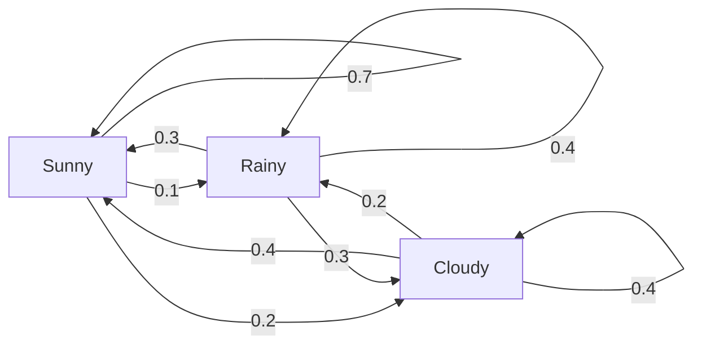
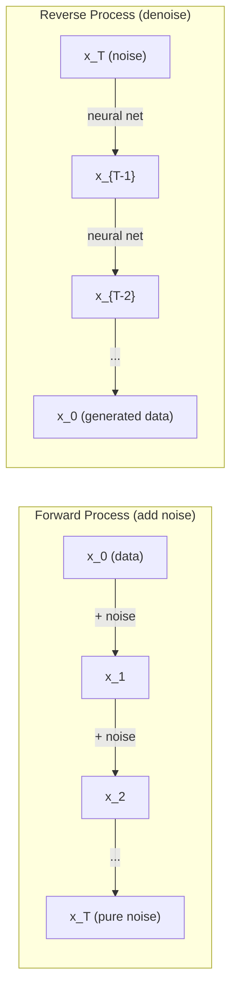

# 확률 과정

> 구조를 지닌 무작위성. 무작위 보행(random walk), 마르코프 연쇄(Markov chain), 확산 모델(diffusion model)의 이면에 있는 수학.

**유형:** Learn (이론)
**Language:** Python
**선수 레슨:** Phase 1, Lessons 06-07 (probability, Bayes)
**소요 시간:** ~75분

## 학습 목표

- 1차원 및 2차원 무작위 보행을 시뮬레이션하고 변위의 $\sqrt{n}$ 스케일링을 검증합니다
- 마르코프 연쇄 시뮬레이터를 구축하고 고윳값 분해(eigendecomposition)를 통해 정상 분포(stationary distribution)를 계산합니다
- 목표 분포에서 표본을 추출하기 위한 메트로폴리스-헤이스팅스(Metropolis-Hastings) MCMC 및 랑주뱅 역학(Langevin dynamics)을 구현합니다
- 순방향 확산 과정을 브라운 운동(Brownian motion)과 연결하고 역방향 과정이 데이터를 생성하는 원리를 설명합니다

## 문제 상황

많은 AI 시스템은 시간에 따라 진화하는 무작위성을 수반합니다. 정적인 무작위성이 아니라, 각 단계가 이전 단계에 의존하는 구조화된 순차적 무작위성입니다.

언어 모델은 토큰을 하나씩 생성합니다. 각 토큰은 이전 문맥에 의존합니다. 모델은 확률 분포를 출력하고, 그 분포에서 표본을 추출한 뒤 다음으로 넘어갑니다. 이것이 바로 확률 과정(stochastic process)입니다.

확산 모델은 이미지가 순수한 정적 잡음이 될 때까지 단계별로 노이즈를 추가합니다. 그런 다음 과정을 역전시켜, 새로운 이미지가 나타날 때까지 단계별로 노이즈를 제거합니다. 순방향 과정은 마르코프 연쇄입니다. 역방향 과정은 거꾸로 실행되는 학습된 마르코프 연쇄입니다.

강화학습 에이전트는 환경 내에서 행동을 취합니다. 각 행동은 특정 확률로 새로운 상태로 이어집니다. 에이전트는 무작위 환경 속에서 무작위 정책을 따릅니다. 이 전체가 마르코프 결정 과정(Markov decision process)입니다.

베이즈 추론(Bayesian inference)의 중추인 MCMC 표본 추출은 표본을 추출하고자 하는 사후 분포를 정상 분포로 갖는 마르코프 연쇄를 구성합니다.

이 모든 것은 네 가지 기초 개념 위에 구축됩니다:
1. 무작위 보행 -- 가장 단순한 확률 과정
2. 마르코프 연쇄 -- 전이 행렬을 지닌 구조화된 무작위성
3. 랑주뱅 역학 -- 노이즈가 더해진 경사 하강법
4. 메트로폴리스-헤이스팅스 -- 임의의 분포에서 표본 추출

## 개념

### 무작위 보행

위치 0에서 시작합니다. 매 단계마다 공정한 동전을 던집니다. 앞면: 오른쪽으로 이동 (+1). 뒷면: 왼쪽으로 이동 (-1).

$n$단계 후, 현재 위치는 $n$개의 무작위 $\pm 1$ 값들의 합입니다. 기댓값 위치는 0입니다(보행에 편향이 없습니다). 하지만 원점으로부터의 기대 거리는 $\sqrt{n}$에 비례하여 증가합니다.

이는 직관에 반합니다. 보행은 공정하며 어느 한쪽으로의 쏠림(drift)도 없습니다. 그러나 시간이 지남에 따라 시작 지점에서 점점 더 멀리 헤매게 됩니다. $n$단계 후의 표준편차는 $\sqrt{n}$입니다.

```
Step 0:  Position = 0
Step 1:  Position = +1 or -1
Step 2:  Position = +2, 0, or -2
...
Step 100: Expected distance from origin ~ 10 (sqrt(100))
Step 10000: Expected distance from origin ~ 100 (sqrt(10000))
```

**2차원에서** 보행자는 상, 하, 좌, 우로 동일한 확률로 이동합니다. 원점으로부터의 거리에도 동일한 $\sqrt{n}$ 스케일링이 적용됩니다. 경로는 프랙탈과 유사한 패턴을 그립니다.

**왜 $\sqrt{n}$일까요?** 각 단계는 동일한 확률로 +1 또는 -1입니다. $n$단계 후의 위치 $S_n = X_1 + X_2 + \cdots + X_n$에서 각 $X_i$는 $\pm 1$입니다. 각 단계의 분산은 1이고 단계들이 독립이므로, $\mathop{\mathrm{Var}}(S_n) = n$입니다. 표준편차 = $\sqrt{n}$입니다. 중심극한정리(central limit theorem)에 의해 $S_n / \sqrt{n}$는 표준 정규 분포로 수렴합니다.

이 $\sqrt{n}$ 스케일링은 ML 곳곳에서 나타납니다. SGD 노이즈는 1/sqrt(batch_size)에 비례하여 스케일링됩니다. 임베딩(embedding) 차원은 $\sqrt{d}$에 비례하여 스케일링됩니다. 제곱근은 독립적인 무작위 덧셈의 고유한 특징입니다.

**브라운 운동과의 연결.** 보폭이 $1/\sqrt{n}$이고 단위 시간당 $n$단계를 밟는 무작위 보행을 생각해 보겠습니다. $n$이 무한대로 향함에 따라, 무작위 보행은 브라운 운동 $B(t)$으로 수렴합니다. 이는 $B(t)$가 평균 0, 분산 $t$을 갖는 정규 분포를 따르는 연속 시간 과정입니다.

브라운 운동은 확산(diffusion)의 수학적 기초입니다. 유체 내 입자의 무작위 흔들림, 주가의 변동, 그리고 결정적으로 확산 모델의 노이즈 과정을 모델링합니다.

**도박사의 파산(Gambler's ruin).** 위치 $k$에서 시작하고 0과 $N$에 흡수 장벽(absorbing barrier)이 있는 무작위 보행자를 생각해 봅니다. 0에 도달하기 전에 $N$에 도달할 확률은 얼마일까요? 공정한 보행의 경우: $P(\text{reach } N) = k/N$입니다. 이는 놀라울 정도로 단순하고 우아합니다. 이는 마틴게일(martingale) 이론과 연결됩니다. 공정한 무작위 보행은 마틴게일입니다(미래 기댓값 = 현재 값).

### 마르코프 연쇄

마르코프 연쇄는 고정된 확률에 따라 상태 사이를 전이하는 시스템입니다. 핵심 특성은 다음 상태가 과거 이력이 아닌 오직 현재 상태에만 의존한다는 것입니다.

```math
P(X_{t+1} = j \mid X_t = i, X_{t-1} = \ldots) = P(X_{t+1} = j \mid X_t = i)
```

이것이 마르코프 특성(Markov property)입니다. 이는 전체 역학을 전이 행렬(transition matrix) $P$로 기술할 수 있음을 의미합니다:

```math
P[i][j] = \text{probability of going from state } i \text{ to state } j
```

$P$의 각 행의 합은 1입니다(어디론가는 반드시 이동해야 합니다).

**예시 -- 날씨:**

```
States: Sunny (0), Rainy (1), Cloudy (2)

P = [[0.7, 0.1, 0.2],    (if sunny: 70% sunny, 10% rainy, 20% cloudy)
     [0.3, 0.4, 0.3],    (if rainy: 30% sunny, 40% rainy, 30% cloudy)
     [0.4, 0.2, 0.4]]    (if cloudy: 40% sunny, 20% rainy, 40% cloudy)
```

어떤 상태에서 시작하든 상관없습니다. 많은 전이를 거친 후, 상태의 분포는 정상 분포 $\pi$로 수렴하며, 여기서 $\pi P = \pi$가 성립합니다. 이는 고윳값 1을 갖는 $P$의 좌고유벡터(left eigenvector)입니다.

이 날씨 연쇄의 경우, 정상 분포는 [0.55, 0.18, 0.27]입니다. 즉, 시작 상태와 관계없이 장기적으로 55%의 시간 동안 맑은 날씨가 됩니다.



**정상 분포 계산하기.** 두 가지 접근 방식이 있습니다:

1. **거듭제곱법(Power method)**: 임의의 초기 분포에 $P$를 반복해서 곱합니다. 충분한 반복 후 수렴합니다.
2. **고윳값 방법(Eigenvalue method)**: 고윳값 1을 갖는 $P$의 좌고유벡터를 구합니다. 이는 고윳값 1을 갖는 $P^T$의 고유벡터입니다.

두 접근 방식 모두 연쇄가 수렴 조건을 만족해야 합니다.

**수렴 조건.** 마르코프 연쇄가 다음 조건을 만족하면 유일한 정상 분포로 수렴합니다:
- **기약성(Irreducible)**: 모든 상태에서 다른 모든 상태로 도달 가능함
- **비주기성(Aperiodic)**: 연쇄가 고정된 주기로 순환하지 않음

ML에서 마주치는 대부분의 연쇄는 두 조건을 모두 만족합니다.

**흡수 상태(Absorbing states).** 한 번 들어가면 다시는 빠져나올 수 없는 상태를 흡수 상태라고 합니다($P[i][i] = 1$). 흡수 마르코프 연쇄는 종료 상태가 있는 과정을 모델링합니다. 끝나는 게임, 이탈하는 고객, 텍스트 끝(end-of-text) 토큰에 도달하는 토큰 시퀀스 등이 해당합니다.

**혼합 시간(Mixing time).** 연쇄가 정상 분포에 "가까워지기"까지 몇 단계가 걸릴까요? 엄밀하게는 정상 상태와의 전변동 거리(total variation distance)가 특정 임계값 아래로 떨어질 때까지의 단계 수입니다. 빠른 혼합 = 적은 단계 필요. 가역 연쇄(reversible chain)의 경우, $P$의 스펙트럼 갭(spectral gap, 고윳값 1을 제외한 고윳값 중 절댓값이 가장 큰 고윳값을 1에서 뺀 값)이 혼합 시간을 제어합니다. 갭이 클수록 = 더 빠르게 혼합됩니다.

### 언어 모델과의 연결

언어 모델의 토큰 생성은 근사적으로 마르코프 과정입니다. 현재 문맥이 주어지면, 모델은 다음 토큰에 대한 분포를 출력합니다. 온도는 분포의 첨도를 제어합니다:

```math
P(\text{token}_i) = \frac{\exp(\text{logit}_i / \text{temperature})}{\sum_j \exp(\text{logit}_j / \text{temperature})}
```

- 온도 = 1.0: 표준 분포
- 온도 < 1.0: 더 뾰족함 (더 결정론적)
- 온도 > 1.0: 더 평평함 (더 무작위적)
- 온도 $\to 0$: argmax (탐욕적 / greedy)

Top-k 표본 추출은 가장 높은 확률을 가진 $k$개의 토큰으로 잘라냅니다. Top-p(핵, nucleus) 표본 추출은 누적 확률이 $p$를 초과하는 가장 작은 토큰 집합으로 잘라냅니다. 두 방식 모두 마르코프 전이 확률을 수정합니다.
### 브라운 운동

랜덤 워크(random walk)의 연속 시간 극한입니다. 위치 $B(t)$은 세 가지 성질을 가집니다:
1. $B(0) = 0$
2. $B(t) - B(s)$은 평균이 0이고 분산이 $t - s$인 정규분포를 따릅니다 ($t > s$에 대해).
3. 겹치지 않는 구간에서의 증분(increment)은 서로 독립입니다.

브라운 운동(Brownian motion)은 연속이지만 모든 곳에서 미분 불가능합니다. 즉, 모든 스케일에서 미세하게 요동칩니다. 이 궤적은 평면에서 프랙탈 차원 2를 갖습니다.

이산 시뮬레이션에서는 브라운 운동을 다음과 같이 근사합니다:

```math
B(t + dt) = B(t) + \sqrt{dt} \, z, \quad \text{where } z \sim \mathcal{N}(0, 1)
```

$\sqrt{dt}$ 스케일링이 중요합니다. 이는 랜덤 워크에 적용된 중심극한정리(central limit theorem)에서 비롯됩니다.

### 랑주뱅 동역학

경사 하강법(gradient descent)은 함수의 최솟값을 찾습니다. 랑주뱅 동역학(Langevin dynamics)은 $\exp(-U(x)/T)$에 비례하는 확률 분포를 찾습니다. 여기서 $U$는 에너지 함수이고 $T$는 온도입니다.

```math
x_{t+1} = x_t - dt \, \nabla U(x_t) + \sqrt{2 T \, dt} \, z_t
```

입자에는 두 가지 힘이 작용합니다:
1. **그래디언트 힘** ($-dt \cdot \nabla U$): 낮은 에너지 방향으로 밀어냅니다 (경사 하강법과 유사).
2. **무작위 힘** ($\sqrt{2T dt} \cdot z$): 무작위 방향으로 밀어냅니다 (탐색).

온도 $T = 0$에서 이는 순수한 경사 하강법이 됩니다. 온도가 높으면 거의 랜덤 워크에 가까워집니다. 적절한 온도에서는 입자가 에너지 지형(energy landscape)을 탐색하며 낮은 에너지 영역에서 더 많은 시간을 보냅니다.

**확산 모델과의 연관성.** 확산 모델(diffusion model)의 순방향 과정(forward process)은 다음과 같습니다:

```math
x_t = \sqrt{\alpha_t} \, x_{t-1} + \sqrt{1 - \alpha_t} \cdot \text{noise}
```

이는 데이터와 노이즈를 점진적으로 섞는 마르코프 연쇄(Markov chain)입니다. 충분한 단계가 지나면 $x_T$은 순수한 가우시안 노이즈가 됩니다.

노이즈에서 다시 데이터로 되돌아가는 역방향 과정(reverse process) 역시 마르코프 연쇄이지만, 그 전이 확률은 신경망을 통해 학습됩니다. 신경망은 각 단계에서 추가된 노이즈를 예측하도록 학습한 뒤, 이를 차감합니다.



### MCMC: 마르코프 연쇄 몬테카를로

때로는 (상수를 제외하고는) 계산할 수 있지만 직접 샘플링할 수는 없는 분포 $p(x)$로부터 샘플을 추출해야 합니다. 베이지안 사후 분포(Bayesian posterior)가 대표적인 예입니다. 우도(likelihood)와 사전 분포(prior)의 곱은 알 수 있지만 정규화 상수(normalizing constant)는 다루기 어렵기(intractable) 때문입니다.

**메트로폴리스-헤이스팅스(Metropolis-Hastings)** 알고리즘은 정상 분포(stationary distribution)가 $p(x)$인 마르코프 연쇄를 구성합니다:

1. 임의의 위치 $x$에서 시작합니다.
2. 제안 분포(proposal distribution) $Q(x' \mid x)$로부터 새로운 위치 $x'$를 제안합니다.
3. 채택률(acceptance ratio)을 계산합니다: $a = p(x') Q(x \mid x') / (p(x) Q(x' \mid x))$
4. $\min(1, a)$의 확률로 $x'$를 채택합니다. 그렇지 않으면 $x$에 머무릅니다.
5. 이를 반복합니다.

만약 $Q$가 대칭적이라면(예: $Q(x' \mid x) = Q(x \mid x') = \mathcal{N}(x, \sigma^2){}$), 비율은 $a = p(x') / p(x)$로 단순화됩니다. 확률의 비율만 필요하므로 정규화 상수는 상쇄됩니다.

이 연쇄는 완만한 조건 하에서 $p(x)$로 수렴함이 보장됩니다. 하지만 제안 스텝이 너무 작으면(랜덤 워크) 또는 너무 크면(높은 기각률) 수렴이 느려질 수 있습니다. 제안 분포를 조율하는 것이 MCMC의 핵심 기술입니다.

**동작 원리.** 채택률은 상세 균형(detailed balance)을 보장합니다. 즉, $x$에 있으면서 $x'$로 이동할 확률은 $x'$에 있으면서 $x$로 이동할 확률과 같습니다. 상세 균형은 $p(x)$이 이 연쇄의 정상 분포임을 의미합니다. 따라서 충분한 단계를 거치면 샘플은 $p(x)$로부터 나오게 됩니다.

**실무적 고려사항:**
- **번인(Burn-in)**: 처음 $N$개의 샘플을 버립니다. 연쇄가 시작점에서부터 정상 분포에 도달하기까지 시간이 필요합니다.
- **솎아내기(Thinning)**: 자기상관(autocorrelation)을 줄이기 위해 매 $k$번째 샘플만 유지합니다.
- **다중 체인**: 서로 다른 시작점에서 여러 연쇄를 실행합니다. 이들이 동일한 분포로 수렴한다면 수렴했다는 근거가 됩니다.
- **채택률(Acceptance rate)**: $d$차원의 가우시안 제안 분포에 대해 최적 채택률은 약 23%입니다 (Roberts & Rosenthal, 2001). 채택률이 너무 높으면 연쇄가 거의 움직이지 않는다는 뜻이고, 너무 낮으면 모든 제안을 기각한다는 뜻입니다.

### 인공지능에서의 확률 과정

| 프로세스 | AI 적용 분야 |
|---------|---------------|
| 랜덤 워크 | 강화학습(RL)에서의 탐색, Node2Vec 임베딩 |
| 마르코프 연쇄 | 텍스트 생성, MCMC 샘플링 |
| 브라운 운동 | 확산 모델(순방향 과정) |
| 랑주뱅 동역학 | 스코어 기반 생성 모델(Score-based generative models), SGLD |
| 마르코프 결정 과정 | 강화학습 |
| 메트로폴리스-헤이스팅스 | 베이지안 추론, 사후 분포 샘플링 |

```figure
random-walk-diffusion
```

## 직접 만들어보기

### 1단계: 랜덤 워크 시뮬레이터

```python
import numpy as np

def random_walk_1d(n_steps, seed=None):
    rng = np.random.RandomState(seed)
    steps = rng.choice([-1, 1], size=n_steps)
    positions = np.concatenate([[0], np.cumsum(steps)])
    return positions


def random_walk_2d(n_steps, seed=None):
    rng = np.random.RandomState(seed)
    directions = rng.choice(4, size=n_steps)
    dx = np.zeros(n_steps)
    dy = np.zeros(n_steps)
    dx[directions == 0] = 1   # right
    dx[directions == 1] = -1  # left
    dy[directions == 2] = 1   # up
    dy[directions == 3] = -1  # down
    x = np.concatenate([[0], np.cumsum(dx)])
    y = np.concatenate([[0], np.cumsum(dy)])
    return x, y
```

1차원 보행은 누적합을 저장합니다. 각 스텝은 +1 또는 -1입니다. $n$ 스텝 후의 위치는 이들의 합입니다. 분산은 $n$에 선형으로 증가하므로, 표준편차는 $\sqrt{n}$에 비례하여 증가합니다.

### 2단계: 마르코프 연쇄

```python
class MarkovChain:
    def __init__(self, transition_matrix, state_names=None):
        self.P = np.array(transition_matrix, dtype=float)
        self.n_states = len(self.P)
        self.state_names = state_names or [str(i) for i in range(self.n_states)]

    def step(self, current_state, rng=None):
        if rng is None:
            rng = np.random.RandomState()
        probs = self.P[current_state]
        return rng.choice(self.n_states, p=probs)

    def simulate(self, start_state, n_steps, seed=None):
        rng = np.random.RandomState(seed)
        states = [start_state]
        current = start_state
        for _ in range(n_steps):
            current = self.step(current, rng)
            states.append(current)
        return states

    def stationary_distribution(self):
        eigenvalues, eigenvectors = np.linalg.eig(self.P.T)
        idx = np.argmin(np.abs(eigenvalues - 1.0))
        stationary = np.real(eigenvectors[:, idx])
        stationary = stationary / stationary.sum()
        return np.abs(stationary)
```

정상 분포는 고윳값이 1인 $P$의 좌고유벡터(left eigenvector)입니다. 우리는 $P^T$의 고유벡터를 계산하여 이를 구합니다(전치하면 좌고유벡터가 우고유벡터가 됩니다).

### 3단계: 랑주뱅 동역학

```python
def langevin_dynamics(grad_U, x0, dt, temperature, n_steps, seed=None):
    rng = np.random.RandomState(seed)
    x = np.array(x0, dtype=float)
    trajectory = [x.copy()]
    for _ in range(n_steps):
        noise = rng.randn(*x.shape)
        x = x - dt * grad_U(x) + np.sqrt(2 * temperature * dt) * noise
        trajectory.append(x.copy())
    return np.array(trajectory)
```

그래디언트는 $x$을 낮은 에너지 방향으로 밀어냅니다. 노이즈는 입자가 국소 최적해에 갇히는 것을 방지합니다. 평형 상태에서 샘플의 분포는 $\exp(-U(x)/\text{temperature})$에 비례합니다.

### 4단계: 메트로폴리스-헤이스팅스

```python
def metropolis_hastings(target_log_prob, proposal_std, x0, n_samples, seed=None):
    rng = np.random.RandomState(seed)
    x = np.array(x0, dtype=float)
    samples = [x.copy()]
    accepted = 0
    for _ in range(n_samples - 1):
        x_proposed = x + rng.randn(*x.shape) * proposal_std
        log_ratio = target_log_prob(x_proposed) - target_log_prob(x)
        if np.log(rng.rand()) < log_ratio:
            x = x_proposed
            accepted += 1
        samples.append(x.copy())
    acceptance_rate = accepted / (n_samples - 1)
    return np.array(samples), acceptance_rate
```

이 알고리즘은 새로운 포인트를 제안하고, 확률이 더 높은지 확인한 뒤(또는 비율에 비례하는 확률로 채택하고), 이를 반복합니다. 원활한 혼합(mixing)을 위해 채택률은 대략 23~50% 수준이어야 합니다.

## 활용하기

실무에서는 이러한 알고리즘을 위해 검증된 라이브러리를 사용합니다. 하지만 동작 메커니즘을 이해하는 것은 디버깅과 튜닝에 있어 중요합니다.

```python
import numpy as np

rng = np.random.RandomState(42)
walk = np.cumsum(rng.choice([-1, 1], size=10000))
print(f"Final position: {walk[-1]}")
print(f"Expected distance: {np.sqrt(10000):.1f}")
print(f"Actual distance: {abs(walk[-1])}")
```

### 전이 행렬을 위한 numpy 활용

```python
import numpy as np

P = np.array([[0.7, 0.1, 0.2],
              [0.3, 0.4, 0.3],
              [0.4, 0.2, 0.4]])

distribution = np.array([1.0, 0.0, 0.0])
for _ in range(100):
    distribution = distribution @ P

print(f"Stationary distribution: {np.round(distribution, 4)}")
```

초기 분포에 $P$을 반복해서 곱합니다. 충분한 반복 후에는 어디서 시작했든 상관없이 정상 분포로 수렴합니다. 이는 지배적인 좌고유벡터를 찾는 거듭제곱법(power method)입니다.

### 실제 프레임워크와의 연계

- **PyTorch diffusion:** Hugging Face의 `DDPMScheduler` 라이브러리에 포함된 `diffusers`는 순방향 및 역방향 마르코프 연쇄를 구현합니다.
- **NumPyro / PyMC:** 베이지안 추론에 MCMC(메트로폴리스-헤이스팅스를 개선한 NUTS 샘플러)를 사용합니다.
- **Gymnasium (RL):** 환경의 step 함수는 마르코프 결정 과정(Markov decision process)을 정의합니다.

### 마르코프 연쇄 수렴성 검증

```python
import numpy as np

P = np.array([[0.9, 0.1], [0.3, 0.7]])

eigenvalues = np.linalg.eigvals(P)
spectral_gap = 1 - sorted(np.abs(eigenvalues))[-2]
print(f"Eigenvalues: {eigenvalues}")
print(f"Spectral gap: {spectral_gap:.4f}")
print(f"Approximate mixing time: {1/spectral_gap:.1f} steps")
```

스펙트럼 갭(spectral gap)은 연쇄가 초기 상태를 얼마나 빨리 잊는지를 알려줍니다. 갭이 0.2이면 믹싱(mixing)에 대략 5단계가 걸린다는 뜻입니다. 갭이 0.01이면 대략 100단계가 걸립니다. 연쇄의 혼합이 느리면 연산 자원이 낭비되므로, 장시간의 시뮬레이션을 실행하기 전에 항상 이를 확인하세요.

## 배포하기

이 레슨을 통해 다음 산출물을 만듭니다:
- `outputs/prompt-stochastic-process-advisor.md` -- 주어진 문제에 어떤 확률 과정 프레임워크를 적용해야 하는지 식별하도록 돕는 프롬프트
## 연계 개념

| 개념 | 등장하는 분야 |
|------|------------------|
| 무작위 행보(Random walk) | Node2Vec 그래프 임베딩(graph embedding), 강화학습(RL)에서의 탐색 |
| 마르코프 연쇄(Markov chain) | LLM의 토큰 생성, MCMC 샘플링 |
| 브라운 운동(Brownian motion) | DDPM의 순방향 확산 과정, SDE 기반 모델 |
| 랑주뱅 역학(Langevin dynamics) | 점수 기반 생성 모델, 확률적 경사 랑주뱅 역학(SGLD) |
| 정적 분포(Stationary distribution) | MCMC 수렴 목표, PageRank |
| 메트로폴리스-헤이스팅스(Metropolis-Hastings) | 베이즈 사후 확률 샘플링, 모의 담금질(simulated annealing) |
| 온도(Temperature) | LLM 샘플링, 강화학습의 볼츠만 탐색, 모의 담금질 |
| 혼합 시간(Mixing time) | MCMC의 수렴 속도, 스펙트럼 갭 분석 |
| 흡수 상태(Absorbing state) | 시퀀스 종료 토큰, 강화학습의 종료 상태 |
| 상세 균형(Detailed balance) | MCMC 샘플러의 정확성 보장 |

확산 모델(Diffusion model)은 특히 주목할 만합니다. DDPM(Ho et al., 2020)은 다음과 같은 순방향 마르코프 연쇄를 정의합니다.

```math
q(x_t \mid x_{t-1}) = \mathcal{N}\left(x_t; \sqrt{1-\beta_t} \, x_{t-1}, \beta_t I\right)
```

여기서 $\beta_t$은 노이즈 스케줄입니다. $T$단계 후 $x_T$은 대략 $\mathcal{N}(0, I)$이 됩니다. 역방향 과정은 노이즈를 예측하는 신경망으로 매개변수화됩니다.

```math
p_\theta(x_{t-1} \mid x_t) = \mathcal{N}\left(x_{t-1}; \mu_\theta(x_t, t), \sigma_t^2 I\right)
```

생성의 모든 단계는 학습된 마르코프 연쇄에서의 한 걸음입니다. 마르코프 연쇄를 이해하는 것은 확산 모델이 데이터를 생성하는 방식과 그 이유를 이해하는 것을 의미합니다.

SGLD(Stochastic Gradient Langevin Dynamics)는 미니배치 경사 하강법과 랑주뱅 노이즈를 결합합니다. 전체 그래디언트를 계산하는 대신 확률적 추정치를 사용하고 보정된 노이즈를 더합니다. 학습률(learning rate)이 감소함에 따라 SGLD는 최적화에서 샘플링으로 전환되며, 근사 베이즈 사후 분포 샘플을 자연스럽게 얻을 수 있습니다. 이는 신경망에서 불확실성 추정치(uncertainty estimate)를 얻는 가장 간단한 방법 중 하나입니다.

이러한 모든 연결을 관통하는 핵심 통찰은 확률 과정(stochastic process)이 단순한 이론적 도구에 그치지 않는다는 점입니다. 이는 현대 AI 시스템 내부의 계산 메커니즘입니다. LLM의 온도를 조절하는 것은 마르코프 연쇄를 조정하는 것입니다. 확산 모델을 훈련하는 것은 브라운 운동과 유사한 과정을 역전시키는 법을 배우는 것입니다. 베이즈 추론(Bayesian inference)을 실행하는 것은 사후 분포로 수렴하는 연쇄를 구성하는 것입니다.

## 연습 문제

1. **10,000단계의 무작위 행보 1,000개를 시뮬레이션합니다.** 최종 위치의 분포를 시각화합니다. 이 분포가 평균 0, 표준편차 $\sqrt{10000} = 100$인 가우스 분포에 근사하는지 확인합니다.

2. **마르코프 연쇄를 사용하여 텍스트 생성기를 구축합니다.** 소규모 코퍼스로 학습합니다. 각 단어에 대해 다음 단어로의 전이 횟수를 셉니다. 전이 행렬을 구성합니다. 연쇄에서 샘플링하여 새로운 문장을 생성합니다.

3. 메트로폴리스-헤이스팅스를 사용하여 **모의 담금질을 구현합니다.** 높은 온도(거의 모든 것을 수락)에서 시작하여 점진적으로 온도를 낮춥니다(개선된 것만 수락). 이를 활용하여 지역 최솟값(local minima)이 많은 함수의 최솟값을 찾습니다.

4. **서로 다른 온도에서의 랑주뱅 역학을 비교합니다.** 이중 우물 퍼텐셜 $U(x) = (x^2 - 1)^2$에서 샘플링합니다. 낮은 온도에서는 샘플이 하나의 우물에 모입니다. 높은 온도에서는 두 우물에 걸쳐 퍼집니다. 연쇄가 두 우물 사이를 오가며 혼합되는 임계 온도를 찾습니다.

5. **순방향 확산 과정을 구현합니다.** 1차원 신호(예: 사인파)로 시작합니다. 선형 노이즈 스케줄을 사용하여 100단계에 걸쳐 점진적으로 노이즈를 추가합니다. 신호가 순수한 노이즈로 저하되는 과정을 보여줍니다. 그런 다음 이 과정을 역전시키는 간단한 디노이저(추정된 노이즈를 단순히 빼는 소박한 방식이라도 무방함)를 구현합니다.

### 힌트

**연습 문제 1.** 1,000개의 시드에 대해 `random_walk_1d(10000, seed=i)`를 호출하고 각 최종 위치를 유지합니다. 평균이 0에 가깝고, 표준편차가 100에 가까우며, 최종 위치의 약 68%가 -100에서 100 사이에 있는지 확인합니다.

**연습 문제 2.** 각 단어 쌍의 빈도를 센 다음, 각 행의 합이 1이 되도록 행의 총합으로 나눕니다. 이 행렬을 `MarkovChain(transition_matrix, state_names)`에 전달하고 `simulate`를 호출합니다. 출력된 모든 단어 쌍이 코퍼스에도 존재하는지 확인합니다.

**연습 문제 3.** 더 나쁜 지점을 확률 $\exp(-\Delta / T)$로 수락하고, 매 단계 후 $T$에 0.99와 같은 계수를 곱합니다. 최솟값을 이미 알고 있는 함수에서 테스트하고, 정밀 그리드 탐색 결과와 답을 비교해 봅니다.

**연습 문제 4.** 그래디언트는 $4x(x^2 - 1)$이므로 이를 `langevin_dynamics(grad_U, x0, dt, temperature, n_steps)`에 전달합니다. $x = 0$의 장벽 높이는 1이므로, 0.05부터 1까지의 온도에 대해 $x$의 부호가 바뀌는 빈도를 세어 횟수가 급격히 증가하기 시작하는 온도를 찾습니다.

**연습 문제 5.** `diffusion_forward(signal, 100)`를 호출하고 마지막 단계에서의 $\bar{\alpha}$를 $(1 - \beta_t)$의 곱으로 계산합니다. $\bar{\alpha}$이 0과 거리가 멀다면 신호가 아직 순수한 노이즈가 아니므로 `beta_end`를 높입니다. 먼저 실제 노이즈를 사용하여 디노이저를 테스트합니다. 이때 $(x_t - \sqrt{1 - \bar{\alpha}_t} \epsilon)/\sqrt{\bar{\alpha}_t}$는 원래 신호를 정확히 복원해야 합니다.

## 핵심 용어

| 용어 | 일반적인 설명 | 실제 의미 |
|------|----------------|----------------------|
| 무작위 행보(Random walk) | "동전 던지기식 움직임" | 매 단계마다 무작위 증분으로 위치가 변하는 과정 |
| 마르코프 성질(Markov property) | "기억 상실" | 미래는 과거의 이력이 아닌 오직 현재 상태에만 의존한다는 성질 |
| 전이 행렬(Transition matrix) | "확률 표" | $P[i][j]$ = 상태 $i$에서 상태 $j$로 이동할 확률 |
| 정적 분포(Stationary distribution) | "장기적 평균" | $\pi P = \pi$를 만족하는 분포 $\pi$ -- 연쇄의 평형 상태 |
| 브라운 운동(Brownian motion) | "불규칙한 흔들림" | 무작위 행보의 연속 시간 극한, $B(t) \sim \mathcal{N}(0, t)$ |
| 랑주뱅 역학(Langevin dynamics) | "노이즈가 포함된 경사 하강법" | 결정론적 그래디언트와 무작위 섭동을 결합한 업데이트 규칙 |
| MCMC | "목표를 향해 걸어가기" | 목표로 하는 분포를 정적 분포로 갖는 마르코프 연쇄를 구성하는 방법 |
| 메트로폴리스-헤이스팅스(Metropolis-Hastings) | "제안하고 수락/거절하기" | 수락 확률을 사용하여 수렴을 보장하는 MCMC 알고리즘 |
| 온도(Temperature) | "무작위성 조절 노브" | 탐색과 활용 사이의 균형을 제어하는 매개변수 |
| 확산 과정(Diffusion process) | "노이즈 넣고, 노이즈 빼기" | 순방향: 점진적으로 노이즈 추가. 역방향: 점진적으로 노이즈 제거. 데이터를 생성함. |

## 참고 자료

- **Ho, Jain, Abbeel (2020)** -- "Denoising Diffusion Probabilistic Models." 확산 모델 혁명의 시발점이 된 DDPM 논문. 순방향 및 역방향 마르코프 연쇄의 명확한 유도를 다룹니다.
- **Song & Ermon (2019)** -- "Generative Modeling by Estimating Gradients of the Data Distribution." 샘플링을 위해 랑주뱅 역학을 사용하는 점수 기반 접근법입니다.
- **Roberts & Rosenthal (2004)** -- "General state space Markov chains and MCMC algorithms." MCMC가 언제, 왜 작동하는지에 대한 이론적 배경을 다룹니다.
- **Norris (1997)** -- "Markov Chains." 표준 교과서입니다. 수렴, 정적 분포 및 도달 시간을 다룹니다.
- **Welling & Teh (2011)** -- "Bayesian Learning via Stochastic Gradient Langevin Dynamics." 확장 가능한 베이즈 추론을 위해 SGD와 랑주뱅 역학을 결합합니다.
