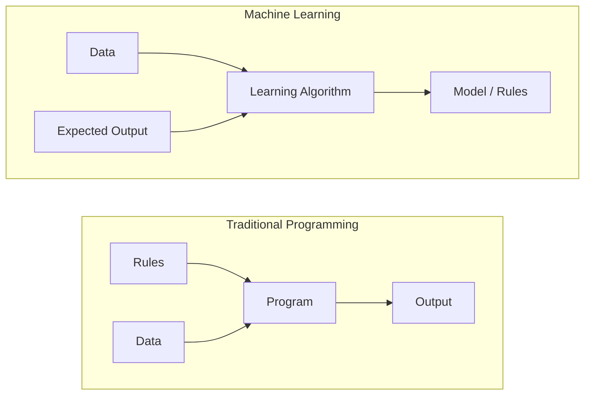
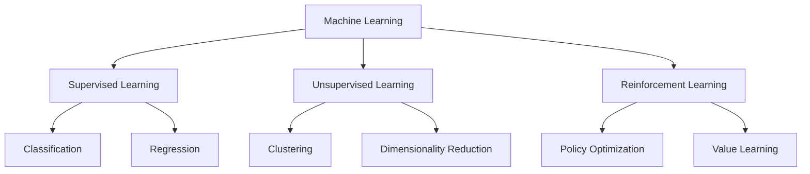
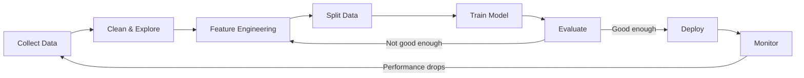
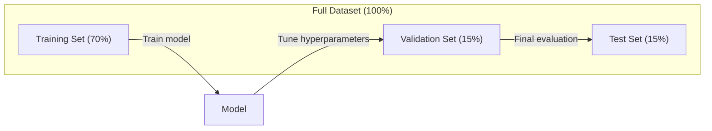
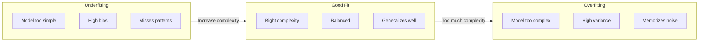
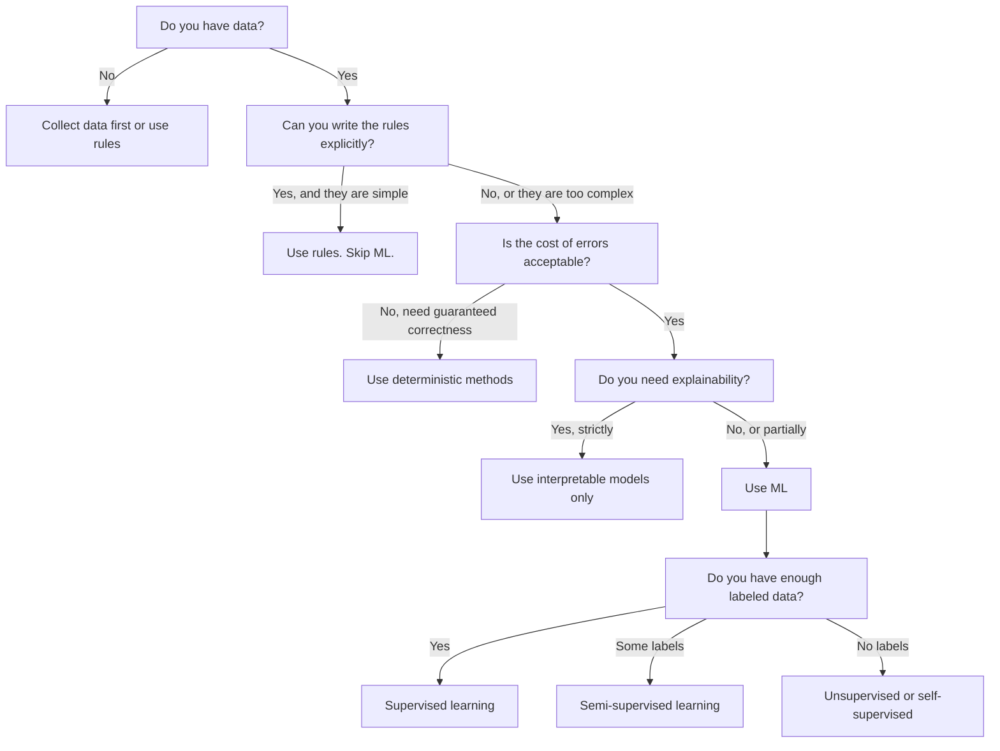

# 머신러닝이란 무엇인가

> 머신러닝(machine learning)이란 규칙을 직접 작성하는 대신 컴퓨터가 데이터에서 패턴을 찾도록 학습시키는 것입니다.

**유형:** Learn (이론)
**사용 언어:** Python
**선수 레슨:** Phase 1 (Math Foundations)
**소요 시간:** ~45분

## 학습 목표

- 지도학습(supervised learning), 비지도학습(unsupervised learning), 강화학습(reinforcement learning)의 차이점을 설명하고, 주어진 문제에 어떤 유형이 적용되는지 식별합니다.
- 최근접 중심 분류기(nearest centroid classifier)를 밑바닥부터 직접 구현하고, 무작위 기준선(random baseline)과 비교하여 평가합니다.
- 분류(classification)와 회귀(regression) 작업을 구분하고 각 작업에 적합한 손실 함수(loss function)를 선택합니다.
- 주어진 비즈니스 문제가 머신러닝에 적합한지, 아니면 결정론적 규칙(deterministic rules)으로 해결하는 것이 더 나은지 평가합니다.

## 문제 상황

스팸 필터를 구축한다고 가정해 보겠습니다. 전통적인 접근 방식은 자리에 앉아 수백 개의 규칙을 작성하는 것입니다. "이메일에 '무료 머니'가 포함되어 있으면 스팸으로 표시한다. 느낌표가 3개 이상이면 스팸으로 표시한다." 몇 주 동안 규칙을 작성합니다. 그러다 스패머들이 단어 표현을 바꿉니다. 작성한 규칙은 무용지물이 됩니다. 더 많은 규칙을 작성합니다. 이 굴레는 끝없이 반복됩니다.

머신러닝은 이러한 패러다임을 바꿉니다. 규칙을 작성하는 대신 컴퓨터에 수천 개의 레이블이 달린(labeled) 이메일("스팸" 또는 "스팸 아님")을 제공하고 스스로 규칙을 파악하도록 합니다. 컴퓨터는 사람이 미처 생각하지 못했던 패턴을 발견합니다. 스패머들이 전략을 바꾸면 코드를 다시 작성하는 대신 새로운 데이터로 모델을 재학습시키면 됩니다.

"규칙 프로그래밍"에서 "데이터로부터 학습"으로의 이러한 전환이 바로 머신러닝의 핵심입니다. 모든 추천 엔진, 음성 비서, 자율주행차, 언어 모델이 이러한 방식으로 작동합니다.

## 핵심 개념

### 규칙이 아닌 데이터로부터의 학습

전통적인 프로그래밍과 머신러닝은 서로 반대 방향으로 문제를 해결합니다.



전통적인 프로그래밍: 개발자가 규칙을 작성합니다. 프로그램이 데이터에 해당 규칙을 적용하여 출력을 생성합니다.

머신러닝: 데이터와 기대되는 출력을 제공합니다. 알고리즘이 스스로 규칙을 발견합니다.

학습을 통해 도출된 "모델(model)"이 바로 숫자(가중치, 파라미터)로 인코딩된 규칙 그 자체입니다. 모델은 이미 본 예시들을 일반화(generalize)하여 지금까지 본 적 없는 새로운 데이터에 대해 예측을 수행합니다.

### 머신러닝의 세 가지 유형



**지도학습(Supervised Learning)**: 입력-출력 쌍이 주어집니다. 모델은 입력을 출력으로 매핑하는 방법을 학습합니다.
- "고양이 또는 개로 라벨링된 사진 10,000장이 있습니다. 둘을 구별하는 법을 배우세요."
- "주택의 특성과 가격 정보가 있습니다. 가격을 예측하는 법을 배우세요."

**비지도학습(Unsupervised Learning)**: 입력만 주어지며 레이블은 없습니다. 모델이 스스로 구조를 찾아냅니다.
- "10,000명의 고객 구매 이력이 있습니다. 자연스러운 그룹을 찾아보세요."
- "1,000차원의 데이터 포인트가 있습니다. 구조를 유지하면서 2차원으로 축소해 보세요."

**강화학습(Reinforcement Learning)**: 에이전트(agent)가 환경(environment)에서 행동(action)을 취하고 보상(reward)이나 불이익(penalty)을 받습니다. 총 보상을 극대화하는 전략(정책, policy)을 학습합니다.
- "이 게임을 플레이하세요. 승리하면 +1, 패배하면 -1입니다. 전략을 찾아보세요."
- "이 로봇 팔을 제어하세요. 물체를 집어 올리면 +1, 1초를 낭비할 때마다 -0.01입니다."

실무에서 구축하게 될 대부분의 시스템은 지도학습을 사용합니다. 비지도학습은 전처리 및 탐색적 분석에 흔히 사용됩니다. 강화학습은 게임 AI, 로보틱스, 언어 모델을 위한 RLHF의 기반 기술로 활용됩니다.

### 3대 유형 그 이상

위의 세 가지 범주는 깔끔하게 구분되지만, 실제 현업의 머신러닝에서는 경계가 모호해지는 경우가 많습니다.

**준지도학습(Semi-supervised learning)**은 소량의 레이블이 있는 데이터와 대량의 레이블이 없는 데이터를 함께 사용합니다. 예를 들어 레이블이 지정된 의료 영상 100장과 레이블이 없는 영상 100,000장이 있는 경우입니다. 대표적인 기법은 다음과 같습니다.

- **레이블 전파(Label propagation):** 유사한 데이터 포인트를 연결하는 그래프를 구축합니다. 그래프를 통해 레이블이 지정된 노드에서 레이블이 없는 인접 노드로 레이블이 확산됩니다.
- **의사 레이블링(Pseudo-labeling):** 레이블이 있는 데이터로 모델을 학습시킨 뒤, 이를 사용해 레이블이 없는 데이터의 레이블을 예측하고 전체 데이터를 바탕으로 다시 학습시킵니다. 모델이 스스로 학습 세트를 부트스트랩(bootstrap)합니다.
- **일관성 정규화(Consistency regularization):** 모델은 특정 입력과 약간의 변형(perturbation)이 가해진 동일 입력에 대해 동일한 예측을 내놓아야 합니다. 이는 레이블 없이도 작동합니다.

**자기지도학습(Self-supervised learning)**은 데이터 자체에서 감독 신호(supervision)를 만들어냅니다. 사람이 작성한 레이블이 전혀 필요하지 않습니다. 모델은 데이터의 구조로부터 자체적인 예측 작업을 생성합니다.

- **마스크 언어 모델링(Masked language modeling, BERT):** 문장 내 단어의 15%를 숨기고, 누락된 단어를 예측하도록 모델을 학습시킵니다. "레이블"은 원본 텍스트에서 직접 가져옵니다.
- **대조 학습(Contrastive learning, SimCLR):** 하나의 이미지를 가져와 두 가지 증강(augmented) 버전을 만듭니다. 모델이 이 두 버전이 같은 이미지에서 유래했음을 인식하도록 학습시키는 동시에, 다른 이미지의 증강 버전과는 구별하도록 합니다.
- **다음 토큰 예측(Next-token prediction, GPT):** 이전의 모든 단어가 주어졌을 때 다음 단어를 예측합니다. 모든 텍스트 문서가 학습 예시가 됩니다.

이들은 3대 유형과 완전히 동떨어진 별개의 범주가 아닙니다. 지도학습과 비지도학습의 아이디어를 결합한 전략입니다. 자기지도학습은 기술적으로 지도학습에 해당하지만(모델이 무언가를 예측하므로), 레이블이 사람이 아닌 데이터 자체에서 자동으로 생성된다는 점이 다릅니다.

### 분류 vs 회귀

이 둘은 지도학습의 두 가지 주요 작업입니다.

| 측면 | 분류 | 회귀 |
|--------|---------------|------------|
| 출력 | 이산적인 범주 | 연속적인 수치 |
| 예시 | "이 이메일은 스팸인가?" | "이 집의 가격은 얼마일까?" |
| 출력 공간 | {cat, dog, bird} | 모든 실수 |
| 손실 함수 | Cross-entropy, accuracy | Mean squared error, MAE |
| 결정 | 클래스 간 경계 | 데이터를 적합하는 곡선 |

분류는 "어떤 범주인가?"에 답하고, 회귀는 "얼마인가?"에 답합니다.

일부 문제는 두 가지 방식 중 어느 쪽으로든 구성할 수 있습니다. 주식이 오를지 내릴지 예측하는 것은 분류입니다. 정확한 주가를 예측하는 것은 회귀입니다.

### 머신러닝 워크플로

어떤 알고리즘을 사용하든 모든 머신러닝 프로젝트는 동일한 파이프라인을 따릅니다.



**데이터 수집(Collect Data)**: 원시 데이터(raw data)를 수집합니다. 데이터는 많을수록 좋은 경우가 대부분이지만, 양보다 품질이 더 중요합니다.

**정제 및 탐색(Clean & Explore)**: 결측치를 처리하고, 중복을 제거하며, 분포를 시각화하고, 이상치를 파악합니다. 이 단계는 대개 전체 프로젝트 시간의 60~80%를 차지합니다.

**특성 엔지니어링(Feature Engineering)**: 원시 데이터를 모델이 사용할 수 있는 특성(feature)으로 변환합니다. 날짜를 요일로 변환하거나, 수치형 열을 정규화하고, 범주형 변수를 인코딩합니다. 화려한 알고리즘보다 좋은 특성을 만드는 것이 더 중요합니다.

**데이터 분할(Split Data)**: 데이터를 훈련(training), 검증(validation), 테스트(test) 세트로 나눕니다. 모델은 훈련 데이터로 학습하고, 검증 데이터로 하이퍼파라미터를 튜닝하며, 테스트 데이터로 최종 성능을 평가하여 보고합니다.

**모델 학습(Train Model)**: 훈련 데이터를 알고리즘에 입력합니다. 알고리즘은 손실 함수를 최소화하도록 내부 파라미터를 조정합니다.

**평가(Evaluate)**: 검증/테스트 데이터에서 성능을 측정합니다. 성능이 만족스럽지 않다면 이전 단계로 돌아가 다른 특성, 알고리즘 또는 하이퍼파라미터를 시도합니다.

**배포(Deploy)**: 새로운 데이터에 대해 예측을 수행할 수 있도록 모델을 프로덕션 환경에 배포합니다.

**모니터링(Monitor)**: 시간에 따른 모델 성능을 추적합니다. 데이터 분포가 변하고(데이터 드리프트, data drift), 모델의 성능이 저하될 수 있습니다. 성능이 떨어지면 재학습을 수행합니다.
### 훈련, 검증 및 테스트 분할

이는 초심자가 가장 흔히 실수하는 매우 중요한 개념입니다. 모델은 훈련 중에 본 적 없는 데이터를 대상으로 평가해야 합니다. 그렇지 않으면 학습이 아닌 단순 암기를 측정하게 됩니다.



| 분할 | 목적 | 사용 시점 | 일반적인 비율 |
|-------|---------|-----------|-------------|
| 훈련(Training) | 모델이 이 데이터로부터 학습 | 훈련 중 | 60-80% |
| 검증(Validation) | 하이퍼파라미터 튜닝, 모델 비교 | 각 훈련 실행 후 | 10-20% |
| 테스트(Test) | 최종적인 편향 없는 성능 평가 | 맨 마지막에 단 한 번 | 10-20% |

테스트 세트는 절대 침범해서는 안 됩니다. 테스트 세트는 정확히 단 한 번만 확인해야 합니다. 테스트 성능을 바탕으로 모델을 계속 수정한다면, 사실상 테스트 세트로 훈련하는 셈이 되며 보고되는 수치는 무의미해집니다.

소규모 데이터셋의 경우 k-겹 교차 검증(k-fold cross-validation)을 사용합니다. 데이터를 $k$개 부분으로 나누고, $k-1$개 부분으로 훈련한 뒤 나머지 부분으로 검증하며, 이를 번갈아 가며 수행한 후 결과를 평균 냅니다.

### 과적합 vs 과소적합



**과소적합(Underfitting)**: 모델이 너무 단순하여 데이터의 패턴을 포착하지 못하는 상태입니다. 곡선 관계를 직선으로 맞추려는 것과 같습니다. 훈련 오차가 높고, 테스트 오차도 높습니다.

**과적합(Overfitting)**: 모델이 지나치게 복잡하여 노이즈를 포함한 훈련 데이터 전체를 암기해 버린 상태입니다. 모든 훈련 데이터 포인트를 통과하는 구불구불한 곡선처럼 작동하여 새로운 데이터에서는 실패합니다. 훈련 오차는 낮지만, 테스트 오차는 높습니다.

**적절한 적합(Good fit)**: 모델이 노이즈를 암기하지 않고 실제 패턴을 잘 포착한 상태입니다. 훈련 오차와 테스트 오차 모두 적절히 낮습니다.

과적합의 징후:
- 훈련 정확도가 검증 정확도보다 훨씬 높음
- 훈련 데이터에서는 잘 작동하지만 새로운 데이터에서는 성능이 떨어짐
- 훈련 데이터를 더 추가했을 때 성능이 향상됨 (모델이 학습이 아닌 암기를 하고 있었음을 의미)

과적합 해결 방법:
- 더 많은 훈련 데이터 확보
- 모델 복잡도 감소 (파라미터 수 축소, 더 단순한 아키텍처 사용)
- 정규화(Regularization, 큰 가중치에 패널티 부여)
- 드롭아웃(Dropout, 훈련 중 무작위로 뉴런을 0으로 설정)
- 조기 종료(Early stopping, 검증 오차가 증가하기 시작할 때 훈련 중단)

과소적합 해결 방법:
- 더 복잡한 모델 사용
- 특성(feature) 추가
- 정규화 강도 감소
- 더 오래 훈련

### 편향-분산 트레이드오프

이는 과적합과 과소적합의 이면에 있는 수학적 프레임워크입니다.

**편향(Bias)**: 모델의 잘못된 가정으로 인해 발생하는 오차입니다. 실제 관계가 비선형일 때 선형 모델을 사용하면 높은 편향을 갖게 됩니다. 높은 편향은 과소적합으로 이어집니다.

**분산(Variance)**: 훈련 데이터의 작은 변동에 대한 민감도로 인해 발생하는 오차입니다. 분산이 높은 모델은 데이터의 서로 다른 하위 집합으로 훈련할 때 매우 다른 예측 결과를 냅니다. 높은 분산은 과적합으로 이어집니다.

| 모델 복잡도 | 편향 | 분산 | 결과 |
|-----------------|------|----------|--------|
| 너무 낮음 (곡선 데이터에 선형 모델 적용) | 높음 | 낮음 | 과소적합 |
| 적절함 | 중간 | 중간 | 우수한 일반화 |
| 너무 높음 (10개 포인트에 20차 다항식 적용) | 낮음 | 높음 | 과적합 |

$\text{Total error} = \text{Bias}^2 + \text{Variance} + \text{Irreducible noise}$

줄일 수 없는 노이즈(데이터 자체의 무작위성)는 줄일 수 없습니다. 따라서 $\text{bias}^2 + \text{variance}$이(가) 최소화되는 최적의 지점을 찾아야 합니다.

### 공짜 점심 없음 정리(No Free Lunch Theorem)

모든 문제에 최적인 단 하나의 알고리즘은 존재하지 않습니다. 특정 유형의 문제에서 뛰어난 성능을 보이는 알고리즘도 다른 유형의 문제에서는 성능이 저조할 수 있습니다. 데이터 과학자들이 여러 알고리즘을 시도하고 결과를 비교하는 이유가 바로 여기에 있습니다.

실무에서 알고리즘의 선택은 다음에 따라 달라집니다:
- 보유한 데이터의 양
- 특성의 개수
- 관계가 선형인지 비선형인지 여부
- 해석 가능성(interpretability)이 필요한지 여부
- 감당할 수 있는 연산 자원의 양

### 머신러닝을 사용하지 말아야 할 때

ML은 강력하지만 항상 올바른 도구는 아닙니다. 모델을 도입하기 전에 모델이 실제로 필요한지 먼저 자문해 보아야 합니다.

**다음과 같은 경우에는 ML을 사용하지 마십시오:**

- **규칙이 단순하고 명확하게 정의되어 있는 경우.** 세금 계산, 정렬 알고리즘, 단위 변환 등이 해당합니다. 몇 개의 if 문으로 로직을 작성할 수 있다면, 모델을 도입하는 것은 이점 없이 복잡성만 가중시킬 뿐입니다.
- **데이터가 없거나 매우 적은 경우.** ML은 학습할 예시 데이터가 필요합니다. 10개의 데이터 포인트로는 유의미한 모델을 훈련할 수 없습니다. 먼저 데이터를 수집하십시오.
- **오류의 대가가 치명적이며 정확성이 보장되어야 하는 경우.** 약물 복용량 계산, 원자로 제어, 암호화 검증 등이 해당합니다. ML 모델은 확률적입니다. 때로는 틀릴 수도 있습니다. "때때로 발생하는 오류"를 용인할 수 없다면 결정론적(deterministic) 방법을 사용하십시오.
- **룩업 테이블이나 휴리스틱으로 문제를 해결할 수 있는 경우.** 단순한 임계값이나 테이블로 케이스의 99%를 처리할 수 있다면, ML을 추가하는 것은 유의미한 개선 없이 유지보수 비용만 늘립니다.
- **결정을 설명할 수 없는데 설명 가능성이 필수적인 경우.** 규제 산업(대출, 보험, 형사 사법)에서는 모든 결정을 온전히 설명할 수 있어야 하는 경우가 있습니다. 일부 ML 모델(선형 회귀, 소규모 의사결정 나무 등)은 해석 가능하지만, 대부분은 그렇지 않습니다.
- **재훈련 속도보다 문제가 더 빠르게 변화하는 경우.** 규칙이 매일 바뀌는데 재훈련에 일주일이 걸린다면, 모델은 항상 철 지난 상태가 됩니다.

다음 의사결정 순서도를 참고하십시오:



```figure
f3-learning-boundary
```

## 직접 구현하기

`code/ml_intro.py`의 코드는 가장 단순한 형태의 ML 알고리즘인 최근접 중심 분류기(nearest centroid classifier)를 밑바닥부터(from scratch) 구현합니다. 이 코드는 데이터로부터 학습한 뒤 새로운 데이터를 예측한다는 핵심 아이디어를 보여줍니다.

### 1단계: 밑바닥부터 최근접 중심 분류기 구현하기

최근접 중심 분류기는 훈련 데이터에 있는 각 클래스의 중심(평균)을 계산합니다. 예측 시에는 새로운 데이터 포인트를 중심이 가장 가까운 클래스에 할당합니다.

```python
class NearestCentroid:
    def fit(self, X, y):
        self.classes = np.unique(y)
        self.centroids = np.array([
            X[y == c].mean(axis=0) for c in self.classes
        ])

    def predict(self, X):
        distances = np.array([
            np.sqrt(((X - c) ** 2).sum(axis=1))
            for c in self.centroids
        ])
        return self.classes[distances.argmin(axis=0)]
```

이것이 알고리즘의 전부입니다. Fit은 두 개의 평균을 계산하고, Predict는 거리를 계산합니다. 경사 하강법(gradient descent)도, 반복 학습도, 하이퍼파라미터도 없습니다.

### 2단계: 합성 데이터로 훈련하기

약간 겹치는 두 개의 클래스를 가진 2D 분류 데이터셋을 생성합니다. 중심 분류기는 클래스 중심들 사이에 선형 결정 경계(decision boundary)를 형성합니다.

```python
rng = np.random.RandomState(42)
X_class0 = rng.randn(100, 2) + np.array([1.0, 1.0])
X_class1 = rng.randn(100, 2) + np.array([-1.0, -1.0])
X = np.vstack([X_class0, X_class1])
y = np.array([0] * 100 + [1] * 100)
```

### 3단계: 베이스라인과 비교하기

모든 ML 모델은 단순한 기준점(베이스라인)과 비교되어야 합니다. 여기서는 무작위 클래스를 예측하는 것을 베이스라인으로 삼습니다. ML 모델이 무작위 추측보다 나은 성능을 내지 못한다면 무언가 잘못된 것입니다.

```python
baseline_preds = rng.choice([0, 1], size=len(y_test))
baseline_acc = np.mean(baseline_preds == y_test)
```

중심 분류기는 이 정제된 데이터셋에서 90% 이상의 정확도를 얻어야 합니다. 무작위 베이스라인은 약 50%를 기록합니다.

### 이것이 중요한 이유

최근접 중심 분류기는 단순하기 그지없습니다. 하이퍼파라미터도, 반복도, 경사 하강법도 없습니다. 그럼에도 ML의 근본적인 패턴을 고스란히 담고 있습니다:

1. 훈련 데이터로부터 표현(representation)을 **학습(Learn)** (중심점 계산)
2. 해당 표현을 사용하여 새로운 데이터를 **예측(Predict)** (최단 거리 계산)
3. 베이스라인과 대비하여 **평가(Evaluate)** (무작위 추측과 비교)

로지스틱 회귀부터 Transformer에 이르기까지 모든 ML 알고리즘은 이 동일한 3단계 패턴을 따릅니다. 표현 방식이 훨씬 복잡해질 뿐, 워크플로는 동일합니다.
### Step 4: 중심점 분류기가 할 수 없는 일

최근접 중심점 분류기(nearest centroid classifier)는 각 클래스가 하나의 덩어리(blob)를 이룬다고 가정합니다. 또한 선형 결정 경계(linear decision boundary)를 그립니다. 이 분류기는 다음과 같은 경우 실패합니다.

- 클래스가 여러 클러스터로 이루어진 경우(예: 숫자 "1"은 여러 가지 다른 방식으로 작성될 수 있음)
- 결정 경계가 비선형인 경우(예: 한 클래스가 다른 클래스를 감싸고 있는 형태)
- 특성(feature)들의 스케일 차이가 매우 큰 경우(가장 큰 스케일을 가진 특성이 거리를 지배함)

이러한 한계는 앞으로 여러분이 배울 다른 모든 알고리즘의 개발 동기가 됩니다. K-최근접 이웃(K-nearest neighbors)은 다중 클러스터를 처리합니다. 결정 트리(decision tree)는 비선형 경계를 처리합니다. 특성 스케일링(feature scaling)은 스케일 문제를 해결합니다. 각 강의는 이전 강의의 한계를 바탕으로 발전해 나갑니다.

## 사용해 보기

sklearn은 `NearestCentroid` 및 합성 데이터 생성기를 제공합니다.

```python
from sklearn.neighbors import NearestCentroid
from sklearn.datasets import make_classification
from sklearn.model_selection import train_test_split

X, y = make_classification(
    n_samples=500, n_features=2, n_redundant=0,
    n_clusters_per_class=1, random_state=42
)
X_train, X_test, y_train, y_test = train_test_split(X, y, test_size=0.3)

clf = NearestCentroid()
clf.fit(X_train, y_train)
print(f"Accuracy: {clf.score(X_test, y_test):.3f}")
```

## 실무 적용

이 강의에서는 모호한 비즈니스 문제를 구체적인 ML 작업으로 전환해 주는 프롬프트인 `outputs/prompt-ml-problem-framer.md`를 제작합니다. 문제 설명("이탈률을 낮추고 싶다" 또는 "다음 분기 수요를 예측하고 싶다")을 입력하면, 학습 유형을 식별하고, 예측 대상을 정의하고, 후보 특성들을 나열하며, 성공 지표를 선택하고, 기준선(baseline)을 수립하며, 데이터 누수(data leakage)나 클래스 불균형(class imbalance)과 같은 함정을 짚어냅니다. 엉뚱한 모델을 개발하는 실수를 방지하기 위해 모든 ML 프로젝트의 시작 단계에서 이를 활용해 보세요.

## 주요 용어

| 용어 | 흔히 하는 말 | 실제 의미 |
|------|----------------|----------------------|
| 모델(Model) | "인공지능(AI)" | 입력을 출력으로 매핑하는 학습 가능한 파라미터를 가진 수학적 함수 |
| 학습(Training) | "AI를 가르치는 것" | 예측이 알려진 출력과 일치하도록 최적화 알고리즘을 실행하여 모델 파라미터를 조정하는 과정 |
| 특성(Feature) | "입력 컬럼" | 모델이 예측을 수행하는 데 사용하는 데이터의 측정 가능한 속성 |
| 레이블(Label) | "정답" | 오류 신호(error signal)를 계산하는 데 사용되는 훈련 데이터 예시의 알려진 출력값 |
| 하이퍼파라미터(Hyperparameter) | "직접 조정하는 설정값" | 학습 프로세스를 제어하기 위해 학습 전에 설정하는 파라미터(학습률, 레이어 수 등) |
| 손실 함수(Loss function) | "모델이 얼마나 틀렸는지" | 예측값과 실제 출력값 사이의 격차를 측정하는 함수로, 학습을 통해 최소화하고자 하는 대상 |
| 과적합(Overfitting) | "시험 문제를 외워버렸다" | 모델이 일반적인 패턴 대신 훈련 데이터에 특화된 노이즈를 학습하여 새로운 데이터에서 성능이 저하되는 현상 |
| 과소적합(Underfitting) | "아무것도 배우지 못했다" | 모델이 너무 단순하여 데이터의 실제 패턴을 포착하지 못하는 현상 |
| 일반화(Generalization) | "새로운 데이터에서도 잘 작동한다" | 훈련에 사용되지 않은 데이터에 대해 모델이 정확한 예측을 수행하는 능력 |
| 교차 검증(Cross-validation) | "서로 다른 덩어리로 테스트하기" | 데이터를 훈련/테스트 폴드(fold)로 반복 분할하고 결과를 평균화하여 보다 견고한 성능 추정치를 얻는 기법 |
| 규제(Regularization) | "가중치를 작게 유지하기" | 지나치게 복잡한 모델에 페널티를 부과하는 항을 손실 함수에 추가하는 기법 |
| 데이터 드리프트(Data drift) | "세상이 바뀌었다" | 유입되는 데이터의 통계적 분포가 시간이 지남에 따라 변하여 모델 성능이 저하되는 현상 |

## 연습문제

1. 데이터셋 하나를 선택하세요(예: Iris, Titanic). 이를 훈련/검증/테스트 세트로 70/15/15 비율로 분할하세요. 테스트 세트에서 하이퍼파라미터를 튜닝하면 안 되는 이유를 설명하세요.
2. 실세계 문제 세 가지를 나열하세요. 각 문제에 대해 분류(classification), 회귀(regression), 클러스터링(clustering) 중 어느 것에 해당하는지, 그리고 지도 학습(supervised)인지 비지도 학습(unsupervised)인지 식별하세요.
3. 한 모델이 훈련 데이터에서는 99%의 정확도를 얻었지만 테스트 데이터에서는 60%를 얻었습니다. 문제를 진단하고 이를 해결하기 위해 시도할 세 가지 방법을 나열하세요.

## 더 읽을거리

- [An Introduction to Statistical Learning](https://www.statlearning.com/) - 실용적인 예제와 함께 모든 전통적 ML 기법을 다루는 무료 교재
- [Google's Machine Learning Crash Course](https://developers.google.com/machine-learning/crash-course) - ML 개념을 간결하고 시각적으로 소개하는 강의
- [Scikit-learn User Guide](https://scikit-learn.org/stable/user_guide.html) - Python으로 ML을 구현하기 위한 실무 레퍼런스 가이드
