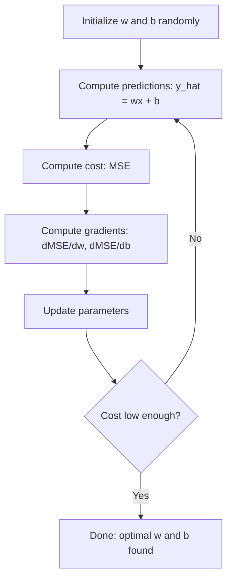

# 선형 회귀 (Linear Regression)

> 선형 회귀는 데이터 사이를 관통하는 최적의 직선을 그립니다. 머신러닝의 "Hello World"에 해당합니다.

**유형:** Build (실습)
**사용 언어:** Python
**선수 레슨:** Phase 1 (Linear Algebra, Calculus, Optimization), Phase 2 Lesson 1
**소요 시간:** ~90분

## 학습 목표

- 평균 제곱 오차에 대한 경사 하강법 업데이트 규칙을 유도하고 선형 회귀를 밑바닥부터 직접 구현합니다.
- 계산 복잡도 및 사용 시점 측면에서 경사 하강법과 정규 방정식을 비교합니다.
- 특성 표준화를 적용한 다중 선형 회귀 모델을 구축하고 학습된 가중치를 해석합니다.
- 릿지 회귀(Ridge regression, L2 정규화)가 큰 가중치에 페널티를 부여하여 과적합을 방지하는 원리를 설명합니다.

## 문제 정의

주택 크기와 매매 가격 데이터가 주어졌다고 가정해 보겠습니다. 새로운 주택 크기가 주어졌을 때 그 가격을 예측하고자 합니다. 산점도를 보며 눈대중으로 어림잡을 수도 있겠지만, 명확한 수식이 필요합니다. 어떤 크기를 대입하든 가격 예측값을 얻을 수 있도록 데이터를 가장 잘 설명하는 직선이 필요합니다.

선형 회귀는 바로 그 직선을 찾아줍니다. 더 중요한 점은, 선형 회귀가 머신러닝의 전체 학습 루프(모델 정의, 비용 함수 정의, 파라미터 최적화)를 소개한다는 것입니다. 모든 머신러닝 알고리즘은 이 동일한 패턴을 따릅니다. 가장 단순한 케이스인 여기서 이 과정을 마스터하면, 어디서든 이 패턴을 알아볼 수 있게 됩니다.

이는 단순한 문제에만 쓰이지 않습니다. 선형 회귀는 수요 예측, A/B 테스트 분석, 금융 모델링 등의 프로덕션 시스템에서 사용되며, 모든 회귀 작업의 베이스라인으로 활용됩니다.

## 개념

### 모델

선형 회귀는 입력($x$)과 출력($y$) 사이에 선형 관계가 있다고 가정합니다.

```math
y = wx + b
```

- `w` (가중치/기울기): $x$가 1 증가할 때 $y$가 변화하는 양
- `b` (편향/절편): $x = 0$일 때 $y$의 값

입력(특성)이 여러 개인 경우 다음과 같이 확장됩니다.

```math
y = w_1 x_1 + w_2 x_2 + \cdots + w_n x_n + b
```

또는 벡터 형태로 표현하면 다음과 같습니다: $y = w^T x + b$

목표는 모든 훈련 예제에 대해 예측된 $y$가 실제 $y$에 가능한 한 가까워지도록 하는 $w$과 $b$의 값을 찾는 것입니다.

### 비용 함수 (평균 제곱 오차)

"가능한 한 가까움"은 어떻게 측정할까요? 예측이 얼마나 틀렸는지를 나타내는 단 하나의 숫자가 필요합니다. 가장 널리 사용되는 선택지는 평균 제곱 오차(MSE, Mean Squared Error)입니다.

```math
\text{MSE} = \frac{1}{n} \sum (y_{\text{predicted}} - y_{\text{actual}})^2
```

왜 제곱을 할까요? 두 가지 이유가 있습니다. 첫째, 작은 오차보다 큰 오차에 더 큰 페널티를 부여합니다(오차 10은 오차 1보다 10배가 아니라 100배 더 나쁩니다). 둘째, 제곱 함수는 모든 지점에서 매끄럽고 미분 가능하므로 최적화가 수월해집니다.

비용 함수는 하나의 곡면을 형성합니다. 단일 가중치 $w$와 편향 $b$에 대해, MSE 곡면은 그릇(볼록 포물면) 모양을 띱니다. 그릇의 바닥이 바로 MSE가 최소화되는 지점입니다. 학습이란 바로 이 바닥을 찾는 것을 의미합니다.

### 경사 하강법

경사 하강법(gradient descent)은 내리막 방향으로 걸음을 내딛으며 그릇의 바닥을 찾아갑니다.



기울기(gradient)는 두 가지 정보를 알려줍니다. 각 파라미터를 어느 방향으로 이동해야 하는지, 그리고 얼마나 많이 이동해야 하는지입니다.

$\hat{y} = wx + b$인 MSE의 경우 다음과 같습니다.

```math
\begin{aligned}
\frac{\partial \text{MSE}}{\partial w} &= \frac{2}{n} \sum (\hat{y} - y) \, x \\
\frac{\partial \text{MSE}}{\partial b} &= \frac{2}{n} \sum (\hat{y} - y)
\end{aligned}
```

업데이트 규칙은 다음과 같습니다.

```math
\begin{aligned}
w &= w - \text{learning\_rate} \cdot \frac{\partial \text{MSE}}{\partial w} \\
b &= b - \text{learning\_rate} \cdot \frac{\partial \text{MSE}}{\partial b}
\end{aligned}
```

학습률(learning rate)은 보폭을 조절합니다. 너무 크면 최솟값을 지나쳐 발산합니다. 너무 작으면 학습에 오랜 시간이 걸립니다. 일반적인 시작 값은 0.01, 0.001 또는 0.0001입니다.

### 정규 방정식 (닫힌 형태의 해)

선형 회귀에는 반복 작업 없이 최적의 가중치를 한 번에 구해주는 직접적인 공식이 존재합니다.

```math
w = (X^T X)^{-1} X^T y
```

이 식은 행렬 역행렬을 계산하여 $w$를 한 단계 만에 풉니다. 작은 데이터셋에서는 완벽하게 동작합니다. 하지만 대규모 데이터셋(수백만 개의 행 또는 수천 개의 특성)에서는 역행렬 계산이 특성 수에 대해 $O(n^3)$의 복잡도를 가지므로 경사 하강법이 선호됩니다.

### 다중 선형 회귀

특성이 여러 개인 경우 모델은 다음과 같이 확장됩니다.

```math
y = w_1 x_1 + w_2 x_2 + \cdots + w_n x_n + b
```

원리는 모두 동일합니다. MSE가 비용 함수가 되며, 경사 하강법이 모든 가중치를 동시에 업데이트합니다. 유일한 차이점은 직선 대신 초평면(hyperplane)을 적합한다는 점입니다.

여기서는 특성 스케일링(feature scaling)이 중요합니다. 한 특성의 범위가 0에서 1 사이이고 다른 특성의 범위가 0에서 1,000,000 사이라면, 비용 곡면이 길게 늘어져 경사 하강법 학습이 어려워집니다. 학습 전에 특성을 표준화(평균을 빼고 표준편차로 나눔)해야 합니다.

### 다항 회귀

관계가 선형이 아니면 어떻게 해야 할까요? 다항 특성(polynomial features)을 생성하여 여전히 선형 회귀를 사용할 수 있습니다.

```math
y = w_1 x + w_2 x^2 + w_3 x^3 + b
```

이 모델은 가중치($w_1, w_2, w_3$)에 대해 선형이므로 여전히 "선형" 회귀입니다. 단지 $x$의 비선형 특성을 사용할 뿐입니다.

차수가 높은 다항식은 더 복잡한 곡선을 표현할 수 있지만 과적합(overfitting)의 위험이 있습니다. 10차 다항식은 10개의 점으로 이루어진 데이터셋의 모든 점을 완벽히 통과하지만, 새로운 데이터에 대해서는 형편없는 예측을 하게 됩니다.

### 결정 계수 (R-Squared 점수)

MSE는 오차의 크기를 알려주지만, 그 값은 $y$의 스케일에 따라 달라집니다. 결정 계수($R^2$)는 스케일에 독립적인 측정값을 제공합니다.

```math
\begin{aligned}
R^2 &= 1 - \frac{\text{sum of squared residuals}}{\text{sum of squared deviations from mean}} \\
&= 1 - \frac{SS_{\text{res}}}{SS_{\text{tot}}}
\end{aligned}
```

- $R^2 = 1.0$: 완벽한 예측
- $R^2 = 0.0$: 매번 평균값만 예측하는 것과 다를 바 없는 모델
- $R^2 < 0.0$: 평균값 예측보다도 못한 모델

### 정규화 맛보기 (릿지 회귀)

특성이 많아지면 모델이 큰 가중치를 할당하여 과적합될 수 있습니다. 릿지 회귀(Ridge regression, L2 정규화)는 페널티를 추가합니다.

```math
\text{Cost} = \text{MSE} + \lambda \sum w_i^2
```

이 페널티 항은 가중치가 커지는 것을 억제합니다. 하이퍼파라미터 $\lambda$는 트레이드오프를 조절합니다. $\lambda$ 값이 클수록 가중치는 작아지고 정규화 강도는 강해집니다. 이에 대해서는 이후 레슨에서 자세히 다룹니다. 지금은 이러한 방법이 존재하며 왜 도움이 되는지 정도만 알아두시기 바랍니다.

```figure
linear-regression-fit
```

## 직접 구현하기

### 1단계: 샘플 데이터 생성

```python
import random
import math

random.seed(42)

TRUE_W = 3.0
TRUE_B = 7.0
N_SAMPLES = 100

X = [random.uniform(0, 10) for _ in range(N_SAMPLES)]
y = [TRUE_W * x + TRUE_B + random.gauss(0, 2.0) for x in X]

print(f"Generated {N_SAMPLES} samples")
print(f"True relationship: y = {TRUE_W}x + {TRUE_B} (+ noise)")
print(f"First 5 points: {[(round(X[i], 2), round(y[i], 2)) for i in range(5)]}")
```

### 2단계: 경사 하강법을 사용한 선형 회귀 밑바닥부터 구현

```python
class LinearRegression:
    def __init__(self, learning_rate=0.01):
        self.w = 0.0
        self.b = 0.0
        self.lr = learning_rate
        self.cost_history = []

    def predict(self, X):
        return [self.w * x + self.b for x in X]

    def compute_cost(self, X, y):
        predictions = self.predict(X)
        n = len(y)
        cost = sum((pred - actual) ** 2 for pred, actual in zip(predictions, y)) / n
        return cost

    def compute_gradients(self, X, y):
        predictions = self.predict(X)
        n = len(y)
        dw = (2 / n) * sum((pred - actual) * x for pred, actual, x in zip(predictions, y, X))
        db = (2 / n) * sum(pred - actual for pred, actual in zip(predictions, y))
        return dw, db

    def fit(self, X, y, epochs=1000, print_every=200):
        for epoch in range(epochs):
            dw, db = self.compute_gradients(X, y)
            self.w -= self.lr * dw
            self.b -= self.lr * db
            cost = self.compute_cost(X, y)
            self.cost_history.append(cost)
            if epoch % print_every == 0:
                print(f"  Epoch {epoch:4d} | Cost: {cost:.4f} | w: {self.w:.4f} | b: {self.b:.4f}")
        return self

    def r_squared(self, X, y):
        predictions = self.predict(X)
        y_mean = sum(y) / len(y)
        ss_res = sum((actual - pred) ** 2 for actual, pred in zip(y, predictions))
        ss_tot = sum((actual - y_mean) ** 2 for actual in y)
        return 1 - (ss_res / ss_tot)


print("=== Training Linear Regression (Gradient Descent) ===")
model = LinearRegression(learning_rate=0.005)
model.fit(X, y, epochs=1000, print_every=200)
print(f"\nLearned: y = {model.w:.4f}x + {model.b:.4f}")
print(f"True:    y = {TRUE_W}x + {TRUE_B}")
print(f"R-squared: {model.r_squared(X, y):.4f}")
```

### 3단계: 정규 방정식 (닫힌 형태의 해)

```python
class LinearRegressionNormal:
    def __init__(self):
        self.w = 0.0
        self.b = 0.0

    def fit(self, X, y):
        n = len(X)
        x_mean = sum(X) / n
        y_mean = sum(y) / n
        numerator = sum((X[i] - x_mean) * (y[i] - y_mean) for i in range(n))
        denominator = sum((X[i] - x_mean) ** 2 for i in range(n))
        self.w = numerator / denominator
        self.b = y_mean - self.w * x_mean
        return self

    def predict(self, X):
        return [self.w * x + self.b for x in X]

    def r_squared(self, X, y):
        predictions = self.predict(X)
        y_mean = sum(y) / len(y)
        ss_res = sum((actual - pred) ** 2 for actual, pred in zip(y, predictions))
        ss_tot = sum((actual - y_mean) ** 2 for actual in y)
        return 1 - (ss_res / ss_tot)


print("\n=== Normal Equation (Closed-Form) ===")
model_normal = LinearRegressionNormal()
model_normal.fit(X, y)
print(f"Learned: y = {model_normal.w:.4f}x + {model_normal.b:.4f}")
print(f"R-squared: {model_normal.r_squared(X, y):.4f}")
```

### 4단계: 다중 선형 회귀

```python
class MultipleLinearRegression:
    def __init__(self, n_features, learning_rate=0.01):
        self.weights = [0.0] * n_features
        self.bias = 0.0
        self.lr = learning_rate
        self.cost_history = []

    def predict_single(self, x):
        return sum(w * xi for w, xi in zip(self.weights, x)) + self.bias

    def predict(self, X):
        return [self.predict_single(x) for x in X]

    def compute_cost(self, X, y):
        predictions = self.predict(X)
        n = len(y)
        return sum((pred - actual) ** 2 for pred, actual in zip(predictions, y)) / n

    def fit(self, X, y, epochs=1000, print_every=200):
        n = len(y)
        n_features = len(X[0])
        for epoch in range(epochs):
            predictions = self.predict(X)
            errors = [pred - actual for pred, actual in zip(predictions, y)]
            for j in range(n_features):
                grad = (2 / n) * sum(errors[i] * X[i][j] for i in range(n))
                self.weights[j] -= self.lr * grad
            grad_b = (2 / n) * sum(errors)
            self.bias -= self.lr * grad_b
            cost = self.compute_cost(X, y)
            self.cost_history.append(cost)
            if epoch % print_every == 0:
                print(f"  Epoch {epoch:4d} | Cost: {cost:.4f}")
        return self

    def r_squared(self, X, y):
        predictions = self.predict(X)
        y_mean = sum(y) / len(y)
        ss_res = sum((actual - pred) ** 2 for actual, pred in zip(y, predictions))
        ss_tot = sum((actual - y_mean) ** 2 for actual in y)
        return 1 - (ss_res / ss_tot)


random.seed(42)
N = 100
X_multi = []
y_multi = []
for _ in range(N):
    size = random.uniform(500, 3000)
    bedrooms = random.randint(1, 5)
    age = random.uniform(0, 50)
    price = 50 * size + 10000 * bedrooms - 1000 * age + 50000 + random.gauss(0, 20000)
    X_multi.append([size, bedrooms, age])
    y_multi.append(price)


def standardize(X):
    n_features = len(X[0])
    means = [sum(X[i][j] for i in range(len(X))) / len(X) for j in range(n_features)]
    stds = []
    for j in range(n_features):
        variance = sum((X[i][j] - means[j]) ** 2 for i in range(len(X))) / len(X)
        stds.append(variance ** 0.5)
    X_scaled = []
    for i in range(len(X)):
        row = [(X[i][j] - means[j]) / stds[j] if stds[j] > 0 else 0 for j in range(n_features)]
        X_scaled.append(row)
    return X_scaled, means, stds


y_mean_val = sum(y_multi) / len(y_multi)
y_std_val = (sum((yi - y_mean_val) ** 2 for yi in y_multi) / len(y_multi)) ** 0.5
y_scaled = [(yi - y_mean_val) / y_std_val for yi in y_multi]

X_scaled, x_means, x_stds = standardize(X_multi)

print("\n=== Multiple Linear Regression (3 features) ===")
print("Features: house size, bedrooms, age")
multi_model = MultipleLinearRegression(n_features=3, learning_rate=0.01)
multi_model.fit(X_scaled, y_scaled, epochs=1000, print_every=200)

print(f"\nWeights (standardized): {[round(w, 4) for w in multi_model.weights]}")
print(f"Bias (standardized): {multi_model.bias:.4f}")
print(f"R-squared: {multi_model.r_squared(X_scaled, y_scaled):.4f}")
```

### 5단계: 다항 회귀

```python
class PolynomialRegression:
    def __init__(self, degree, learning_rate=0.01):
        self.degree = degree
        self.weights = [0.0] * degree
        self.bias = 0.0
        self.lr = learning_rate

    def make_features(self, X):
        return [[x ** (d + 1) for d in range(self.degree)] for x in X]

    def predict(self, X):
        features = self.make_features(X)
        return [sum(w * f for w, f in zip(self.weights, row)) + self.bias for row in features]

    def fit(self, X, y, epochs=1000, print_every=200):
        features = self.make_features(X)
        n = len(y)
        for epoch in range(epochs):
            predictions = [sum(w * f for w, f in zip(self.weights, row)) + self.bias for row in features]
            errors = [pred - actual for pred, actual in zip(predictions, y)]
            for j in range(self.degree):
                grad = (2 / n) * sum(errors[i] * features[i][j] for i in range(n))
                self.weights[j] -= self.lr * grad
            grad_b = (2 / n) * sum(errors)
            self.bias -= self.lr * grad_b
            if epoch % print_every == 0:
                cost = sum(e ** 2 for e in errors) / n
                print(f"  Epoch {epoch:4d} | Cost: {cost:.6f}")
        return self

    def r_squared(self, X, y):
        predictions = self.predict(X)
        y_mean = sum(y) / len(y)
        ss_res = sum((actual - pred) ** 2 for actual, pred in zip(y, predictions))
        ss_tot = sum((actual - y_mean) ** 2 for actual in y)
        return 1 - (ss_res / ss_tot)


random.seed(42)
X_poly = [x / 10.0 for x in range(0, 50)]
y_poly = [0.5 * x ** 2 - 2 * x + 3 + random.gauss(0, 1.0) for x in X_poly]

x_max = max(abs(x) for x in X_poly)
X_poly_norm = [x / x_max for x in X_poly]
y_poly_mean = sum(y_poly) / len(y_poly)
y_poly_std = (sum((yi - y_poly_mean) ** 2 for yi in y_poly) / len(y_poly)) ** 0.5
y_poly_norm = [(yi - y_poly_mean) / y_poly_std for yi in y_poly]

print("\n=== Polynomial Regression (degree 2 vs degree 5) ===")
print("True relationship: y = 0.5x^2 - 2x + 3")

print("\nDegree 2:")
poly2 = PolynomialRegression(degree=2, learning_rate=0.1)
poly2.fit(X_poly_norm, y_poly_norm, epochs=2000, print_every=500)
print(f"  R-squared: {poly2.r_squared(X_poly_norm, y_poly_norm):.4f}")

print("\nDegree 5:")
poly5 = PolynomialRegression(degree=5, learning_rate=0.1)
poly5.fit(X_poly_norm, y_poly_norm, epochs=2000, print_every=500)
print(f"  R-squared: {poly5.r_squared(X_poly_norm, y_poly_norm):.4f}")

print("\nDegree 2 fits the true curve well. Degree 5 fits training data slightly better")
print("but risks overfitting on new data.")
```

### 6단계: 릿지 회귀 (L2 정규화)

```python
class RidgeRegression:
    def __init__(self, n_features, learning_rate=0.01, alpha=1.0):
        self.weights = [0.0] * n_features
        self.bias = 0.0
        self.lr = learning_rate
        self.alpha = alpha

    def predict_single(self, x):
        return sum(w * xi for w, xi in zip(self.weights, x)) + self.bias

    def predict(self, X):
        return [self.predict_single(x) for x in X]

    def fit(self, X, y, epochs=1000, print_every=200):
        n = len(y)
        n_features = len(X[0])
        for epoch in range(epochs):
            predictions = self.predict(X)
            errors = [pred - actual for pred, actual in zip(predictions, y)]
            mse = sum(e ** 2 for e in errors) / n
            reg_term = self.alpha * sum(w ** 2 for w in self.weights)
            cost = mse + reg_term
            for j in range(n_features):
                grad = (2 / n) * sum(errors[i] * X[i][j] for i in range(n))
                grad += 2 * self.alpha * self.weights[j]
                self.weights[j] -= self.lr * grad
            grad_b = (2 / n) * sum(errors)
            self.bias -= self.lr * grad_b
            if epoch % print_every == 0:
                print(f"  Epoch {epoch:4d} | Cost: {cost:.4f} | L2 penalty: {reg_term:.4f}")
        return self


print("\n=== Ridge Regression (L2 Regularization) ===")
print("Same data as multiple regression, with alpha=0.1")
ridge = RidgeRegression(n_features=3, learning_rate=0.01, alpha=0.1)
ridge.fit(X_scaled, y_scaled, epochs=1000, print_every=200)
print(f"\nRidge weights: {[round(w, 4) for w in ridge.weights]}")
print(f"Plain weights: {[round(w, 4) for w in multi_model.weights]}")
print("Ridge weights are smaller (shrunk toward zero) due to the L2 penalty.")
```

## 활용하기

이제 프로덕션 환경에서 실제로 사용하게 될 scikit-learn으로 동일한 작업을 수행해 봅니다.

```python
from sklearn.linear_model import LinearRegression as SklearnLR
from sklearn.linear_model import Ridge
from sklearn.preprocessing import PolynomialFeatures, StandardScaler
from sklearn.model_selection import train_test_split
from sklearn.metrics import mean_squared_error, r2_score
import numpy as np

np.random.seed(42)
X_sk = np.random.uniform(0, 10, (100, 1))
y_sk = 3.0 * X_sk.squeeze() + 7.0 + np.random.normal(0, 2.0, 100)

X_train, X_test, y_train, y_test = train_test_split(X_sk, y_sk, test_size=0.2, random_state=42)

lr = SklearnLR()
lr.fit(X_train, y_train)
y_pred = lr.predict(X_test)

print("=== Scikit-learn Linear Regression ===")
print(f"Coefficient (w): {lr.coef_[0]:.4f}")
print(f"Intercept (b): {lr.intercept_:.4f}")
print(f"R-squared (test): {r2_score(y_test, y_pred):.4f}")
print(f"MSE (test): {mean_squared_error(y_test, y_pred):.4f}")

poly = PolynomialFeatures(degree=2, include_bias=False)
X_poly_sk = poly.fit_transform(X_train)
X_poly_test = poly.transform(X_test)

lr_poly = SklearnLR()
lr_poly.fit(X_poly_sk, y_train)
print(f"\nPolynomial degree 2 R-squared: {r2_score(y_test, lr_poly.predict(X_poly_test)):.4f}")

scaler = StandardScaler()
X_train_scaled = scaler.fit_transform(X_train)
X_test_scaled = scaler.transform(X_test)

ridge = Ridge(alpha=1.0)
ridge.fit(X_train_scaled, y_train)
print(f"Ridge R-squared: {r2_score(y_test, ridge.predict(X_test_scaled)):.4f}")
print(f"Ridge coefficient: {ridge.coef_[0]:.4f}")
```

직접 구현한 코드와 scikit-learn은 동일한 결과를 냅니다. 차이점은 scikit-learn이 예외 케이스 처리, 수치적 안정성, 성능 최적화를 지원한다는 점입니다. 프로덕션에서는 라이브러리를 사용하고, 내부에서 어떤 일이 일어나는지 이해하기 위해 직접 구현해 본 코드를 활용하십시오.

## 배포하기

이 레슨을 통해 다음 결과물을 생성합니다.
- `outputs/skill-regression.md` - 문제에 맞춰 적절한 회귀 방식을 선택하는 스킬

## 연습 문제

1. 배치 경사 하강법, 확률적 경사 하강법(SGD), 미니배치 경사 하강법을 구현하십시오. 동일한 데이터셋에서 수렴 속도를 비교하십시오. 어떤 방식이 가장 빠르게 수렴합니까? 어떤 방식의 비용 곡선이 가장 매끄럽습니까?
2. 3차 함수($y = ax^3 + bx^2 + cx + d + \text{noise}$)로부터 데이터를 생성하십시오. 1차, 3차, 10차 다항식을 적합해 보십시오. 훈련 $R^2$와 테스트 $R^2$를 비교하십시오. 몇 차수에서 과적합이 뚜렷하게 나타납니까?
3. 라쏘 회귀(Lasso regression, L1 정규화: $\text{penalty} = \alpha \sum \lvert w_i \rvert$)를 구현하십시오. 다중 특성 주택 데이터로 학습시키십시오. Ridge와 비교했을 때 어떤 가중치가 0으로 수렴하는지 확인하십시오. L2와 달리 L1이 희소한(sparse) 해를 생성하는 이유는 무엇입니까?
## 주요 용어

| 용어 | 일반적인 표현 | 실제 의미 |
|------|----------------|----------------------|
| 선형 회귀(Linear regression) | "데이터에 선 긋기" | $wx+b$와 실제 $y$ 값 간의 제곱 오차 합을 최소화하는 가중치 $w$ 및 편향 $b$ 찾기 |
| 비용 함수(Cost function) | "모델의 성능이 얼마나 나쁜지" | 모델 파라미터를 예측 오차를 측정하는 단일 수치로 매핑하며, 최적화를 통해 최소화하려는 함수 |
| 평균 제곱 오차(Mean squared error) | "제곱 오차의 평균" | 큰 오차에 불균형적으로 큰 페널티를 부여하는 $\frac{1}{n} \sum (\text{predicted} - \text{actual})^2$ |
| 경사 하강법(Gradient descent) | "내리막길 걷기" | 편미분을 사용하여 비용 함수를 줄이는 방향으로 파라미터를 반복적으로 조정하기 |
| 학습률(Learning rate) | "보폭" | 경사 하강법 단계마다 파라미터가 변경되는 정도를 제어하는 스칼라 |
| 정규 방정식(Normal equation) | "직접 풀기" | 반복적인 계산 없이 최적의 가중치를 제공하는 닫힌 형식 해(closed-form solution) $w = (X^T X)^{-1} X^T y$ |
| 결정계수(R-squared) | "적합도가 얼마나 좋은지" | 모델에 의해 설명되는 $y$의 분산 비율(범위: 음의 무한대 ~ 1.0) |
| 특성 스케일링(Feature scaling) | "특성들을 비교 가능하게 만들기" | 경사 하강법이 더 빠르게 수렴하도록 특성들을 유사한 범위(예: 평균 0, 분산 1)로 변환하는 것 |
| 정규화(Regularization) | "복잡성에 페널티 부여하기" | 비용 함수에 가중치를 축소하는 항을 추가하여 과적합(overfitting)을 방지하는 것 |
| 릿지 회귀(Ridge regression) | "L2 정규화" | MSE에 $\lambda \sum w_i^2$ 페널티를 추가한 선형 회귀 |
| 다항 회귀(Polynomial regression) | "선형 수학으로 곡선 피팅하기" | 다항 특성($x, x^2, x^3, \ldots$)에 대한 선형 회귀로, 가중치에 대해서는 여전히 선형성을 유지함 |
| 과적합(Overfitting) | "훈련 데이터 암기하기" | 모델이 지나치게 복잡하여 훈련 데이터의 노이즈까지 학습함으로써 새로운 데이터에 일반화되지 못하는 상태 |

## 추가 자료

- [An Introduction to Statistical Learning (ISLR)](https://www.statlearning.com/) -- 무료 PDF로, 3장과 6장에서 실용적인 R 예제와 함께 선형 회귀 및 정규화를 다룹니다.
- [The Elements of Statistical Learning (ESL)](https://hastie.su.domains/ElemStatLearn/) -- 무료 PDF로, ISLR보다 수학적인 내용을 깊이 있게 다루며 릿지와 라쏘(lasso)를 심도 있게 설명합니다.
- [Stanford CS229 Lecture Notes on Linear Regression](https://cs229.stanford.edu/main_notes.pdf) -- 정규 방정식과 경사 하강법을 기본 원리부터 유도하는 Andrew Ng 교수의 강의 노트입니다.
- [scikit-learn LinearRegression documentation](https://scikit-learn.org/stable/modules/linear_model.html) -- 코드 예제와 함께 LinearRegression, Ridge, Lasso, ElasticNet을 다루는 실용적인 참고 문서입니다.
