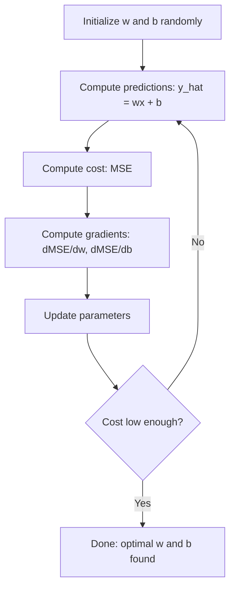

# 선형 회귀

> 선형 회귀(linear regression)는 데이터에 가장 잘 맞는 직선을 찾아 그립니다. 머신러닝의 "Hello World"에 해당합니다.

**유형:** Build (실습)
**사용 언어:** Python, Julia, Rust
**선수 레슨:** Phase 1 (Linear Algebra, Calculus, Optimization), Phase 2 Lesson 1
**소요 시간:** ~90분

## 학습 목표

- 평균 제곱 오차(mean squared error)에 대한 경사 하강법(gradient descent) 가중치 업데이트 규칙을 유도하고 선형 회귀를 밑바닥부터 구현합니다.
- 계산 복잡도와 사용 시점 측면에서 경사 하강법과 정규 방정식(normal equation)을 비교합니다.
- 특성 표준화(feature standardization)를 적용한 다중 선형 회귀 모델을 구축하고 학습된 가중치를 해석합니다.
- 릿지 회귀(Ridge regression, L2 정규화)가 큰 가중치에 페널티를 부여하여 과적합(overfitting)을 방지하는 원리를 설명합니다.

## 문제 상황

주택 크기와 매매가 데이터가 있습니다. 주택 크기가 주어졌을 때 새로운 주택의 가격을 예측하고자 합니다. 산점도를 보며 눈대중으로 짐작할 수도 있지만, 우리에게는 수식이 필요합니다. 어떤 크기든 입력하여 가격 예측값을 얻을 수 있도록 데이터에 가장 잘 맞는 직선을 구해야 합니다.

선형 회귀는 바로 그 직선을 제공합니다. 더 중요한 점은, 선형 회귀가 머신러닝의 전체 학습 루프(모델 정의, 비용 함수 정의, 파라미터 최적화)를 소개한다는 것입니다. 모든 머신러닝 알고리즘은 이와 동일한 패턴을 따릅니다. 가장 단순한 사례인 여기서 이를 완벽히 익히면 어디서든 이 패턴을 알아볼 수 있게 됩니다.

이는 단순한 문제에만 쓰이지 않습니다. 선형 회귀는 수요 예측, A/B 테스트 분석, 금융 모델링 등의 프로덕션 시스템에서 널리 활용되며, 모든 회귀 작업의 베이스라인으로 사용됩니다.

## 핵심 개념

### 모델

선형 회귀는 입력($x$)과 출력($y$) 사이에 선형 관계가 있다고 가정합니다.

```math
y = wx + b
```

- `w`(가중치/기울기): $x$가 1 증가할 때 $y$가 변화하는 양
- `b`(편향/절편): $x = 0$일 때 $y$의 값

입력(특성)이 여러 개인 경우 다음과 같이 확장됩니다.

```math
y = w_1 x_1 + w_2 x_2 + \cdots + w_n x_n + b
```

또는 벡터 형태로 나타내면 다음과 같습니다: $y = w^T x + b$

목표: 모든 훈련 예제에 대해 예측값 $y$이 실제값 $y$에 최대한 가까워지도록 하는 $w$ 및 $b$의 값을 찾는 것입니다.

### 비용 함수 (평균 제곱 오차)

"최대한 가깝다"는 것을 어떻게 측정할까요? 예측이 얼마나 잘못되었는지를 나타내는 단 하나의 숫자가 필요합니다. 가장 흔히 사용되는 선택지는 평균 제곱 오차(MSE, Mean Squared Error)입니다.

```math
\text{MSE} = \frac{1}{n} \sum (y_{\text{predicted}} - y_{\text{actual}})^2
```

왜 제곱을 할까요? 두 가지 이유가 있습니다. 첫째, 작은 오차보다 큰 오차에 더 큰 페널티를 부여합니다(오차 10은 오차 1보다 10배가 아니라 100배 더 나쁩니다). 둘째, 제곱 함수는 매끄럽고 모든 지점에서 미분 가능하므로 최적화가 수월합니다.

비용 함수는 하나의 곡면(surface)을 형성합니다. 단일 가중치 $w$와 편향 $b$에 대해, MSE 곡면은 그릇(볼록 포물면) 모양을 띱니다. 그릇의 바닥이 바로 MSE가 최소화되는 지점입니다. 학습이란 바로 이 바닥을 찾는 것을 의미합니다.

### 경사 하강법

경사 하강법은 내리막 방향으로 걸음을 옮겨 그릇의 바닥을 찾아갑니다.



기울기(gradient)는 두 가지 정보를 알려줍니다. 각 파라미터를 어느 방향으로 이동해야 하는지, 그리고 얼마나 많이 이동해야 하는지입니다.

$\hat{y} = wx + b$에 대한 MSE의 경우 다음과 같습니다.

```math
\begin{aligned}
\frac{\partial \text{MSE}}{\partial w} &= \frac{2}{n} \sum (\hat{y} - y) \, x \\
\frac{\partial \text{MSE}}{\partial b} &= \frac{2}{n} \sum (\hat{y} - y)
\end{aligned}
```

업데이트 규칙:

```math
\begin{aligned}
w &= w - \text{learning\_rate} \cdot \frac{\partial \text{MSE}}{\partial w} \\
b &= b - \text{learning\_rate} \cdot \frac{\partial \text{MSE}}{\partial b}
\end{aligned}
```

학습률(learning rate)은 걸음의 크기를 제어합니다. 너무 크면 최솟값을 지나쳐 발산하고, 너무 작으면 학습에 지나치게 오랜 시간이 걸립니다. 일반적인 시작 값은 0.01, 0.001 또는 0.0001입니다.

### 정규 방정식 (닫힌 형식의 해)

선형 회귀에는 반복 계산 없이 최적 가중치를 바로 계산할 수 있는 직접적인 공식이 있습니다.

```math
w = (X^T X)^{-1} X^T y
```

이는 행렬의 역행렬을 계산하여 단 한 번의 단계로 $w$를 구합니다. 소규모 데이터셋에는 완벽하게 작동합니다. 하지만 대규모 데이터셋(수백만 개의 행 또는 수천 개의 특성)의 경우, 역행렬 계산의 복잡도가 특성 수에 대해 $O(n^3)$이므로 경사 하강법이 더 선호됩니다.

### 다중 선형 회귀

특성이 여러 개일 때 모델은 다음과 같습니다.

```math
y = w_1 x_1 + w_2 x_2 + \cdots + w_n x_n + b
```

모든 원리는 동일합니다. MSE가 비용 함수가 되고, 경사 하강법이 모든 가중치를 동시에 업데이트합니다. 유일한 차이점은 직선 대신 초평면(hyperplane)을 적합한다는 것뿐입니다.

여기서는 특성 스케일링(feature scaling)이 중요합니다. 한 특성의 범위가 0에서 1 사이이고 다른 특성의 범위가 0에서 1,000,000 사이라면, 비용 곡면이 길게 늘어나 경사 하강법이 수렴하는 데 어려움을 겪습니다. 학습 전에 특성을 표준화(평균을 빼고 표준편차로 나눔)해야 합니다.

### 다항 회귀

관계가 선형이 아니면 어떻게 해야 할까요? 다항 특성(polynomial feature)을 생성하여 여전히 선형 회귀를 사용할 수 있습니다.

```math
y = w_1 x + w_2 x^2 + w_3 x^3 + b
```

모델이 가중치($w_1, w_2, w_3$)에 대해 선형이므로 이는 여전히 "선형" 회귀입니다. 단지 $x$의 비선형 특성을 사용하고 있을 뿐입니다.

고차 다항식은 더 복잡한 곡선을 적합할 수 있지만 과적합의 위험이 있습니다. 10차 다항식은 10개 점으로 이루어진 데이터셋의 모든 점을 지나가겠지만 새로운 데이터에 대한 예측 성능은 떨어집니다.

### R 제곱 점수

MSE는 예측이 얼마나 틀렸는지를 알려주지만, 그 수치는 $y$의 스케일에 따라 달라집니다. 결정계수(R-squared, $R^2$)는 스케일에 독립적인 측정값을 제공합니다.

```math
\begin{aligned}
R^2 &= 1 - \frac{\text{sum of squared residuals}}{\text{sum of squared deviations from mean}} \\
&= 1 - \frac{SS_{\text{res}}}{SS_{\text{tot}}}
\end{aligned}
```

- $R^2 = 1.0$: 완벽한 예측
- $R^2 = 0.0$: 매번 평균값을 예측하는 것보다 나을 것이 없는 모델
- $R^2 < 0.0$: 평균값을 예측하는 것보다 못한 모델

### 정규화 미리보기 (릿지 회귀)

특성이 많을 때 모델은 큰 가중치를 할당하여 과적합될 수 있습니다. 릿지 회귀(Ridge regression, L2 정규화)는 페널티를 추가합니다.

```math
\text{Cost} = \text{MSE} + \lambda \sum w_i^2
```

페널티 항은 가중치가 커지는 것을 억제합니다. 하이퍼파라미터 $\lambda$는 트레이드오프를 제어합니다. $\lambda$가 클수록 가중치는 작아지고 정규화 강도는 커집니다. 이에 대해서는 이후 레슨에서 심도 있게 다룹니다. 지금은 이러한 방법이 존재하며 왜 도움이 되는지만 알아두시기 바랍니다.

```figure
linear-regression-fit
```

## 직접 구현하기

### 1단계: 샘플 데이터 생성

```python
import random
import math

random.seed(42)

TRUE_W = 3.0
TRUE_B = 7.0
N_SAMPLES = 100

X = [random.uniform(0, 10) for _ in range(N_SAMPLES)]
y = [TRUE_W * x + TRUE_B + random.gauss(0, 2.0) for x in X]

print(f"Generated {N_SAMPLES} samples")
print(f"True relationship: y = {TRUE_W}x + {TRUE_B} (+ noise)")
print(f"First 5 points: {[(round(X[i], 2), round(y[i], 2)) for i in range(5)]}")
```

### 2단계: 경사 하강법을 이용한 선형 회귀 밑바닥부터 구현

```python
class LinearRegression:
    def __init__(self, learning_rate=0.01):
        self.w = 0.0
        self.b = 0.0
        self.lr = learning_rate
        self.cost_history = []

    def predict(self, X):
        return [self.w * x + self.b for x in X]

    def compute_cost(self, X, y):
        predictions = self.predict(X)
        n = len(y)
        cost = sum((pred - actual) ** 2 for pred, actual in zip(predictions, y)) / n
        return cost

    def compute_gradients(self, X, y):
        predictions = self.predict(X)
        n = len(y)
        dw = (2 / n) * sum((pred - actual) * x for pred, actual, x in zip(predictions, y, X))
        db = (2 / n) * sum(pred - actual for pred, actual in zip(predictions, y))
        return dw, db

    def fit(self, X, y, epochs=1000, print_every=200):
        for epoch in range(epochs):
            dw, db = self.compute_gradients(X, y)
            self.w -= self.lr * dw
            self.b -= self.lr * db
            cost = self.compute_cost(X, y)
            self.cost_history.append(cost)
            if epoch % print_every == 0:
                print(f"  Epoch {epoch:4d} | Cost: {cost:.4f} | w: {self.w:.4f} | b: {self.b:.4f}")
        return self

    def r_squared(self, X, y):
        predictions = self.predict(X)
        y_mean = sum(y) / len(y)
        ss_res = sum((actual - pred) ** 2 for actual, pred in zip(y, predictions))
        ss_tot = sum((actual - y_mean) ** 2 for actual in y)
        return 1 - (ss_res / ss_tot)


print("=== Training Linear Regression (Gradient Descent) ===")
model = LinearRegression(learning_rate=0.005)
model.fit(X, y, epochs=1000, print_every=200)
print(f"\nLearned: y = {model.w:.4f}x + {model.b:.4f}")
print(f"True:    y = {TRUE_W}x + {TRUE_B}")
print(f"R-squared: {model.r_squared(X, y):.4f}")
```

### 3단계: 정규 방정식 (닫힌 형식의 해)

```python
class LinearRegressionNormal:
    def __init__(self):
        self.w = 0.0
        self.b = 0.0

    def fit(self, X, y):
        n = len(X)
        x_mean = sum(X) / n
        y_mean = sum(y) / n
        numerator = sum((X[i] - x_mean) * (y[i] - y_mean) for i in range(n))
        denominator = sum((X[i] - x_mean) ** 2 for i in range(n))
        self.w = numerator / denominator
        self.b = y_mean - self.w * x_mean
        return self

    def predict(self, X):
        return [self.w * x + self.b for x in X]

    def r_squared(self, X, y):
        predictions = self.predict(X)
        y_mean = sum(y) / len(y)
        ss_res = sum((actual - pred) ** 2 for actual, pred in zip(y, predictions))
        ss_tot = sum((actual - y_mean) ** 2 for actual in y)
        return 1 - (ss_res / ss_tot)


print("\n=== Normal Equation (Closed-Form) ===")
model_normal = LinearRegressionNormal()
model_normal.fit(X, y)
print(f"Learned: y = {model_normal.w:.4f}x + {model_normal.b:.4f}")
print(f"R-squared: {model_normal.r_squared(X, y):.4f}")
```

### 4단계: 다중 선형 회귀

```python
class MultipleLinearRegression:
    def __init__(self, n_features, learning_rate=0.01):
        self.weights = [0.0] * n_features
        self.bias = 0.0
        self.lr = learning_rate
        self.cost_history = []

    def predict_single(self, x):
        return sum(w * xi for w, xi in zip(self.weights, x)) + self.bias

    def predict(self, X):
        return [self.predict_single(x) for x in X]

    def compute_cost(self, X, y):
        predictions = self.predict(X)
        n = len(y)
        return sum((pred - actual) ** 2 for pred, actual in zip(predictions, y)) / n

    def fit(self, X, y, epochs=1000, print_every=200):
        n = len(y)
        n_features = len(X[0])
        for epoch in range(epochs):
            predictions = self.predict(X)
            errors = [pred - actual for pred, actual in zip(predictions, y)]
            for j in range(n_features):
                grad = (2 / n) * sum(errors[i] * X[i][j] for i in range(n))
                self.weights[j] -= self.lr * grad
            grad_b = (2 / n) * sum(errors)
            self.bias -= self.lr * grad_b
            cost = self.compute_cost(X, y)
            self.cost_history.append(cost)
            if epoch % print_every == 0:
                print(f"  Epoch {epoch:4d} | Cost: {cost:.4f}")
        return self

    def r_squared(self, X, y):
        predictions = self.predict(X)
        y_mean = sum(y) / len(y)
        ss_res = sum((actual - pred) ** 2 for actual, pred in zip(y, predictions))
        ss_tot = sum((actual - y_mean) ** 2 for actual in y)
        return 1 - (ss_res / ss_tot)


random.seed(42)
N = 100
X_multi = []
y_multi = []
for _ in range(N):
    size = random.uniform(500, 3000)
    bedrooms = random.randint(1, 5)
    age = random.uniform(0, 50)
    price = 50 * size + 10000 * bedrooms - 1000 * age + 50000 + random.gauss(0, 20000)
    X_multi.append([size, bedrooms, age])
    y_multi.append(price)


def standardize(X):
    n_features = len(X[0])
    means = [sum(X[i][j] for i in range(len(X))) / len(X) for j in range(n_features)]
    stds = []
    for j in range(n_features):
        variance = sum((X[i][j] - means[j]) ** 2 for i in range(len(X))) / len(X)
        stds.append(variance ** 0.5)
    X_scaled = []
    for i in range(len(X)):
        row = [(X[i][j] - means[j]) / stds[j] if stds[j] > 0 else 0 for j in range(n_features)]
        X_scaled.append(row)
    return X_scaled, means, stds


y_mean_val = sum(y_multi) / len(y_multi)
y_std_val = (sum((yi - y_mean_val) ** 2 for yi in y_multi) / len(y_multi)) ** 0.5
y_scaled = [(yi - y_mean_val) / y_std_val for yi in y_multi]

X_scaled, x_means, x_stds = standardize(X_multi)

print("\n=== Multiple Linear Regression (3 features) ===")
print("Features: house size, bedrooms, age")
multi_model = MultipleLinearRegression(n_features=3, learning_rate=0.01)
multi_model.fit(X_scaled, y_scaled, epochs=1000, print_every=200)

print(f"\nWeights (standardized): {[round(w, 4) for w in multi_model.weights]}")
print(f"Bias (standardized): {multi_model.bias:.4f}")
print(f"R-squared: {multi_model.r_squared(X_scaled, y_scaled):.4f}")
```

### 5단계: 다항 회귀

```python
class PolynomialRegression:
    def __init__(self, degree, learning_rate=0.01):
        self.degree = degree
        self.weights = [0.0] * degree
        self.bias = 0.0
        self.lr = learning_rate

    def make_features(self, X):
        return [[x ** (d + 1) for d in range(self.degree)] for x in X]

    def predict(self, X):
        features = self.make_features(X)
        return [sum(w * f for w, f in zip(self.weights, row)) + self.bias for row in features]

    def fit(self, X, y, epochs=1000, print_every=200):
        features = self.make_features(X)
        n = len(y)
        for epoch in range(epochs):
            predictions = [sum(w * f for w, f in zip(self.weights, row)) + self.bias for row in features]
            errors = [pred - actual for pred, actual in zip(predictions, y)]
            for j in range(self.degree):
                grad = (2 / n) * sum(errors[i] * features[i][j] for i in range(n))
                self.weights[j] -= self.lr * grad
            grad_b = (2 / n) * sum(errors)
            self.bias -= self.lr * grad_b
            if epoch % print_every == 0:
                cost = sum(e ** 2 for e in errors) / n
                print(f"  Epoch {epoch:4d} | Cost: {cost:.6f}")
        return self

    def r_squared(self, X, y):
        predictions = self.predict(X)
        y_mean = sum(y) / len(y)
        ss_res = sum((actual - pred) ** 2 for actual, pred in zip(y, predictions))
        ss_tot = sum((actual - y_mean) ** 2 for actual in y)
        return 1 - (ss_res / ss_tot)


random.seed(42)
X_poly = [x / 10.0 for x in range(0, 50)]
y_poly = [0.5 * x ** 2 - 2 * x + 3 + random.gauss(0, 1.0) for x in X_poly]

x_max = max(abs(x) for x in X_poly)
X_poly_norm = [x / x_max for x in X_poly]
y_poly_mean = sum(y_poly) / len(y_poly)
y_poly_std = (sum((yi - y_poly_mean) ** 2 for yi in y_poly) / len(y_poly)) ** 0.5
y_poly_norm = [(yi - y_poly_mean) / y_poly_std for yi in y_poly]

print("\n=== Polynomial Regression (degree 2 vs degree 5) ===")
print("True relationship: y = 0.5x^2 - 2x + 3")

print("\nDegree 2:")
poly2 = PolynomialRegression(degree=2, learning_rate=0.1)
poly2.fit(X_poly_norm, y_poly_norm, epochs=2000, print_every=500)
print(f"  R-squared: {poly2.r_squared(X_poly_norm, y_poly_norm):.4f}")

print("\nDegree 5:")
poly5 = PolynomialRegression(degree=5, learning_rate=0.1)
poly5.fit(X_poly_norm, y_poly_norm, epochs=2000, print_every=500)
print(f"  R-squared: {poly5.r_squared(X_poly_norm, y_poly_norm):.4f}")

print("\nDegree 2 fits the true curve well. Degree 5 fits training data slightly better")
print("but risks overfitting on new data.")
```

### 6단계: 릿지 회귀 (L2 정규화)

```python
class RidgeRegression:
    def __init__(self, n_features, learning_rate=0.01, alpha=1.0):
        self.weights = [0.0] * n_features
        self.bias = 0.0
        self.lr = learning_rate
        self.alpha = alpha

    def predict_single(self, x):
        return sum(w * xi for w, xi in zip(self.weights, x)) + self.bias

    def predict(self, X):
        return [self.predict_single(x) for x in X]

    def fit(self, X, y, epochs=1000, print_every=200):
        n = len(y)
        n_features = len(X[0])
        for epoch in range(epochs):
            predictions = self.predict(X)
            errors = [pred - actual for pred, actual in zip(predictions, y)]
            mse = sum(e ** 2 for e in errors) / n
            reg_term = self.alpha * sum(w ** 2 for w in self.weights)
            cost = mse + reg_term
            for j in range(n_features):
                grad = (2 / n) * sum(errors[i] * X[i][j] for i in range(n))
                grad += 2 * self.alpha * self.weights[j]
                self.weights[j] -= self.lr * grad
            grad_b = (2 / n) * sum(errors)
            self.bias -= self.lr * grad_b
            if epoch % print_every == 0:
                print(f"  Epoch {epoch:4d} | Cost: {cost:.4f} | L2 penalty: {reg_term:.4f}")
        return self


print("\n=== Ridge Regression (L2 Regularization) ===")
print("Same data as multiple regression, with alpha=0.1")
ridge = RidgeRegression(n_features=3, learning_rate=0.01, alpha=0.1)
ridge.fit(X_scaled, y_scaled, epochs=1000, print_every=200)
print(f"\nRidge weights: {[round(w, 4) for w in ridge.weights]}")
print(f"Plain weights: {[round(w, 4) for w in multi_model.weights]}")
print("Ridge weights are smaller (shrunk toward zero) due to the L2 penalty.")
```

## 라이브러리 활용하기

이제 실제 프로덕션 환경에서 사용하게 될 scikit-learn으로 동일한 작업을 수행해 봅니다.

```python
from sklearn.linear_model import LinearRegression as SklearnLR
from sklearn.linear_model import Ridge
from sklearn.preprocessing import PolynomialFeatures, StandardScaler
from sklearn.model_selection import train_test_split
from sklearn.metrics import mean_squared_error, r2_score
import numpy as np

np.random.seed(42)
X_sk = np.random.uniform(0, 10, (100, 1))
y_sk = 3.0 * X_sk.squeeze() + 7.0 + np.random.normal(0, 2.0, 100)

X_train, X_test, y_train, y_test = train_test_split(X_sk, y_sk, test_size=0.2, random_state=42)

lr = SklearnLR()
lr.fit(X_train, y_train)
y_pred = lr.predict(X_test)

print("=== Scikit-learn Linear Regression ===")
print(f"Coefficient (w): {lr.coef_[0]:.4f}")
print(f"Intercept (b): {lr.intercept_:.4f}")
print(f"R-squared (test): {r2_score(y_test, y_pred):.4f}")
print(f"MSE (test): {mean_squared_error(y_test, y_pred):.4f}")

poly = PolynomialFeatures(degree=2, include_bias=False)
X_poly_sk = poly.fit_transform(X_train)
X_poly_test = poly.transform(X_test)

lr_poly = SklearnLR()
lr_poly.fit(X_poly_sk, y_train)
print(f"\nPolynomial degree 2 R-squared: {r2_score(y_test, lr_poly.predict(X_poly_test)):.4f}")

scaler = StandardScaler()
X_train_scaled = scaler.fit_transform(X_train)
X_test_scaled = scaler.transform(X_test)

ridge = Ridge(alpha=1.0)
ridge.fit(X_train_scaled, y_train)
print(f"Ridge R-squared: {r2_score(y_test, ridge.predict(X_test_scaled)):.4f}")
print(f"Ridge coefficient: {ridge.coef_[0]:.4f}")
```

직접 밑바닥부터 구현한 모델과 scikit-learn은 동일한 결과를 냅니다. 차이점은 scikit-learn이 엣지 케이스 처리, 수치적 안정성, 성능 최적화 등을 처리해 준다는 점입니다. 프로덕션에서는 라이브러리를 사용하세요. 밑바닥부터 구현한 버전은 내부 동작 원리를 이해하는 데 활용하시기 바랍니다.

## 결과물 완성하기

이번 레슨을 통해 완성하는 결과물은 다음과 같습니다.
- `outputs/skill-regression.md` - 문제 상황에 따라 적절한 회귀 접근법을 선택할 수 있는 스킬

## 연습 문제

1. 배치 경사 하강법(batch gradient descent), 확률적 경사 하강법(stochastic gradient descent, SGD), 미니배치 경사 하강법(mini-batch gradient descent)을 구현해 보세요. 동일한 데이터셋에서 수렴 속도를 비교해 보세요. 어느 방법이 가장 빠르게 수렴하나요? 비용 곡선이 가장 매끄러운 방법은 무엇인가요?
2. 3차 함수($y = ax^3 + bx^2 + cx + d + \text{noise}$)로부터 데이터를 생성하세요. 1차, 3차, 10차 다항식을 적합해 보세요. 훈련 $R^2$와 테스트 $R^2$를 비교해 보세요. 몇 차수에서 과적합이 뚜렷하게 나타나나요?
3. 라쏘 회귀(Lasso regression, L1 정규화: $\text{penalty} = \alpha \sum \lvert w_i \rvert$)를 구현해 보세요. 다중 특성 주택 데이터를 학습시켜 보세요. 릿지 회귀와 비교했을 때 어떤 가중치가 0이 되는지 확인해 보세요. L2와 달리 L1이 희소한(sparse) 해를 만들어내는 이유는 무엇일까요?
## 주요 용어

| 용어 | 흔히 하는 표현 | 실제 의미 |
|------|----------------|----------------------|
| 선형 회귀(Linear regression) | "데이터에 선 긋기" | $wx+b$와 실제 $y$ 값 사이의 제곱 오차 합을 최소화하는 가중치 $w$와 편향(bias) $b$을 찾는 것 |
| 비용 함수(Cost function) | "모델이 얼마나 나쁜지" | 최적화 과정에서 최소화하고자 하는 예측 오차를 측정하여 모델 파라미터를 단일 숫자로 매핑하는 함수 |
| 평균 제곱 오차(Mean squared error) | "제곱 오차의 평균" | $\frac{1}{n} \sum (\text{predicted} - \text{actual})^2$이며, 큰 오차에 불균형적으로 더 큰 페널티를 부여함 |
| 경사 하강법(Gradient descent) | "내리막길 걷기" | 편미분을 사용하여 비용 함수를 줄이는 방향으로 파라미터를 반복적으로 조정하는 방법 |
| 학습률(Learning rate) | "보폭" | 경사 하강법의 각 단계에서 파라미터가 변경되는 정도를 제어하는 스칼라 값 |
| 정규 방정식(Normal equation) | "직접 풀기" | 반복 연산 없이 최적의 가중치를 제공하는 닫힌 형식의 해(closed-form solution) $w = (X^T X)^{-1} X^T y$ |
| 결정 계수(R-squared) | "적합도가 얼마나 좋은지" | 모델에 의해 설명되는 $y$의 분산 비율로, 음의 무한대부터 1.0까지의 범위를 가짐 |
| 특성 스케일링(Feature scaling) | "특성들을 비교 가능하게 만들기" | 경사 하강법이 더 빠르게 수렴하도록 특성들을 유사한 범위(예: 평균 0, 단위 분산)로 변환하는 것 |
| 정규화(Regularization) | "복잡성에 페널티 주기" | 가중치를 축소하는 항을 비용 함수에 추가하여 과적합을 방지하는 기법 |
| 릿지 회귀(Ridge regression) | "L2 정규화" | MSE에 $\lambda \sum w_i^2$ 페널티가 추가된 선형 회귀 |
| 다항 회귀(Polynomial regression) | "선형 수학으로 곡선 맞추기" | 다항 특성($x, x^2, x^3, \ldots$)에 대한 선형 회귀로, 가중치에 대해서는 여전히 선형성을 유지함 |
| 과적합(Overfitting) | "훈련 데이터 암기하기" | 모델이 너무 복잡하여 훈련 데이터의 노이즈까지 학습함으로써 새로운 데이터에서 성능이 떨어지는 현상 |

## 더 읽을거리

- [An Introduction to Statistical Learning (ISLR)](https://www.statlearning.com/) -- 무료 PDF로 제공되며, 3장과 6장에서 실용적인 R 예제와 함께 선형 회귀 및 정규화를 다룹니다.
- [The Elements of Statistical Learning (ESL)](https://hastie.su.domains/ElemStatLearn/) -- 무료 PDF로 제공되며, ISLR보다 수학적으로 깊이 있게 릿지와 라쏘(lasso)를 다루는 자매 도서입니다.
- [Stanford CS229 Linear Regression 강의 노트](https://cs229.stanford.edu/main_notes.pdf) -- 앤드류 응(Andrew Ng) 교수의 강의 노트로, 제1원리(first principles)로부터 정규 방정식과 경사 하강법을 유도합니다.
- [scikit-learn LinearRegression 문서](https://scikit-learn.org/stable/modules/linear_model.html) -- LinearRegression, Ridge, Lasso, ElasticNet에 대한 코드 예제가 포함된 실용적인 참고 자료입니다.
