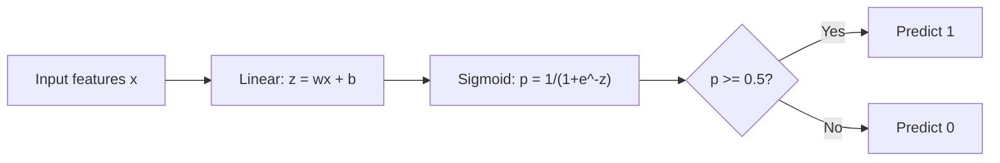
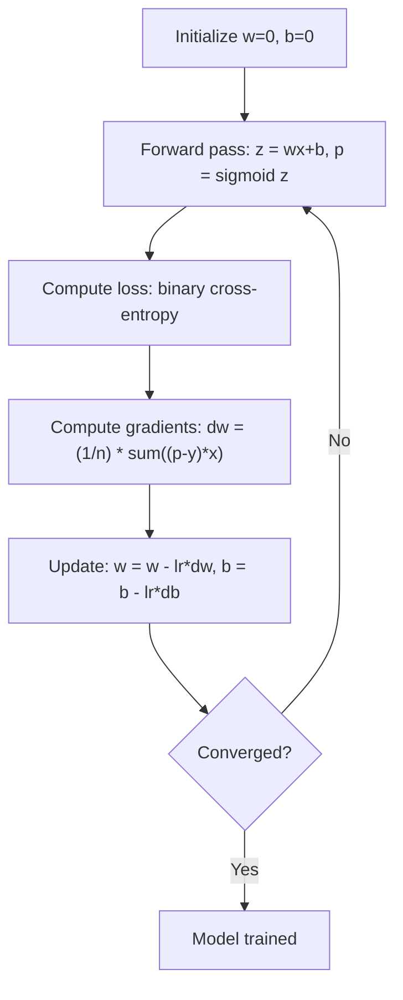

# 로지스틱 회귀 (Logistic Regression)

> 로지스틱 회귀는 직선을 S자 곡선으로 변형하여 예/아니오 질문에 대한 답을 확률로 제시합니다.

**유형:** Build (실습)
**사용 언어:** Python
**선수 레슨:** Phase 2 Lesson 1-2 (What Is ML, Linear Regression)
**소요 시간:** ~90분

## 학습 목표

- 시그모이드(sigmoid) 함수와 이진 교차 엔트로피(binary cross-entropy) 손실을 사용하여 밑바닥부터(from scratch) 로지스틱 회귀를 구현합니다.
- 이진 분류를 위한 정밀도(precision), 재현율(recall), F1 점수(F1 score) 및 혼동 행렬(confusion matrix)을 계산하고 해석합니다.
- 분류 문제에서 MSE가 실패하는 이유와 이진 교차 엔트로피가 볼록(convex) 비용 곡면을 형성하는 이유를 설명합니다.
- 다중 클래스 분류를 위한 소프트맥스(softmax) 회귀 모델을 구축하고 임계값 튜닝(threshold tuning)의 트레이드오프를 평가합니다.

## 문제 정의

종양의 크기를 바탕으로 그것이 악성인지 양성인지를 예측하고자 합니다. 선형 회귀(linear regression)를 적용해 보면 0.3이나 1.7, 또는 -0.5와 같은 숫자가 출력됩니다. 이 숫자들은 무엇을 의미할까요? 1.7은 "매우 악성"이라는 뜻일까요? -0.5는 "매우 양성"이라는 뜻일까요? 선형 회귀는 범위 제한이 없는 숫자를 출력합니다. 하지만 분류(classification)에는 0과 1 사이로 제한된 확률과 '예' 또는 '아니오'라는 명확한 결정이 필요합니다.

로지스틱 회귀는 이 문제를 해결합니다. 동일한 선형 결합($wx + b$)을 취한 뒤, 어떤 숫자든 (0, 1) 범위로 압축하는 시그모이드 함수를 통과시킵니다. 그 결과 출력값은 확률이 됩니다. 여기에 임계값(보통 0.5)을 설정하여 최종 결정을 내립니다.

로지스틱 회귀는 실무에서 가장 널리 사용되는 알고리즘 중 하나입니다. 이름에 '회귀'가 들어가지만, 회귀 알고리즘이 아니라 분류 알고리즘입니다. 이 이름은 모델 내부에서 사용하는 로지스틱(시그모이드) 함수에서 유래했습니다.

## 핵심 개념

### 선형 회귀가 분류에서 실패하는 이유

공부 시간을 바탕으로 합격/불합격(1/0)을 예측한다고 가정해 보겠습니다. 선형 회귀는 데이터를 관통하는 직선을 적합합니다:

```
hours:  1   2   3   4   5   6   7   8   9   10
actual: 0   0   0   0   1   1   1   1   1   1
```

선형 적합을 사용하면 1시간 공부했을 때 -0.2, 10시간 공부했을 때 1.3과 같은 예측값이 나올 수 있습니다. 이러한 값은 확률이 아닙니다. 0보다 작거나 1보다 커지기 때문입니다. 더 심각한 문제는 경계에서 멀리 떨어진 단 하나의 이상치(outlier, 예: 50시간 공부한 사람)가 직선 전체를 끌어당겨 모든 샘플에 대한 예측을 왜곡할 수 있다는 점입니다.

따라서 분류에는 다음과 같은 함수가 필요합니다:
- 0과 1 사이의 값(확률)을 출력해야 합니다.
- 급격한 전환 구간(결정 경계, decision boundary)을 형성해야 합니다.
- 경계에서 멀리 떨어진 이상치에 의해 왜곡되지 않아야 합니다.

### 시그모이드 함수

시그모이드 함수는 바로 이 역할을 수행합니다:

```math
\sigma(z) = \frac{1}{1 + e^{-z}}
```

특성:
- $z$가 양수 방향으로 매우 크면, $\sigma(z)$는 1에 가까워집니다.
- $z$가 음수 방향으로 매우 크면, $\sigma(z)$는 0에 가까워집니다.
- $z = 0$일 때, $\sigma(z) = 0.5$입니다.
- 출력값은 항상 0과 1 사이에 위치합니다.
- 모든 지점에서 매끄럽고 미분 가능합니다.

도함수는 $\sigma'(z) = \sigma(z) (1 - \sigma(z))$라는 편리한 형태를 가집니다. 덕분에 기울기(gradient)를 효율적으로 계산할 수 있습니다.

### 로지스틱 회귀 = 선형 모델 + 시그모이드

이 모델은 선형 회귀와 동일하게 $z = wx + b$를 계산한 후, 시그모이드 함수를 적용합니다:



출력값 $p$는 입력이 클래스 1에 속할 확률인 $P(y=1 \mid x)$로 해석됩니다. 결정 경계는 $wx + b = 0$가 되는 지점이며, 이때 시그모이드 출력값은 정확히 0.5가 됩니다.

### 이진 교차 엔트로피 손실

로지스틱 회귀에는 MSE를 손실 함수로 사용할 수 없습니다. 시그모이드에 MSE를 적용하면 국소 최솟값(local minima)이 다수 존재하는 비볼록(non-convex) 비용 곡면이 형성되기 때문입니다. 대신 이진 교차 엔트로피(로그 손실, log loss)를 사용합니다:

```math
\text{Loss} = -\frac{1}{n} \sum \left( y \log(p) + (1-y) \log(1-p) \right)
```

작동 원리:
- $y=1$이고 $p$이 1에 가까울 때: $\log(1) = 0$이므로 손실이 0에 가깝습니다 (정답, 낮은 비용).
- $y=1$이고 $p$이 0에 가까울 때: $\log(0)$가 음의 무한대로 발산하므로 손실이 극도로 커집니다 (오답, 높은 비용).
- $y=0$이고 $p$이 0에 가까울 때: $\log(1) = 0$이므로 손실이 0에 가깝습니다 (정답, 낮은 비용).
- $y=0$이고 $p$이 1에 가까울 때: $\log(0)$가 음의 무한대로 발산하므로 손실이 극도로 커집니다 (오답, 높은 비용).

이 손실 함수는 로지스틱 회귀에 대해 볼록(convex) 함수이므로 단 하나의 전역 최솟값(global minimum)을 보장합니다.

### 로지스틱 회귀의 경사 하강법

시그모이드를 적용한 이진 교차 엔트로피의 기울기는 다음과 같이 간결한 형태를 갖습니다:

```math
\begin{aligned}
\frac{\partial L}{\partial w} &= \frac{1}{n} \sum (p - y) \, x \\
\frac{\partial L}{\partial b} &= \frac{1}{n} \sum (p - y)
\end{aligned}
```

이는 선형 회귀의 기울기 식과 형태가 동일해 보입니다. 차이점은 $p = wx + b$ 대신 $p = \sigma(wx + b)$가 사용된다는 점입니다. 시그모이드가 비선형성을 도입하지만, 기울기 업데이트 규칙 자체는 동일하게 유지됩니다.



### 결정 경계

2차원 입력(두 개의 특성)에서 결정 경계는 다음을 만족하는 직선입니다:

```math
w_1 x_1 + w_2 x_2 + b = 0
```

직선의 한쪽에 있는 점들은 1로 분류되고, 다른 쪽에 있는 점들은 0으로 분류됩니다. 로지스틱 회귀는 항상 선형 결정 경계를 만듭니다. 곡선 형태의 경계가 필요하다면 다항 특성(polynomial features)을 추가하거나 비선형 모델을 사용해야 합니다.

### 소프트맥스를 활용한 다중 클래스 분류

이진 로지스틱 회귀는 두 개의 클래스를 다룹니다. $k$개의 클래스를 분류할 때는 소프트맥스(softmax) 함수를 사용합니다:

```math
\text{softmax}(z_i) = \frac{e^{z_i}}{\sum_j e^{z_j}}
```

각 클래스는 독립된 가중치 벡터를 갖습니다. 모델이 각 클래스에 대한 점수 $z_i$를 계산하면, 소프트맥스가 이 점수들을 합이 1이 되는 확률값으로 변환합니다. 최종 예측 클래스는 확률이 가장 높은 클래스로 선택됩니다.

이때 손실 함수는 범주형 교차 엔트로피(categorical cross-entropy)가 됩니다:

```math
\text{Loss} = -\frac{1}{n} \sum \sum_k y_k \log(p_k)
```

여기서 $y_k$는 실제 클래스에 대해서는 1이고, 다른 모든 클래스에 대해서는 0입니다(원-핫 인코딩, one-hot encoding).

### 평가 지표

정확도(accuracy)만으로는 모델 성능을 온전히 평가할 수 없습니다. 음성 95%, 양성 5%로 구성된 불균형 데이터셋에서는 무조건 음성으로만 예측해도 95%의 정확도를 얻지만, 이러한 모델은 실질적으로 아무 쓸모가 없습니다.

**혼동 행렬(Confusion Matrix)**:

| | 예측 양성 (Predicted Positive) | 예측 음성 (Predicted Negative) |
|---|---|---|
| 실제 양성 (Actually Positive) | True Positive (TP) | False Negative (FN) |
| 실제 음성 (Actually Negative) | False Positive (FP) | True Negative (TN) |

**정밀도(Precision)**: 양성으로 예측한 샘플 중 실제로 양성인 비율은 얼마인가?
```math
\text{Precision} = \frac{TP}{TP + FP}
```

**재현율(Recall)** (민감도, Sensitivity): 실제 양성 샘플 중 모델이 올바르게 감지해 낸 비율은 얼마인가?
```math
\text{Recall} = \frac{TP}{TP + FN}
```

**F1 점수(F1 Score)**: 정밀도와 재현율의 조화 평균으로, 두 지표 간의 균형을 나타냅니다.
```math
F_1 = 2 \cdot \frac{\text{Precision} \cdot \text{Recall}}{\text{Precision} + \text{Recall}}
```

지표별 우선순위 기준:
- **정밀도(Precision)**: 거짓 양성(false positive)의 비용이 큰 경우 (스팸 필터: 정상 이메일이 스팸으로 분류되어 차단되면 안 됨)
- **재현율(Recall)**: 거짓 음성(false negative)의 비용이 큰 경우 (암 진단: 실제 악성 종양을 놓쳐서는 안 됨)
- **F1 점수**: 정밀도와 재현율의 균형을 종합적으로 나타내는 단일 지표가 필요할 때

```figure
logistic-sigmoid
```

## 직접 구현하기

### 1단계: 시그모이드 함수 및 데이터 생성

```python
import random
import math

def sigmoid(z):
    z = max(-500, min(500, z))
    return 1.0 / (1.0 + math.exp(-z))


random.seed(42)
N = 200
X = []
y = []

for _ in range(N // 2):
    X.append([random.gauss(2, 1), random.gauss(2, 1)])
    y.append(0)

for _ in range(N // 2):
    X.append([random.gauss(5, 1), random.gauss(5, 1)])
    y.append(1)

combined = list(zip(X, y))
random.shuffle(combined)
X, y = zip(*combined)
X = list(X)
y = list(y)

print(f"Generated {N} samples (2 classes, 2 features)")
print(f"Class 0 center: (2, 2), Class 1 center: (5, 5)")
print(f"First 5 samples:")
for i in range(5):
    print(f"  Features: [{X[i][0]:.2f}, {X[i][1]:.2f}], Label: {y[i]}")
```

### 2단계: 로지스틱 회귀 밑바닥부터 구현하기

```python
class LogisticRegression:
    def __init__(self, n_features, learning_rate=0.01):
        self.weights = [0.0] * n_features
        self.bias = 0.0
        self.lr = learning_rate
        self.loss_history = []

    def predict_proba(self, x):
        z = sum(w * xi for w, xi in zip(self.weights, x)) + self.bias
        return sigmoid(z)

    def predict(self, x, threshold=0.5):
        return 1 if self.predict_proba(x) >= threshold else 0

    def compute_loss(self, X, y):
        n = len(y)
        total = 0.0
        for i in range(n):
            p = self.predict_proba(X[i])
            p = max(1e-15, min(1 - 1e-15, p))
            total += y[i] * math.log(p) + (1 - y[i]) * math.log(1 - p)
        return -total / n

    def fit(self, X, y, epochs=1000, print_every=200):
        n = len(y)
        n_features = len(X[0])
        for epoch in range(epochs):
            dw = [0.0] * n_features
            db = 0.0
            for i in range(n):
                p = self.predict_proba(X[i])
                error = p - y[i]
                for j in range(n_features):
                    dw[j] += error * X[i][j]
                db += error
            for j in range(n_features):
                self.weights[j] -= self.lr * (dw[j] / n)
            self.bias -= self.lr * (db / n)
            loss = self.compute_loss(X, y)
            self.loss_history.append(loss)
            if epoch % print_every == 0:
                print(f"  Epoch {epoch:4d} | Loss: {loss:.4f} | w: [{self.weights[0]:.3f}, {self.weights[1]:.3f}] | b: {self.bias:.3f}")
        return self

    def accuracy(self, X, y):
        correct = sum(1 for i in range(len(y)) if self.predict(X[i]) == y[i])
        return correct / len(y)


split = int(0.8 * N)
X_train, X_test = X[:split], X[split:]
y_train, y_test = y[:split], y[split:]

print("\n=== Training Logistic Regression ===")
model = LogisticRegression(n_features=2, learning_rate=0.1)
model.fit(X_train, y_train, epochs=1000, print_every=200)

print(f"\nTrain accuracy: {model.accuracy(X_train, y_train):.4f}")
print(f"Test accuracy:  {model.accuracy(X_test, y_test):.4f}")
print(f"Weights: [{model.weights[0]:.4f}, {model.weights[1]:.4f}]")
print(f"Bias: {model.bias:.4f}")
```

### 3단계: 혼동 행렬 및 평가 지표 밑바닥부터 구현하기

```python
class ClassificationMetrics:
    def __init__(self, y_true, y_pred):
        self.tp = sum(1 for t, p in zip(y_true, y_pred) if t == 1 and p == 1)
        self.tn = sum(1 for t, p in zip(y_true, y_pred) if t == 0 and p == 0)
        self.fp = sum(1 for t, p in zip(y_true, y_pred) if t == 0 and p == 1)
        self.fn = sum(1 for t, p in zip(y_true, y_pred) if t == 1 and p == 0)

    def accuracy(self):
        total = self.tp + self.tn + self.fp + self.fn
        return (self.tp + self.tn) / total if total > 0 else 0

    def precision(self):
        denom = self.tp + self.fp
        return self.tp / denom if denom > 0 else 0

    def recall(self):
        denom = self.tp + self.fn
        return self.tp / denom if denom > 0 else 0

    def f1(self):
        p = self.precision()
        r = self.recall()
        return 2 * p * r / (p + r) if (p + r) > 0 else 0

    def print_confusion_matrix(self):
        print(f"\n  Confusion Matrix:")
        print(f"                  Predicted")
        print(f"                  Pos   Neg")
        print(f"  Actual Pos     {self.tp:4d}  {self.fn:4d}")
        print(f"  Actual Neg     {self.fp:4d}  {self.tn:4d}")

    def print_report(self):
        self.print_confusion_matrix()
        print(f"\n  Accuracy:  {self.accuracy():.4f}")
        print(f"  Precision: {self.precision():.4f}")
        print(f"  Recall:    {self.recall():.4f}")
        print(f"  F1 Score:  {self.f1():.4f}")


y_pred_test = [model.predict(x) for x in X_test]
print("\n=== Classification Report (Test Set) ===")
metrics = ClassificationMetrics(y_test, y_pred_test)
metrics.print_report()
```

### 4단계: 결정 경계 분석

```python
print("\n=== Decision Boundary ===")
w1, w2 = model.weights
b = model.bias
print(f"Decision boundary: {w1:.4f}*x1 + {w2:.4f}*x2 + {b:.4f} = 0")
if abs(w2) > 1e-10:
    print(f"Solved for x2:     x2 = {-w1/w2:.4f}*x1 + {-b/w2:.4f}")

print("\nSample predictions near the boundary:")
test_points = [
    [3.0, 3.0],
    [3.5, 3.5],
    [4.0, 4.0],
    [2.5, 2.5],
    [5.0, 5.0],
]
for point in test_points:
    prob = model.predict_proba(point)
    pred = model.predict(point)
    print(f"  [{point[0]}, {point[1]}] -> prob={prob:.4f}, class={pred}")
```

### 5단계: 소프트맥스를 사용한 다중 클래스 분류

```python
class SoftmaxRegression:
    def __init__(self, n_features, n_classes, learning_rate=0.01):
        self.n_features = n_features
        self.n_classes = n_classes
        self.lr = learning_rate
        self.weights = [[0.0] * n_features for _ in range(n_classes)]
        self.biases = [0.0] * n_classes

    def softmax(self, scores):
        max_score = max(scores)
        exp_scores = [math.exp(s - max_score) for s in scores]
        total = sum(exp_scores)
        return [e / total for e in exp_scores]

    def predict_proba(self, x):
        scores = [
            sum(self.weights[k][j] * x[j] for j in range(self.n_features)) + self.biases[k]
            for k in range(self.n_classes)
        ]
        return self.softmax(scores)

    def predict(self, x):
        probs = self.predict_proba(x)
        return probs.index(max(probs))

    def fit(self, X, y, epochs=1000, print_every=200):
        n = len(y)
        for epoch in range(epochs):
            grad_w = [[0.0] * self.n_features for _ in range(self.n_classes)]
            grad_b = [0.0] * self.n_classes
            total_loss = 0.0
            for i in range(n):
                probs = self.predict_proba(X[i])
                for k in range(self.n_classes):
                    target = 1.0 if y[i] == k else 0.0
                    error = probs[k] - target
                    for j in range(self.n_features):
                        grad_w[k][j] += error * X[i][j]
                    grad_b[k] += error
                true_prob = max(probs[y[i]], 1e-15)
                total_loss -= math.log(true_prob)
            for k in range(self.n_classes):
                for j in range(self.n_features):
                    self.weights[k][j] -= self.lr * (grad_w[k][j] / n)
                self.biases[k] -= self.lr * (grad_b[k] / n)
            if epoch % print_every == 0:
                print(f"  Epoch {epoch:4d} | Loss: {total_loss / n:.4f}")
        return self

    def accuracy(self, X, y):
        correct = sum(1 for i in range(len(y)) if self.predict(X[i]) == y[i])
        return correct / len(y)


random.seed(42)
X_3class = []
y_3class = []

centers = [(1, 1), (5, 1), (3, 5)]
for label, (cx, cy) in enumerate(centers):
    for _ in range(50):
        X_3class.append([random.gauss(cx, 0.8), random.gauss(cy, 0.8)])
        y_3class.append(label)

combined = list(zip(X_3class, y_3class))
random.shuffle(combined)
X_3class, y_3class = zip(*combined)
X_3class = list(X_3class)
y_3class = list(y_3class)

split_3 = int(0.8 * len(X_3class))
X_train_3 = X_3class[:split_3]
y_train_3 = y_3class[:split_3]
X_test_3 = X_3class[split_3:]
y_test_3 = y_3class[split_3:]

print("\n=== Multi-class Softmax Regression (3 classes) ===")
softmax_model = SoftmaxRegression(n_features=2, n_classes=3, learning_rate=0.1)
softmax_model.fit(X_train_3, y_train_3, epochs=1000, print_every=200)
print(f"\nTrain accuracy: {softmax_model.accuracy(X_train_3, y_train_3):.4f}")
print(f"Test accuracy:  {softmax_model.accuracy(X_test_3, y_test_3):.4f}")

print("\nSample predictions:")
for i in range(5):
    probs = softmax_model.predict_proba(X_test_3[i])
    pred = softmax_model.predict(X_test_3[i])
    print(f"  True: {y_test_3[i]}, Predicted: {pred}, Probs: [{', '.join(f'{p:.3f}' for p in probs)}]")
```

### 6단계: 임계값 튜닝

```python
print("\n=== Threshold Tuning ===")
print("Default threshold: 0.5. Adjusting the threshold trades precision for recall.\n")

thresholds = [0.3, 0.4, 0.5, 0.6, 0.7]
print(f"{'Threshold':>10} {'Accuracy':>10} {'Precision':>10} {'Recall':>10} {'F1':>10}")
print("-" * 52)

for t in thresholds:
    y_pred_t = [1 if model.predict_proba(x) >= t else 0 for x in X_test]
    m = ClassificationMetrics(y_test, y_pred_t)
    print(f"{t:>10.1f} {m.accuracy():>10.4f} {m.precision():>10.4f} {m.recall():>10.4f} {m.f1():>10.4f}")
```

## 라이브러리 활용하기

이제 scikit-learn을 사용하여 동일한 작업을 수행해 봅니다.

```python
from sklearn.linear_model import LogisticRegression as SklearnLR
from sklearn.metrics import accuracy_score, precision_score, recall_score, f1_score
from sklearn.metrics import confusion_matrix, classification_report
from sklearn.model_selection import train_test_split
from sklearn.preprocessing import StandardScaler
import numpy as np

np.random.seed(42)
X_0 = np.random.randn(100, 2) + [2, 2]
X_1 = np.random.randn(100, 2) + [5, 5]
X_sk = np.vstack([X_0, X_1])
y_sk = np.array([0] * 100 + [1] * 100)

X_tr, X_te, y_tr, y_te = train_test_split(X_sk, y_sk, test_size=0.2, random_state=42)

scaler = StandardScaler()
X_tr_sc = scaler.fit_transform(X_tr)
X_te_sc = scaler.transform(X_te)

lr = SklearnLR()
lr.fit(X_tr_sc, y_tr)
y_pred = lr.predict(X_te_sc)

print("=== Scikit-learn Logistic Regression ===")
print(f"Accuracy:  {accuracy_score(y_te, y_pred):.4f}")
print(f"Precision: {precision_score(y_te, y_pred):.4f}")
print(f"Recall:    {recall_score(y_te, y_pred):.4f}")
print(f"F1:        {f1_score(y_te, y_pred):.4f}")
print(f"\nConfusion Matrix:\n{confusion_matrix(y_te, y_pred)}")
print(f"\nClassification Report:\n{classification_report(y_te, y_pred)}")
```

직접 밑바닥부터 구현한 모델도 동일한 결정 경계와 평가 지표를 산출합니다. scikit-learn은 다양한 솔버 옵션(liblinear, lbfgs, saga), 자동 규제(regularization), 다중 클래스 전략(one-vs-rest, multinomial), 수치 안정성(numerical stability) 최적화 기능을 추가로 제공합니다.

## 결과물 제출

이번 실습에서 작성한 결과물은 다음과 같습니다:
- `code/logistic_regression.py` - 평가 지표를 포함하여 밑바닥부터 구현한 로지스틱 회귀
## 연습 문제

1. 선형 분리가 불가능한(not linearly separable) 데이터셋(예: 두 개의 동심원)을 생성합니다. 로지스틱 회귀(logistic regression)를 학습시키고 제대로 분류하지 못하는 모습을 관찰합니다. 그런 다음 다항 특성($x_1^2, x_2^2, x_1 x_2$)을 추가하고 다시 학습시킵니다. 정확도가 향상됨을 확인합니다.
2. 3개 클래스를 가진 softmax 모델을 위한 다중 클래스 혼동 행렬(confusion matrix)을 구현합니다. 클래스별 정밀도(precision)와 재현율(recall)을 계산합니다. 어떤 클래스가 가장 분류하기 어렵습니까?
3. ROC 곡선(ROC curve)을 밑바닥부터 직접 구현합니다. 0부터 1까지 100개의 임곗값(threshold)에 대해 참 양성률(true positive rate)과 거짓 양성률(false positive rate)을 계산합니다. 사다리꼴 공식(trapezoidal rule)을 사용하여 AUC(곡선 아래 면적)를 구합니다.

## 핵심 용어

| 용어 | 일반적인 표현 | 실제 의미 |
|------|----------------|----------------------|
| 로지스틱 회귀(Logistic regression) | "분류를 위한 회귀" | 클래스 확률을 출력하기 위해 선형 모델 뒤에 시그모이드(sigmoid) 함수를 적용한 모델 |
| 시그모이드 함수(Sigmoid function) | "S자형 곡선" | 임의의 실수를 (0, 1) 범위로 매핑하는 함수 $1/(1+e^{-z})$ |
| 이진 교차 엔트로피(Binary cross-entropy) | "로그 손실(Log loss)" | 잘못된 예측을 높은 확신으로 내놓았을 때 큰 페널티를 부여하는 손실 함수 $-[y \log(p) + (1-y) \log(1-p)]$ |
| 결정 경계(Decision boundary) | "구분선" | 모델의 출력 확률이 0.5가 되어 예측 클래스가 나뉘는 경계면 |
| 소프트맥스(Softmax) | "다중 클래스 시그모이드" | 점수 벡터를 합이 1이 되는 확률 분포로 변환하는 함수 |
| 정밀도(Precision) | "선택된 것 중 관련 있는 것의 비율" | 양성으로 예측된 항목 중 실제 양성인 비율인 $TP / (TP + FP)$ |
| 재현율(Recall) | "관련 있는 것 중 선택된 것의 비율" | 실제 양성인 항목 중 모델이 올바르게 식별해 낸 비율인 $TP / (TP + FN)$ |
| F1 점수(F1 score) | "균형 잡힌 정확도" | 정밀도와 재현율의 조화 평균: $2PR / (P+R)$ |
| 혼동 행렬(Confusion matrix) | "오차 분류표" | 각 클래스 쌍에 대한 TP, TN, FP, FN 수를 나타내는 표 |
| 임곗값(Threshold) | "기준값(cutoff)" | 모델이 클래스 1로 예측하는 기준이 되는 확률값(기본값 0.5, 조정 가능) |
| 원-핫 인코딩(One-hot encoding) | "범주를 위한 이진 열" | 클래스 $k$를 $k$ 위치만 1이고 나머지는 0인 벡터로 표현하는 방식 |
| 범주형 교차 엔트로피(Categorical cross-entropy) | "다중 클래스 로그 손실" | 원-핫 인코딩된 레이블을 사용하여 이진 교차 엔트로피를 $k$개 클래스로 확장한 손실 함수 |
