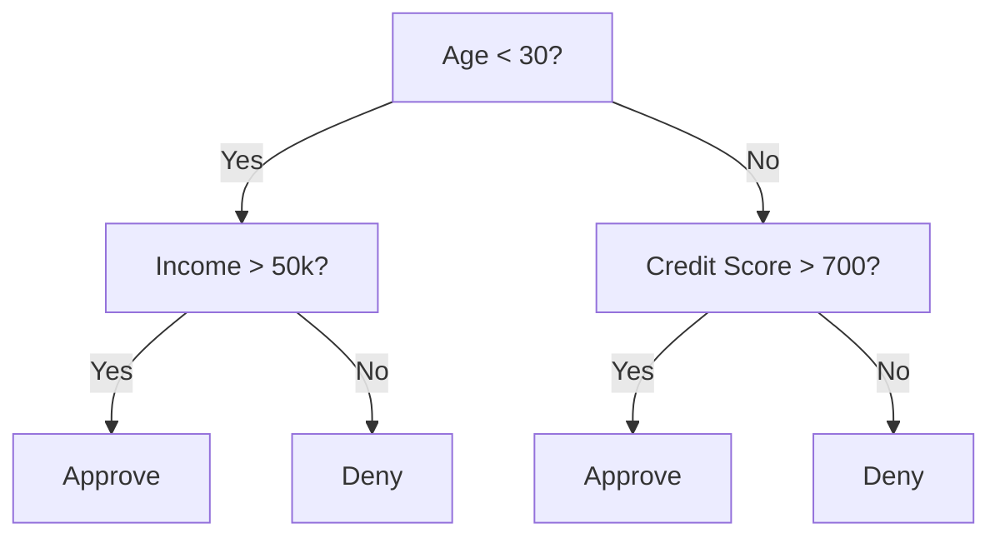
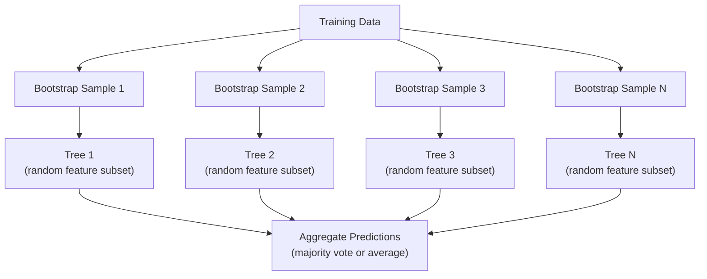

# 결정 트리와 랜덤 포레스트

> 결정 트리는 순서도에 불과할 수 있습니다. 하지만 이들이 모인 포레스트는 머신러닝에서 가장 강력한 도구 중 하나입니다.

**유형:** Build (실습)
**Language:** Python
**선수 레슨:** Phase 1 (Lessons 09 Information Theory, 06 Probability)
**소요 시간:** ~90분

## 학습 목표

- 최적의 결정 트리 분할(split)을 찾기 위한 지니 불순도(Gini impurity), 엔트로피(entropy), 정보 획득량(information gain) 계산을 구현합니다.
- 사전 가지치기(pre-pruning) 제어 기법(최대 깊이, 최소 샘플 수)을 적용하여 밑바닥부터 결정 트리 분류기를 구축합니다.
- 부트스트랩 샘플링(bootstrap sampling)과 특성 무작위 선택(feature randomization)을 사용하여 랜덤 포레스트를 구축하고, 이것이 분산(variance)을 줄이는 이유를 설명합니다.
- MDI 특성 중요도와 순열 중요도(permutation importance)를 비교하고 MDI에 편향이 발생하는 시점을 파악합니다.

## 문제

정형 데이터(tabular data)가 주어졌다고 가정해 보겠습니다. 행은 샘플이고 열은 특성(feature)이며, 예측하려는 타깃(target) 열이 존재합니다. 신경망을 적용할 수도 있겠지만, 정형 데이터에서는 트리 기반 모델(결정 트리, 랜덤 포레스트, 그래디언트 부스팅 트리)이 딥러닝보다 일관되게 우수한 성능을 보입니다. 정형 데이터를 다루는 Kaggle 경진 대회는 트랜스포머(Transformer)가 아니라 XGBoost와 LightGBM이 지배하고 있습니다.

왜 그럴까요? 트리는 별도의 전처리 없이도 수치형과 범주형이 혼합된 특성 유형을 잘 다룹니다. 특성 공학(feature engineering) 없이도 비선형 관계를 처리할 수 있습니다. 또한 해석 가능성이 높습니다. 트리를 살펴보면 예측이 내려진 이유를 정확히 파악할 수 있습니다. 그리고 여러 트리의 평균을 취하는 랜덤 포레스트는 중간 규모의 데이터셋에서 과적합(overfitting)에 매우 강합니다.

이번 강의에서는 재귀적 분할(recursive splitting)을 사용하여 결정 트리를 밑바닥부터 구현한 다음, 그 위에 랜덤 포레스트를 구축합니다. 분할 기준(지니 불순도, 엔트로피, 정보 획득량) 이면의 수학적 원리를 구현하고, 약한 학습기(weak learner)의 앙상블(ensemble)이 어떻게 강력한 모델이 되는지 이해하게 됩니다.

## 핵심 개념

### 결정 트리의 동작 원리

결정 트리는 일련의 예/아니오 질문을 던져 특성 공간을 직사각형 영역으로 분할합니다.



각 내부 노드(internal node)는 특정 임계값(threshold)을 기준으로 특성을 테스트합니다. 각 리프 노드(leaf node)는 예측값을 출력합니다. 새로운 데이터 포인트를 분류할 때는 루트 노드에서 시작하여 리프 노드에 도달할 때까지 가지(branch)를 따라 내려갑니다.

트리는 데이터를 가장 잘 분리하는 특성과 임계값을 각 노드에서 선택하면서 하향식(top-down)으로 구축됩니다. 여기서 "가장 잘 분리한다"는 기준은 분할 기준(split criterion)에 의해 정의됩니다.

### 분할 기준: 불순도 측정

각 노드에는 일련의 샘플 집합이 있습니다. 이 샘플들을 분할하여 결과로 나오는 자식 노드가 가능한 한 "순수(pure)"해지도록, 즉 각 자식 노드가 주로 한 가지 클래스만 포함하도록 만드는 것이 목표입니다.

**지니 불순도(Gini impurity)**는 해당 노드의 클래스 분포에 따라 레이블을 무작위로 지정했을 때, 임의로 선택한 샘플이 잘못 분류될 확률을 측정합니다.

```math
\text{Gini}(S) = 1 - \sum_k p_k^2 \quad \text{where } p_k \text{ is the proportion of class } k \text{ in set } S.
```

순수한 노드(모두 같은 클래스)인 경우 지니 불순도는 0입니다. 클래스가 50대 50인 이진 분할의 경우 지니 불순도는 0.5입니다. 값이 작을수록 좋습니다.

```
Example: 6 cats, 4 dogs

Gini = 1 - (0.6^2 + 0.4^2) = 1 - (0.36 + 0.16) = 0.48
```

**엔트로피(Entropy)**는 노드의 정보량(무질서도)을 측정합니다. Phase 1의 Lesson 09에서 다룬 내용입니다.

```math
\text{Entropy}(S) = -\sum_k p_k \log_2(p_k)
```

순수한 노드의 경우 엔트로피는 0입니다. 50대 50 이진 분할의 경우 엔트로피는 1.0입니다. 값이 작을수록 좋습니다.

```
Example: 6 cats, 4 dogs

Entropy = -(0.6 * log2(0.6) + 0.4 * log2(0.4))
        = -(0.6 * -0.737 + 0.4 * -1.322)
        = 0.442 + 0.529
        = 0.971 bits
```

**정보 획득량(Information gain)**은 분할 후 불순도(엔트로피 또는 지니 불순도)가 감소한 정도를 나타냅니다.

```math
\begin{aligned}
& IG(S, \text{feature}, \text{threshold}) = \text{Impurity}(S) - \text{weighted\_avg}(\text{Impurity}(S_{\text{left}}), \text{Impurity}(S_{\text{right}})) \\[4pt]
& \text{where the weights are the proportions of samples in each child.}
\end{aligned}
```

각 노드에서의 탐욕적 알고리즘(greedy algorithm)은 모든 특성과 가능한 모든 임계값을 테스트해 보는 방식입니다. 정보 획득량을 최대화하는 (특성, 임계값) 쌍을 선택합니다.

### 분할이 이루어지는 방식

현재 노드에 $m$개의 샘플과 $n$개의 특성을 가진 데이터셋이 있을 때:

1. 각 특성 $j$($j = 1$부터 $n$까지)에 대해:
   - 특성 $j$을 기준으로 샘플을 정렬합니다.
   - 연속된 서로 다른 값 사이의 모든 중간값을 임계값 후보로 테스트합니다.
   - 각 임계값에 대한 정보 획득량을 계산합니다.
2. 정보 획득량이 가장 높은 특성과 임계값을 선택합니다.
3. 데이터를 왼쪽(특성 <= 임계값)과 오른쪽(특성 > 임계값)으로 분할합니다.
4. 각 자식 노드에 대해 재귀적으로 이 과정을 반복합니다.

이러한 탐욕적 접근 방식이 전역 최적(globally optimal) 트리를 보장하지는 않습니다. 최적의 트리를 찾는 문제는 NP-난해(NP-hard) 문제입니다. 그러나 탐욕적 분할은 실제 환경에서 매우 잘 작동합니다.

### 정지 조건

정지 조건이 없으면 트리는 모든 리프가 순수해지거나 샘플을 더 이상 나눌 수 없을 때까지 계속 자라며, 리프당 샘플이 하나만 남는 경우도 흔합니다. 이렇게 되면 훈련 데이터를 완벽하게 외워버려 일반화 성능이 극도로 떨어집니다.

**사전 가지치기(Pre-pruning)**는 트리가 완전히 성장하기 전에 성장을 멈춥니다.
- 최대 깊이(Maximum depth): 트리가 정해진 깊이에 도달하면 분할을 중단합니다.
- 리프당 최소 샘플 수(Minimum samples per leaf): 노드의 샘플 수가 $k$개 미만이면 중단합니다.
- 최소 정보 획득량(Minimum information gain): 최적 분할로 인한 불순도 개선량이 임계값보다 작으면 중단합니다.
- 최대 리프 노드 수(Maximum leaf nodes): 전체 리프 노드의 개수를 제한합니다.

**사후 가지치기(Post-pruning)**는 트리를 완전히 성장시킨 후 가지를 잘라냅니다.
- 비용 복잡도 가지치기(Cost-complexity pruning, scikit-learn에서 사용): 리프 노드 수에 비례하는 페널티를 추가합니다. 페널티를 높일수록 더 작은 트리가 생성됩니다.
- 오차 감소 가지치기(Reduced error pruning): 검증 오차가 증가하지 않는다면 서브트리를 제거합니다.

사전 가지치기는 더 단순하고 빠릅니다. 사후 가지치기는 이후에 유용한 추가 분할로 이어질 수 있는 분할을 조기에 차단하지 않으므로 종종 더 나은 트리를 만들어냅니다.

### 회귀를 위한 결정 트리

회귀(regression) 문제에서 리프의 예측값은 해당 리프에 속한 타깃값들의 평균입니다. 분할 기준 또한 달라집니다.

정보 획득량 대신 **분산 감소량(Variance reduction)**을 사용합니다.

```math
VR(S, \text{feature}, \text{threshold}) = \text{Var}(S) - \text{weighted\_avg}(\text{Var}(S_{\text{left}}), \text{Var}(S_{\text{right}}))
```

분산을 가장 크게 줄여주는 분할을 선택합니다. 트리는 입력 공간을 여러 영역으로 분할하고, 각 영역에서 상수(평균값)를 예측합니다.

### 랜덤 포레스트: 앙상블의 힘

단일 결정 트리는 분산이 높습니다. 데이터가 조금만 바뀌어도 완전히 다른 트리가 만들어질 수 있습니다. 랜덤 포레스트는 여러 트리의 결과를 평균하여 이 문제를 해결합니다.



트리를 다양하게 만드는 두 가지 무작위성(randomness) 요소는 다음과 같습니다.

**배깅(Bagging, bootstrap aggregating):** 각 트리는 훈련 데이터로부터 복원 추출한 무작위 표본인 부트스트랩 샘플(bootstrap sample)로 훈련됩니다. 원본 샘플의 약 63%가 각 부트스트랩에 포함됩니다(나머지는 검증에 사용할 수 있는 OOB(out-of-bag) 샘플이 됩니다).

**특성 무작위 선택(Feature randomization):** 각 분할 시 무작위로 선택된 특성의 부분 집합만을 고려합니다. 분류 문제의 기본값은 $\sqrt{n_{\text{features}}}$이며, 회귀 문제의 기본값은 $n_{\text{features}}/3$입니다. 이를 통해 모든 트리가 동일한 지배적 특성을 기준으로 분할되는 것을 방지합니다.

핵심 통찰: 서로 상관관계가 적은(decorrelated) 수많은 트리의 평균을 취하면 편향(bias)을 증가시키지 않으면서 분산을 줄일 수 있습니다. 개별 트리는 평범할 수 있지만, 앙상블은 강력합니다.

### 특성 중요도

랜덤 포레스트는 자연스럽게 특성 중요도(feature importance) 점수를 제공합니다. 가장 일반적인 방식은 다음과 같습니다.

**불순도 감소 평균(Mean Decrease in Impurity, MDI):** 각 특성에 대해, 해당 특성이 사용된 모든 트리와 모든 노드에서의 총 불순도 감소량을 합산합니다. 트리의 상위 분할에서 더 큰 불순도 감소를 유도한 특성일수록 중요도가 높습니다.

```math
\text{importance}(\text{feature}_j) = \sum_{\text{nodes where feature}_j \text{ is used}} \frac{n_{\text{samples at node}}}{n_{\text{total samples}}} \cdot \text{impurity\_decrease}
```

이 방식은 빠르지만(훈련 중에 계산됨), 카디널리티(cardinality, 고유값의 수)가 높은 특성과 분할 후보 지점이 많은 특성에 편향되는 단점이 있습니다.

그 대안이 **순열 중요도(Permutation importance)**입니다. 한 특성의 값을 무작위로 섞은(shuffle) 후 모델의 정확도가 얼마나 떨어지는지 측정합니다. 더 신뢰할 수 있지만 계산 속도는 느립니다.
### 트리가 신경망보다 뛰어난 경우

정형 데이터(tabular data)에서는 트리와 포레스트가 인공 신경망(neural network)보다 우세합니다. 몇 가지 이유는 다음과 같습니다.

| 요소 | 트리 | 신경망 |
|--------|-------|----------------|
| 혼합 유형 (수치형 + 범주형) | 기본 지원 | 인코딩 필요 |
| 소규모 데이터셋 (< 1만 행) | 우수하게 작동 | 과적합 발생 |
| 특성 상호작용 | 분기를 통해 발견 | 아키텍처 설계 필요 |
| 해석 가능성 | 완전한 투명성 | 블랙박스 |
| 학습 시간 | 수 분 | 수 시간 |
| 하이퍼파라미터 민감도 | 낮음 | 높음 |

데이터에 공간적 또는 순차적 구조가 있는 경우(이미지, 텍스트, 오디오)에는 신경망이 유리합니다. 평면적인 특성 테이블의 경우 트리가 기본 선택입니다.

```figure
decision-tree-depth
```

## 직접 구현하기

### 1단계: 지니 불순도와 엔트로피

두 분할 기준(split criteria)을 밑바닥부터 구현하고, 어떤 분할이 좋은지에 대해 두 기준이 일치하는지 확인합니다.

```python
import math

def gini_impurity(labels):
    n = len(labels)
    if n == 0:
        return 0.0
    counts = {}
    for label in labels:
        counts[label] = counts.get(label, 0) + 1
    return 1.0 - sum((c / n) ** 2 for c in counts.values())

def entropy(labels):
    n = len(labels)
    if n == 0:
        return 0.0
    counts = {}
    for label in labels:
        counts[label] = counts.get(label, 0) + 1
    return -sum(
        (c / n) * math.log2(c / n) for c in counts.values() if c > 0
    )
```

### 2단계: 최적의 분할 찾기

모든 특성과 임곗값을 시도합니다. 정보 획득량(information gain)이 가장 높은 분할을 반환합니다.

```python
def information_gain(parent_labels, left_labels, right_labels, criterion="gini"):
    measure = gini_impurity if criterion == "gini" else entropy
    n = len(parent_labels)
    n_left = len(left_labels)
    n_right = len(right_labels)
    if n_left == 0 or n_right == 0:
        return 0.0
    parent_impurity = measure(parent_labels)
    child_impurity = (
        (n_left / n) * measure(left_labels) +
        (n_right / n) * measure(right_labels)
    )
    return parent_impurity - child_impurity
```

### 3단계: DecisionTree 클래스 구현하기

재귀적 분할, 예측, 특성 중요도(feature importance) 추적을 구현합니다. `_build`는 트리의 핵심입니다. 노드가 순수(pure)해지거나 사전 가지치기(pre-pruning) 제한에 도달하면 중단되고, 그렇지 않으면 최적의 분할을 적용하여 두 자식 노드로 재귀 호출합니다.

```python
import random

class DecisionTree:
    def __init__(self, max_depth=None, min_samples_split=2,
                 min_samples_leaf=1, criterion="gini",
                 max_features=None):
        self.max_depth = max_depth
        self.min_samples_split = min_samples_split
        self.min_samples_leaf = min_samples_leaf
        self.criterion = criterion
        self.max_features = max_features
        self.tree = None
        self.feature_importances_ = None

    def fit(self, X, y):
        self.n_features = len(X[0])
        self.feature_importances_ = [0.0] * self.n_features
        self.n_samples = len(X)
        self.tree = self._build(X, y, depth=0)
        total = sum(self.feature_importances_)
        if total > 0:
            self.feature_importances_ = [
                fi / total for fi in self.feature_importances_
            ]

    def predict(self, X):
        return [self._predict_one(x, self.tree) for x in X]

    def _build(self, X, y, depth):
        if len(set(y)) == 1:
            return {"leaf": True, "value": y[0]}

        if self.max_depth is not None and depth >= self.max_depth:
            return self._make_leaf(y)

        if len(y) < self.min_samples_split:
            return self._make_leaf(y)

        best_feature, best_threshold, best_gain = self._best_split(X, y)

        if best_feature is None or best_gain <= 0:
            return self._make_leaf(y)

        left_X, left_y, right_X, right_y = self._split_data(
            X, y, best_feature, best_threshold
        )

        if len(left_y) < self.min_samples_leaf or len(right_y) < self.min_samples_leaf:
            return self._make_leaf(y)

        weight = len(y) / self.n_samples
        self.feature_importances_[best_feature] += weight * best_gain

        return {
            "leaf": False,
            "feature": best_feature,
            "threshold": best_threshold,
            "left": self._build(left_X, left_y, depth + 1),
            "right": self._build(right_X, right_y, depth + 1),
        }

    def _make_leaf(self, y):
        counts = {}
        for label in y:
            counts[label] = counts.get(label, 0) + 1
        return {"leaf": True, "value": max(counts, key=counts.get)}

    def _best_split(self, X, y):
        best_feature = None
        best_threshold = None
        best_gain = -1.0

        if self.max_features == "sqrt":
            k = max(1, int(math.sqrt(self.n_features)))
            feature_indices = random.sample(range(self.n_features), k)
        elif isinstance(self.max_features, int):
            if self.max_features < 1:
                raise ValueError("max_features must be at least 1 when given as an integer")
            k = min(self.max_features, self.n_features)
            feature_indices = random.sample(range(self.n_features), k)
        else:
            feature_indices = list(range(self.n_features))

        for feature_idx in feature_indices:
            values = sorted(set(X[i][feature_idx] for i in range(len(X))))
            if len(values) <= 1:
                continue

            for i in range(len(values) - 1):
                threshold = (values[i] + values[i + 1]) / 2.0
                left_y = [y[j] for j in range(len(X)) if X[j][feature_idx] <= threshold]
                right_y = [y[j] for j in range(len(X)) if X[j][feature_idx] > threshold]

                if len(left_y) < self.min_samples_leaf or len(right_y) < self.min_samples_leaf:
                    continue

                gain = information_gain(y, left_y, right_y, self.criterion)
                if gain > best_gain:
                    best_gain = gain
                    best_feature = feature_idx
                    best_threshold = threshold

        return best_feature, best_threshold, best_gain

    def _split_data(self, X, y, feature, threshold):
        left_X, left_y, right_X, right_y = [], [], [], []
        for i in range(len(X)):
            if X[i][feature] <= threshold:
                left_X.append(X[i])
                left_y.append(y[i])
            else:
                right_X.append(X[i])
                right_y.append(y[i])
        return left_X, left_y, right_X, right_y

    def _predict_one(self, x, node):
        if node["leaf"]:
            return node["value"]
        if x[node["feature"]] <= node["threshold"]:
            return self._predict_one(x, node["left"])
        return self._predict_one(x, node["right"])
```

### 4단계: RandomForest 클래스 구현하기

부트스트랩 샘플링(bootstrap sampling), 특성 무작위화, 다수결 투표를 구현합니다.

```python
class RandomForest:
    def __init__(self, n_trees=100, max_depth=None,
                 min_samples_split=2, max_features="sqrt",
                 criterion="gini"):
        self.n_trees = n_trees
        self.max_depth = max_depth
        self.min_samples_split = min_samples_split
        self.max_features = max_features
        self.criterion = criterion
        self.trees = []

    def fit(self, X, y):
        n = len(X)
        for _ in range(self.n_trees):
            indices = [random.randint(0, n - 1) for _ in range(n)]
            X_boot = [X[i] for i in indices]
            y_boot = [y[i] for i in indices]
            tree = DecisionTree(
                max_depth=self.max_depth,
                min_samples_split=self.min_samples_split,
                max_features=self.max_features,
                criterion=self.criterion,
            )
            tree.fit(X_boot, y_boot)
            self.trees.append(tree)

    def predict(self, X):
        all_preds = [tree.predict(X) for tree in self.trees]
        predictions = []
        for i in range(len(X)):
            votes = {}
            for preds in all_preds:
                v = preds[i]
                votes[v] = votes.get(v, 0) + 1
            predictions.append(max(votes, key=votes.get))
        return predictions
```

모든 헬퍼 메서드가 포함된 전체 구현은 `code/trees.py`을 참고하세요.

## 활용하기

scikit-learn을 사용하면 단 세 줄로 랜덤 포레스트를 학습시킬 수 있습니다.

```python
from sklearn.ensemble import RandomForestClassifier
from sklearn.datasets import load_iris
from sklearn.model_selection import train_test_split

X, y = load_iris(return_X_y=True)
X_train, X_test, y_train, y_test = train_test_split(X, y, random_state=42)

rf = RandomForestClassifier(n_estimators=100, random_state=42)
rf.fit(X_train, y_train)
print(f"Accuracy: {rf.score(X_test, y_test):.4f}")
print(f"Feature importances: {rf.feature_importances_}")
```

실무에서는 그래디언트 부스팅 트리(gradient boosted tree: XGBoost, LightGBM, CatBoost)가 랜덤 포레스트보다 더 강력한 경우가 많습니다. 트리를 순차적으로 구축하며 각 트리가 이전 트리의 오차를 보정하기 때문입니다. 하지만 랜덤 포레스트는 잘못 설정할 가능성이 적고 하이퍼파라미터 튜닝이 거의 필요하지 않습니다.

## 배포하기

이번 레슨에서는 비즈니스 이해관계자를 위해 의사결정 트리 분할을 해석해 주는 프롬프트인 `outputs/prompt-tree-interpreter.md`을 제작합니다. 학습된 트리의 구조(깊이, 특성, 분할 임곗값, 정확도)를 입력하면 모델을 쉬운 언어의 규칙으로 변환하고, 특성 중요도의 순위를 매기며, 과적합(overfitting)이나 데이터 누수(leakage)를 표시하고, 다음 단계를 제안해 줍니다. 코드를 읽지 못하는 사람에게 트리 기반 모델을 설명해야 할 때 언제든지 활용하세요.

## 연습 문제

1. 3개의 클래스를 가진 2D 데이터셋에서 단일 의사결정 트리를 학습시킵니다. 분할을 수동으로 추적하고 직사각형 결정 경계(decision boundary)를 그려보세요. max_depth=2와 max_depth=10에서의 경계를 비교해 보세요.

2. 회귀 트리(regression tree)를 위한 분산 감소(variance reduction) 분할을 구현합니다. 200개 포인트에 대해 $y = \sin(x) + \text{noise}$를 생성하고 회귀 트리를 적합(fit)시킵니다. 트리의 구간별 상수(piecewise-constant) 예측값과 실제 곡선을 함께 시각화해 보세요.

3. 트리 개수를 1, 5, 10, 50, 200개로 설정하여 랜덤 포레스트를 구축합니다. 트리 개수에 따른 학습 정확도와 테스트 정확도를 그래프로 그려보세요. 테스트 정확도가 정체(plateau)되기는 하지만 감소하지는 않는 현상(포레스트가 과적합에 강한 특성)을 관찰해 보세요.

4. 5개의 서로 다른 데이터셋에서 분할 기준으로 지니 불순도와 엔트로피를 비교합니다. 정확도와 트리 깊이를 측정해 보세요. 대부분의 경우 두 기준은 거의 동일한 결과를 냅니다. 그 이유를 설명해 보세요.

5. 순열 중요도(permutation importance)를 구현합니다. 한 특성이 무작위 노이즈이지만 높은 카디널리티(cardinality)를 갖는 데이터셋에서 이를 MDI(Mean Decrease in Impurity) 중요도와 비교해 보세요. MDI는 노이즈 특성을 높게 평가하지만, 순열 중요도는 그렇지 않습니다.

## 핵심 용어

| 용어 | 흔히 하는 말 | 실제 의미 |
|------|----------------|----------------------|
| 의사결정 트리 (Decision tree) | "예측을 위한 순서도" | 일련의 if/else 분할을 학습하여 특성 공간을 직사각형 영역으로 분할하는 모델 |
| 지니 불순도 (Gini impurity) | "노드가 얼마나 섞여 있는가" | 노드에서 무작위 샘플을 잘못 분류할 확률. 0 = 순수, 0.5 = 이진 분류에서 최대 불순도 |
| 엔트로피 (Entropy) | "노드 내의 무질서도" | 노드의 정보량. 0 = 순수, 1.0 = 이진 분류에서 최대 불확실성. 정보 이론에서 유래 |
| 정보 획득량 (Information gain) | "분할이 얼마나 좋은가" | 분할 후 불순도의 감소량. 분할을 선택할 때 사용하는 탐욕적(greedy) 기준 |
| 사전 가지치기 (Pre-pruning) | "트리를 조기에 중단하기" | 최대 깊이, 최소 샘플 수, 최소 획득량 임곗값을 설정하여 트리의 성장을 조기에 멈추는 것 |
| 사후 가지치기 (Post-pruning) | "나중에 트리를 다듬기" | 트리를 완전히 성장시킨 후, 검증 성능을 향상시키지 않는 서브트리를 제거하는 것 |
| 배깅 (Bagging) | "무작위 서브셋으로 학습하기" | 부트스트랩 집계(Bootstrap aggregating). 복원 추출된 서로 다른 무작위 샘플로 각 모델을 학습시킴 |
| 랜덤 포레스트 (Random forest) | "트리의 묶음" | 의사결정 트리의 앙상블로, 각 트리는 부트스트랩 샘플로 학습되며 각 분할마다 무작위 특성 서브셋을 사용함 |
| 특성 중요도 (MDI) | "어떤 특성이 중요한가" | 모든 트리와 노드에 걸쳐 각 특성이 기여한 불순도 감소량의 총합 |
| 순열 중요도 (Permutation importance) | "섞어서 확인하기" | 특성값을 무작위로 섞었을 때의 정확도 하락폭. 노이즈가 있는 특성에 대해 MDI보다 더 신뢰할 수 있음 |
| 분산 감소 (Variance reduction) | "정보 획득량의 회귀 버전" | 정보 획득량에 해당하는 회귀 트리의 개념. 타깃 분산을 가장 많이 줄이는 분할을 선택함 |
| 부트스트랩 샘플 (Bootstrap sample) | "중복을 허용한 무작위 샘플" | 원본 데이터셋에서 복원 추출한 무작위 샘플. 크기는 동일하지만 중복 데이터가 포함됨 |

## 더 읽을거리

- [Breiman: Random Forests (2001)](https://link.springer.com/article/10.1023/A:1010933404324) - 원본 랜덤 포레스트 논문
- [Grinsztajn et al.: Why do tree-based models still outperform deep learning on tabular data? (2022)](https://arxiv.org/abs/2207.08815) - 정형 데이터 작업에서 트리와 신경망을 엄밀하게 비교한 논문
- [scikit-learn Decision Trees documentation](https://scikit-learn.org/stable/modules/tree.html) - 시각화 도구가 포함된 실무 가이드
- [XGBoost: A Scalable Tree Boosting System (Chen & Guestrin, 2016)](https://arxiv.org/abs/1603.02754) - 캐글(Kaggle)을 지배한 그래디언트 부스팅 논문
