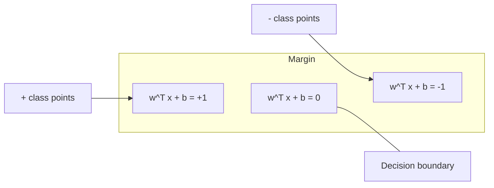
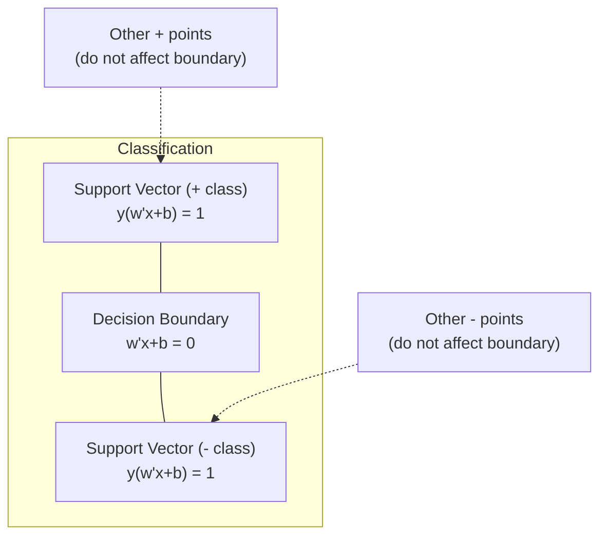
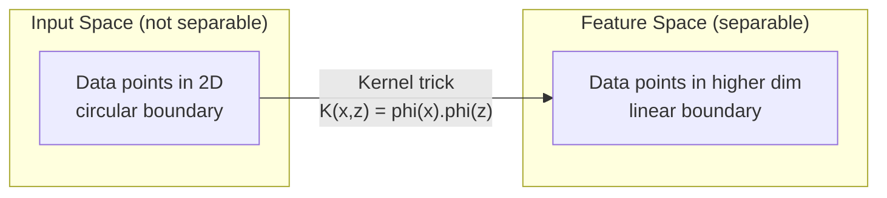

# 서포트 벡터 머신 (Support Vector Machines)

> 두 클래스 사이에서 가장 넓은 도로를 찾는 것. 이것이 핵심 아이디어의 전부입니다.

**유형:** Build (실습)
**Language:** Python
**선수 레슨:** Phase 1 (Lessons 08 Optimization, 14 Norms and Distances, 18 Convex Optimization)
**소요 시간:** ~90분

## 학습 목표

- 힌지 손실(hinge loss)과 원초 형태(primal formulation)에 대한 경사 하강법을 사용하여 선형 SVM을 밑바닥부터 구현합니다.
- 최대 마진 원리를 설명하고 학습된 모델에서 서포트 벡터(support vector)를 식별합니다.
- 선형, 다항식, RBF 커널을 비교하고 커널 트릭(kernel trick)이 명시적인 고차원 매핑을 어떻게 회피하는지 설명합니다.
- 마진 폭과 분류 오차 사이에서 C 매개변수가 제어하는 트레이드오프를 평가합니다.

## 문제

두 클래스의 데이터 포인트가 주어졌을 때, 이들을 분리하는 직선(또는 초평면)을 그려야 합니다. 무수히 많은 직선이 가능합니다. 어떤 직선을 선택해야 할까요?

마진이 가장 큰 직선입니다. 마진은 결정 경계(decision boundary)와 양쪽에서 가장 가까운 데이터 포인트 사이의 거리입니다. 마진이 넓을수록 분류기의 확신도가 높으며, 보지 못한 데이터에 대해 더 잘 일반화됩니다.

이러한 직관은 머신러닝에서 수학적으로 가장 우아한 알고리즘 중 하나인 서포트 벡터 머신(SVM)으로 이어집니다. SVM은 딥러닝 이전 시대에 가장 지배적인 분류 방법이었으며, 소규모 데이터셋, 고차원 데이터, 이론적 보장이 뒷받침되는 원리적이고 이해하기 쉬운 모델이 필요한 문제에서 여전히 최선의 선택지로 남아 있습니다.

SVM은 Phase 1의 내용과 직접적으로 연결됩니다. 최적화는 볼록(convex)하며(Lesson 18), 마진은 노름(norm)으로 측정되고(Lesson 14), 커널 트릭은 내적을 활용하여 고차원 공간에서 직접 계산하지 않고도 비선형 경계를 처리합니다.

## 개념

### 최대 마진 분류기 (The maximum margin classifier)

레이블 $y_i \in \lbrace -1, +1 \rbrace$ 및 특성 벡터 $x_i$를 가진 선형 분리 가능 데이터가 주어졌을 때, 클래스를 분리하는 초평면 $w^T x + b = 0$을 찾고자 합니다.

한 점 $x_i$에서 초평면까지의 거리는 다음과 같습니다:

```math
\text{distance} = \frac{\lvert w^T x_i + b \rvert}{\lVert w \rVert}
```

올바르게 분류된 점에 대해: $y_i (w^T x_i + b) > 0$. 마진은 초평면에서 양쪽의 가장 가까운 점까지의 거리의 두 배입니다.



최적화 문제:

```math
\begin{aligned}
\text{maximize} \quad & \frac{2}{\lVert w \rVert} \quad \text{(the margin width)} \\
\text{subject to} \quad & y_i (w^T x_i + b) \ge 1 \quad \text{for all } i
\end{aligned}
```

동치 표현으로 ($\lVert w \rVert^2$를 최소화하는 것이 최적화하기 더 쉬움):

```math
\begin{aligned}
\text{minimize} \quad & \frac{1}{2} \lVert w \rVert^2 \\
\text{subject to} \quad & y_i (w^T x_i + b) \ge 1 \quad \text{for all } i
\end{aligned}
```

이는 볼록 이차 계획법(convex quadratic program) 문제입니다. 유일한 전역 해를 가집니다. 마진 경계 위에 정확히 위치하는 데이터 포인트($y_i (w^T x_i + b) = 1$인 지점)를 서포트 벡터라고 합니다. 결정 경계를 결정하는 것은 오직 이 포인트들뿐입니다. 서포트 벡터가 아닌 포인트를 이동하거나 제거해도 경계는 변하지 않습니다.

### 서포트 벡터: 결정적인 소수



대부분의 훈련 포인트는 무관합니다. 오직 서포트 벡터만이 중요합니다. 이것이 SVM이 예측 시점에 메모리 효율적인 이유입니다. 전체 훈련 세트가 아니라 서포트 벡터만 저장하면 됩니다.

또한 서포트 벡터의 수는 일반화 오차(generalization error)에 대한 한계를 제공합니다. 데이터셋 크기 대비 서포트 벡터의 수가 적을수록 일반화 성능이 더 우수함을 의미합니다.

### 소프트 마진: C 매개변수로 노이즈 다루기

실제 데이터는 완벽하게 분리되는 경우가 드뭅니다. 일부 포인트는 경계의 잘못된 쪽에 있거나 마진 내부에 있을 수 있습니다. 소프트 마진 형태는 슬랙 변수(slack variable)를 도입하여 위반을 허용합니다.

```math
\begin{aligned}
\text{minimize} \quad & \frac{1}{2} \lVert w \rVert^2 + C \sum_i \xi_i \\
\text{subject to} \quad & y_i (w^T x_i + b) \ge 1 - \xi_i \\
& \xi_i \ge 0 \quad \text{for all } i
\end{aligned}
```

슬랙 변수 $\xi_i$는 포인트 $i$가 마진을 얼마나 위반하는지 측정합니다. $C$는 트레이드오프를 제어합니다:

| $C$ 값 | 동작 |
|---------|----------|
| 큰 $C$ | 위반에 큰 페널티를 부여합니다. 좁은 마진, 적은 오분류. 과적합(overfitting) 발생 |
| 작은 $C$ | 더 많은 위반을 허용합니다. 넓은 마진, 더 많은 오분류. 과소적합(underfitting) 발생 |

$C$는 규제(regularization) 강도의 역수입니다. 큰 $C$ = 적은 규제. 작은 $C$ = 강한 규제.

### 힌지 손실: SVM 손실 함수

소프트 마진 SVM은 제약 없는 최적화 문제로 다시 작성할 수 있습니다:

```math
\text{minimize} \quad \frac{1}{2} \lVert w \rVert^2 + C \sum_i \max(0, 1 - y_i (w^T x_i + b))
```

항 $\max(0, 1 - y_i f(x_i))$은 힌지 손실입니다. 포인트가 올바르게 분류되고 마진 밖에 있을 때는 0입니다. 포인트가 마진 내부에 있거나 오분류되었을 때는 선형적입니다.

```
Hinge loss for a single point:

loss
  |
  | \
  |  \
  |   \
  |    \
  |     \_______________
  |
  +-----|-----|-------->  y * f(x)
       0     1

Zero loss when y*f(x) >= 1 (correctly classified, outside margin).
Linear penalty when y*f(x) < 1.
```

로지스틱 손실(로지스틱 회귀)과 비교해 보세요:

```math
\begin{aligned}
\text{Hinge:} \quad & \max(0, 1 - y f(x)) && \text{Hard cutoff at margin} \\
\text{Logistic:} \quad & \log(1 + \exp(-y f(x))) && \text{Smooth, never exactly zero}
\end{aligned}
```

힌지 손실은 희소한 해(sparse solution)를 생성합니다(서포트 벡터만 0이 아닌 기여를 가짐). 로지스틱 손실은 모든 데이터 포인트를 사용합니다. 이로 인해 SVM은 예측 시점에 더 메모리 효율적입니다.

### 경사 하강법으로 선형 SVM 훈련하기

제약 조건이 있는 QP를 풀지 않고도, 힌지 손실에 L2 규제를 더한 식에 경사 하강법을 적용하여 선형 SVM을 훈련할 수 있습니다:

```math
\begin{aligned}
& L(w, b) = \frac{\lambda}{2} \lVert w \rVert^2 + \frac{1}{n} \sum_i \max(0, 1 - y_i (w^T x_i + b)) \\[6pt]
& \text{Gradient with respect to } w\text{:} \\
& \quad \text{If } y_i (w^T x_i + b) \ge 1\text{:} \quad \frac{\partial L}{\partial w} = \lambda w \\
& \quad \text{If } y_i (w^T x_i + b) < 1\text{:} \quad \frac{\partial L}{\partial w} = \lambda w - y_i x_i \\[6pt]
& \text{Gradient with respect to } b\text{:} \\
& \quad \text{If } y_i (w^T x_i + b) \ge 1\text{:} \quad \frac{\partial L}{\partial b} = 0 \\
& \quad \text{If } y_i (w^T x_i + b) < 1\text{:} \quad \frac{\partial L}{\partial b} = -y_i
\end{aligned}
```

이를 원초 형태(primal formulation)라고 합니다. 에포크당 $O(n \cdot d)$의 시간 복잡도로 실행되며, 여기서 $n$은 샘플 수이고 $d$는 특성 수입니다. 대규모 희소 고차원 데이터(텍스트 분류)의 경우 매우 빠릅니다.

### 쌍대 형태와 커널 트릭

SVM 문제의 라그랑주 쌍대(Lagrangian dual)(Phase 1 Lesson 18, KKT 조건 참조)는 다음과 같습니다:

```math
\begin{aligned}
\text{maximize} \quad & \sum_i \alpha_i - \frac{1}{2} \sum_{i,j} \alpha_i \alpha_j y_i y_j (x_i \cdot x_j) \\
\text{subject to} \quad & 0 \le \alpha_i \le C \\
& \sum_i \alpha_i y_i = 0
\end{aligned}
```

쌍대 형태는 오직 데이터 포인트 간의 내적 $x_i \cdot x_j$만을 포함합니다. 이것이 핵심 인사이트입니다. 모든 내적을 커널 함수 $K(x_i, x_j)$로 대체하면, SVM은 변환을 명시적으로 계산하지 않고도 비선형 경계를 학습할 수 있습니다.

```math
\begin{aligned}
\text{Linear kernel:} \quad & K(x, z) = x \cdot z \\
\text{Polynomial kernel:} \quad & K(x, z) = (x \cdot z + c)^d \\
\text{RBF (Gaussian):} \quad & K(x, z) = \exp(-\gamma \lVert x - z \rVert^2)
\end{aligned}
```

RBF 커널은 데이터를 무한 차원 공간으로 매핑합니다. 입력 공간에서 가까운 포인트는 커널 값이 1에 가깝습니다. 멀리 떨어진 포인트는 커널 값이 0에 가깝습니다. 어떤 매끄러운 결정 경계도 학습할 수 있습니다.



커널 트릭은 고차원 공간으로 직접 이동하지 않고도 해당 공간에서의 내적을 계산합니다. $D$차원에서 차수 $d$의 다항식 커널의 경우, 명시적 특성 공간은 $O(D^d)$차원을 가집니다. 하지만 $K(x, z)$는 $O(D)$ 시간에 계산됩니다.

### 회귀를 위한 SVM (SVR)

서포트 벡터 회귀(Support Vector Regression)는 데이터 주변에 폭이 $\epsilon$인 튜브(tube)를 적합합니다. 튜브 내부의 포인트는 손실이 0입니다. 튜브 외부의 포인트는 선형적으로 페널티를 받습니다.

```math
\begin{aligned}
\text{minimize} \quad & \frac{1}{2} \lVert w \rVert^2 + C \sum_i (\xi_i + \xi_i^*) \\
\text{subject to} \quad & y_i - (w^T x_i + b) \le \epsilon + \xi_i \\
& (w^T x_i + b) - y_i \le \epsilon + \xi_i^* \\
& \xi_i, \xi_i^* \ge 0
\end{aligned}
```

$\epsilon$ 매개변수는 튜브 폭을 제어합니다. 넓은 튜브 = 적은 서포트 벡터 = 더 부드러운 적합. 좁은 튜브 = 더 많은 서포트 벡터 = 더 빡빡한 적합.

### SVM이 딥러닝에 밀려난 이유 (그리고 여전히 승리하는 경우)

SVM은 1990년대 후반부터 2010년대 초반까지 머신러닝을 지배했습니다. 딥러닝이 SVM을 능가하게 된 데는 몇 가지 이유가 있습니다:

| 요인 | SVM | 딥러닝 |
|--------|------|---------------|
| 특성 공학(Feature engineering) | 필요함 | 특성을 스스로 학습함 |
| 확장성 | 커널 사용 시 $O(n^2)$ ~ $O(n^3)$ | SGD 사용 시 에포크당 $O(n)$ |
| 이미지/텍스트/오디오 | 수작업 특성 필요 | 원시 데이터에서 직접 학습 |
| 대규모 데이터셋 (>10만) | 느림 | 우수한 확장성 |
| GPU 가속 | 제한적인 이점 | 대규모 속도 향상 |

SVM은 다음과 같은 상황에서 여전히 우세합니다:
- 소규모 데이터셋 (수백 ~ 수천 개 수준의 샘플)
- 고차원 희소 데이터 (TF-IDF 특성을 가진 텍스트)
- 수학적 보장이 필요할 때 (마진 한계)
- 훈련 시간을 최소화해야 할 때 (선형 SVM은 매우 빠름)
- 명확한 마진 구조를 가진 이진 분류
- 이상 탐지(anomaly detection, One-Class SVM)

```figure
svm-margin
```

## 직접 구현하기

### 1단계: 힌지 손실 및 기울기

기본 토대입니다. 배치에 대한 힌지 손실과 해당 기울기(gradient)를 계산합니다.

```python
def hinge_loss(X, y, w, b):
    n = len(X)
    total_loss = 0.0
    for i in range(n):
        margin = y[i] * (dot(w, X[i]) + b)
        total_loss += max(0.0, 1.0 - margin)
    return total_loss / n
```

### 2단계: 경사 하강법을 통한 선형 SVM

규제화된 힌지 손실을 최소화하여 훈련합니다. QP 솔버는 필요하지 않습니다.

```python
class LinearSVM:
    def __init__(self, lr=0.001, lambda_param=0.01, n_epochs=1000):
        self.lr = lr
        self.lambda_param = lambda_param
        self.n_epochs = n_epochs
        self.w = None
        self.b = 0.0

    def fit(self, X, y):
        n_features = len(X[0])
        self.w = [0.0] * n_features
        self.b = 0.0

        for epoch in range(self.n_epochs):
            for i in range(len(X)):
                margin = y[i] * (dot(self.w, X[i]) + self.b)
                if margin >= 1:
                    self.w = [wj - self.lr * self.lambda_param * wj
                              for wj in self.w]
                else:
                    self.w = [wj - self.lr * (self.lambda_param * wj - y[i] * X[i][j])
                              for j, wj in enumerate(self.w)]
                    self.b -= self.lr * (-y[i])

    def predict(self, X):
        return [1 if dot(self.w, x) + self.b >= 0 else -1 for x in X]
```
### 3단계: 커널 함수

선형(linear), 다항식(polynomial), RBF 커널을 구현합니다.

```python
def linear_kernel(x, z):
    return dot(x, z)

def polynomial_kernel(x, z, degree=3, c=1.0):
    return (dot(x, z) + c) ** degree

def rbf_kernel(x, z, gamma=0.5):
    diff = [xi - zi for xi, zi in zip(x, z)]
    return math.exp(-gamma * dot(diff, diff))
```

### 4단계: 마진 및 서포트 벡터 식별

학습이 끝난 후, 어떤 점이 서포트 벡터인지 식별하고 마진의 너비를 계산합니다.

```python
def find_support_vectors(X, y, w, b, tol=1e-3):
    support_vectors = []
    for i in range(len(X)):
        margin = y[i] * (dot(w, X[i]) + b)
        if abs(margin - 1.0) < tol:
            support_vectors.append(i)
    return support_vectors
```

모든 데모가 포함된 전체 구현은 `code/svm.py`을 참조하세요.

## 사용법

scikit-learn을 사용하는 방법은 다음과 같습니다.

```python
from sklearn.svm import SVC, LinearSVC, SVR
from sklearn.preprocessing import StandardScaler
from sklearn.pipeline import Pipeline

clf = Pipeline([
    ("scaler", StandardScaler()),
    ("svm", SVC(kernel="rbf", C=1.0, gamma="scale")),
])
clf.fit(X_train, y_train)
print(f"Accuracy: {clf.score(X_test, y_test):.4f}")
print(f"Support vectors: {clf['svm'].n_support_}")
```

중요: SVM을 학습시키기 전에는 항상 특성(feature)의 스케일을 조정해야 합니다. 마진이 $\lVert w \rVert$에 의존하므로 SVM은 특성의 크기에 민감하며, 스케일이 조정되지 않은 특성은 기하학적 구조를 왜곡합니다.

대규모 데이터셋의 경우, `SVC`(쌍대 문제 정식화, $O(n^2)$ ~ $O(n^3){}$) 대신 `LinearSVC`(원시 문제 정식화, 에포크당 $O(n \cdot d)$, $n$에 선형)를 사용하세요.

```python
from sklearn.svm import LinearSVC

clf = Pipeline([
    ("scaler", StandardScaler()),
    ("svm", LinearSVC(C=1.0, max_iter=10000)),
])
```

## 연습 문제

1. 2차원의 선형 분리 가능한(linearly separable) 데이터셋을 생성합니다. LinearSVM을 학습시키고 서포트 벡터를 식별하세요. 서포트 벡터가 결정 경계에 가장 가까운 점들임을 확인합니다.

2. 노이즈가 있는 데이터셋에서 $C$를 0.001부터 1000까지 변경해 봅니다. 각 $C$ 값에 대한 결정 경계를 시각화하세요. 넓은 마진(과소적합)에서 좁은 마진(과적합)으로 변화하는 과정을 관찰합니다.

3. 클래스 경계가 원형(비선형)인 데이터셋을 만듭니다. 선형 SVM이 실패함을 보여주세요. RBF 커널 행렬을 계산하고 커널로 유도된 특성 공간에서 클래스들이 분리 가능해짐을 확인합니다.

4. 동일한 데이터셋에서 힌지 손실(hinge loss)과 로지스틱 손실(logistic loss)을 비교합니다. 선형 SVM과 로지스틱 회귀를 학습시키세요. 각 모델의 결정 경계에 기여하는 학습 점의 수(서포트 벡터 vs 모든 점)를 세어 봅니다.

5. SVR(입실론 무감도 손실)을 구현합니다. 이를 $y = \sin(x) + \text{noise}$에 적합(fit)시킵니다. 예측값 주변의 입실론 튜브를 시각화하고 서포트 벡터(튜브 외부의 점들)를 강조 표시하세요.

## 핵심 용어

| 용어 | 실제 의미 |
|------|----------------------|
| 서포트 벡터(Support vectors) | 결정 경계에 가장 가까운 학습 데이터 점들. 초평면을 결정하는 유일한 점들 |
| 마진(Margin) | 결정 경계와 가장 가까운 서포트 벡터 사이의 거리. SVM은 이를 최대화함 |
| 힌지 손실(Hinge loss) | $\max(0, 1 - y f(x))$. 올바르게 분류되고 마진 외부에 있으면 0. 그렇지 않으면 선형 페널티 부여 |
| C 매개변수 | 마진 너비와 분류 오차 사이의 절충(trade-off). 큰 $C$ = 좁은 마진, 작은 $C$ = 넓은 마진 |
| 소프트 마진(Soft margin) | 슬랙 변수를 통해 마진 위반을 허용하는 SVM 정식화. 분리 불가능한 데이터를 다룸 |
| 커널 트릭(Kernel trick) | 고차원 특성 공간으로 명시적 매핑을 하지 않고도 해당 공간에서의 내적을 계산하는 기법 |
| 선형 커널(Linear kernel) | $K(x, z) = x \cdot z$. 표준 내적과 동일함. 선형 분리 가능한 데이터에 사용 |
| RBF 커널 | $K(x, z) = \exp(-\gamma \Vert x-z \Vert^2)$. 무한 차원으로 매핑함. 모든 매끄러운 경계를 학습 가능 |
| 다항식 커널(Polynomial kernel) | $K(x, z) = (x \cdot z + c)^d$. 다항식 조합의 특성 공간으로 매핑함 |
| 쌍대 정식화(Dual formulation) | 데이터 점 간의 내적에만 의존하도록 SVM 문제를 재구성한 형태. 커널 사용을 가능하게 함 |
| SVR | 서포트 벡터 회귀(Support Vector Regression). 데이터 주변에 입실론 튜브를 적합시킴. 튜브 내부의 점들은 손실이 0임 |
| 슬랙 변수(Slack variables) | $\xi_i$: 점이 마진을 얼마나 위반하는지 측정함. 마진 외부에서 올바르게 분류된 점은 0 |
| 최대 마진(Maximum margin) | 각 클래스의 가장 가까운 점들과의 거리를 최대화하는 초평면을 선택하는 원리 |

## 추천 자료

- [Vapnik: The Nature of Statistical Learning Theory (1995)](https://link.springer.com/book/10.1007/978-1-4757-3264-1) - SVM과 통계적 학습 이론에 관한 기초 명저
- [Cortes & Vapnik: Support-vector networks (1995)](https://link.springer.com/article/10.1007/BF00994018) - 원본 SVM 논문
- [Platt: Sequential Minimal Optimization (1998)](https://www.microsoft.com/en-us/research/publication/sequential-minimal-optimization-a-fast-algorithm-for-training-support-vector-machines/) - SVM 학습을 실용적으로 만든 SMO 알고리즘
- [scikit-learn SVM documentation](https://scikit-learn.org/stable/modules/svm.html) - 구현 세부 사항이 포함된 실용적인 가이드
- [LIBSVM: A Library for Support Vector Machines](https://www.csie.ntu.edu.tw/~cjlin/libsvm/) - 대부분의 SVM 구현체 기반이 되는 C++ 라이브러리
