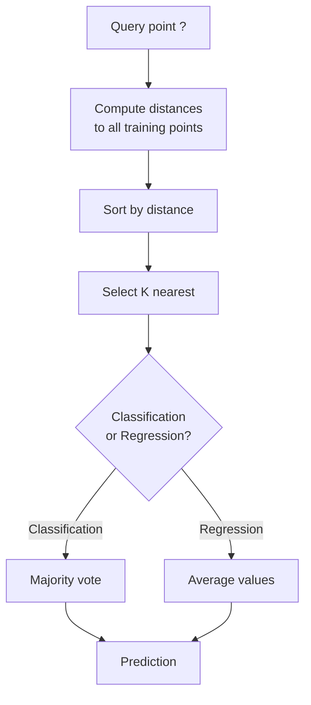
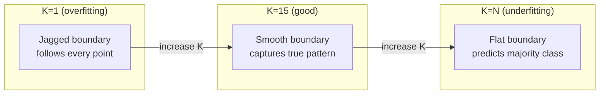
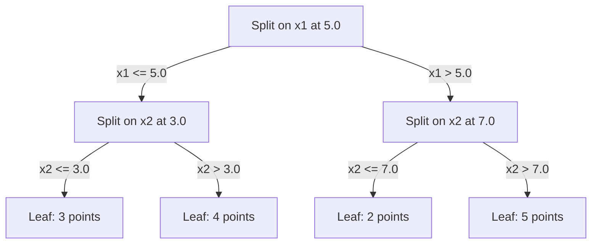

# K-최근접 이웃과 거리

> 모든 것을 저장합니다. 이웃을 보고 예측합니다. 실제로 동작하는 가장 단순한 알고리즘입니다.

**유형:** Build (실습)
**Language:** Python
**선수 레슨:** Phase 1 (Lesson 14 Norms and Distances)
**소요 시간:** ~90분

## Learning Objectives

- K 값과 거리 가중치 투표(distance-weighted voting)를 설정할 수 있는 KNN 분류 및 회귀를 밑바닥부터 구현합니다.
- L1, L2, 코사인, 민코프스키(Minkowski) 거리 측도를 비교하고 주어진 데이터 유형에 적합한 측도를 선택합니다.
- 차원의 저주(curse of dimensionality)를 설명하고 고차원 공간에서 KNN의 성능이 저하되는 이유를 증명합니다.
- 효율적인 최근접 이웃 탐색을 위한 KD-트리(KD-tree)를 구축하고, 무차별 대입(brute-force) 방식보다 성능이 우수한 경우를 분석합니다.

## The Problem

데이터셋이 주어졌습니다. 새로운 데이터 포인트가 도착합니다. 이를 분류하거나 값을 예측해야 합니다. (선형 회귀나 SVM처럼) 데이터로부터 파라미터를 학습하는 대신, 새 포인트에 가장 가까운 K개의 훈련 포인트를 찾아 투표하게 하면 됩니다.

이것이 바로 K-최근접 이웃(K-nearest neighbors, KNN)입니다. 훈련 단계가 없습니다. 학습할 파라미터도 없습니다. 최소화해야 할 손실 함수도 없습니다. 전체 훈련 세트를 저장해 두고 예측 시점에 거리를 계산합니다.

너무 단순해서 잘 동작하지 않을 것 같지만, KNN은 많은 문제, 특히 중소 규모 데이터셋에서 놀라울 정도로 경쟁력이 있습니다. 또한 KNN을 깊이 이해하면 거리 측도의 선택(Phase 1 Lesson 14와 연결), 차원의 저주, 게으른 학습(lazy learning)과 열정적 학습(eager learning)의 차이 등 근본적인 개념들이 명확해집니다.

KNN은 현대 AI 전반에서도 이름만 바뀐 채 어디에나 등장합니다. 벡터 데이터베이스는 임베딩(embedding)에 대해 KNN 탐색을 수행합니다. 검색 증강 생성(retrieval-augmented generation, RAG)은 가장 가까운 K개의 문서 청크를 찾습니다. 추천 시스템은 유사한 사용자나 아이템을 찾습니다. 알고리즘은 동일하며, 규모와 자료구조만 다를 뿐입니다.

## The Concept

### How KNN works

레이블이 지정된 데이터 포인트와 새로운 쿼리 포인트가 주어졌을 때:

1. 쿼리에서 데이터셋의 모든 포인트까지의 거리를 계산합니다.
2. 거리순으로 정렬합니다.
3. 가장 가까운 K개의 포인트를 선택합니다.
4. 분류의 경우: K개 이웃 간의 다수결 투표를 진행합니다.
5. 회귀의 경우: K개 이웃 값들의 평균(또는 가중 평균)을 구합니다.



이것이 알고리즘의 전부입니다. 피팅도, 경사 하강법도, 에포크도 없습니다.

### Choosing K

K는 유일한 하이퍼파라미터입니다. 편향-분산 트레이드오프(bias-variance trade-off)를 제어합니다:

| K | Behavior |
|---|----------|
| $K = 1$ | 결정 경계가 모든 포인트를 따릅니다. 훈련 오차는 0입니다. 높은 분산을 가지며 과적합(overfit)됩니다. |
| 작은 K (3-5) | 국소 구조에 민감합니다. 복잡한 경계를 포착할 수 있습니다. |
| 큰 K | 더 매끄러운 경계를 형성합니다. 노이즈에 더 강건합니다. 과소적합(underfit)될 수 있습니다. |
| $K = N$ | 모든 포인트에 대해 다수 클래스를 예측합니다. 최대 편향을 갖습니다. |

$N$개 포인트로 구성된 데이터셋의 일반적인 시작점은 $K = \sqrt{N}$입니다. 이진 분류에서는 동점을 방지하기 위해 홀수 K를 사용합니다.



### Distance metrics

거리 함수는 "가깝다"는 것이 무엇을 의미하는지 정의합니다. 측도가 다르면 이웃도 달라지고, 예측도 달라집니다.

**L2 (유클리드, Euclidean)** 거리가 기본값입니다. 직선 거리입니다.

```math
d(a, b) = \sqrt{\sum_i (a_i - b_i)^2}
```

피처 스케일에 민감합니다. KNN에서 L2를 사용하기 전에는 항상 피처를 표준화해야 합니다.

**L1 (맨해튼, Manhattan)** 거리는 절댓값 차이의 합입니다. 차이를 제곱하지 않기 때문에 L2보다 이상치(outlier)에 더 강건합니다.

```math
d(a, b) = \sum_i \lvert a_i - b_i \rvert
```

**코사인 거리(Cosine distance)**는 벡터 간의 각도를 측정하며 크기는 무시합니다. 텍스트 및 임베딩 데이터에 필수적입니다.

```math
d(a, b) = 1 - \frac{a \cdot b}{\lVert a \rVert \, \lVert b \rVert}
```

**민코프스키(Minkowski)** 거리는 파라미터 $p$를 통해 L1과 L2를 일반화합니다.

```math
\begin{aligned}
& d(a, b) = \left( \sum_i \lvert a_i - b_i \rvert^p \right)^{1/p} \\[6pt]
& p=1\text{: Manhattan} \\
& p=2\text{: Euclidean} \\
& p \to \infty\text{: Chebyshev (max absolute difference)}
\end{aligned}
```

어떤 측도를 사용할지는 데이터에 따라 달라집니다:

| Data type | Best metric | Why |
|-----------|------------|-----|
| 수치형 피처, 유사한 스케일 | L2 (유클리드) | 기본값이며 공간 데이터에 적합합니다. |
| 수치형 피처, 이상치 존재 | L1 (맨해튼) | 강건하며 큰 차이를 증폭시키지 않습니다. |
| 텍스트 임베딩 | 코사인 | 크기는 노이즈이고 방향이 의미를 나타냅니다. |
| 고차원 희소 데이터 | 코사인 또는 L1 | L2는 차원의 저주를 겪습니다. |
| 혼합 유형 | 커스텀 거리 | 피처 유형별로 측도를 결합합니다. |

### Weighted KNN

표준 KNN은 K개의 모든 이웃에 동일한 가중치를 부여합니다. 그러나 거리 0.1에 있는 이웃은 거리 5.0에 있는 이웃보다 더 큰 비중을 가져야 합니다.

**거리 가중 KNN(Distance-weighted KNN)**은 각 이웃에 거리에 반비례하는 가중치를 부여합니다:

```math
\begin{aligned}
& \text{weight}_i = \frac{1}{\text{distance}_i + \epsilon} \\[6pt]
& \text{For classification: weighted vote} \\
& \text{For regression: weighted average} = \frac{\sum_i w_i y_i}{\sum_i w_i}
\end{aligned}
```

$\epsilon$는 쿼리 포인트가 훈련 포인트와 정확히 일치할 때 0으로 나누는 것을 방지합니다.

가중 KNN은 먼 이웃의 기여도가 어차피 매우 작기 때문에 K 값 선택에 덜 민감합니다.

### The curse of dimensionality

고차원에서는 KNN 성능이 저하됩니다. 이는 막연한 우려가 아니라 수학적 사실입니다.

**문제 1: 거리의 수렴.** 차원이 증가함에 따라 최대 거리와 최소 거리의 비율이 1에 가까워집니다. 모든 포인트가 쿼리로부터 거의 같은 정도로 "멀어지게" 됩니다.

```
In d dimensions, for random uniform points:

d=2:    max_dist / min_dist = varies widely
d=100:  max_dist / min_dist ~ 1.01
d=1000: max_dist / min_dist ~ 1.001

When all distances are nearly equal, "nearest" is meaningless.
```

**문제 2: 부피의 폭발.** 데이터의 고정된 비율 내에서 K개의 이웃을 확보하려면, 피처 공간의 훨씬 더 큰 비율을 포함하도록 탐색 반경을 넓혀야 합니다. 고차원에서의 "이웃"은 공간의 대부분을 포괄하게 됩니다.

**문제 3: 모서리의 지배.** d차원 단위 초입방체(unit hypercube)에서 대부분의 부피는 중심이 아닌 모서리 근처에 집중됩니다. 초입방체에 내접하는 초구(hypersphere)는 d가 증가함에 따라 부피 비율이 0에 수렴합니다.

실질적인 시사점: KNN은 피처가 약 20~50개 이하일 때 잘 동작합니다. 그 이상에서는 KNN을 적용하기 전에 차원 축소(PCA, UMAP, t-SNE)를 수행하거나, 데이터 본연의 낮은 내재 차원을 활용하는 트리 기반 탐색 구조를 사용해야 합니다.

### KD-trees: fast nearest neighbor search

무차별 대입 KNN은 쿼리에서 모든 훈련 포인트까지의 거리를 계산합니다. 이는 쿼리당 $O(n \cdot d)$의 비용이 듭니다. 대규모 데이터셋에서는 너무 느립니다.

KD-트리는 피처 축을 따라 공간을 재귀적으로 분할합니다. 각 수준에서 한 차원의 중앙값(median)을 기준으로 분할합니다.



가장 가까운 이웃을 찾으려면 쿼리를 포함하는 리프 노드까지 트리를 탐색한 다음, 역추적(backtrack)하면서 더 가까운 포인트를 포함할 가능성이 있는 인접 분할 영역만 확인합니다.

평균 쿼리 시간: 저차원에서는 $O(\log n)$입니다. 그러나 고차원($d > 20$)에서는 역추적 시 가지치기되는 분기가 점점 줄어들어 KD-트리의 성능이 $O(n)$로 저하됩니다.

### Ball trees: better for moderate dimensions

볼 트리(Ball tree)는 축에 정렬된 상자 대신 중첩된 초구(hypersphere) 형태로 데이터를 분할합니다. 각 노드는 해당 서브트리의 모든 포인트를 포함하는 볼(중심 + 반경)을 정의합니다.

KD-트리 대비 장점:
- 중간 규모 차원(최대 약 50차원)에서 더 잘 동작합니다.
- 축에 정렬되지 않은 구조를 잘 처리합니다.
- 경계 볼륨이 더 조밀하여 탐색 시 더 많은 분기가 가지치기(pruned)됩니다.

KD-트리와 볼 트리는 모두 정확한(exact) 알고리즘입니다. 진정한 대규모 탐색(수백만 개의 포인트, 수백 차원)에서는 근사 최근접 이웃(approximate nearest neighbor, ANN) 방법(HNSW, IVF, 곱 양자화(product quantization))이 대신 사용됩니다. 이에 대해서는 Phase 1 Lesson 14에서 다룹니다.
### 지연 학습 vs 조급한 학습(Lazy learning vs eager learning)

KNN은 지연 학습자(lazy learner)입니다. 학습 시점에는 아무런 작업도 하지 않고, 모든 작업을 예측 시점에 수행합니다. 대부분의 다른 알고리즘(선형 회귀, SVM, 신경망)은 조급한 학습자(eager learner)입니다. 이들은 학습 시점에 많은 계산을 수행하여 컴팩트한 모델을 구축한 다음, 빠른 예측을 제공합니다.

| 측면 | 지연 학습 (KNN) | 조급한 학습 (SVM, 신경망) |
|--------|------------|------------------------|
| 학습 시간 | $O(1)$ 데이터를 저장하기만 함 | $O(n \cdot \text{epochs})$ |
| 예측 시간 | 쿼리당 $O(n \cdot d)$ | $O(d)$ 또는 $O(\text{parameters})$ |
| 예측 시 메모리 | 전체 학습 데이터셋 저장 | 모델 파라미터만 저장 |
| 새 데이터 적응 | 포인트를 즉시 추가 | 모델 재학습 필요 |
| 결정 경계 | 암묵적, 즉석에서 계산됨 | 명시적, 학습 후 고정됨 |

지연 학습은 다음과 같은 경우에 이상적입니다:
- 데이터셋이 빈번하게 변경될 때 (재학습 없이 포인트 추가/제거)
- 매우 적은 수의 쿼리에 대해서만 예측이 필요할 때
- 학습 시간을 전혀 들이고 싶지 않을 때
- 데이터셋이 충분히 작아서 전수 탐색(brute-force search)이 빠를 때

### 회귀를 위한 KNN

다수결 투표(majority voting) 대신, 회귀를 위한 KNN은 K개 이웃의 타깃값들을 평균합니다.

```math
\begin{aligned}
& \text{prediction} = \frac{1}{K} \sum_{i \in K \text{ nearest neighbors}} y_i \\[6pt]
& \text{Or with distance weighting:} \\
& \text{prediction} = \frac{\sum_i w_i y_i}{\sum_i w_i} \quad \text{where } w_i = \frac{1}{\text{distance}_i + \epsilon}
\end{aligned}
```

KNN 회귀는 구분적 상수(piecewise-constant) 또는 거리 가중치를 사용할 경우 구분적 평활(piecewise-smooth) 예측을 생성합니다. 학습 데이터의 범위를 벗어난 외삽(extrapolation)은 불가능합니다. 학습 타깃이 모두 0에서 100 사이라면, KNN은 결코 200을 예측할 수 없습니다.

```figure
knn-smoothness
```

## 직접 구현하기

### 1단계: 거리 함수

L1, L2, 코사인, 민코프스키(Minkowski) 거리를 구현합니다. 이는 파트 1 레슨 14와 직접적으로 연결됩니다.

```python
import math

def l2_distance(a, b):
    return math.sqrt(sum((ai - bi) ** 2 for ai, bi in zip(a, b)))

def l1_distance(a, b):
    return sum(abs(ai - bi) for ai, bi in zip(a, b))

def cosine_distance(a, b):
    dot_val = sum(ai * bi for ai, bi in zip(a, b))
    norm_a = math.sqrt(sum(ai ** 2 for ai in a))
    norm_b = math.sqrt(sum(bi ** 2 for bi in b))
    if norm_a == 0 or norm_b == 0:
        return 1.0
    return 1.0 - dot_val / (norm_a * norm_b)

def minkowski_distance(a, b, p=2):
    if p == float('inf'):
        return max(abs(ai - bi) for ai, bi in zip(a, b))
    return sum(abs(ai - bi) ** p for ai, bi in zip(a, b)) ** (1 / p)
```

### 2단계: KNN 분류기 및 회귀기

K 값, 거리 메트릭, 선택적 거리 가중치를 설정할 수 있는 완전한 KNN을 구축합니다.

```python
class KNN:
    def __init__(self, k=5, distance_fn=l2_distance, weighted=False,
                 task="classification"):
        self.k = k
        self.distance_fn = distance_fn
        self.weighted = weighted
        self.task = task
        self.X_train = None
        self.y_train = None

    def fit(self, X, y):
        self.X_train = X
        self.y_train = y

    def predict(self, X):
        return [self._predict_one(x) for x in X]
```

### 3단계: 효율적인 탐색을 위한 KD-트리

각 차원의 중앙값(median)을 기준으로 재귀적으로 분할하는 KD-트리를 바닥부터 구현합니다.

```python
class KDTree:
    def __init__(self, X, indices=None, depth=0):
        # Recursively partition the data
        self.axis = depth % len(X[0])
        # Split on median of the current axis
        ...

    def query(self, point, k=1):
        # Traverse to leaf, then backtrack
        ...
```

모든 헬퍼 메서드와 데모가 포함된 완전한 구현은 `code/knn.py`을 참조하십시오.

### 4단계: 특성 스케일링

거리는 특성의 크기(magnitude)에 민감하므로 KNN에는 특성 스케일링(feature scaling)이 필수적입니다. 0에서 1000 범위를 갖는 특성은 0에서 1 범위를 갖는 특성을 압도하게 됩니다.

```python
def standardize(X):
    n = len(X)
    d = len(X[0])
    means = [sum(X[i][j] for i in range(n)) / n for j in range(d)]
    stds = [
        max(1e-10, (sum((X[i][j] - means[j]) ** 2 for i in range(n)) / n) ** 0.5)
        for j in range(d)
    ]
    return [[((X[i][j] - means[j]) / stds[j]) for j in range(d)] for i in range(n)], means, stds
```

## 사용해 보기

scikit-learn 사용 시:

```python
from sklearn.neighbors import KNeighborsClassifier
from sklearn.preprocessing import StandardScaler
from sklearn.pipeline import Pipeline

clf = Pipeline([
    ("scaler", StandardScaler()),
    ("knn", KNeighborsClassifier(n_neighbors=5, metric="euclidean")),
])
clf.fit(X_train, y_train)
print(f"Accuracy: {clf.score(X_test, y_test):.4f}")
```

scikit-learn은 데이터셋이 충분히 크고 차원이 충분히 낮을 때 KD-트리나 볼 트리(ball tree)를 자동으로 사용합니다. 고차원 데이터의 경우 전수 탐색으로 폴백(fallback)합니다. 이는 `algorithm` 파라미터로 제어할 수 있습니다.

대규모 최근접 이웃 탐색(수백만 개의 벡터)의 경우, FAISS, Annoy 또는 벡터 데이터베이스를 사용하십시오:

```python
import faiss

index = faiss.IndexFlatL2(dimension)
index.add(embeddings)
distances, indices = index.search(query_vectors, k=5)
```

## 연습문제

1. 3개 클래스를 가진 2D 데이터셋에서 KNN 분류를 구현하십시오. $K=1$, $K=5$, $K=15$, $K=N$에 대해 결정 경계를 시각화하십시오. 과대적합(overfitting)에서 과소적합(underfitting)으로 전환되는 과정을 관찰하십시오.

2. 2, 5, 10, 50, 100, 500차원에서 1,000개의 무작위 포인트를 생성하십시오. 각 차원에 대해 쌍별 최대 거리와 쌍별 최소 거리의 비율을 계산하십시오. 차원의 저주(curse of dimensionality)를 시각화하기 위해 차원 대비 비율 그래프를 그리십시오.

3. 텍스트 분류 문제(TF-IDF 벡터 사용)에서 KNN의 L1, L2, 코사인 거리를 비교하십시오. 어떤 메트릭이 가장 높은 정확도를 제공합니까? 텍스트 데이터에서 코사인 거리가 우수한 경향을 보이는 이유는 무엇입니까?

4. KD-트리를 구현하고 2D, 10D, 50D에서 1,000개, 10,000개, 100,000개 포인트의 데이터셋에 대해 전수 탐색 대비 쿼리 시간을 측정하십시오. 몇 차원에서 KD-트리가 전수 탐색보다 빠르지 않게 됩니까?

5. $y = \sin(x) + \text{noise}$에 대해 가중치가 적용된 KNN 회귀기를 구축하십시오. $K=3, 10, 30$에 대해 가중치가 없는 KNN과 비교하십시오. 특히 큰 K에 대해 가중치 적용이 더 부드러운 예측을 생성함을 보이십시오.

## 핵심 용어

| 용어 | 실제 의미 |
|------|----------------------|
| K-최근접 이웃(K-nearest neighbors) | 쿼리에서 가장 가까운 K개의 학습 포인트를 찾아 예측하는 비모수(non-parametric) 알고리즘 |
| 지연 학습(Lazy learning) | 학습 시점에 아무런 계산도 하지 않음. 모든 작업이 예측 시점에 발생함. KNN이 대표적인 예 |
| 조급한 학습(Eager learning) | 학습 시점에 많은 계산을 수행하여 컴팩트한 모델을 구축함. 대부분의 ML 알고리즘이 조급한 학습에 해당 |
| 차원의 저주(Curse of dimensionality) | 고차원에서는 거리가 수렴하고 이웃 영역이 공간의 대부분을 덮을 정도로 팽창하여 KNN이 비효율적으로 변하는 현상 |
| KD-트리(KD-tree) | 특성 축을 따라 공간을 재귀적으로 분할하는 이진 트리. 저차원에서 $O(\log n)$ 쿼리 제공 |
| 볼 트리(Ball tree) | 중첩된 초구(hypersphere)들의 트리. 중간 차원(최대 약 50차원)에서 KD-트리보다 우수하게 작동 |
| 가중치 적용 KNN(Weighted KNN) | 거리에 반비례하여 이웃에 가중치를 부여함. 더 가까운 이웃이 예측에 더 큰 영향을 미침 |
| 특성 스케일링(Feature scaling) | 특성들을 비교 가능한 범위로 정규화하는 작업. KNN과 같은 거리 기반 방법에서 필수적 |
| 다수결 투표(Majority vote) | K개의 이웃 중 가장 흔한 클래스를 세어 분류하는 방식 |
| 전수 탐색(Brute force search) | 모든 학습 포인트와의 거리를 계산함. 쿼리당 $O(n \cdot d)$. 정확하지만 큰 $n$에서는 느림 |
| 근사 최근접 이웃(Approximate nearest neighbor) | 정확한 탐색보다 훨씬 빠르게 근사적으로 가장 가까운 포인트를 찾는 알고리즘(HNSW, LSH, IVF) |
| 보로노이 다이어그램(Voronoi diagram) | 각 영역이 다른 어떤 학습 포인트보다 특정 학습 포인트에 더 가까운 점들을 포함하도록 공간을 분할한 것. $K=1$ KNN은 보로노이 경계를 생성함 |

## 더 읽을거리

- [Cover & Hart: Nearest Neighbor Pattern Classification (1967)](https://ieeexplore.ieee.org/document/1053964) - KNN의 오차율이 베이즈 최적 오차율의 최대 2배 이하임을 증명한 기념비적인 논문
- [Friedman, Bentley, Finkel: An Algorithm for Finding Best Matches in Logarithmic Expected Time (1977)](https://dl.acm.org/doi/10.1145/355744.355745) - 최초의 KD-트리 논문
- [Beyer et al.: When Is "Nearest Neighbor" Meaningful? (1999)](https://link.springer.com/chapter/10.1007/3-540-49257-7_15) - 최근접 이웃에서의 차원의 저주에 관한 형식적 분석
- [scikit-learn Nearest Neighbors documentation](https://scikit-learn.org/stable/modules/neighbors.html) - 알고리즘 선택에 관한 실용적인 가이드
- [FAISS: A Library for Efficient Similarity Search](https://github.com/facebookresearch/faiss) - 10억 단위 규모의 근사 최근접 이웃 탐색을 위한 Meta의 라이브러리
