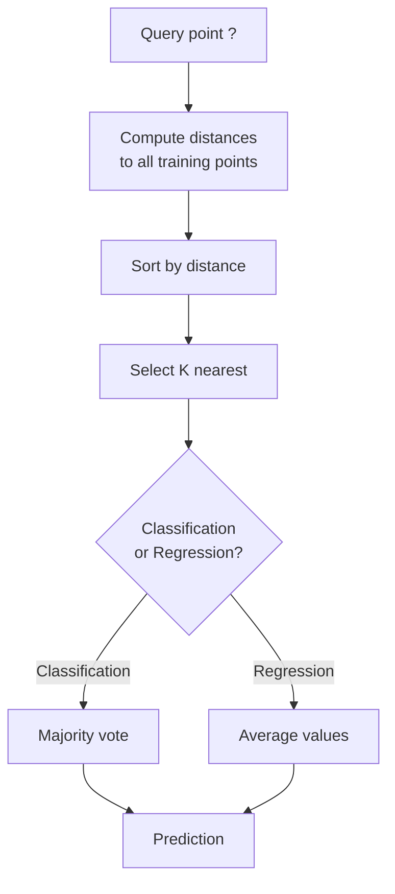
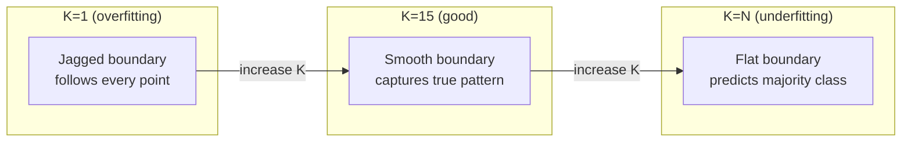
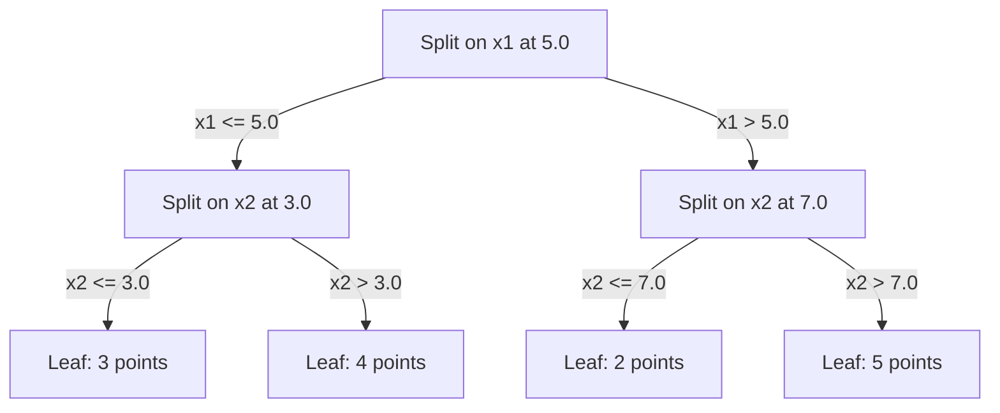

# K-최근접 이웃과 거리 지표

> 모든 것을 저장하고, 이웃을 보고 예측합니다. 실제로 작동하는 가장 단순한 알고리즘입니다.

**유형:** Build (실습)
**사용 언어:** Python, TypeScript
**선수 레슨:** Phase 1 (Lesson 14 Norms and Distances)
**소요 시간:** ~90분

## 학습 목표

- 설정 가능한 K와 거리 가중치 투표를 적용한 KNN 분류 및 회귀를 밑바닥부터 구현합니다.
- L1, L2, 코사인, 민코프스키 거리 지표를 비교하고 주어진 데이터 유형에 적합한 지표를 선택합니다.
- 차원의 저주를 설명하고 고차원 공간에서 KNN의 성능이 저하되는 이유를 입증합니다.
- 효율적인 최근접 이웃 탐색을 위한 KD-트리를 구축하고 무차별 대입(brute-force) 방식보다 성능이 우수한 시점을 분석합니다.

## 문제

데이터셋이 주어졌습니다. 새로운 데이터 포인트가 도착합니다. 이를 분류하거나 값을 예측해야 합니다. 데이터로부터 파라미터를 학습하는 대신(선형 회귀나 SVM처럼), 새 포인트와 가장 가까운 K개의 훈련 포인트를 찾아 투표하게 만듭니다.

이것이 K-최근접 이웃(K-nearest neighbors, KNN)입니다. 훈련 단계가 없습니다. 학습할 파라미터도 없습니다. 최소화할 손실 함수도 없습니다. 전체 훈련 세트를 저장하고 예측 시점에 거리를 계산합니다.

작동하기에는 너무 단순해 보일 수 있습니다. 하지만 KNN은 특히 중소 규모 데이터셋을 다룰 때 여러 문제에서 놀라울 정도로 경쟁력이 있으며, 이를 깊이 이해하면 핵심 개념들을 파악할 수 있습니다. 즉, 거리 지표의 선택(Phase 1 Lesson 14와 연결), 차원의 저주, 그리고 게으른 학습(lazy learning)과 열정적 학습(eager learning)의 차이입니다.

KNN은 최신 AI 전반에서도 다른 이름으로 항상 등장합니다. 벡터 데이터베이스는 임베딩(embedding)에 대해 KNN 탐색을 수행합니다. 검색 증강 생성(RAG)은 가장 가까운 K개의 문서 청크를 찾습니다. 추천 시스템은 유사한 사용자나 아이템을 찾습니다. 알고리즘은 동일하며, 규모와 데이터 구조만 다를 뿐입니다.

## 개념

### KNN의 작동 방식

레이블이 지정된 포인트 데이터셋과 새로운 쿼리 포인트가 주어졌을 때:

1. 쿼리에서 데이터셋의 모든 포인트까지의 거리를 계산합니다.
2. 거리를 기준으로 정렬합니다.
3. 가장 가까운 K개의 포인트를 선택합니다.
4. 분류의 경우: K개 이웃 간의 다수결 투표를 수행합니다.
5. 회귀의 경우: K개 이웃 값의 평균(또는 가중 평균)을 구합니다.



이것이 알고리즘의 전부입니다. 피팅도, 경사 하강법도, 에포크도 없습니다.

### K 선택하기

K는 유일한 하이퍼파라미터입니다. 편향-분산 트레이드오프(bias-variance trade-off)를 제어합니다.

| K | 동작 |
|---|----------|
| $K = 1$ | 결정 경계가 모든 포인트를 따름. 훈련 오차 0. 높은 분산. 과대적합(overfitting) |
| 작은 K (3-5) | 국소적 구조에 민감함. 복잡한 경계를 포착할 수 있음 |
| 큰 K | 더 매끄러운 경계. 노이즈에 더 견고함. 과소적합(underfitting)될 수 있음 |
| $K = N$ | 모든 포인트에 대해 다수 클래스를 예측함. 최대 편향 |

$N$개 포인트로 구성된 데이터셋의 일반적인 시작점은 $K = \sqrt{N}$입니다. 이진 분류에서는 동점을 방지하기 위해 홀수 K를 사용합니다.



### 거리 지표

거리 함수는 "가깝다"는 의미를 정의합니다. 지표에 따라 이웃이 달라지고, 예측도 달라집니다.

**L2(유클리드, Euclidean)** 거리가 기본값입니다. 직선거리입니다.

```math
d(a, b) = \sqrt{\sum_i (a_i - b_i)^2}
```

피처 스케일에 민감합니다. KNN에서 L2를 사용하기 전에는 항상 피처를 표준화해야 합니다.

**L1(맨해튼, Manhattan)** 거리는 절댓값 차이의 합입니다. 차이를 제곱하지 않기 때문에 L2보다 이상치에 더 견고합니다.

```math
d(a, b) = \sum_i \lvert a_i - b_i \rvert
```

**코사인 거리(cosine distance)**는 벡터의 크기를 무시하고 두 벡터 사이의 각도를 측정합니다. 텍스트 및 임베딩 데이터에 필수적입니다.

```math
d(a, b) = 1 - \frac{a \cdot b}{\lVert a \rVert \, \lVert b \rVert}
```

**민코프스키(Minkowski)** 거리는 파라미터 $p$를 사용하여 L1과 L2를 일반화합니다.

```math
\begin{aligned}
& d(a, b) = \left( \sum_i \lvert a_i - b_i \rvert^p \right)^{1/p} \\[6pt]
& p=1\text{: Manhattan} \\
& p=2\text{: Euclidean} \\
& p \to \infty\text{: Chebyshev (max absolute difference)}
\end{aligned}
```

어떤 지표를 사용할지는 데이터에 따라 달라집니다.

| 데이터 유형 | 최적의 지표 | 이유 |
|-----------|------------|-----|
| 수치형 피처, 유사한 스케일 | L2 (유클리드) | 기본값, 공간 데이터에 적합 |
| 수치형 피처, 이상치 존재 | L1 (맨해튼) | 견고함, 큰 차이를 증폭하지 않음 |
| 텍스트 임베딩 | 코사인 | 크기는 노이즈이고, 방향이 의미를 나타냄 |
| 고차원 희소 데이터 | 코사인 또는 L1 | L2는 차원의 저주를 겪음 |
| 혼합 유형 | 커스텀 거리 | 피처 유형별로 지표를 결합 |

### 가중치 적용 KNN

표준 KNN은 K개의 모든 이웃에 동일한 가중치를 부여합니다. 하지만 거리가 0.1인 이웃은 거리가 5.0인 이웃보다 더 중요하게 취급되어야 합니다.

**거리 가중치 KNN(distance-weighted KNN)**은 각 이웃에 거리에 반비례하는 가중치를 부여합니다.

```math
\begin{aligned}
& \text{weight}_i = \frac{1}{\text{distance}_i + \epsilon} \\[6pt]
& \text{For classification: weighted vote} \\
& \text{For regression: weighted average} = \frac{\sum_i w_i y_i}{\sum_i w_i}
\end{aligned}
```

$\epsilon$은 쿼리 포인트가 훈련 포인트와 정확히 일치할 때 0으로 나누는 상황을 방지합니다.

가중치 적용 KNN은 먼 이웃의 기여도가 어차피 매우 작기 때문에 K의 선택에 덜 민감합니다.

### 차원의 저주

KNN 성능은 고차원에서 저하됩니다. 이는 막연한 우려가 아니라 수학적 사실입니다.

**문제 1: 거리의 수렴.** 차원이 증가함에 따라 최대 거리와 최소 거리의 비율이 1에 수렴합니다. 모든 포인트가 쿼리로부터 똑같이 "멀어지게" 됩니다.

```
In d dimensions, for random uniform points:

d=2:    max_dist / min_dist = varies widely
d=100:  max_dist / min_dist ~ 1.01
d=1000: max_dist / min_dist ~ 1.001

When all distances are nearly equal, "nearest" is meaningless.
```

**문제 2: 부피의 폭발.** 데이터의 고정된 비율 내에서 K개의 이웃을 확보하려면 탐색 반경을 넓혀 피처 공간의 훨씬 더 큰 비율을 포함해야 합니다. 고차원에서 "이웃"은 공간의 대부분을 포함하게 됩니다.

**문제 3: 모서리의 지배.** d차원 단위 초입방체에서 대부분의 부피는 중심이 아닌 모서리 부근에 집중됩니다. d가 커질수록 초입방체에 내접하는 초구는 부피의 극히 일부만을 차지하게 됩니다.

실질적인 영향: KNN은 피처 수가 약 20~50개일 때까지 잘 작동합니다. 그 이상에서는 KNN을 적용하기 전에 차원 축소(PCA, UMAP, t-SNE)를 적용하거나, 데이터의 고유한 저차원성을 활용하는 트리 기반 탐색 구조를 사용해야 합니다.

### KD-트리: 빠른 최근접 이웃 탐색

무차별 대입 방식의 KNN은 쿼리에서 모든 훈련 포인트까지의 거리를 계산합니다. 이는 쿼리당 $O(n \cdot d)$이 걸립니다. 대규모 데이터셋에서는 너무 느립니다.

KD-트리는 피처 축을 따라 공간을 재귀적으로 분할합니다. 각 수준에서 하나의 차원을 따라 중앙값(median)에서 분할합니다.



가장 가까운 이웃을 찾으려면 쿼리가 포함된 리프까지 트리를 순회한 다음, 더 가까운 포인트를 포함할 가능성이 있는 경우에만 역추적(backtracking)하여 인접한 분할 영역을 확인합니다.

평균 쿼리 시간: 저차원에서는 $O(\log n)$입니다. 그러나 고차원($d > 20$)에서는 역추적이 가지를 거의 가지치기하지 못하므로 KD-트리의 성능이 $O(n)$로 저하됩니다.

### 볼 트리: 중간 차원에 더 적합

볼 트리(ball tree)는 축에 정렬된 상자 대신 중첩된 초구(hypersphere)로 데이터를 분할합니다. 각 노드는 해당 하위 트리의 모든 포인트를 포함하는 볼(중심 + 반지름)을 정의합니다.

KD-트리 대비 장점:
- 중간 차원(최대 약 50차원)에서 더 잘 작동함
- 축에 정렬되지 않은 구조를 다룰 수 있음
- 경계 볼륨이 더 조밀하여 탐색 중에 더 많은 가지가 가지치기됨

KD-트리와 볼 트리는 모두 정확한(exact) 알고리즘입니다. 진정한 대규모 탐색(수백만 개의 포인트, 수백 차원)의 경우 근사 최근접 이웃(approximate nearest neighbor, ANN) 방법(HNSW, IVF, 곱 양자화(product quantization))이 대신 사용됩니다. 이는 Phase 1 Lesson 14에서 다룹니다.
### 게으른 학습 vs 적극적 학습

KNN은 게으른 학습자(lazy learner)입니다. 학습 시점에는 아무 작업도 하지 않고, 예측 시점에 모든 연산을 수행합니다. 대부분의 다른 알고리즘(선형 회귀, SVM, 신경망)은 적극적 학습자(eager learner)입니다. 학습 시점에 많은 연산을 거쳐 간결한 모델을 구축한 뒤, 빠르게 예측을 수행합니다.

| 측면 | 게으른 학습 (KNN) | 적극적 학습 (SVM, 신경망) |
|--------|------------|------------------------|
| 학습 시간 | $O(1)$ 데이터 저장만 수행 | $O(n \cdot \text{epochs})$ |
| 예측 시간 | 쿼리당 $O(n \cdot d)$ | $O(d)$ 또는 $O(\text{parameters})$ |
| 예측 시 메모리 | 전체 훈련 세트 저장 | 모델 파라미터만 저장 |
| 새로운 데이터 적응 | 즉시 데이터 포인트 추가 | 모델 재학습 필요 |
| 결정 경계 | 암묵적, 런타임에 즉석 계산 | 명시적, 학습 완료 후 고정 |

게으른 학습은 다음과 같은 경우에 이상적입니다:
- 데이터셋이 빈번하게 변경될 때 (재학습 없이 데이터 포인트 추가/제거 가능)
- 매우 적은 수의 쿼리에 대해서만 예측이 필요할 때
- 학습 시간이 전혀 들지 않기를 원할 때
- 데이터셋이 충분히 작아서 전수 탐색(brute-force search)이 빠를 때

### 회귀용 KNN

다수결 투표(majority voting) 대신, 회귀용 KNN은 K개 이웃의 타깃값 평균을 구합니다.

```math
\begin{aligned}
& \text{prediction} = \frac{1}{K} \sum_{i \in K \text{ nearest neighbors}} y_i \\[6pt]
& \text{Or with distance weighting:} \\
& \text{prediction} = \frac{\sum_i w_i y_i}{\sum_i w_i} \quad \text{where } w_i = \frac{1}{\text{distance}_i + \epsilon}
\end{aligned}
```

KNN 회귀는 구분적 상수(piecewise-constant, 가중치를 적용할 경우 구분적 평활) 예측을 생성합니다. 훈련 데이터의 범위를 벗어나는 외삽(extrapolate)은 불가능합니다. 훈련 타깃이 모두 0에서 100 사이라면, KNN은 결코 200을 예측할 수 없습니다.

```figure
knn-smoothness
```

## 직접 구현하기

### 1단계: 거리 함수

L1, L2, 코사인, 민코프스키 거리를 구현합니다. 이는 Phase 1 Lesson 14와 직접적으로 연결됩니다.

```python
import math

def l2_distance(a, b):
    return math.sqrt(sum((ai - bi) ** 2 for ai, bi in zip(a, b)))

def l1_distance(a, b):
    return sum(abs(ai - bi) for ai, bi in zip(a, b))

def cosine_distance(a, b):
    dot_val = sum(ai * bi for ai, bi in zip(a, b))
    norm_a = math.sqrt(sum(ai ** 2 for ai in a))
    norm_b = math.sqrt(sum(bi ** 2 for bi in b))
    if norm_a == 0 or norm_b == 0:
        return 1.0
    return 1.0 - dot_val / (norm_a * norm_b)

def minkowski_distance(a, b, p=2):
    if p == float('inf'):
        return max(abs(ai - bi) for ai, bi in zip(a, b))
    return sum(abs(ai - bi) ** p for ai, bi in zip(a, b)) ** (1 / p)
```

### 2단계: KNN 분류기 및 회귀기

K 값, 거리 메트릭, 선택적 거리 가중치를 설정할 수 있는 완전한 KNN을 구축합니다.

```python
class KNN:
    def __init__(self, k=5, distance_fn=l2_distance, weighted=False,
                 task="classification"):
        self.k = k
        self.distance_fn = distance_fn
        self.weighted = weighted
        self.task = task
        self.X_train = None
        self.y_train = None

    def fit(self, X, y):
        self.X_train = X
        self.y_train = y

    def predict(self, X):
        return [self._predict_one(x) for x in X]
```

### 3단계: 효율적인 탐색을 위한 KD-트리

각 차원의 중앙값(median)을 기준으로 재귀적으로 분할하는 KD-트리를 밑바닥부터 구현합니다.

```python
class KDTree:
    def __init__(self, X, indices=None, depth=0):
        # Recursively partition the data
        self.axis = depth % len(X[0])
        # Split on median of the current axis
        ...

    def query(self, point, k=1):
        # Traverse to leaf, then backtrack
        ...
```

모든 헬퍼 메서드와 데모가 포함된 전체 구현은 `code/knn.py`을 참고하세요. `code/knn.ts`은 동일한 함수와 데모를 제공하는 TypeScript 포팅 버전입니다. `npx tsx code/knn.ts` 명령어로 실행할 수 있습니다.

### 4단계: 특성 스케일링

거리는 특성의 크기(magnitude)에 민감하므로 KNN에서는 특성 스케일링(feature scaling)이 필수적입니다. 0에서 1000 사이의 범위를 갖는 특성은 0에서 1 사이의 범위를 갖는 특성을 압도하게 됩니다.

```python
def standardize(X):
    n = len(X)
    d = len(X[0])
    means = [sum(X[i][j] for i in range(n)) / n for j in range(d)]
    stds = [
        max(1e-10, (sum((X[i][j] - means[j]) ** 2 for i in range(n)) / n) ** 0.5)
        for j in range(d)
    ]
    return [[((X[i][j] - means[j]) / stds[j]) for j in range(d)] for i in range(n)], means, stds
```

## 사용하기

scikit-learn 사용 예시:

```python
from sklearn.neighbors import KNeighborsClassifier
from sklearn.preprocessing import StandardScaler
from sklearn.pipeline import Pipeline

clf = Pipeline([
    ("scaler", StandardScaler()),
    ("knn", KNeighborsClassifier(n_neighbors=5, metric="euclidean")),
])
clf.fit(X_train, y_train)
print(f"Accuracy: {clf.score(X_test, y_test):.4f}")
```

scikit-learn은 데이터셋이 충분히 크고 차원이 충분히 낮을 때 자동으로 KD-트리나 볼 트리(ball tree)를 사용합니다. 고차원 데이터의 경우 전수 탐색으로 대체됩니다. 이는 `algorithm` 파라미터로 제어할 수 있습니다.

수백만 개 벡터 규모의 대규모 최근접 이웃 탐색에는 FAISS, Annoy 또는 벡터 데이터베이스를 사용합니다:

```python
import faiss

index = faiss.IndexFlatL2(dimension)
index.add(embeddings)
distances, indices = index.search(query_vectors, k=5)
```

## 연습문제

1. 3개 클래스를 가진 2D 데이터셋에 대해 KNN 분류를 구현해 보세요. $K=1$, $K=5$, $K=15$, $K=N$일 때의 결정 경계를 시각화해 보세요. 과적합(overfitting)에서 과소적합(underfitting)으로 변화하는 과정을 관찰하세요.

2. 2차원, 5차원, 10차원, 50차원, 100차원, 500차원 공간에서 1000개의 무작위 점을 생성해 보세요. 각 차원별로 최대 쌍별 거리와 최소 쌍별 거리의 비율을 계산하세요. 차원의 저주(curse of dimensionality)를 시각화하기 위해 차원 대비 비율 그래프를 그려보세요.

3. 텍스트 분류 문제(TF-IDF 벡터 사용)에서 KNN의 L1, L2, 코사인 거리를 비교해 보세요. 어떤 메트릭이 가장 높은 정확도를 보이나요? 텍스트 데이터에서 코사인 거리가 우수한 성능을 보이는 이유는 무엇인가요?

4. KD-트리를 구현하고, 2차원, 10차원, 50차원에서 1천, 1만, 10만 개 데이터 포인트의 데이터셋에 대해 전수 탐색과의 쿼리 시간을 비교 측정해 보세요. 몇 차원부터 KD-트리가 전수 탐색보다 빠르지 않게 되나요?

5. $y = \sin(x) + \text{noise}$에 대한 가중치 적용 KNN 회귀기를 구현해 보세요. $K=3, 10, 30$에 대해 가중치를 적용하지 않은 KNN과 비교해 보세요. 특히 K가 클 때 가중치를 적용하면 더 매끄러운 예측이 생성됨을 확인하세요.

## 핵심 용어

| 용어 | 실제 의미 |
|------|----------------------|
| K-최근접 이웃 (K-nearest neighbors) | 쿼리에서 가장 가까운 K개의 훈련 데이터 포인트를 찾아 예측하는 비모수(non-parametric) 알고리즘 |
| 게으른 학습 (Lazy learning) | 학습 시점에 연산을 수행하지 않고, 모든 작업이 예측 시점에 이루어지는 방식. KNN이 대표적인 예 |
| 적극적 학습 (Eager learning) | 학습 시점에 많은 연산을 수행하여 간결한 모델을 구축하는 방식. 대부분의 머신러닝 알고리즘이 해당됨 |
| 차원의 저주 (Curse of dimensionality) | 고차원에서는 거리가 수렴하고 이웃 영역이 공간의 대부분을 덮도록 확장되어 KNN의 효과가 떨어지는 현상 |
| KD-트리 (KD-tree) | 특성 축을 따라 공간을 재귀적으로 분할하는 이진 트리. 저차원에서 $O(\log n)$ 쿼리 속도 제공 |
| 볼 트리 (Ball tree) | 중첩된 초구(hypersphere)로 구성된 트리. 중차원(약 50차원까지)에서 KD-트리보다 우수하게 동작 |
| 가중치 적용 KNN (Weighted KNN) | 거리에 반비례하여 이웃에 가중치를 부여하는 방식. 더 가까운 이웃이 예측에 더 큰 영향을 미침 |
| 특성 스케일링 (Feature scaling) | 특성들을 비교 가능한 범위로 정규화하는 작업. KNN과 같은 거리 기반 방법에서 필수적 |
| 다수결 투표 (Majority vote) | K개의 이웃 중 가장 흔한 클래스를 세어 분류하는 방식 |
| 전수 탐색 (Brute force search) | 모든 훈련 데이터 포인트와의 거리를 계산하는 방식. 쿼리당 $O(n \cdot d)$. 정확하지만 $n$이 클 때 느림 |
| 근사 최근접 이웃 (Approximate nearest neighbor) | 정확한 탐색보다 훨씬 빠르게 근사적인 최근접 점들을 찾아내는 알고리즘 (HNSW, LSH, IVF 등) |
| 보로노이 다이어그램 (Voronoi diagram) | 특정 훈련 데이터 포인트에 다른 어떤 점보다 더 가까운 영역들로 공간을 분할한 것. $K=1$ KNN은 보로노이 경계를 형성함 |

## 더 읽을거리

- [Cover & Hart: Nearest Neighbor Pattern Classification (1967)](https://ieeexplore.ieee.org/document/1053964) - KNN의 오차율이 베이즈 최적 오차율의 최대 2배 이하임을 증명한 기념비적인 논문
- [Friedman, Bentley, Finkel: An Algorithm for Finding Best Matches in Logarithmic Expected Time (1977)](https://dl.acm.org/doi/10.1145/355744.355745) - 최초의 KD-트리 논문
- [Beyer et al.: When Is "Nearest Neighbor" Meaningful? (1999)](https://link.springer.com/chapter/10.1007/3-540-49257-7_15) - 최근접 이웃에 대한 차원의 저주를 수학적으로 분석한 논문
- [scikit-learn Nearest Neighbors documentation](https://scikit-learn.org/stable/modules/neighbors.html) - 알고리즘 선택에 관한 실용적인 가이드
- [FAISS: A Library for Efficient Similarity Search](https://github.com/facebookresearch/faiss) - 10억 개 규모의 벡터에 대한 근사 최근접 이웃 탐색을 지원하는 Meta의 라이브러리
