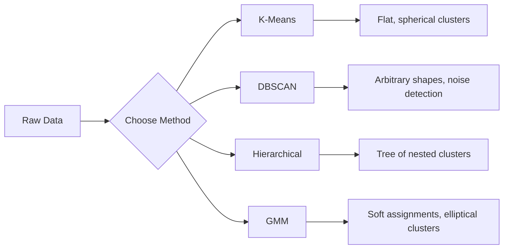

# 비지도 학습(Unsupervised Learning)

> 레이블도, 교사도 없습니다. 알고리즘이 스스로 구조를 찾아냅니다.

**유형:** Build (실습)
**사용 언어:** Python, TypeScript
**선수 레슨:** Phase 1 (Norms & Distances, Probability & Distributions), Phase 2 Lessons 1-6
**소요 시간:** ~90분

## 학습 목표

- K-Means, DBSCAN, 가우시안 혼합 모델(Gaussian Mixture Models, GMM)을 밑바닥부터 구현하고 클러스터링 동작을 비교합니다.
- 실루엣 점수(silhouette score)와 엘보우 방법(elbow method)을 사용하여 클러스터 품질을 평가하고 최적의 K를 선택합니다.
- DBSCAN이 K-Means보다 우수한 성능을 보이는 경우를 설명하고, 비구형 클러스터와 이상치(outlier)를 처리할 수 있는 알고리즘을 파악합니다.
- 클러스터링 방법을 사용해 정상 패턴에서 벗어난 포인트를 찾아내는 이상 탐지(anomaly detection) 파이프라인을 구축합니다.

## 문제 정의

지금까지의 모든 ML 수업은 "여기에 입력이 있고, 여기에 정답 출력이 있다"는 레이블이 지정된 데이터를 가정했습니다. 현실 세계에서는 레이블을 얻는 비용이 매우 큽니다. 병원에는 수백만 개의 환자 기록이 있지만, 질병 카테고리를 일일이 수작업으로 태깅한 사람은 없습니다. 이커머스 사이트에는 수백만 개의 사용자 세션이 있지만, 고객 세그먼트를 직접 분류해 둔 사람은 없습니다. 보안 팀에는 네트워크 로그가 있지만, 모든 이상 징후에 플래그를 달아두지는 못했습니다.

비지도 학습은 무엇을 찾아야 하는지 알려주지 않아도 패턴을 찾아냅니다. 유사한 데이터 포인트를 그룹화하고, 숨겨진 구조를 발견하며, 이상치를 드러냅니다. 지도 학습이 해답지가 있는 교재로 공부하는 것이라면, 비지도 학습은 패턴이 스스로 드러날 때까지 원시 데이터를 들여다보는 것과 같습니다.

문제는 레이블이 없기 때문에 "정답"이나 "오답"을 직접 측정할 수 없다는 점입니다. 알고리즘이 찾아낸 구조가 의미 있는지 평가하려면 다른 도구가 필요합니다.

## 핵심 개념

### 클러스터링: 유사한 대상을 함께 그룹화하기

클러스터링(clustering, 군집화)은 같은 그룹 내의 포인트들이 다른 그룹의 포인트들보다 서로 더 유사하도록 각 데이터 포인트를 그룹(클러스터)에 할당합니다. 여기서 질문은 항상 이것입니다. "유사하다"는 것은 무엇을 의미할까요?



### K-Means: 가장 널리 쓰이는 표준 알고리즘

K-Means는 데이터를 정확히 K개의 클러스터로 분할합니다. 각 클러스터에는 센트로이드(centroid, 질량 중심)가 있으며, 모든 포인트는 가장 가까운 센트로이드에 속합니다.

로이드 알고리즘(Lloyd's algorithm):

1. 무작위로 K개의 포인트를 초기 센트로이드로 선택합니다.
2. 각 데이터 포인트를 가장 가까운 센트로이드에 할당합니다.
3. 각 센트로이드를 자신에게 할당된 포인트들의 평균으로 다시 계산합니다.
4. 할당 결과가 변하지 않을 때까지 2~3단계를 반복합니다.

목적 함수(이너셔, inertia)는 각 포인트에서 할당된 센트로이드까지의 제곱 거리의 합을 측정합니다. K-Means는 이를 최소화하지만, 지역 최솟값(local minimum)만을 찾습니다. 초기화 상태에 따라 서로 다른 결과가 나올 수 있습니다.

### K 선택하기

두 가지 표준 방법:

**엘보우 방법(Elbow method):** $K = 1, 2, 3, \ldots, n$에 대해 K-Means를 실행합니다. K에 따른 이너셔를 그래프로 그립니다. 클러스터를 더 추가해도 이너셔가 크게 감소하지 않는 "팔꿈치(elbow)" 지점을 찾습니다.

**실루엣 점수(Silhouette score):** 각 포인트에 대해 자신이 속한 클러스터와의 유사도($a$)와 가장 가까운 다른 클러스터와의 유사도($b$)를 비교 측정합니다. 실루엣 계수는 $(b - a) / \max(a, b)$이며, 범위는 -1(잘못된 클러스터)부터 +1(잘 군집화됨)까지입니다. 전체 점수를 얻기 위해 모든 포인트에 대해 평균을 냅니다.

### DBSCAN: 밀도 기반 클러스터링

K-Means는 클러스터가 구형이라고 가정하며 사전에 K를 지정해야 합니다. DBSCAN은 두 가지 가정 모두 필요하지 않습니다. 희소한 영역으로 구분된 밀집 영역을 클러스터로 찾아냅니다.

두 가지 매개변수:
- **eps**: 이웃을 정의하는 반경
- **min_samples**: 밀집 영역을 형성하는 데 필요한 최소 포인트 수

세 가지 포인트 유형:
- **핵심 포인트(Core point)**: eps 거리 내에 최소 min_samples개 이상의 포인트가 있는 포인트
- **경계 포인트(Border point)**: 핵심 포인트의 eps 반경 내에 있지만, 자기 자신은 핵심 포인트가 아닌 포인트
- **노이즈 포인트(Noise point)**: 핵심 포인트도 경계 포인트도 아닌 포인트. 이들이 바로 이상치입니다.

DBSCAN은 서로 eps 거리 내에 있는 핵심 포인트들을 동일한 클러스터로 연결합니다. 경계 포인트는 가까운 핵심 포인트의 클러스터에 합류합니다. 노이즈 포인트는 어떤 클러스터에도 속하지 않습니다.

장점: 임의의 모양을 가진 클러스터를 찾을 수 있고, 클러스터 수를 자동으로 결정하며, 이상치를 식별합니다. 단점: 밀도가 서로 다른 클러스터가 혼재된 경우 처리가 어렵습니다.

### 계층적 클러스터링(Hierarchical Clustering)

중첩된 클러스터의 트리(덴드로그램, dendrogram)를 구축합니다.

병합형(Agglomerative, 상향식):
1. 각 포인트를 개별 클러스터로 시작합니다.
2. 가장 가까운 두 클러스터를 병합합니다.
3. 하나의 클러스터만 남을 때까지 반복합니다.
4. 원하는 레벨에서 덴드로그램을 잘라 K개의 클러스터를 얻습니다.

클러스터 간의 "가까움"은 다음과 같이 측정할 수 있습니다:
- **단일 연결법(Single linkage)**: 두 클러스터의 임의의 두 포인트 간 최소 거리
- **완전 연결법(Complete linkage)**: 두 클러스터의 임의의 두 포인트 간 최대 거리
- **평균 연결법(Average linkage)**: 모든 포인트 쌍 간의 평균 거리
- **와드 방법(Ward's method)**: 병합 시 전체 클러스터 내 분산의 증가량이 가장 적은 방식

### 가우시안 혼합 모델(Gaussian Mixture Models, GMM)

K-Means는 하드 할당(hard assignment)을 수행합니다. 즉, 각 포인트는 정확히 하나의 클러스터에만 속합니다. GMM은 소프트 할당(soft assignment)을 제공합니다. 각 포인트는 각 클러스터에 속할 확률을 가집니다.

GMM은 데이터가 각자의 평균과 공분산을 가진 K개의 가우시안 분포의 혼합으로부터 생성되었다고 가정합니다. 기댓값-최대화(Expectation-Maximization, EM) 알고리즘은 다음 두 단계를 번갈아 수행합니다:

- **E-단계(E-step)**: 각 포인트가 각 가우시안에 속할 확률을 계산합니다.
- **M-단계(M-step)**: 데이터의 우도(likelihood)를 최대화하도록 각 가우시안의 평균, 공분산, 혼합 가중치를 업데이트합니다.

GMM은 (K-Means처럼 구형뿐만 아니라) 타원형 클러스터를 모델링할 수 있으며, 서로 겹치는 클러스터도 자연스럽게 처리합니다.

### 어떤 방법을 언제 사용할 것인가

| 방법 | 적합한 경우 | 피해야 할 경우 |
|--------|----------|------------|
| K-Means | 대규모 데이터셋, 구형 클러스터, K를 알고 있는 경우 | 불규칙한 모양, 이상치가 존재하는 경우 |
| DBSCAN | K를 모르는 경우, 임의의 모양, 이상치 탐지 | 밀도가 다양한 경우, 매우 높은 차원 |
| 계층적 클러스터링 | 소규모 데이터셋, 덴드로그램이 필요한 경우, K를 모르는 경우 | 대규모 데이터셋($O(n^2)$ 메모리) |
| GMM | 겹치는 클러스터, 소프트 할당이 필요한 경우 | 매우 큰 데이터셋, 너무 많은 차원 |

### 클러스터링을 활용한 이상 탐지

클러스터링은 본질적으로 이상 탐지를 지원합니다:
- **K-Means**: 어떤 센트로이드로부터도 멀리 떨어진 포인트가 이상치입니다.
- **DBSCAN**: 노이즈 포인트가 정의상 곧 이상치입니다.
- **GMM**: 모든 가우시안 하에서 발생 확률이 낮은 포인트가 이상치입니다.

```figure
kmeans-step
```

## 구현하기

### 1단계: 밑바닥부터 K-Means 구현

```python
import math
import random


def euclidean_distance(a, b):
    return math.sqrt(sum((ai - bi) ** 2 for ai, bi in zip(a, b)))


def kmeans(data, k, max_iterations=100, seed=42):
    random.seed(seed)
    n_features = len(data[0])

    centroids = random.sample(data, k)

    for iteration in range(max_iterations):
        clusters = [[] for _ in range(k)]
        assignments = []

        for point in data:
            distances = [euclidean_distance(point, c) for c in centroids]
            nearest = distances.index(min(distances))
            clusters[nearest].append(point)
            assignments.append(nearest)

        new_centroids = []
        for cluster in clusters:
            if len(cluster) == 0:
                new_centroids.append(random.choice(data))
                continue
            centroid = [
                sum(point[j] for point in cluster) / len(cluster)
                for j in range(n_features)
            ]
            new_centroids.append(centroid)

        if all(
            euclidean_distance(old, new) < 1e-6
            for old, new in zip(centroids, new_centroids)
        ):
            print(f"  Converged at iteration {iteration + 1}")
            break

        centroids = new_centroids

    return assignments, centroids
```

### 2단계: 엘보우 방법과 실루엣 점수

```python
def compute_inertia(data, assignments, centroids):
    total = 0.0
    for point, cluster_id in zip(data, assignments):
        total += euclidean_distance(point, centroids[cluster_id]) ** 2
    return total


def silhouette_score(data, assignments):
    n = len(data)
    if n < 2:
        return 0.0

    clusters = {}
    for i, c in enumerate(assignments):
        clusters.setdefault(c, []).append(i)

    if len(clusters) < 2:
        return 0.0

    scores = []
    for i in range(n):
        own_cluster = assignments[i]
        own_members = [j for j in clusters[own_cluster] if j != i]

        if len(own_members) == 0:
            scores.append(0.0)
            continue

        a = sum(euclidean_distance(data[i], data[j]) for j in own_members) / len(own_members)

        b = float("inf")
        for cluster_id, members in clusters.items():
            if cluster_id == own_cluster:
                continue
            avg_dist = sum(euclidean_distance(data[i], data[j]) for j in members) / len(members)
            b = min(b, avg_dist)

        if max(a, b) == 0:
            scores.append(0.0)
        else:
            scores.append((b - a) / max(a, b))

    return sum(scores) / len(scores)


def find_best_k(data, max_k=10):
    print("Elbow method:")
    inertias = []
    for k in range(1, max_k + 1):
        assignments, centroids = kmeans(data, k)
        inertia = compute_inertia(data, assignments, centroids)
        inertias.append(inertia)
        print(f"  K={k}: inertia={inertia:.2f}")

    print("\nSilhouette scores:")
    for k in range(2, max_k + 1):
        assignments, centroids = kmeans(data, k)
        score = silhouette_score(data, assignments)
        print(f"  K={k}: silhouette={score:.4f}")

    return inertias
```

### 3단계: 밑바닥부터 DBSCAN 구현

```python
def dbscan(data, eps, min_samples):
    n = len(data)
    labels = [-1] * n
    cluster_id = 0

    def region_query(point_idx):
        neighbors = []
        for i in range(n):
            if euclidean_distance(data[point_idx], data[i]) <= eps:
                neighbors.append(i)
        return neighbors

    visited = [False] * n

    for i in range(n):
        if visited[i]:
            continue
        visited[i] = True

        neighbors = region_query(i)

        if len(neighbors) < min_samples:
            labels[i] = -1
            continue

        labels[i] = cluster_id
        seed_set = list(neighbors)
        seed_set.remove(i)

        j = 0
        while j < len(seed_set):
            q = seed_set[j]

            if not visited[q]:
                visited[q] = True
                q_neighbors = region_query(q)
                if len(q_neighbors) >= min_samples:
                    for nb in q_neighbors:
                        if nb not in seed_set:
                            seed_set.append(nb)

            if labels[q] == -1:
                labels[q] = cluster_id

            j += 1

        cluster_id += 1

    return labels
```

### 4단계: 가우시안 혼합 모델(EM 알고리즘)

```python
def gmm(data, k, max_iterations=100, seed=42):
    random.seed(seed)
    n = len(data)
    d = len(data[0])

    indices = random.sample(range(n), k)
    means = [list(data[i]) for i in indices]
    variances = [1.0] * k
    weights = [1.0 / k] * k

    def gaussian_pdf(x, mean, variance):
        d = len(x)
        coeff = 1.0 / ((2 * math.pi * variance) ** (d / 2))
        exponent = -sum((xi - mi) ** 2 for xi, mi in zip(x, mean)) / (2 * variance)
        return coeff * math.exp(max(exponent, -500))

    for iteration in range(max_iterations):
        responsibilities = []
        for i in range(n):
            probs = []
            for j in range(k):
                probs.append(weights[j] * gaussian_pdf(data[i], means[j], variances[j]))
            total = sum(probs)
            if total == 0:
                total = 1e-300
            responsibilities.append([p / total for p in probs])

        old_means = [list(m) for m in means]

        for j in range(k):
            r_sum = sum(responsibilities[i][j] for i in range(n))
            if r_sum < 1e-10:
                continue

            weights[j] = r_sum / n

            for dim in range(d):
                means[j][dim] = sum(
                    responsibilities[i][j] * data[i][dim] for i in range(n)
                ) / r_sum

            variances[j] = sum(
                responsibilities[i][j]
                * sum((data[i][dim] - means[j][dim]) ** 2 for dim in range(d))
                for i in range(n)
            ) / (r_sum * d)
            variances[j] = max(variances[j], 1e-6)

        shift = sum(
            euclidean_distance(old_means[j], means[j]) for j in range(k)
        )
        if shift < 1e-6:
            print(f"  GMM converged at iteration {iteration + 1}")
            break

    assignments = []
    for i in range(n):
        assignments.append(responsibilities[i].index(max(responsibilities[i])))

    return assignments, means, weights, responsibilities
```

### 5단계: 테스트 데이터 생성 및 전체 실행

```python
def make_blobs(centers, n_per_cluster=50, spread=0.5, seed=42):
    random.seed(seed)
    data = []
    true_labels = []
    for label, (cx, cy) in enumerate(centers):
        for _ in range(n_per_cluster):
            x = cx + random.gauss(0, spread)
            y = cy + random.gauss(0, spread)
            data.append([x, y])
            true_labels.append(label)
    return data, true_labels


def make_moons(n_samples=200, noise=0.1, seed=42):
    random.seed(seed)
    data = []
    labels = []
    n_half = n_samples // 2
    for i in range(n_half):
        angle = math.pi * i / n_half
        x = math.cos(angle) + random.gauss(0, noise)
        y = math.sin(angle) + random.gauss(0, noise)
        data.append([x, y])
        labels.append(0)
    for i in range(n_half):
        angle = math.pi * i / n_half
        x = 1 - math.cos(angle) + random.gauss(0, noise)
        y = 1 - math.sin(angle) - 0.5 + random.gauss(0, noise)
        data.append([x, y])
        labels.append(1)
    return data, labels


if __name__ == "__main__":
    centers = [[2, 2], [8, 3], [5, 8]]
    data, true_labels = make_blobs(centers, n_per_cluster=50, spread=0.8)

    print("=== K-Means on 3 blobs ===")
    assignments, centroids = kmeans(data, k=3)
    print(f"  Centroids: {[[round(c, 2) for c in cent] for cent in centroids]}")
    sil = silhouette_score(data, assignments)
    print(f"  Silhouette score: {sil:.4f}")

    print("\n=== Elbow Method ===")
    find_best_k(data, max_k=6)

    print("\n=== DBSCAN on 3 blobs ===")
    db_labels = dbscan(data, eps=1.5, min_samples=5)
    n_clusters = len(set(db_labels) - {-1})
    n_noise = db_labels.count(-1)
    print(f"  Found {n_clusters} clusters, {n_noise} noise points")

    print("\n=== GMM on 3 blobs ===")
    gmm_assignments, gmm_means, gmm_weights, _ = gmm(data, k=3)
    print(f"  Means: {[[round(m, 2) for m in mean] for mean in gmm_means]}")
    print(f"  Weights: {[round(w, 3) for w in gmm_weights]}")
    gmm_sil = silhouette_score(data, gmm_assignments)
    print(f"  Silhouette score: {gmm_sil:.4f}")

    print("\n=== DBSCAN on moons (non-spherical clusters) ===")
    moon_data, moon_labels = make_moons(n_samples=200, noise=0.1)
    moon_db = dbscan(moon_data, eps=0.3, min_samples=5)
    n_moon_clusters = len(set(moon_db) - {-1})
    n_moon_noise = moon_db.count(-1)
    print(f"  Found {n_moon_clusters} clusters, {n_moon_noise} noise points")

    print("\n=== K-Means on moons (will fail to separate) ===")
    moon_km, moon_centroids = kmeans(moon_data, k=2)
    moon_sil = silhouette_score(moon_data, moon_km)
    print(f"  Silhouette score: {moon_sil:.4f}")
    print("  K-Means splits moons poorly because they are not spherical")

    print("\n=== Anomaly detection with DBSCAN ===")
    anomaly_data = list(data)
    anomaly_data.append([20.0, 20.0])
    anomaly_data.append([-5.0, -5.0])
    anomaly_data.append([15.0, 0.0])
    anomaly_labels = dbscan(anomaly_data, eps=1.5, min_samples=5)
    anomalies = [
        anomaly_data[i]
        for i in range(len(anomaly_labels))
        if anomaly_labels[i] == -1
    ]
    print(f"  Detected {len(anomalies)} anomalies")
    for a in anomalies[-3:]:
        print(f"    Point {[round(v, 2) for v in a]}")
```

## 사용하기

scikit-learn을 사용하면 동일한 알고리즘을 한 줄로 작성할 수 있습니다:

```python
from sklearn.cluster import KMeans, DBSCAN, AgglomerativeClustering
from sklearn.mixture import GaussianMixture
from sklearn.metrics import silhouette_score as sklearn_silhouette

km = KMeans(n_clusters=3, random_state=42).fit(data)
db = DBSCAN(eps=1.5, min_samples=5).fit(data)
agg = AgglomerativeClustering(n_clusters=3).fit(data)
gmm_model = GaussianMixture(n_components=3, random_state=42).fit(data)
```

직접 구현해 본 버전을 통해 이러한 라이브러리가 내부에서 정확히 무엇을 계산하는지 이해할 수 있습니다. K-Means는 할당과 재계산을 반복합니다. DBSCAN은 밀집된 시드로부터 클러스터를 확장합니다. GMM은 기댓값 계산과 최대화를 번갈아 수행합니다. 라이브러리 버전에는 수치적 안정성, 더 스마트한 초기화(K-Means++), GPU 가속 등이 추가되어 있지만 핵심 로직은 동일합니다.

## 배포하기

이번 수업에서는 K-Means, DBSCAN, GMM을 밑바닥부터 직접 구현해 보았습니다. 이 클러스터링 코드는 더 고급 비지도 학습 방법을 구축하기 위한 기반으로 재사용할 수 있습니다.
## Exercises

1. K-Means++ 초기화를 구현합니다. 무작위로 센트로이드(centroid)를 선택하는 대신 첫 번째 센트로이드는 무작위로 고르고, 그 이후의 각 센트로이드는 가장 가까운 기존 센트로이드와의 거리 제곱에 비례하는 확률로 선택합니다. 무작위 초기화와의 수렴 속도를 비교합니다.
2. 코드에 계층적 병합 군집화(hierarchical agglomerative clustering)를 추가합니다. 와드 연결법(Ward's linkage)을 구현하고 덴드로그램(dendrogram)을 생성합니다(병합 단계의 중첩 리스트 형태). 다양한 레벨에서 잘라내어 K-Means 결과와 비교합니다.
3. 간단한 이상 탐지(anomaly detection) 파이프라인을 구축합니다. 동일한 데이터에 DBSCAN과 GMM을 실행하고, 두 방법 모두 이상치(outlier)로 판정한 데이터 포인트(DBSCAN의 노이즈, GMM의 낮은 확률)에 플래그를 지정합니다. 두 방법의 일치도를 측정하고 결과가 달라지는 경우에 대해 논의합니다.

## Key Terms

| Term | What people say | What it actually means |
|------|----------------|----------------------|
| 군집화(Clustering) | "비슷한 것끼리 묶기" | 특정 거리 지표를 기준으로 군집 간 유사도보다 군집 내 유사도가 더 높아지도록 데이터를 부분집합으로 분할하는 것 |
| 센트로이드(Centroid) | "군집의 중심" | 특정 군집에 할당된 모든 점의 평균. K-Means에서 군집의 대표값으로 사용됨 |
| 이너셔(Inertia) | "군집이 얼마나 조밀하게 뭉쳐 있는가" | 각 데이터 포인트에서 할당된 센트로이드까지의 거리 제곱합. 작을수록 더 조밀함 |
| 실루엣 점수(Silhouette score) | "군집이 얼마나 잘 분리되어 있는가" | 각 점에 대해 $(b - a) / \max(a, b)$으로 계산됨. 여기서 $a$는 군집 내 평균 거리, $b$는 가장 가까운 군집과의 평균 거리 |
| 핵심 포인트(Core point) | "밀집된 영역의 한 점" | DBSCAN에서 eps 거리 내에 최소 min_samples개의 이웃을 가진 데이터 포인트 |
| EM 알고리즘(EM algorithm) | "소프트 K-Means" | 기댓값 최대화(Expectation-Maximization): 소속 확률을 계산하는 단계(E-step)와 분포 파라미터를 업데이트하는 단계(M-step)를 반복적으로 수행함 |
| 덴드로그램(Dendrogram) | "군집 트리" | 계층적 군집화에서 군집이 병합된 순서와 거리를 나타내는 트리 다이어그램 |
| 이상치(Anomaly) | "특이값" | 기대되는 패턴을 따르지 않는 데이터 포인트. DBSCAN에서는 노이즈로, GMM에서는 낮은 확률로 식별됨 |

## Further Reading

- [Stanford CS229 - Unsupervised Learning](https://cs229.stanford.edu/notes2022fall/main_notes.pdf) - 군집화 및 EM 알고리즘에 관한 Andrew Ng의 강의 노트
- [scikit-learn Clustering Guide](https://scikit-learn.org/stable/modules/clustering.html) - 시각적 예시를 곁들인 모든 군집화 알고리즘의 실용적 비교
- [DBSCAN original paper (Ester et al., 1996)](https://www.aaai.org/Papers/KDD/1996/KDD96-037.pdf) - 밀도 기반 군집화(density-based clustering)를 소개한 원본 논문
