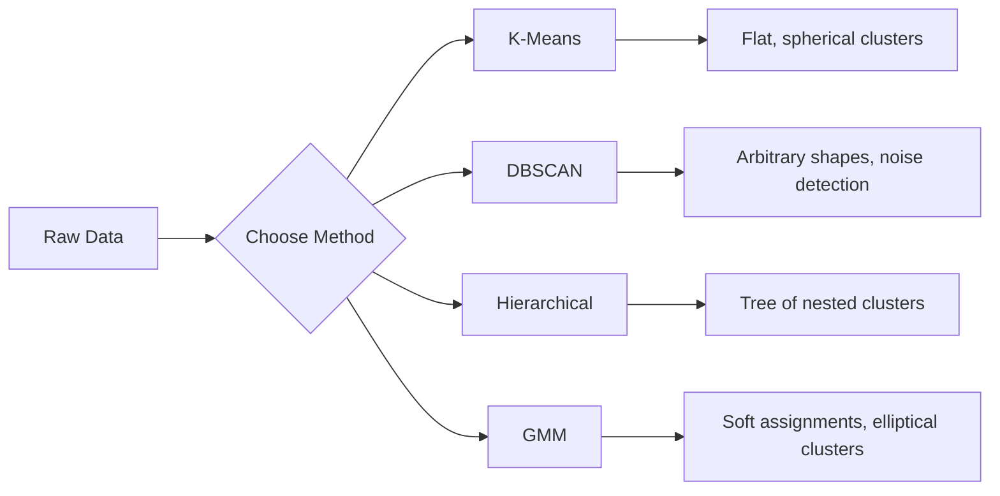

# 비지도 학습

> 라벨도, 교사도 없습니다. 알고리즘이 스스로 구조를 찾아냅니다.

**유형:** Build (실습)
**사용 언어:** Python
**선수 레슨:** Phase 1 (Norms & Distances, Probability & Distributions), Phase 2 Lessons 1-6
**소요 시간:** ~90분

## 학습 목표

- K-Means, DBSCAN, 가우시안 혼합 모델(Gaussian Mixture Model, GMM)을 밑바닥부터 구현하고 군집화(clustering) 동작을 비교합니다.
- 실루엣 점수(silhouette score)와 엘보우 기법(elbow method)을 활용해 군집 품질을 평가하고 최적의 K를 선택합니다.
- DBSCAN이 K-Means보다 뛰어난 성능을 보이는 시점을 설명하고, 비구형(non-spherical) 군집과 이상치(outlier)를 잘 다루는 알고리즘을 파악합니다.
- 군집화 기법을 사용해 정상 패턴에서 벗어난 포인트를 감지하는 이상 탐지(anomaly detection) 파이프라인을 구축합니다.

## 문제 상황

지금까지의 모든 머신러닝 학습에서는 라벨이 지정된 데이터, 즉 "여기에 입력이 있고, 여기에 정답 출력이 있다"는 가정을 전제로 했습니다. 하지만 현실 세계에서 라벨링 비용은 매우 큽니다. 병원에는 수백만 건의 환자 기록이 있지만 누구도 각 기록에 질병 카테고리를 일일이 태깅해 두지 않았습니다. 전자상거래 사이트에는 수백만 개의 사용자 세션이 있지만 고객 세그먼트를 직접 손으로 라벨링한 사람은 없습니다. 보안 팀에는 네트워크 로그가 있지만 모든 이상 징후에 플래그가 지정되어 있지는 않습니다.

비지도 학습(unsupervised learning)은 무엇을 찾아야 하는지 알려주지 않아도 패턴을 찾아냅니다. 유사한 데이터 포인트를 그룹화하고, 숨겨진 구조를 발견하며, 이상치를 드러냅니다. 지도 학습이 해답지가 있는 교과서로 공부하는 것이라면, 비지도 학습은 패턴이 스스로 드러날 때까지 원시 데이터를 들여다보는 것과 같습니다.

문제는 라벨이 없기 때문에 "정답"인지 "오답"인지 직접 측정할 수 없다는 점입니다. 알고리즘이 찾아낸 구조가 유의미한지 평가하려면 다른 도구가 필요합니다.

## 개념

### 군집화: 유사한 항목들을 하나로 묶기

군집화(clustering)는 각 데이터 포인트를 그룹(군집, cluster)에 할당하여 같은 그룹 내의 포인트들이 다른 그룹의 포인트들보다 서로 더 유사하도록 만듭니다. 여기서 핵심 질문은 언제나 이것입니다. "유사하다"는 것은 무엇을 의미할까요?



### K-Means: 가장 널리 쓰이는 기본 알고리즘

K-Means는 데이터를 정확히 K개의 군집으로 분할합니다. 각 군집은 중심점(centroid, 질량 중심)을 가지며, 모든 포인트는 가장 가까운 중심점에 속하게 됩니다.

로이드 알고리즘(Lloyd's algorithm):

1. K개의 무작위 포인트를 초기 중심점으로 선택합니다.
2. 각 데이터 포인트를 가장 가까운 중심점에 할당합니다.
3. 각 중심점을 자신에게 할당된 포인트들의 평균으로 다시 계산합니다.
4. 할당이 더 이상 바뀌지 않을 때까지 2~3단계를 반복합니다.

목적 함수(이너셔, inertia)는 각 포인트에서 할당된 중심점까지의 거리 제곱합을 측정합니다. K-Means는 이를 최소화하지만, 지역 최솟값(local minimum)만을 찾을 수 있습니다. 초기화 상태에 따라 서로 다른 결과가 나올 수 있습니다.

### K 선택하기

두 가지 표준 방법이 있습니다.

**엘보우 기법(Elbow method):** $K = 1, 2, 3, \ldots, n$에 대해 K-Means를 실행합니다. K에 따른 이너셔 그래프를 그립니다. 군집을 추가해도 이너셔가 크게 감소하지 않는 "엘보우(팔꿈치)" 지점을 찾습니다.

**실루엣 점수(Silhouette score):** 각 포인트에 대해 자신이 속한 군집과의 유사도($a$)와 가장 가까운 다른 군집과의 유사도($b$)를 측정합니다. 실루엣 계수는 $(b - a) / \max(a, b)$이며, -1(잘못된 군집)부터 +1(잘 군집화됨)까지의 범위를 갖습니다. 전체 포인트에 대한 평균을 내어 종합 점수를 구합니다.

### DBSCAN: 밀도 기반 군집화

K-Means는 군집이 구형이라고 가정하며 K를 미리 지정해야 합니다. 반면 DBSCAN은 둘 중 어느 것도 가정하지 않습니다. 희소한 영역으로 구분된 밀집 영역을 군집으로 찾아냅니다.

두 가지 매개변수:
- **eps**: 이웃 영역의 반경
- **min_samples**: 밀집 영역을 형성하는 데 필요한 최소 포인트 수

세 가지 유형의 포인트:
- **핵심 포인트(Core point)**: eps 거리 내에 최소 min_samples개의 포인트를 가집니다.
- **경계 포인트(Border point)**: 핵심 포인트의 eps 거리 내에 있지만 그 자체는 핵심 포인트가 아닙니다.
- **노이즈 포인트(Noise point)**: 핵심 포인트도 경계 포인트도 아닙니다. 이들은 이상치(outlier)입니다.

DBSCAN은 서로 eps 거리 내에 있는 핵심 포인트들을 연결하여 동일한 군집으로 묶습니다. 경계 포인트는 인접한 핵심 포인트의 군집에 합류합니다. 노이즈 포인트는 어느 군집에도 속하지 않습니다.

장점: 임의의 형태를 가진 군집을 찾을 수 있고, 군집 수를 자동으로 결정하며, 이상치를 식별합니다. 단점: 군집마다 밀도가 다양할 경우 군집화에 어려움을 겪습니다.

### 계층적 군집화

중첩된 군집들의 트리(덴드로그램, dendrogram)를 구축합니다.

병합형(Agglomerative, 상향식):
1. 각 포인트를 개별 군집으로 시작합니다.
2. 가장 가까운 두 군집을 병합합니다.
3. 하나의 군집만 남을 때까지 반복합니다.
4. 원하는 높이에서 덴드로그램을 잘라 K개의 군집을 얻습니다.

군집 간의 "가까움(거리)"은 다음과 같이 측정할 수 있습니다.
- **단일 연결법(Single linkage)**: 두 군집의 임의의 두 포인트 간 최소 거리
- **완전 연결법(Complete linkage)**: 두 군집의 임의의 두 포인트 간 최대 거리
- **평균 연결법(Average linkage)**: 모든 쌍 간의 평균 거리
- **와드 기법(Ward's method)**: 군집 내 총 분산 증가량이 가장 작아지는 방식으로 병합

### 가우시안 혼합 모델(GMM)

K-Means는 하드 할당(hard assignment)을 제공합니다. 즉, 각 포인트가 정확히 하나의 군집에만 속합니다. 반면 GMM은 소프트 할당(soft assignment)을 제공합니다. 즉, 각 포인트가 각 군집에 속할 확률을 갖습니다.

GMM은 데이터가 각자 고유한 평균과 공분산을 갖는 K개의 가우시안 분포의 혼합에서 생성되었다고 가정합니다. 기댓값 최대화(Expectation-Maximization, EM) 알고리즘은 다음 두 단계를 번갈아 수행합니다.

- **E-단계(E-step)**: 각 포인트가 각 가우시안에 속할 확률을 계산합니다.
- **M-단계(M-step)**: 데이터의 우도(likelihood)를 최대화하도록 각 가우시안의 평균, 공분산, 혼합 가중치(mixing weight)를 업데이트합니다.

GMM은 (K-Means처럼 구형뿐만 아니라) 타원형 군집을 모델링할 수 있으며, 겹치는 군집도 자연스럽게 처리합니다.

### 알고리즘 선택 기준

| 방법 | 적합한 경우 | 피해야 하는 경우 |
|--------|----------|------------|
| K-Means | 대규모 데이터셋, 구형 군집, K를 아는 경우 | 불규칙한 형태, 이상치가 존재하는 경우 |
| DBSCAN | K를 모르는 경우, 임의의 형태, 이상치 탐지 | 밀도가 다양한 경우, 매우 고차원인 경우 |
| Hierarchical | 소규모 데이터셋, 덴드로그램이 필요한 경우, K를 모르는 경우 | 대규모 데이터셋 ($O(n^2)$ 메모리) |
| GMM | 겹치는 군집, 소프트 할당이 필요한 경우 | 매우 큰 데이터셋, 지나치게 높은 차원 |

### 군집화를 활용한 이상 탐지

군집화는 본질적으로 이상 탐지(anomaly detection)를 지원합니다.
- **K-Means**: 어떤 중심점에서도 멀리 떨어진 포인트는 이상치입니다.
- **DBSCAN**: 정의상 노이즈 포인트가 곧 이상치입니다.
- **GMM**: 모든 가우시안에서 확률이 낮게 나타나는 포인트는 이상치입니다.

```figure
kmeans-step
```

## 직접 구현하기

### 1단계: K-Means 밑바닥부터 구현하기

```python
import math
import random


def euclidean_distance(a, b):
    return math.sqrt(sum((ai - bi) ** 2 for ai, bi in zip(a, b)))


def kmeans(data, k, max_iterations=100, seed=42):
    random.seed(seed)
    n_features = len(data[0])

    centroids = random.sample(data, k)

    for iteration in range(max_iterations):
        clusters = [[] for _ in range(k)]
        assignments = []

        for point in data:
            distances = [euclidean_distance(point, c) for c in centroids]
            nearest = distances.index(min(distances))
            clusters[nearest].append(point)
            assignments.append(nearest)

        new_centroids = []
        for cluster in clusters:
            if len(cluster) == 0:
                new_centroids.append(random.choice(data))
                continue
            centroid = [
                sum(point[j] for point in cluster) / len(cluster)
                for j in range(n_features)
            ]
            new_centroids.append(centroid)

        if all(
            euclidean_distance(old, new) < 1e-6
            for old, new in zip(centroids, new_centroids)
        ):
            print(f"  Converged at iteration {iteration + 1}")
            break

        centroids = new_centroids

    return assignments, centroids
```

### 2단계: 엘보우 기법 및 실루엣 점수

```python
def compute_inertia(data, assignments, centroids):
    total = 0.0
    for point, cluster_id in zip(data, assignments):
        total += euclidean_distance(point, centroids[cluster_id]) ** 2
    return total


def silhouette_score(data, assignments):
    n = len(data)
    if n < 2:
        return 0.0

    clusters = {}
    for i, c in enumerate(assignments):
        clusters.setdefault(c, []).append(i)

    if len(clusters) < 2:
        return 0.0

    scores = []
    for i in range(n):
        own_cluster = assignments[i]
        own_members = [j for j in clusters[own_cluster] if j != i]

        if len(own_members) == 0:
            scores.append(0.0)
            continue

        a = sum(euclidean_distance(data[i], data[j]) for j in own_members) / len(own_members)

        b = float("inf")
        for cluster_id, members in clusters.items():
            if cluster_id == own_cluster:
                continue
            avg_dist = sum(euclidean_distance(data[i], data[j]) for j in members) / len(members)
            b = min(b, avg_dist)

        if max(a, b) == 0:
            scores.append(0.0)
        else:
            scores.append((b - a) / max(a, b))

    return sum(scores) / len(scores)


def find_best_k(data, max_k=10):
    print("Elbow method:")
    inertias = []
    for k in range(1, max_k + 1):
        assignments, centroids = kmeans(data, k)
        inertia = compute_inertia(data, assignments, centroids)
        inertias.append(inertia)
        print(f"  K={k}: inertia={inertia:.2f}")

    print("\nSilhouette scores:")
    for k in range(2, max_k + 1):
        assignments, centroids = kmeans(data, k)
        score = silhouette_score(data, assignments)
        print(f"  K={k}: silhouette={score:.4f}")

    return inertias
```

### 3단계: DBSCAN 밑바닥부터 구현하기

```python
def dbscan(data, eps, min_samples):
    n = len(data)
    labels = [-1] * n
    cluster_id = 0

    def region_query(point_idx):
        neighbors = []
        for i in range(n):
            if euclidean_distance(data[point_idx], data[i]) <= eps:
                neighbors.append(i)
        return neighbors

    visited = [False] * n

    for i in range(n):
        if visited[i]:
            continue
        visited[i] = True

        neighbors = region_query(i)

        if len(neighbors) < min_samples:
            labels[i] = -1
            continue

        labels[i] = cluster_id
        seed_set = list(neighbors)
        seed_set.remove(i)

        j = 0
        while j < len(seed_set):
            q = seed_set[j]

            if not visited[q]:
                visited[q] = True
                q_neighbors = region_query(q)
                if len(q_neighbors) >= min_samples:
                    for nb in q_neighbors:
                        if nb not in seed_set:
                            seed_set.append(nb)

            if labels[q] == -1:
                labels[q] = cluster_id

            j += 1

        cluster_id += 1

    return labels
```

### 4단계: 가우시안 혼합 모델 (EM 알고리즘)

```python
def gmm(data, k, max_iterations=100, seed=42):
    random.seed(seed)
    n = len(data)
    d = len(data[0])

    indices = random.sample(range(n), k)
    means = [list(data[i]) for i in indices]
    variances = [1.0] * k
    weights = [1.0 / k] * k

    def gaussian_pdf(x, mean, variance):
        d = len(x)
        coeff = 1.0 / ((2 * math.pi * variance) ** (d / 2))
        exponent = -sum((xi - mi) ** 2 for xi, mi in zip(x, mean)) / (2 * variance)
        return coeff * math.exp(max(exponent, -500))

    for iteration in range(max_iterations):
        responsibilities = []
        for i in range(n):
            probs = []
            for j in range(k):
                probs.append(weights[j] * gaussian_pdf(data[i], means[j], variances[j]))
            total = sum(probs)
            if total == 0:
                total = 1e-300
            responsibilities.append([p / total for p in probs])

        old_means = [list(m) for m in means]

        for j in range(k):
            r_sum = sum(responsibilities[i][j] for i in range(n))
            if r_sum < 1e-10:
                continue

            weights[j] = r_sum / n

            for dim in range(d):
                means[j][dim] = sum(
                    responsibilities[i][j] * data[i][dim] for i in range(n)
                ) / r_sum

            variances[j] = sum(
                responsibilities[i][j]
                * sum((data[i][dim] - means[j][dim]) ** 2 for dim in range(d))
                for i in range(n)
            ) / (r_sum * d)
            variances[j] = max(variances[j], 1e-6)

        shift = sum(
            euclidean_distance(old_means[j], means[j]) for j in range(k)
        )
        if shift < 1e-6:
            print(f"  GMM converged at iteration {iteration + 1}")
            break

    assignments = []
    for i in range(n):
        assignments.append(responsibilities[i].index(max(responsibilities[i])))

    return assignments, means, weights, responsibilities
```

### 5단계: 테스트 데이터 생성 및 전체 실행

```python
def make_blobs(centers, n_per_cluster=50, spread=0.5, seed=42):
    random.seed(seed)
    data = []
    true_labels = []
    for label, (cx, cy) in enumerate(centers):
        for _ in range(n_per_cluster):
            x = cx + random.gauss(0, spread)
            y = cy + random.gauss(0, spread)
            data.append([x, y])
            true_labels.append(label)
    return data, true_labels


def make_moons(n_samples=200, noise=0.1, seed=42):
    random.seed(seed)
    data = []
    labels = []
    n_half = n_samples // 2
    for i in range(n_half):
        angle = math.pi * i / n_half
        x = math.cos(angle) + random.gauss(0, noise)
        y = math.sin(angle) + random.gauss(0, noise)
        data.append([x, y])
        labels.append(0)
    for i in range(n_half):
        angle = math.pi * i / n_half
        x = 1 - math.cos(angle) + random.gauss(0, noise)
        y = 1 - math.sin(angle) - 0.5 + random.gauss(0, noise)
        data.append([x, y])
        labels.append(1)
    return data, labels


if __name__ == "__main__":
    centers = [[2, 2], [8, 3], [5, 8]]
    data, true_labels = make_blobs(centers, n_per_cluster=50, spread=0.8)

    print("=== K-Means on 3 blobs ===")
    assignments, centroids = kmeans(data, k=3)
    print(f"  Centroids: {[[round(c, 2) for c in cent] for cent in centroids]}")
    sil = silhouette_score(data, assignments)
    print(f"  Silhouette score: {sil:.4f}")

    print("\n=== Elbow Method ===")
    find_best_k(data, max_k=6)

    print("\n=== DBSCAN on 3 blobs ===")
    db_labels = dbscan(data, eps=1.5, min_samples=5)
    n_clusters = len(set(db_labels) - {-1})
    n_noise = db_labels.count(-1)
    print(f"  Found {n_clusters} clusters, {n_noise} noise points")

    print("\n=== GMM on 3 blobs ===")
    gmm_assignments, gmm_means, gmm_weights, _ = gmm(data, k=3)
    print(f"  Means: {[[round(m, 2) for m in mean] for mean in gmm_means]}")
    print(f"  Weights: {[round(w, 3) for w in gmm_weights]}")
    gmm_sil = silhouette_score(data, gmm_assignments)
    print(f"  Silhouette score: {gmm_sil:.4f}")

    print("\n=== DBSCAN on moons (non-spherical clusters) ===")
    moon_data, moon_labels = make_moons(n_samples=200, noise=0.1)
    moon_db = dbscan(moon_data, eps=0.3, min_samples=5)
    n_moon_clusters = len(set(moon_db) - {-1})
    n_moon_noise = moon_db.count(-1)
    print(f"  Found {n_moon_clusters} clusters, {n_moon_noise} noise points")

    print("\n=== K-Means on moons (will fail to separate) ===")
    moon_km, moon_centroids = kmeans(moon_data, k=2)
    moon_sil = silhouette_score(moon_data, moon_km)
    print(f"  Silhouette score: {moon_sil:.4f}")
    print("  K-Means splits moons poorly because they are not spherical")

    print("\n=== Anomaly detection with DBSCAN ===")
    anomaly_data = list(data)
    anomaly_data.append([20.0, 20.0])
    anomaly_data.append([-5.0, -5.0])
    anomaly_data.append([15.0, 0.0])
    anomaly_labels = dbscan(anomaly_data, eps=1.5, min_samples=5)
    anomalies = [
        anomaly_data[i]
        for i in range(len(anomaly_labels))
        if anomaly_labels[i] == -1
    ]
    print(f"  Detected {len(anomalies)} anomalies")
    for a in anomalies[-3:]:
        print(f"    Point {[round(v, 2) for v in a]}")
```

## 실무 활용

scikit-learn을 사용하면 동일한 알고리즘을 한 줄의 코드로 실행할 수 있습니다.

```python
from sklearn.cluster import KMeans, DBSCAN, AgglomerativeClustering
from sklearn.mixture import GaussianMixture
from sklearn.metrics import silhouette_score as sklearn_silhouette

km = KMeans(n_clusters=3, random_state=42).fit(data)
db = DBSCAN(eps=1.5, min_samples=5).fit(data)
agg = AgglomerativeClustering(n_clusters=3).fit(data)
gmm_model = GaussianMixture(n_components=3, random_state=42).fit(data)
```

밑바닥부터 구현한 버전을 통해 이러한 라이브러리들이 실제로 무엇을 계산하는지 명확하게 이해할 수 있습니다. K-Means는 할당과 재계산을 반복합니다. DBSCAN은 밀집된 시드(seed)로부터 군집을 확장해 나갑니다. GMM은 기댓값 계산과 최대화를 번갈아 수행합니다. 라이브러리 버전은 수치적 안정성, 더 스마트한 초기화(K-Means++), GPU 가속 등을 추가했을 뿐 핵심 로직은 동일합니다.

## 배포하기

이번 레슨에서는 K-Means, DBSCAN, GMM을 밑바닥부터 동작하도록 구현했습니다. 이 군집화 코드는 향후 더 발전된 비지도 학습 기법의 기초로 재사용할 수 있습니다.
## 연습 문제

1. K-Means++ 초기화를 구현합니다. 무작위로 중심점(centroid)을 선택하는 대신, 첫 번째 중심점은 무작위로 선택하고 그 이후의 각 중심점은 가장 가까운 기존 중심점과의 거리 제곱에 비례하는 확률로 선택합니다. 무작위 초기화와 수렴 속도를 비교해 봅니다.
2. 코드에 계층적 병합 군집화(hierarchical agglomerative clustering)를 추가합니다. 와드 연결법(Ward's linkage)을 구현하고 덴드로그램(dendrogram, 병합 과정을 나타낸 중첩 리스트 형태)을 생성합니다. 다양한 높이에서 잘라보고(cut) K-Means 결과와 비교해 봅니다.
3. 간단한 이상치 탐지(anomaly detection) 파이프라인을 구축합니다. 동일한 데이터에 대해 DBSCAN과 GMM을 실행하고, 두 방법 모두 이상치(outlier)로 판정한 데이터 포인트(DBSCAN의 노이즈, GMM의 낮은 확률)를 표시합니다. 겹치는 비율을 측정하고 두 방법의 결과가 일치하지 않는 경우에 대해 논의해 봅니다.

## 핵심 용어

| 용어 | 일반적인 표현 | 실제 의미 |
|------|----------------|----------------------|
| 군집화(Clustering) | "유사한 것들을 묶는 것" | 특정 거리 측정 기준에 따라 군집 내 유사도가 군집 간 유사도보다 크도록 데이터를 하위 집합으로 분할하는 것 |
| 중심점(Centroid) | "군집의 중심" | 군집에 할당된 모든 점의 평균이며, K-Means에서 군집의 대표값으로 사용됨 |
| 이너셔(Inertia) | "군집이 얼마나 조밀한지" | 각 데이터 포인트에서 할당된 중심점까지의 거리 제곱합으로, 값이 작을수록 더 조밀함 |
| 실루엣 점수(Silhouette score) | "군집들이 얼마나 잘 분리되어 있는지" | 각 데이터 포인트에 대해 $(b - a) / \max(a, b)$이며, 여기서 $a$는 군집 내 평균 거리, $b$는 가장 가까운 타 군집과의 평균 거리임 |
| 핵심 포인트(Core point) | "밀집 영역에 있는 포인트" | DBSCAN에서 eps 거리 내에 최소 min_samples개의 이웃을 가진 포인트 |
| EM 알고리즘(EM algorithm) | "소프트 K-Means" | 기댓값 최대화(Expectation-Maximization): 소속 확률을 계산하는 E 단계(E-step)와 분포 파라미터를 업데이트하는 M 단계(M-step)를 반복적으로 수행함 |
| 덴드로그램(Dendrogram) | "군집의 트리 구조" | 계층적 군집화에서 군집들이 병합되는 순서와 거리를 나타내는 트리 다이어그램 |
| 이상치(Anomaly) | "특이값(아웃라이어)" | 예상된 패턴을 따르지 않는 데이터 포인트로, DBSCAN에서는 노이즈로, GMM에서는 낮은 확률로 식별됨 |

## 참고 자료

- [Stanford CS229 - Unsupervised Learning](https://cs229.stanford.edu/notes2022fall/main_notes.pdf) - 군집화 및 EM 알고리즘에 관한 Andrew Ng 교수의 강의 노트
- [scikit-learn Clustering Guide](https://scikit-learn.org/stable/modules/clustering.html) - 시각적 예시를 곁들인 모든 군집화 알고리즘의 실용적인 비교
- [DBSCAN 원본 논문 (Ester et al., 1996)](https://www.aaai.org/Papers/KDD/1996/KDD96-037.pdf) - 밀도 기반 군집화를 처음 소개한 논문
