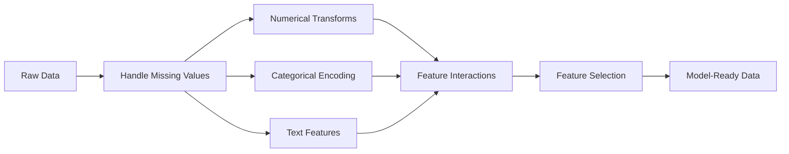

# 특성 공학 및 선택 (Feature Engineering & Selection)

> 좋은 특성 하나는 천 개의 데이터 포인트만큼의 가치가 있습니다.

**유형:** Build (실습)
**사용 언어:** Python
**선수 레슨:** Phase 1 (Statistics for ML, Linear Algebra), Phase 2 Lessons 1-7
**소요 시간:** ~90분

## 학습 목표

- 수치형 변환(표준화, 최소-최대 스케일링, 로그 변환, 비닝)을 구현하고 각 변환이 적절한 시점을 설명합니다.
- 범주형 특성을 위한 원-핫, 레이블, 타깃 인코딩을 구축하고 타깃 인코딩의 데이터 누출(data leakage) 위험을 식별합니다.
- 밑바닥부터 TF-IDF 벡터라이저를 구현하고, 텍스트 분류에서 이것이 단순 단어 빈도보다 뛰어난 성능을 보이는 이유를 설명합니다.
- 차원 축소를 위해 필터 기반 특성 선택(분산 임계값, 상관관계, 상호 정보량)을 적용합니다.

## 문제 정의

데이터셋이 주어졌습니다. 알고리즘을 선택하고, 모델을 훈련합니다. 결과는 평범합니다. 더 정교한 알고리즘을 시도해 봅니다. 여전히 평범합니다. 일주일 동안 하이퍼파라미터 튜닝에 매달립니다. 미미한 개선에 그칩니다.

그런 다음 누군가가 원시 데이터를 더 나은 특성으로 변환하자, 단순한 로지스틱 회귀 모델이 여러분이 튜닝한 그래디언트 부스팅 앙상블 모델을 뛰어넘습니다.

이런 일은 빈번하게 일어납니다. 전통적인 머신러닝에서는 알고리즘의 선택보다 데이터 표현(representation)이 훨씬 더 중요합니다. "면적"과 "침실 수"가 포함된 주택 가격 예측 모델은 학습 알고리즘이 아무리 정교하더라도 "주소 원시 문자열"만 있는 모델을 압도합니다. 알고리즘은 제공된 데이터 내에서만 작동할 수 있기 때문입니다.

특성 공학(feature engineering)은 모델이 패턴을 더 쉽게 찾을 수 있도록 원시 데이터를 표현으로 변환하는 과정입니다. 특성 선택(feature selection)은 신호(signal)를 추가하지 않고 노이즈만 더하는 특성을 제거하는 과정입니다. 이 둘은 전통적인 머신러닝에서 가장 큰 영향을 미치는 핵심 활동입니다.

## 핵심 개념

### 특성 파이프라인 (Feature Pipeline)



### 수치형 특성 (Numerical Features)

원시 수치 데이터는 모델에 바로 투입하기 적합하지 않은 경우가 많습니다. 일반적인 변환 기법은 다음과 같습니다.

**스케일링(Scaling):** 거리 기반 알고리즘(K-Means, KNN, SVM)이 모든 특성을 동등하게 다루도록 특성들을 동일한 범위로 맞춥니다. 최소-최대 스케일링(min-max scaling)은 값을 [0, 1] 범위로 변환합니다. 표준화(standardization, z-score)는 평균=0, 표준편차=1로 변환합니다.

**로그 변환(Log transform):** 오른쪽으로 치우친(right-skewed) 분포(소득, 인구, 단어 빈도 등)를 압축합니다. 곱셈 관계를 덧셈 관계로 변환합니다.

**비닝(Binning):** 연속형 값을 범주형으로 변환합니다. 특성과 타깃 간의 관계가 비선형적이면서 계단식 형태를 띨 때 유용합니다(예: 연령대).

**다항 특성(Polynomial features):** $x^2$, $x^3$, $x_1 x_2$ 등의 항을 생성합니다. 선형 모델이 더 많은 특성을 대가로 비선형 관계를 포착할 수 있게 돕습니다.

### 범주형 특성 (Categorical Features)

모델은 숫자를 필요로 합니다. 따라서 범주는 인코딩이 필요합니다.

**원-핫 인코딩(One-hot encoding):** 각 범주마다 이진 열을 생성합니다. "color = red/blue/green"은 is_red, is_blue, is_green 세 개의 열이 됩니다. 카디널리티(cardinality, 고유 범주 수)가 낮은 특성에는 잘 작동하지만, 범주 수가 많아지면 차원이 급증합니다.

**레이블 인코딩(Label encoding):** 각 범주를 정수에 매핑합니다(red=0, blue=1, green=2). 잘못된 순서 관계를 부여할 수 있습니다(모델이 green > blue > red라고 인식할 위험). 개별 값을 기준으로 분기하는 트리 기반 모델에만 적합합니다.

**타깃 인코딩(Target encoding):** 각 범주를 해당 범주에 속한 타깃 변수의 평균값으로 대체합니다. 강력하지만 위험합니다. 데이터 누출(data leakage) 위험이 큽니다. 반드시 훈련 데이터에서만 계산하여 테스트 데이터에 적용해야 합니다.

### 텍스트 특성 (Text Features)

**카운트 벡터라이저(Count vectorizer):** 문서 내 각 단어의 등장 횟수를 셉니다. "the cat sat on the mat"은 {the: 2, cat: 1, sat: 1, on: 1, mat: 1}이 됩니다.

**TF-IDF:** 단어 빈도-역문서 빈도(Term Frequency-Inverse Document Frequency)의 약어입니다. 여러 문서에 걸쳐 단어가 얼마나 고유한지에 따라 가중치를 부여합니다. "the"와 같은 흔한 단어는 낮은 가중치를, 드물고 구별력 있는 단어는 높은 가중치를 받습니다.

```math
\begin{aligned}
\text{TF}(\text{word}, \text{doc}) &= \frac{\text{count(word in doc)}}{\text{total words in doc}} \\
\text{IDF}(\text{word}) &= \log \frac{\text{total docs}}{\text{docs containing word}} \\
\text{TF-IDF} &= \text{TF} \cdot \text{IDF}
\end{aligned}
```

### 결측치 처리 (Missing Values)

실제 데이터에는 결측치가 존재합니다. 주요 전략은 다음과 같습니다.

- **행 삭제:** 결측 데이터가 극히 드물고 무작위로 발생한 경우에만 사용합니다.
- **평균/중앙값 대체(imputation):** 단순하며 분포 형태를 보존합니다(중앙값은 이상치에 더 강건합니다).
- **최빈값 대체:** 범주형 특성에 적합합니다.
- **지시자 열(Indicator column) 추가:** 대체하기 전에 "was_this_missing"이라는 이진 열을 추가합니다. 데이터가 누락되었다는 사실 자체가 유용한 정보일 수 있습니다.
- **전진/후진 채우기(Forward/backward fill):** 시계열 데이터에 사용합니다.

### 특성 상호작용 (Feature Interaction)

때로는 두 특성의 조합 속에 관계가 숨어 있습니다. "키"와 "몸무게" 각각보다는 $\text{BMI} = \text{weight} / \text{height}^2$가 훨씬 더 높은 예측력을 가질 수 있습니다. 특성 상호작용은 특성 공간을 크게 늘리므로, 도메인 지식을 활용해 적절한 특성을 골라내야 합니다.

### 특성 선택 (Feature Selection)

특성이 많다고 항상 좋은 것은 아닙니다. 무관한 특성은 노이즈를 더하고, 훈련 시간을 늘리며, 과적합(overfitting)을 유발할 수 있습니다.

**필터 방식(Filter methods, 모델 적용 전):**
- 상관관계(Correlation): 서로 높은 상관관계를 보이는(중복된) 특성을 제거합니다.
- 상호 정보량(Mutual information): 한 특성을 아는 것이 타깃에 대한 불확실성을 얼마나 줄여주는지 측정합니다.
- 분산 임계값(Variance threshold): 변화가 거의 없는 특성을 제거합니다.

**래퍼 방식(Wrapper methods, 모델 기반):**
- L1 규제(Lasso): 관련 없는 특성의 가중치를 정확히 0으로 만듭니다.
- 재귀적 특성 제거(Recursive feature elimination): 훈련 후 가장 덜 중요한 특성을 제거하는 과정을 반복합니다.

**특성 선택이 중요한 이유:** 좋은 특성 10개를 가진 모델이 대체로 좋은 특성 10개와 노이즈 특성 90개를 가진 모델보다 성능이 뛰어납니다. 노이즈 특성은 일반화되지 않는 훈련 데이터의 패턴에 모델이 과적합할 빌미를 제공하기 때문입니다.

```figure
feature-scaling
```

## 직접 구현하기

### 1단계: 밑바닥부터 수치형 변환 구현하기

```python
import math


def min_max_scale(values):
    min_val = min(values)
    max_val = max(values)
    if max_val == min_val:
        return [0.0] * len(values)
    return [(v - min_val) / (max_val - min_val) for v in values]


def standardize(values):
    n = len(values)
    mean = sum(values) / n
    variance = sum((v - mean) ** 2 for v in values) / n
    std = math.sqrt(variance) if variance > 0 else 1.0
    return [(v - mean) / std for v in values]


def log_transform(values):
    return [math.log(v + 1) for v in values]


def bin_values(values, n_bins=5):
    min_val = min(values)
    max_val = max(values)
    bin_width = (max_val - min_val) / n_bins
    if bin_width == 0:
        return [0] * len(values)
    result = []
    for v in values:
        bin_idx = int((v - min_val) / bin_width)
        bin_idx = min(bin_idx, n_bins - 1)
        result.append(bin_idx)
    return result


def polynomial_features(row, degree=2):
    n = len(row)
    result = list(row)
    if degree >= 2:
        for i in range(n):
            result.append(row[i] ** 2)
        for i in range(n):
            for j in range(i + 1, n):
                result.append(row[i] * row[j])
    return result
```

### 2단계: 밑바닥부터 범주형 인코딩 구현하기

```python
def one_hot_encode(values):
    categories = sorted(set(values))
    cat_to_idx = {cat: i for i, cat in enumerate(categories)}
    n_cats = len(categories)

    encoded = []
    for v in values:
        row = [0] * n_cats
        row[cat_to_idx[v]] = 1
        encoded.append(row)

    return encoded, categories


def label_encode(values):
    categories = sorted(set(values))
    cat_to_int = {cat: i for i, cat in enumerate(categories)}
    return [cat_to_int[v] for v in values], cat_to_int


def target_encode(feature_values, target_values, smoothing=10):
    global_mean = sum(target_values) / len(target_values)

    category_stats = {}
    for feat, target in zip(feature_values, target_values):
        if feat not in category_stats:
            category_stats[feat] = {"sum": 0.0, "count": 0}
        category_stats[feat]["sum"] += target
        category_stats[feat]["count"] += 1

    encoding = {}
    for cat, stats in category_stats.items():
        cat_mean = stats["sum"] / stats["count"]
        weight = stats["count"] / (stats["count"] + smoothing)
        encoding[cat] = weight * cat_mean + (1 - weight) * global_mean

    return [encoding[v] for v in feature_values], encoding
```

### 3단계: 밑바닥부터 텍스트 특성 구현하기

```python
def count_vectorize(documents):
    vocab = {}
    idx = 0
    for doc in documents:
        for word in doc.lower().split():
            if word not in vocab:
                vocab[word] = idx
                idx += 1

    vectors = []
    for doc in documents:
        vec = [0] * len(vocab)
        for word in doc.lower().split():
            vec[vocab[word]] += 1
        vectors.append(vec)

    return vectors, vocab


def tfidf(documents):
    n_docs = len(documents)

    vocab = {}
    idx = 0
    for doc in documents:
        for word in doc.lower().split():
            if word not in vocab:
                vocab[word] = idx
                idx += 1

    doc_freq = {}
    for doc in documents:
        seen = set()
        for word in doc.lower().split():
            if word not in seen:
                doc_freq[word] = doc_freq.get(word, 0) + 1
                seen.add(word)

    vectors = []
    for doc in documents:
        words = doc.lower().split()
        word_count = len(words)
        tf_map = {}
        for word in words:
            tf_map[word] = tf_map.get(word, 0) + 1

        vec = [0.0] * len(vocab)
        for word, count in tf_map.items():
            tf = count / word_count
            idf = math.log(n_docs / doc_freq[word])
            vec[vocab[word]] = tf * idf
        vectors.append(vec)

    return vectors, vocab
```

### 4단계: 밑바닥부터 결측치 대체 구현하기

```python
def impute_mean(values):
    present = [v for v in values if v is not None]
    if not present:
        return [0.0] * len(values), 0.0
    mean = sum(present) / len(present)
    return [v if v is not None else mean for v in values], mean


def impute_median(values):
    present = sorted(v for v in values if v is not None)
    if not present:
        return [0.0] * len(values), 0.0
    n = len(present)
    if n % 2 == 0:
        median = (present[n // 2 - 1] + present[n // 2]) / 2
    else:
        median = present[n // 2]
    return [v if v is not None else median for v in values], median


def impute_mode(values):
    present = [v for v in values if v is not None]
    if not present:
        return values, None
    counts = {}
    for v in present:
        counts[v] = counts.get(v, 0) + 1
    mode = max(counts, key=counts.get)
    return [v if v is not None else mode for v in values], mode


def add_missing_indicator(values):
    return [0 if v is not None else 1 for v in values]
```

### 5단계: 밑바닥부터 특성 선택 구현하기

```python
def correlation(x, y):
    n = len(x)
    mean_x = sum(x) / n
    mean_y = sum(y) / n
    cov = sum((xi - mean_x) * (yi - mean_y) for xi, yi in zip(x, y)) / n
    std_x = math.sqrt(sum((xi - mean_x) ** 2 for xi in x) / n)
    std_y = math.sqrt(sum((yi - mean_y) ** 2 for yi in y) / n)
    if std_x == 0 or std_y == 0:
        return 0.0
    return cov / (std_x * std_y)


def mutual_information(feature, target, n_bins=10):
    feat_min = min(feature)
    feat_max = max(feature)
    bin_width = (feat_max - feat_min) / n_bins if feat_max != feat_min else 1.0
    feat_binned = [
        min(int((f - feat_min) / bin_width), n_bins - 1) for f in feature
    ]

    n = len(feature)
    target_classes = sorted(set(target))

    feat_bins = sorted(set(feat_binned))
    p_feat = {}
    for b in feat_bins:
        p_feat[b] = feat_binned.count(b) / n

    p_target = {}
    for t in target_classes:
        p_target[t] = target.count(t) / n

    mi = 0.0
    for b in feat_bins:
        for t in target_classes:
            joint_count = sum(
                1 for fb, tv in zip(feat_binned, target) if fb == b and tv == t
            )
            p_joint = joint_count / n
            if p_joint > 0:
                mi += p_joint * math.log(p_joint / (p_feat[b] * p_target[t]))

    return mi


def variance_threshold(features, threshold=0.01):
    n_features = len(features[0])
    n_samples = len(features)
    selected = []

    for j in range(n_features):
        col = [features[i][j] for i in range(n_samples)]
        mean = sum(col) / n_samples
        var = sum((v - mean) ** 2 for v in col) / n_samples
        if var >= threshold:
            selected.append(j)

    return selected


def remove_correlated(features, threshold=0.9):
    n_features = len(features[0])
    n_samples = len(features)

    to_remove = set()
    for i in range(n_features):
        if i in to_remove:
            continue
        col_i = [features[r][i] for r in range(n_samples)]
        for j in range(i + 1, n_features):
            if j in to_remove:
                continue
            col_j = [features[r][j] for r in range(n_samples)]
            corr = abs(correlation(col_i, col_j))
            if corr >= threshold:
                to_remove.add(j)

    return [i for i in range(n_features) if i not in to_remove]
```

### 6단계: 전체 파이프라인 및 데모

```python
import random


def make_housing_data(n=200, seed=42):
    random.seed(seed)
    data = []
    for _ in range(n):
        sqft = random.uniform(500, 5000)
        bedrooms = random.choice([1, 2, 3, 4, 5])
        age = random.uniform(0, 50)
        neighborhood = random.choice(["downtown", "suburbs", "rural"])
        has_pool = random.choice([True, False])

        sqft_with_missing = sqft if random.random() > 0.05 else None
        age_with_missing = age if random.random() > 0.08 else None

        price = (
            50 * sqft
            + 20000 * bedrooms
            - 1000 * age
            + (50000 if neighborhood == "downtown" else 10000 if neighborhood == "suburbs" else 0)
            + (15000 if has_pool else 0)
            + random.gauss(0, 20000)
        )

        data.append({
            "sqft": sqft_with_missing,
            "bedrooms": bedrooms,
            "age": age_with_missing,
            "neighborhood": neighborhood,
            "has_pool": has_pool,
            "price": price,
        })
    return data


if __name__ == "__main__":
    data = make_housing_data(200)

    print("=== Raw Data Sample ===")
    for row in data[:3]:
        print(f"  {row}")

    sqft_raw = [d["sqft"] for d in data]
    age_raw = [d["age"] for d in data]
    prices = [d["price"] for d in data]

    print("\n=== Missing Value Handling ===")
    sqft_missing = sum(1 for v in sqft_raw if v is None)
    age_missing = sum(1 for v in age_raw if v is None)
    print(f"  sqft missing: {sqft_missing}/{len(sqft_raw)}")
    print(f"  age missing: {age_missing}/{len(age_raw)}")

    sqft_indicator = add_missing_indicator(sqft_raw)
    age_indicator = add_missing_indicator(age_raw)
    sqft_imputed, sqft_fill = impute_median(sqft_raw)
    age_imputed, age_fill = impute_mean(age_raw)
    print(f"  sqft filled with median: {sqft_fill:.0f}")
    print(f"  age filled with mean: {age_fill:.1f}")

    print("\n=== Numerical Transforms ===")
    sqft_scaled = standardize(sqft_imputed)
    age_scaled = min_max_scale(age_imputed)
    sqft_log = log_transform(sqft_imputed)
    age_binned = bin_values(age_imputed, n_bins=5)
    print(f"  sqft standardized: mean={sum(sqft_scaled)/len(sqft_scaled):.4f}, std={math.sqrt(sum(v**2 for v in sqft_scaled)/len(sqft_scaled)):.4f}")
    print(f"  age min-max: [{min(age_scaled):.2f}, {max(age_scaled):.2f}]")
    print(f"  age bins: {sorted(set(age_binned))}")

    print("\n=== Categorical Encoding ===")
    neighborhoods = [d["neighborhood"] for d in data]

    ohe, ohe_cats = one_hot_encode(neighborhoods)
    print(f"  One-hot categories: {ohe_cats}")
    print(f"  Sample encoding: {neighborhoods[0]} -> {ohe[0]}")

    le, le_map = label_encode(neighborhoods)
    print(f"  Label encoding map: {le_map}")

    te, te_map = target_encode(neighborhoods, prices, smoothing=10)
    print(f"  Target encoding: {({k: round(v) for k, v in te_map.items()})}")

    print("\n=== Text Features ===")
    descriptions = [
        "large modern house with pool",
        "small cozy cottage near downtown",
        "spacious family home with large yard",
        "modern apartment downtown with view",
        "rustic cabin in rural area",
    ]
    cv, cv_vocab = count_vectorize(descriptions)
    print(f"  Vocabulary size: {len(cv_vocab)}")
    print(f"  Doc 0 non-zero features: {sum(1 for v in cv[0] if v > 0)}")

    tf, tf_vocab = tfidf(descriptions)
    print(f"  TF-IDF vocabulary size: {len(tf_vocab)}")
    top_words = sorted(tf_vocab.keys(), key=lambda w: tf[0][tf_vocab[w]], reverse=True)[:3]
    print(f"  Doc 0 top TF-IDF words: {top_words}")

    print("\n=== Polynomial Features ===")
    sample_row = [sqft_scaled[0], age_scaled[0]]
    poly = polynomial_features(sample_row, degree=2)
    print(f"  Input: {[round(v, 4) for v in sample_row]}")
    print(f"  Polynomial: {[round(v, 4) for v in poly]}")
    print(f"  Features: [x1, x2, x1^2, x2^2, x1*x2]")

    print("\n=== Feature Selection ===")
    feature_matrix = [
        [sqft_scaled[i], age_scaled[i], float(sqft_indicator[i]), float(age_indicator[i])]
        + ohe[i]
        for i in range(len(data))
    ]

    print(f"  Total features: {len(feature_matrix[0])}")

    surviving_var = variance_threshold(feature_matrix, threshold=0.01)
    print(f"  After variance threshold (0.01): {len(surviving_var)} features kept")

    surviving_corr = remove_correlated(feature_matrix, threshold=0.9)
    print(f"  After correlation filter (0.9): {len(surviving_corr)} features kept")

    binary_prices = [1 if p > sum(prices) / len(prices) else 0 for p in prices]
    print("\n  Mutual information with target:")
    feature_names = ["sqft", "age", "sqft_missing", "age_missing"] + [f"neigh_{c}" for c in ohe_cats]
    for j in range(len(feature_matrix[0])):
        col = [feature_matrix[i][j] for i in range(len(feature_matrix))]
        mi = mutual_information(col, binary_prices, n_bins=10)
        print(f"    {feature_names[j]}: MI={mi:.4f}")

    print("\n  Correlation with price:")
    for j in range(len(feature_matrix[0])):
        col = [feature_matrix[i][j] for i in range(len(feature_matrix))]
        corr = correlation(col, prices)
        print(f"    {feature_names[j]}: r={corr:.4f}")
```

## 적용하기

scikit-learn을 사용하면 이러한 변환을 조합 가능한 파이프라인으로 구성할 수 있습니다.

```python
from sklearn.preprocessing import StandardScaler, OneHotEncoder, PolynomialFeatures
from sklearn.impute import SimpleImputer
from sklearn.feature_extraction.text import TfidfVectorizer
from sklearn.feature_selection import mutual_info_classif, VarianceThreshold
from sklearn.compose import ColumnTransformer
from sklearn.pipeline import Pipeline

numeric_pipe = Pipeline([
    ("imputer", SimpleImputer(strategy="median")),
    ("scaler", StandardScaler()),
])

categorical_pipe = Pipeline([
    ("encoder", OneHotEncoder(sparse_output=False)),
])

preprocessor = ColumnTransformer([
    ("num", numeric_pipe, ["sqft", "age"]),
    ("cat", categorical_pipe, ["neighborhood"]),
])
```

직접 구현한 코드는 각 변환 내부에서 어떤 일이 일어나는지 정확하게 보여줍니다. 라이브러리 버전은 예외 처리, 희소 행렬(sparse matrix) 지원, 파이프라인 구성 기능 등을 추가로 제공하지만, 수학적 원리는 완전히 동일합니다.

## 배포하기

본 레슨의 결과물:
- `outputs/prompt-feature-engineer.md` - 원시 데이터로부터 체계적으로 특성을 엔지니어링하기 위한 프롬프트

## 연습 문제

1. 수치형 변환에 로버스트 스케일링(robust scaling, 평균과 표준편차 대신 중앙값과 사분위간 범위 사용)을 추가하세요. 극단적인 이상치가 있는 데이터에서 이를 표준 스케일링과 비교해 보세요.
2. LOO(leave-one-out) 타깃 인코딩을 구현하세요. 각 행에 대해 해당 행 자신의 타깃 값을 제외하고 타깃 평균을 계산합니다. 단순 타깃 인코딩에 비해 이것이 어떻게 과적합을 줄이는지 보여주세요.
3. 분산 임계값, 상관관계 필터링, 상호 정보량 순위 지정을 결합한 자동 특성 선택 파이프라인을 구축하세요. 이를 주택 데이터셋에 적용하고, 단순 선형 회귀를 사용하여 전체 특성을 사용했을 때와 선택된 특성만 사용했을 때의 모델 성능을 비교해 보세요.
## 핵심 용어

| 용어 | 흔히 하는 말 | 실제 의미 |
|------|----------------|----------------------|
| 피처 엔지니어링(Feature engineering) | "새로운 열 만들기" | 원시 데이터를 모델이 패턴을 쉽게 파악할 수 있는 표현으로 변환하는 작업 |
| 표준화(Standardization) | "정규분포처럼 만들기" | 평균을 빼고 표준편차로 나누어 피처가 평균=0, 표준편차=1을 갖도록 만드는 작업 |
| 원-핫 인코딩(One-hot encoding) | "더미 변수 만들기" | 범주당 하나의 이진 열을 생성하여, 각 행마다 정확히 하나의 열만 1이 되도록 하는 방식 |
| 타깃 인코딩(Target encoding) | "정답을 사용해 인코딩하기" | 과적합(overfitting)을 방지하기 위한 평활화(smoothing)와 함께, 각 범주를 해당 범주의 평균 타깃값으로 대체하는 방식 |
| TF-IDF | "고급 단어 빈도 계산" | 단어 빈도(Term Frequency)에 역문서 빈도(Inverse Document Frequency)를 곱한 값: 말뭉치(corpus) 전체에서 단어가 얼마나 독특한지에 따라 가중치를 부여함 |
| 대치(Imputation) | "빈칸 채우기" | 결측값을 추정값(평균, 중앙값, 최빈값 또는 모델 예측값)으로 대체하는 작업 |
| 피처 선택(Feature selection) | "좋지 않은 열 버리기" | 노이즈나 중복을 유발하는 피처를 제거하고, 타깃에 대한 신호가 있는 피처만 유지하는 작업 |
| 상호 정보량(Mutual information) | "한 가지가 다른 것에 대해 얼마나 많은 정보를 주는지" | 변수 X를 관측함으로써 얻는 변수 Y의 불확실성 감소량을 나타내는 척도 |
| 데이터 누수(Data leakage) | "의도치 않게 커닝하기" | 예측 시점에는 사용할 수 없는 정보를 학습 중에 사용하여, 거짓으로 낙관적인 결과를 초래하는 현상 |

## 추가 자료

- [Feature Engineering and Selection (Max Kuhn & Kjell Johnson)](http://www.feat.engineering/) - 피처 엔지니어링 전반을 다루는 무료 온라인 도서
- [scikit-learn Preprocessing Guide](https://scikit-learn.org/stable/modules/preprocessing.html) - 모든 표준 변환에 대한 실무 참고 자료
- [Target Encoding Done Right (Micci-Barreca, 2001)](https://dl.acm.org/doi/10.1145/507533.507538) - 평활화를 적용한 타깃 인코딩에 관한 원저 논문
