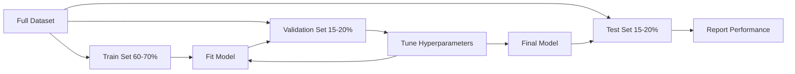

# 모델 평가

> 모델의 가치는 그것을 측정하는 방법에 의해 결정됩니다.

**유형:** Build (실습)
**사용 언어:** Python
**선수 레슨:** Phase 1 (Probability & Distributions, Statistics for ML), Phase 2 Lessons 1-8
**소요 시간:** ~90분

## 학습 목표

- K-폴드(K-fold) 및 계층화 K-폴드(stratified K-fold) 교차 검증을 밑바닥부터 구현하고, 불균형 데이터에서 계층화가 왜 중요한지 설명합니다.
- 정밀도(precision), 재현율(recall), F1, AUC-ROC, 회귀 지표(MSE, RMSE, MAE, R-squared)를 밑바닥부터 계산합니다.
- 학습 곡선(learning curve)을 해석하여 모델이 높은 편향(high bias) 또는 높은 분산(high variance) 문제를 겪고 있는지 진단합니다.
- 데이터 누수(data leakage), 잘못된 지표 선택, 테스트 세트 오염 등 흔히 발생하는 평가 실수를 식별합니다.

## 문제

모델을 학습시켰습니다. 데이터에서 95%의 정확도(accuracy)를 달성했습니다. 좋은 모델일까요?

그럴 수도 있고, 아닐 수도 있습니다. 데이터의 95%가 하나의 클래스에 속한다면, 항상 해당 클래스만 예측하는 모델도 95%의 정확도를 얻지만 완전히 쓸모없습니다. 학습에 사용한 것과 동일한 데이터로 평가했다면, 모델이 정답을 단순히 암기했을 뿐이므로 95%라는 수치는 무의미합니다. 데이터셋에 시간적 요소가 포함되어 있는데 분할 전에 무작위로 섞었다면, 모델이 미래의 데이터를 사용해 과거를 예측하고 있을 수도 있습니다.

모델 평가는 대부분의 ML 프로젝트가 잘못되는 지점입니다. 잘못된 지표는 형편없는 모델을 좋은 모델처럼 보이게 만듭니다. 잘못된 분할은 모델이 부정행위를 하도록 허용합니다. 잘못된 비교는 더 나쁜 모델을 선택하게 만듭니다. 평가를 제대로 수행하는 것은 선택 사항이 아닙니다. 프로덕션 환경에서 작동하는 모델과 실제 데이터를 마주하는 순간 실패하는 모델 사이의 차이를 만듭니다.

## 개념

### 학습, 검증, 테스트 세트



세 가지 분할, 세 가지 목적:

- **학습 세트(Training set)**: 모델이 이 데이터로부터 학습합니다. 학습 중에 이 예시들을 직접 봅니다.
- **검증 세트(Validation set)**: 하이퍼파라미터를 튜닝하고 모델 간의 선택을 내리는 데 사용됩니다. 모델은 이 데이터로 학습하지 않지만, 개발자의 결정은 이에 영향을 받습니다.
- **테스트 세트(Test set)**: 최종 성능을 보고하기 위해 맨 마지막에 딱 한 번만 접근합니다. 테스트 성능을 확인한 후 모델을 변경하기 위해 되돌아간다면, 그것은 더 이상 테스트 세트가 아닙니다. 두 번째 검증 세트가 되어버린 것입니다.

테스트 세트는 보고된 성능이 모델이 한 번도 보지 못한 데이터에서 어떻게 작동할지를 반영한다는 것을 보장하는 홀드아웃(hold-out) 안전장치입니다.

### K-폴드 교차 검증

데이터셋이 작을 때 단일 학습/검증 분할은 데이터를 낭비하고 노이즈가 많은 추정치를 제공합니다. K-폴드 교차 검증(K-fold cross-validation)은 모든 데이터를 학습과 검증 모두에 사용합니다:

```mermaid
flowchart TB
    subgraph Fold1["Fold 1"]
        direction LR
        V1["Val"] --- T1a["Train"] --- T1b["Train"] --- T1c["Train"] --- T1d["Train"]
    end
    subgraph Fold2["Fold 2"]
        direction LR
        T2a["Train"] --- V2["Val"] --- T2b["Train"] --- T2c["Train"] --- T2d["Train"]
    end
    subgraph Fold3["Fold 3"]
        direction LR
        T3a["Train"] --- T3b["Train"] --- V3["Val"] --- T3c["Train"] --- T3d["Train"]
    end
    subgraph Fold4["Fold 4"]
        direction LR
        T4a["Train"] --- T4b["Train"] --- T4c["Train"] --- V4["Val"] --- T4d["Train"]
    end
    subgraph Fold5["Fold 5"]
        direction LR
        T5a["Train"] --- T5b["Train"] --- T5c["Train"] --- T5d["Train"] --- V5["Val"]
    end
    Fold1 --> R["Average scores"]
    Fold2 --> R
    Fold3 --> R
    Fold4 --> R
    Fold5 --> R
```



1. 데이터를 크기가 같은 $K$개의 폴드(fold)로 나눕니다.
2. 각 폴드에 대해, $K-1$개의 폴드로 학습하고 나머지 폴드로 검증합니다.
3. $K$개의 검증 점수를 평균 냅니다.

$K=5$ 또는 $K=10$이 표준적인 선택입니다. 모든 데이터 포인트는 정확히 한 번씩 검증에 사용됩니다. 평균 점수는 단일 분할보다 더 안정적인 추정치를 제공합니다.

**계층화 K-폴드(Stratified K-fold)**: 각 폴드에서 클래스 비율을 보존합니다. 데이터셋이 클래스 A 70%, 클래스 B 30%로 구성되어 있다면, 각 폴드도 대략 동일한 비율을 가집니다. 이는 무작위 분할로 인해 한 폴드에 모든 소수 클래스 샘플이 몰릴 수 있는 불균형 데이터셋에서 중요합니다.

### 분류 지표

**혼동 행렬(Confusion matrix)**: 모든 지표의 기초입니다. 이진 분류의 경우:

|  | 양성 예측 (Predicted Positive) | 음성 예측 (Predicted Negative) |
|--|---|---|
| 실제 양성 (Actually Positive) | 진짜 양성 (True Positive, TP) | 가짜 음성 (False Negative, FN) |
| 실제 음성 (Actually Negative) | 가짜 양성 (False Positive, FP) | 진짜 음성 (True Negative, TN) |

이 행렬로부터 다른 모든 지표가 도출됩니다:

- **정확도(Accuracy)** = $(TP + TN) / (TP + TN + FP + FN)$. 올바른 예측의 비율입니다. 클래스가 불균형할 때 잘못된 판단을 유도할 수 있습니다.
- **정밀도(Precision)** = $TP / (TP + FP)$. 양성으로 예측한 모든 것 중 실제로 양성인 것은 몇 개인가? 가짜 양성(FP)의 비용이 클 때 사용합니다 (예: 스팸 필터가 정상 이메일을 스팸으로 표시하는 경우).
- **재현율(Recall, 민감도)** = $TP / (TP + FN)$. 실제 양성인 모든 것 중 몇 개를 찾아냈는가? 가짜 음성(FN)의 비용이 클 때 사용합니다 (예: 암 검진에서 종양을 놓치는 경우).
- **F1 점수(F1 score)** = $2 \cdot \text{precision} \cdot \text{recall} / (\text{precision} + \text{recall})$. 정밀도와 재현율의 조화 평균입니다. 어느 한쪽이 확실히 우세하지 않을 때 둘의 균형을 맞춥니다.
- **AUC-ROC**: 수신자 조작 특성(Receiver Operating Characteristic) 곡선 아래 면적입니다. 다양한 분류 임계값(threshold)에서 진짜 양성 비율(TPR) 대 가짜 양성 비율(FPR)을 플롯합니다. AUC = 0.5는 무작위 추측을 의미하며, AUC = 1.0은 완벽한 분리를 의미합니다. 임계값에 독립적(threshold-independent)입니다. 선택한 기준점에 관계없이 모델이 양성을 음성보다 얼마나 잘 순위 매기는지를 측정합니다.

### 회귀 지표

- **MSE** (평균 제곱 오차, Mean Squared Error) = $\text{mean}((y_{\text{true}} - y_{\text{pred}})^2)$. 큰 오차에 제곱으로 페널티를 부여합니다. 이상치(outlier)에 민감합니다.
- **RMSE** (평균 제곱근 오차, Root Mean Squared Error) = $\sqrt{\text{MSE}}$. 타깃 변수와 동일한 단위를 가집니다. MSE보다 해석하기 쉽습니다.
- **MAE** (평균 절대 오차, Mean Absolute Error) = $\text{mean}(\lvert y_{\text{true}} - y_{\text{pred}} \rvert)$. 모든 오차를 선형적으로 처리합니다. MSE보다 이상치에 더 강건(robust)합니다.
- **R-squared** (결정계수) = $1 - SS_{\text{res}} / SS_{\text{tot}}$, 여기서 $SS_{\text{res}} = \sum (y_{\text{true}} - y_{\text{pred}})^2$이고 $SS_{\text{tot}} = \sum (y_{\text{true}} - y_{\text{mean}})^2$입니다. 모델에 의해 설명되는 분산의 비율입니다. $R^2 = 1.0$은 완벽함을 의미합니다. $R^2 = 0.0$은 모델이 항상 평균을 예측하는 것보다 나을 바가 없음을 의미합니다. 모델이 평균보다 못하면 $R^2$은 음수가 될 수도 있습니다.

### 학습 곡선

학습 세트 크기의 함수로 학습 및 검증 점수를 플롯합니다:

- **높은 편향(과소적합, underfitting)**: 두 곡선 모두 낮은 점수로 수렴합니다. 데이터를 더 추가해도 도움이 되지 않습니다. 더 복잡한 모델이 필요합니다.
- **높은 분산(과적합, overfitting)**: 학습 점수는 높지만 검증 점수는 훨씬 낮습니다. 두 점수 사이의 격차가 큽니다. 데이터를 더 추가하는 것이 도움이 됩니다.

### 검증 곡선

하이퍼파라미터의 함수로 학습 및 검증 점수를 플롯합니다:

- 복잡도가 낮을 때: 두 점수 모두 낮음 (과소적합)
- 적절한 복잡도일 때: 두 점수 모두 높고 서로 가까움
- 복잡도가 높을 때: 학습 점수는 높게 유지되지만 검증 점수는 떨어짐 (과적합)

최적의 하이퍼파라미터 값은 검증 점수가 최고조에 달하는 지점입니다.

### 흔히 발생하는 평가 실수

**데이터 누수(Data leakage)**: 테스트 세트의 정보가 학습 과정으로 누출됩니다. 예시: 분할 전에 전체 데이터셋에 스케일러(scaler)를 적용(fit)하는 경우, 시계열 예측에서 미래 데이터를 포함하는 경우, 타깃에서 파생된 특성(feature)을 사용하는 경우. 항상 먼저 분할한 후 전처리를 수행해야 합니다.

**클래스 불균형(Class imbalance)**: 거래의 99%가 정상이고 1%가 사기입니다. 항상 "정상"으로 예측하는 모델은 99%의 정확도를 얻습니다. 대신 정밀도, 재현율, F1, 또는 AUC-ROC를 사용하십시오.

**잘못된 지표**: 재현율을 최적화해야 할 때 정확도를 최적화하는 경우(의료 진단), 또는 데이터에 심한 이상치가 있을 때 RMSE를 최적화하는 경우(대신 MAE 사용).

**계층화 분할 미사용**: 불균형 데이터에서 무작위 분할을 사용하면 검증 폴드에 소수 클래스 샘플이 극소수만 포함되어 추정치가 불안정해질 수 있습니다.

**너무 잦은 테스트**: 테스트 성능을 확인하고 조정할 때마다 테스트 세트에 과적합됩니다. 테스트 세트는 일회용입니다.

```figure
precision-recall-threshold
```

## 직접 구현하기

### 1단계: 학습/검증/테스트 세트 분할

```python
import random
import math


def train_val_test_split(X, y, train_ratio=0.6, val_ratio=0.2, seed=42):
    random.seed(seed)
    n = len(X)
    indices = list(range(n))
    random.shuffle(indices)

    train_end = int(n * train_ratio)
    val_end = int(n * (train_ratio + val_ratio))

    train_idx = indices[:train_end]
    val_idx = indices[train_end:val_end]
    test_idx = indices[val_end:]

    X_train = [X[i] for i in train_idx]
    y_train = [y[i] for i in train_idx]
    X_val = [X[i] for i in val_idx]
    y_val = [y[i] for i in val_idx]
    X_test = [X[i] for i in test_idx]
    y_test = [y[i] for i in test_idx]

    return X_train, y_train, X_val, y_val, X_test, y_test
```

### 2단계: K-폴드 및 계층화 K-폴드 교차 검증

```python
def kfold_split(n, k=5, seed=42):
    random.seed(seed)
    indices = list(range(n))
    random.shuffle(indices)

    fold_size = n // k
    folds = []

    for i in range(k):
        start = i * fold_size
        end = start + fold_size if i < k - 1 else n
        val_idx = indices[start:end]
        train_idx = indices[:start] + indices[end:]
        folds.append((train_idx, val_idx))

    return folds


def stratified_kfold_split(y, k=5, seed=42):
    random.seed(seed)

    class_indices = {}
    for i, label in enumerate(y):
        class_indices.setdefault(label, []).append(i)

    for label in class_indices:
        random.shuffle(class_indices[label])

    folds = [{"train": [], "val": []} for _ in range(k)]

    for label, indices in class_indices.items():
        fold_size = len(indices) // k
        for i in range(k):
            start = i * fold_size
            end = start + fold_size if i < k - 1 else len(indices)
            val_part = indices[start:end]
            train_part = indices[:start] + indices[end:]
            folds[i]["val"].extend(val_part)
            folds[i]["train"].extend(train_part)

    return [(f["train"], f["val"]) for f in folds]


def cross_validate(X, y, model_fn, k=5, metric_fn=None, stratified=False):
    n = len(X)

    if stratified:
        folds = stratified_kfold_split(y, k)
    else:
        folds = kfold_split(n, k)

    scores = []
    for train_idx, val_idx in folds:
        X_train = [X[i] for i in train_idx]
        y_train = [y[i] for i in train_idx]
        X_val = [X[i] for i in val_idx]
        y_val = [y[i] for i in val_idx]

        model = model_fn()
        model.fit(X_train, y_train)
        predictions = [model.predict(x) for x in X_val]

        if metric_fn:
            score = metric_fn(y_val, predictions)
        else:
            score = sum(1 for yt, yp in zip(y_val, predictions) if yt == yp) / len(y_val)
        scores.append(score)

    return scores
```

### 3단계: 혼동 행렬 및 분류 지표

```python
def confusion_matrix(y_true, y_pred):
    tp = sum(1 for yt, yp in zip(y_true, y_pred) if yt == 1 and yp == 1)
    tn = sum(1 for yt, yp in zip(y_true, y_pred) if yt == 0 and yp == 0)
    fp = sum(1 for yt, yp in zip(y_true, y_pred) if yt == 0 and yp == 1)
    fn = sum(1 for yt, yp in zip(y_true, y_pred) if yt == 1 and yp == 0)
    return tp, tn, fp, fn


def accuracy(y_true, y_pred):
    tp, tn, fp, fn = confusion_matrix(y_true, y_pred)
    total = tp + tn + fp + fn
    return (tp + tn) / total if total > 0 else 0.0


def precision(y_true, y_pred):
    tp, tn, fp, fn = confusion_matrix(y_true, y_pred)
    return tp / (tp + fp) if (tp + fp) > 0 else 0.0


def recall(y_true, y_pred):
    tp, tn, fp, fn = confusion_matrix(y_true, y_pred)
    return tp / (tp + fn) if (tp + fn) > 0 else 0.0


def f1_score(y_true, y_pred):
    p = precision(y_true, y_pred)
    r = recall(y_true, y_pred)
    return 2 * p * r / (p + r) if (p + r) > 0 else 0.0


def roc_curve(y_true, y_scores):
    thresholds = sorted(set(y_scores), reverse=True)
    tpr_list = []
    fpr_list = []

    total_positives = sum(y_true)
    total_negatives = len(y_true) - total_positives

    for threshold in thresholds:
        y_pred = [1 if s >= threshold else 0 for s in y_scores]
        tp = sum(1 for yt, yp in zip(y_true, y_pred) if yt == 1 and yp == 1)
        fp = sum(1 for yt, yp in zip(y_true, y_pred) if yt == 0 and yp == 1)

        tpr = tp / total_positives if total_positives > 0 else 0.0
        fpr = fp / total_negatives if total_negatives > 0 else 0.0

        tpr_list.append(tpr)
        fpr_list.append(fpr)

    return fpr_list, tpr_list, thresholds


def auc_roc(y_true, y_scores):
    fpr_list, tpr_list, _ = roc_curve(y_true, y_scores)

    pairs = sorted(zip(fpr_list, tpr_list))
    fpr_sorted = [p[0] for p in pairs]
    tpr_sorted = [p[1] for p in pairs]

    area = 0.0
    for i in range(1, len(fpr_sorted)):
        width = fpr_sorted[i] - fpr_sorted[i - 1]
        height = (tpr_sorted[i] + tpr_sorted[i - 1]) / 2
        area += width * height

    return area
```

### 4단계: 회귀 지표

```python
def mse(y_true, y_pred):
    n = len(y_true)
    return sum((yt - yp) ** 2 for yt, yp in zip(y_true, y_pred)) / n


def rmse(y_true, y_pred):
    return math.sqrt(mse(y_true, y_pred))


def mae(y_true, y_pred):
    n = len(y_true)
    return sum(abs(yt - yp) for yt, yp in zip(y_true, y_pred)) / n


def r_squared(y_true, y_pred):
    mean_y = sum(y_true) / len(y_true)
    ss_res = sum((yt - yp) ** 2 for yt, yp in zip(y_true, y_pred))
    ss_tot = sum((yt - mean_y) ** 2 for yt in y_true)
    if ss_tot == 0:
        return 0.0
    return 1.0 - ss_res / ss_tot
```

### 5단계: 학습 곡선

```python
def learning_curve(X, y, model_fn, metric_fn, train_sizes=None, val_ratio=0.2, seed=42):
    random.seed(seed)
    n = len(X)
    indices = list(range(n))
    random.shuffle(indices)

    val_size = int(n * val_ratio)
    val_idx = indices[:val_size]
    pool_idx = indices[val_size:]

    X_val = [X[i] for i in val_idx]
    y_val = [y[i] for i in val_idx]

    if train_sizes is None:
        train_sizes = [int(len(pool_idx) * r) for r in [0.1, 0.2, 0.4, 0.6, 0.8, 1.0]]

    train_scores = []
    val_scores = []

    for size in train_sizes:
        subset = pool_idx[:size]
        X_train = [X[i] for i in subset]
        y_train = [y[i] for i in subset]

        model = model_fn()
        model.fit(X_train, y_train)

        train_pred = [model.predict(x) for x in X_train]
        val_pred = [model.predict(x) for x in X_val]

        train_scores.append(metric_fn(y_train, train_pred))
        val_scores.append(metric_fn(y_val, val_pred))

    return train_sizes, train_scores, val_scores
```

### 6단계: 테스트용 단순 분류기 및 전체 데모

```python
class SimpleLogistic:
    def __init__(self, lr=0.1, epochs=100):
        self.lr = lr
        self.epochs = epochs
        self.weights = None
        self.bias = 0.0

    def sigmoid(self, z):
        z = max(-500, min(500, z))
        return 1.0 / (1.0 + math.exp(-z))

    def fit(self, X, y):
        n_features = len(X[0])
        self.weights = [0.0] * n_features
        self.bias = 0.0

        for _ in range(self.epochs):
            for xi, yi in zip(X, y):
                z = sum(w * x for w, x in zip(self.weights, xi)) + self.bias
                pred = self.sigmoid(z)
                error = yi - pred
                for j in range(n_features):
                    self.weights[j] += self.lr * error * xi[j]
                self.bias += self.lr * error

    def predict_proba(self, x):
        z = sum(w * xi for w, xi in zip(self.weights, x)) + self.bias
        return self.sigmoid(z)

    def predict(self, x):
        return 1 if self.predict_proba(x) >= 0.5 else 0


class SimpleLinearRegression:
    def __init__(self, lr=0.001, epochs=200):
        self.lr = lr
        self.epochs = epochs
        self.weights = None
        self.bias = 0.0

    def fit(self, X, y):
        n_features = len(X[0])
        self.weights = [0.0] * n_features
        self.bias = 0.0
        n = len(X)

        for _ in range(self.epochs):
            for xi, yi in zip(X, y):
                pred = sum(w * x for w, x in zip(self.weights, xi)) + self.bias
                error = yi - pred
                for j in range(n_features):
                    self.weights[j] += self.lr * error * xi[j] / n
                self.bias += self.lr * error / n

    def predict(self, x):
        return sum(w * xi for w, xi in zip(self.weights, x)) + self.bias


def standardize(values):
    n = len(values)
    mean = sum(values) / n
    var = sum((v - mean) ** 2 for v in values) / n
    std = math.sqrt(var) if var > 0 else 1.0
    return [(v - mean) / std for v in values], mean, std


def make_classification_data(n=300, seed=42):
    random.seed(seed)
    X = []
    y = []
    for _ in range(n):
        x1 = random.gauss(0, 1)
        x2 = random.gauss(0, 1)
        label = 1 if (x1 + x2 + random.gauss(0, 0.5)) > 0 else 0
        X.append([x1, x2])
        y.append(label)
    return X, y


def make_regression_data(n=200, seed=42):
    random.seed(seed)
    X = []
    y = []
    for _ in range(n):
        x1 = random.uniform(0, 10)
        x2 = random.uniform(0, 5)
        target = 3 * x1 + 2 * x2 + random.gauss(0, 2)
        X.append([x1, x2])
        y.append(target)
    return X, y


def make_imbalanced_data(n=300, minority_ratio=0.05, seed=42):
    random.seed(seed)
    X = []
    y = []
    for _ in range(n):
        if random.random() < minority_ratio:
            x1 = random.gauss(3, 0.5)
            x2 = random.gauss(3, 0.5)
            label = 1
        else:
            x1 = random.gauss(0, 1)
            x2 = random.gauss(0, 1)
            label = 0
        X.append([x1, x2])
        y.append(label)
    return X, y


if __name__ == "__main__":
    X_clf, y_clf = make_classification_data(300)

    print("=== Train/Validation/Test Split ===")
    X_train, y_train, X_val, y_val, X_test, y_test = train_val_test_split(X_clf, y_clf)
    print(f"  Train: {len(X_train)}, Val: {len(X_val)}, Test: {len(X_test)}")
    print(f"  Train class distribution: {sum(y_train)}/{len(y_train)} positive")
    print(f"  Val class distribution: {sum(y_val)}/{len(y_val)} positive")

    model = SimpleLogistic(lr=0.1, epochs=200)
    model.fit(X_train, y_train)

    print("\n=== Classification Metrics ===")
    y_pred = [model.predict(x) for x in X_test]
    tp, tn, fp, fn = confusion_matrix(y_test, y_pred)
    print(f"  Confusion matrix: TP={tp}, TN={tn}, FP={fp}, FN={fn}")
    print(f"  Accuracy:  {accuracy(y_test, y_pred):.4f}")
    print(f"  Precision: {precision(y_test, y_pred):.4f}")
    print(f"  Recall:    {recall(y_test, y_pred):.4f}")
    print(f"  F1 Score:  {f1_score(y_test, y_pred):.4f}")

    y_scores = [model.predict_proba(x) for x in X_test]
    auc = auc_roc(y_test, y_scores)
    print(f"  AUC-ROC:   {auc:.4f}")

    print("\n=== K-Fold Cross-Validation (K=5) ===")
    cv_scores = cross_validate(
        X_clf, y_clf,
        model_fn=lambda: SimpleLogistic(lr=0.1, epochs=200),
        k=5,
        metric_fn=accuracy,
    )
    mean_cv = sum(cv_scores) / len(cv_scores)
    std_cv = math.sqrt(sum((s - mean_cv) ** 2 for s in cv_scores) / len(cv_scores))
    print(f"  Fold scores: {[round(s, 4) for s in cv_scores]}")
    print(f"  Mean: {mean_cv:.4f} (+/- {std_cv:.4f})")

    print("\n=== Stratified K-Fold Cross-Validation (K=5) ===")
    strat_scores = cross_validate(
        X_clf, y_clf,
        model_fn=lambda: SimpleLogistic(lr=0.1, epochs=200),
        k=5,
        metric_fn=accuracy,
        stratified=True,
    )
    strat_mean = sum(strat_scores) / len(strat_scores)
    strat_std = math.sqrt(sum((s - strat_mean) ** 2 for s in strat_scores) / len(strat_scores))
    print(f"  Fold scores: {[round(s, 4) for s in strat_scores]}")
    print(f"  Mean: {strat_mean:.4f} (+/- {strat_std:.4f})")

    print("\n=== Imbalanced Data: Why Accuracy Lies ===")
    X_imb, y_imb = make_imbalanced_data(300, minority_ratio=0.05)
    positives = sum(y_imb)
    print(f"  Class distribution: {positives} positive, {len(y_imb) - positives} negative ({positives/len(y_imb)*100:.1f}% positive)")

    always_negative = [0] * len(y_imb)
    print(f"  Always-negative baseline:")
    print(f"    Accuracy:  {accuracy(y_imb, always_negative):.4f}")
    print(f"    Precision: {precision(y_imb, always_negative):.4f}")
    print(f"    Recall:    {recall(y_imb, always_negative):.4f}")
    print(f"    F1 Score:  {f1_score(y_imb, always_negative):.4f}")

    X_tr_i, y_tr_i, X_v_i, y_v_i, X_te_i, y_te_i = train_val_test_split(X_imb, y_imb)
    model_imb = SimpleLogistic(lr=0.5, epochs=500)
    model_imb.fit(X_tr_i, y_tr_i)
    y_pred_imb = [model_imb.predict(x) for x in X_te_i]
    print(f"\n  Trained model on imbalanced data:")
    print(f"    Accuracy:  {accuracy(y_te_i, y_pred_imb):.4f}")
    print(f"    Precision: {precision(y_te_i, y_pred_imb):.4f}")
    print(f"    Recall:    {recall(y_te_i, y_pred_imb):.4f}")
    print(f"    F1 Score:  {f1_score(y_te_i, y_pred_imb):.4f}")

    print("\n=== Regression Metrics ===")
    X_reg, y_reg = make_regression_data(200)

    col0 = [x[0] for x in X_reg]
    col1 = [x[1] for x in X_reg]
    col0_s, m0, s0 = standardize(col0)
    col1_s, m1, s1 = standardize(col1)
    X_reg_scaled = [[col0_s[i], col1_s[i]] for i in range(len(X_reg))]

    X_tr_r, y_tr_r, X_v_r, y_v_r, X_te_r, y_te_r = train_val_test_split(X_reg_scaled, y_reg)
    reg_model = SimpleLinearRegression(lr=0.01, epochs=500)
    reg_model.fit(X_tr_r, y_tr_r)
    y_pred_r = [reg_model.predict(x) for x in X_te_r]

    print(f"  MSE:       {mse(y_te_r, y_pred_r):.4f}")
    print(f"  RMSE:      {rmse(y_te_r, y_pred_r):.4f}")
    print(f"  MAE:       {mae(y_te_r, y_pred_r):.4f}")
    print(f"  R-squared: {r_squared(y_te_r, y_pred_r):.4f}")

    mean_baseline = [sum(y_tr_r) / len(y_tr_r)] * len(y_te_r)
    print(f"\n  Mean baseline:")
    print(f"    MSE:       {mse(y_te_r, mean_baseline):.4f}")
    print(f"    R-squared: {r_squared(y_te_r, mean_baseline):.4f}")

    print("\n=== Learning Curve ===")
    sizes, train_sc, val_sc = learning_curve(
        X_clf, y_clf,
        model_fn=lambda: SimpleLogistic(lr=0.1, epochs=200),
        metric_fn=accuracy,
    )
    print(f"  {'Size':>6} {'Train':>8} {'Val':>8}")
    for s, tr, va in zip(sizes, train_sc, val_sc):
        print(f"  {s:>6} {tr:>8.4f} {va:>8.4f}")

    print("\n=== Statistical Model Comparison ===")
    model_a_scores = cross_validate(
        X_clf, y_clf,
        model_fn=lambda: SimpleLogistic(lr=0.1, epochs=100),
        k=5, metric_fn=accuracy,
    )
    model_b_scores = cross_validate(
        X_clf, y_clf,
        model_fn=lambda: SimpleLogistic(lr=0.1, epochs=500),
        k=5, metric_fn=accuracy,
    )
    diffs = [a - b for a, b in zip(model_a_scores, model_b_scores)]
    mean_diff = sum(diffs) / len(diffs)
    std_diff = math.sqrt(sum((d - mean_diff) ** 2 for d in diffs) / len(diffs))
    t_stat = mean_diff / (std_diff / math.sqrt(len(diffs))) if std_diff > 0 else 0.0
    print(f"  Model A (100 epochs) mean: {sum(model_a_scores)/len(model_a_scores):.4f}")
    print(f"  Model B (500 epochs) mean: {sum(model_b_scores)/len(model_b_scores):.4f}")
    print(f"  Mean difference: {mean_diff:.4f}")
    print(f"  Paired t-statistic: {t_stat:.4f}")
    print(f"  (|t| > 2.78 for significance at p<0.05 with df=4)")
```
## 활용하기

scikit-learn을 사용하면 평가가 워크플로에 기본적으로 내장되어 있습니다:

```python
from sklearn.model_selection import cross_val_score, StratifiedKFold, learning_curve
from sklearn.metrics import (
    accuracy_score, precision_score, recall_score, f1_score,
    roc_auc_score, confusion_matrix, mean_squared_error, r2_score,
)
from sklearn.linear_model import LogisticRegression

model = LogisticRegression()
scores = cross_val_score(model, X, y, cv=StratifiedKFold(5), scoring="f1")
```

바닥부터 직접 구현해 본 버전(from-scratch)은 교차 검증(cross-validation)이 실제로 수행하는 작업(마법이 아닌 단순한 for 루프와 인덱스 추적), 각 지표가 계산되는 방식(단순한 TP/FP/TN/FN 카운팅), 그리고 층화(stratification)가 왜 중요한지(각 폴드에서 클래스 비율 유지)를 정확히 보여줍니다. 라이브러리 버전에는 병렬 처리, 더 다양한 점수 측정 옵션, 파이프라인과의 통합 기능이 추가되어 있습니다.

## 배포하기

이번 강의를 통해 다음 결과물을 얻을 수 있습니다:
- `outputs/skill-evaluation.md` - 분류 및 회귀 모델의 평가 전략을 다루는 스킬

## 연습 문제

1. 정밀도-재현율 곡선(precision-recall curve) 구현하기: 다양한 임계값(threshold)에서 재현율 대비 정밀도를 시각화합니다. 평균 정밀도(average precision, PR 곡선 아래 면적)를 계산합니다. 불균형 데이터셋에서 PR 곡선과 ROC 곡선을 비교하고 각각이 어떤 상황에서 더 유용한 정보를 제공하는지 설명하세요.
2. 중첩 교차 검증(nested cross-validation) 루프 구축하기: 외부 루프는 모델 성능을 평가하고, 내부 루프는 하이퍼파라미터를 튜닝합니다. 이를 사용하여 검증 데이터가 평가로 유출되지 않도록 하면서 두 모델을 공정하게 비교하세요.
3. 모델 비교를 위한 순열 검정(permutation test) 구현하기: 레이블을 무작위로 섞고 재학습한 뒤 성능을 측정합니다. 이를 100회 반복하여 귀무 분포(null distribution)를 생성합니다. 이 분포를 바탕으로 관측된 모델 성능에 대한 p-값(p-value)을 계산하세요.

## 핵심 용어

| 용어 | 일반적인 설명 | 실제 의미 |
|------|----------------|----------------------|
| 과적합(Overfitting) | "학습 데이터를 외워버림" | 모델이 학습 데이터의 노이즈까지 포착하여, 학습 데이터에서는 잘 동작하지만 보지 못한 데이터(unseen data)에서는 성능이 저하되는 현상 |
| 교차 검증(Cross-validation) | "서로 다른 하위 집합에서 테스트" | 검증에 사용할 데이터 부분을 체계적으로 교체해가며 평가하고, 모든 회차의 결과를 평균 내는 기법 |
| 정밀도(Precision) | "양성으로 예측한 것 중 실제 맞춘 비율" | $TP / (TP + FP)$: 양성으로 예측된 항목 중 실제로 양성인 항목의 비율 |
| 재현율(Recall) | "실제 양성 중 찾아낸 비율" | $TP / (TP + FN)$: 실제 양성 항목 중 올바르게 식별된 항목의 비율 |
| AUC-ROC | "모델이 클래스를 얼마나 잘 분리하는가" | 모든 임계값에 걸쳐 거짓 양성 비율 대비 참 양성 비율을 나타낸 곡선 아래 면적으로, 0.5(무작위)에서 1.0(완벽함) 사이의 값을 가짐 |
| 결정계수(R-squared) | "설명된 분산의 양" | $1 - (\text{sum of squared residuals} / \text{total sum of squares})$: 타깃 데이터의 분산 중 모델에 의해 설명되는 비율 |
| 데이터 누수(Data leakage) | "모델이 부정행위를 함" | 예측 시점에는 사용할 수 없는 정보를 학습 과정에서 사용하여 평가 결과가 지나치게 낙관적으로 나타나는 현상 |
| 학습 곡선(Learning curve) | "데이터가 늘어남에 따라 성능이 어떻게 변하는가" | 학습 세트 크기에 따른 학습 점수와 검증 점수를 나타낸 그래프로, 과소적합 또는 과적합 여부를 파악할 수 있음 |
| 층화 분할(Stratified split) | "클래스 비율을 균형 있게 유지" | 각 하위 집합이 전체 데이터셋과 동일한 클래스 비율을 갖도록 데이터를 분할하는 방법 |

## 더 읽어보기

- [scikit-learn Model Selection Guide](https://scikit-learn.org/stable/model_selection.html) - 교차 검증, 평가지표, 하이퍼파라미터 튜닝에 관한 종합 레퍼런스
- [Beyond Accuracy: Precision and Recall (Google ML Crash Course)](https://developers.google.com/machine-learning/crash-course/classification/precision-and-recall) - 대화형 예제와 함께 제공되는 명확한 설명
- [A Survey of Cross-Validation Procedures (Arlot & Celisse, 2010)](https://projecteuclid.org/journals/statistics-surveys/volume-4/issue-none/A-survey-of-cross-validation-procedures-for-model-selection/10.1214/09-SS054.full) - 다양한 교차 검증 전략이 언제, 왜 효과적인지에 대한 엄밀한 고찰
