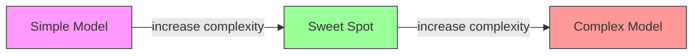
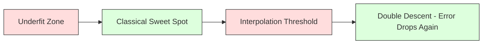
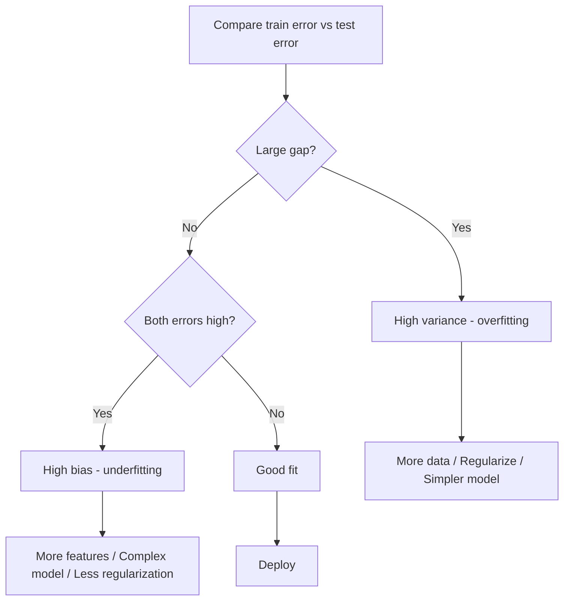
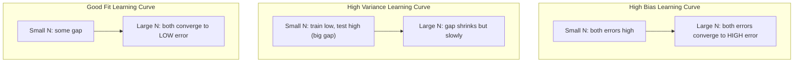
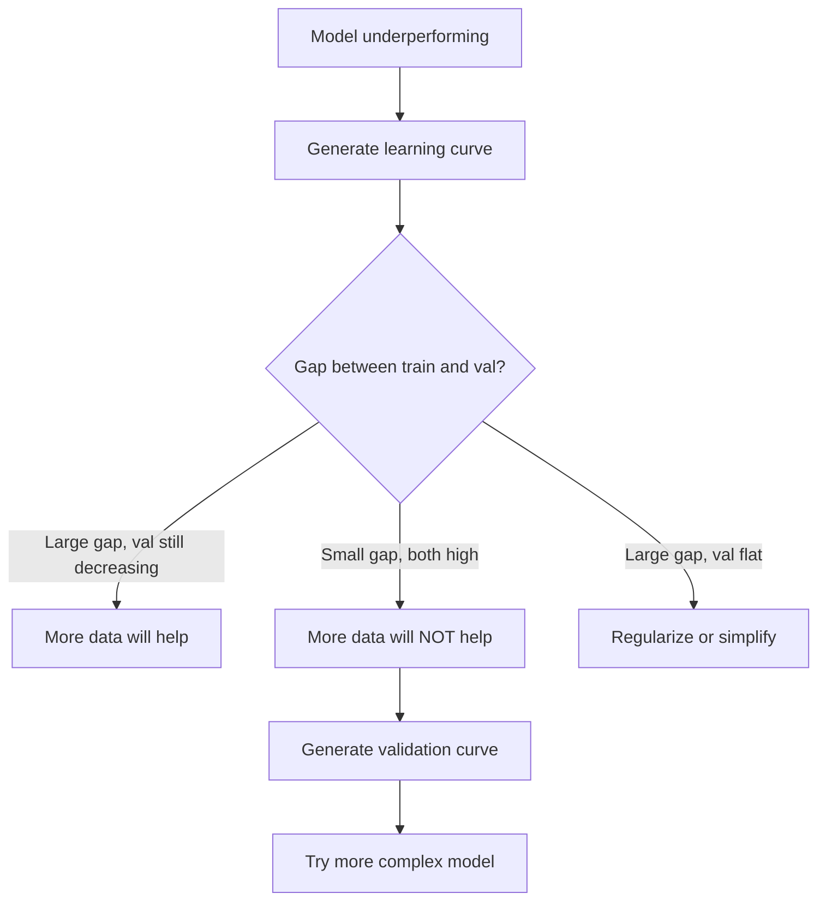

# 편향-분산 트레이드오프(Bias-Variance Tradeoff)

> 모든 모델 오차는 편향(bias), 분산(variance), 노이즈(noise)라는 세 가지 원인 중 하나에서 비롯됩니다. 이 중 제어할 수 있는 것은 앞의 두 가지뿐입니다.

**유형:** Learn (이론)
**Language:** Python
**선수 레슨:** Phase 2, Lessons 01-09 (ML basics, regression, classification, evaluation)
**소요 시간:** ~75분

## 학습 목표

- 기대 예측 오차의 편향-분산 분해(bias-variance decomposition)를 유도하고, 줄일 수 없는 노이즈(irreducible noise)의 역할을 설명합니다.
- 학습 및 테스트 오차 패턴을 분석하여 모델이 높은 편향 또는 높은 분산 문제를 겪고 있는지 진단합니다.
- 정규화(regularization) 기법(L1, L2, 드롭아웃(dropout), 조기 종료(early stopping))이 어떻게 편향과 분산을 절충하는지 설명합니다.
- 복잡도가 증가하는 모델 전반에서 편향-분산 트레이드오프를 시각화하는 실험을 구현합니다.

## 문제

모델을 학습시켰더니 테스트 데이터에서 오차가 발생했습니다. 이 오차는 어디에서 비롯된 것일까요?

모델이 너무 단순하면(곡선 형태의 데이터셋에 선형 회귀를 적용하는 경우) 실제 패턴을 지속적으로 놓치게 됩니다. 이것이 편향(bias)입니다. 반대로 모델이 너무 복잡하면(15개의 데이터 포인트에 20차 다항식을 적용하는 경우) 학습 데이터에는 완벽히 들어맞지만 새로운 데이터에 대해서는 완전히 빗나간 예측을 내놓게 됩니다. 이것이 분산(variance)입니다.

모델 용량(capacity)이 고정되어 있다면 편향과 분산을 동시에 최소화할 수는 없습니다. 편향을 낮추면 분산이 커지고, 분산을 낮추면 편향이 커집니다. 이 트레이드오프를 이해하는 것은 머신러닝에서 가장 유용한 진단 역량입니다. 이를 통해 모델의 복잡도를 높여야 할지 낮춰야 할지, 데이터를 더 확보해야 할지 특성 공학(feature engineering)을 개선해야 할지, 정규화를 강화해야 할지 완화해야 할지를 판단할 수 있습니다.

## 개념

### 편향: 체계적 오차

편향(bias)은 모델의 평균 예측값이 실제 값과 얼마나 멀리 떨어져 있는지를 측정합니다. 동일한 분포에서 추출한 여러 서로 다른 학습 데이터셋으로 동일한 모델을 학습시킨 뒤 예측값들의 평균을 구했을 때, 그 평균과 실제 값 사이의 차이가 바로 편향입니다.

높은 편향은 모델이 너무 경직되어 실제 패턴을 포착하지 못함을 의미합니다. 포물선 데이터에 직선을 맞추면 데이터를 아무리 많이 제공하더라도 곡선 패턴을 계속 놓칠 수밖에 없습니다. 이것이 과소적합(underfitting)입니다.

```
High bias (underfitting):
  Model always predicts roughly the same wrong thing.
  Training error: HIGH
  Test error: HIGH
  Gap between them: SMALL
```

### 분산: 학습 데이터에 대한 민감도

분산(variance)은 서로 다른 데이터 하위 집합으로 학습할 때 예측값이 얼마나 크게 변하는지를 측정합니다. 학습 데이터셋의 작은 변화가 모델에 큰 변화를 일으킨다면 분산이 높은 것입니다.

높은 분산은 모델이 기저의 실제 신호(signal)가 아니라 학습 데이터의 노이즈(noise)에 맞춰 학습하고 있음을 의미합니다. 20차 다항식은 모든 학습 포인트를 정확히 통과하지만, 포인트 사이 구간에서는 극심하게 요동칩니다. 이것이 과적합(overfitting)입니다.

```
High variance (overfitting):
  Model fits training data perfectly but fails on new data.
  Training error: LOW
  Test error: HIGH
  Gap between them: LARGE
```

### 오차의 분해

모든 포인트 $x$에 대해, 제곱 손실(squared loss) 하에서의 기대 예측 오차는 다음과 같이 정확히 분해됩니다.

```math
\begin{aligned}
& \text{Expected Error} = \text{Bias}^2 + \text{Variance} + \text{Irreducible Noise} \\[6pt]
& \text{where:} \\
& \quad \text{Bias}^2 = (\mathbb{E}[\hat{f}(x)] - f(x))^2 \\
& \quad \text{Variance} = \mathbb{E}[(\hat{f}(x) - \mathbb{E}[\hat{f}(x)])^2] \\
& \quad \text{Noise} = \mathbb{E}[(y - f(x))^2] \quad (\sigma^2)
\end{aligned}
```

- $f(x)$는 실제 함수입니다.
- $\hat{f}(x)$는 모델의 예측값입니다.
- $\mathbb{E}[\ldots]$는 서로 다른 학습 데이터셋에 대한 기댓값입니다.
- $y$는 관측된 레이블(실제 함수에 노이즈가 더해진 값)입니다.

노이즈 항은 줄일 수 없는 오차(irreducible error)입니다. 어떤 모델도 노이즈가 포함된 데이터에서 $\sigma^2$보다 뛰어난 성능을 낼 수는 없습니다. 엔지니어의 역할은 $\text{bias}^2$과 분산 사이의 올바른 균형을 찾는 것입니다.

### 모델 복잡도 대 오차



전형적인 U자형 곡선은 다음과 같습니다.

| 복잡도 | 편향 | 분산 | 총 오차 |
|-----------|------|----------|-------------|
| 너무 낮음 | 높음(HIGH) | 낮음(LOW) | 높음(HIGH, 과소적합) |
| 적절함 | 보통(MODERATE) | 보통(MODERATE) | 최저(LOWEST) |
| 너무 높음 | 낮음(LOW) | 높음(HIGH) | 높음(HIGH, 과적합) |

### 편향-분산 제어 수단으로서의 정규화

정규화는 분산을 줄이기 위해 의도적으로 편향을 증가시킵니다. 모델에 제약을 가하여 노이즈를 쫓아가지 못하도록 만드는 것입니다.

- **L2 (Ridge):** 모든 가중치를 0 쪽으로 축소합니다. 모든 특성을 유지하되 그 영향력을 줄입니다.
- **L1 (Lasso):** 일부 가중치를 정확히 0으로 만듭니다. 특성 선택(feature selection)을 수행합니다.
- **드롭아웃(Dropout):** 학습 중에 무작위로 뉴런을 비활성화합니다. 중복 표현(redundant representation)을 학습하도록 강제합니다.
- **조기 종료(Early stopping):** 모델이 학습 데이터에 완전히 적합되기 전에 학습을 중단합니다.

정규화 강도(람다(lambda), 드롭아웃 비율, 에포크(epoch) 수)는 편향-분산 곡선상에서 모델이 위치할 지점을 직접 제어합니다. 정규화를 강화할수록 편향은 커지고 분산은 작아집니다.

### 이중 하강(Double Descent): 현대적 관점

고전 이론에 따르면 최적점을 지난 후에는 복잡도가 증가할수록 항상 성능이 나빠집니다. 그러나 2019년 이후의 연구들은 예상치 못한 현상을 밝혀냈습니다. 모델 용량을 보간 임계값(interpolation threshold, 모델이 학습 데이터를 완벽하게 맞출 수 있을 만큼의 파라미터를 갖추는 지점)을 훨씬 넘어 계속 증가시키면, 테스트 오차가 다시 감소할 수 있다는 점입니다.



이러한 "이중 하강(double descent)" 현상은 학습 예제 수보다 훨씬 많은 파라미터를 가진 극단적인 과매개변수화(overparameterized) 신경망이 여전히 우수한 일반화 성능을 보이는 이유를 설명해 줍니다. 고전적인 편향-분산 트레이드오프가 틀린 것은 아니지만, 현대적 영역을 설명하기에는 불완전했던 것입니다.

이중 하강에 대한 핵심 관찰 사항:
- 선형 모델, 결정 트리(decision tree), 신경망 모두에서 발생합니다.
- 보간 영역에서는 데이터가 늘어나는 것이 오히려 성능을 저하시킬 수 있습니다(표본별 이중 하강, sample-wise double descent).
- 학습 에포크가 늘어나는 것으로도 발생할 수 있습니다(에포크별 이중 하강, epoch-wise double descent).
- 정규화는 오차 피크(peak)를 완만하게 만들지만 완전히 없애지는 못합니다.

이러한 현상이 발생하는 이유는 무엇일까요? 보간 임계값에서 모델은 모든 학습 포인트를 겨우 맞출 수 있을 정도의 용량만을 가집니다. 따라서 모든 포인트를 억지로 통과하는 매우 특수한 해(solution)를 선택해야 하므로, 데이터의 미세한 변화에도 적합 결과가 크게 달라집니다. 바로 이 지점에서 분산이 정점에 도달합니다. 임계값을 지나면 모델은 데이터를 완벽하게 맞출 수 있는 수많은 해를 갖게 됩니다. 이때 학습 알고리즘(예: 암묵적 정규화가 내재된 경사 하강법)은 그중 가장 단순한 해를 선택하는 경향이 있습니다. 단순한 해를 선호하는 이 암묵적 편향(implicit bias) 덕분에 과매개변수화된 모델이 일반화될 수 있는 것입니다.

| 영역 | 파라미터 수 대 샘플 수 | 동작 특성 |
|--------|----------------------|----------|
| 과소매개변수화(Underparameterized) | $p \ll n$ | 고전적 트레이드오프 적용 |
| 보간 임계값(Interpolation threshold) | $p \sim n$ | 분산 정점 도달, 테스트 오차 급증 |
| 과매개변수화(Overparameterized) | $p \gg n$ | 암묵적 정규화 발현, 테스트 오차 감소 |

실무적 관점: 신경망이나 대규모 트리 앙상블을 사용할 때는 보간 임계값에서 멈추지 마십시오. (명시적 정규화를 적용하여) 임계값보다 훨씬 낮은 수준에 머무르거나, 임계값을 훌쩍 넘어서야 합니다. 가장 피해야 할 지점은 바로 임계값 경계입니다.

### 모델 진단하기



| 증상 | 진단 | 해결책 |
|---------|-----------|-----|
| 높은 학습 오차, 높은 테스트 오차 | 편향(Bias) | 특성 추가, 더 복잡한 모델 사용, 정규화 완화 |
| 낮은 학습 오차, 높은 테스트 오차 | 분산(Variance) | 데이터 추가 확보, 정규화 적용, 더 단순한 모델 사용, 드롭아웃 |
| 낮은 학습 오차, 낮은 테스트 오차 | 양호한 적합(Good fit) | 배포 진행 |
| 학습 오차 감소, 테스트 오차 증가 | 과적합 진행 중 | 조기 종료 적용 |

### 실전 전략

**편향이 문제인 경우:**
- 다항식 특성이나 상호작용(interaction) 특성을 추가합니다.
- 더 유연한 모델을 사용합니다(선형 모델 대신 트리 앙상블 등).
- 정규화 강도를 줄입니다.
- 모델이 아직 수렴하지 않았다면 더 오래 학습시킵니다.

**분산이 문제인 경우:**
- 학습 데이터를 더 많이 확보합니다.
- 배깅(bagging, 랜덤 포레스트 등) 기법을 사용합니다.
- 정규화를 강화합니다(람다 값 증가, 드롭아웃 비율 확대).
- 특성 선택을 수행합니다(노이즈가 많은 특성 제거).
- 조기에 감지할 수 있도록 교차 검증(cross-validation)을 활용합니다.
### 앙상블 기법과 분산 감소

앙상블 기법(ensemble methods)은 분산(variance)을 줄이기 위한 가장 실용적인 도구입니다.

**배깅(Bagging, Bootstrap Aggregating)**은 훈련 데이터의 서로 다른 부트스트랩 샘플에서 여러 모델을 학습시킨 다음, 그 예측값들을 평균 냅니다. 개별 모델은 분산이 높지만, 그 평균은 분산이 훨씬 낮아집니다. 랜덤 포레스트(Random forest)는 결정 트리(decision tree)에 배깅을 적용한 것입니다.

수학적으로 이것이 작동하는 이유는 다음과 같습니다. 각각 분산이 $\sigma^2$인 $N$개의 독립적인 예측값을 평균 내면, 평균의 분산은 $\sigma^2 / N$이 됩니다. 모델들이 완전히 독립적인 것은 아니므로(모두 유사한 데이터를 봄) 감소폭이 $1/N$보다는 작지만, 여전히 상당한 감소 효과가 있습니다.

**부스팅(Boosting)**은 모델을 순차적으로 구축하여 편향(bias)을 줄입니다. 이때 새로운 모델은 이전까지의 앙상블이 범한 오차에 집중합니다. 그래디언트 부스팅(Gradient boosting)과 AdaBoost가 대표적인 예입니다. 부스팅은 모델을 너무 많이 추가하면 과대적합(overfitting)될 수 있으므로, 조기 종료(early stopping)나 정규화(regularization)가 필요합니다.

| Method | Primary Effect | Bias Change | Variance Change |
|--------|---------------|-------------|-----------------|
| Bagging | Reduces variance | No change | Decreases |
| Boosting | Reduces bias | Decreases | Can increase |
| Stacking | Reduces both | Depends on meta-learner | Depends on base models |
| Dropout | Implicit bagging | Slight increase | Decreases |

**실용적 규칙:** 베이스 모델의 분산이 크다면(깊은 트리, 고차 다항식) 배깅을 사용하십시오. 베이스 모델의 편향이 크다면(얕은 스텀프, 단순한 선형 모델) 부스팅을 사용하십시오.

### 학습 곡선

학습 곡선(learning curve)은 훈련 세트 크기에 따른 훈련 오차와 검증 오차를 시각화한 것입니다. 이는 가장 실용적인 진단 도구입니다. 단일 훈련/테스트 비교와 달리, 학습 곡선은 모델의 궤적을 보여주며 데이터를 더 추가하는 것이 도움이 될지 알려줍니다.



해석 방법:

| Scenario | Training Error | Validation Error | Gap | What It Means | What to Do |
|----------|---------------|-----------------|-----|---------------|------------|
| High bias | High | High | Small | Model cannot capture the pattern | More features, complex model, less regularization |
| High variance | Low | High | Large | Model memorizes training data | More data, regularization, simpler model |
| Good fit | Moderate | Moderate | Small | Model generalizes well | Ship it |
| High variance, improving | Low | Decreasing with more data | Shrinking | Variance problem that data can fix | Collect more data |
| High bias, flat | High | High and flat | Small and flat | More data will NOT help | Change model architecture |

핵심 통찰: 두 곡선이 모두 정체(plateau) 상태에 도달했고 격차는 작지만 두 오차가 모두 높다면, 데이터를 더 추가해도 소용이 없습니다. 더 나은 모델이 필요합니다. 격차가 크고 여전히 줄어들고 있다면, 데이터를 더 추가하는 것이 도움이 됩니다.

### 학습 곡선을 생성하는 방법

두 가지 접근법이 있습니다.

**접근법 1: 고정된 모델에서 훈련 세트 크기 변경.** 모델과 하이퍼파라미터를 일정하게 유지합니다. 훈련 데이터의 크기를 점진적으로 늘려가며 학습시킵니다. 각 크기마다 훈련 오차와 검증 오차를 측정합니다. 이것이 표준 학습 곡선입니다.

**접근법 2: 고정된 데이터에서 모델 복잡도 변경.** 데이터를 일정하게 유지합니다. 복잡도 파라미터(다항식 차수, 트리 깊이, 레이어 수)를 탐색합니다. 각 복잡도에서 훈련 오차와 검증 오차를 측정합니다. 이것은 검증 곡선(validation curve)이며, 편향-분산 트레이드오프를 직접 보여줍니다.

두 접근법은 상호 보완적입니다. 첫 번째는 데이터를 더 추가하는 것이 도움이 될지 알려줍니다. 두 번째는 다른 모델을 사용하는 것이 도움이 될지 알려줍니다. 다음 단계를 결정하기 전에 두 가지를 모두 실행해 보십시오.



```figure
bias-variance
```

## 직접 만들어보기

`code/bias_variance.py`의 코드는 전체 편향-분산 분해(bias-variance decomposition) 실험을 실행합니다. 단계별 접근 방식은 다음과 같습니다.

### 1단계: 알려진 함수로부터 합성 데이터 생성

가우시안 노이즈(Gaussian noise)가 포함된 `f(x) = sin(1.5x) + 0.5x`를 사용합니다. 실제 함수를 알고 있으면 정확한 편향과 분산을 계산할 수 있습니다.

```python
def true_function(x):
    return np.sin(1.5 * x) + 0.5 * x

def generate_data(n_samples=30, noise_std=0.5, x_range=(-3, 3), seed=None):
    rng = np.random.RandomState(seed)
    x = rng.uniform(x_range[0], x_range[1], n_samples)
    y = true_function(x) + rng.normal(0, noise_std, n_samples)
    return x, y
```

### 2단계: 부트스트랩 샘플링 및 다항식 적합

각 다항식 차수에 대해 여러 부트스트랩 훈련 세트를 추출하고, 다항식을 적합(fitting)한 다음 고정된 테스트 그리드에서 예측값을 기록합니다. 이를 통해 각 테스트 지점에서 예측값의 분포를 얻을 수 있습니다.

```python
def fit_polynomial(x_train, y_train, degree, lam=0.0):
    X = np.column_stack([x_train ** d for d in range(degree + 1)])
    if lam > 0:
        penalty = lam * np.eye(X.shape[1])
        penalty[0, 0] = 0
        w = np.linalg.solve(X.T @ X + penalty, X.T @ y_train)
    else:
        w = np.linalg.lstsq(X, y_train, rcond=None)[0]
    return w
```

200개의 서로 다른 부트스트랩 샘플에 적합합니다. 각 부트스트랩 샘플은 동일한 기본 분포에서 추출되지만 서로 다른 데이터 포인트를 포함합니다.

### 3단계: 편향^2, 분산 분해 계산

각 테스트 포인트에서 200개의 예측값 세트를 확보하면 정의로부터 직접 분해를 계산할 수 있습니다.

```python
mean_pred = predictions.mean(axis=0)
bias_sq = np.mean((mean_pred - y_true) ** 2)
variance = np.mean(predictions.var(axis=0))
total_error = np.mean(np.mean((predictions - y_true) ** 2, axis=1))
```

- `mean_pred`는 부트스트랩 샘플로부터 추정된 $\mathbb{E}[\hat{f}(x)]$입니다.
- `bias_sq`는 평균 예측값과 실제값 간의 차이의 제곱입니다.
- `variance`는 부트스트랩 샘플 전반에 걸친 예측값의 평균 분산도(spread)입니다.
- `total_error`는 대략 $\text{bias}^2 + \text{variance} + \text{noise}$와 같아야 합니다.

### 4단계: 학습 곡선

학습 곡선은 모델 복잡도를 고정한 상태에서 훈련 세트 크기를 탐색합니다. 모델이 데이터의 제약을 받는지, 용량(capacity)의 제약을 받는지 보여줍니다.

```python
def demo_learning_curves():
    sizes = [10, 15, 20, 30, 50, 75, 100, 150, 200, 300]
    degree = 5

    for n in sizes:
        train_errors = []
        test_errors = []
        for seed in range(50):
            x_train, y_train = generate_data(n_samples=n, seed=seed * 100)
            w = fit_polynomial(x_train, y_train, degree)
            train_pred = predict_polynomial(x_train, w)
            train_mse = np.mean((train_pred - y_train) ** 2)
            test_pred = predict_polynomial(x_test, w)
            test_mse = np.mean((test_pred - y_test) ** 2)
            train_errors.append(train_mse)
            test_errors.append(test_mse)
        # Average over runs gives the learning curve point
```

분산이 높은 모델(데이터가 적은 5차 다항식)의 경우 다음과 같은 현상이 나타납니다.
- 데이터가 많아질수록 암기가 어려워지므로 훈련 오차는 낮게 시작하여 증가합니다.
- 모델이 더 많은 신호를 얻게 되므로 테스트 오차는 높게 시작하여 감소합니다.
- 데이터가 많아질수록 둘 사이의 격차가 줄어듭니다.

편향이 높은 모델(1차 다항식)의 경우, 두 오차가 빠르게 동일한 높은 값으로 수렴하며 데이터를 더 추가해도 도움이 되지 않습니다.

### 5단계: 정규화 탐색

이 코드에는 고차 다항식(15차)을 고정하고 Ridge 정규화 강도를 0.001에서 100까지 탐색하는 `demo_regularization_sweep()`도 포함되어 있습니다. 이는 다른 각도에서 편향-분산 트레이드오프를 보여줍니다. 즉, 모델 복잡도를 변경하는 대신 제약 조건의 강도를 변경합니다.

```python
def demo_regularization_sweep():
    alphas = [0.001, 0.005, 0.01, 0.05, 0.1, 0.5, 1.0, 5.0, 10.0, 50.0, 100.0]
    for alpha in alphas:
        results = bias_variance_decomposition([15], lam=alpha)
        r = results[15]
        print(f"alpha={alpha:.3f}  bias={r['bias_sq']:.4f}  var={r['variance']:.4f}")
```

낮은 alpha에서 15차 다항식은 거의 제약을 받지 않습니다. 모델이 각 부트스트랩 샘플의 노이즈를 쫓아가기 때문에 분산이 지배적입니다. 높은 alpha에서는 페널티가 너무 커서 모델이 사실상 상수에 가까운 함수가 됩니다. 이때는 편향이 지배적입니다. 최적의 alpha는 이 극단적인 값들 사이에 위치합니다.

이것은 다항식 차수를 변경할 때 나타나는 U자형 곡선과 동일하지만, 이산적인(discrete) 노브 대신 연속적인(continuous) 노브로 제어됩니다. 실제로 정규화는 특성 집합을 변경하지 않고도 세밀한 제어가 가능하므로 트레이드오프를 제어하는 데 선호되는 방식입니다.

## 적용해보기

sklearn은 부트스트랩 루프를 직접 작성하지 않고도 이러한 진단을 자동화할 수 있는 `learning_curve` 및 `validation_curve`를 제공합니다.

### 검증 곡선: 모델 복잡도 탐색

```python
from sklearn.model_selection import validation_curve
from sklearn.pipeline import make_pipeline
from sklearn.preprocessing import PolynomialFeatures
from sklearn.linear_model import Ridge

degrees = list(range(1, 16))
train_scores_all = []
val_scores_all = []

for d in degrees:
    pipe = make_pipeline(PolynomialFeatures(d), Ridge(alpha=0.01))
    train_scores, val_scores = validation_curve(
        pipe, X, y, param_name="polynomialfeatures__degree",
        param_range=[d], cv=5, scoring="neg_mean_squared_error"
    )
    train_scores_all.append(-train_scores.mean())
    val_scores_all.append(-val_scores.mean())
```

이를 통해 편향-분산 트레이드오프 곡선을 직접 얻을 수 있습니다. 훈련 점수에 비해 검증 점수가 가장 나쁜 곳에서는 분산이 지배적입니다. 둘 다 나쁜 곳에서는 편향이 지배적입니다.

### 학습 곡선: 훈련 세트 크기 탐색

```python
from sklearn.model_selection import learning_curve

pipe = make_pipeline(PolynomialFeatures(5), Ridge(alpha=0.01))
train_sizes, train_scores, val_scores = learning_curve(
    pipe, X, y, train_sizes=np.linspace(0.1, 1.0, 10),
    cv=5, scoring="neg_mean_squared_error"
)
train_mse = -train_scores.mean(axis=1)
val_mse = -val_scores.mean(axis=1)
```

`train_sizes`에 대해 `train_mse`와 `val_mse`를 시각화합니다. 그 형태가 모델에 대한 모든 것을 알려줍니다.

### 정규화 탐색을 사용한 교차 검증

```python
from sklearn.model_selection import cross_val_score

alphas = [0.001, 0.01, 0.1, 1.0, 10.0, 100.0]
for alpha in alphas:
    pipe = make_pipeline(PolynomialFeatures(10), Ridge(alpha=alpha))
    scores = cross_val_score(pipe, X, y, cv=5, scoring="neg_mean_squared_error")
    print(f"alpha={alpha:>7.3f}  MSE={-scores.mean():.4f} +/- {scores.std():.4f}")
```

고정된 모델 복잡도에 대해 정규화 강도를 탐색합니다. 여기서도 동일한 편향-분산 트레이드오프를 확인할 수 있습니다. 낮은 alpha는 높은 분산을 의미하고, 높은 alpha는 높은 편향을 의미합니다.
### 종합하기: 완전한 진단 워크플로

실무에서는 이러한 진단 과정을 순서대로 실행합니다.

1. 모델을 훈련합니다. 훈련 오차와 테스트 오차를 계산합니다.
2. 둘 다 높다면 편향(bias) 문제가 있는 것입니다. 4단계로 건너뜁니다.
3. 훈련 오차는 낮지만 테스트 오차가 높다면 분산(variance) 문제가 있는 것입니다. 학습 곡선(learning curve)을 생성하여 데이터를 더 확보하는 것이 도움이 될지 확인합니다. 도움이 되지 않는다면 정규화(regularization)를 적용합니다.
4. 주요 복잡도 파라미터를 스윕(sweep)하며 검증 곡선(validation curve)을 생성합니다. 최적점(sweet spot)을 찾습니다.
5. 최적점에서 학습 곡선을 생성합니다. 여전히 간격이 크다면 더 많은 데이터나 정규화가 필요합니다.
6. `cross_val_score`를 사용하여 다양한 alpha 값으로 Ridge/Lasso를 시도합니다. 교차 검증 오차가 가장 낮은 alpha를 선택합니다.

이는 대부분의 정형 데이터셋에서 10~15분 정도의 연산 시간만 소요되며, 수 시간의 막연한 추측을 덜어줍니다.

## Ship It

이번 레슨을 통해 다음 결과물이 생성됩니다: `outputs/prompt-model-diagnostics.md`

## 연습 문제

1. `noise_std=0`(노이즈 없음)로 분해를 실행해 보세요. 기약 오차(irreducible error) 항에는 어떤 변화가 생기나요? 최적 복잡도가 달라지나요?

2. 훈련 세트 크기를 30에서 300으로 늘려 보세요. 이것이 분산 성분에 어떤 영향을 미치나요? 최적 다항식 차수가 이동하나요?

3. 실험에 L2 정규화(Ridge 회귀)를 추가해 보세요. 고차 다항식(15차)을 고정한 상태에서 lambda를 0부터 100까지 스윕해 보세요. lambda의 함수로서 $\text{bias}^2$와 분산을 시각화해 보세요.

4. 실제 함수를 다항식에서 `sin(x)`로 수정해 보세요. 편향-분산 분해는 어떻게 달라지나요? 여전히 명확한 최적 차수가 존재하나요?

5. 간단한 부트스트랩 집계(bagging) 래퍼를 구현해 보세요. 부트스트랩 샘플에 대해 10개의 모델을 훈련하고 예측을 평균화합니다. 이것이 편향을 크게 증가시키지 않으면서 분산을 줄여줌을 보여주세요.

## 핵심 용어

| 용어 | 일반적인 표현 | 실제 의미 |
|------|----------------|----------------------|
| 편향 (Bias) | "모델이 너무 단순하다" | 잘못된 가정으로 인한 체계적 오차. 모델의 평균 예측값과 실제값 사이의 차이. |
| 분산 (Variance) | "모델이 과적합되었다" | 훈련 데이터에 대한 민감도로 인한 오차. 서로 다른 훈련 세트에 따라 예측이 얼마나 달라지는지. |
| 기약 오차 (Irreducible error) | "데이터의 노이즈" | 실제 데이터 생성 과정의 무작위성으로 인한 오차. 어떤 모델로도 제거할 수 없음. |
| 과소적합 (Underfitting) | "충분히 학습하지 못했다" | 모델의 편향이 높음. 훈련 데이터에서조차 실제 패턴을 놓침. |
| 과적합 (Overfitting) | "데이터를 외워버렸다" | 모델의 분산이 높음. 일반화되지 않는 훈련 데이터의 노이즈까지 학습함. |
| 정규화 (Regularization) | "모델을 제약한다" | 편향을 약간 높이는 대신 분산을 낮추기 위해 페널티를 추가하여 모델 복잡도를 줄임. |
| 이중 하강 (Double descent) | "파라미터가 더 많아도 도움이 될 수 있다" | 모델 용량이 보간 임계값(interpolation threshold)을 크게 초과할 때 테스트 오차가 다시 감소하는 현상. |
| 모델 복잡도 (Model complexity) | "모델이 얼마나 유연한가" | 임의의 패턴에 적합할 수 있는 모델의 용량. 아키텍처, 특성(feature), 또는 정규화로 제어됨. |

## 추가 자료

- [Hastie, Tibshirani, Friedman: Elements of Statistical Learning, Ch. 7](https://hastie.su.domains/ElemStatLearn/) -- 편향-분산 분해에 대한 결정판
- [Belkin et al., Reconciling modern machine learning practice and the bias-variance trade-off (2019)](https://arxiv.org/abs/1812.11118) -- 이중 하강 논문
- [Nakkiran et al., Deep Double Descent (2019)](https://arxiv.org/abs/1912.02292) -- 에포크(epoch) 단위 및 샘플 단위의 이중 하강
- [Scott Fortmann-Roe: Understanding the Bias-Variance Tradeoff](http://scott.fortmann-roe.com/docs/BiasVariance.html) -- 명확한 시각적 설명
