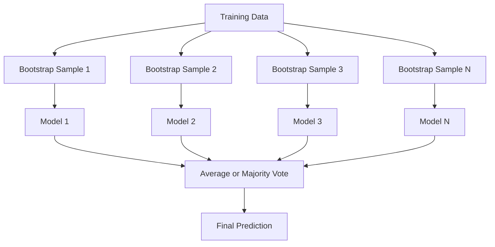
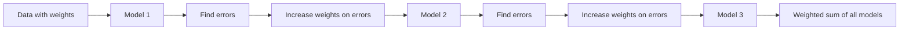
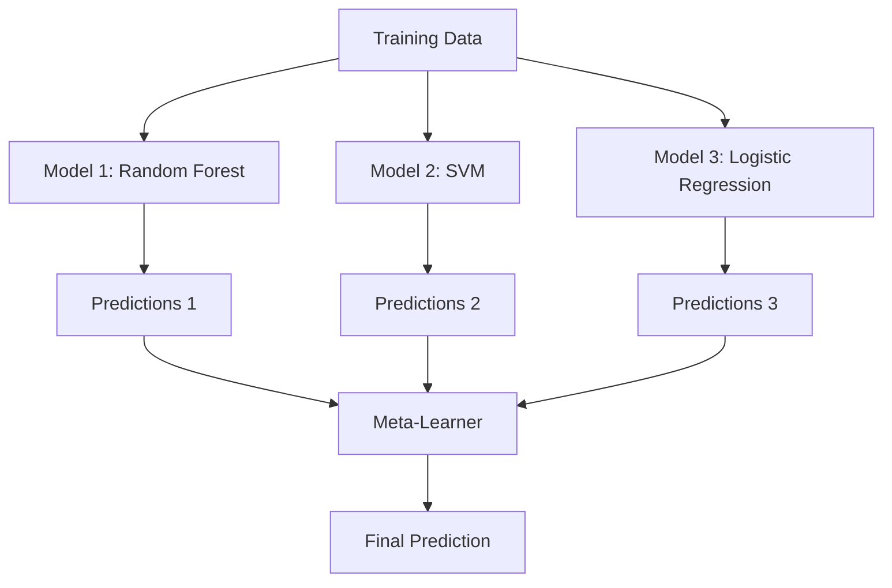

# 앙상블 기법

> 올바르게 결합된 약한 학습기(weak learner)의 집합은 강한 학습기(strong learner)가 됩니다. 이는 비유가 아닙니다. 정리(theorem)입니다.

**유형:** Build (실습)
**Language:** Python
**선수 레슨:** Phase 2, Lesson 10 (Bias-Variance Tradeoff)
**소요 시간:** ~120분

## 학습 목표

- AdaBoost와 그래디언트 부스팅(gradient boosting)을 밑바닥부터 구현하고, 부스팅이 순차적으로 편향(bias)을 줄이는 원리를 설명합니다.
- 배깅(bagging) 앙상블을 구축하고, 상관관계가 낮은(decorrelated) 모델들의 평균을 내어 편향을 증가시키지 않으면서 분산(variance)을 줄이는 방법을 증명합니다.
- 각 기법이 목표로 하는 오차 성분(error component) 관점에서 배깅, 부스팅, 스태킹(stacking)을 비교합니다.
- 앙상블의 다양성을 평가하고, 독립적인 약한 학습기가 많아질수록 다수결 투표(majority voting) 정확도가 향상되는 이유를 설명합니다.

## 문제

단일 결정 트리(decision tree)는 학습이 빠르고 해석하기 쉽지만, 과적합(overfitting)되기 쉽습니다. 단일 선형 모델은 복잡한 결정 경계에서 과소적합(underfitting)됩니다. 완벽한 모델 아키텍처를 엔지니어링하는 데 며칠을 보낼 수도 있습니다. 또는 불완전한 모델들을 여러 개 결합하여 개별 모델 중 어느 것보다도 뛰어난 결과를 얻을 수도 있습니다.

앙상블 기법(ensemble methods)이 바로 이 역할을 수행합니다. 정형 데이터(tabular data)를 다루는 Kaggle 대회에서 우승하기 위한 가장 신뢰할 수 있는 기법이며, 대부분의 프로덕션 ML 시스템을 뒷받침하고, 편향-분산 트레이드오프(bias-variance tradeoff)가 실제로 어떻게 작동하는지 명확하게 보여줍니다. 배깅은 분산을 줄입니다. 부스팅은 편향을 줄입니다. 스태킹은 어떤 입력에 대해 어떤 모델을 신뢰할지 학습합니다.

## 핵심 개념

### 앙상블이 작동하는 이유

각각 $p > 0.5$의 정확도를 가지는 서로 독립적인 분류기 $N$개가 있다고 가정해 보겠습니다. 다수결 투표의 정확도는 다음과 같습니다:

```math
P(\text{majority correct}) = \sum_{k > N/2} \binom{N}{k} p^k (1-p)^{N-k}
```

정확도가 60%인 분류기 21개의 경우 다수결 투표 정확도는 약 74%입니다. 101개 분류기에서는 84%까지 상승합니다. 모델들이 서로 다른 오류를 범할 때 이러한 오차는 상쇄됩니다.

핵심 요구 조건은 **다양성(diversity)**입니다. 모든 모델이 동일한 오류를 범한다면 모델을 결합해도 아무런 도움이 되지 않습니다. 앙상블은 다음과 같은 방식을 통해 다양한 모델을 생성하므로 효과적으로 작동합니다:

- 서로 다른 훈련 데이터 부분집합 (배깅)
- 서로 다른 특성 부분집합 (랜덤 포레스트)
- 순차적 오차 보정 (부스팅)
- 서로 다른 모델 계열 (스태킹)

### 배깅(Bagging, Bootstrap Aggregating)

배깅은 훈련 데이터의 서로 다른 부트스트랩 샘플(bootstrap sample)로 각 모델을 훈련하여 다양성을 확보합니다.



부트스트랩 샘플은 원본 데이터에서 복원 추출(sampling with replacement)되며, 크기는 원본과 동일합니다. 고유한 샘플 중 약 63.2%가 각 부트스트랩에 포함됩니다. 나머지 36.8%(OOB 샘플, out-of-bag samples)는 별도의 비용 없이 검증 세트 역할을 합니다.

배깅은 편향을 크게 증가시키지 않으면서 분산을 줄입니다. 개별 트리는 각각의 부트스트랩 샘플에 과적합되지만, 과적합되는 양상이 트리마다 다르기 때문에 평균을 내면 노이즈가 상쇄됩니다.

**랜덤 포레스트(Random Forest)**는 배깅에 한 가지 기법을 더한 것입니다. 즉, 매 분할(split)마다 특성의 무작위 부분집합만을 고려합니다. 이는 트리 간의 다양성을 더욱 강제합니다. 후보 특성의 일반적인 개수는 분류 문제의 경우 `sqrt(n_features)`, 회귀 문제의 경우 `n_features / 3`입니다.

### 부스팅(Boosting, 순차적 오차 보정)

부스팅은 모델을 순차적으로 훈련합니다. 새로운 모델마다 이전 모델들이 잘못 예측한 샘플에 집중합니다.



부스팅은 편향을 줄입니다. 각각의 새로운 모델은 지금까지의 앙상블이 범한 체계적 오류를 보정합니다. 최종 예측은 모든 모델의 가중 합(weighted sum)이며, 성능이 더 좋은 모델일수록 더 높은 가중치를 받습니다.

트레이드오프: 라운드를 너무 많이 진행하면 부스팅도 과적합될 수 있습니다. 해결하기 어려운 샘플에 계속해서 맞추려 하기 때문인데, 이 중 일부는 단순 노이즈일 수 있습니다.

### AdaBoost

AdaBoost(Adaptive Boosting)는 최초의 실용적인 부스팅 알고리즘이었습니다. 어떤 베이스 학습기(base learner)와도 동작하지만, 일반적으로 결정 스텀프(decision stump, 깊이 1의 트리)를 사용합니다.

알고리즘 동작 방식:

```
1. Initialize sample weights: w_i = 1/N for all i

2. For t = 1 to T:
   a. Train weak learner h_t on weighted data
   b. Compute weighted error:
      err_t = sum(w_i * I(h_t(x_i) != y_i)) / sum(w_i)
   c. Compute model weight:
      alpha_t = 0.5 * ln((1 - err_t) / err_t)
   d. Update sample weights:
      w_i = w_i * exp(-alpha_t * y_i * h_t(x_i))
   e. Normalize weights to sum to 1

3. Final prediction: H(x) = sign(sum(alpha_t * h_t(x)))
```

오차가 낮은 모델일수록 더 높은 알파(alpha) 값을 받습니다. 잘못 분류된 샘플은 가중치가 높아져 다음 모델이 해당 샘플에 집중하게 됩니다.

### 그래디언트 부스팅(Gradient Boosting)

그래디언트 부스팅은 부스팅을 임의의 손실 함수(loss function)로 일반화합니다. 샘플의 가중치를 조정하는 대신, 각 새로운 모델을 현재 앙상블의 잔차(residual, 손실 함수의 음의 그래디언트)에 맞추어 학습시킵니다.

```
1. Initialize: F_0(x) = argmin_c sum(L(y_i, c))

2. For t = 1 to T:
   a. Compute pseudo-residuals:
      r_i = -dL(y_i, F_{t-1}(x_i)) / dF_{t-1}(x_i)
   b. Fit a tree h_t to the residuals r_i
   c. Find optimal step size:
      gamma_t = argmin_gamma sum(L(y_i, F_{t-1}(x_i) + gamma * h_t(x_i)))
   d. Update:
      F_t(x) = F_{t-1}(x) + learning_rate * gamma_t * h_t(x)

3. Final prediction: F_T(x)
```

제곱 오차 손실(squared error loss)의 경우, 의사 잔차(pseudo-residual)는 실제 잔차와 동일합니다: $r_i = y_i - F_{t-1}(x_i)$. 각 트리는 말 그대로 이전 앙상블의 오차에 적합(fit)됩니다.

학습률(learning rate, 축소/shrinkage)은 각 트리가 기여하는 정도를 제어합니다. 학습률이 작을수록 더 많은 트리가 필요하지만 일반화 성능은 향상됩니다. 일반적인 값은 0.01에서 0.3 사이입니다.

### XGBoost: 정형 데이터에서 독보적인 이유

XGBoost(eXtreme Gradient Boosting)는 빠른 속도, 높은 정확도, 과적합에 대한 강건함을 달성하기 위해 엔지니어링 최적화가 적용된 그래디언트 부스팅입니다:

- **정규화된 목적 함수(Regularized objective):** 리프 가중치에 L1 및 L2 페널티를 적용하여 개별 트리가 지나치게 확신하는 것을 방지합니다.
- **2차 근사(Second-order approximation):** 손실의 1차 및 2차 도함수를 모두 사용하여 더 우수한 분할 결정을 내립니다.
- **희소성 인식 분할(Sparsity-aware splits):** 각 분할에서 결측값 데이터에 대한 최적의 방향을 학습하여 결측치를 자체적으로 처리합니다.
- **컬럼 서브샘플링(Column subsampling):** 랜덤 포레스트와 마찬가지로 다양성을 위해 매 분할마다 특성을 샘플링합니다.
- **가중 분위수 스케치(Weighted quantile sketch):** 분산 데이터 환경에서 연속형 특성에 대한 분할점을 효율적으로 탐색합니다.
- **캐시 인식 블록 구조(Cache-aware block structure):** CPU 캐시 라인에 최적화된 메모리 레이아웃을 제공합니다.

정형 데이터의 경우 XGBoost(및 그 후속인 LightGBM)는 인공신경망(neural network)보다 일관되게 뛰어난 성능을 보입니다. 이는 당분간 바뀌지 않을 것입니다. 데이터가 행과 열로 이루어진 테이블 형태라면 그래디언트 부스팅으로 시작하세요.

### 스태킹(Stacking, 메타 학습)

스태킹은 여러 베이스 모델의 예측값을 메타 학습기(meta-learner)의 특성(feature)으로 사용합니다.



메타 학습기는 어떤 입력에 대해 어떤 베이스 모델을 신뢰해야 할지 학습합니다. 예를 들어 특정 영역에서는 랜덤 포레스트가 더 우수하고 다른 영역에서는 SVM이 더 우수하다면, 메타 학습기는 그에 맞게 판단하도록 학습합니다.

데이터 누수(data leakage)를 방지하기 위해 베이스 모델의 예측값은 반드시 훈련 세트에 대한 교차 검증(cross-validation)을 통해 생성해야 합니다. 동일한 데이터로 베이스 모델을 훈련하고 메타 특성을 생성해서는 안 됩니다.

### 보팅(Voting)

가장 단순한 앙상블입니다. 예측값을 직접 결합하기만 하면 됩니다.

- **하드 보팅(Hard voting):** 클래스 레이블에 대한 다수결 투표.
- **소프트 보팅(Soft voting):** 예측 확률의 평균을 구하고, 평균 확률이 가장 높은 클래스를 선택합니다. 확신도(confidence) 정보를 활용하기 때문에 보통 더 우수합니다.

```figure
f3-ensemble-average
```

## 직접 구현하기

### 1단계: 결정 스텀프 (베이스 학습기)

`code/ensembles.py`의 코드는 모든 것을 밑바닥부터 구현합니다. 단일 분할을 수행하는 트리인 결정 스텀프부터 시작합니다.

```python
class DecisionStump:
    def __init__(self):
        self.feature_idx = None
        self.threshold = None
        self.polarity = 1
        self.alpha = None

    def fit(self, X, y, weights):
        n_samples, n_features = X.shape
        best_error = float("inf")

        for f in range(n_features):
            thresholds = np.unique(X[:, f])
            for thresh in thresholds:
                for polarity in [1, -1]:
                    pred = np.ones(n_samples)
                    pred[polarity * X[:, f] < polarity * thresh] = -1
                    error = np.sum(weights[pred != y])
                    if error < best_error:
                        best_error = error
                        self.feature_idx = f
                        self.threshold = thresh
                        self.polarity = polarity

    def predict(self, X):
        n = X.shape[0]
        pred = np.ones(n)
        idx = self.polarity * X[:, self.feature_idx] < self.polarity * self.threshold
        pred[idx] = -1
        return pred
```

### 2단계: AdaBoost 밑바닥부터 구현하기

```python
class AdaBoostScratch:
    def __init__(self, n_estimators=50):
        self.n_estimators = n_estimators
        self.stumps = []
        self.alphas = []

    def fit(self, X, y):
        n = X.shape[0]
        weights = np.full(n, 1 / n)

        for _ in range(self.n_estimators):
            stump = DecisionStump()
            stump.fit(X, y, weights)
            pred = stump.predict(X)

            err = np.sum(weights[pred != y])
            err = np.clip(err, 1e-10, 1 - 1e-10)

            alpha = 0.5 * np.log((1 - err) / err)
            weights *= np.exp(-alpha * y * pred)
            weights /= weights.sum()

            stump.alpha = alpha
            self.stumps.append(stump)
            self.alphas.append(alpha)

    def predict(self, X):
        total = sum(a * s.predict(X) for a, s in zip(self.alphas, self.stumps))
        return np.sign(total)
```

### 3단계: 그래디언트 부스팅 밑바닥부터 구현하기

```python
class GradientBoostingScratch:
    def __init__(self, n_estimators=100, learning_rate=0.1, max_depth=3):
        self.n_estimators = n_estimators
        self.lr = learning_rate
        self.max_depth = max_depth
        self.trees = []
        self.initial_pred = None

    def fit(self, X, y):
        self.initial_pred = np.mean(y)
        current_pred = np.full(len(y), self.initial_pred)

        for _ in range(self.n_estimators):
            residuals = y - current_pred
            tree = SimpleRegressionTree(max_depth=self.max_depth)
            tree.fit(X, residuals)
            update = tree.predict(X)
            current_pred += self.lr * update
            self.trees.append(tree)

    def predict(self, X):
        pred = np.full(X.shape[0], self.initial_pred)
        for tree in self.trees:
            pred += self.lr * tree.predict(X)
        return pred
```

### 4단계: sklearn과 비교하기

이 코드는 직접 구현한 모델이 sklearn의 `AdaBoostClassifier` 및 `GradientBoostingClassifier`와 유사한 정확도를 보이는지 검증하고, 모든 기법을 나란히 비교합니다.

## 활용하기
### 각 방법의 사용 시점

| 방법 | 감소 대상 | 가장 적합한 경우 | 주의할 점 |
|--------|---------|----------|---------------|
| 배깅(Bagging) / 랜덤 포레스트(Random Forest) | 분산(Variance) | 노이즈가 많은 데이터, 많은 특성 | 편향 감소에는 도움이 되지 않음 |
| AdaBoost | 편향(Bias) | 정제된 데이터, 단순한 기본 학습기 | 이상치(outlier)와 노이즈에 민감함 |
| 그래디언트 부스팅(Gradient Boosting) | 편향(Bias) | 정형 데이터, 경진대회 | 학습 속도가 느림, 튜닝하지 않으면 과적합(overfitting)되기 쉬움 |
| XGBoost / LightGBM | 둘 다 | 프로덕션 정형 데이터 ML | 많은 하이퍼파라미터 |
| 스태킹(Stacking) | 둘 다 | 마지막 1~2%의 정확도를 확보해야 할 때 | 복잡함, 메타 학습기의 과적합 위험 |
| 보팅(Voting) | 분산(Variance) | 다양한 모델의 빠른 결합 | 모델들이 서로 다양할 때만 도움이 됨 |

### 정형 데이터를 위한 프로덕션 스택

대부분의 정형 데이터 예측 문제에서는 다음 순서대로 시도하는 것이 좋습니다.

1. 기본 파라미터를 적용한 **LightGBM 또는 XGBoost**
2. n_estimators, learning_rate, max_depth, min_child_weight 튜닝
3. 마지막 0.5%의 성능이 더 필요하다면 서로 다른 3~5개 모델로 스태킹 앙상블 구축
4. 전 과정에서 교차 검증(cross-validation) 활용

지속적인 연구 시도에도 불구하고, 정형 데이터에서 신경망(neural network)은 거의 항상 그래디언트 부스팅보다 성능이 떨어집니다. TabNet, NODE 및 유사한 아키텍처들은 가끔 잘 튜닝된 XGBoost와 대등한 수준을 보이지만 이를 능가하는 경우는 드뭅니다.

## 배포하기

이 레슨에서는 주어진 데이터셋에 적합한 앙상블 방법을 선택하도록 돕는 프롬프트인 `outputs/prompt-ensemble-selector.md`를 작성합니다. 데이터(크기, 특성 유형, 노이즈 수준, 클래스 균형)와 해결하려는 문제를 설명하세요. 프롬프트는 의사결정 체크리스트를 따라 진행되며, 방법을 추천하고, 시작 하이퍼파라미터를 제안하고, 해당 방법에서 자주 발생하는 실수를 경고합니다. 또한 전체 선택 가이드가 포함된 `outputs/skill-ensemble-builder.md`도 함께 생성합니다.

## 실습 과제

1. 각 라운드가 끝난 후 훈련 정확도를 추적하도록 AdaBoost 구현을 수정하세요. 정확도 대 추정기(estimator) 수의 그래프를 그려보세요. 언제 수렴하나요?

2. 회귀 트리에 무작위 특성 서브샘플링을 추가하여 밑바닥부터 랜덤 포레스트를 구현하세요. `max_features=sqrt(n_features)`를 사용하여 100개의 트리를 학습시키고 예측값을 평균하세요. 단일 트리와 비교하여 분산 감소 효과를 비교해 보세요.

3. 그래디언트 부스팅 구현에 조기 종료(early stopping)를 추가하세요. 각 라운드 후 검증 손실을 추적하고 10회 연속으로 개선되지 않으면 중단하도록 합니다. 실제로 몇 개의 트리가 필요한가요?

4. 세 가지 기본 모델(로지스틱 회귀, 결정 트리, k-최근접 이웃)과 로지스틱 회귀 메타 학습기를 사용하여 스태킹 앙상블을 구축하세요. 5-겹(fold) 교차 검증을 사용하여 메타 특성을 생성하세요. 각 기본 모델 단독 결과와 비교해 보세요.

5. 동일한 데이터셋에서 기본 파라미터로 XGBoost를 실행하세요. 밑바닥부터 구현한 그래디언트 부스팅과 정확도를 비교하세요. 둘 다 시간을 측정해 보세요. 속도 차이가 얼마나 큰가요?

## 핵심 용어

| 용어 | 흔히 하는 말 | 실제 의미 |
|------|----------------|----------------------|
| 배깅(Bagging) | "무작위 부분집합으로 학습한다" | 부트스트랩 집계(Bootstrap aggregating): 부트스트랩 샘플로 모델들을 학습시키고, 예측값을 평균하여 분산을 줄임 |
| 부스팅(Boosting) | "어려운 예제에 집중한다" | 편향을 줄이기 위해 모델을 순차적으로 학습시키며, 각 모델이 이전까지의 앙상블 오차를 보정함 |
| AdaBoost | "데이터 가중치를 재조정한다" | 샘플 가중치 업데이트를 통한 부스팅; 잘못 분류된 데이터 포인트는 다음 학습기에서 더 높은 가중치를 받음 |
| 그래디언트 부스팅(Gradient boosting) | "잔차(residual)에 맞춘다" | 손실 함수의 음의 그래디언트에 각 새로운 모델을 맞추는 방식으로 진행하는 부스팅 |
| XGBoost | "캐글(Kaggle)의 최종 병기" | 정규화, 2차 최적화, 시스템 수준의 속도 트릭이 적용된 그래디언트 부스팅 |
| 스태킹(Stacking) | "모델 위에 모델을 얹는다" | 기본 모델들의 예측값을 메타 학습기의 입력 특성으로 사용함 |
| 랜덤 포레스트(Random forest) | "무작위화된 많은 트리들" | 결정 트리를 사용한 배깅에 다양성을 확보하기 위해 각 분할 시 무작위 특성 서브샘플링을 추가한 것 |
| 앙상블 다양성(Ensemble diversity) | "서로 다른 실수를 한다" | 앙상블이 개별 모델보다 개선되려면 모델들의 오차 간에 상관관계가 없어야 함 |
| OOB 오차(Out-of-bag error) | "공짜 검증" | 부트스트랩 추출에 포함되지 않은 샘플(~36.8%)을 별도의 홀드아웃(holdout) 없이 검증 세트로 활용함 |

## 더 읽을거리

- [Schapire & Freund: Boosting: Foundations and Algorithms](https://mitpress.mit.edu/9780262526036/) -- AdaBoost 창시자들이 쓴 도서
- [Friedman: Greedy Function Approximation: A Gradient Boosting Machine (2001)](https://doi.org/10.1214/aos/1013203451) -- 그래디언트 부스팅 원 논문
- [Chen & Guestrin: XGBoost (2016)](https://arxiv.org/abs/1603.02754) -- XGBoost 논문
- [Wolpert: Stacked Generalization (1992)](https://www.sciencedirect.com/science/article/abs/pii/S0893608005800231) -- 스태킹 원 논문
- [scikit-learn Ensemble Methods](https://scikit-learn.org/stable/modules/ensemble.html) -- 실무 참고 자료
